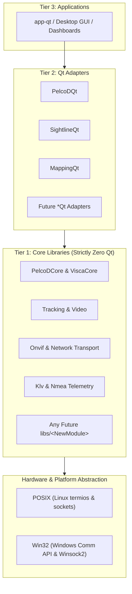

# Architecture & Layer Boundaries

## 1. Multi-Subsystem Tiered Architecture

The repository enforces a strict, modular tiered architecture across all current (`PelcoDCore`, `Onvif`, `Tracking`, `ViscaCore`, `SightlineCore`, `Klv`, `Nmea`, `Mapping`, `Transport`) and **any future libraries** added to the codebase:

```
+-------------------------------------------------------------------------------+
|                       REPOSITORY LAYER BOUNDARIES                             |
|                                                                               |
|   [Tier 3: Presentation / Applications] (app-qt/, apps/*)                     |
|         │                                                                     |
|         ▼                                                                     |
|   [Tier 2: Qt Adapters] (libs/*Qt: PelcoDQt, SightlineQt, MappingQt...)       |
|         │                                                                     |
|         ▼                                                                     |
|   [Tier 1: Core / Domain Libraries] (libs/*: Tracking, Onvif, PelcoDCore...)   |
|         │  • Pure C++17                                                       |
|         │  • ZERO Qt dependencies (#include <Q...> is strictly BANNED)        |
|         │  • Zero-heap fast paths (CERT ERR55-CPP)                            |
|         ▼                                                                     |
|   [Hardware / OS Layer] (POSIX termios/sockets, Win32 Comm/Winsock2)          |
+-------------------------------------------------------------------------------+
```



---

## 2. Universal Governance for Current & Future Libraries

1. **Automatic Classification Rule:**
   - Any library created under `libs/` that does **not** end in `Qt` is automatically classified as a **Core Library** (e.g. `libs/SensorCore`, `libs/Payload`, `libs/Radar`).
   - **Zero Qt Policy:** Core libraries must **never** include Qt headers (`#include <Q...>`). They must be pure C++17, decoupled from any GUI framework, and consumable by any client (Qt, CLI, Dear ImGui, ROS).
   - Any Qt integration must be isolated in a companion module ending with `Qt` (e.g. `libs/SensorQt`).
2. **Co-located File Organization:**
   - Headers (`.h`) and implementations (`.cpp`) must reside in the same directory. Never create split `include/` and `src/` subdirectories.
3. **Modular CMake & Security Hardening:**
   - Every library has its own `CMakeLists.txt` and must apply `apply_compiler_flags` from `cmake/CompilerFlags.cmake` (`-Wall -Wextra -pedantic -Werror`, `/W4`, `-Wconversion`, `-fstack-protector-strong`, and sanitizers).
4. **Header Guards:**
   - Always use `#pragma once` as the first non-comment line. Never use legacy `#ifndef / #define` guards.
5. **Cross-Platform Portability:**
   - All I/O, serial transport, network, and system drivers must compile and run cleanly on both **Linux** (POSIX termios, BSD sockets) and **Windows** (Win32 Comm API, Winsock2). Platform-specific branches must be cleanly encapsulated behind abstract interfaces (e.g. `ITransport`).

---

## 3. Concurrency, Streaming & Real-Time Invariants

1. **Inbound Streaming:**
   - High-throughput byte streaming uses lock-free Single-Producer Single-Consumer (SPSC) ring buffers (`CircularByteRing`) with cacheline padding (`alignas(64)`). Transport read threads push raw bytes lock-free with zero dynamic allocation.
2. **Outbound Command Pacing:**
   - Serial and protocol commands are dispatched through a thread-safe pacing queue enforcing inter-command delays with bounded capacities.
3. **Zero Dynamic Allocation on Fast Paths (CERT ERR55-CPP):**
   - High-frequency paths (network receive, UDP discovery, packet parsing, frame tracking loops) marked `noexcept` must not perform dynamic heap allocations (`std::string`, `std::vector`, `new`, `std::make_unique`). Operate strictly on `std::string_view`, stack arrays, or pre-allocated buffers.

---

## 4. Abstraction & Layer Boundaries

1. **Program to Abstractions:**
   - Encapsulate lower-level mechanics (file descriptors, sockets, serial handles, checksum algorithms) inside transport and framing layers (`ITransport`, `CircularByteRing`).
   - Expose clean domain entities and value objects to upper layers.
2. **Strict Layer Boundary Hierarchy:**
   - Each layer may only communicate with its immediate neighbor directly below it. UI components must interact through adapter objects, never accessing raw transport descriptors or private internals.
3. **Member Visibility:**
   - Keep all fields and helper functions private unless external exposure is explicitly required by interface contracts. Treat visibility changes as breaking design modifications.

---

## 5. Error Handling & Language Restrictions

1. **No Exceptions in Critical Paths:**
   - Core library operations, packet parsers, and tracking loops must not throw exceptions. Report errors via `bool`, `std::optional`, or error status codes.
2. **`noexcept` Specification:**
   - Mark all non-throwing operations as `noexcept` (especially destructors, move operations, and invariant-checked accessors).
3. **No C-Style Casts:**
   - Always use explicit C++ casts (`static_cast`, `const_cast`). C-style casts `(Type)val` are strictly banned.
4. **Atomic Expressions:**
   - Avoid compound expressions with side effects (e.g. `arr[i++] = ++j;`). Keep expressions simple and atomic.
