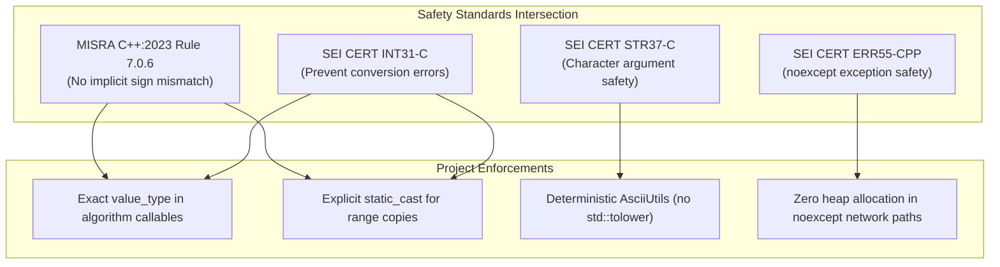

# Compliance Frameworks

Every line of code generated must comply with the intersection of these safety standards:
- **MISRA C++:2023** (and relevant C++14/17 updates)
- **SEI CERT C++ Coding Standard** (Secure Systems)

If a prompt requests a solution that violates these rules, you must refuse, explain the violation, and provide the safe alternative.

---

## 1. Safety Rules & Specific Enforcements

### MISRA C++:2023 Rule 7.0.6 & SEI CERT INT31-C (Signed/Unsigned Conversions)
- Conversions between signed and unsigned integer types must be explicit (`static_cast`), deliberate, and range-verified.
- Never pass operands or iterators to Standard Library templates where the library internally executes an implicit signed/unsigned conversion (e.g., passing `char*` iterators to `std::vector<std::uint8_t>` constructor or passing `char` to a lambda expecting `unsigned char` via `std::transform`).
- Every fixed-width integer type must strictly use `<cstdint>` and namespace prefix `std::` (e.g., `std::uint8_t`, `std::int32_t`).

### SEI CERT STR37-C (Character Handling & Determinism)
- Standard character functions from `<cctype>` (`std::tolower`, `std::toupper`, `std::isalpha`, etc.) take an `int` parameter whose value must be representable as `unsigned char` or equal to `EOF`. Passing a signed `char` with a negative value is undefined behavior.
- For protocol tokens (UUIDs, URI schemes, HTTP headers, XML elements), use locale-independent ASCII helpers (`toLowerAscii`, `toUpperAscii`, `equalsIgnoreCaseAscii`) to eliminate dependence on global C/C++ locales and prevent negative `char` undefined behavior.

### SEI CERT ERR55-CPP (Exception Safety & `noexcept` Boundaries)
- A function declared `noexcept` must never allow an exception to escape. If an exception escapes a `noexcept` function, the runtime calls `std::terminate()` immediately, resulting in abnormal termination and denial of service.
- Functions on high-frequency network receive, packet validation, and dispatch paths (e.g., `WsDiscoveryValidator::validateProbe`, `isSelfMessage`) that are marked `noexcept` must not perform dynamic heap allocations (`std::string`, `std::vector`, `new`, `std::make_unique`). Dynamic allocation failure throws `std::bad_alloc`, which terminates the application. Operate strictly on `std::string_view`, stack arrays, or pre-allocated buffers.

---

## 2. Safety Intersection Model

### ASCII Diagram: Compliance Intersection

```
+-------------------------------------------------------------------------------+
|                       SAFETY COMPLIANCE FRAMEWORK                             |
|                                                                               |
|       MISRA C++:2023                            SEI CERT C++                  |
|   ┌───────────────────────────┐       ┌───────────────────────────┐           |
|   │ Rule 7.0.6                │       │ INT31-C                   │           |
|   │ (Explicit cast; no sign   │◄─────►│ (Safe integer conversion; │           |
|   │  mismatches in templates) │       │  no truncation/wrap)      │           |
|   └─────────────┬─────────────┘       └─────────────┬─────────────┘           |
|                 │                                   │                         |
|                 └─────────────────┬─────────────────┘                         |
|                                   ▼                                           |
|                   ┌───────────────────────────────┐                           |
|                   │    Deterministic Project      │                           |
|                   │    Standard Implementation    │                           |
|                   │                               │                           |
|                   │ • STR37-C: toLowerAscii(char) │                           |
|                   │ • ERR55-CPP: 0-heap noexcept  │                           |
|                   │ • IWYU & std::uint8_t policy  │                           |
|                   └───────────────────────────────┘                           |
+-------------------------------------------------------------------------------+
```

### Mermaid Diagram: Compliance Architecture


