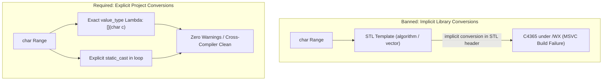

# C++17 Language Rules & RAII

## Memory & Resource Management
- **Strict RAII:** All resources (memory, files, sockets, locks) must be managed by object lifetimes. Raw `new` and `delete` expressions are strictly **forbidden**.
- **Smart Pointers:** Use `std::unique_ptr` by default for exclusive ownership. Use `std::shared_ptr` only when shared ownership is explicitly required.
- **Factory Functions:** Use `std::make_unique<T>()` and `std::make_shared<T>()`. Never pass a raw pointer to a smart pointer constructor.
- **No Raw Pointers for Ownership:** Raw pointers (`T*`) may only be used as non-owning, non-nullable observers. Otherwise, use `std::reference_wrapper`.

## Types and Initialization
- Avoid magic numbers and strings by extracting recurring or meaningful values into descriptive constants (`constexpr`) or enums. Keep self-explanatory, one-off values inline to avoid clutter. If a value comes from a spec, use a constant regardless.
- **No Uninitialized Variables:** Every variable must be initialized immediately upon declaration. Use braced initialization `{}` where possible to prevent narrowing conversions.
- **Fixed-Width Types & `<cstdint>`:** Use types from `<cstdint>` (e.g., `std::uint8_t`, `std::int32_t`, `std::uint64_t`) instead of basic types (`int`, `long`) to ensure predictable cross-platform sizing. Every file referencing these types must explicitly `#include <cstdint>` and strictly namespace with `std::` (never use bare `uint8_t` or rely on indirect includes). For object sizes and buffer capacities, explicitly include `<cstddef>` and use `std::size_t`.
- **`auto` Usage:** Use `auto` only when the concrete type is explicitly obvious from the right-hand side (e.g., `auto ptr = std::make_unique<Target>();`) or when dealing with iterators/lambdas.

## Modern C++17 Features
- **Compile-Time Verification:** Use `constexpr` for all functions and constants that can be evaluated at compile time. Use `static_assert` to enforce invariant checks at compile time.
- **Structured Bindings:** Use structured bindings `auto [x, y] = ...` for readable tuple/pair unpacks.
- **Attributes:** Use C++17 standard attributes to communicate intent to the compiler:
  - `[[nodiscard]]` on functions where ignoring the return value is a logical error or safety risk.
  - `[[fallthrough]]` in switch cases where falling through is intended.
  - `[[maybe_unused]]` for variables that might not be used depending on build configurations.
- **Safe Alternatives:** Use `std::string_view` for non-owning read-only string parameters. Use `std::optional` instead of magic values (like `-1` or `nullptr`) to indicate missing data.

## Include-What-You-Use (IWYU) & Header Hygiene
- **Direct Inclusion:** Every source (`.cpp`) and header (`.h`) file must directly include the headers declaring every symbol, type, template, or macro it uses. Never rely on indirect/transitive includes.
- **Header Decoupling:** In header files, prefer forward declarations (`class Foo;`, `struct Bar;`) for types referenced only by pointer or reference to minimize compilation coupling and avoid circular dependencies. Full definitions are included in the corresponding `.cpp` file.
- **Unused Headers:** Prune any unused `#include` statements to reduce compile times and header pollution.
- **Header Guards:** Headers must always begin with `#pragma once`. Legacy `#ifndef` guards are banned.

## STL Algorithms & Range Type Safety
- **Value-Type Matching on Algorithm Callables:** Lambdas and callables passed to Standard Library algorithms (`std::transform`, `std::search`, `std::find_if`) must accept the range's exact `value_type` (e.g., `char` when operating on `std::string` or `std::string_view`, never implicit conversion to `unsigned char` in template arguments). Any type transformation must be explicitly cast inside the callable body.
- **Prohibition of Implicit Range Conversions:** Iterator-range constructors across differing signed/unsigned types (e.g. `std::vector<std::uint8_t>(str.begin(), str.end())`) are strictly forbidden as they invoke implicit conversions inside `<xmemory>` / `<vector>` that trigger MSVC warning C4365 under `/WX`. Use an explicit loop with `reserve()` + `push_back(static_cast<std::uint8_t>(ch))` or a safe conversion helper (`stringToBytes()`).
- **Deterministic ASCII Protocol Helpers:** Protocol tokens (UUIDs, HTTP headers, URI schemes) must be processed using locale-independent ASCII helpers (`toLowerAscii`, `toUpperAscii`, `equalsIgnoreCaseAscii`, `containsIgnoreCaseAscii`) rather than `<cctype>` functions (`std::tolower`) to avoid undefined behavior on negative `char` values and eliminate dependence on global C/C++ locales (CERT STR37-C).
- **Zero Allocations in `noexcept` Network Ingress:** Functions marked `noexcept` on network packet ingest and validation paths must not perform dynamic heap allocations (`std::string`, `std::vector`, `new`). Instead, operate on `std::string_view`, stack arrays, or pre-allocated buffers to prevent `std::bad_alloc` from triggering `std::terminate` (CERT ERR55-CPP).

### ASCII Diagram: Range Conversion & Algorithm Predicate Matching

```
  BANNED (Implicit STL Conversion):
    std::transform(s.begin(), s.end(), s.begin(), [](unsigned char c) { return std::tolower(c); });
    std::vector<std::uint8_t> v(s.begin(), s.end());  // C4365 in STL <xmemory>

  REQUIRED (Explicit Project Conversion):
    // 1. Exact value_type in lambda:
    std::transform(s.begin(), s.end(), s.begin(), [](char c) noexcept { return toLowerAscii(c); });
    // 2. Explicit cast in project code:
    std::vector<std::uint8_t> v {};
    v.reserve(s.size());
    for (const char ch : s) { v.push_back(static_cast<std::uint8_t>(ch)); }
```

### Mermaid Diagram: Range Conversion & Algorithm Predicate Matching


