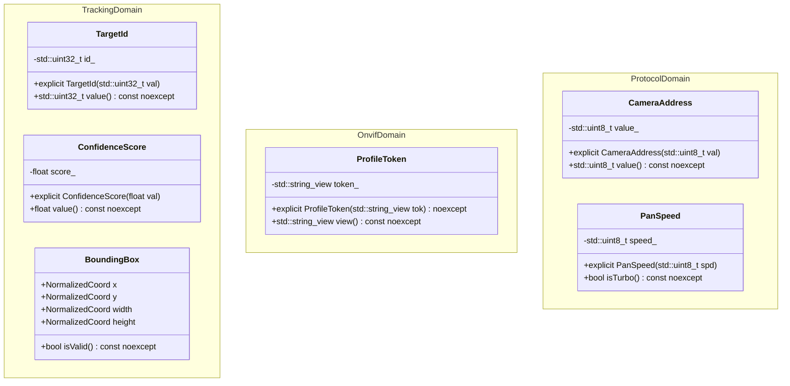

# Domain Modeling & Value Objects Standard

This rule mandates type-driven domain modeling across the **entire codebase**—enforcing standards on all current libraries (`libs/PelcoDCore`, `libs/Onvif`, `libs/Tracking`, `libs/ViscaCore`, `libs/SightlineCore`, `libs/Klv`, `libs/Nmea`, `libs/Mapping`, etc.) and **any future libraries** added to the repository.

---

## 1. Core Principles

1. **Prohibition of Primitive Obsession:**
   - Raw primitives (`std::uint8_t`, `int`, `float`, `double`, `std::string`) must **never** be passed directly across business logic, algorithm, or API boundaries where semantic meaning or domain bounds exist.
   - Wrap primitives into zero-cost, strongly-typed C++17 value objects (e.g., `CameraAddress`, `PanSpeed`, `NormalizedCoord`, `BoundingBox`, `ConfidenceScore`, `ProfileToken`).
2. **Make Illegal States Unrepresentable:**
   - Enforce domain invariants upon construction. If a value falls outside allowable bounds, it must be rejected immediately at construction time or fail compile-time validation.
   - Mutually exclusive commands (e.g., Pan Left + Pan Right) must be rejected by the domain layer.
3. **Zero Dynamic Allocation (CERT ERR55-CPP):**
   - Value types and invariant validators on real-time loops, network receive paths, and packet dispatchers must be `noexcept` and execute with **zero dynamic heap allocations**. Operate on `std::string_view`, stack arrays, or pre-allocated buffers.
4. **Explicit Typing & Conversions (MISRA C++:2023 Rule 7.0.6 & SEI CERT INT31-C):**
   - Fixed-width integers must explicitly include `<cstdint>` and use the `std::` namespace.
   - Coordinate or unit transformations (e.g., normalized float to pixel integer) must be explicit, clamped, and range-verified via `static_cast`.

---

## 2. Architecture: Primitive Obsession vs. Strongly-Typed Domain Modeling

### ASCII Diagram: Primitive Obsession vs. Strong Value Objects

```
+-------------------------------------------------------------------------------+
|                       PRIMITIVE OBSESSION (STRICTLY BANNED)                   |
|                                                                               |
|   // Ambiguous parameters, easily transposed, zero compile-time safety:      |
|   void updateTrack(int id, float x, float y, float w, float h, float conf);  |
|   void sendPanCommand(uint8_t addr, uint8_t speed, uint8_t dir);              |
+-------------------------------------------------------------------------------+
|                     STRONG DOMAIN MODELING (REQUIRED)                         |
|                                                                               |
|   // Type-safe, invariant-enforced, zero runtime overhead:                    |
|   void updateTrack(TargetId id, const BoundingBox& box, ConfidenceScore conf);|
|   void sendPanCommand(CameraAddress addr, PanSpeed speed, PanDirection dir);  |
+-------------------------------------------------------------------------------+
```

### Mermaid Diagram: Strong Value Object Architecture



---

## 3. Implementation Rules for Value Types

1. **Explicit Constructors:**
   - Every single-argument constructor must be marked `explicit` (e.g. `explicit constexpr PanSpeed(std::uint8_t speed) noexcept`).
2. **Constexpr & Noexcept:**
   - Methods querying value type states must be marked `[[nodiscard]] constexpr ... noexcept` whenever possible.
3. **No Implicit Casts:**
   - Conversion to raw primitive types must be explicit via named accessors (`.value()`, `.raw()`, `.view()`), never through implicit conversion operators `operator T()`.
4. **Application to Any Future Library:**
   - Any new module added under `libs/<NewModule>` must identify its core nouns, angles, speeds, tokens, and coordinates, defining type-safe value objects before authoring business logic.

