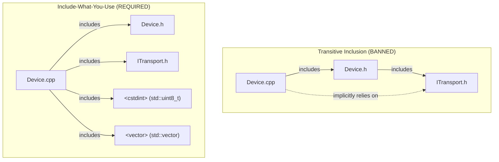
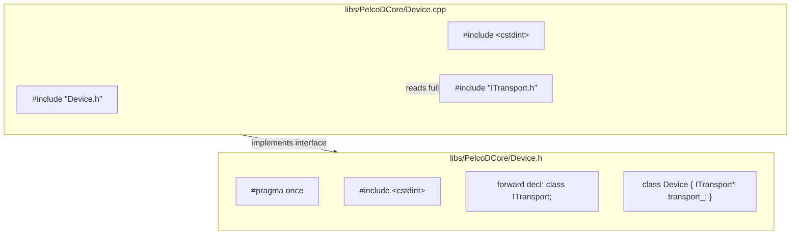

# Include-What-You-Use (IWYU) & `<cstdint>` Policy

## Overview
Every source file (`.cpp`) and header file (`.h`) must adhere to strict **Include-What-You-Use (IWYU)** principles and mandatory **`<cstdint>`** inclusion rules. Relying on transitive (indirect) includes is strictly forbidden because standard library implementations (libstdc++, libc++, MSVC STL) differ significantly in their internal include graphs, leading to subtle cross-platform build breaks.

---

## 1. Fixed-Width Integer Types & `<cstdint>` Rules

1. **Mandatory Explicit Inclusion:**
   - Any file (header or source) that references fixed-width integer types (`int8_t`, `uint8_t`, `int16_t`, `uint16_t`, `int32_t`, `uint32_t`, `int64_t`, `uint64_t`, `intptr_t`, `uintptr_t`, `intmax_t`, `uintmax_t`) must explicitly `#include <cstdint>`.
   - Never assume `<cstdint>` is provided transitively by container headers (e.g. `<vector>`, `<string>`) or other project headers.

2. **Standard Namespace Qualification (`std::`):**
   - Per MISRA C++:2023 and SEI CERT C++, all fixed-width integer types must be explicitly scoped within the `std::` namespace (e.g., `std::uint8_t`, `std::int32_t`).
   - Bare types without namespace (e.g., `uint8_t`, `int32_t`) or non-standard types (`u_int8_t`, `BYTE`) are strictly banned in core interfaces.

3. **Size and Offset Types (`<cstddef>`):**
   - Use `std::size_t` from `<cstddef>` for sizes, counts, and container indexing.
   - Use `std::ptrdiff_t` from `<cstddef>` for pointer offsets and iterator differences.
   - Explicitly `#include <cstddef>` whenever `std::size_t` or `std::ptrdiff_t` are directly referenced.

---

## 2. Include-What-You-Use (IWYU) Rules

1. **Direct Symbol Inclusion:**
   - If a translation unit or header references any symbol, type, template, or macro from the C++ standard library or another component, it must directly include the header defining that entity.
   - Example mappings:
     - `std::unique_ptr`, `std::shared_ptr`, `std::make_unique` $\rightarrow$ `#include <memory>`
     - `std::vector` $\rightarrow$ `#include <vector>`
     - `std::string` $\rightarrow$ `#include <string>`
     - `std::string_view` $\rightarrow$ `#include <string_view>`
     - `std::optional`, `std::nullopt` $\rightarrow$ `#include <optional>`
     - `std::array` $\rightarrow$ `#include <array>`
     - `std::atomic` $\rightarrow$ `#include <atomic>`
     - `std::mutex`, `std::lock_guard` $\rightarrow$ `#include <mutex>`
     - `std::clamp`, `std::min`, `std::max`, `std::find` $\rightarrow$ `#include <algorithm>`
     - `std::chrono` $\rightarrow$ `#include <chrono>`

2. **Transitive Inclusion Prohibition:**
   - An implementation file (`.cpp`) must **not** assume its companion header (`.h`) supplies all required standard headers. If `MyClass.cpp` uses `std::vector` or `std::uint8_t`, it must directly include `<vector>` and `<cstdint>`, even if `MyClass.h` already includes them.

3. **Header Self-Containment:**
   - Every header file must be self-contained: it must compile cleanly on its own if included first in an empty translation unit, without requiring any preceding includes.
   - Every header must use `#pragma once` as its first non-comment line.

4. **Forward Declarations in Headers:**
   - In header files (`.h`), prefer forward declarations (`class Foo;`, `struct Bar;`) over full `#include` directives when a type is only used as a pointer (`Foo*`), reference (`const Foo&`), or inside a non-inline method signature.
   - The full definition header (`"Foo.h"`) must be included in the implementation file (`.cpp`).
   - Exception: Include the full header if the type's size is required (by-value member variables, inheritance, `sizeof`, or inline method bodies).

5. **Pruning Unused Headers:**
   - Remove unused `#include` statements promptly to maintain fast compilation and avoid circular header dependencies.

---

## 3. Canonical Include Ordering

Headers must be organized into distinct, alphabetized groups separated by a single blank line:

1. **Associated Header:** The companion header for this source file (e.g. `#include "Device.h"`).
2. **C System / Standard Headers:** (e.g. `#include <cstdint>`, `#include <cstddef>`, `#include <cmath>`).
3. **C++ Standard Library Headers:** (e.g. `#include <algorithm>`, `#include <memory>`, `#include <vector>`).
4. **Third-Party Libraries:** (e.g. Qt headers `#include <QObject>`, `#include <gtest/gtest.h>`).
5. **Project Local Headers:** (e.g. `#include "ITransport.h"`, `#include "PelcoDFrame.h"`).

```cpp
/// @file Device.cpp
#include "Device.h"

#include <cstddef>
#include <cstdint>

#include <algorithm>
#include <memory>
#include <vector>

#include "ITransport.h"
#include "PelcoDFrame.h"
```

---

## 4. Architectural Dependency & Inclusion Flow

### ASCII Diagram: Direct Inclusion vs. Transitive Dependency

```
+--------------------------------------------------------------------------+
|                       TRANSITIVE INCLUSION (BANNED)                      |
|                                                                          |
|   [Device.cpp] --------> [Device.h] --------> [ITransport.h]             |
|        |                                           |                     |
|        + - - - - (implicitly uses ITransport) - - +                     |
|        * Fragile: If Device.h removes ITransport.h, Device.cpp breaks!  |
+--------------------------------------------------------------------------+
|                       INCLUDE-WHAT-YOU-USE (REQUIRED)                    |
|                                                                          |
|   [Device.cpp] --------> [Device.h] (associated interface)               |
|        |                                                                 |
|        +---------------> [ITransport.h] (directly used in Device.cpp)    |
|        |                                                                 |
|        +---------------> <cstdint> (directly uses std::uint8_t)          |
|        |                                                                 |
|        +---------------> <vector> (directly uses std::vector)            |
+--------------------------------------------------------------------------+
```

### Mermaid Diagram: Direct Inclusion vs. Transitive Dependency



---

### ASCII Diagram: Header Forward Declaration vs. Source Inclusion

```
+--------------------------------------------------------------------------+
|                     HEADER / IMPLEMENTATION DECOUPLING                   |
+--------------------------------------------------------------------------+
|  libs/PelcoDCore/Device.h (Interface):                                   |
|    - #pragma once                                                        |
|    - #include <cstdint>          <-- needed for std::uint8_t parameters  |
|    - class ITransport;           <-- forward declaration (pointer only)  |
|                                                                          |
|    class Device {                                                        |
|    public:                                                               |
|        void sendCommand(std::uint8_t cmd);                               |
|    private:                                                              |
|        ITransport* transport_{nullptr};                                  |
|    };                                                                    |
+--------------------------------------------------------------------------+
|  libs/PelcoDCore/Device.cpp (Implementation):                            |
|    - #include "Device.h"         <-- associated header                   |
|    - #include <cstdint>          <-- directly uses std::uint8_t          |
|    - #include "ITransport.h"     <-- full definition included here       |
+--------------------------------------------------------------------------+
```

### Mermaid Diagram: Header Forward Declaration vs. Source Inclusion



---

## 5. Verification Checklist

Before saving changes or presenting code snippets, verify:
- [ ] Every file referencing `std::uint8_t`, `std::int32_t`, etc., has `#include <cstdint>`.
- [ ] All integer types are prefixed with `std::` (never bare `uint8_t` or `int32_t`).
- [ ] Every file referencing `std::size_t` or `std::ptrdiff_t` has `#include <cstddef>` or `<cstdint>`.
- [ ] Every symbol used is backed by a direct `#include` in that specific file (IWYU).
- [ ] In `.h` files, types used only as pointers or references are forward-declared where possible.
- [ ] All headers start with `#pragma once`.
- [ ] Headers are organized into canonical sorted groups.
- [ ] Automated verification script passes: `python3 scripts/verify_iwyu_cstdint.py --files <modified_files>`.
