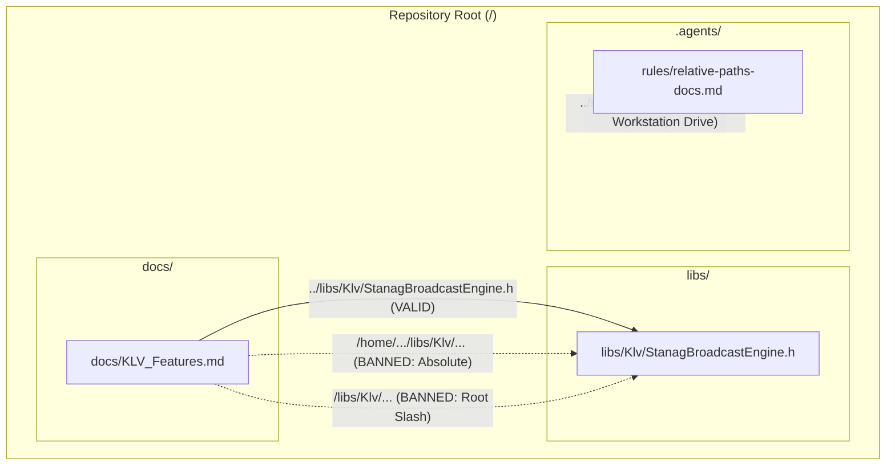

# Relative Paths in Documentation & Comments Standard

This rule mandates that all file paths, directory references, hyperlinks, asset embeds, and document references across Markdown documentation (`docs/*.md`, implementation plans, architectural specifications, `README.md`) and source code comments (`/// @file`, `/// @see`, inline notes) must strictly use **relative paths**.

---

## 1. Core Principles & Enforcements

1. **Absolute Workstation Paths Strictly Banned:**
   - Never embed machine-specific or user-specific filesystem paths (e.g., `/home/<user>/...`, `/Users/<username>/...`, `C:\Users\<username>\...`).
   - Hardcoding user directories breaks documentation portability across development machines, CI/CD runners, and automated containers.

2. **Document-Relative Markdown Hyperlinks:**
   - Hyperlinks in Markdown (`[text](target)`) must resolve relatively from the directory of the referencing document.
   - Example from a file inside `docs/` pointing to a header in `libs/`:
     - **Compliant:** `[Device.h](../libs/PelcoDCore/Device.h)`
     - **Banned:** `[Device.h](/libs/PelcoDCore/Device.h)` (leading root slash breaks offline and sub-path web viewing).
     - **Banned:** `[Device.h](/home/<user>/repo/libs/PelcoDCore/Device.h)` (machine-dependent absolute path).

3. **Repository-Relative Prose & Narrative References:**
   - When mentioning filenames in text, tables, or terminal snippets without a hyperlink, use repository-relative paths without a leading slash (e.g., `libs/PelcoDCore/Device.h`, `scripts/build.sh`, `.agents/rules/compliance.md`).
   - Never prefix repo paths with a leading slash (e.g., avoid `/libs/PelcoDCore`).

4. **Doxygen `@file` Basename Rule:**
   - In source headers and translation units, the Doxygen `/// @file` tag must use the file's bare basename (e.g., `/// @file Device.h`) or relative path, never an absolute path or machine prefix.

5. **Cross-Platform Forward Slashes:**
   - Always use POSIX forward slashes (`/`) in documentation paths and Markdown links. Never use Windows backslashes (`\`).

6. **Asset & Image Embeds:**
   - Image and media embeds must use relative paths (e.g., `` or ``).

---

## 2. Architecture: Absolute vs. Relative Path Resolution

### ASCII Diagram: Path Portability Model

```
+-------------------------------------------------------------------------------+
|                       ABSOLUTE PATHS (STRICTLY BANNED)                        |
|                                                                               |
|   // Broken on other machines, CI pipelines, and web docs renderers:          |
|   See: /home/theon/Development/PelcoD-Controller/libs/PelcoDCore/Device.h     |
|   Link: [Device](/home/theon/Development/PelcoD-Controller/libs/Device.h)    |
|   Root Link: [Device](/libs/PelcoDCore/Device.h)  <-- Fails in sub-paths      |
+-------------------------------------------------------------------------------+
|                      RELATIVE PATH MODEL (MANDATORY)                          |
|                                                                               |
|   // Completely portable across workstations, Docker, and GitHub/GitLab:      |
|   From 'docs/Plan.md':      [Device](../libs/PelcoDCore/Device.h)             |
|   From 'README.md':         [Device](libs/PelcoDCore/Device.h)                |
|   In narrative prose:       libs/PelcoDCore/Device.h                          |
|   In Doxygen header:        /// @file Device.h                                |
+-------------------------------------------------------------------------------+
```

### Mermaid Diagram: Documentation Link Resolution Architecture



---

## 3. Reference Mapping Table

| Context | Banned Pattern | Compliant Pattern |
| :--- | :--- | :--- |
| **Markdown Link from `docs/*.md`** | `[Header](/libs/Onvif/OnvifServer.h)` | `[Header](../libs/Onvif/OnvifServer.h)` |
| **Markdown Link from root `README.md`** | `[Header](/libs/Onvif/OnvifServer.h)` | `[Header](libs/Onvif/OnvifServer.h)` |
| **Prose / Table Reference** | `/libs/Tracking/TrackingEngine.cpp` | `libs/Tracking/TrackingEngine.cpp` |
| **Doxygen File Banner** | `/// @file /home/<user>/repo/libs/Foo.h` | `/// @file Foo.h` |
| **OS Filesystem Separators** | `libs\PelcoDCore\Device.h` | `libs/PelcoDCore/Device.h` |
| **Local Image Embed** | `` | `` |

---

## 4. Verification & Automated Tooling

Verify all documentation files and headers using the project scanner:

```bash
# Scan default documentation locations (docs/, .agents/, README.md)
python3 scripts/verify_relative_doc_paths.py

# Scan specific files with strict verification
python3 scripts/verify_relative_doc_paths.py --files docs/KLV_Features.md README.md --strict
```
