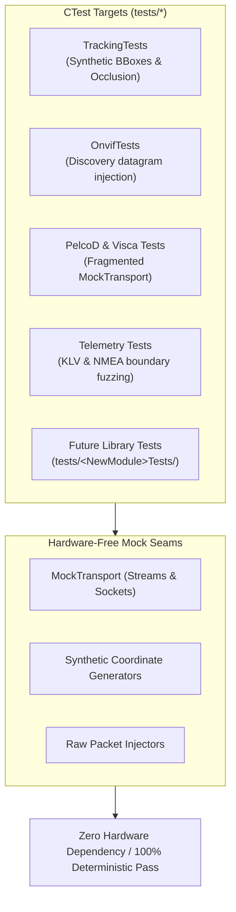

# Testing & Verification Standards

This rule governs automated testing, hardware-free simulation, and regression testing across the **entire codebase**—encompassing all current test targets and **any newly added libraries** in this repository.

---

## 1. Testing Architecture & Mock Seams

```
+-------------------------------------------------------------------------------+
|                       AUTOMATED TESTING & SEAM ARCHITECTURE                   |
|                                                                               |
|   tests/ (Unit, Regression & Concurrency Suites)                              |
|         │                                                                     |
|         ├── [Tracking Tests]: Synthetic frame sequences, Kalman stability     |
|         ├── [Onvif Tests]: Mock UDP datagrams into WsDiscoveryValidator        |
|         ├── [Protocol Tests]: Fragmented byte injection via MockTransport      |
|         ├── [Telemetry Tests]: KLV BER / NMEA XOR checksum verification       |
|         └── [Future Modules]: Interface mocking (ISensor, ITransport, etc.)   |
|         │                                                                     |
|         ▼                                                                     |
|   Deterministic CTest Execution (`ctest --output-on-failure` -> 100% Pass)    |
+-------------------------------------------------------------------------------+
```



---

## 2. Test-Driven Bug Fixing (TDD)

When fixing any defect or regression in any module:
1. **Never write the fix first.**
2. **Step 1 (RED):** Write a targeted test that exposes and reproduces the bug. Confirm failure under `ctest`.
3. **Step 2 (GREEN):** Implement the minimal, MISRA/CERT-compliant fix.
4. **Step 3 (REFACTOR):** Confirm all tests pass with zero compiler warnings and zero compliance errors.

---

## 3. Repository Testing Conventions

1. **Automated CTest Suite:**
   - Execute all test suites via:
     ```bash
     ctest --test-dir build --output-on-failure
     ```
   - 100% of tests must pass with zero failures.
2. **Hardware-Free Simulation Requirement:**
   - Unit tests must **never** require physical serial hardware, actual IP cameras, or physical network interfaces.
   - Use mock abstractions (`MockTransport`, synthetic coordinate feeds, mock sockets) for end-to-end testing of device controllers, tracking engines, and protocol deserializers.
3. **Specification & Wire Conformance:**
   - Verify byte ordering, frame delimiters, bitmasks, and checksums against official specifications (Pelco-D, Sony VISCA, ONVIF Core, STANAG 4609, NMEA-0183).
4. **Concurrency & Lock-Free Stress Validation:**
   - Multi-threaded data structures (e.g. `CircularByteRing`, pacing queues) must include multi-threaded stress tests verifying zero byte loss, thread-safety, and absence of data races under ThreadSanitizer (`-fsanitize=thread`).
5. **Universal Seam Rule for Any Future Library:**
   - Any new library added under `libs/<NewModule>` must include a companion test directory under `tests/<NewModule>Tests/` with hardware-decoupled mock seams.
