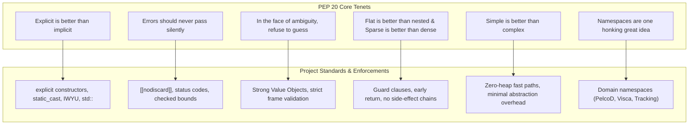

# Zen of Systems Engineering (PEP 20 Applied)

This rule establishes the universal design, architectural, and stylistic philosophy for the **entire codebase**—governing all current libraries (`libs/PelcoDCore`, `libs/Onvif`, `libs/Tracking`, `libs/ViscaCore`, `libs/SightlineCore`, `libs/Klv`, `libs/Nmea`, `libs/Mapping`, etc.) and **any future libraries** created in this repository.

It translates the 19 timeless aphorisms of **The Zen of Python ([PEP 20](https://peps.python.org/pep-0020/))** into rigorous, safety-critical C++17 systems engineering standards, harmonized with [MISRA C++:2023 / SEI CERT C++](compliance.md), [Include-What-You-Use](iwyu-cstdint.md), [Domain Modeling](domain-modeling.md), and [Architectural Layer Boundaries](architecture.md).

---

## 1. Architectural Philosophy: The Zen Intersection

### ASCII Diagram: Philosophy & Safety Intersection

```
+-------------------------------------------------------------------------------+
|                       ZEN OF SYSTEMS ENGINEERING (PEP 20)                     |
|                                                                               |
|   PEP 20 Aphorisms               C++ Systems & Safety Standards               |
|   ┌──────────────────────────┐   ┌────────────────────────────────────────┐   |
|   │ Explicit > Implicit      │──►│ • explicit constructors & static_cast  │   |
|   │                          │   │ • IWYU includes & std:: qualification  │   |
|   ├──────────────────────────┤   ├────────────────────────────────────────┤   |
|   │ Errors never pass silent │──►│ • [[nodiscard]] on fallible APIs       │   |
|   │                          │   │ • std::optional & Status checking      │   |
|   ├──────────────────────────┤   ├────────────────────────────────────────┤   |
|   │ Refuse to guess          │──►│ • Make illegal states unrepresentable  │   |
|   │                          │   │ • Reject malformed network payloads    │   |
|   ├──────────────────────────┤   ├────────────────────────────────────────┤   |
|   │ Flat > Nested            │──►│ • Guard clauses & early returns        │   |
|   │ Sparse > Dense           │──►│ • Atomic statements, no side effects   │   |
|   ├──────────────────────────┤   ├────────────────────────────────────────┤   |
|   │ Namespaces are great     │──►│ • Modular domain namespaces            │   |
|   │                          │   │ • Banning 'using namespace std;'       │   |
|   └──────────────────────────┘   └────────────────────────────────────────┘   |
+-------------------------------------------------------------------------------+
```

### Mermaid Diagram: Zen Translation to Repository Invariants



---

## 2. Aphorism-by-Aphorism Enforcements in C++17

### 1. Beautiful is better than ugly.
- Clean, idiomatic, modern C++17 RAII code is beautiful. Macro tricks, naked pointers, void-pointer casts, and clever side effects are ugly.
- Code must communicate intent directly. If a construct looks contorted, redesign the abstraction.

### 2. Explicit is better than implicit.
- **Single-argument constructors:** Must be marked `explicit` (e.g. `explicit constexpr PanSpeed(std::uint8_t val) noexcept`).
- **Conversions:** Type casts between signed and unsigned or numeric ranges must use explicit `static_cast`, never implicit conversions or C-style casts (MISRA Rule 7.0.6 & SEI CERT INT31-C).
- **Includes:** Every file must directly include what it uses (IWYU); never rely on transitive header inclusion.
- **Fixed-width types:** Explicitly scope all fixed-width integer types (`std::uint8_t`, `std::int32_t`) with `<cstdint>`.
- **API signatures:** Use strongly typed enums or value objects instead of raw boolean flags to avoid boolean blindness at call sites.

### 3. Simple is better than complex.
- Prefer linear, deterministic, and easily verifiable code over elaborate class hierarchies or deep template metaprogramming.
- In fast paths and network pipelines, predictable linear execution with zero dynamic memory allocation outperforms intricate dynamic buffering.

### 4. Complex is better than complicated.
- When inherent domain complexity exists (such as Pelco-D/Visca framing, PTZ geometry, ONVIF WS-Discovery, or KLV decoding), isolate and compartmentalize that complexity within dedicated domain layers.
- Do not let complexity bleed across layer boundaries into transport, GUI, or client modules.

### 5. Flat is better than nested.
- **Eliminate the Arrow Anti-Pattern:** Deeply nested `if`, `for`, and `while` blocks obscure logic and introduce subtle branching bugs.
- Use **guard clauses**, **early returns**, and **early continues** to keep function nesting depth to a minimum ($\le 2$ levels).

```cpp
// BANNED: Nested Pyramid of Doom
void handlePacket(const Packet& pkt) {
    if (pkt.isValid()) {
        if (pkt.isTargeted()) {
            if (hasPermission()) {
                dispatch(pkt);
            }
        }
    }
}

// REQUIRED: Flat, Linear Guard Clauses
void handlePacket(const Packet& pkt) {
    if (!pkt.isValid() || !pkt.isTargeted() || !hasPermission()) {
        return;
    }
    dispatch(pkt);
}
```

### 6. Sparse is better than dense.
- Let code breathe. Place single empty lines between distinct logical phases of an algorithm.
- Avoid dense compound expressions with side effects (e.g., `arr[i++] = ++j;` or nested conditional ternaries). Split complex logic into distinct, verifiable statements.

### 7. Readability counts.
- Code is read far more often than it is written.
- Use ubiquitous domain vocabulary (`CameraAddress`, `PanSpeed`, `NormalizedCoord`) rather than generic primitives (`std::uint8_t`, `float`).
- Maintain short, descriptive function names (strictly under 30 characters). Document public interfaces with comprehensive Doxygen comments explaining *what* and *why*.

### 8. Special cases aren't special enough to break the rules.
- Hardware quirks, legacy devices, or urgent patches never justify violating memory safety, RAII, thread safety, or boundary validation.
- All code—regardless of perceived urgency—must conform to MISRA C++:2023, SEI CERT, and project compiler hardening flags (`-Wall -Wextra -pedantic -Werror`).

### 9. Although practicality beats purity.
- Abstract theoretical purity must yield to hardware and real-time realities.
- Where platform-specific adaptations are needed (Linux POSIX termios vs. Windows Win32 Comm API), encapsulate them cleanly behind clean abstract interfaces (e.g., `ITransport`) rather than polluting domain layers with `#ifdef` directives.

### 10. Errors should never pass silently.
- Functions returning status codes, validation results, or fallible data must be declared `[[nodiscard]]`.
- Never ignore return values. Inspect every transport write, packet parsing result, and bounds check.
- Silent truncation, integer wraparound, and dropped network packets are treated as severe defects.

### 11. Unless explicitly silenced.
- If a return value is deliberately ignored after careful consideration, explicitly mark it (e.g. `(void)bytesWritten;`) accompanied by an explanatory comment justifying why discarding is safe in that context.

### 12. In the face of ambiguity, refuse the temptation to guess.
- Never guess user intent or infer corrupted network payloads.
- If a packet has an invalid checksum, unexpected length, or out-of-range command byte, reject it immediately and log the fault.
- Construct domain value types such that invalid values cannot be formed: **make illegal states unrepresentable**.

### 13. There should be one—and preferably only one—obvious way to do it.
- Maintain consistent design patterns across all libraries in `libs/`:
  - Transport abstraction via `ITransport`.
  - Frame serialization via dedicated, immutable framers.
  - Streaming ingestion via cache-aligned lock-free ring buffers (`CircularByteRing`).
  - Unit tests via Google Test with standard naming and hardware-free simulation.

### 14. Now is better than never. Although never is often better than *right* now.
- Fix identified bugs, memory leaks, and technical debt proactively.
- However, resist the temptation to rush unvetted, hasty "quick fixes" directly into production. Follow Test-Driven Development (TDD): write a reproducing failing test first, verify the fix, and ensure full compliance before merging.

### 15. If the implementation is hard to explain, it's a bad idea.
- If a design requires convoluted explanation, convoluted synchronization schemes, or esoteric language tricks, it is inherently fragile.
- Simplify the model. State machines should be self-evident; data flows should be unidirectional where possible.

### 16. If the implementation is easy to explain, it may be a good idea.
- A clean, modular design with single-responsibility components and clear ownership semantics is readily understood and easily audited.

### 17. Namespaces are one honking great idea—let's do more of those!
- Scope all types and functions within explicit, modular domain namespaces (e.g., `PelcoD`, `Visca`, `Tracking`, `Onvif`).
- Direct qualification (`std::uint8_t`, `std::size_t`) is mandatory.
- **Strict Prohibition:** `using namespace ...;` is strictly banned in header files, and `using namespace std;` is forbidden repository-wide.

---

## 3. Verification & Code Review Checklist

Before approving a diff or presenting code, verify:
- [ ] **Explicit over Implicit:** All single-arg constructors are `explicit`, integer conversions use `static_cast`, and `<cstdint>` is directly included.
- [ ] **Errors Handled:** Fallible methods use `[[nodiscard]]` and return statuses are verified.
- [ ] **Flat Logic:** Arrow anti-pattern eliminated using guard clauses and early returns ($\le 2$ levels of indentation).
- [ ] **Sparse & Readable:** Statements are atomic (no compound side-effect chains like `a[i++] = ++j`), with breathing room between phases.
- [ ] **Namespaces & Scoping:** Types reside in appropriate domain namespaces; no `using namespace std;`.
- [ ] **No Guessing:** Boundary and packet checks reject malformed inputs immediately.
