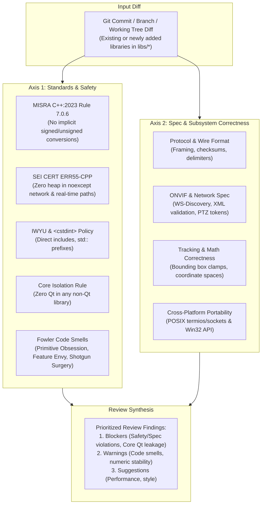

# Dual-Axis Code Review

This skill performs a rigorous, multi-perspective code review across the **entire codebase**—enforcing standards on all existing libraries (`libs/PelcoDCore`, `libs/Onvif`, `libs/Tracking`, `libs/SightlineCore`, `libs/ViscaCore`, `libs/Klv`, `libs/Nmea`, `libs/Mapping`, etc.) as well as **any newly added or future libraries** in this repository.

It separates evaluation into two independent axes: **Standards & Safety** (MISRA/CERT compliance, architectural decoupling, code smells) and **Specification & Correctness** (subsystem requirements, wire protocol adherence, mathematical correctness).

---

## 1. Review Architecture

```
+-------------------------------------------------------------------------------+
|                       DUAL-AXIS CODE REVIEW ARCHITECTURE                      |
|                                                                               |
|   Diff / Working Tree (Any Current or Future Library in libs/*)              |
|         │                                                                     |
|         ├───► [Axis 1: Standards & Safety] ─────────────────────────┐         |
|         │       • MISRA C++:2023 & SEI CERT C++                     │         |
|         │       • IWYU & std:: fixed-width integer compliance       │         |
|         │       • Core Isolation (Zero Qt in ANY Core library)      ▼         |
|         │       • Fowler Code Smells (Primitive Obsession, etc.)[Prioritized] |
|         │                                                       [ Findings  ] |
|         └───► [Axis 2: Spec & Subsystem Integrity] ────────────►[ Report    ] |
|                 • Subsystem specification & wire format integrity   ▲         |
|                 • Mathematical & numerical stability (Vision/Math)  │         |
|                 • Real-time & network path safety (0-heap noexcept) │         |
|                 • Cross-platform portability (Linux & Win32)        ┘         |
+-------------------------------------------------------------------------------+
```



---

## 2. Universal Governance for New & Future Libraries

Any newly added library in `libs/` is immediately governed by these strict architectural rules:

1. **Default Classification (Core vs. Qt):**
   - By default, any new directory added under `libs/` is a **Core Library** unless its name explicitly ends with `Qt` (e.g. `libs/FooCore`, `libs/Foo`, `libs/Sensors`).
   - **Zero Qt Rule:** A Core library must have **zero Qt dependencies** (`#include <Q...>` is strictly prohibited). Qt usage must remain isolated within companion UI libraries (e.g. `libs/FooQt`).
2. **Standard Memory & Safety Baseline:**
   - Raw `new` or `delete` is strictly banned; RAII and smart pointers are mandatory.
   - Headers must use `#pragma once` and co-locate with `.cpp` in the same directory.
   - All integer types must use `<cstdint>` and explicit `std::` qualification (`std::uint8_t`, `std::int32_t`).
3. **High-Frequency & Real-Time Path Policy:**
   - Any function on network receive, protocol parsing, or frame-by-frame processing loops marked `noexcept` must be **100% free of dynamic heap allocations** (`std::string`, `std::vector`, `new`, `std::make_unique`). Dynamic allocation failure throws `std::bad_alloc`, which terminates the application (SEI CERT ERR55-CPP).

---

## 3. Review Axes Details

### Axis 1: Standards & Safety Compliance
Review the diff against the safety rules defined in `.agents/rules/compliance.md`, `.agents/rules/iwyu-cstdint.md`, and `.agents/rules/verification-checklist.md`:

1. **MISRA C++:2023 & SEI CERT C++ Rules:**
   - Any implicit signed/unsigned conversions? (Must use explicit `static_cast`).
   - Are Standard Library algorithms given exact matching `value_type` parameters?
   - **Zero-Heap in `noexcept` Paths (ERR55-CPP):** Functions on high-frequency paths (network receive, UDP packet parsing, `WsDiscoveryValidator`, real-time `Tracking` frame pipelines) marked `noexcept` must never perform dynamic heap allocations (`std::string`, `std::vector`, `new`).
   - Character operations must use locale-independent ASCII helpers (STR37-C).
2. **IWYU & Standard Type Qualification:**
   - Does every file directly include the headers it uses?
   - Are all fixed-width integer types preceded by `std::` (`std::uint8_t`, `std::int32_t`) with `#include <cstdint>`?
   - Is `std::size_t` preceded by `#include <cstddef>` or `<cstdint>`?
3. **Core Layer Decoupling (Strict Zero Qt in Core):**
   - Any `#include <Q...>` in a non-Qt library is an immediate blocker.
4. **Fowler Code Smells Baseline:**
   - *Primitive Obsession:* Are raw integers or floats passed instead of domain types (`ConfidenceScore`, `NormalizedCoord`, `PanSpeed`)?
   - *Feature Envy / Inappropriate Intimacy:* Does a processing class reach directly into private internals of models?
   - *Resource Management:* Are there raw `new` or `delete` calls instead of RAII containers/smart pointers?

### Axis 2: Subsystem Specification & Correctness
Review the diff against the specific subsystem's functional invariants:

1. **Computer Vision & Tracking:**
   - Are normalized coordinates bounded within $[0.0f, 1.0f]$?
   - Are division-by-zero checks present when normalizing pixel dimensions?
   - Are bounding box coordinates protected against inversions ($x_2 < x_1$ or $y_2 < y_1$)?
   - Is matrix or filter arithmetic numerically stable without floating-point underflow/overflow?
2. **ONVIF & Network Discovery:**
   - Does `WsDiscoveryValidator` operate with zero heap allocations on incoming multicast datagrams?
   - Are XML tokens and namespaces parsed safely without buffer overrun risks?
   - Are PTZ velocity ranges verified against profile capabilities?
3. **Serial & PTZ Protocols:**
   - Does the frame serialize to the strict wire format?
   - Are checksums calculated correctly (e.g. modulo-256 sum for Pelco-D)?
4. **Telemetry & Sensor Formats:**
   - Are BER lengths and KLV tag headers decoded safely without buffer over-reads?
   - Are NMEA XOR checksums validated before parsing sentence fields?
5. **Cross-Platform Portability:**
   - Are platform-specific network and serial implementations cleanly abstracted behind `ITransport` (supporting POSIX and Windows)?

---

## 4. Step-by-Step Review Procedure

1. **Pin the Baseline:**
   ```bash
   git diff main...HEAD
   # or for local uncommitted changes:
   git diff HEAD
   ```
2. **Inspect Axis 1 (Standards & Safety):**
   - Verify zero Qt includes in any core or newly added non-Qt modules.
   - Run compliance checker:
     ```bash
     python3 scripts/verify_iwyu_cstdint.py --files <changed_files>
     ```
3. **Inspect Axis 2 (Subsystem Specification):**
   - Validate mathematical, wire, or protocol invariants against module requirements.
4. **Generate Prioritized Feedback:**
   - **🔴 Blocker:** MISRA/CERT violations, dynamic allocations in `noexcept` paths, Qt leakage into non-Qt libraries, or protocol corruption.
   - **🟡 Warning:** Fowler code smells, missing `[[nodiscard]]`, missing Doxygen documentation, or numerical precision warnings.
   - **🟢 Suggestion:** Constexpr optimizations, naming clarity, or test coverage expansion.
