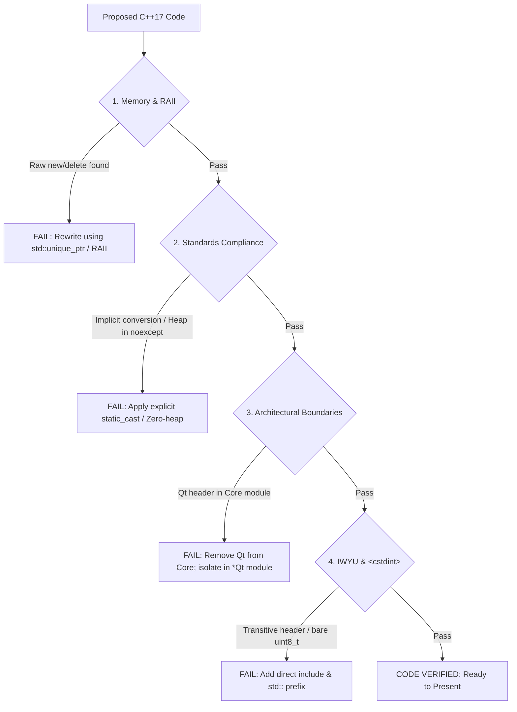

# C++17 Verification Checklist & Safety Gate

Before presenting any C++17 code snippet, writing an implementation file, or proposing a refactoring across any library in this repository, internally verify the code against this comprehensive 18-point safety gate.

---

## 1. Verification Gate Architecture

```
+-------------------------------------------------------------------------------+
|                       C++17 COMPLIANCE & SAFETY GATE                          |
|                                                                               |
|   Proposed Code Snippet / Implementation Diff                                 |
|         │                                                                     |
|         ├── [1. Memory & Types]: RAII, zero raw new/delete, std::uint8_t, {}  |
|         ├── [2. Standards]: MISRA C++:2023, SEI CERT INT31-C / ERR55-CPP      |
|         ├── [3. Architecture]: 0 Qt in Core libraries, Linux & Win32 support  |
|         ├── [4. IWYU & Tooling]: Direct headers, scripts/verify_iwyu_cstdint.py|
|         └── [5. Documentation]: Full Doxygen, relative paths, ASCII & Mermaid |
|         │                                                                     |
|         ▼                                                                     |
|   Pass All 18 Checks -> Approved for Output / Merge                           |
+-------------------------------------------------------------------------------+
```



---

## 2. The 18-Point Verification Checklist

1. **RAII / Memory:** Did I use any raw `new` or `delete`? (If yes, rewrite using RAII/smart pointers like `std::unique_ptr`).
2. **Explicit Initialization:** Are all variables explicitly initialized using `{}` where possible (e.g. `int count{0};`, `std::uint8_t byte{0x00};`)?
3. **Safety Attributes:** Did I apply `[[nodiscard]]` to all functions returning status codes, error states, or safety-critical data?
4. **Documentation Completeness:** Are all public APIs documented with full Doxygen templates (`/// @brief`, `@details`, `@param`, `@return`, `@note`)?
5. **Standards Compliance:** Does this code strictly comply with MISRA C++:2023 and SEI CERT C++ (no dynamic cast, explicit `static_cast`, range verification)?
6. **TDD:** Did I write a failing test first if fixing a bug or regression (per [`.agents/skills/tdd-bug-fixing`](../tdd-bug-fixing/SKILL.md))?
7. **Header Guards:** Are headers using `#pragma once` as the first non-comment line? (Never use legacy `#ifndef` / `#define` include guards).
8. **File Co-location:** Are companion header (`.h`) and implementation (`.cpp`) files co-located in the same directory?
9. **Core Layer Isolation:** Do Core libraries maintain **zero Qt dependencies**? (`#include <Q...>` is strictly banned in `libs/PelcoDCore`, `libs/ViscaCore`, `libs/SightlineCore`, `libs/Onvif`, `libs/Tracking`, `libs/Klv`, `libs/Nmea`, `libs/PayloadHal`, and any future non-Qt library). Qt belongs exclusively in companion `*Qt` UI libraries.
10. **Concise Naming:** Are all function names concise (strictly fewer than 30 characters)?
11. **Cross-Platform Portability:** Does transport and operating system code support both **Linux** (POSIX termios/sockets) and **Windows** (Win32 Comm API/Winsock2)?
12. **Compiler Warning Cleanliness:** Does the code compile with zero warnings under `-Wall -Wextra -pedantic` (`-Werror`) on GCC/Clang and `/W4` on MSVC?
13. **Documentation Paths:** Are all file paths mentioned in documentation and comments relative?
14. **Dual Diagrams:** If diagrams are involved in documentation, are both **ASCII** and **Mermaid** diagrams included?
15. **Fixed-Width Integers & `<cstdint>`:** Did I explicitly `#include <cstdint>` in every file referencing fixed-width integers, and are all integer types strictly qualified with `std::` (e.g. `std::uint8_t`, `std::int32_t`)? Did I use `<cstddef>` for `std::size_t`?
16. **IWYU (Include-What-You-Use):** Does every file directly include all headers it depends on without assuming transitive includes, using forward declarations in headers where pointer/reference usage suffices?
17. **STL Value Types & Conversions:** Do callables passed to STL algorithms take the range's exact `value_type`? Are iterator-range constructors between differing signed/unsigned types avoided in favor of explicit `static_cast` in project code?
18. **Exception Safety & Fast Paths (CERT ERR55-CPP):** Are all functions declared `noexcept` on network receive, protocol parsing, and tracking frame loops **100% free of dynamic heap allocations** (`std::string`, `std::vector`, `new`, `std::make_unique`) to prevent `std::bad_alloc` triggering `std::terminate`?

---

## 3. Automated Pre-Commit Tooling

Run the compliance scanner prior to staging or committing code:

```bash
# Verify specific modified files
python3 scripts/verify_iwyu_cstdint.py --files libs/Tracking/TrackingEngine.h libs/Tracking/TrackingEngine.cpp --strict

# Run across an entire library
python3 scripts/verify_iwyu_cstdint.py libs/Onvif
```
