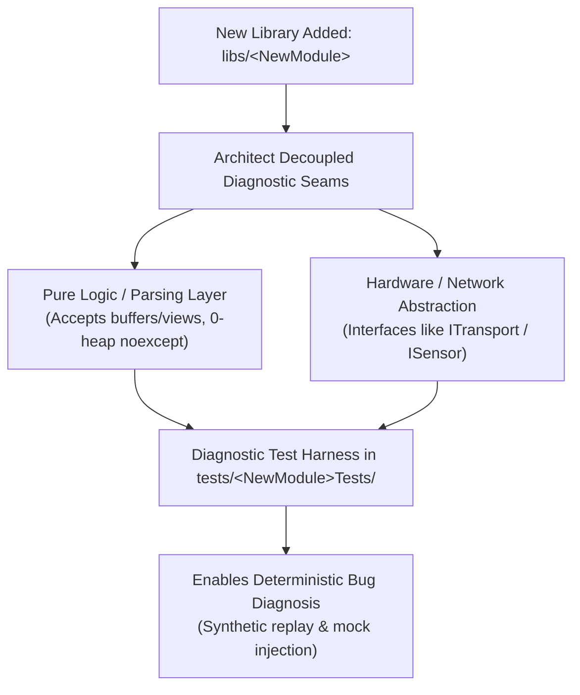

# Systematic Bug Diagnosis

This skill enforces a disciplined, hypothesis-driven diagnostic loop for defects, telemetry parsing errors, serial framing drops, network discovery issues, tracking regressions, and memory/concurrency faults across the **entire codebase**—enforcing standards on all existing libraries (`libs/Tracking`, `libs/Onvif`, `libs/PelcoDCore`, `libs/ViscaCore`, `libs/SightlineCore`, `libs/Klv`, `libs/Nmea`, `libs/Mapping`, etc.) as well as **any future or newly added libraries** in this repository.

It strictly prevents speculative trial-and-error patching by requiring a reproducible, deterministic feedback loop before any fix is attempted.

---

## 1. Diagnostic Philosophy

1. **No Fixes Without Diagnosis:**
   - Never speculate or patch production code until the root cause is isolated and demonstrated with a failing check.
2. **Deterministic Feedback Loop First:**
   - Construct a minimal, deterministic reproducer that goes **RED** exclusively on the defect.
3. **Verify Diagnostic Seams:**
   - Ensure the diagnostic test exercises genuine production parsers, trackers, or network validators rather than a shallow test mock.
4. **Sanitize Telemetry & Security Data:**
   - Redact camera credentials, IP addresses, drone coordinates, or internal telemetry tokens using `<REDACTED>`.

---

## 2. Universal Diagnostic Seam Policy for Any New Library

Whenever a new library or component is added to `libs/`, it must be architected with clear diagnostic seams from the beginning:

```
+-------------------------------------------------------------------------------+
|                    NEW LIBRARY DIAGNOSTIC SEAM PRINCIPLE                      |
|                                                                               |
|   New Library (`libs/<Name>`)                                                 |
|         │                                                                     |
|         ├── [Decouple I/O from Logic]:                                        |
|         │     Parsers and algorithms must accept buffers/spans/iterators,     |
|         │     never directly calling hardware sockets or files internally.    |
|         │                                                                     |
|         ├── [Mockable Transport / System Boundaries]:                         |
|         │     Hardware interfaces must implement abstract contracts           |
|         │     (e.g., ITransport, ISensor) to allow mock injection in tests.   |
|         │                                                                     |
|         └── [Deterministic Seams for Reproducers]:                            |
|               Unit tests in `tests/<Name>Tests/` must be able to replay       |
|               recorded raw byte sequences, synthetic inputs, or edge values.  |
+-------------------------------------------------------------------------------+
```



---

## 3. Architecture & Diagnostic Workflow

### ASCII Diagram: Systematic Diagnostic Process

```
+-------------------------------------------------------------------------------+
|                       SYSTEMATIC DIAGNOSTIC PROCESS                           |
|                                                                               |
|   1. Symptom Intake (Tracking drift, WS-Discovery drop, frame corrupt, crash) |
|         │                                                                     |
|         ▼                                                                     |
|   2. Formulate Root-Cause Hypothesis                                          |
|      (Coordinate normalization? Checksum drift? Socket split? bad_alloc?)     |
|         │                                                                     |
|         ▼                                                                     |
|   3. Build Deterministic Reproducer (Select Subsystem Seam):                  |
|         ├── [Vision / Tracking]: Synthetic frame coordinate replay test       |
|         ├── [Network / Discovery]: Malformed datagram / XML injection harness |
|         ├── [Protocols / Telemetry]: Byte fragmentation replay via MockTransport|
|         └── [Memory / Threads]: ASan / UBSan / TSan execution                 |
|         │                                                                     |
|         ▼                                                                     |
|   4. Observe RED Failure (Must fail deterministically with expected reason)   |
|         │                                                                     |
|         ▼                                                                     |
|   5. Transition to TDD (Handoff to .agents/skills/tdd-bug-fixing)             |
+-------------------------------------------------------------------------------+
```

### Mermaid Diagram: Diagnostic Workflow

```mermaid
flowchart TD
    A["1. Symptom Intake<br/>(Failure report in any current or future library)"] --> B["2. Formulate Hypothesis<br/>(Boundary bug, memory fault, framing error)"]
    B --> C{"3. Select Subsystem Seam"}
    
    C -->|Computer Vision / Tracking| D1["Tracking: Synthetic BBox / Coordinate Replay"]
    C -->|Network / Discovery| D2["Network: Mock Datagram / Frame Injection Harness"]
    C -->|Serial / Telemetry Protocols| D3["Protocols: Fragmented Byte Replay via MockTransport"]
    C -->|Memory / Concurrency| D4["Sanitizer Run: ASan / UBSan / TSan"]
    
    D1 --> E["4. Execute Feedback Loop"]
    D2 --> E
    D3 --> E
    D4 --> E
    
    E --> F{"Fails Deterministically?"}
    F -->|No| G["Refine hypothesis / increase stress iterations / check race condition"]
    G --> E
    F -->|Yes (RED)| H["5. Hand off to .agents/skills/tdd-bug-fixing"]
```

---

## 4. Subsystem-Specific Reproducer Strategies

Select the appropriate reproducible diagnostic seam based on the failing component (existing or future):

| Subsystem Category | Typical Failure Modes | Reproducer Strategy | Target Seam |
| :--- | :--- | :--- | :--- |
| **Tracking & Vision** (`libs/Tracking`, `libs/Video`) | Target loss on boundary, bbox coordinate inversion, Kalman divergence | Inject synthetic sequence of normalized bounding boxes with known velocity steps | Tracking filter unit tests (`tests/TrackingTests/`) |
| **Network & Discovery** (`libs/Onvif`, Web Services) | Discovery timeout, probe filter drop, XML malformation, heap allocation | Inject raw UDP WS-Discovery probe datagrams directly into `WsDiscoveryValidator` | Discovery unit tests (`tests/OnvifTests/`) |
| **Serial Protocols** (`libs/PelcoDCore`, `libs/ViscaCore`) | Sync byte loss, checksum mismatch, packet splitting | Feed fragmented byte buffers through `MockTransport` | Protocol deserializer tests (`tests/PelcoDTests/`) |
| **Telemetry & Sensors** (`libs/Klv`, `libs/Nmea`, `libs/DjiTelemetry`) | BER length parsing overrun, corrupted checksum, invalid latitude bounds | Feed corrupted or edge-case byte sequences | Parser unit tests (`tests/KlvTests/`, `tests/NmeaTests/`) |
| **Transport & Concurrency** (`libs/Transport`) | Half-duplex turnaround collision, socket disconnect deadlock | Run thread-stress harness with `-fsanitize=thread` | Transport integration tests |

---

## 5. Seam Verification Checklist

Before accepting a reproducer as valid:
- [ ] Does the test exercise real production logic (e.g. `TrackingEngine`, `WsDiscoveryValidator`, `PelcoDProtocol`), rather than a shallow mock?
- [ ] In tracking algorithms, is numerical stability verified against edge values (e.g., zero bounding box width/height, object touching sensor border)?
- [ ] In network receive paths, is `noexcept` checked to ensure memory allocation failure cannot occur (CERT ERR55-CPP)?
- [ ] For serial and telemetry protocols, are split frames, garbage prefix bytes, and checksum errors properly exercised?

---

## 6. Transition to Fix

Once the reproducer consistently fails:
1. Document the confirmed root cause in diagnostic notes.
2. Hand off to [`.agents/skills/tdd-bug-fixing`](../tdd-bug-fixing/SKILL.md) to implement the minimal, compliant fix.
3. Verify that the reproducer turns **GREEN**.
4. Run static and safety verification using [`.agents/skills/cpp-verification`](../cpp-verification/SKILL.md).
