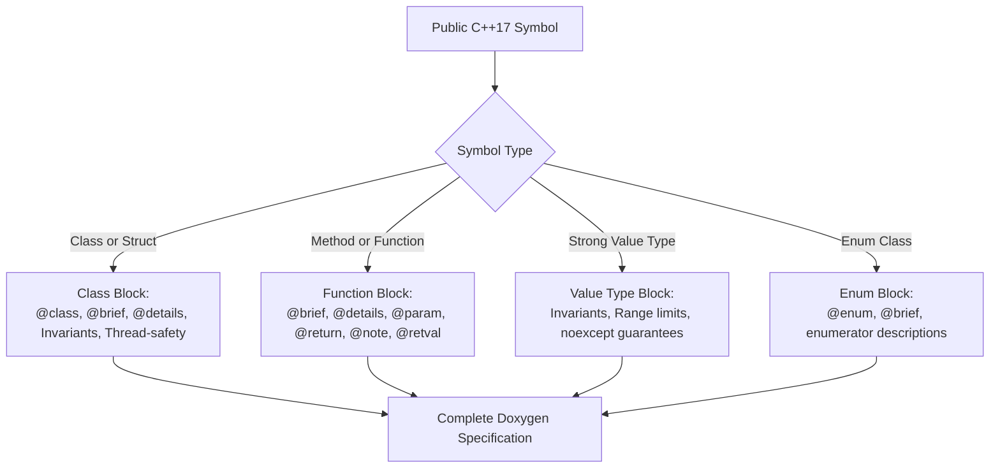

# Doxygen Documentation Requirements

Every class, struct, interface, method, enum, and free function across the entire codebase must be fully documented using standardized Doxygen structural tags before generation. Use the `///` triple-slash comment style.

---

## 1. Documentation Structure & Flow

```
+-------------------------------------------------------------------------------+
|                       DOXYGEN DOCUMENTATION WORKFLOW                          |
|                                                                               |
|   Header / Interface Declaration                                              |
|         │                                                                     |
|         ├── Class / Struct Block: Responsibility, thread-safety, invariants  |
|         ├── Method / Function Block: Brief, details, params, returns, notes   |
|         └── Value Types / Enums: Meaning of enumerators, boundary guarantees  |
|         │                                                                     |
|         ▼                                                                     |
|   Deterministic API Documentation (Doxygen Compiler Clean)                    |
+-------------------------------------------------------------------------------+
```



---

## 2. Standard Templates

### A. Member Method & Free Function Template

```cpp
/// @brief Brief one-line summary of what the function does.
/// @details Detailed explanation of algorithm logic, pre-conditions, and post-conditions.
/// @param[in] paramName Description of input parameter.
/// @param[out] outputResult Description of output parameter (when passed by reference/pointer).
/// @return Description of return value.
/// @retval true When operation succeeds and telemetry frame is valid.
/// @retval false When checksum verification fails or payload is truncated.
/// @note Thread Safety: Safe for concurrent readers; single-writer locked.
/// @note Exception Safety: noexcept; performs zero dynamic heap allocations.
/// @see ITransport::sendFrame
[[nodiscard]] bool processTelemetry(const TelemetryFrame& frame) noexcept;
```

### B. Class & Interface Template

```cpp
/// @class TrackingEngine
/// @brief Real-time visual tracking coordinator for sensor payloads.
/// @details Maintains target states across frame sequences using Kalman filtering
///          and normalized coordinate envelopes. Operates with zero heap allocation
///          during continuous tracking execution.
/// @note Invariants: Normalized bounding box coordinates must remain within [0.0, 1.0].
/// @note Thread Safety: Not thread-safe. Synchronization must be handled by caller.
class TrackingEngine {
public:
    virtual ~TrackingEngine() = default;
};
```

### C. Strongly-Typed Value Object Template

```cpp
/// @class PanSpeed
/// @brief Strongly-typed, range-validated pan velocity value object.
/// @details Prevents primitive obsession by encapsulating Pelco-D pan speed limits.
///          Enforces the domain invariant [0x00, 0x3F] or 0xFF (turbo).
class PanSpeed final {
public:
    /// @brief Construct a validated PanSpeed instance.
    /// @param[in] speed Raw speed byte to validate.
    /// @throws std::invalid_argument if speed exceeds maximum allowable range.
    explicit constexpr PanSpeed(std::uint8_t speed);
    
    /// @brief Check whether pan speed represents turbo mode.
    /// @return true if speed equals 0xFF; false otherwise.
    [[nodiscard]] constexpr bool isTurbo() const noexcept;
};
```

### D. Enum Class Template

```cpp
/// @enum TrackerState
/// @brief Lifecycle states of the target tracking state machine.
enum class TrackerState : std::uint8_t {
    Searching, ///< Actively searching for target features in sensor stream.
    Acquired,  ///< Initial target lock acquired; building filter covariance.
    Tracking,  ///< Actively tracking target with high confidence.
    Lost       ///< Target lost due to occlusion or sensor boundary exit.
};
```

---

## 3. Style & Compliance Rules

1. **Tag Ordering:** Maintain standard tag sequence: `@brief` $\rightarrow$ `@details` $\rightarrow$ `@param` $\rightarrow$ `@return` $\rightarrow$ `@retval` $\rightarrow$ `@note` $\rightarrow$ `@see`.
2. **Relative File Paths:** If referencing documents or files in comments, always use relative paths (e.g. `docs/domain/`, `.agents/rules/`).
3. **Diagrams in Documentation:** If class documentation includes architecture diagrams, supply both ASCII and Mermaid diagrams.
