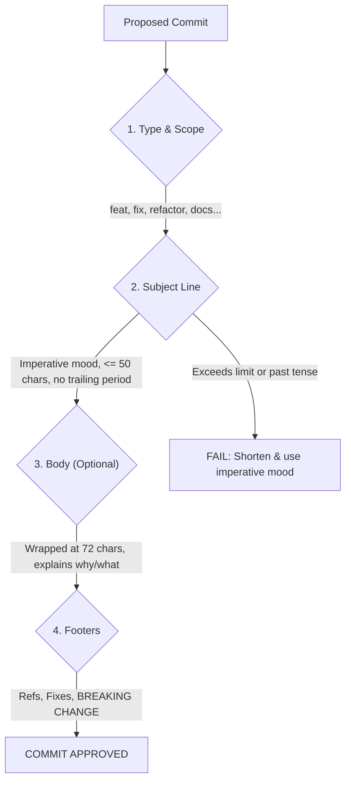

# Git Commit Guidelines

When writing a commit message, follow these 6 strict formatting rules alongside the **Conventional Commits 1.0.0** specification.

---

## 1. Commit Workflow & Formatting Architecture

```
+-------------------------------------------------------------------------------+
|                       CONVENTIONAL COMMIT ARCHITECTURE                        |
|                                                                               |
|   <type>(<scope>): <short imperative description>                             |
|                                                                               |
|   [optional body explaining WHY and WHAT (wrapped at 72 chars)]               |
|                                                                               |
|   [optional footer(s): Fixes: #123, BREAKING CHANGE: ...]                     |
+-------------------------------------------------------------------------------+
```



---

## 2. General Git Formatting Rules

- **Rule 1:** Separate the subject line from the body with a single blank line.
- **Rule 2:** Limit the subject line to 50 characters (72 is the absolute hard limit).
- **Rule 3:** Do not end the subject line with a period.
- **Rule 4:** Use the imperative mood in the subject line (e.g., "fix bug," "add feature," not "fixed" or "adds").
  - *Test formula:* It must complete the sentence: *"If applied, this commit will [your subject line here]"*.
- **Rule 5:** Wrap the body text manually at 72 characters to prevent formatting issues in terminal pagers.
- **Rule 6:** Use the body to explain **what and why** vs. how. Assume the diff explains the how; the commit message must explain context, motivation, and safety implications.

---

## 3. Conventional Commits 1.0.0 Specification

Commit messages must adhere to the structural layout:

```text
<type>[optional scope][!]: <description>

[optional body]

[optional footer(s)]
```

### Types
- **`feat`**: Introduces a new feature or functionality.
- **`fix`**: Patches a bug or regression.
- **`docs`**: Documentation changes only.
- **`style`**: Formatting, whitespace, or naming with no logic change.
- **`refactor`**: Code restructuring that neither fixes a bug nor adds a feature.
- **`perf`**: Code modifications improving algorithmic performance or memory footprint.
- **`test`**: Adding missing tests, updating unit fixtures, or benchmarks.
- **`build`**: Changes affecting the build system (CMake, package scripts).
- **`ci`**: Continuous integration configuration or GitHub Actions scripts.
- **`chore`**: Maintenance, tooling configuration, or miscellaneous housekeeping.
- **`revert`**: Reverts a previous commit.

### Canonical Scopes for this Repository
Select a scope matching the affected subsystem:

| Scope | Target Subsystem | Example |
| :--- | :--- | :--- |
| `tracking` | Target tracking & Kalman filtering | `feat(tracking): add bounding box occlusion recovery` |
| `onvif` | WS-Discovery & IP camera control | `fix(onvif): eliminate heap allocation in probe validator` |
| `pelco` | Pelco-D protocol serialization | `fix(pelco): correct modulo-256 checksum overflow` |
| `visca` | Sony VISCA serial protocol | `feat(visca): support digital zoom control command` |
| `klv` | STANAG 4609 KLV metadata | `refactor(klv): optimize BER length field decoder` |
| `nmea` | NMEA-0183 GPS/INS telemetry | `fix(nmea): validate XOR checksum prior to sentence parsing` |
| `mapping` | Coordinate transformations & geo | `feat(mapping): add WGS-84 to UTM coordinate projection` |
| `transport`| Serial port & socket abstractions | `fix(transport): handle win32 comm port timeout` |
| `core` | Core library cross-cutting logic | `refactor(core): enforce zero Qt include rule` |
| `ui` | Qt GUI widgets & controllers | `feat(ui): add crosshair overlay to tracking view` |

---

## 4. Breaking Changes & Footers

- Breaking changes must include a `!` before the colon or a footer starting with `BREAKING CHANGE: `:
  ```text
  refactor(tracking)!: require NormalizedCoord in updateTrack()
  
  Replace raw float coordinates with type-safe NormalizedCoord value
  objects to prevent coordinate inversion and unit transposition.
  
  BREAKING CHANGE: `TrackingEngine::updateTrack()` signature changed.
  ```
- Reference tickets or pull requests in footers:
  ```text
  Fixes: #123
  Refs: #456
  ```
