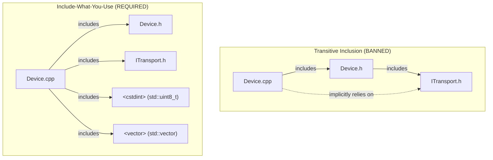
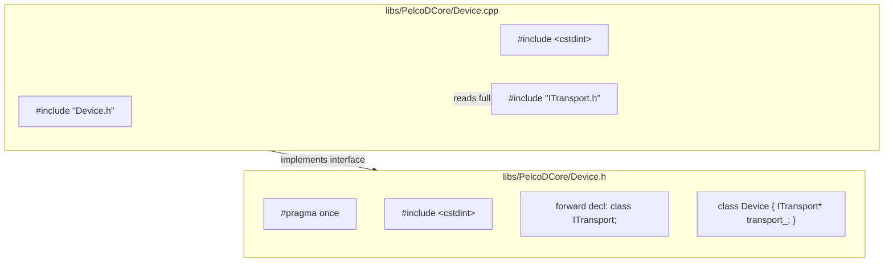

# Include-What-You-Use (IWYU) & `<cstdint>` Verification

This skill guides the auditing, verification, and remediation of header dependencies, ensuring strict compliance with **Include-What-You-Use (IWYU)** and explicit **`<cstdint>`** inclusion standards across the Pelco-D Controller codebase.

---

## 1. Core Principles & Safety Requirements

1. **Explicit `<cstdint>` Inclusion:**
   Every header (`.h`) and translation unit (`.cpp`) using fixed-width integer types (`int8_t`, `uint8_t`, `int16_t`, `uint16_t`, `int32_t`, `uint32_t`, `int64_t`, `uint64_t`, `intptr_t`, `uintptr_t`, `intmax_t`, `uintmax_t`) must explicitly `#include <cstdint>`.
   - Never assume transitive inclusion through other headers like `<vector>` or `"PelcoDFrame.h"`.
   - All types must be scoped under `std::` (e.g., `std::uint8_t`, `std::int32_t`). Bare types (e.g., `uint8_t`) violate MISRA C++:2023.

2. **Explicit `<cstddef>` Inclusion:**
   Any file referencing `std::size_t` or `std::ptrdiff_t` must explicitly `#include <cstddef>`.

3. **Direct Symbol Inclusion (IWYU):**
   Every file must directly include the declaration of every symbol, type, template, or macro it references.
   - Do not rely on indirect headers.
   - Headers must be self-contained and compilable in isolation.

4. **Forward Declarations in Headers:**
   In header files (`.h`), prefer forward declaring classes or structs (`class Foo;`, `struct Bar;`) if they are only manipulated through pointers (`Foo*`, `std::unique_ptr<Foo>`) or references (`const Foo&`). The complete header `#include "Foo.h"` belongs in the implementation (`.cpp`) file.

---

## 2. Standard Library Symbol-to-Header Reference

| Symbol / Type Pattern | Required Standard Header |
| :--- | :--- |
| `std::int8_t`, `std::uint8_t`, `std::int32_t`, `std::uint32_t`, `std::uint64_t` | `<cstdint>` |
| `std::size_t`, `std::ptrdiff_t`, `std::nullptr_t` | `<cstddef>` |
| `std::unique_ptr`, `std::make_unique`, `std::shared_ptr`, `std::make_shared` | `<memory>` |
| `std::vector` | `<vector>` |
| `std::string` | `<string>` |
| `std::string_view` | `<string_view>` |
| `std::optional`, `std::nullopt` | `<optional>` |
| `std::array` | `<array>` |
| `std::atomic`, `std::atomic<T>` | `<atomic>` |
| `std::mutex`, `std::lock_guard`, `std::unique_lock` | `<mutex>` |
| `std::clamp`, `std::min`, `std::max`, `std::find`, `std::copy` | `<algorithm>` |
| `std::chrono::milliseconds`, `std::chrono::steady_clock` | `<chrono>` |
| `std::function` | `<functional>` |
| `std::accumulate`, `std::iota` | `<numeric>` |

---

## 3. Include Grouping & Order

Maintain five cleanly separated, alphabetized include groups:

```cpp
/// @file DeviceController.cpp
#include "DeviceController.h"   // 1. Associated header

#include <cstddef>              // 2. C Standard library
#include <cstdint>

#include <algorithm>            // 3. C++ Standard library
#include <memory>
#include <vector>

#include <gtest/gtest.h>        // 4. Third-party libraries

#include "ITransport.h"         // 5. Local project headers
#include "PelcoDFrame.h"
```

---

## 4. Architectural Dependency Diagrams

### ASCII Diagram: IWYU Direct vs. Transitive Dependency

```
+--------------------------------------------------------------------------+
|                       TRANSITIVE INCLUSION (BANNED)                      |
|                                                                          |
|   [Device.cpp] --------> [Device.h] --------> [ITransport.h]             |
|        |                                           |                     |
|        + - - - - (implicitly uses ITransport) - - +                     |
|        * Fragile: If Device.h removes ITransport.h, Device.cpp breaks!  |
+--------------------------------------------------------------------------+
|                       INCLUDE-WHAT-YOU-USE (REQUIRED)                    |
|                                                                          |
|   [Device.cpp] --------> [Device.h] (associated interface)               |
|        |                                                                 |
|        +---------------> [ITransport.h] (directly used in Device.cpp)    |
|        |                                                                 |
|        +---------------> <cstdint> (directly uses std::uint8_t)          |
|        |                                                                 |
|        +---------------> <vector> (directly uses std::vector)            |
+--------------------------------------------------------------------------+
```

### Mermaid Diagram: IWYU Direct vs. Transitive Dependency



---

### ASCII Diagram: Forward Declaration in Headers

```
+--------------------------------------------------------------------------+
|                     HEADER / IMPLEMENTATION DECOUPLING                   |
+--------------------------------------------------------------------------+
|  libs/PelcoDCore/Device.h:                                               |
|    - #pragma once                                                        |
|    - #include <cstdint>          <-- needed for value parameters         |
|    - class ITransport;           <-- forward declaration (pointer/ref)   |
|                                                                          |
|    class Device {                                                        |
|    public:                                                               |
|        void send(std::uint8_t cmd);                                      |
|    private:                                                              |
|        ITransport* transport_{nullptr};                                  |
|    };                                                                    |
+--------------------------------------------------------------------------+
|  libs/PelcoDCore/Device.cpp:                                             |
|    - #include "Device.h"                                                 |
|    - #include <cstdint>                                                  |
|    - #include "ITransport.h"     <-- full definition included here       |
+--------------------------------------------------------------------------+
```

### Mermaid Diagram: Forward Declaration in Headers



---

## 5. Verification Commands & Tooling

The repository provides an automated scanner in `scripts/verify_iwyu_cstdint.py` that can audit any library across the workspace:

### Verification on Modified / Staged Files:
```bash
python3 scripts/verify_iwyu_cstdint.py --files libs/Tracking/TrackingEngine.h libs/Tracking/TrackingEngine.cpp --strict
```

### Automated Insertion of Missing `<cstdint>`:
```bash
python3 scripts/verify_iwyu_cstdint.py --files <path/to/file.cpp> --fix-cstdint
```

### Full Subsystem Audit (Any Library):
```bash
# Audit specific subsystems
python3 scripts/verify_iwyu_cstdint.py libs/Tracking
python3 scripts/verify_iwyu_cstdint.py libs/Onvif
python3 scripts/verify_iwyu_cstdint.py libs/PelcoDCore
```

### Running Native IWYU Binary:
```bash
python3 scripts/verify_iwyu_cstdint.py --files libs/ViscaCore/ViscaPacket.cpp --tool
```

---

## 6. Verification Checklist

Before completing any task involving C++ code:
- [ ] 1. Are all fixed-width integer types (`std::uint8_t`, `std::int32_t`, etc.) backed by `#include <cstdint>` in each file?
- [ ] 2. Are all fixed-width types qualified with `std::` (never bare `uint8_t`)?
- [ ] 3. Does any file using `std::size_t` include `<cstddef>` or `<cstdint>`?
- [ ] 4. Are standard library types (`std::vector`, `std::unique_ptr`, `std::optional`, `std::string`, `std::clamp`) backed by their direct headers?
- [ ] 5. Does the implementation file directly include what it uses, without assuming its header transitively provides it?
- [ ] 6. Are forward declarations used in `.h` files where pointer or reference semantics suffice?
- [ ] 7. Does the verification script pass with code 0: `python3 scripts/verify_iwyu_cstdint.py --files <file1> <file2>`?
