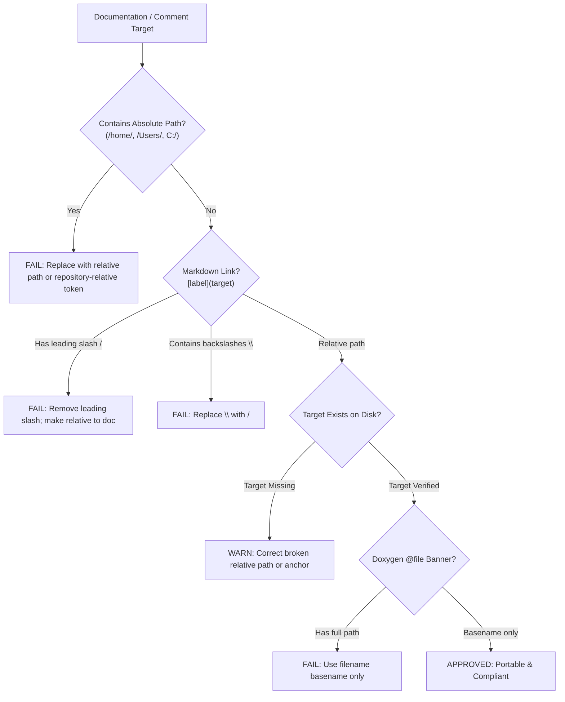

# Relative Paths in Documentation Skill

This skill enforces strict usage of relative paths across all project documentation (`docs/*.md`, plans, specifications, `README.md`) and C++ code comments (`/// @file`, `/// @see`, inline documentation).

---

## 1. Documentation Path Architecture

```
+-------------------------------------------------------------------------------+
|                       DOCUMENTATION PATH AUDIT WORKFLOW                       |
|                                                                               |
|   Target Markdown Document or Source Header                                   |
|         │                                                                     |
|         ├── [1. Absolute Path Check]: Reject /home/..., C:\..., /Users/...    |
|         ├── [2. Link Target Resolution]: Ensure target resolves from doc dir  |
|         ├── [3. Root Slash Check]: Convert /libs/... to ../libs/... or libs/  |
|         ├── [4. Separator Check]: Convert backslashes '\' to forward '/'     |
|         └── [5. Doxygen Check]: Ensure '/// @file' uses basename              |
|         │                                                                     |
|         ▼                                                                     |
|   100% Portable Documentation (Machine & CI Independent)                      |
+-------------------------------------------------------------------------------+
```



---

## 2. Step-by-Step Audit & Correction Procedure

### Step 1: Detect Hardcoded Absolute Paths
Inspect markdown files and docstrings for workstation-specific paths:
- **Search:** `/home/`, `/Users/`, `C:\`, `/root/`
- **Correction:** Replace with relative path or repository-relative reference without leading slash.

### Step 2: Validate Markdown Hyperlinks
When linking to another file from Markdown:
- If document is in `docs/` and target is in `libs/Onvif/OnvifServer.h`:
  - **Correct:** `[OnvifServer.h](../libs/Onvif/OnvifServer.h)`
  - **Incorrect:** `[OnvifServer.h](/libs/Onvif/OnvifServer.h)`
- If document is in repository root (`README.md`):
  - **Correct:** `[Device.h](libs/PelcoDCore/Device.h)`
- If linking to a sibling document in `docs/`:
  - **Correct:** `[KLV Features](KLV_Features.md)`

### Step 3: Enforce Forward Slashes
All file paths and links in Markdown and comments must use POSIX slashes:
- Replace `libs\PelcoDCore\Device.h` with `libs/PelcoDCore/Device.h`.

### Step 4: Audit Doxygen Header Banners
Verify C++ headers declare file basenames:
```cpp
/// @file Device.h
/// @brief Device controller interface.
```
Never use full or absolute paths in `@file` (e.g., avoid `/// @file libs/PelcoDCore/Device.h`).

---

## 3. Automated Scanning Tooling

Run the repository path validator against documentation files:

```bash
# Scan default documentation directories (docs/, .agents/, README.md)
python3 scripts/verify_relative_doc_paths.py

# Scan specific files in strict mode
python3 scripts/verify_relative_doc_paths.py --files docs/KLV_Features.md README.md --strict

# Verbose output
python3 scripts/verify_relative_doc_paths.py -v
```

