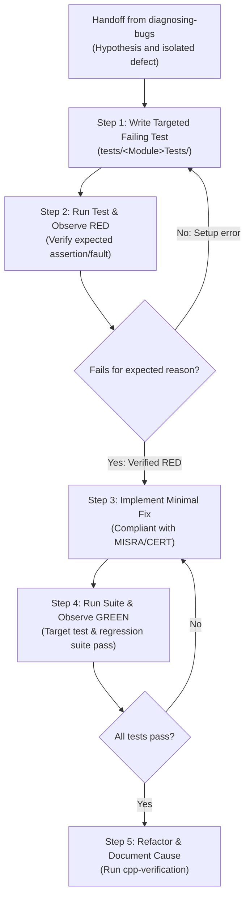

# Test-Driven Bug Fixing (TDD)

This skill enforces a strict **Test-Driven Development (TDD)** Red-Green-Refactor loop when resolving bugs, regressions, or anomalous behavior across all repository subsystems (**Tracking**, **Onvif**, **PelcoDCore**, **ViscaCore**, **Klv**, **Nmea**, **Transport**, etc.).

Never apply a code fix directly without first reproducing the failure with an automated test.

---

## 1. TDD Workflow Architecture

```
+-------------------------------------------------------------------------------+
|                       TDD BUG-FIXING LIFECYCLE (RED-GREEN-REFACTOR)           |
|                                                                               |
|   Diagnosed Defect (From .agents/skills/diagnosing-bugs)                      |
|         │                                                                     |
|         ▼                                                                     |
|   1. Write Targeted Failing Test (RED)                                        |
|      - Isolate the defect in tests/<Subsystem>Tests/                          |
|      - Test MUST fail with the exact symptom observed                         |
|         │                                                                     |
|         ▼                                                                     |
|   2. Execute & Verify RED Failure                                             |
|      - Confirm failure is not caused by test harness or fixture error         |
|         │                                                                     |
|         ▼                                                                     |
|   3. Implement Minimal Compliant Fix (GREEN)                                  |
|      - Smallest code change required to satisfy the test                      |
|      - Adhere strictly to MISRA C++:2023, SEI CERT, and IWYU rules            |
|         │                                                                     |
|         ▼                                                                     |
|   4. Execute & Verify GREEN Pass                                              |
|      - Ensure all existing regression test suites remain passing              |
|         │                                                                     |
|         ▼                                                                     |
|   5. Refactor & Document                                                      |
|      - Clean code smells without breaking tests                               |
|      - Document root cause and impact in commit / PR                          |
+-------------------------------------------------------------------------------+
```



---

## 2. Multi-Subsystem Test Seams

Choose the appropriate test harness and seam based on the affected library:

| Subsystem | Test Location | Test Pattern | Example Assertion |
| :--- | :--- | :--- | :--- |
| **Tracking** (`libs/Tracking`) | `tests/TrackingTests/` | Synthetic coordinate injection | `EXPECT_EQ(tracker.getState(), TrackerState::Tracking);` |
| **ONVIF** (`libs/Onvif`) | `tests/OnvifTests/` | Raw datagram injection into validator | `EXPECT_TRUE(validator.validateProbe(payload));` |
| **Serial Protocols** (`libs/PelcoDCore`, `libs/ViscaCore`) | `tests/PelcoDTests/` | Fragmented buffer feed via `MockTransport` | `EXPECT_EQ(receivedFrame.checksum().value(), expectedSum);` |
| **Telemetry** (`libs/Klv`, `libs/Nmea`) | `tests/KlvTests/`, `tests/NmeaTests/` | Corrupted byte-stream parsing | `EXPECT_FALSE(nmeaParser.parse(corruptedSentence));` |

---

## 3. The 5-Step Execution Procedure

1. **Step 1 — Reproduce with a Targeted Test:**
   - Do not touch production files yet.
   - Write a new unit test in the appropriate `tests/` directory exposing the defect.
2. **Step 2 — Observe Failure (RED):**
   - Run the test suite:
     ```bash
     ctest --output-on-failure -R <TestName>
     ```
   - Confirm that the test fails for the expected reason (e.g. assertion failure, invalid state transition, or out-of-bounds error).
3. **Step 3 — Implement Minimal Fix:**
   - Write the minimal code change necessary to satisfy the test.
   - Ensure the fix adheres to [`.agents/skills/cpp-verification`](../cpp-verification/SKILL.md) (no raw pointers, explicit `<cstdint>`, zero-heap on `noexcept` paths).
4. **Step 4 — Observe Passing (GREEN):**
   - Re-run the test to confirm it now passes:
     ```bash
     ctest --output-on-failure
     ```
   - Confirm zero regression across all test suites.
5. **Step 5 — Refactor & Document:**
   - Clean up code formatting, verify IWYU compliance (`python3 scripts/verify_iwyu_cstdint.py`), and ensure zero compiler warnings.
   - Document the underlying cause, the fix mechanism, and regression prevention.
