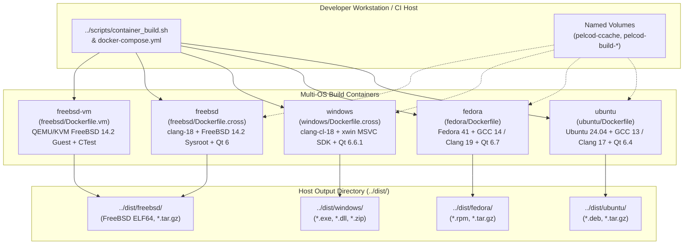

# PelcoD-Controller Multi-OS Container Build Infrastructure

Hermetic, reproducible OCI/Docker build containers for compiling **PelcoD-Controller** libraries, headless TUI/conformance tools, Qt 6 Widgets/Quick/QML GUI applications, unit tests, and redistributable packages across **Ubuntu 24.04 LTS**, **Fedora 41**, **Windows x64**, and **FreeBSD 14.2-RELEASE**.

---

## 1. Architecture & Container Topology

### 1.1 ASCII Diagram: Multi-OS Container Build Pipeline

```text
+---------------------------------------------------------------------------------------------------+
|                           DEVELOPER WORKSTATION / CI ORCHESTRATOR                                 |
|                ../scripts/container_build.sh   |   docker compose -f docker-compose.yml           |
+---------------+-------------------------+-------------------------+-------------------------------+
                |                         |                         |
                v                         v                         v
+-----------------------+   +-----------------------+   +-------------------------------------------+
|   LINUX CONTAINERS    |   |  WINDOWS CONTAINERS   |   |           FREEBSD CONTAINERS              |
|  (Native OCI Kernel)  |   |                       |   |                                           |
|                       |   |  Mode A (Linux Host): |   |  Mode A (Linux Host - Fast Cross Build):  |
| 1. ubuntu             |   |  windows              |   |  freebsd                                  |
|    ubuntu/Dockerfile  |   |  windows/Dockerfile   |   |  freebsd/Dockerfile.cross                 |
|    - GCC 13 / Clang 17|   |    .cross             |   |  - clang++-18 --target=x86_64-freebsd14.2 |
|    - Qt 6.4+ (apt)    |   |  - clang-cl-18 + xwin |   |  - FreeBSD 14.2 base.txz + pkg sysroot    |
|    - Output: .deb/.tgz|   |  - Qt 6.6.1 win64     |   |  - Linux QT_HOST_PATH=/usr                |
|                       |   |  - Output: .exe/.zip  |   |                                           |
| 2. fedora             |   |                       |   |  Mode B (Linux Host - Full Build + CTest):|
|    fedora/Dockerfile  |   |  Mode B (Win Host):   |   |  freebsd-vm (freebsd/Dockerfile.vm)       |
|    - GCC 14 / Clang 19|   |  windows/Dockerfile   |   |  - QEMU/KVM FreeBSD 14.2 QCOW2 guest      |
|    - Qt 6.7+ (dnf)    |   |    .msvc              |   |                                           |
|    - Output: .rpm/.tgz|   |  - VS 2022 + vcpkg    |   |  Mode C (FreeBSD Host):                   |
|                       |   |                       |   |  freebsd/Containerfile.native             |
+-----------+-----------+   +-----------+-----------+   +---------------------+---------------------+
            |                           |                                     |
            +---------------------------+-------------------------------------+
                                        |
                                        v
+---------------------------------------------------------------------------------------------------+
|                        VOLUME-MOUNTED ARTIFACT & PACKAGE OUTPUTS                                  |
|  ../dist/ubuntu/      ../dist/fedora/      ../dist/windows/      ../dist/freebsd/                 |
|  - bin/ & lib/        - bin/ & lib64/      - bin/*.exe & *.dll   - bin/ & lib/                    |
|  - include/           - include/           - include/            - include/                       |
|  - packages/*.deb     - packages/*.rpm     - packages/*.zip      - packages/*.tar.gz              |
+---------------------------------------------------------------------------------------------------+
```

### 1.2 Mermaid Diagram: Multi-OS Container Build Pipeline



---

## 2. Quickstart Usage (`scripts/container_build.sh`)

From the repository root, use [`../scripts/container_build.sh`](../scripts/container_build.sh):

```bash
# 1. Build all libraries, Qt 6 GUI/QML apps, TUI apps, and packages across all 4 OSes:
./scripts/container_build.sh --os all --mode apps

# 2. Build only the 17 core C++17 libraries (zero Qt dependency) on Ubuntu and Fedora with CTest:
./scripts/container_build.sh --os ubuntu,fedora --mode libs --run-tests

# 3. Build Core + Qt 6 adapter libraries (PelcoDQt, MappingQt, SightlineQt) without GUI apps:
./scripts/container_build.sh --os ubuntu --mode libs-qt

# 4. Build Headless TUI & ONVIF Conformance Server tools:
./scripts/container_build.sh --os ubuntu,fedora,freebsd --mode tui

# 5. Cross-compile Windows x64 libraries, Qt 6 GUI apps, and redistributable .zip on Linux:
./scripts/container_build.sh --os windows --mode apps

# 6. Cross-compile FreeBSD 14.2 ELF64 libraries, Qt 6 GUI apps, and .tar.gz on Linux:
./scripts/container_build.sh --os freebsd --mode apps

# 7. Run native FreeBSD 14.2 build and full CTest suite inside QEMU/KVM container:
./scripts/container_build.sh --os freebsd-vm --mode libs --run-tests

# 8. Build a single CMake target (e.g. PelcoDCore or Onvif) across all 4 OSes:
./scripts/container_build.sh --os all --mode libs --target PelcoDCore --no-package

# 9. Drop into an interactive shell inside a container for debugging:
./scripts/container_build.sh --os ubuntu --shell
```

---

## 3. Selectable Build Modes (`--mode` / `BUILD_MODE`)

| Build Mode | `PELCOD_ENABLE_QT` | `PELCOD_BUILD_APPS` | Compiled Targets |
| :--- | :---: | :---: | :--- |
| `libs` | `OFF` | `OFF` | 17 pure C++17 libraries (`Math`, `Transport`, `PelcoDCore`, `PelcoDFujinon`, `PelcoDSim`, `ViscaCore`, `ViscaSony`, `Klv`, `DjiTelemetry`, `Nmea`, `Tracking`, `Mapping`, `SightlineCore`, `PayloadHal`, `Onvif`, `Video`, `VideoFilters`) |
| `libs-qt` | `ON` | `OFF` | All 17 core C++17 libraries + 3 Qt 6 adapter libraries (`PelcoDQt`, `MappingQt`, `SightlineQt`) |
| `tui` | `OFF` | `ON` | All 17 core C++17 libraries + headless executables (`PelcoDAppTui`, `OnvifServerApp`) |
| `apps` *(default)* | `ON` | `ON` | All 20 libraries + all 9 executables (`PelcoDAppTui`, `OnvifServerApp`, `PelcoDAppQt`, `FujinonAppQt`, `ViscaAppQt`, `OnvifAppQt`, `VideoAppQt`, `RtspServerAppQt`, `SightlineAppQt`) |

---

## 4. Direct Docker Compose Usage

You can also invoke services directly via [`docker-compose.yml`](docker-compose.yml):

```bash
# Build and run Ubuntu 24.04 container (outputs to dist/ubuntu/)
docker compose -f docker/docker-compose.yml run --rm ubuntu

# Build and run Fedora 41 container with unit tests enabled
RUN_TESTS=true docker compose -f docker/docker-compose.yml run --rm fedora

# Cross-compile Windows x64 libraries only
BUILD_MODE=libs docker compose -f docker/docker-compose.yml run --rm windows

# Cross-compile FreeBSD 14.2 full suite
docker compose -f docker/docker-compose.yml run --rm freebsd
```

---

## 5. Directory Layout

| File | Description |
| :--- | :--- |
| [`docker-compose.yml`](docker-compose.yml) | Multi-container service & persistent volume definitions (`ubuntu`, `fedora`, `windows`, `freebsd`, `freebsd-vm`). |
| [`common/entrypoint-build.sh`](common/entrypoint-build.sh) | Unified inside-container configure, build, CTest, install, and CPack runner. |
| [`common/fetch-live555.sh`](common/fetch-live555.sh) | Pre-fetches and caches Live555 source archive into `/opt/cache/live555` during `docker build`. |
| [`ubuntu/Dockerfile`](ubuntu/Dockerfile) | Ubuntu 24.04 LTS container definition (GCC 13, Clang 17, Qt 6.4, FFmpeg, GStreamer, OpenCV, ONVIF). |
| [`fedora/Dockerfile`](fedora/Dockerfile) | Fedora 41 container definition (GCC 14, Clang 19, Qt 6.7, FFmpeg, GStreamer, OpenCV, ONVIF). |
| [`windows/Dockerfile.cross`](windows/Dockerfile.cross) | Linux-hosted Windows x64 cross-compilation container (`clang-cl-18`, `lld-link-18`, `xwin` MSVC SDK, `vcpkg`, Qt 6.6.1). |
| [`windows/Dockerfile.msvc`](windows/Dockerfile.msvc) | Native Windows Server Core LTSC 2022 container with Visual Studio 2022 Build Tools, `vcpkg`, and Qt 6.6.1. |
| [`windows/toolchain-clang-cl-xwin.cmake`](windows/toolchain-clang-cl-xwin.cmake) | CMake toolchain for `clang-cl-18` + `lld-link-18` against the `xwin` MSVC CRT & Windows 11 SDK. |
| [`windows/toolchain-mingw64.cmake`](windows/toolchain-mingw64.cmake) | CMake toolchain for MinGW-w64 `x86_64-w64-mingw32`. |
| [`freebsd/Dockerfile.cross`](freebsd/Dockerfile.cross) | Linux-hosted FreeBSD 14.2 amd64 cross-compilation container (`clang-18`, `ld.lld-18`, `/opt/freebsd-sysroot`). |
| [`freebsd/Dockerfile.vm`](freebsd/Dockerfile.vm) | Linux-hosted QEMU/KVM FreeBSD 14.2 VM container for native FreeBSD compilation and CTest execution. |
| [`freebsd/Containerfile.native`](freebsd/Containerfile.native) | Native FreeBSD 14.2 containerfile for FreeBSD hosts running `podman` / `ocijail`. |
| [`freebsd/bootstrap-freebsd-sysroot.sh`](freebsd/bootstrap-freebsd-sysroot.sh) | Populates `/opt/freebsd-sysroot` from official FreeBSD 14.2 `base.txz` and `pkg` binary packages. |
| [`freebsd/toolchain-freebsd14.cmake`](freebsd/toolchain-freebsd14.cmake) | CMake toolchain targeting `x86_64-unknown-freebsd14.2` with Linux host Qt code generators. |
| [`freebsd/vm-entrypoint.sh`](freebsd/vm-entrypoint.sh) | Entrypoint for booting the FreeBSD 14.2 QCOW2 VM and executing CMake + Ninja + CTest over SSH. |

