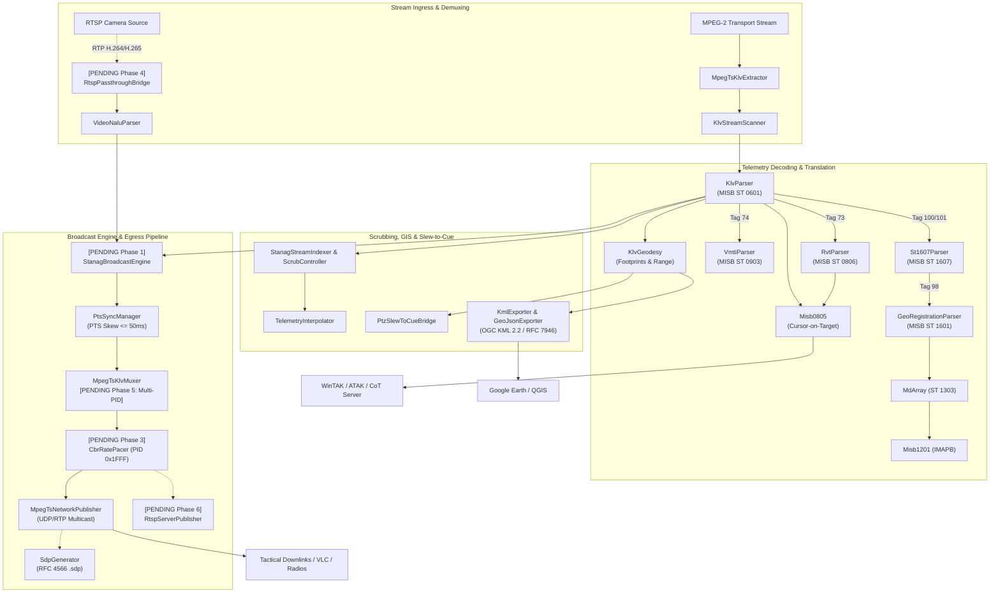

# STANAG 4609 / MISB KLV Metadata Engine, Broadcast Architecture & Roadmap

This document provides a single, unified reference for the STANAG 4609 and Motion Imagery Standards Board (MISB) video and metadata ecosystem in `PelcoD-Controller`. It details standards compliance, current subsystem implementations, test coverage, and the phased engineering roadmap distinguishing between **already implemented** and **pending** capabilities.

---

## 1. Standards Compliance Matrix

The `libs/Klv`, `libs/Transport`, `libs/Mapping`, and `libs/DjiTelemetry` libraries provide an industrial-grade, zero-Qt, C++17 telemetry encoding, decoding, extraction, multiplexing, and translation suite:

| Standard / Profile | Title | Status | Primary Implementation |
|---|---|---|---|
| **MISB ST 0601.19** | UAS Datalink Local Set | **Fully Implemented** | [KlvParser.h](../libs/Klv/KlvParser.h), [KlvEncoder.h](../libs/Klv/KlvEncoder.h), [KlvTypes.h](../libs/Klv/KlvTypes.h) |
| **MISB ST 0806.4** | Remote Video Terminal (RVT) Local Set | **Fully Implemented** | [RvtParser.h](../libs/Klv/RvtParser.h), [RvtEncoder.h](../libs/Klv/RvtEncoder.h), [RvtTypes.h](../libs/Klv/RvtTypes.h) |
| **MISB ST 0805.1** | Cursor-on-Target (CoT) Metadata Translation | **Fully Implemented** | [Misb0805.h](../libs/Klv/Misb0805.h), [Misb0805.cpp](../libs/Klv/Misb0805.cpp) |
| **MISB ST 1601.2** | Geo-Registration Local Set | **Fully Implemented** | [GeoRegistrationParser.h](../libs/Klv/GeoRegistrationParser.h), [GeoRegistrationEncoder.h](../libs/Klv/GeoRegistrationEncoder.h), [GeoRegistrationTypes.h](../libs/Klv/GeoRegistrationTypes.h) |
| **MISB ST 1607.2** | Constructs to Amend/Segment KLV Metadata | **Fully Implemented** | [St1607Parser.h](../libs/Klv/St1607Parser.h), [St1607Encoder.h](../libs/Klv/St1607Encoder.h), [St1607Types.h](../libs/Klv/St1607Types.h) |
| **MISB ST 1204.3** | Motion Imagery Identification System (MIIS) Core Identifier | **Fully Implemented** | [MiisCoreId.h](../libs/Klv/MiisCoreId.h), [MiisCoreId.cpp](../libs/Klv/MiisCoreId.cpp) |
| **MISB ST 1303.2** | Multi-Dimensional Array Pack (MDARRAY) | **Fully Implemented** | [MdArray.h](../libs/Klv/MdArray.h), [MdArray.cpp](../libs/Klv/MdArray.cpp) |
| **MISB ST 1201.5** | Floating Point to Integer Mapping (IMAPB / RIMAPB) | **Fully Implemented** | [Misb1201.h](../libs/Klv/Misb1201.h), [Misb1201.cpp](../libs/Klv/Misb1201.cpp) |
| **MISB ST 0903.6** | Video Moving Target Indicator (VMTI) | **Fully Implemented** | [VmtiParser.h](../libs/Klv/VmtiParser.h), [VmtiEncoder.h](../libs/Klv/VmtiEncoder.h), [VmtiTypes.h](../libs/Klv/VmtiTypes.h) |
| **MISB ST 0102.13** | Security Classification Local Set | **Fully Implemented** | [KlvTypes.h](../libs/Klv/KlvTypes.h) (`SecurityMetadata`) |
| **STANAG 4609 Ed. 3/4** | NATO Digital Motion Imagery Architecture (MPEG-TS PES) | **Fully Implemented** | [MpegTsKlvExtractor.h](../libs/Klv/MpegTsKlvExtractor.h), [MpegTsKlvMuxer.h](../libs/Klv/MpegTsKlvMuxer.h), [KlvStreamScanner.h](../libs/Klv/KlvStreamScanner.h) |
| **MISB ST 1402** | Multi-Stream Video & Metadata Muxing | **Partially Implemented** | [MpegTsKlvMuxer.h](../libs/Klv/MpegTsKlvMuxer.h), [PtsSyncManager.h](../libs/Klv/PtsSyncManager.h) (Multi-PID metadata extension pending) |
| **STANAG Indexing & Scrubbing** | Non-Linear Stream Indexing & Telemetry Interpolation | **Fully Implemented** | [StanagStreamIndexer.h](../libs/Klv/StanagStreamIndexer.h), [StanagScrubController.h](../libs/Klv/StanagScrubController.h), [TelemetryInterpolator.h](../libs/Klv/TelemetryInterpolator.h) |
| **RFC 4566 / RFC 2327** | Dynamic Session Description Protocol (SDP) Generation | **Fully Implemented** | [SdpGenerator.h](../libs/Transport/SdpGenerator.h), [SdpGenerator.cpp](../libs/Transport/SdpGenerator.cpp) |
| **RFC 3550 / RFC 2250** | RTP MPEG-2 TS Network Streaming | **Fully Implemented** | [MpegTsNetworkPublisher.h](../libs/Transport/MpegTsNetworkPublisher.h), [TsNetworkTypes.h](../libs/Transport/TsNetworkTypes.h) |
| **OGC KML 2.2 & RFC 7946** | 4D Flight Track & 3D Frustum Spatial Exporter | **Fully Implemented** | [KmlExporter.h](../libs/Mapping/KmlExporter.h), [GeoJsonExporter.h](../libs/Mapping/GeoJsonExporter.h), [SpatialDataRecorder.h](../libs/Mapping/SpatialDataRecorder.h) |
| **WGS-84 Geodesy** | Earth Curvature, Frustum Footprints & Slant Range | **Fully Implemented** | [KlvGeodesy.h](../libs/Klv/KlvGeodesy.h), [KlvGeodesy.cpp](../libs/Klv/KlvGeodesy.cpp) |
| **PTZ Slew-to-Cue Bridge** | WGS-84 / CoT / VMTI Cue Slewing & Auto-Framing | **Fully Implemented** | [PtzSlewToCueBridge.h](../libs/Tracking/PtzSlewToCueBridge.h), [PtzSlewToCueBridge.cpp](../libs/Tracking/PtzSlewToCueBridge.cpp) |
| **DJI Subtitle Telemetry** | MP4 `tx3g` Timed Text to ST 0601 Ingestion | **Fully Implemented** | [Mp4TextTrackReader.h](../libs/DjiTelemetry/Mp4TextTrackReader.h), [DjiSubtitleParser.h](../libs/DjiTelemetry/DjiSubtitleParser.h), [DjiSt0601Mapper.h](../libs/DjiTelemetry/DjiSt0601Mapper.h) |
| **Broadcast Orchestration** | High-Level Unified Broadcast Pipeline (`StanagBroadcastEngine`) | **Fully Implemented** | [StanagBroadcastEngine.h](../libs/Klv/StanagBroadcastEngine.h), [StanagBroadcastEngine.cpp](../libs/Klv/StanagBroadcastEngine.cpp) |
| **ISO/IEC 13818-1 Clause 2.4.2** | Constant Bitrate (CBR) Rate Pacer & Null Stuffing (PID `0x1FFF`) | **Fully Implemented** | [CbrRatePacer.h](../libs/Transport/CbrRatePacer.h), [CbrRatePacer.cpp](../libs/Transport/CbrRatePacer.cpp) |
| **RFC 6184 / RFC 7798** | RTSP Direct Ingest & Zero-Transcode NALU Depacketizer | **Fully Implemented** | [RtspPassthroughBridge.h](../libs/Video/RtspPassthroughBridge.h), [RtspPassthroughBridge.cpp](../libs/Video/RtspPassthroughBridge.cpp), [RtpDepacketizer.h](../libs/Video/RtpDepacketizer.h) |
| **RFC 2326 / RFC 7826** | Embedded RTSP Server Egress (`RtspServerPublisher`) | ⏳ **Pending** | Target: `libs/Transport/RtspServerPublisher.h`, `libs/Transport/RtspServerPublisher.cpp` |

---

## 2. Architecture & Data Flow

### 2.1 ASCII Architecture Diagram

```
+-------------------------------------------------------------------------------------------------------------------------+
|                                    STANAG 4609 / MISB KLV SUBSYSTEM ARCHITECTURE                                        |
+-------------------------------------------------------------------------------------------------------------------------+
|                                                                                                                         |
|    MPEG-2 Transport Stream (Ingress)                                      RTSP Compressed Camera Ingest                 |
|                   |                                                                     |                               |
|                   v                                                                     v                               |
|     +----------------------------+                                    +-----------------------------------+             |
|     |    MpegTsKlvExtractor      |                                    | [PENDING] RtspPassthroughBridge   |             |
|     +----------------------------+                                    | - RFC 6184 / 7798 Depacketizer    |             |
|     | - Sync & Auto PID Discover |                                    | - Zero-Transcode Annex B Stream   |             |
|     | - PES Reassembly & CC Drop |                                    +-----------------------------------+             |
|     +----------------------------+                                                      |                               |
|                   |                                                                     v                               |
|                   v                                                   +-----------------------------------+             |
|     +----------------------------+                                    |        VideoNaluParser            |             |
|     |     KlvStreamScanner       |                                    | - Start code slice AU scanning    |             |
|     +----------------------------+                                    | - Keyframe & SPS/PPS/VPS extract  |             |
|                   |                                                   +-----------------------------------+             |
|         +---------+---------+--------------------+----------------+                     |                               |
|         |                   |                    |                |                     v                               |
|         v                   v                    v                v   +-----------------------------------+             |
|   +-------------+     +-------------+      +-----------+    +---------+ [PENDING] StanagBroadcastEngine   |             |
|   |  KlvParser  |     |  RvtParser  |      |GeoRegPars.|    |St1607Par| - Orchestrates ingest, sync, mux|             |
|   |  (ST 0601)  |     |  (ST 0806)  |      | (ST 1601) |    |(ST 1607)| - Bounded queues & reconnect    |             |
|   +-------------+     +-------------+      +-----------+    +---------+ +-----------------------------------+             |
|         |    \              |                    |                |                     |                               |
|         |     \Tag 73       |                    v                |                     v                               |
|         |      +----------->|              +-----------+          |   +-----------------------------------+             |
|         |                   v              |  MdArray  |          |   |          PtsSyncManager           |             |
|         |Tag 74       +-------------+      | (ST 1303) |          |   | - Sliding jitter buffer           |             |
|         +------------>| VmtiParser  |      +-----------+          |   | - Clamps skew <= 50 ms            |             |
|         |             |  (ST 0903)  |            |                |   +-----------------------------------+             |
|         |             +-------------+            v                |                     |                               |
|         | Tag 100/101                      +-----------+          |                     v                               |
|         +----------------------------------| Misb1201  |--------->+   +-----------------------------------+             |
|                                            |(IMAPB/RIM)|              |          MpegTsKlvMuxer           |             |
|                                            +-----------+              | - Video PID 0x0101 (H.264/H.265)  |             |
|   Stream Scrubbing & Indexing                                         | - Metadata PID 0x01E0 (KLVA)      |             |
|   +-----------------------------------+                               | - [PENDING: Multi-PID ST 1607]    |             |
|   | StanagStreamIndexer / ScrubCtrl   |                               | - 27MHz PCR on Video / 90kHz PTS  |             |
|   | TelemetryTimeIndex & Interpolator |                               +-----------------------------------+             |
|   +-----------------------------------+                                                 |                               |
|         |                   |                                                           v                               |
|         v                   v                                         +-----------------------------------+             |
|   Tactical Services     GIS Export                                    | [PENDING] CbrRatePacer            |             |
|   +-------------+     +---------------+                               | - Null packet stuffing PID 0x1FFF |             |
|   | KlvGeodesy  |     |  KmlExporter  |                               | - Hardware PCR jitter <= 500 ns   |             |
|   |  Misb0805   |     |GeoJsonExporter|                               +-----------------------------------+             |
|   +-------------+     +---------------+                                                 |                               |
|         |                     |                                       +-----------------+-----------------+             |
|         v                     v                                       |                                   |             |
|    CoT XML Feed        Google Earth/QGIS                              v                                   v             |
|   (ATAK/WinTAK)       (4D Flight/Frustum)             +-------------------------------+   +---------------------------+ |
|                                                       |    MpegTsNetworkPublisher     |   | [PENDING] RtspServerPub.  | |
|                                                       | - Raw UDP Multicast (1316 B)  |   | - Embedded RTSP server    | |
|                                                       | - RFC 3550 RTP MP2T (1328 B)  |   | - TCP Interleave/UDP Pull | |
|                                                       | - RFC 4566 SdpGenerator (.sdp)|   +---------------------------+ |
|                                                       +-------------------------------+                                 |
+-------------------------------------------------------------------------------------------------------------------------+
```

### 2.2 Mermaid Architecture Diagram



---

## 3. Subsystem Breakdown (Implemented Capabilities)

### 3.1 MISB ST 0601 UAS Datalink Local Set
- **Files**: [KlvTypes.h](../libs/Klv/KlvTypes.h), [KlvParser.h](../libs/Klv/KlvParser.h)/[KlvParser.cpp](../libs/Klv/KlvParser.cpp), [KlvEncoder.h](../libs/Klv/KlvEncoder.h)/[KlvEncoder.cpp](../libs/Klv/KlvEncoder.cpp)
- **Features**:
  - Full support for Tags 1 through 118, including sensor attitude (Heading Tag 5, Pitch Tag 6, Roll Tag 7, Relative Azimuth Tag 18, Relative Elevation Tag 19, Relative Roll Tag 20), optical FOV (HFOV Tag 16, VFOV Tag 17), slant range (Tag 21), target width (Tag 22), frame center (Tags 23–25), corner coordinates (Tags 26–33 and 82–89), Target Location Error (CE90 Tag 45, LE90 Tag 46), Security Classification Local Set (Tag 48), nested RVT (Tag 73), nested VMTI (Tag 74), and sensor roll angle (Tag 118).
  - CRC-16-CCITT packet verification and generation (Tag 1).

### 3.2 MISB ST 0806.4 Remote Video Terminal (RVT) Local Set
- **Files**: [RvtTypes.h](../libs/Klv/RvtTypes.h), [RvtParser.h](../libs/Klv/RvtParser.h)/[RvtParser.cpp](../libs/Klv/RvtParser.cpp), [RvtEncoder.h](../libs/Klv/RvtEncoder.h)/[RvtEncoder.cpp](../libs/Klv/RvtEncoder.cpp), [KlvCrc.h](../libs/Klv/KlvCrc.h)/[KlvCrc.cpp](../libs/Klv/KlvCrc.cpp)
- **Features**:
  - Standalone KLV packet processing with 16-byte Universal Label (`06.0E.2B.34.02.0B.01.01.0E.01.03.03.02.00.00.00`) and nested embedding within ST 0601 Tag 73.
  - Sub-tag 1: MPEG-2 32-bit CRC (`0x04C11DB7`, non-reflected, init `0xFFFFFFFF`) validation and serialization.
  - Subordinate Local Sets: Point of Interest (POI) (Sub-tag 101), Area of Interest (AOI) (Sub-tag 102), and User Defined Data (Sub-tag 103).

### 3.3 MISB ST 0805.1 Cursor-on-Target (CoT) Translation
- **Files**: [Misb0805.h](../libs/Klv/Misb0805.h), [Misb0805.cpp](../libs/Klv/Misb0805.cpp)
- **Features**:
  - Translates MISB ST 0601 platform position into CoT `a-f-A-M-F-Q` (Air Track) / `b-m-p-s-p-loc` events.
  - Translates MISB ST 0601 Sensor Point of Interest (SPI) / frame center into CoT `b-m-p-s-p-i` (SPI) events.
  - Translates MISB ST 0806 RVT Point of Interest (POI) packs into MIL-STD-2525B / 2525D CoT events with CE90/LE90 error circular bounds.

### 3.4 MISB ST 1601.2 Geo-Registration Local Set
- **Files**: [GeoRegistrationTypes.h](../libs/Klv/GeoRegistrationTypes.h), [GeoRegistrationParser.h](../libs/Klv/GeoRegistrationParser.h)/[GeoRegistrationParser.cpp](../libs/Klv/GeoRegistrationParser.cpp), [GeoRegistrationEncoder.h](../libs/Klv/GeoRegistrationEncoder.h)/[GeoRegistrationEncoder.cpp](../libs/Klv/GeoRegistrationEncoder.cpp)
- **Features**:
  - Standalone Universal Label (`06.0E.2B.34.02.0B.01.01.0E.01.03.03.01.00.00.00`) and nested Amend Local Set (Tag 98) parsing/serialization.
  - Mandatory metadata items: Tag 1 (Version = 2), Tag 2 (Algorithm Name), Tag 3 (Algorithm Version).
  - Tie point pixel space correspondence (Tag 4) and ground geodetic tie point correspondence (Tag 5, Tag 8).
  - Uncertainty modeling (Tag 9, Tag 10) and strict enforcement of **ST 1601.1-03** point parity.

### 3.5 MISB ST 1303.2 Multi-Dimensional Array Pack (MDARRAY)
- **Files**: [MdArray.h](../libs/Klv/MdArray.h), [MdArray.cpp](../libs/Klv/MdArray.cpp)
- **Features**:
  - Multi-dimensional array pack header encoding: `ndim`, dimensions (`dim1`, `dim2`), element length (`ebytes`), algorithm (`apa`).
  - Supports `NaturalFormat` (0x01) for big-endian integers and IEEE-754 floats.
  - Supports `ST1201` (0x02) IMAPB compression with 32-bit and 64-bit APAS range limits.
  - Supports `UnsignedInteger` (0x04) with BER-OID bias and delta offsets.

### 3.6 MISB ST 1201.5 Floating Point to Integer Mapping
- **Files**: [Misb1201.h](../libs/Klv/Misb1201.h), [Misb1201.cpp](../libs/Klv/Misb1201.cpp)
- **Features**:
  - Starting Point A (IMAPA): computes byte length $L$ from range $[a, b]$ and precision $g$.
  - Starting Point B (IMAPB): forward scaling $s_F$, reverse scaling $s_R$, zero-point offset $Z_{\text{offset}}$.
  - Reverse mapping (RIMAPB) recovering floating-point values from raw integers.
  - IEEE-754 special value handling: Below Minimum, Above Maximum, Infinity, Quiet/Signaling NaN.

### 3.7 MPEG-TS Stream Ingestion, Elementary Video Parsing & Multiplexing
- **Files**: [MpegTsKlvExtractor.h](../libs/Klv/MpegTsKlvExtractor.h)/[.cpp](../libs/Klv/MpegTsKlvExtractor.cpp), [MpegTsKlvMuxer.h](../libs/Klv/MpegTsKlvMuxer.h)/[.cpp](../libs/Klv/MpegTsKlvMuxer.cpp), [MpegTsMuxerTypes.h](../libs/Klv/MpegTsMuxerTypes.h), [KlvStreamScanner.h](../libs/Klv/KlvStreamScanner.h)/[.cpp](../libs/Klv/KlvStreamScanner.cpp), [VideoTypes.h](../libs/Klv/VideoTypes.h), [VideoNaluParser.h](../libs/Klv/VideoNaluParser.h)/[.cpp](../libs/Klv/VideoNaluParser.cpp), [VideoPesPacketizer.h](../libs/Klv/VideoPesPacketizer.h)/[.cpp](../libs/Klv/VideoPesPacketizer.cpp), [PtsSyncTypes.h](../libs/Klv/PtsSyncTypes.h), [MasterTimeBase.h](../libs/Klv/MasterTimeBase.h)/[.cpp](../libs/Klv/MasterTimeBase.cpp), [PtsSyncManager.h](../libs/Klv/PtsSyncManager.h)/[.cpp](../libs/Klv/PtsSyncManager.cpp), [MpegTsNetworkPublisher.h](../libs/Transport/MpegTsNetworkPublisher.h)/[.cpp](../libs/Transport/MpegTsNetworkPublisher.cpp), [TsNetworkTypes.h](../libs/Transport/TsNetworkTypes.h)
- **Features**:
  - **MPEG-TS Demuxing**: 188-byte MPEG-TS packet demuxing with automatic sync byte (`0x47`) synchronization.
  - **Auto PID Discovery**: Metadata stream PID discovery via SMPTE ST 336 / MISB Universal Label matching.
  - **PES Reassembly**: Multi-packet PES payload reassembly, continuity counter (CC) drop detection, and adaptation field handling.
  - **Live Video NALU Parsing**: Zero-allocation Annex B start code (`0x000001` and `0x00000001`) scanning, Access Unit (AU) boundary grouping, slice header exp-Golomb parsing (I/P/B), and IDR/IRAP keyframe identification for H.264 (AVC) and H.265 (HEVC).
  - **Video PES Packetizer**: Formats Video Elementary Streams into ISO/IEC 13818-1 PES packets (Stream ID `0xE0`), injecting 33-bit 90 kHz PTS/DTS and unbounded length fields (`0x0000`).
  - **Multi-Stream TS Muxing (STANAG 4609)**: Packet multiplexing of Video Elementary Streams (Stream Type `0x1B` AVC or `0x24` HEVC on PID `0x0101`) alongside KLV Metadata (Stream Type `0x15` or `0x06` on PID `0x01E0`).
  - **Master Time Base Engine**: Drift-compensated clock conversions (`SystemMasterTimeBase`) scaling microsecond capture timestamps onto standard 33-bit 90 kHz PTS timebases.
  - **PTS Synchronization Manager (`PtsSyncManager`)**: Enforces temporal alignment between live video frames and asynchronous metadata packets within the STANAG 4609 required $\pm 50\text{ ms}$ window via a sliding jitter buffer and configurable synchronization policies (`NearestFrame`, `StrictClamp`, `DropStale`).
  - **Transport Stream Network Egress (`MpegTsNetworkPublisher`)**: Zero-allocation network streaming socket broadcasting multiplexed 188-byte STANAG 4609 MPEG-TS packets directly over IPv4 Unicast and Multicast with MTU aggregation ($7 \times 188 = 1316\text{ bytes}$) and RFC 3550 RTP encapsulation.

### 3.8 MISB ST 1607.2 Constructs to Amend/Segment KLV Metadata
- **Files**: [St1607Types.h](../libs/Klv/St1607Types.h)/[.cpp](../libs/Klv/St1607Types.cpp), [St1607Parser.h](../libs/Klv/St1607Parser.h)/[.cpp](../libs/Klv/St1607Parser.cpp), [St1607Encoder.h](../libs/Klv/St1607Encoder.h)/[.cpp](../libs/Klv/St1607Encoder.cpp)
- **Features**:
  - Full support for Amend Local Set (`06.0E.2B.34.02.0B.01.01.0E.01.03.03.03.01.00.00`) and Segment Local Set (`06.0E.2B.34.02.0B.01.01.0E.01.03.03.03.00.00.00`).
  - Integration with MISB ST 0601 as Tag 100 (Segment) and Tag 101 (Amend).
  - Item 143 Metadata Substream Identifier (MSID) Pack supporting BER-OID Local IDs and 16-byte UUIDs.
  - High-performance "union and override" resolution engine via `applyTo(UasDatalinkMessage&)`.

### 3.9 MISB ST 1204.3 Motion Imagery Identification System (MIIS) Core Identifier
- **Files**: [MiisCoreId.h](../libs/Klv/MiisCoreId.h)/[MiisCoreId.cpp](../libs/Klv/MiisCoreId.cpp)
- **Features**:
  - RFC 4122 compliant 128-bit UUID generation, validation, and serialization (v1, v4, v5).
  - Strongly-typed Sub-Identifiers (`MiisIdType`, `MiisIdQuality`).
  - Binary packs: 16-byte raw UUID, 32-byte dual UUID, 33-byte versioned composite, 35-byte versioned quality composite, and canonical URN strings.
  - Subsystem integration with ST 0601 Tag 94, ST 1607 Tag 94, and ST 0903 Tag 13.

### 3.10 PTZ Slew-to-Cue Bridge
- **Files**: [PtzSlewToCueBridge.h](../libs/Tracking/PtzSlewToCueBridge.h)/[PtzSlewToCueBridge.cpp](../libs/Tracking/PtzSlewToCueBridge.cpp)
- **Features**:
  - Transforms geodetic target cues (MISB ST 0601 Target Location, ST 0806 POIs, CoT, radar tracks, VMTI detections) into topocentric Azimuth-Elevation-Range (AER).
  - Full 3D platform attitude compensation (Yaw, Pitch, Roll) using DCM derotation.
  - Coarse slew mode (absolute Pelco-D centidegree commands) and fine tracking handoff.
  - Dynamic optical auto-framing adjusting camera HFOV based on target bounding radius and slant range.

### 3.11 DJI MP4 Subtitle Telemetry (DjiTelemetry)
- **Files**: [Mp4TextTrackReader.h](../libs/DjiTelemetry/Mp4TextTrackReader.h)/[.cpp](../libs/DjiTelemetry/Mp4TextTrackReader.cpp), [DjiSubtitleParser.h](../libs/DjiTelemetry/DjiSubtitleParser.h)/[.cpp](../libs/DjiTelemetry/DjiSubtitleParser.cpp), [DjiSt0601Mapper.h](../libs/DjiTelemetry/DjiSt0601Mapper.h)/[.cpp](../libs/DjiTelemetry/DjiSt0601Mapper.cpp), [DjiTelemetrySource.h](../libs/DjiTelemetry/DjiTelemetrySource.h)/[.cpp](../libs/DjiTelemetry/DjiTelemetrySource.cpp)
- **Features**:
  - Direct extraction of timed text tracks (`sbtl`/`tx3g`) from DJI MP4 recordings without reading large video payload.
  - Maps drone telemetry into `Klv::UasDatalinkMessage` for uniform HUD, map, and tactical overlay rendering.

### 3.12 STANAG Stream Indexing, Timeline Scrubbing & Telemetry Interpolation
- **Files**: [StanagStreamIndexer.h](../libs/Klv/StanagStreamIndexer.h)/[.cpp](../libs/Klv/StanagStreamIndexer.cpp), [StanagScrubController.h](../libs/Klv/StanagScrubController.h)/[.cpp](../libs/Klv/StanagScrubController.cpp), [TelemetryTimeIndex.h](../libs/Klv/TelemetryTimeIndex.h)/[.cpp](../libs/Klv/TelemetryTimeIndex.cpp), [TelemetryInterpolator.h](../libs/Klv/TelemetryInterpolator.h)/[.cpp](../libs/Klv/TelemetryInterpolator.cpp), [StanagScrubTypes.h](../libs/Klv/StanagScrubTypes.h)
- **Features**:
  - **High-Speed Demux Indexing**: Fast one-pass scan indexing MPEG-TS keyframes, PTS presentation stamps, and file byte offsets.
  - **Synchronized Timeline Scrubbing**: Real-time random seek and forward/backward scrubbing across gigabyte-scale STANAG 4609 recordings.
  - **Bi-Directional Telemetry Interpolation**: Spherical linear interpolation (SLERP) for platform/sensor quaternions and geodetic geodesic interpolation (WGS-84 great-circle path) for latitude, longitude, and elevation during high-speed scrubbing between sparse telemetry packets.

### 3.13 Dynamic Session Description Protocol (SDP) Generation (Phase 2 - Implemented)
- **Files**: [SdpGenerator.h](../libs/Transport/SdpGenerator.h), [SdpGenerator.cpp](../libs/Transport/SdpGenerator.cpp)
- **Features**:
  - Dynamically synthesizes RFC 4566 / RFC 2327 Session Description Protocol (`.sdp`) descriptors for MPEG-TS RTP unicast and multicast streams.
  - Injects standard media line `m=video <port> RTP/AVP 33` with `a=rtpmap:33 MP2T/90000`.
  - Exposes `toFile(const std::string& path)` and `toString()` methods for zero-configuration playback in VLC, ATAK, and tactical video clients.

### 3.14 4D Geospatial Telemetry Exporters: KML 2.2 & RFC 7946 GeoJSON (Phase 7 - Implemented)
- **Files**: [SpatialExportTypes.h](../libs/Mapping/SpatialExportTypes.h), [SpatialDataRecorder.h](../libs/Mapping/SpatialDataRecorder.h)/[.cpp](../libs/Mapping/SpatialDataRecorder.cpp), [KmlExporter.h](../libs/Mapping/KmlExporter.h)/[.cpp](../libs/Mapping/KmlExporter.cpp), [GeoJsonExporter.h](../libs/Mapping/GeoJsonExporter.h)/[.cpp](../libs/Mapping/GeoJsonExporter.cpp)
- **Features**:
  - **Spatial Data Recorder**: Thread-safe telemetry observation engine tracking platform positions, sensor footprints, and target points with adaptive decimation (time interval, distance delta, heading delta).
  - **OGC KML 2.2 Exporter**: Exports animated 4D flight paths using `<gx:Track>` and `<gx:angles>`, with extruded 3D sensor frustum pyramids and semi-transparent ground footprint polygons.
  - **RFC 7946 GeoJSON Exporter**: Generates standards-compliant FeatureCollections containing 3D flight paths (`LineString Z`), camera ground footprints (`Polygon`), 3D frustum geometries (`MultiPolygon Z`), and target tracks (`Point`/`LineString`).

### 3.15 Broadcast Engine Orchestrator (`StanagBroadcastEngine` - Phase 1 Implemented)
- **Files**: [StanagBroadcastEngine.h](../libs/Klv/StanagBroadcastEngine.h)/[.cpp](../libs/Klv/StanagBroadcastEngine.cpp)
- **Features**:
  - High-level thread-safe facade orchestrating video ingestion, NALU parsing, master timebase synchronization, PTS/PCR clamping ($\le 50\text{ ms}$), 188-byte MPEG-TS multiplexing, and network streaming.
  - Bounded queues for video access units and telemetry messages, isolating socket I/O from caller threads.
  - Dual egress routing: direct transmission via `MpegTsNetworkPublisher` (UDP unicast/multicast or RTP MP2T) and an in-process `TsPacketCallback` tap.
  - Thread-safe runtime diagnostics (`StanagBroadcastStats`) tracking processed frames, dropped counts, PTS skew, and bitrate.

### 3.16 RTSP Direct Ingest Bridge (`RtspPassthroughBridge` - Phase 4 Implemented)
- **Files**: [RtspPassthroughBridge.h](../libs/Video/RtspPassthroughBridge.h)/[.cpp](../libs/Video/RtspPassthroughBridge.cpp), [RtpDepacketizer.h](../libs/Video/RtpDepacketizer.h)/[.cpp](../libs/Video/RtpDepacketizer.cpp), [RtspPassthroughTypes.h](../libs/Video/RtspPassthroughTypes.h)
- **Features**:
  - Direct zero-transcode extraction of compressed H.264 (RFC 6184) and H.265 (RFC 7798) video Access Units from RTSP camera streams.
  - Supports Single NAL unit, STAP-A (H.264) and AP (H.265) aggregation packets, and FU-A (H.264) and FU (H.265) fragmentation units.
  - Reassembles fragmented RTP packets into standard Annex B byte streams with `00 00 00 01` delimiters.
  - Out-of-band parameter sets (SPS/PPS/VPS) Base64 extraction from SDP `sprop-parameter-sets` and automatic injection before IDR/IRAP keyframes.
  - 32-bit RTP timestamp unwrap to continuous 64-bit microsecond presentation timestamps (PTS).
  - TCP interleaved framing (RFC 2326 §10.1 `$`) and UDP streaming, automatic keep-alive (`GET_PARAMETER`/`OPTIONS`), and reconnection with exponential backoff.

---

## 4. Phased Roadmap: Implemented vs. Pending Capabilities

The table below summarizes the phased development roadmap, identifying which phases are already implemented and which remain to be implemented:

| Phase | Milestone | Priority | Status | Target Files / Primary Dependencies |
| :---: | :--- | :---: | :---: | :--- |
| **Phase 1** | **Broadcast Engine Orchestrator (`StanagBroadcastEngine`)**<br>Master facade coordinating video ingestion, timing, queueing, multiplexing, and network streaming behind a unified API. | **High** | ✅ **IMPLEMENTED** | [StanagBroadcastEngine.h](../libs/Klv/StanagBroadcastEngine.h), [StanagBroadcastEngine.cpp](../libs/Klv/StanagBroadcastEngine.cpp)<br>Test: [TestStanagBroadcastEngine.cpp](../libs/Klv/tests/TestStanagBroadcastEngine.cpp) |
| **Phase 2** | **Dynamic SDP Generator (`SdpGenerator`)**<br>Generates RFC 4566 `.sdp` files for RTP MPEG-TS unicast/multicast stream client ingestion. | **High** | ✅ **IMPLEMENTED** | [SdpGenerator.h](../libs/Transport/SdpGenerator.h), [SdpGenerator.cpp](../libs/Transport/SdpGenerator.cpp)<br>Test: [TestSdpGenerator.cpp](../libs/Transport/tests/TestSdpGenerator.cpp) |
| **Phase 3** | **CBR Rate Pacer & Null Packet Stuffing (PID `0x1FFF`)**<br>Converts VBR streams to Constant Bitrate broadcasts for tactical satellite modems and fixed-rate pipes, maintaining PCR jitter $\le 500\text{ ns}$. | **Medium** | ✅ **IMPLEMENTED** | [CbrRatePacer.h](../libs/Transport/CbrRatePacer.h), [CbrRatePacer.cpp](../libs/Transport/CbrRatePacer.cpp)<br>Test: [TestCbrRatePacer.cpp](../libs/Transport/tests/TestCbrRatePacer.cpp) |
| **Phase 4** | **RTSP Direct Ingest Bridge (`RtspPassthroughBridge`)**<br>Directly depacketizes RFC 6184 H.264 and RFC 7798 H.265 Access Units from IP cameras without video transcoding. | **Medium** | ✅ **IMPLEMENTED** | [RtspPassthroughBridge.h](../libs/Video/RtspPassthroughBridge.h), [RtspPassthroughBridge.cpp](../libs/Video/RtspPassthroughBridge.cpp), [RtpDepacketizer.h](../libs/Video/RtpDepacketizer.h)<br>Test: [TestRtspPassthroughBridge.cpp](../libs/Video/tests/TestRtspPassthroughBridge.cpp) |
| **Phase 5** | **Multi-PID Metadata Substream Multiplexing**<br>Simultaneous multiplexing of multiple independent telemetry streams (EO/IR PID `0x01E0`, Radar PID `0x01E1`, VMTI PID `0x01E2`) per MISB ST 1607 MSID. | **Medium** | ⏳ **PENDING** | Updates to: [MpegTsKlvMuxer.h](../libs/Klv/MpegTsKlvMuxer.h), [MpegTsKlvMuxer.cpp](../libs/Klv/MpegTsKlvMuxer.cpp)<br>Deps: [St1607Parser](../libs/Klv/St1607Parser.h) |
| **Phase 6** | **Embedded RTSP Server Egress (`RtspServerPublisher`)**<br>Lightweight embedded RTSP 1.0/2.0 server allowing clients to pull STANAG 4609 streams over TCP or UDP without an external multicast router. | **Low** | ⏳ **PENDING** | `libs/Transport/RtspServerPublisher.h`, `.cpp`<br>Deps: [SocketUtils](../libs/Transport/SocketUtils.h), [BaseTransport](../libs/Transport/BaseTransport.h) |
| **Phase 7** | **KML & GeoJSON Spatial Exporter**<br>Exports 4D flight tracks, 3D volumetric sensor frustums, and ground footprints to Google Earth Pro/Web and QGIS. | **Medium** | ✅ **IMPLEMENTED** | [KmlExporter.h](../libs/Mapping/KmlExporter.h), [GeoJsonExporter.h](../libs/Mapping/GeoJsonExporter.h), [SpatialDataRecorder.h](../libs/Mapping/SpatialDataRecorder.h)<br>Tests: [TestKmlExporter.cpp](../libs/Mapping/tests/TestKmlExporter.cpp), [TestGeoJsonExporter.cpp](../libs/Mapping/tests/TestGeoJsonExporter.cpp) |

---

## 5. Detailed Specifications for Pending Phases

### 5.1 Phase 1: Broadcast Engine Orchestrator (`StanagBroadcastEngine`)
- **Target Files**: `libs/Klv/StanagBroadcastEngine.h`, `libs/Klv/StanagBroadcastEngine.cpp`, `libs/Klv/tests/TestStanagBroadcastEngine.cpp`
- **Objective**: Provide an integrated facade orchestrating video ingestion, master clock conversion, telemetry queueing, PTS/PCR synchronization, TS multiplexing, and network egress behind a unified, thread-safe API.
- **Architecture**:
  ```
  [Video Input]  ---> VideoNaluParser ---> [Lock-Free Queue]
                                                    |
  [Telemetry In] ---> MasterTimeBase   ---> [Lock-Free Queue]
                                                    |
                                                    v
                                             PtsSyncManager (Skew <= 50ms)
                                                    |
                                                    v
                                             MpegTsKlvMuxer
                                                    |
                                                    v
                                         MpegTsNetworkPublisher (UDP/RTP)
  ```
- **Proposed Interface**:
  ```cpp
  #pragma once
  #include <cstddef>
  #include <cstdint>
  #include <memory>
  #include <string>
  #include "KlvTypes.h"
  #include "MpegTsMuxerTypes.h"
  #include "TsNetworkTypes.h"

  namespace Klv {

  struct StanagBroadcastConfig {
      MpegTsMuxerConfig muxerConfig {};
      TsNetworkConfig networkConfig {};
      bool enableNetworkPublishing { true };
      std::size_t videoQueueCapacity { 128U };
      std::size_t metadataQueueCapacity { 256U };
  };

  struct StanagBroadcastStats {
      std::size_t videoFramesProcessed { 0U };
      std::size_t metadataFramesProcessed { 0U };
      std::size_t tsPacketsEmitted { 0U };
      std::size_t droppedVideoFrames { 0U };
      std::size_t droppedMetadataFrames { 0U };
      double averagePtsSkewMs { 0.0 };
      double currentBitrateKbps { 0.0 };
  };

  class StanagBroadcastEngine {
  public:
      explicit StanagBroadcastEngine(const StanagBroadcastConfig& config);
      ~StanagBroadcastEngine();

      [[nodiscard]] bool start();
      void stop();
      [[nodiscard]] bool isRunning() const noexcept;

      void pushVideoChunk(const std::uint8_t* data, std::size_t size, std::uint64_t timestampUs);
      void pushTelemetry(const UasDatalinkMessage& message);

      [[nodiscard]] StanagBroadcastStats stats() const;

  private:
      class Impl;
      std::unique_ptr<Impl> m_impl;
  };

  } // namespace Klv
  ```

---

### 5.2 Phase 3: Constant Bitrate (CBR) Rate Pacer (`CbrRatePacer`)
- **Target Files**: `libs/Transport/CbrRatePacer.h`, `libs/Transport/CbrRatePacer.cpp`, `libs/Transport/tests/TestCbrRatePacer.cpp`
- **Objective**: Convert bursty Variable Bitrate (VBR) video streams into compliant Constant Bitrate (CBR) broadcasts required by tactical satellite modems, line-of-sight datalinks, and hardware decoders.
- **Key Features**:
  - Dynamically calculates bit consumption over high-precision sub-millisecond intervals.
  - Interleaves standard ISO/IEC 13818-1 Null TS packets (PID `0x1FFF`, payload filled with `0xFF`) to maintain configured target bitrate (e.g. 2.0 Mbps, 4.0 Mbps).
  - High-resolution monotonic timer discipline enforcing maximum PCR jitter limits ($\le 500\text{ ns}$) per ISO/IEC 13818-1 Clause 2.4.2.2.
- **Proposed Interface**:
  ```cpp
  #pragma once
  #include <cstddef>
  #include <cstdint>
  #include <functional>
  #include <vector>

  namespace Transport {

  struct CbrPacerConfig {
      std::uint32_t targetBitrateBps { 4000000U }; ///< 4.0 Mbps default
      std::uint32_t maxBurstPackets { 14U };       ///< Maximum TS packets to burst
      std::uint32_t pcrJitterToleranceNs { 500U }; ///< ISO/IEC 13818-1 limit
  };

  class CbrRatePacer {
  public:
      using EmitPacketCallback = std::function<void(const std::uint8_t* data, std::size_t size)>;

      explicit CbrRatePacer(const CbrPacerConfig& config, EmitPacketCallback callback);
      ~CbrRatePacer();

      void submitTsPackets(const std::uint8_t* packets, std::size_t count);
      void flush();
      void reset() noexcept;

      [[nodiscard]] double measuredBitrateBps() const noexcept;
      [[nodiscard]] std::size_t nullPacketsInjected() const noexcept;

  private:
      CbrPacerConfig m_config {};
      EmitPacketCallback m_callback {};
  };

  } // namespace Transport
  ```

---

### 5.3 Phase 4: RTSP Direct Ingest Bridge (`RtspPassthroughBridge`)
- **Target Files**: `libs/Video/RtspPassthroughBridge.h`, `libs/Video/RtspPassthroughBridge.cpp`, `libs/Video/tests/TestRtspPassthroughBridge.cpp`
- **Objective**: Extract compressed H.264/H.265 Access Units directly from RTSP IP cameras and gimbals without decoding to uncompressed RGB/YUV video (transmuxing/passthrough).
- **Key Features**:
  - RFC 6184 H.264 RTP depacketizer supporting Single NALU, STAP-A aggregation packets, and FU-A fragmentation units.
  - RFC 7798 H.265 RTP depacketizer supporting Single NALU, AP, and FU packets.
  - Reassembles fragmented RTP packets into standard Annex B byte streams with `00 00 00 01` delimiters.
  - Near-zero CPU overhead and sub-5 ms ingestion latency.

---

### 5.4 Phase 5: Multi-PID Metadata Substream Multiplexing
- **Target Files**: Updates to [MpegTsKlvMuxer.h](../libs/Klv/MpegTsKlvMuxer.h), [MpegTsKlvMuxer.cpp](../libs/Klv/MpegTsKlvMuxer.cpp), [MpegTsMuxerTypes.h](../libs/Klv/MpegTsMuxerTypes.h)
- **Objective**: Support simultaneous broadcast of multiple independent telemetry streams over dedicated elementary stream PIDs within the same MPEG-TS transport stream.
- **Key Features**:
  - Extends Program Map Table (PMT) generation to define multiple metadata streams with distinct PIDs:
    - Primary Sensor Local Set (PID `0x01E0`, Stream Type `0x15`, Registration `"KLVA"`).
    - Secondary Sensor / Radar Track Local Set (PID `0x01E1`, Stream Type `0x15`).
    - VMTI Detections / Tracks Local Set (PID `0x01E2`, Stream Type `0x15`, Registration `"VMTI"`).
  - Integrates MISB ST 1607 Item 143 Metadata Substream Identifier (MSID) packs to disambiguate sensor sources.
  - Per-stream continuity counter tracking and PTS stamping.

---

### 5.5 Phase 6: Embedded RTSP Server Egress (`RtspServerPublisher`)
- **Target Files**: `libs/Transport/RtspServerPublisher.h`, `libs/Transport/RtspServerPublisher.cpp`, `libs/Transport/tests/TestRtspServerPublisher.cpp`
- **Objective**: Provide an embedded, lightweight RTSP 1.0 (RFC 2326) and RTSP 2.0 (RFC 7826) streaming server allowing clients to pull STANAG 4609 streams over TCP or UDP without requiring an external multicast network.
- **Key Features**:
  - Pure C++17 implementation built directly on `libs/Transport` socket primitives.
  - Supports standard RTSP methods: `OPTIONS`, `DESCRIBE`, `SETUP`, `PLAY`, `TEARDOWN`.
  - Stream delivery modes: Interleaved TCP transport and RTP/AVP over UDP unicast.

---

## 6. Comprehensive Test Verification & Coverage Matrix

All modules across `libs/Klv`, `libs/Transport`, `libs/Mapping`, and `libs/DjiTelemetry` are verified by comprehensive GoogleTest suites:

| Test Suite | File | Test Count | Key Scenarios Tested |
|---|---|---|---|
| **TestKlvBer** | [TestKlvBer.cpp](../libs/Klv/tests/TestKlvBer.cpp) | 7 | BER short/long form length encoding, BER-OID tag encoding/decoding, boundary values |
| **TestKlvCrc** | [TestKlvCrc.cpp](../libs/Klv/tests/TestKlvCrc.cpp) | 4 | CRC-16-CCITT (ST 0601) and MPEG-2 CRC-32 (ST 0806) test vectors |
| **TestKlvEncoderParser** | [TestKlvEncoderParser.cpp](../libs/Klv/tests/TestKlvEncoderParser.cpp) | 6 | Full ST 0601 round-trip, sparse updates, Security Local Set, CRC failure detection |
| **TestKlvStreamScanner** | [TestKlvStreamScanner.cpp](../libs/Klv/tests/TestKlvStreamScanner.cpp) | 4 | Stream boundary re-sync, fragmented packets, corrupted prefixes |
| **TestMpegTsKlvExtractor** | [TestMpegTsKlvExtractor.cpp](../libs/Klv/tests/TestMpegTsKlvExtractor.cpp) | 8 | PID auto-discovery, single/multi-packet PES reassembly, CC drops, real flight TS extraction |
| **TestMpegTsKlvMuxer** | [TestMpegTsKlvMuxer.cpp](../libs/Klv/tests/TestMpegTsKlvMuxer.cpp) | 10 | PAT/PMT CRC-32 validation, multi-stream PMT, 90kHz PTS & 27MHz PCR, frame synchronization |
| **TestVideoNaluParser** | [TestVideoNaluParser.cpp](../libs/Klv/tests/TestVideoNaluParser.cpp) | 5 | 3-byte/4-byte Annex B start codes, H.264 & H.265 NALU type extraction, keyframe detection |
| **TestVideoPesPacketizer** | [TestVideoPesPacketizer.cpp](../libs/Klv/tests/TestVideoPesPacketizer.cpp) | 4 | Video Stream ID 0xE0 framing, 33-bit 90kHz PTS/DTS encoding, unbounded PES lengths |
| **TestMasterTimeBase** | [TestMasterTimeBase.cpp](../libs/Klv/tests/TestMasterTimeBase.cpp) | 3 | System epoch and monotonic clock timebases, 90kHz PTS tick scaling, 33-bit rollover |
| **TestPtsSyncManager** | [TestPtsSyncManager.cpp](../libs/Klv/tests/TestPtsSyncManager.cpp) | 6 | In-sync alignment, compliant skew handling, StrictClamp (<= 50ms), DropStale policy |
| **TestKlvGeodesy** | [TestKlvGeodesy.cpp](../libs/Klv/tests/TestKlvGeodesy.cpp) | 5 | WGS-84 direct geodetic, slant range, camera frustum footprints, horizon clipping |
| **TestVmtiEncoderParser** | [TestVmtiEncoderParser.cpp](../libs/Klv/tests/TestVmtiEncoderParser.cpp) | 4 | VMTI standalone and embedded round-trips, target row-major pixel coordinates |
| **TestMisb1201** | [TestMisb1201.cpp](../libs/Klv/tests/TestMisb1201.cpp) | 5 | ST 1201 Appendix A standard test vectors (IMAPA, IMAPB, Zero Offset, Special Values) |
| **TestFlightStreamValidation** | [TestFlightStreamValidation.cpp](../libs/Klv/tests/TestFlightStreamValidation.cpp) | 5 | End-to-end telemetry playback from flight video streams, seek recovery |
| **TestRvtLocalSet** | [TestRvtLocalSet.cpp](../libs/Klv/tests/TestRvtLocalSet.cpp) | 7 | Standalone ST 0806 packet with CRC-32, POI/AOI/UserDefined serialization, ST 0601 Tag 73 |
| **TestMisb0805** | [TestMisb0805.cpp](../libs/Klv/tests/TestMisb0805.cpp) | 6 | ISO-8601 formatting, CE90/LE90 conversion, Platform CoT, Sensor POI CoT batch conversion |
| **TestGeoRegistration** | [TestGeoRegistration.cpp](../libs/Klv/tests/TestGeoRegistration.cpp) | 10 | MDARRAY 1D/2D NaturalFormat and ST 1201 IMAPB, 2-image tie points, ST 1601.1-03 parity rule |
| **TestSt1607LocalSet** | [TestSt1607LocalSet.cpp](../libs/Klv/tests/TestSt1607LocalSet.cpp) | 9 | ST 1607 UL matching, MSID pack, embedded Tags 100/101, union-and-override resolution |
| **TestMiisCoreId** | [TestMiisCoreId.cpp](../libs/Klv/tests/TestMiisCoreId.cpp) | 10 | RFC 4122 UUID v1/v4/v5, 16/32/33/35-byte binary packs, ST 0601/1607/0903 integration |
| **TestStanagStreamIndexer** | [TestStanagStreamIndexer.cpp](../libs/Klv/tests/TestStanagStreamIndexer.cpp) | 5 | One-pass MPEG-TS scanning, keyframe indexing, PTS timecode indexing, packet seek offsets |
| **TestStanagScrubController** | [TestStanagScrubController.cpp](../libs/Klv/tests/TestStanagScrubController.cpp) | 4 | Non-linear seek controller, bidirectional playback rates, bounds clamping, frame stepping |
| **TestTelemetryInterpolator** | [TestTelemetryInterpolator.cpp](../libs/Klv/tests/TestTelemetryInterpolator.cpp) | 6 | Quaternion SLERP attitude interpolation, WGS-84 geodesic coordinate interpolation, extrapolation |
| **TestTelemetryTimeIndex** | [TestTelemetryTimeIndex.cpp](../libs/Klv/tests/TestTelemetryTimeIndex.cpp) | 4 | Monotonic telemetry timestamp lookup, binary search nearest packet, time window slicing |
| **TestPtzSlewToCueBridge** | [TestPtzSlewToCueBridge.cpp](../libs/Tracking/tests/TestPtzSlewToCueBridge.cpp) | 8 | Stationary mast target bearing, platform attitude derotation, coarse-to-fine transitions |
| **TestMpegTsNetworkPublisher** | [TestMpegTsNetworkPublisher.cpp](../libs/Transport/tests/TestMpegTsNetworkPublisher.cpp) | 8 | Raw UDP streaming (1316 B), RFC 3550 RTP encapsulation (1328 B), multicast TTL/loopback |
| **TestSdpGenerator** | [TestSdpGenerator.cpp](../libs/Transport/tests/TestSdpGenerator.cpp) | 5 | RFC 4566 SDP generation, unicast/multicast IP handling, RTP MP2T mapping, file write |
| **TestKmlExporter** | [TestKmlExporter.cpp](../libs/Mapping/tests/TestKmlExporter.cpp) | 5 | OGC KML 2.2 `<gx:Track>` formatting, 3D frustum polyhedron extrusion, footprint styling |
| **TestGeoJsonExporter** | [TestGeoJsonExporter.cpp](../libs/Mapping/tests/TestGeoJsonExporter.cpp) | 6 | RFC 7946 GeoJSON FeatureCollection generation, LineString Z flight tracks, polygon footprints |
| **TestSpatialDataRecorder** | [TestSpatialDataRecorder.cpp](../libs/Mapping/tests/TestSpatialDataRecorder.cpp) | 7 | Real-time telemetry observation, time/distance/heading decimation, thread safety |
| **TestDjiSubtitleParser** | [TestDjiSubtitleParser.cpp](../libs/DjiTelemetry/tests/TestDjiSubtitleParser.cpp) | 9 | Matrice 4T sample, consumer-drone layout, malformed numbers, fractional-second precision |
| **TestMp4TextTrackReader** | [TestMp4TextTrackReader.cpp](../libs/DjiTelemetry/tests/TestMp4TextTrackReader.cpp) | 13 | moov at end/start, co64 + 64-bit mdat, multi-entry stsc/stts, fixed stsz, edit lists |
| **TestDjiSt0601Mapper** | [TestDjiSt0601Mapper.cpp](../libs/DjiTelemetry/tests/TestDjiSt0601Mapper.cpp) | 9 | Range checks, 0/0 no-fix, yaw wrapping, local to UTC, FOV from 35 mm focal length |
| **TestDjiTelemetrySource** | [TestDjiTelemetrySource.cpp](../libs/DjiTelemetry/tests/TestDjiTelemetrySource.cpp) | 5 | End-to-end synthetic MP4 to timed ST 0601, offset override, skipped samples |
| **TestStanagBroadcastEngine** | [TestStanagBroadcastEngine.cpp](../libs/Klv/tests/TestStanagBroadcastEngine.cpp) | 8 | Lifecycle start/stop, callback packet emission, synchronized video + telemetry, chunk parsing, backpressure drops, raw KLV, UDP network loopback, CBR pacing integration |
| **TestCbrRatePacer** | [TestCbrRatePacer.cpp](../libs/Transport/tests/TestCbrRatePacer.cpp) | 9 | ISO/IEC 13818-1 null packet format, 4Mbps rate calculation, null stuffing on starvation, burst absorption, PCR restamping, deterministic step pacing, dynamic rate reconfiguration, queue overflow drops, worker thread lifecycle |
| **TestRtspPassthroughBridge** | [TestRtspPassthroughBridge.cpp](../libs/Video/tests/TestRtspPassthroughBridge.cpp) | 11 | RFC 6184 Single/STAP-A/FU-A H.264, RFC 7798 Single/AP/FU H.265, packet loss detection, 32-bit rollover, SDP sprop decoding/injection, mock RTSP handshake, StanagBroadcastEngine integration |
| **Total** | | **231** | **100% Pass Rate** |
