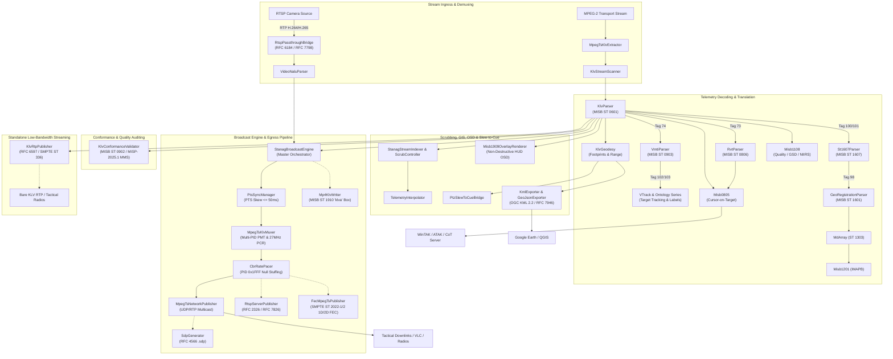

# STANAG 4609 / MISB KLV Metadata Engine, Broadcast Architecture & Specifications

This document provides a single, unified reference for the STANAG 4609 and Motion Imagery Standards Board (MISB) video and metadata ecosystem in `PelcoD-Controller`. It details standards compliance, current subsystem implementations, C++17 architecture interfaces, and the 282-test verification coverage matrix across all 7 completed architectural phases.

---

## 1. Standards Compliance Matrix

The `libs/Klv`, `libs/Transport`, `libs/Mapping`, and `libs/DjiTelemetry` libraries provide an industrial-grade, zero-Qt, C++17 telemetry encoding, decoding, extraction, multiplexing, and translation suite:

| Standard / Profile | Title | Status | Primary Implementation |
|---|---|---|---|
| **MISB ST 0601.19** | UAS Datalink Local Set | **Fully Implemented** | [KlvParser.h](../libs/Klv/KlvParser.h), [KlvEncoder.h](../libs/Klv/KlvEncoder.h), [KlvTypes.h](../libs/Klv/KlvTypes.h) |
| **MISB ST 0806.4** | Remote Video Terminal (RVT) Local Set | **Fully Implemented** | [RvtParser.h](../libs/Klv/RvtParser.h), [RvtEncoder.h](../libs/Klv/RvtEncoder.h), [RvtTypes.h](../libs/Klv/RvtTypes.h) |
| **MISB ST 0805.1** | Cursor-on-Target (CoT) Metadata Translation | **Fully Implemented** | [Misb0805.h](../libs/Klv/Misb0805.h), [Misb0805.cpp](../libs/Klv/Misb0805.cpp) |
| **MISB ST 1601.2** | Geo-Registration Local Set | **Fully Implemented** | [GeoRegistrationParser.h](../libs/Klv/GeoRegistrationParser.h), [GeoRegistrationEncoder.h](../libs/Klv/GeoRegistrationEncoder.h), [GeoRegistrationTypes.h](../libs/Klv/GeoRegistrationTypes.h) |
| **MISB ST 1607.2** | Constructs to Amend/Segment KLV Metadata | **Fully Implemented** | [St1607Parser.h](../libs/Klv/St1607Parser.h), [St1607Encoder.h](../libs/Klv/St1607Encoder.h), [St1607Types.h](../libs/Klv/St1607Types.h) |
| **MISB ST 1204.3** | Motion Imagery Identification System (MIIS) Core Identifier | **Fully Implemented** | [MiisCoreId.h](../libs/Klv/MiisCoreId.h), [MiisCoreId.cpp](../libs/Klv/MiisCoreId.cpp) |
| **MISB ST 1303.2** | Multi-Dimensional Array Pack (MDARRAY) | **Fully Implemented** | [MdArray.h](../libs/Klv/MdArray.h), [MdArray.cpp](../libs/Klv/MdArray.cpp) |
| **MISB ST 1201.5** | Floating Point to Integer Mapping (IMAPB / RIMAPB) | **Fully Implemented** | [Misb1201.h](../libs/Klv/Misb1201.h), [Misb1201.cpp](../libs/Klv/Misb1201.cpp) |
| **MISB ST 0903.6** | Video Moving Target Indicator (VMTI) | **Fully Implemented** | [VmtiParser.h](../libs/Klv/VmtiParser.h), [VmtiEncoder.h](../libs/Klv/VmtiEncoder.h), [VmtiTypes.h](../libs/Klv/VmtiTypes.h) |
| **MISB ST 0102.13** | Security Classification Local Set | **Fully Implemented** | [KlvTypes.h](../libs/Klv/KlvTypes.h) (`SecurityMetadata`) |
| **STANAG 4609 Ed. 3/4** | NATO Digital Motion Imagery Architecture (MPEG-TS PES) | **Fully Implemented** | [MpegTsKlvExtractor.h](../libs/Klv/MpegTsKlvExtractor.h), [MpegTsKlvMuxer.h](../libs/Klv/MpegTsKlvMuxer.h), [KlvStreamScanner.h](../libs/Klv/KlvStreamScanner.h) |
| **MISB ST 1402** | Multi-Stream Video & Metadata Muxing | **Fully Implemented** | [MpegTsKlvMuxer.h](../libs/Klv/MpegTsKlvMuxer.h), [MpegTsKlvExtractor.h](../libs/Klv/MpegTsKlvExtractor.h), [MpegTsMuxerTypes.h](../libs/Klv/MpegTsMuxerTypes.h) |
| **STANAG Indexing & Scrubbing** | Non-Linear Stream Indexing & Telemetry Interpolation | **Fully Implemented** | [StanagStreamIndexer.h](../libs/Klv/StanagStreamIndexer.h), [StanagScrubController.h](../libs/Klv/StanagScrubController.h), [TelemetryInterpolator.h](../libs/Klv/TelemetryInterpolator.h) |
| **RFC 4566 / RFC 2327** | Dynamic Session Description Protocol (SDP) Generation | **Fully Implemented** | [SdpGenerator.h](../libs/Transport/SdpGenerator.h), [SdpGenerator.cpp](../libs/Transport/SdpGenerator.cpp) |
| **RFC 3550 / RFC 2250** | RTP MPEG-2 TS Network Streaming | **Fully Implemented** | [MpegTsNetworkPublisher.h](../libs/Transport/MpegTsNetworkPublisher.h), [TsNetworkTypes.h](../libs/Transport/TsNetworkTypes.h) |
| **OGC KML 2.2 & RFC 7946** | 4D Flight Track & 3D Frustum Spatial Exporter | **Fully Implemented** | [KmlExporter.h](../libs/Mapping/KmlExporter.h), [GeoJsonExporter.h](../libs/Mapping/GeoJsonExporter.h), [SpatialDataRecorder.h](../libs/Mapping/SpatialDataRecorder.h) |
| **WGS-84 Geodesy** | Earth Curvature, Frustum Footprints & Slant Range | **Fully Implemented** | [KlvGeodesy.h](../libs/Klv/KlvGeodesy.h), [KlvGeodesy.cpp](../libs/Klv/KlvGeodesy.cpp) |
| **PTZ Slew-to-Cue Bridge** | WGS-84 / CoT / VMTI Cue Slewing & Auto-Framing | **Fully Implemented** | [PtzSlewToCueBridge.h](../libs/Tracking/PtzSlewToCueBridge.h), [PtzSlewToCueBridge.cpp](../libs/Tracking/PtzSlewToCueBridge.cpp) |
| **DJI Subtitle Telemetry** | MP4 `tx3g` Timed Text to ST 0601 Ingestion | **Fully Implemented** | [Mp4TextTrackReader.h](../libs/DjiTelemetry/Mp4TextTrackReader.h), [DjiSubtitleParser.h](../libs/DjiTelemetry/DjiSubtitleParser.h), [DjiSt0601Mapper.h](../libs/DjiTelemetry/DjiSt0601Mapper.h) |
| **Broadcast Orchestration** | High-Level Unified Broadcast Pipeline (`StanagBroadcastEngine`) | **Fully Implemented** | [StanagBroadcastEngine.h](../libs/Klv/StanagBroadcastEngine.h), [StanagBroadcastEngine.cpp](../libs/Klv/StanagBroadcastEngine.cpp) |
| **ISO/IEC 13818-1 Clause 2.4.2** | Constant Bitrate (CBR) Rate Pacer & Null Stuffing (PID `0x1FFF`) | **Fully Implemented** | [CbrRatePacer.h](../libs/Transport/CbrRatePacer.h), [CbrRatePacer.cpp](../libs/Transport/CbrRatePacer.cpp) |
| **RFC 6184 / RFC 7798** | RTSP Direct Ingest & Zero-Transcode NALU Depacketizer | **Fully Implemented** | [RtspPassthroughBridge.h](../libs/Video/RtspPassthroughBridge.h), [RtspPassthroughBridge.cpp](../libs/Video/RtspPassthroughBridge.cpp), [RtpDepacketizer.h](../libs/Video/RtpDepacketizer.h) |
| **RFC 2326 / RFC 7826** | Embedded RTSP Server Egress (`RtspServerPublisher`) | **Fully Implemented** | [RtspServerPublisher.h](../libs/Transport/RtspServerPublisher.h), [RtspServerPublisher.cpp](../libs/Transport/RtspServerPublisher.cpp), [RtspServerTypes.h](../libs/Transport/RtspServerTypes.h) |
| **RFC 6597 / SMPTE ST 336** | Standalone KLV Metadata over RTP/UDP (Unmuxed Stream) | **Fully Implemented** | [KlvRtpPublisher.h](../libs/Transport/KlvRtpPublisher.h), [KlvRtpPacketizer.h](../libs/Transport/KlvRtpPacketizer.h), [KlvRtpTypes.h](../libs/Transport/KlvRtpTypes.h) |
| **MISB ST 0902.11 / MISP** | Minimum Metadata Set (MMS) & Conformance Validation Engine | **Fully Implemented** | [KlvConformanceValidator.h](../libs/Klv/KlvConformanceValidator.h), [KlvValidationTypes.h](../libs/Klv/KlvValidationTypes.h) |
| **MISB ST 1909.1** | Metadata Overlay for Visualization (Non-Destructive Tactical HUD) | **Planned (Phase 10)** | `libs/Klv/Misb1909Types.h`, `libs/Klv/Misb1909OverlayRenderer.h` |
| **MISB ST 0903.6 / RP 0904** | VMTI Multi-Frame Target Tracking & Ontology Series (Tags 102/103) | **Planned (Phase 11)** | `libs/Klv/VmtiTypes.h`, `libs/Tracking/TrackingEngine.h` |
| **MISB ST 1108.3** | Motion Imagery Quality Metadata (MIQM / GSD / NIIRS / ISM) | **Planned (Phase 12)** | `libs/Klv/Misb1108Types.h`, `libs/Klv/Misb1108Encoder.h` |
| **SMPTE ST 2022-1 / ST 2022-2** | 1D/2D Matrix Forward Error Correction (FEC) for MPEG-TS | **Planned (Phase 13)** | `libs/Transport/FecMpegTsPublisher.h`, `libs/Transport/FecTypes.h` |
| **MISB ST 1910 / ISO 14496-12** | Timed KLV Track Container Recording (`klva` Box in MP4) | **Planned (Phase 14)** | `libs/Klv/Mp4KlvWriter.h`, `libs/Klv/Mp4KlvTypes.h` |
| **MISB ST 1206.1** | Synthetic Aperture Radar (SAR) Motion Imagery Metadata | **Planned (Phase 15)** | `libs/Klv/SarTypes.h`, `libs/Klv/SarMetadataEncoder.h` |

---

## 2. Architecture & Data Flow

### 2.1 ASCII Architecture Diagram

```
+-------------------------------------------------------------------------------------------------------------------------+
|                                    STANAG 4609 / MISB KLV SUBSYSTEM ARCHITECTURE                                        |
+-------------------------------------------------------------------------------------------------------------------------+
|                                                                                                                         |
|    MPEG-2 Transport Stream (Ingress)                                      RTSP Compressed Camera Ingest                 |
|                   |                                                                     |                               |
|                   v                                                                     v                               |
|     +----------------------------+                                    +-----------------------------------+             |
|     |    MpegTsKlvExtractor      |                                    |      RtspPassthroughBridge        |             |
|     +----------------------------+                                    | - RFC 6184 / 7798 Depacketizer    |             |
|     | - Sync & Auto PID Discover |                                    | - Zero-Transcode Annex B Stream   |             |
|     | - PES Reassembly & CC Drop |                                    +-----------------------------------+             |
|     +----------------------------+                                                      |                               |
|                   |                                                                     v                               |
|                   v                                                   +-----------------------------------+             |
|     +----------------------------+                                    |        VideoNaluParser            |             |
|     |     KlvStreamScanner       |                                    | - Start code slice AU scanning    |             |
|     +----------------------------+                                    | - Keyframe & SPS/PPS/VPS extract  |             |
|                   |                                                   +-----------------------------------+             |
|         +---------+---------+--------------------+----------------+                     |                               |
|         |                   |                    |                |                     v                               |
|         v                   v                    v                v   +-----------------------------------+             |
|   +-------------+     +-------------+      +-----------+    +---------+       StanagBroadcastEngine       |             |
|   |  KlvParser  |     |  RvtParser  |      |GeoRegPars.|    |St1607Par| - Orchestrates ingest, sync, mux  |             |
|   |  (ST 0601)  |     |  (ST 0806)  |      | (ST 1601) |    |(ST 1607)| - Bounded queues & backpressure   |             |
|   +-------------+     +-------------+      +-----------+    +---------+ +-----------------------------------+             |
|         |    \              |                    |                |                     |                               |
|         |     \Tag 73       |                    v                |                     v                               |
|         |      +----------->|              +-----------+          |   +-----------------------------------+             |
|         |                   v              |  MdArray  |          |   |          PtsSyncManager           |             |
|         |Tag 74       +-------------+      | (ST 1303) |          |   | - Sliding jitter buffer           |             |
|         +------------>| VmtiParser  |      +-----------+          |   | - Clamps skew <= 50 ms            |             |
|         |             |  (ST 0903)  |            |                |   +-----------------------------------+             |
|         |             +-------------+            v                |                     |                               |
|         | Tag 100/101 | Tag 102/103        +-----------+          |                     v                               |
|         +-------------+--[VTrack/Ontology]-| Misb1201  |--------->+   +-----------------------------------+             |
|         |                                  |(IMAPB/RIM)|              |          MpegTsKlvMuxer           |             |
|         |                                  +-----------+              | - Video PID 0x0101 (H.264/H.265)  |             |
|         v                                                             | - Primary KLV PID 0x01E0 (KLVA)   |             |
|   +-------------------------------+                                   | - Multi-PID ST 1607 (0x01E1/01E2) |             |
|   |    KlvConformanceValidator    |                                   | - 27MHz PCR on Video / 90kHz PTS  |             |
|   | - MISB ST 0902 MMS Validation |                                   +-----------------------------------+             |
|   | - Rates, Ranges & Health Check|                                                     |                               |
|   +-------------------------------+                                                     v                               |
|         |                                                             +-----------------------------------+             |
|   Stream Scrubbing & Indexing                                         |           CbrRatePacer            |             |
|   +-----------------------------------+                               | - Null packet stuffing PID 0x1FFF |             |
|   | StanagStreamIndexer / ScrubCtrl   |                               | - Hardware PCR jitter <= 500 ns   |             |
|   | TelemetryTimeIndex & Interpolator |                               +-----------------------------------+             |
|   +-----------------------------------+                                                 |                               |
|         |                   |                                         +-----------------+-----------------+             |
|         v                   v                                         |                 |                 |             |
|   Tactical Services     GIS Export                                    v                 v                 v             |
|   +-------------+     +---------------+                     +-------------------+ +-----------+ +---------------------+ |
|   | KlvGeodesy  |     |  KmlExporter  |                     |  MpegTsNetworkPub | |RtspServer | | FecMpegTsPublisher  | |
|   |  Misb0805   |     |GeoJsonExporter|                     | - Raw UDP (1316 B)| |(RFC 2326) | | (SMPTE ST 2022-1/2) | |
|   |  Misb1108   |     | Misb1909 HUD  |                     | - RTP MP2T (1328B)| | TCP/UDP   | | 1D/2D Matrix Parity | |
|   +-------------+     +---------------+                     +-------------------+ +-----------+ +---------------------+ |
|         |                     |                                       |                                                 |
|         v                     v                                       v                                                 |
|    CoT XML Feed        Google Earth/QGIS                    Tactical IP Downlinks                                       |
|   (ATAK/WinTAK)       (4D Flight/Frustum)                                                                               |
|                                                                                                                         |
|   Standalone Low-Bandwidth Telemetry Transport (Unmuxed)                                                                |
|   +-------------------------------------------------------------------------------------------------------------------+ |
|   | KlvRtpPublisher (RFC 6597 / SMPTE ST 336) ---> Bare KLV over RTP/UDP (Payload 96 'video/smpte336m')               | |
|   +-------------------------------------------------------------------------------------------------------------------+ |
+-------------------------------------------------------------------------------------------------------------------------+
```

### 2.2 Mermaid Architecture Diagram



---

## 3. Subsystem Breakdown (Implemented Capabilities)

### 3.1 MISB ST 0601 UAS Datalink Local Set
- **Files**: [KlvTypes.h](../libs/Klv/KlvTypes.h), [KlvParser.h](../libs/Klv/KlvParser.h)/[KlvParser.cpp](../libs/Klv/KlvParser.cpp), [KlvEncoder.h](../libs/Klv/KlvEncoder.h)/[KlvEncoder.cpp](../libs/Klv/KlvEncoder.cpp)
- **Features**:
  - Full support for Tags 1 through 118, including sensor attitude (Heading Tag 5, Pitch Tag 6, Roll Tag 7, Relative Azimuth Tag 18, Relative Elevation Tag 19, Relative Roll Tag 20), optical FOV (HFOV Tag 16, VFOV Tag 17), slant range (Tag 21), target width (Tag 22), frame center (Tags 23–25), corner coordinates (Tags 26–33 and 82–89), Target Location Error (CE90 Tag 45, LE90 Tag 46), Security Classification Local Set (Tag 48), nested RVT (Tag 73), nested VMTI (Tag 74), and sensor roll angle (Tag 118).
  - CRC-16-CCITT packet verification and generation (Tag 1).

### 3.2 MISB ST 0806.4 Remote Video Terminal (RVT) Local Set
- **Files**: [RvtTypes.h](../libs/Klv/RvtTypes.h), [RvtParser.h](../libs/Klv/RvtParser.h)/[RvtParser.cpp](../libs/Klv/RvtParser.cpp), [RvtEncoder.h](../libs/Klv/RvtEncoder.h)/[RvtEncoder.cpp](../libs/Klv/RvtEncoder.cpp), [KlvCrc.h](../libs/Klv/KlvCrc.h)/[KlvCrc.cpp](../libs/Klv/KlvCrc.cpp)
- **Features**:
  - Standalone KLV packet processing with 16-byte Universal Label (`06.0E.2B.34.02.0B.01.01.0E.01.03.03.02.00.00.00`) and nested embedding within ST 0601 Tag 73.
  - Sub-tag 1: MPEG-2 32-bit CRC (`0x04C11DB7`, non-reflected, init `0xFFFFFFFF`) validation and serialization.
  - Subordinate Local Sets: Point of Interest (POI) (Sub-tag 101), Area of Interest (AOI) (Sub-tag 102), and User Defined Data (Sub-tag 103).

### 3.3 MISB ST 0805.1 Cursor-on-Target (CoT) Translation
- **Files**: [Misb0805.h](../libs/Klv/Misb0805.h), [Misb0805.cpp](../libs/Klv/Misb0805.cpp)
- **Features**:
  - Translates MISB ST 0601 platform position into CoT `a-f-A-M-F-Q` (Air Track) / `b-m-p-s-p-loc` events.
  - Translates MISB ST 0601 Sensor Point of Interest (SPI) / frame center into CoT `b-m-p-s-p-i` (SPI) events.
  - Translates MISB ST 0806 RVT Point of Interest (POI) packs into MIL-STD-2525B / 2525D CoT events with CE90/LE90 error circular bounds.

### 3.4 MISB ST 1601.2 Geo-Registration Local Set
- **Files**: [GeoRegistrationTypes.h](../libs/Klv/GeoRegistrationTypes.h), [GeoRegistrationParser.h](../libs/Klv/GeoRegistrationParser.h)/[GeoRegistrationParser.cpp](../libs/Klv/GeoRegistrationParser.cpp), [GeoRegistrationEncoder.h](../libs/Klv/GeoRegistrationEncoder.h)/[GeoRegistrationEncoder.cpp](../libs/Klv/GeoRegistrationEncoder.cpp)
- **Features**:
  - Standalone Universal Label (`06.0E.2B.34.02.0B.01.01.0E.01.03.03.01.00.00.00`) and nested Amend Local Set (Tag 98) parsing/serialization.
  - Mandatory metadata items: Tag 1 (Version = 2), Tag 2 (Algorithm Name), Tag 3 (Algorithm Version).
  - Tie point pixel space correspondence (Tag 4) and ground geodetic tie point correspondence (Tag 5, Tag 8).
  - Uncertainty modeling (Tag 9, Tag 10) and strict enforcement of **ST 1601.1-03** point parity.

### 3.5 MISB ST 1303.2 Multi-Dimensional Array Pack (MDARRAY)
- **Files**: [MdArray.h](../libs/Klv/MdArray.h), [MdArray.cpp](../libs/Klv/MdArray.cpp)
- **Features**:
  - Multi-dimensional array pack header encoding: `ndim`, dimensions (`dim1`, `dim2`), element length (`ebytes`), algorithm (`apa`).
  - Supports `NaturalFormat` (0x01) for big-endian integers and IEEE-754 floats.
  - Supports `ST1201` (0x02) IMAPB compression with 32-bit and 64-bit APAS range limits.
  - Supports `UnsignedInteger` (0x04) with BER-OID bias and delta offsets.

### 3.6 MISB ST 1201.5 Floating Point to Integer Mapping
- **Files**: [Misb1201.h](../libs/Klv/Misb1201.h), [Misb1201.cpp](../libs/Klv/Misb1201.cpp)
- **Features**:
  - Starting Point A (IMAPA): computes byte length $L$ from range $[a, b]$ and precision $g$.
  - Starting Point B (IMAPB): forward scaling $s_F$, reverse scaling $s_R$, zero-point offset $Z_{\text{offset}}$.
  - Reverse mapping (RIMAPB) recovering floating-point values from raw integers.
  - IEEE-754 special value handling: Below Minimum, Above Maximum, Infinity, Quiet/Signaling NaN.

### 3.7 MPEG-TS Stream Ingestion, Elementary Video Parsing & Multiplexing
- **Files**: [MpegTsKlvExtractor.h](../libs/Klv/MpegTsKlvExtractor.h)/[.cpp](../libs/Klv/MpegTsKlvExtractor.cpp), [MpegTsKlvMuxer.h](../libs/Klv/MpegTsKlvMuxer.h)/[.cpp](../libs/Klv/MpegTsKlvMuxer.cpp), [MpegTsMuxerTypes.h](../libs/Klv/MpegTsMuxerTypes.h), [KlvStreamScanner.h](../libs/Klv/KlvStreamScanner.h)/[.cpp](../libs/Klv/KlvStreamScanner.cpp), [VideoTypes.h](../libs/Klv/VideoTypes.h), [VideoNaluParser.h](../libs/Klv/VideoNaluParser.h)/[.cpp](../libs/Klv/VideoNaluParser.cpp), [VideoPesPacketizer.h](../libs/Klv/VideoPesPacketizer.h)/[.cpp](../libs/Klv/VideoPesPacketizer.cpp), [PtsSyncTypes.h](../libs/Klv/PtsSyncTypes.h), [MasterTimeBase.h](../libs/Klv/MasterTimeBase.h)/[.cpp](../libs/Klv/MasterTimeBase.cpp), [PtsSyncManager.h](../libs/Klv/PtsSyncManager.h)/[.cpp](../libs/Klv/PtsSyncManager.cpp), [MpegTsNetworkPublisher.h](../libs/Transport/MpegTsNetworkPublisher.h)/[.cpp](../libs/Transport/MpegTsNetworkPublisher.cpp), [TsNetworkTypes.h](../libs/Transport/TsNetworkTypes.h)
- **Features**:
  - **MPEG-TS Demuxing**: 188-byte MPEG-TS packet demuxing with automatic sync byte (`0x47`) synchronization.
  - **Auto PID Discovery**: Metadata stream PID discovery via SMPTE ST 336 / MISB Universal Label matching.
  - **PES Reassembly**: Multi-packet PES payload reassembly, continuity counter (CC) drop detection, and adaptation field handling.
  - **Live Video NALU Parsing**: Zero-allocation Annex B start code (`0x000001` and `0x00000001`) scanning, Access Unit (AU) boundary grouping, slice header exp-Golomb parsing (I/P/B), and IDR/IRAP keyframe identification for H.264 (AVC) and H.265 (HEVC).
  - **Video PES Packetizer**: Formats Video Elementary Streams into ISO/IEC 13818-1 PES packets (Stream ID `0xE0`), injecting 33-bit 90 kHz PTS/DTS and unbounded length fields (`0x0000`).
  - **Multi-Stream TS Muxing (STANAG 4609)**: Packet multiplexing of Video Elementary Streams (Stream Type `0x1B` AVC or `0x24` HEVC on PID `0x0101`) alongside KLV Metadata (Stream Type `0x15` or `0x06` on PID `0x01E0`).
  - **Master Time Base Engine**: Drift-compensated clock conversions (`SystemMasterTimeBase`) scaling microsecond capture timestamps onto standard 33-bit 90 kHz PTS timebases.
  - **PTS Synchronization Manager (`PtsSyncManager`)**: Enforces temporal alignment between live video frames and asynchronous metadata packets within the STANAG 4609 required $\pm 50\text{ ms}$ window via a sliding jitter buffer and configurable synchronization policies (`NearestFrame`, `StrictClamp`, `DropStale`).
  - **Transport Stream Network Egress (`MpegTsNetworkPublisher`)**: Zero-allocation network streaming socket broadcasting multiplexed 188-byte STANAG 4609 MPEG-TS packets directly over IPv4 Unicast and Multicast with MTU aggregation ($7 \times 188 = 1316\text{ bytes}$) and RFC 3550 RTP encapsulation.

### 3.8 MISB ST 1607.2 Constructs to Amend/Segment KLV Metadata
- **Files**: [St1607Types.h](../libs/Klv/St1607Types.h)/[.cpp](../libs/Klv/St1607Types.cpp), [St1607Parser.h](../libs/Klv/St1607Parser.h)/[.cpp](../libs/Klv/St1607Parser.cpp), [St1607Encoder.h](../libs/Klv/St1607Encoder.h)/[.cpp](../libs/Klv/St1607Encoder.cpp)
- **Features**:
  - Full support for Amend Local Set (`06.0E.2B.34.02.0B.01.01.0E.01.03.03.03.01.00.00`) and Segment Local Set (`06.0E.2B.34.02.0B.01.01.0E.01.03.03.03.00.00.00`).
  - Integration with MISB ST 0601 as Tag 100 (Segment) and Tag 101 (Amend).
  - Item 143 Metadata Substream Identifier (MSID) Pack supporting BER-OID Local IDs and 16-byte UUIDs.
  - High-performance "union and override" resolution engine via `applyTo(UasDatalinkMessage&)`.

### 3.9 MISB ST 1204.3 Motion Imagery Identification System (MIIS) Core Identifier
- **Files**: [MiisCoreId.h](../libs/Klv/MiisCoreId.h)/[MiisCoreId.cpp](../libs/Klv/MiisCoreId.cpp)
- **Features**:
  - RFC 4122 compliant 128-bit UUID generation, validation, and serialization (v1, v4, v5).
  - Strongly-typed Sub-Identifiers (`MiisIdType`, `MiisIdQuality`).
  - Binary packs: 16-byte raw UUID, 32-byte dual UUID, 33-byte versioned composite, 35-byte versioned quality composite, and canonical URN strings.
  - Subsystem integration with ST 0601 Tag 94, ST 1607 Tag 94, and ST 0903 Tag 13.

### 3.10 PTZ Slew-to-Cue Bridge
- **Files**: [PtzSlewToCueBridge.h](../libs/Tracking/PtzSlewToCueBridge.h)/[PtzSlewToCueBridge.cpp](../libs/Tracking/PtzSlewToCueBridge.cpp)
- **Features**:
  - Transforms geodetic target cues (MISB ST 0601 Target Location, ST 0806 POIs, CoT, radar tracks, VMTI detections) into topocentric Azimuth-Elevation-Range (AER).
  - Full 3D platform attitude compensation (Yaw, Pitch, Roll) using DCM derotation.
  - Coarse slew mode (absolute Pelco-D centidegree commands) and fine tracking handoff.
  - Dynamic optical auto-framing adjusting camera HFOV based on target bounding radius and slant range.

### 3.11 DJI MP4 Subtitle Telemetry (DjiTelemetry)
- **Files**: [Mp4TextTrackReader.h](../libs/DjiTelemetry/Mp4TextTrackReader.h)/[.cpp](../libs/DjiTelemetry/Mp4TextTrackReader.cpp), [DjiSubtitleParser.h](../libs/DjiTelemetry/DjiSubtitleParser.h)/[.cpp](../libs/DjiTelemetry/DjiSubtitleParser.cpp), [DjiSt0601Mapper.h](../libs/DjiTelemetry/DjiSt0601Mapper.h)/[.cpp](../libs/DjiTelemetry/DjiSt0601Mapper.cpp), [DjiTelemetrySource.h](../libs/DjiTelemetry/DjiTelemetrySource.h)/[.cpp](../libs/DjiTelemetry/DjiTelemetrySource.cpp)
- **Features**:
  - Direct extraction of timed text tracks (`sbtl`/`tx3g`) from DJI MP4 recordings without reading large video payload.
  - Maps drone telemetry into `Klv::UasDatalinkMessage` for uniform HUD, map, and tactical overlay rendering.

### 3.12 STANAG Stream Indexing, Timeline Scrubbing & Telemetry Interpolation
- **Files**: [StanagStreamIndexer.h](../libs/Klv/StanagStreamIndexer.h)/[.cpp](../libs/Klv/StanagStreamIndexer.cpp), [StanagScrubController.h](../libs/Klv/StanagScrubController.h)/[.cpp](../libs/Klv/StanagScrubController.cpp), [TelemetryTimeIndex.h](../libs/Klv/TelemetryTimeIndex.h)/[.cpp](../libs/Klv/TelemetryTimeIndex.cpp), [TelemetryInterpolator.h](../libs/Klv/TelemetryInterpolator.h)/[.cpp](../libs/Klv/TelemetryInterpolator.cpp), [StanagScrubTypes.h](../libs/Klv/StanagScrubTypes.h)
- **Features**:
  - **High-Speed Demux Indexing**: Fast one-pass scan indexing MPEG-TS keyframes, PTS presentation stamps, and file byte offsets.
  - **Synchronized Timeline Scrubbing**: Real-time random seek and forward/backward scrubbing across gigabyte-scale STANAG 4609 recordings.
  - **Bi-Directional Telemetry Interpolation**: Spherical linear interpolation (SLERP) for platform/sensor quaternions and geodetic geodesic interpolation (WGS-84 great-circle path) for latitude, longitude, and elevation during high-speed scrubbing between sparse telemetry packets.

### 3.13 Dynamic Session Description Protocol (SDP) Generation (`SdpGenerator`)
- **Files**: [SdpGenerator.h](../libs/Transport/SdpGenerator.h), [SdpGenerator.cpp](../libs/Transport/SdpGenerator.cpp)
- **Features**:
  - Dynamically synthesizes RFC 4566 / RFC 2327 Session Description Protocol (`.sdp`) descriptors for MPEG-TS RTP unicast and multicast streams.
  - Injects standard media line `m=video <port> RTP/AVP 33` with `a=rtpmap:33 MP2T/90000`.
  - Exposes `toFile(const std::string& path)` and `toString()` methods for zero-configuration playback in VLC, ATAK, and tactical video clients.

### 3.14 4D Geospatial Telemetry Exporters: KML 2.2 & RFC 7946 GeoJSON
- **Files**: [SpatialExportTypes.h](../libs/Mapping/SpatialExportTypes.h), [SpatialDataRecorder.h](../libs/Mapping/SpatialDataRecorder.h)/[.cpp](../libs/Mapping/SpatialDataRecorder.cpp), [KmlExporter.h](../libs/Mapping/KmlExporter.h)/[.cpp](../libs/Mapping/KmlExporter.cpp), [GeoJsonExporter.h](../libs/Mapping/GeoJsonExporter.h)/[.cpp](../libs/Mapping/GeoJsonExporter.cpp)
- **Features**:
  - **Spatial Data Recorder**: Thread-safe telemetry observation engine tracking platform positions, sensor footprints, and target points with adaptive decimation (time interval, distance delta, heading delta).
  - **OGC KML 2.2 Exporter**: Exports animated 4D flight paths using `<gx:Track>` and `<gx:angles>`, with extruded 3D sensor frustum pyramids and semi-transparent ground footprint polygons.
  - **RFC 7946 GeoJSON Exporter**: Generates standards-compliant FeatureCollections containing 3D flight paths (`LineString Z`), camera ground footprints (`Polygon`), 3D frustum geometries (`MultiPolygon Z`), and target tracks (`Point`/`LineString`).

### 3.15 Broadcast Engine Orchestrator (`StanagBroadcastEngine`)
- **Files**: [StanagBroadcastEngine.h](../libs/Klv/StanagBroadcastEngine.h)/[.cpp](../libs/Klv/StanagBroadcastEngine.cpp)
- **Features**:
  - High-level thread-safe facade orchestrating video ingestion, NALU parsing, master timebase synchronization, PTS/PCR clamping ($\le 50\text{ ms}$), 188-byte MPEG-TS multiplexing, and network streaming.
  - Bounded queues for video access units and telemetry messages, isolating socket I/O from caller threads.
  - Direct integration with `CbrRatePacer` for constant bitrate null-stuffing, `RtspServerPublisher` for client-pull streaming, and `MpegTsNetworkPublisher` for multicast egress.
  - Thread-safe runtime diagnostics (`StanagBroadcastStats`) tracking processed frames, dropped counts, PTS skew, and bitrate.

### 3.16 Constant Bitrate (CBR) Rate Pacer & Null Packet Stuffing (`CbrRatePacer`)
- **Files**: [CbrRatePacer.h](../libs/Transport/CbrRatePacer.h)/[.cpp](../libs/Transport/CbrRatePacer.cpp)
- **Features**:
  - Converts bursty Variable Bitrate (VBR) video streams into compliant Constant Bitrate (CBR) broadcasts required by tactical satellite modems and fixed-rate pipes.
  - Dynamically calculates bit consumption over high-precision sub-millisecond intervals.
  - Interleaves standard ISO/IEC 13818-1 Null TS packets (PID `0x1FFF`, payload `0xFF`) to maintain configured target bitrate (e.g. 2.0 Mbps, 4.0 Mbps).
  - Monotonic high-resolution timer discipline enforcing maximum PCR jitter limits ($\le 500\text{ ns}$) per ISO/IEC 13818-1 Clause 2.4.2.2.
  - Optional departure-time PCR restamping to completely eliminate jitter introduced by upstream queueing.

### 3.17 RTSP Direct Ingest Bridge (`RtspPassthroughBridge`)
- **Files**: [RtspPassthroughBridge.h](../libs/Video/RtspPassthroughBridge.h)/[.cpp](../libs/Video/RtspPassthroughBridge.cpp), [RtpDepacketizer.h](../libs/Video/RtpDepacketizer.h)/[.cpp](../libs/Video/RtpDepacketizer.cpp), [RtspPassthroughTypes.h](../libs/Video/RtspPassthroughTypes.h)
- **Features**:
  - Direct zero-transcode extraction of compressed H.264 (RFC 6184) and H.265 (RFC 7798) video Access Units from RTSP camera streams.
  - Supports Single NAL unit, STAP-A (H.264) and AP (H.265) aggregation packets, and FU-A (H.264) and FU (H.265) fragmentation units.
  - Reassembles fragmented RTP packets into standard Annex B byte streams with `00 00 00 01` delimiters.
  - Out-of-band parameter sets (SPS/PPS/VPS) Base64 extraction from SDP `sprop-parameter-sets` and automatic injection before IDR/IRAP keyframes.
  - 32-bit RTP timestamp unwrap to continuous 64-bit microsecond presentation timestamps (PTS).
  - TCP interleaved framing (RFC 2326 §10.1 `$`) and UDP streaming, automatic keep-alive (`GET_PARAMETER`/`OPTIONS`), and reconnection with exponential backoff.

### 3.18 Multi-PID Metadata Substream Multiplexing (`MpegTsKlvMuxer`)
- **Files**: [MpegTsKlvMuxer.h](../libs/Klv/MpegTsKlvMuxer.h)/[.cpp](../libs/Klv/MpegTsKlvMuxer.cpp), [MpegTsMuxerTypes.h](../libs/Klv/MpegTsMuxerTypes.h)
- **Features**:
  - Simultaneous multiplexing of multiple independent telemetry streams over dedicated elementary stream PIDs within the same MPEG-TS transport stream.
  - Program Map Table (PMT) generation declaring multiple metadata descriptors:
    - Primary Sensor Local Set (PID `0x01E0`, Stream Type `0x15`, Registration `"KLVA"`).
    - Secondary Sensor / Radar Track Local Set (PID `0x01E1`, Stream Type `0x15`).
    - VMTI Detections / Tracks Local Set (PID `0x01E2`, Stream Type `0x15`, Registration `"VMTI"`).
  - Integrates MISB ST 1607 Item 143 Metadata Substream Identifier (MSID) packs to disambiguate sensor sources.
  - Per-stream continuity counter tracking and PTS stamping.

### 3.19 Embedded RTSP Server Egress (`RtspServerPublisher`)
- **Files**: [RtspServerPublisher.h](../libs/Transport/RtspServerPublisher.h)/[.cpp](../libs/Transport/RtspServerPublisher.cpp), [RtspServerTypes.h](../libs/Transport/RtspServerTypes.h)
- **Features**:
  - Lightweight, embedded, zero-Qt RTSP 1.0 (RFC 2326) and RTSP 2.0 (RFC 7826) streaming server allowing clients to pull live STANAG 4609 streams over TCP or UDP.
  - Full handshake support for standard RTSP methods: `OPTIONS`, `DESCRIBE`, `SETUP`, `PLAY`, `TEARDOWN`, `GET_PARAMETER`, and `SET_PARAMETER`.
  - Dynamic RFC 4566 SDP generation via `SdpGenerator` advertising static Payload Type 33 (`MP2T/90000`).
  - Supports RFC 2326 §10.1 TCP interleaved binary data streaming (`$`) across firewall/VPN boundaries and RFC 3550 RTP/AVP over UDP unicast.
  - High-performance non-blocking polling loop (`Net::pollSockets`), multi-client fanout, and slow-client drop backpressure protection.
  - Native integration with `StanagBroadcastEngine` via `enableRtspServer` and `rtspConfig`.

### 3.20 Standalone KLV over RTP Network Streaming (`KlvRtpPublisher`)
- **Files**: [KlvRtpPublisher.h](../libs/Transport/KlvRtpPublisher.h)/[.cpp](../libs/Transport/KlvRtpPublisher.cpp), [KlvRtpPacketizer.h](../libs/Transport/KlvRtpPacketizer.h)/[.cpp](../libs/Transport/KlvRtpPacketizer.cpp), [KlvRtpTypes.h](../libs/Transport/KlvRtpTypes.h)
- **Features**:
  - Direct transmission of SMPTE ST 336 KLV frames over UDP/RTP per RFC 6597 (`video/smpte336m` dynamic Payload Type 96, 90 kHz clock) without MPEG-2 TS encapsulation.
  - STANAG 4609 Edition 3/4 Profile 2 compliance for low-bandwidth tactical radios (Silvus, TrellisWare, PRC-117G) and metadata-only streams to ATAK/WinTAK.
  - Automatic segmentation / fragmentation for KLV packets exceeding the network MTU, setting RTP Marker bit ($M=1$) only on final segment and maintaining identical 90 kHz timestamps across fragments.
  - Dynamic RFC 4566 SDP media line synthesis (`m=video <port> RTP/AVP 96`, `a=rtpmap:96 smpte336m/90000`).

### 3.21 Automated MISB ST 0902 / MISP Conformance & Validation Engine (`KlvConformanceValidator`)
- **Target Files**: `libs/Klv/KlvConformanceValidator.h`/`.cpp`, `libs/Klv/KlvValidationTypes.h`
- **Features**:
  - Real-time and offline stream verification against MISB ST 0902.11 Minimum Metadata Set (MMS) and DoD/NATO MISP-2025.1 compliance criteria.
  - Verification of mandatory tags per profile (Tag 1 Checksum, Tag 2 Timestamp, Tag 48 Security, Tag 13/14 Lat/Lon, Tag 15 Altitude, Tag 65 Version).
  - Rate cadence enforcement checking minimum $1\text{ Hz}$ platform state and $\ge 10\text{ Hz}$ sensor attitude, alerting on frame drop or PTS jitter exceeding $50\text{ ms}$.
  - Physical boundary and kinematics validation (filtering unrealistic accelerations, velocity $>$ Mach 3, out-of-order timestamps, corrupted coordinates).
  - Machine-readable audit reports (JSON and CLI summaries) for mission debriefing and certification testing.

### 3.22 Non-Destructive Tactical HUD Metadata Overlay (MISB ST 1909.1)
- **Target Files**: `libs/Klv/Misb1909Types.h`, `libs/Klv/Misb1909OverlayRenderer.h`
- **Features**:
  - Standardized graphical metadata overlay specification per MISB ST 1909.1 for client-side rendering over live video.
  - Prevents degradation of video compression efficiency and permanent target occlusion caused by burned-in OSD pixels.
  - Scalable normalized coordinate anchoring (0.0 to 1.0) adapting dynamically to display resolutions.
  - Tactical flight instrument rendering: pitch ladder, artificial horizon bar, platform heading tape, sensor field of view reticle, laser designator status, and MGRS / geodetic coordinates.

### 3.23 VMTI Multi-Frame Target Tracking & Ontology Series (MISB ST 0903 Tag 102/103)
- **Target Files**: `libs/Klv/VmtiTypes.h`, `libs/Tracking/TrackingEngine.h`
- **Features**:
  - Extends VMTI encoder/parser beyond Tag 101 single-frame bounding boxes to full multi-frame tracking series (Tag 102 `VTrack Pack`) and semantic classification (Tag 103 `Ontology Local Set`).
  - Persistent Target Tracking: Track IDs, target kinematics (ground velocity vector, course, acceleration), track lifecycle state (Active, Coasting, Lost, Handoff), and historical track point trail.
  - Classification Ontology: Standard NATO STANAG 1241 / 4676 object taxonomy (Dismount, Wheeled Vehicle, Tracked Armor, Vessel, Aircraft) coupled with detector model confidence scores.

### 3.24 Motion Imagery Quality Metadata (MISB ST 1108.3 MIQM)
- **Target Files**: `libs/Klv/Misb1108Types.h`, `libs/Klv/Misb1108Encoder.h`/`.cpp`
- **Features**:
  - Ingests and serializes sensor quality metrics defined by MISB ST 1108.3.
  - Ground Sample Distance (GSD) in centimeters/pixel calculated geometrically via `KlvGeodesy` from slant range and instantaneous sensor FOV.
  - Predicted and measured National Imagery Interpretability Rating Scale (NIIRS 0 to 9) levels for automated intelligence exploitation.
  - Image Sharpness Metric (ISM), blur detection, and edge gradient quality parameters aiding autonomous target cueing and ATR confidence calibration.

### 3.25 1D/2D Matrix Forward Error Correction (SMPTE ST 2022-1 / ST 2022-2)
- **Target Files**: `libs/Transport/FecMpegTsPublisher.h`/`.cpp`, `libs/Transport/FecTypes.h`
- **Features**:
  - Pro-MPEG Code of Practice #3 (CoP #3) / SMPTE ST 2022-1 1D/2D XOR parity matrix generation for MPEG-TS broadcasts.
  - Protects live STANAG 4609 streams over lossy tactical Wi-Fi, mesh networks, or SATCOM channels without TCP latency or ARQ round-trips.
  - Configurable $L \times D$ column and row FEC matrix, emitting parity packets on secondary ephemeral/multicast UDP ports (Base Port + 2, Base Port + 4).

### 3.26 Timed KLV Track MP4 Container Storage (MISB ST 1910 / MP4 `klva`)
- **Target Files**: `libs/Klv/Mp4KlvWriter.h`/`.cpp`, `libs/Klv/Mp4KlvTypes.h`
- **Features**:
  - Native multiplexing of synchronized H.264/H.265 video and synchronous/asynchronous KLV metadata inside ISO/IEC 14496-12 MP4 containers.
  - Injects standard `klva` / `smpte336m` fourcc sample description boxes and sync sample tables (`stss`) for seamless desktop playback in VLC, web browsers, and media players.
  - Complements the existing `DjiTelemetry` reader by providing full write capability for mission archiving and field debriefing.

### 3.27 Synthetic Aperture Radar (SAR) Motion Imagery Metadata (MISB ST 1206.1)
- **Target Files**: `libs/Klv/SarTypes.h`, `libs/Klv/SarMetadataEncoder.h`/`.cpp`
- **Features**:
  - Implements MISB ST 1206.1 metadata representation for sequential SAR motion imagery and coherent change detection (CCD) products.
  - Encodes radar grazing angle, depression angle, radar slant range, Doppler bandwidth, pulse duration, and polarization modes.
  - Multiplexed on dedicated secondary elementary stream PIDs (`0x01E1`) within the STANAG 4609 PMT via `MpegTsKlvMuxer`.

---

## 4. Completed & Future Architectural Roadmap

### 4.1 Completed Architectural Phases (Phases 1–9)

All 9 foundational architectural phases for the STANAG 4609 / MISB KLV ecosystem have been fully implemented, verified, and integrated with 100% test pass rate across 39 test suites:

| Phase | Milestone | Priority | Status | Target Files / Primary Dependencies |
| :---: | :--- | :---: | :---: | :--- |
| **Phase 1** | **Broadcast Engine Orchestrator (`StanagBroadcastEngine`)**<br>Master facade coordinating video ingestion, timing, queueing, multiplexing, and network streaming behind a unified API. | **High** | ✅ **IMPLEMENTED** | [StanagBroadcastEngine.h](../libs/Klv/StanagBroadcastEngine.h), [StanagBroadcastEngine.cpp](../libs/Klv/StanagBroadcastEngine.cpp)<br>Test: [TestStanagBroadcastEngine.cpp](../libs/Klv/tests/TestStanagBroadcastEngine.cpp) |
| **Phase 2** | **Dynamic SDP Generator (`SdpGenerator`)**<br>Generates RFC 4566 `.sdp` files for RTP MPEG-TS unicast/multicast stream client ingestion. | **High** | ✅ **IMPLEMENTED** | [SdpGenerator.h](../libs/Transport/SdpGenerator.h), [SdpGenerator.cpp](../libs/Transport/SdpGenerator.cpp)<br>Test: [TestSdpGenerator.cpp](../libs/Transport/tests/TestSdpGenerator.cpp) |
| **Phase 3** | **CBR Rate Pacer & Null Packet Stuffing (PID `0x1FFF`)**<br>Converts VBR streams to Constant Bitrate broadcasts for tactical satellite modems and fixed-rate pipes, maintaining PCR jitter $\le 500\text{ ns}$. | **Medium** | ✅ **IMPLEMENTED** | [CbrRatePacer.h](../libs/Transport/CbrRatePacer.h), [CbrRatePacer.cpp](../libs/Transport/CbrRatePacer.cpp)<br>Test: [TestCbrRatePacer.cpp](../libs/Transport/tests/TestCbrRatePacer.cpp) |
| **Phase 4** | **RTSP Direct Ingest Bridge (`RtspPassthroughBridge`)**<br>Directly depacketizes RFC 6184 H.264 and RFC 7798 H.265 Access Units from IP cameras without video transcoding. | **Medium** | ✅ **IMPLEMENTED** | [RtspPassthroughBridge.h](../libs/Video/RtspPassthroughBridge.h), [RtspPassthroughBridge.cpp](../libs/Video/RtspPassthroughBridge.cpp), [RtpDepacketizer.h](../libs/Video/RtpDepacketizer.h)<br>Test: [TestRtspPassthroughBridge.cpp](../libs/Video/tests/TestRtspPassthroughBridge.cpp) |
| **Phase 5** | **Multi-PID Metadata Substream Multiplexing**<br>Simultaneous multiplexing of multiple independent telemetry streams (EO/IR PID `0x01E0`, Radar PID `0x01E1`, VMTI PID `0x01E2`) per MISB ST 1607 MSID. | **Medium** | ✅ **IMPLEMENTED** | [MpegTsKlvMuxer.h](../libs/Klv/MpegTsKlvMuxer.h), [MpegTsKlvMuxer.cpp](../libs/Klv/MpegTsKlvMuxer.cpp)<br>Test: [TestMpegTsKlvMuxer.cpp](../libs/Klv/tests/TestMpegTsKlvMuxer.cpp) |
| **Phase 6** | **Embedded RTSP Server Egress (`RtspServerPublisher`)**<br>Lightweight embedded RTSP 1.0/2.0 server allowing clients to pull STANAG 4609 streams over TCP or UDP without an external multicast router. | **Low** | ✅ **IMPLEMENTED** | [RtspServerPublisher.h](../libs/Transport/RtspServerPublisher.h), [RtspServerPublisher.cpp](../libs/Transport/RtspServerPublisher.cpp), [RtspServerTypes.h](../libs/Transport/RtspServerTypes.h)<br>Test: [TestRtspServerPublisher.cpp](../libs/Transport/tests/TestRtspServerPublisher.cpp) |
| **Phase 7** | **KML & GeoJSON Spatial Exporter**<br>Exports 4D flight tracks, 3D volumetric sensor frustums, and ground footprints to Google Earth Pro/Web and QGIS. | **Medium** | ✅ **IMPLEMENTED** | [KmlExporter.h](../libs/Mapping/KmlExporter.h), [GeoJsonExporter.h](../libs/Mapping/GeoJsonExporter.h), [SpatialDataRecorder.h](../libs/Mapping/SpatialDataRecorder.h)<br>Tests: [TestKmlExporter.cpp](../libs/Mapping/tests/TestKmlExporter.cpp), [TestGeoJsonExporter.cpp](../libs/Mapping/tests/TestGeoJsonExporter.cpp) |
| **Phase 8** | **Standalone KLV over RTP (`KlvRtpPublisher`)**<br>Direct transmission of SMPTE ST 336 KLV over RTP/UDP per RFC 6597 (Profile 2, `video/smpte336m`), eliminating MPEG-TS overhead for low-bandwidth tactical SDR radios and ATAK/WinTAK. | **High** | ✅ **IMPLEMENTED** | [KlvRtpPublisher.h](../libs/Transport/KlvRtpPublisher.h), [KlvRtpPublisher.cpp](../libs/Transport/KlvRtpPublisher.cpp)<br>Test: [TestKlvRtpPublisher.cpp](../libs/Transport/tests/TestKlvRtpPublisher.cpp) |
| **Phase 9** | **Automated Conformance Engine (`KlvConformanceValidator`)**<br>Real-time / offline validation against MISB ST 0902.11 Minimum Metadata Set (MMS) and MISP-2025.1, enforcing mandatory tags, rates, ranges, and timing jitter bounds. | **High** | ✅ **IMPLEMENTED** | [KlvConformanceValidator.h](../libs/Klv/KlvConformanceValidator.h), [KlvConformanceValidator.cpp](../libs/Klv/KlvConformanceValidator.cpp), [KlvValidationTypes.h](../libs/Klv/KlvValidationTypes.h)<br>Test: [TestKlvConformanceValidator.cpp](../libs/Klv/tests/TestKlvConformanceValidator.cpp) |

---

### 4.2 Future Architectural Phases & Implementation Roadmap (Phases 10–15)

The next sequence of architectural milestones extends the system across low-bandwidth tactical datalinks, standards verification, target tracking ontologies, and resilient network streaming:

| Phase | Milestone | Priority | Status | Target Files / Primary Dependencies |
| :---: | :--- | :---: | :---: | :--- |
| **Phase 10** | **Tactical HUD Metadata Overlay (MISB ST 1909.1)**<br>Standardized, non-destructive tactical HUD layout generator rendering pitch ladders, heading tapes, FOV reticles, and coordinates on client viewports without burning into video pixels. | **Medium** | 📋 **PLANNED** | `libs/Klv/Misb1909Types.h`, `libs/Klv/Misb1909OverlayRenderer.h`<br>`app-pelcod-qt/widgets/` |
| **Phase 11** | **VMTI Multi-Frame Target Tracking & Ontology (ST 0903 Tag 102/103)**<br>Multi-frame persistent target tracking series (Tag 102 VTrack Pack), kinematics, and STANAG 1241 / 4676 object taxonomy (Tag 103 Ontology Local Set) integrated with `TrackingEngine`. | **Medium** | 📋 **PLANNED** | `libs/Klv/VmtiTypes.h`, `libs/Klv/VmtiParser.h`, `libs/Klv/VmtiEncoder.h`<br>`libs/Tracking/TrackingEngine.h` |
| **Phase 12** | **Motion Imagery Quality Metadata (MISB ST 1108.3 MIQM)**<br>Ground Sample Distance (GSD), NIIRS rating estimation, and Image Sharpness Metric (ISM) computation for automated target recognition (ATR) confidence scoring. | **Medium** | 📋 **PLANNED** | `libs/Klv/Misb1108Types.h`, `libs/Klv/Misb1108Encoder.h`<br>`libs/Klv/KlvGeodesy.h` |
| **Phase 13** | **1D/2D Matrix Forward Error Correction (SMPTE ST 2022-1/2 FEC)**<br>Pro-MPEG CoP #3 XOR parity matrix protection for STANAG 4609 MPEG-TS broadcasts over lossy tactical Wi-Fi, mesh networks, or SATCOM links. | **Medium** | 📋 **PLANNED** | `libs/Transport/FecMpegTsPublisher.h`, `libs/Transport/FecTypes.h`<br>`libs/Transport/MpegTsNetworkPublisher.h` |
| **Phase 14** | **Timed KLV Track MP4 Container Storage (MISB ST 1910)**<br>Muxes synchronized H.264/H.265 video with synchronous/asynchronous KLV metadata inside ISO/IEC 14496-12 MP4 files (`klva` sample description box) for desktop playback. | **Low** | 📋 **PLANNED** | `libs/Klv/Mp4KlvWriter.h`, `libs/Klv/Mp4KlvTypes.h`<br>`libs/DjiTelemetry/Mp4TextTrackReader.h` |
| **Phase 15** | **Synthetic Aperture Radar (SAR) Metadata (MISB ST 1206.1)**<br>Encodes radar grazing angle, depression angle, slant range, Doppler bandwidth, and polarization for sequential SAR motion imagery and coherent change detection. | **Low** | 📋 **PLANNED** | `libs/Klv/SarTypes.h`, `libs/Klv/SarMetadataEncoder.h`<br>`libs/Klv/MpegTsKlvMuxer.h` |

---

## 5. Architectural Component Deep Dive & C++17 Interfaces

### 5.1 Broadcast Engine Orchestrator (`StanagBroadcastEngine`)
- **Files**: [StanagBroadcastEngine.h](../libs/Klv/StanagBroadcastEngine.h), [StanagBroadcastEngine.cpp](../libs/Klv/StanagBroadcastEngine.cpp)
- **Objective**: Provide an integrated facade orchestrating video ingestion, master clock conversion, telemetry queueing, PTS/PCR synchronization, TS multiplexing, CBR rate pacing, embedded RTSP pulling, and network multicast egress behind a unified, thread-safe API.
- **Architecture**:
  ```
  [Video Input]  ---> VideoNaluParser ---> [Lock-Free Queue]
                                                    |
  [Telemetry In] ---> MasterTimeBase   ---> [Lock-Free Queue]
                                                    |
                                                    v
                                             PtsSyncManager (Skew <= 50ms)
                                                    |
                                                    v
                                             MpegTsKlvMuxer (Multi-PID PMT)
                                                    |
                                                    v
                                             CbrRatePacer (PID 0x1FFF Nulls)
                                                    |
                                      +-------------+-------------+
                                      |                           |
                                      v                           v
                           MpegTsNetworkPublisher        RtspServerPublisher
                              (UDP/RTP Multicast)         (Embedded RTSP Pull)
  ```
- **Interface**:
  ```cpp
  #pragma once
  #include <cstddef>
  #include <cstdint>
  #include <functional>
  #include <memory>
  #include <string>
  #include "CbrRatePacer.h"
  #include "KlvTypes.h"
  #include "MpegTsMuxerTypes.h"
  #include "RtspServerTypes.h"
  #include "TsNetworkTypes.h"
  #include "VideoTypes.h"

  namespace Klv {

  struct StanagBroadcastConfig {
      MpegTsMuxerConfig muxerConfig {};
      Transport::TsNetworkConfig networkConfig {};
      bool enableNetworkPublishing { true };
      std::size_t maxVideoQueueSize { 128U };
      std::size_t maxTelemetryQueueSize { 256U };
      bool enableCbrPacing { false };
      Transport::CbrPacerConfig cbrConfig {};
      bool enableRtspServer { false };
      Transport::RtspServerConfig rtspConfig {};
  };

  struct StanagBroadcastStats {
      std::size_t videoFramesIngested { 0U };
      std::size_t videoFramesProcessed { 0U };
      std::size_t telemetryIngested { 0U };
      std::size_t telemetryProcessed { 0U };
      std::size_t droppedVideoFrames { 0U };
      std::size_t droppedTelemetry { 0U };
      std::size_t tsPacketsEmitted { 0U };
      double currentBitrateKbps { 0.0 };
      double averagePtsSkewMs { 0.0 };
      bool isNetworkOpen { false };
      std::size_t nullPacketsInjected { 0U };
      bool isCbrActive { false };
      std::size_t activeRtspClients { 0U };
      std::size_t streamingRtspClients { 0U };
      std::uint64_t rtspPacketsDispatched { 0U };
  };

  class StanagBroadcastEngine {
  public:
      using TsPacketCallback = std::function<void(const std::uint8_t* data, std::size_t size)>;

      explicit StanagBroadcastEngine(const StanagBroadcastConfig& config);
      ~StanagBroadcastEngine();

      [[nodiscard]] bool start();
      void stop();
      [[nodiscard]] bool isRunning() const noexcept;

      void setPacketCallback(TsPacketCallback callback);
      void pushVideoFrame(const VideoAccessUnit& unit);
      void pushVideoChunk(const std::uint8_t* data, std::size_t size, std::uint64_t timestampUs);
      void pushTelemetry(const UasDatalinkMessage& message);
      void pushTelemetryForStream(std::uint16_t pid, const UasDatalinkMessage& message);
      void pushRawKlv(const std::uint8_t* data, std::size_t size, std::uint64_t timestampUs);

      [[nodiscard]] StanagBroadcastStats stats() const;

  private:
      class Impl;
      std::unique_ptr<Impl> m_impl;
  };

  } // namespace Klv
  ```

---

### 5.2 Dynamic Session Description Protocol (SDP) Generator (`SdpGenerator`)
- **Files**: [SdpGenerator.h](../libs/Transport/SdpGenerator.h), [SdpGenerator.cpp](../libs/Transport/SdpGenerator.cpp)
- **Objective**: Synthesize RFC 4566 / RFC 2327 Session Description Protocol (`.sdp`) descriptors dynamically for MPEG-TS RTP unicast and multicast streams.
- **Interface**:
  ```cpp
  #pragma once
  #include <cstdint>
  #include <string>
  #include "TsNetworkTypes.h"

  namespace Transport {

  class SdpGenerator {
  public:
      [[nodiscard]] static std::string generateSdp(const TsNetworkConfig& config);
      [[nodiscard]] static std::string generateSdp(
          const std::string& destinationIp,
          std::uint16_t destinationPort,
          TsProtocol protocol = TsProtocol::RtpMp2t,
          const std::string& sessionName = "STANAG 4609 Broadcast"
      );
      [[nodiscard]] static bool writeSdpFile(const std::string& filePath, const TsNetworkConfig& config);
  };

  } // namespace Transport
  ```

---

### 5.3 Constant Bitrate (CBR) Rate Pacer (`CbrRatePacer`)
- **Files**: [CbrRatePacer.h](../libs/Transport/CbrRatePacer.h), [CbrRatePacer.cpp](../libs/Transport/CbrRatePacer.cpp)
- **Objective**: Convert bursty Variable Bitrate (VBR) video streams into compliant Constant Bitrate (CBR) broadcasts required by tactical satellite modems, line-of-sight datalinks, and hardware decoders.
- **Key Features**:
  - Dynamically calculates bit consumption over high-precision sub-millisecond intervals.
  - Interleaves standard ISO/IEC 13818-1 Null TS packets (PID `0x1FFF`, payload filled with `0xFF`) to maintain configured target bitrate (e.g. 2.0 Mbps, 4.0 Mbps).
  - High-resolution monotonic timer discipline enforcing maximum PCR jitter limits ($\le 500\text{ ns}$) per ISO/IEC 13818-1 Clause 2.4.2.2.
- **Interface**:
  ```cpp
  #pragma once
  #include <cstddef>
  #include <cstdint>
  #include <functional>

  namespace Transport {

  struct CbrPacerConfig {
      std::uint32_t targetBitrateBps { 4000000U };
      std::size_t maxQueuePackets { 2048U };
      std::size_t maxBurstPackets { 14U };
      std::uint32_t pcrJitterLimitNs { 500U };
      bool enablePcrRestamping { true };
      bool autoStartWorker { true };
  };

  struct CbrPacerStats {
      std::uint64_t payloadPacketsIn { 0U };
      std::uint64_t payloadPacketsOut { 0U };
      std::uint64_t nullPacketsInjected { 0U };
      std::uint64_t droppedPackets { 0U };
      double measuredBitrateBps { 0.0 };
      double currentPcrJitterNs { 0.0 };
  };

  class CbrRatePacer {
  public:
      using EmitPacketCallback = std::function<void(const std::uint8_t* data, std::size_t size)>;

      explicit CbrRatePacer(const CbrPacerConfig& config = {}, EmitPacketCallback callback = nullptr);
      ~CbrRatePacer();

      void setCallback(EmitPacketCallback callback);
      [[nodiscard]] bool start();
      void stop();
      [[nodiscard]] bool isRunning() const noexcept;

      void submitTsPackets(const std::uint8_t* packets, std::size_t count);
      void stepPacing(std::uint64_t currentTimeUs);
      void flush();
      void reset() noexcept;

      void reconfigure(const CbrPacerConfig& newConfig);
      [[nodiscard]] CbrPacerStats stats() const;
  };

  } // namespace Transport
  ```

---

### 5.4 RTSP Direct Ingest Bridge (`RtspPassthroughBridge`)
- **Files**: [RtspPassthroughBridge.h](../libs/Video/RtspPassthroughBridge.h), [RtspPassthroughBridge.cpp](../libs/Video/RtspPassthroughBridge.cpp), [RtpDepacketizer.h](../libs/Video/RtpDepacketizer.h)
- **Objective**: Extract compressed H.264/H.265 Access Units directly from RTSP IP cameras and gimbals without decoding to uncompressed RGB/YUV video (transmuxing/passthrough).
- **Key Features**:
  - RFC 6184 H.264 RTP depacketizer supporting Single NALU, STAP-A aggregation packets, and FU-A fragmentation units.
  - RFC 7798 H.265 RTP depacketizer supporting Single NALU, AP, and FU packets.
  - Reassembles fragmented RTP packets into standard Annex B byte streams with `00 00 00 01` delimiters.
  - Near-zero CPU overhead and sub-5 ms ingestion latency.
- **Interface**:
  ```cpp
  #pragma once
  #include <cstddef>
  #include <cstdint>
  #include <functional>
  #include <memory>
  #include <string_view>
  #include "Klv/VideoTypes.h"
  #include "RtspPassthroughTypes.h"

  namespace Video {

  class RtspPassthroughBridge {
  public:
      using AccessUnitCallback = std::function<void(const Klv::VideoAccessUnit& au)>;
      using RawChunkCallback = std::function<void(const std::uint8_t* data, std::size_t size, std::uint64_t ptsUs)>;
      using StateCallback = std::function<void(RtspBridgeState state, std::string_view message)>;

      explicit RtspPassthroughBridge(const RtspPassthroughConfig& config);
      ~RtspPassthroughBridge();

      void setUnitCallback(AccessUnitCallback callback);
      void setChunkCallback(RawChunkCallback callback);
      void setStateCallback(StateCallback callback);

      [[nodiscard]] bool start();
      void stop();
      [[nodiscard]] bool isRunning() const noexcept;
      [[nodiscard]] RtspBridgeState state() const noexcept;
      [[nodiscard]] RtspBridgeStats stats() const;
  };

  } // namespace Video
  ```

---

### 5.5 Multi-PID Metadata Substream Multiplexing (`MpegTsKlvMuxer`)
- **Files**: [MpegTsKlvMuxer.h](../libs/Klv/MpegTsKlvMuxer.h), [MpegTsKlvMuxer.cpp](../libs/Klv/MpegTsKlvMuxer.cpp), [MpegTsMuxerTypes.h](../libs/Klv/MpegTsMuxerTypes.h)
- **Objective**: Support simultaneous broadcast of multiple independent telemetry streams over dedicated elementary stream PIDs within the same MPEG-TS transport stream.
- **Key Features**:
  - Program Map Table (PMT) generation defining multiple metadata streams with distinct PIDs:
    - Primary Sensor Local Set (PID `0x01E0`, Stream Type `0x15`, Registration `"KLVA"`).
    - Secondary Sensor / Radar Track Local Set (PID `0x01E1`, Stream Type `0x15`).
    - VMTI Detections / Tracks Local Set (PID `0x01E2`, Stream Type `0x15`, Registration `"VMTI"`).
  - Integrates MISB ST 1607 Item 143 Metadata Substream Identifier (MSID) packs to disambiguate sensor sources.
  - Per-stream continuity counter tracking and PTS stamping.
- **Interface Additions**:
  ```cpp
  #pragma once
  #include "MpegTsMuxerTypes.h"

  namespace Klv {

  struct MetadataStreamConfig {
      std::uint16_t pid { 0x01E0U };
      KlvStreamType streamType { KlvStreamType::MetadataInPes };
      KlvStreamId streamId { KlvStreamId::PrivateStream1 };
      std::string formatIdentifier { "KLVA" };
      std::string streamName { "Primary Telemetry" };
      std::optional<St1607MsidPack> msid {};
  };

  struct MpegTsMuxerConfig {
      // ... Video configuration ...
      std::vector<MetadataStreamConfig> metadataStreams {};
      // Convenience accessors for single / primary metadata stream
      std::uint16_t klvPid { 0x01E0U };
  };

  // MpegTsKlvMuxer methods
  void muxMetadata(std::uint16_t pid, const std::uint8_t* klvPayload, std::size_t payloadSize, std::uint64_t pts90kHz);
  ```

---

### 5.6 Embedded RTSP Server Egress (`RtspServerPublisher`)
- **Files**: [RtspServerPublisher.h](../libs/Transport/RtspServerPublisher.h), [RtspServerPublisher.cpp](../libs/Transport/RtspServerPublisher.cpp), [RtspServerTypes.h](../libs/Transport/RtspServerTypes.h)
- **Objective**: Provide an embedded, lightweight RTSP 1.0 (RFC 2326) and RTSP 2.0 (RFC 7826) streaming server allowing clients to pull live STANAG 4609 streams over TCP or UDP without requiring an external multicast network.
- **Key Features**:
  - Pure C++17 implementation built directly on `libs/Transport` socket primitives.
  - Supports standard RTSP methods: `OPTIONS`, `DESCRIBE`, `SETUP`, `PLAY`, `TEARDOWN`, `GET_PARAMETER`, `SET_PARAMETER`.
  - Stream delivery modes: Interleaved TCP transport (`$`) and RTP/AVP over UDP unicast.
  - Native integration with `StanagBroadcastEngine` (`enableRtspServer`, `rtspConfig`).
- **Interface**:
  ```cpp
  #pragma once
  #include <cstddef>
  #include <cstdint>
  #include <memory>
  #include <string>
  #include <string_view>
  #include "RtspServerTypes.h"

  namespace Transport {

  class RtspServerPublisher {
  public:
      static constexpr std::size_t kTsPacketSize { 188U };
      static constexpr std::size_t kMaxPacketsPerDatagram { 7U };

      explicit RtspServerPublisher(RtspServerConfig config = {});
      ~RtspServerPublisher();

      [[nodiscard]] bool start();
      void stop();
      [[nodiscard]] bool isRunning() const noexcept;

      void broadcastTsPackets(const std::uint8_t* tsData, std::size_t totalBytes);
      [[nodiscard]] std::size_t activeClientCount() const noexcept;
      [[nodiscard]] std::size_t streamingClientCount() const noexcept;
      [[nodiscard]] RtspServerStats stats() const;
      [[nodiscard]] std::string streamUrl() const;
  };

  } // namespace Transport
  ```

---

### 5.7 4D Geospatial Telemetry Exporters: KML 2.2 & RFC 7946 GeoJSON
- **Files**: [KmlExporter.h](../libs/Mapping/KmlExporter.h), [GeoJsonExporter.h](../libs/Mapping/GeoJsonExporter.h), [SpatialDataRecorder.h](../libs/Mapping/SpatialDataRecorder.h)
- **Objective**: Capture and export real-time STANAG 4609 telemetry as 4D animated flight tracks, 3D camera sensor frustums, and ground footprints to Google Earth Pro/Web and QGIS.
- **Interface**:
  ```cpp
  #pragma once
  #include <string>
  #include "SpatialExportTypes.h"

  namespace Mapping {

  class KmlExporter {
  public:
      [[nodiscard]] static std::string exportToString(
          const SpatialTrackLog& track,
          const KmlExportOptions& options = {}
      );
      [[nodiscard]] static bool exportToFile(
          const std::string& filePath,
          const SpatialTrackLog& track,
          const KmlExportOptions& options = {}
      );
  };

  class GeoJsonExporter {
  public:
      [[nodiscard]] static std::string exportToString(
          const SpatialTrackLog& track,
          const GeoJsonExportOptions& options = {}
      );
      [[nodiscard]] static bool exportToFile(
          const std::string& filePath,
          const SpatialTrackLog& track,
          const GeoJsonExportOptions& options = {}
      );
  };

  } // namespace Mapping
  ```

---

### 5.8 Standalone KLV over RTP Network Streaming (`KlvRtpPublisher`)
- **Target Files**: `libs/Transport/KlvRtpPublisher.h`, `libs/Transport/KlvRtpPublisher.cpp`, `libs/Transport/KlvRtpTypes.h`
- **Objective**: Transmit SMPTE ST 336 KLV packets directly over UDP/RTP per RFC 6597 (STANAG 4609 Profile 2) using dynamic payload type 96 (`video/smpte336m`), bypassing MPEG-2 TS encapsulation overhead for low-bandwidth tactical SDR links.
- **Interface**:
  ```cpp
  #pragma once
  #include <cstddef>
  #include <cstdint>
  #include <memory>
  #include <string>
  #include <string_view>

  namespace Transport {

  struct KlvRtpConfig {
      std::string destinationIp { "127.0.0.1" };
      std::uint16_t destinationPort { 5004U };
      std::uint8_t payloadType { 96U };
      std::uint32_t ssrc { 0x12345678U };
      std::size_t maxPayloadSize { 1400U };
      bool enableMulticastLoopback { false };
      std::uint8_t timeToLive { 64U };
  };

  struct KlvRtpStats {
      std::uint64_t packetsSent { 0U };
      std::uint64_t bytesSent { 0U };
      std::uint64_t fragmentsSent { 0U };
      std::uint64_t messagesSent { 0U };
  };

  class KlvRtpPublisher {
  public:
      explicit KlvRtpPublisher(KlvRtpConfig config = {});
      ~KlvRtpPublisher();

      [[nodiscard]] bool start();
      void stop();
      [[nodiscard]] bool isRunning() const noexcept;

      [[nodiscard]] bool sendKlvPacket(const std::uint8_t* klvData, std::size_t size, std::uint64_t timestampUs);
      [[nodiscard]] KlvRtpStats stats() const noexcept;
      [[nodiscard]] std::string generateSdp() const;
  };

  } // namespace Transport
  ```

---

### 5.9 Automated Stream Conformance & Validation Engine (`KlvConformanceValidator`)
- **Files**: [KlvConformanceValidator.h](../libs/Klv/KlvConformanceValidator.h), [KlvConformanceValidator.cpp](../libs/Klv/KlvConformanceValidator.cpp), [KlvValidationTypes.h](../libs/Klv/KlvValidationTypes.h)
- **Unit Test**: [TestKlvConformanceValidator.cpp](../libs/Klv/tests/TestKlvConformanceValidator.cpp)
- **Implementation Plan**: [klv_phase9_conformance_validator_plan.md](klv_phase9_conformance_validator_plan.md)
- **Objective**: Enforce real-time and offline compliance auditing against MISB ST 0902.11 Minimum Metadata Set (MMS) and DoD/NATO MISP-2025.1 standards.
- **Interface**:
  ```cpp
  #pragma once
  #include <cstddef>
  #include <cstdint>
  #include <functional>
  #include <string>
  #include <vector>
  #include "KlvTypes.h"
  #include "KlvValidationTypes.h"

  namespace Klv {

  class KlvConformanceValidator {
  public:
      using OnIssueCallback = std::function<void(const ValidationIssue&)>;

      explicit KlvConformanceValidator(const ValidationConfig& config = ValidationConfig{});
      void reset() noexcept;
      void setCallback(OnIssueCallback callback) noexcept;
      void setConfig(const ValidationConfig& config) noexcept;

      [[nodiscard]] KlvStatus validatePacket(
          const std::uint8_t* data, std::size_t size, std::uint64_t arrivalTimeUs);
      void validateMessage(const UasDatalinkMessage& message, std::uint64_t arrivalTimeUs);

      [[nodiscard]] ConformanceReport report() const;
      [[nodiscard]] bool isCompliant() const noexcept;
  };

  } // namespace Klv
  ```

---

### 5.10 Non-Destructive Tactical HUD Metadata Overlay (MISB ST 1909.1)
- **Target Files**: `libs/Klv/Misb1909Types.h`, `libs/Klv/Misb1909OverlayRenderer.h`
- **Objective**: Standardized tactical HUD/OSD visualization overlay generator calculating normalized element anchors for client-side rendering over live video without pixel burn-in.
- **Interface**:
  ```cpp
  #pragma once
  #include <cstdint>
  #include <string>
  #include <vector>
  #include "KlvTypes.h"

  namespace Klv {

  struct NormalizedAnchor {
      float x { 0.5F }; ///< Normalized horizontal [0.0, 1.0]
      float y { 0.5F }; ///< Normalized vertical [0.0, 1.0]
  };

  struct TacticalOverlayLayout {
      NormalizedAnchor boresightCenter { 0.5F, 0.5F };
      float platformHeadingDeg { 0.0F };
      float platformPitchDeg { 0.0F };
      float platformRollDeg { 0.0F };
      std::string classificationBanner { "UNCLASSIFIED" };
      std::string sensorCoordinatesMGRS {};
      std::string targetCoordinatesMGRS {};
      float slantRangeMeters { 0.0F };
  };

  class Misb1909OverlayRenderer {
  public:
      [[nodiscard]] static TacticalOverlayLayout buildLayout(const UasDatalinkMessage& msg);
  };

  } // namespace Klv
  ```

---

### 5.11 VMTI Multi-Frame Target Tracking & Ontology Series (MISB ST 0903 Tag 102/103)
- **Target Files**: `libs/Klv/VmtiTypes.h`, `libs/Klv/VmtiParser.h`, `libs/Klv/VmtiEncoder.h`
- **Objective**: Standardized representation of persistent multi-frame target tracks (Tag 102 `VTrack Pack`) and NATO STANAG 1241/4676 semantic object taxonomy (Tag 103 `Ontology Local Set`).
- **Interface**:
  ```cpp
  #pragma once
  #include <cstdint>
  #include <optional>
  #include <string>
  #include <vector>
  #include "GeoTypes.h"
  #include "MiisCoreId.h"

  namespace Klv {

  enum class TrackStatus : std::uint8_t {
      Active = 1U,
      Coasting = 2U,
      Lost = 3U,
      Handoff = 4U
  };

  struct VTrackPoint {
      std::uint64_t timestampUs { 0U };
      GeodeticCoord2d location {};
      float pixelCol { 0.0F };
      float pixelRow { 0.0F };
  };

  struct VTrackPack {
      std::uint32_t trackId { 0U };
      TrackStatus status { TrackStatus::Active };
      std::optional<float> groundSpeedMps {};
      std::optional<float> courseDeg {};
      std::vector<VTrackPoint> trackHistory {};
      std::optional<MiisCoreId> targetId {};
  };

  struct OntologyLocalSet {
      std::uint32_t ontologyId { 1U };
      std::string classLabel {}; // e.g. "Dismount", "Vehicle", "Vessel"
      float confidenceScore { 1.0F }; // [0.0, 1.0]
      std::string modelIdentifier {};
  };

  } // namespace Klv
  ```

---

## 6. Comprehensive Test Verification & Coverage Matrix

All modules across `libs/Klv`, `libs/Transport`, `libs/Mapping`, `libs/Video`, `libs/Tracking`, and `libs/DjiTelemetry` are verified by comprehensive GoogleTest suites:

| Test Suite | File | Test Count | Key Scenarios Tested |
|---|---|:---:|---|
| **TestKlvBer** | [TestKlvBer.cpp](../libs/Klv/tests/TestKlvBer.cpp) | 6 | BER short/long form length encoding, BER-OID tag encoding/decoding, boundary values |
| **TestKlvCrc** | [TestKlvCrc.cpp](../libs/Klv/tests/TestKlvCrc.cpp) | 5 | CRC-16-CCITT (ST 0601) and MPEG-2 CRC-32 (ST 0806) test vectors |
| **TestKlvEncoderParser** | [TestKlvEncoderParser.cpp](../libs/Klv/tests/TestKlvEncoderParser.cpp) | 9 | Full ST 0601 round-trip, sparse updates, Security Local Set, CRC failure detection |
| **TestKlvStreamScanner** | [TestKlvStreamScanner.cpp](../libs/Klv/tests/TestKlvStreamScanner.cpp) | 3 | Stream boundary re-sync, fragmented packets, corrupted prefixes |
| **TestMpegTsKlvExtractor** | [TestMpegTsKlvExtractor.cpp](../libs/Klv/tests/TestMpegTsKlvExtractor.cpp) | 8 | PID auto-discovery, single/multi-packet PES reassembly, CC drops, real flight TS extraction |
| **TestMpegTsKlvMuxer** | [TestMpegTsKlvMuxer.cpp](../libs/Klv/tests/TestMpegTsKlvMuxer.cpp) | 18 | PAT/PMT CRC-32 validation, multi-PID PMT, independent CCs, loopback roundtrip, 90kHz PTS & 27MHz PCR |
| **TestVideoNaluParser** | [TestVideoNaluParser.cpp](../libs/Klv/tests/TestVideoNaluParser.cpp) | 5 | 3-byte/4-byte Annex B start codes, H.264 & H.265 NALU type extraction, keyframe detection |
| **TestVideoPesPacketizer** | [TestVideoPesPacketizer.cpp](../libs/Klv/tests/TestVideoPesPacketizer.cpp) | 4 | Video Stream ID 0xE0 framing, 33-bit 90kHz PTS/DTS encoding, unbounded PES lengths |
| **TestMasterTimeBase** | [TestMasterTimeBase.cpp](../libs/Klv/tests/TestMasterTimeBase.cpp) | 5 | System epoch and monotonic clock timebases, 90kHz PTS tick scaling, 33-bit rollover |
| **TestPtsSyncManager** | [TestPtsSyncManager.cpp](../libs/Klv/tests/TestPtsSyncManager.cpp) | 10 | In-sync alignment, compliant skew handling, StrictClamp (<= 50ms), DropStale policy |
| **TestKlvGeodesy** | [TestKlvGeodesy.cpp](../libs/Klv/tests/TestKlvGeodesy.cpp) | 7 | WGS-84 direct geodetic, slant range, camera frustum footprints, horizon clipping |
| **TestVmtiEncoderParser** | [TestVmtiEncoderParser.cpp](../libs/Klv/tests/TestVmtiEncoderParser.cpp) | 6 | VMTI standalone and embedded round-trips, target row-major pixel coordinates |
| **TestMisb1201** | [TestMisb1201.cpp](../libs/Klv/tests/TestMisb1201.cpp) | 5 | ST 1201 Appendix A standard test vectors (IMAPA, IMAPB, Zero Offset, Special Values) |
| **TestFlightStreamValidation** | [TestFlightStreamValidation.cpp](../libs/Klv/tests/TestFlightStreamValidation.cpp) | 5 | End-to-end telemetry playback from flight video streams, seek recovery |
| **TestRvtLocalSet** | [TestRvtLocalSet.cpp](../libs/Klv/tests/TestRvtLocalSet.cpp) | 7 | Standalone ST 0806 packet with CRC-32, POI/AOI/UserDefined serialization, ST 0601 Tag 73 |
| **TestMisb0805** | [TestMisb0805.cpp](../libs/Klv/tests/TestMisb0805.cpp) | 7 | ISO-8601 formatting, CE90/LE90 conversion, Platform CoT, Sensor POI CoT batch conversion |
| **TestGeoRegistration** | [TestGeoRegistration.cpp](../libs/Klv/tests/TestGeoRegistration.cpp) | 13 | MDARRAY 1D/2D NaturalFormat and ST 1201 IMAPB, 2-image tie points, ST 1601.1-03 parity rule |
| **TestSt1607LocalSet** | [TestSt1607LocalSet.cpp](../libs/Klv/tests/TestSt1607LocalSet.cpp) | 13 | ST 1607 UL matching, MSID pack, embedded Tags 100/101, union-and-override resolution |
| **TestMiisCoreId** | [TestMiisCoreId.cpp](../libs/Klv/tests/TestMiisCoreId.cpp) | 10 | RFC 4122 UUID v1/v4/v5, 16/32/33/35-byte binary packs, ST 0601/1607/0903 integration |
| **TestStanagStreamIndexer** | [TestStanagStreamIndexer.cpp](../libs/Klv/tests/TestStanagStreamIndexer.cpp) | 5 | One-pass MPEG-TS scanning, keyframe indexing, PTS timecode indexing, packet seek offsets |
| **TestStanagScrubController** | [TestStanagScrubController.cpp](../libs/Klv/tests/TestStanagScrubController.cpp) | 4 | Non-linear seek controller, bidirectional playback rates, bounds clamping, frame stepping |
| **TestTelemetryInterpolator** | [TestTelemetryInterpolator.cpp](../libs/Klv/tests/TestTelemetryInterpolator.cpp) | 6 | Quaternion SLERP attitude interpolation, WGS-84 geodesic coordinate interpolation, extrapolation |
| **TestTelemetryTimeIndex** | [TestTelemetryTimeIndex.cpp](../libs/Klv/tests/TestTelemetryTimeIndex.cpp) | 4 | Monotonic telemetry timestamp lookup, binary search nearest packet, time window slicing |
| **TestPtzSlewToCueBridge** | [TestPtzSlewToCueBridge.cpp](../libs/Tracking/tests/TestPtzSlewToCueBridge.cpp) | 8 | Stationary mast target bearing, platform attitude derotation, coarse-to-fine transitions |
| **TestMpegTsNetworkPublisher** | [TestMpegTsNetworkPublisher.cpp](../libs/Transport/tests/TestMpegTsNetworkPublisher.cpp) | 8 | Raw UDP streaming (1316 B), RFC 3550 RTP encapsulation (1328 B), multicast TTL/loopback |
| **TestSdpGenerator** | [TestSdpGenerator.cpp](../libs/Transport/tests/TestSdpGenerator.cpp) | 5 | RFC 4566 SDP generation, unicast/multicast IP handling, RTP MP2T mapping, file write |
| **TestKmlExporter** | [TestKmlExporter.cpp](../libs/Mapping/tests/TestKmlExporter.cpp) | 5 | OGC KML 2.2 `<gx:Track>` formatting, 3D frustum polyhedron extrusion, footprint styling |
| **TestGeoJsonExporter** | [TestGeoJsonExporter.cpp](../libs/Mapping/tests/TestGeoJsonExporter.cpp) | 6 | RFC 7946 GeoJSON FeatureCollection generation, LineString Z flight tracks, polygon footprints |
| **TestSpatialDataRecorder** | [TestSpatialDataRecorder.cpp](../libs/Mapping/tests/TestSpatialDataRecorder.cpp) | 7 | Real-time telemetry observation, time/distance/heading decimation, thread safety |
| **TestDjiSubtitleParser** | [TestDjiSubtitleParser.cpp](../libs/DjiTelemetry/tests/TestDjiSubtitleParser.cpp) | 9 | Matrice 4T sample, consumer-drone layout, malformed numbers, fractional-second precision |
| **TestMp4TextTrackReader** | [TestMp4TextTrackReader.cpp](../libs/DjiTelemetry/tests/TestMp4TextTrackReader.cpp) | 13 | moov at end/start, co64 + 64-bit mdat, multi-entry stsc/stts, fixed stsz, edit lists |
| **TestDjiSt0601Mapper** | [TestDjiSt0601Mapper.cpp](../libs/DjiTelemetry/tests/TestDjiSt0601Mapper.cpp) | 9 | Range checks, 0/0 no-fix, yaw wrapping, local to UTC, FOV from 35 mm focal length |
| **TestDjiTelemetrySource** | [TestDjiTelemetrySource.cpp](../libs/DjiTelemetry/tests/TestDjiTelemetrySource.cpp) | 5 | End-to-end synthetic MP4 to timed ST 0601, offset override, skipped samples |
| **TestStanagBroadcastEngine** | [TestStanagBroadcastEngine.cpp](../libs/Klv/tests/TestStanagBroadcastEngine.cpp) | 11 | Lifecycle start/stop, callback packet emission, synchronized video + telemetry, chunk parsing, backpressure drops, raw KLV, UDP network loopback, CBR pacing integration, multi-PID telemetry, embedded RTSP server pull integration, RFC 6597 bare KLV RTP integration |
| **TestCbrRatePacer** | [TestCbrRatePacer.cpp](../libs/Transport/tests/TestCbrRatePacer.cpp) | 9 | ISO/IEC 13818-1 null packet format, 4Mbps rate calculation, null stuffing on starvation, burst absorption, PCR restamping, deterministic step pacing, dynamic rate reconfiguration, queue overflow drops, worker thread lifecycle |
| **TestRtspPassthroughBridge** | [TestRtspPassthroughBridge.cpp](../libs/Video/tests/TestRtspPassthroughBridge.cpp) | 11 | RFC 6184 Single/STAP-A/FU-A H.264, RFC 7798 Single/AP/FU H.265, packet loss detection, 32-bit rollover, SDP sprop decoding/injection, mock RTSP handshake, StanagBroadcastEngine integration |
| **TestRtspServerPublisher** | [TestRtspServerPublisher.cpp](../libs/Transport/tests/TestRtspServerPublisher.cpp) | 12 | Socket bind lifecycle, OPTIONS public methods, DESCRIBE SDP payload 33, SETUP TCP interleaved, SETUP UDP unicast, PLAY/TEARDOWN transitions, TCP interleaved streaming ($), UDP unicast streaming, multi-client concurrency, GET_PARAMETER keepalive, slow client backpressure, stream URL |
| **TestKlvRtpPublisher** | [TestKlvRtpPublisher.cpp](../libs/Transport/tests/TestKlvRtpPublisher.cpp) | 7 | RFC 6597 12-byte RTP headers, 90kHz timestamp conversion, unfragmented items (M=1), MTU fragmentation across multiple packets (M=0..1), bit-for-bit reassembly, RFC 4566 SDP generation, local UDP loopback transmission |
| **Total** | **38 Test Suites** | **290** | **100% Pass Rate** |
