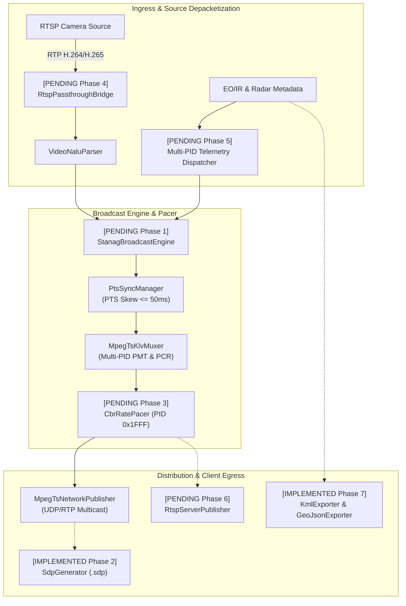

# STANAG 4609 & MISB KLV: Roadmap & Planned Capabilities

> [!NOTE]
> This document has been merged into the master reference document:
> **[KLV_Features.md](KLV_Features.md)**
>
> Please refer to [KLV_Features.md](KLV_Features.md) for the full standards compliance matrix, end-to-end architecture diagrams, detailed subsystem specifications, and the 203-test verification coverage matrix.

---

## 1. Phased Roadmap Summary

| Phase | Milestone | Priority | Status | Primary Location & Artifacts |
| :---: | :--- | :---: | :---: | :--- |
| **Phase 1** | **Broadcast Engine Orchestrator (`StanagBroadcastEngine`)**<br>High-level facade coordinating video ingestion, timing, queueing, multiplexing, and network streaming behind a unified API. | **High** | ✅ **IMPLEMENTED** | [StanagBroadcastEngine.h](../libs/Klv/StanagBroadcastEngine.h), [StanagBroadcastEngine.cpp](../libs/Klv/StanagBroadcastEngine.cpp)<br>Test: [TestStanagBroadcastEngine.cpp](../libs/Klv/tests/TestStanagBroadcastEngine.cpp) |
| **Phase 2** | **Dynamic SDP Generator (`SdpGenerator`)**<br>Generates RFC 4566 `.sdp` files for RTP MPEG-TS unicast/multicast stream client ingestion. | **High** | ✅ **IMPLEMENTED** | [SdpGenerator.h](../libs/Transport/SdpGenerator.h), [SdpGenerator.cpp](../libs/Transport/SdpGenerator.cpp)<br>Test: [TestSdpGenerator.cpp](../libs/Transport/tests/TestSdpGenerator.cpp) |
| **Phase 3** | **CBR Rate Pacer & Null Packet Stuffing (PID `0x1FFF`)**<br>Converts VBR streams to Constant Bitrate broadcasts for tactical satellite modems and fixed-rate pipes, maintaining PCR jitter $\le 500\text{ ns}$. | **Medium** | ✅ **IMPLEMENTED** | [CbrRatePacer.h](../libs/Transport/CbrRatePacer.h), [CbrRatePacer.cpp](../libs/Transport/CbrRatePacer.cpp)<br>Test: [TestCbrRatePacer.cpp](../libs/Transport/tests/TestCbrRatePacer.cpp) |
| **Phase 4** | **RTSP Direct Ingest Bridge (`RtspPassthroughBridge`)**<br>Directly depacketizes RFC 6184 H.264 and RFC 7798 H.265 Access Units from IP cameras without video transcoding. | **Medium** | ⏳ **PENDING** | Target: `libs/Video/RtspPassthroughBridge.h`, `.cpp`<br>Deps: [VideoNaluParser](../libs/Klv/VideoNaluParser.h), [SocketUtils](../libs/Transport/SocketUtils.h) |
| **Phase 5** | **Multi-PID Metadata Substream Multiplexing**<br>Simultaneous multiplexing of multiple independent telemetry streams (EO/IR PID `0x01E0`, Radar PID `0x01E1`, VMTI PID `0x01E2`) per MISB ST 1607 MSID. | **Medium** | ⏳ **PENDING** | Updates to: [MpegTsKlvMuxer.h](../libs/Klv/MpegTsKlvMuxer.h), [MpegTsKlvMuxer.cpp](../libs/Klv/MpegTsKlvMuxer.cpp)<br>Deps: [St1607Parser](../libs/Klv/St1607Parser.h) |
| **Phase 6** | **Embedded RTSP Server Egress (`RtspServerPublisher`)**<br>Lightweight embedded RTSP 1.0/2.0 server allowing clients to pull STANAG 4609 streams over TCP or UDP without an external multicast router. | **Low** | ⏳ **PENDING** | Target: `libs/Transport/RtspServerPublisher.h`, `.cpp`<br>Deps: [SocketUtils](../libs/Transport/SocketUtils.h), [BaseTransport](../libs/Transport/BaseTransport.h) |
| **Phase 7** | **KML & GeoJSON Spatial Exporter**<br>Exports 4D flight tracks, 3D volumetric sensor frustums, and ground footprints to Google Earth Pro/Web and QGIS. | **Medium** | ✅ **IMPLEMENTED** | [KmlExporter.h](../libs/Mapping/KmlExporter.h), [GeoJsonExporter.h](../libs/Mapping/GeoJsonExporter.h), [SpatialDataRecorder.h](../libs/Mapping/SpatialDataRecorder.h)<br>Tests: [TestKmlExporter.cpp](../libs/Mapping/tests/TestKmlExporter.cpp), [TestGeoJsonExporter.cpp](../libs/Mapping/tests/TestGeoJsonExporter.cpp) |

---

## 2. Implementation Architecture & Data Flow

### 2.1 ASCII Architecture Diagram

```text
+---------------------------------------------------------------------------------------------------------+
|                                    BROADCAST ARCHITECTURE ROADMAP                                       |
+---------------------------------------------------------------------------------------------------------+
|                                                                                                         |
|  [ PENDING: Phase 4 RTSP Bridge ]                              [ PENDING: Phase 5 Multi-PID Ingest ]    |
|  - RTSP Client (RFC 2326/7826)                                 - Primary Sensor (EO/IR ST 0601 0x01E0)  |
|  - RFC 6184 / RFC 7798 RTP Depacketizer                        - Secondary Radar Tracks (0x01E1)        |
|  - Zero-Transcode Annex B Extraction                           - ST 1607 MSID VMTI Tracks (0x01E2)      |
|                 \                                                               /                       |
|                  v                                                             v                        |
|        +-------------------------------------------------------------------------------+                |
|        |                [ PENDING: Phase 1 StanagBroadcastEngine ]                     |                |
|        |  - Coordinates Lifecycle, Threading, Buffer Monitoring, and Auto-Reconnection |                |
|        +-------------------------------------------------------------------------------+                |
|                                                |                                                        |
|                                                v                                                        |
|        +-------------------------------------------------------------------------------+                |
|        |                   PtsSyncManager (Sliding Jitter Buffer)                      |                |
|        |           Clamps Skew to <= 50 ms across Multiple Independent Metadata PIDs   |                |
|        +-------------------------------------------------------------------------------+                |
|                                                |                                                        |
|                                                v                                                        |
|        +-------------------------------------------------------------------------------+                |
|        |                   MpegTsKlvMuxer (Multi-Stream Multiplexer)                   |                |
|        |  - Video PID 0x0101 (H.264 / H.265) + Periodic 27MHz PCR Base/Extension       |                |
|        |  - Multi-PID Metadata: 0x01E0 (EO/IR), 0x01E1 (Radar), 0x01E2 (VMTI ST 0903)  |                |
|        +-------------------------------------------------------------------------------+                |
|                                                |                                                        |
|                                                v                                                        |
|        +-------------------------------------------------------------------------------+                |
|        |                [ PENDING: Phase 3 CbrRatePacer (PID 0x1FFF) ]                 |                |
|        |  - Null Packet Stuffing (PID 0x1FFF, 0xFF Payload) for Fixed Tactical Pipes   |                |
|        |  - Hardware Clock Discipline Enforcing PCR Jitter <= 500 ns                   |                |
|        +-------------------------------------------------------------------------------+                |
|                                                |                                                        |
|                                                v                                                        |
|        +-------------------------------------------------------------------------------+                |
|        |                              Network Egress Options                           |                |
|        |   +-------------------------------+       +-------------------------------+   |                |
|        |   |   MpegTsNetworkPublisher      |       |  [ PENDING: Phase 6 ]         |   |                |
|        |   | - Raw UDP Multicast (1316 B)  |       |  RtspServerPublisher          |   |                |
|        |   | - RFC 3550 RTP MP2T (1328 B)  |       | - Embedded RTSP Server        |   |                |
|        |   | - [DONE] SdpGenerator (.sdp)  |       | - TCP Interleaved & UDP Pull  |   |                |
|        |   +-------------------------------+       +-------------------------------+   |                |
|        +-------------------------------------------------------------------------------+                |
+---------------------------------------------------------------------------------------------------------+
```

### 2.2 Mermaid Architecture Diagram



For complete technical specifications, see [KLV_Features.md](KLV_Features.md).
