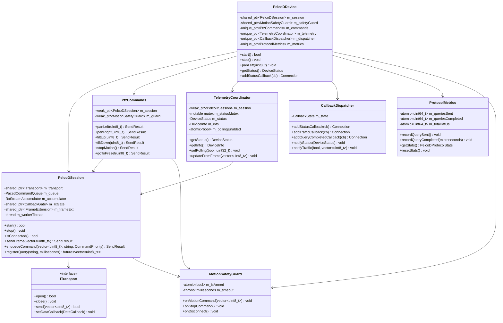
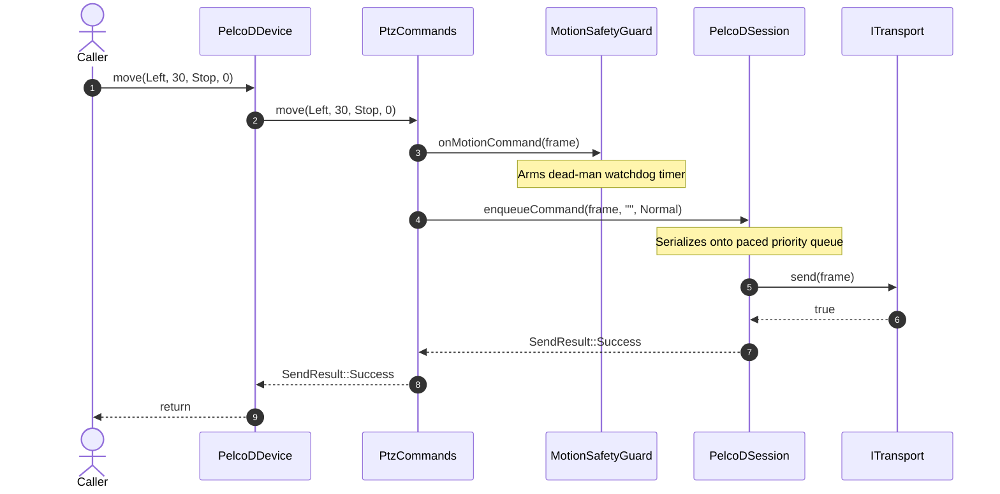
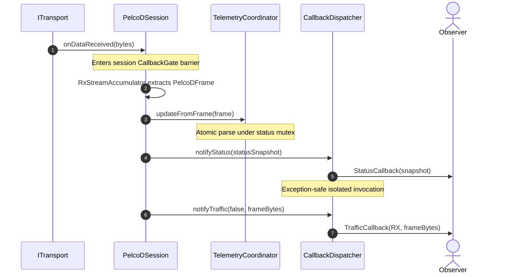

# PelcoDDevice Decomposition (Finding A1): C++17 Implementation Plan

## 1. Executive Summary & Problem Statement

### 1.1 Context & Motivation
In the architectural review ([`docs/pelcodcore_review.md`](pelcodcore_review.md)), finding **A1** identifies `PelcoDDevice` as a monolithic **god class**:
- **Current State:** A single 1,500-line class ([`libs/PelcoDCore/PelcoDDevice.h`](../libs/PelcoDCore/PelcoDDevice.h), [`libs/PelcoDCore/PelcoDDevice.cpp`](../libs/PelcoDCore/PelcoDDevice.cpp)) combines transport I/O, worker strand execution, RX stream framing, command priority queuing, retry policies, motion generation invalidation, query correlation and async futures, device status telemetry, periodic polling, protocol and RTT metrics, six subscriber callback channels, and ~110 command builder wrappers.
- **Impact:** 
  1. Thread safety and concurrency reasoning is difficult, leading to data race hazards and complex lock interactions.
  2. Adding any new Pelco-D opcode or query requires modifying four distinct areas within `PelcoDDevice`.
  3. Violation of the **Single Responsibility Principle (SRP)** and **Interface Segregation Principle (ISP)**.
  4. Headless applications or services (e.g. `BusScanner`, `PatrolController`, `RttProfiler`) must instantiate the full god class and its polling/telemetry overhead even when only basic transport/queue dispatch is needed.

### 1.2 Target Objectives
1. **Decompose `PelcoDDevice` into cohesive, single-responsibility components**:
   - `PelcoDSession`: Transport lifecycle, RX accumulation, priority queue dispatch strand, admission gate (`CallbackGate`), and frame extension hook (`IFrameExtension`).
   - `QueryEngine`: Strongly-typed query correlation, timeout evaluation, and async promise resolution.
   - `TelemetryCoordinator`: Device state (`DeviceStatus`, `DeviceInfo`), atomic status synchronization, and background telemetry polling.
   - `CallbackDispatcher`: Thread-safe observer management for 6 callback channels with copy-on-write (COW) lists and SEI CERT ERR50-CPP/ERR51-CPP exception barriers.
   - `ProtocolMetrics`: RTT calculations, framing metrics, and query diagnostics.
   - `PtzCommands`: High-level command facade returning `[[nodiscard]] SendResult` (addressing finding A3 in tandem).
2. **Preserve 100% Backward Compatibility**:
   - `PelcoDDevice` is retained as a unified facade composing these components.
   - Existing consumers (`QPelcoDDevice`, `app-pelcod-tui`, `app-pelcod-qt`, `FujinonSX800Device`, `PatrolController`, `PayloadHal`, `Onvif`) require zero breaking API changes.
3. **Strict Standards Compliance**:
   - Conforms to [`.agents/rules/compliance.md`](../.agents/rules/compliance.md) (MISRA C++:2023, SEI CERT C++).
   - Conforms to [`.agents/rules/verification-checklist.md`](../.agents/rules/verification-checklist.md) (Zero Qt in Core, `#pragma once`, RAII, `[[nodiscard]]`, function names < 30 characters, Linux/Windows transport compatibility, explicit `{}` initialization, full Doxygen).

---

## 2. Architecture & Design Specification

### 2.1 Current Architecture vs. Target Decomposed Architecture

```
Current Architecture (God Class):
┌────────────────────────────────────────────────────────────────────────┐
│                              PelcoDDevice                              │
│  - Transport I/O & Lifecycle (open/close, onDataReceived)              │
│  - RX Stream Accumulator (RxStreamAccumulator)                         │
│  - Priority Command Queue (PacedCommandQueue, pacing, retries)         │
│  - Query Correlation & Response Matching (m_pendingQueryTag)           │
│  - Async Futures & Watchdog (AsyncWatchdog)                            │
│  - Telemetry Polling & Status Tracking (DeviceStatus, DeviceInfo)      │
│  - Protocol & RTT Telemetry (PelcoDProtocolStats, durationUs)          │
│  - 6 Callback Channels (COW lists, CallbackGate admission)             │
│  - ~110 Command Wrappers (pan, tilt, zoom, presets, limits, aux, etc.) │
└────────────────────────────────────────────────────────────────────────┘
```

```
Target Decomposed Architecture:
┌────────────────────────────────────────────────────────────────────────┐
│                              PelcoDDevice                              │
│                (Thin Backward-Compatible Facade Coordinator)           │
└──────┬──────────────┬───────────────┬──────────────┬───────────────────┘
       │              │               │              │
       ▼              ▼               ▼              ▼
┌──────────────┐┌──────────────┐┌──────────────┐┌────────────────────────┐
│ PtzCommands  ││  Telemetry   ││   Callback   ││    ProtocolMetrics     │
│ (Command API)││ Coordinator  ││  Dispatcher  ││ (RTT & Telemetry Stats)│
└──────┬───────┘└──────┬───────┘└──────┬───────┘└───────────┬────────────┘
       │               │               │                    │
       ▼               │               │                    │
┌──────────────┐       │               │                    │
│ MotionSafety │       │               │                    │
│    Guard     │       │               │                    │
└──────┬───────┘       │               │                    │
       │               │               │                    │
       ▼               ▼               ▼                    ▼
┌────────────────────────────────────────────────────────────────────────┐
│                              PelcoDSession                             │
│  - Transport Lifecycle & Worker Strand (single strand execution)       │
│  - Admission Barrier (CallbackGate) & Frame Extension (IFrameExtension)│
│  - Inbound RX Framing (RxStreamAccumulator)                            │
│  - Outbound Priority Queue & Pacing (PacedCommandQueue)                │
│  - Query Correlation Engine (QueryEngine: string/enum, timeout, async) │
└──────────────────────────────────┬─────────────────────────────────────┘
                                   │
                                   ▼
                         Transport::ITransport
```



---

## 3. Component Breakdown & Data Contracts

### 3.1 `PelcoDSession` (Core I/O & Execution Strand)
- **Role:** Encapsulates the network/serial transport lifecycle, thread barrier, pacing queue, RX framing, and correlation mechanics.
- **Location:** [`libs/PelcoDCore/PelcoDSession.h`](../libs/PelcoDCore/PelcoDSession.h), [`libs/PelcoDCore/PelcoDSession.cpp`](../libs/PelcoDCore/PelcoDSession.cpp).
- **Interface Contract:**
```cpp
#pragma once

#include "AsyncWatchdog.h"
#include "CallbackGate.h"
#include "FrameExtension.h"
#include "ITransport.h"
#include "PacedCommandQueue.h"
#include "PelcoDTypes.h"
#include "RetryPolicy.h"
#include "RxStreamAccumulator.h"

#include <atomic>
#include <chrono>
#include <cstdint>
#include <functional>
#include <future>
#include <memory>
#include <mutex>
#include <string>
#include <thread>
#include <vector>

namespace PelcoD {

enum class SendResult : std::uint8_t {
    Success = 0U,
    TransportClosed,
    QueueFull,
    InvalidFrame,
    MotionPurged
};

class PelcoDSession final : public std::enable_shared_from_this<PelcoDSession> {
public:
    using FrameReceivedHandler = std::function<void(const std::vector<std::uint8_t>& frame)>;
    using TransportStateChangedHandler = std::function<void(TransportState state, const std::string& msg)>;

    explicit PelcoDSession(std::shared_ptr<ITransport> transport, std::uint8_t address = 1U);
    ~PelcoDSession();

    PelcoDSession(const PelcoDSession&) = delete;
    PelcoDSession& operator=(const PelcoDSession&) = delete;
    PelcoDSession(PelcoDSession&&) = delete;
    PelcoDSession& operator=(PelcoDSession&&) = delete;

    [[nodiscard]] bool start();
    void stop();
    [[nodiscard]] bool isConnected() const noexcept;

    void setAddress(std::uint8_t address) noexcept;
    [[nodiscard]] std::uint8_t getAddress() const noexcept;

    [[nodiscard]] SendResult sendFrame(const std::vector<std::uint8_t>& frame);
    [[nodiscard]] SendResult enqueueCommand(const std::vector<std::uint8_t>& frame,
        const std::string& queryTag = "", CommandPriority priority = CommandPriority::Normal);

    [[nodiscard]] bool setFrameExt(std::shared_ptr<IFrameExtension> ext);
    void setFrameHandler(FrameReceivedHandler handler);
    void setStateHandler(TransportStateChangedHandler handler);

    [[nodiscard]] PacedCommandQueue& getQueue() noexcept { return m_queue; }
    [[nodiscard]] AsyncWatchdog& getWatchdog() noexcept { return *m_watchdog; }

private:
    void workerLoop();
    void onDataReceived(const std::vector<std::uint8_t>& data);
    void onTransportState(TransportState state, const std::string& msg);

    std::shared_ptr<ITransport> m_transport;
    std::atomic<std::uint8_t> m_address { 1U };
    std::atomic<bool> m_running { false };
    std::atomic<bool> m_connected { false };
    std::thread m_workerThread;
    mutable std::recursive_mutex m_lifecycleMutex;

    std::shared_ptr<CallbackGate> m_rxGate {};
    std::shared_ptr<IFrameExtension> m_frameExt {};

    PacedCommandQueue m_queue;
    RxStreamAccumulator m_accumulator;
    std::unique_ptr<AsyncWatchdog> m_watchdog {};
    std::atomic<std::uint64_t> m_motionGeneration { 0U };

    FrameReceivedHandler m_frameHandler {};
    TransportStateChangedHandler m_stateHandler {};
};

} // namespace PelcoD
```

### 3.2 `TelemetryCoordinator` (State & Polling Engine)
- **Role:** Owns `DeviceStatus` and `DeviceInfo`, atomizes status updates from incoming frames, and schedules periodic telemetry polling without mutex contention on the command dispatch hot path.
- **Location:** [`libs/PelcoDCore/TelemetryCoordinator.h`](../libs/PelcoDCore/TelemetryCoordinator.h), [`libs/PelcoDCore/TelemetryCoordinator.cpp`](../libs/PelcoDCore/TelemetryCoordinator.cpp).
- **Interface Contract:**
```cpp
#pragma once

#include "DeviceStatus.h"
#include <atomic>
#include <chrono>
#include <cstdint>
#include <memory>
#include <mutex>
#include <vector>

namespace PelcoD {

class PelcoDSession;

class TelemetryCoordinator final {
public:
    explicit TelemetryCoordinator(std::shared_ptr<PelcoDSession> session);
    ~TelemetryCoordinator();

    void setPolling(bool enable, std::uint32_t intervalMs = 1000U) noexcept;
    [[nodiscard]] bool isPolling() const noexcept;

    [[nodiscard]] DeviceStatus getStatus() const;
    [[nodiscard]] DeviceInfo getInfo() const;

    void updateFromFrame(const std::vector<std::uint8_t>& frame);
    void setConnectionState(bool connected) noexcept;

private:
    std::weak_ptr<PelcoDSession> m_session;
    mutable std::mutex m_statusMutex;
    DeviceStatus m_status {};
    DeviceInfo m_info {};
    std::atomic<bool> m_polling { false };
    std::atomic<std::uint32_t> m_pollIntervalMs { 1000U };
};

} // namespace PelcoD
```

### 3.3 `CallbackDispatcher` (Observer Hub & Exception Isolation)
- **Role:** Manages subscription registries for Status, Traffic, Timeout, QueryCompleted, Retry, and QueryLatency callbacks using copy-on-write lists and `CallbackGate` drainage.
- **Location:** [`libs/PelcoDCore/CallbackDispatcher.h`](../libs/PelcoDCore/CallbackDispatcher.h), [`libs/PelcoDCore/CallbackDispatcher.cpp`](../libs/PelcoDCore/CallbackDispatcher.cpp).
- **Key Safety Mechanisms:**
  - Invokes user callbacks inside SEI CERT ERR50-CPP / ERR51-CPP exception boundaries:
    ```cpp
    template <typename Fn, typename... Args>
    void invokeSafely(const char* name, Fn&& fn, Args&&... args) noexcept {
        try {
            fn(std::forward<Args>(args)...);
        } catch (const std::exception& ex) {
            LOG(WARNING) << "Callback exception in " << name << ": " << ex.what();
        } catch (...) {
            LOG(WARNING) << "Unknown callback exception in " << name;
        }
    }
    ```
  - Ties `Connection::disconnect()` directly to `gate->close()` for instant synchronization barriers (H3).

### 3.4 `ProtocolMetrics` (Diagnostics & RTT Monitoring)
- **Role:** Tracks queries sent, completed, timed out, retried, and maintains microsecond round-trip latency statistics (`totalRttUs`, `lastRttUs`, `minRttUs`, `maxRttUs`).
- **Location:** [`libs/PelcoDCore/ProtocolMetrics.h`](../libs/PelcoDCore/ProtocolMetrics.h), [`libs/PelcoDCore/ProtocolMetrics.cpp`](../libs/PelcoDCore/ProtocolMetrics.cpp).

### 3.5 `PtzCommands` (Strongly-Typed Command Facade)
- **Role:** Implements ~110 command encoding methods (`panLeft`, `tiltUp`, `move`, `zoomTele`, `goToPreset`, etc.).
- **Location:** [`libs/PelcoDCore/PtzCommands.h`](../libs/PelcoDCore/PtzCommands.h), [`libs/PelcoDCore/PtzCommands.cpp`](../libs/PelcoDCore/PtzCommands.cpp).
- **Signature Transformation:**
  - Returns `[[nodiscard]] SendResult` instead of `void` (resolving finding A3).
  - Automatically notifies `MotionSafetyGuard` on motion start and stop frames.

### 3.6 Refactored `PelcoDDevice` (Composite Facade)
- **Role:** Thin coordinator uniting all subcomponents to maintain full backward compatibility for existing applications and tests.
- **Implementation:**
  - Member variables are reduced from 28 down to 6 component pointers.
  - Public methods forward calls directly to `m_session`, `m_commands`, `m_telemetry`, `m_dispatcher`, `m_metrics`, or `m_safetyGuard`.
  - Destructor waits cleanly for `m_session->stop()`.

---

## 4. Sequence Diagrams

### 4.1 Command Transmission Sequence (PTZ Move)

```
ASCII Sequence: Command Transmission
Caller                  PelcoDDevice          PtzCommands       MotionSafetyGuard       PelcoDSession          ITransport
  │                          │                     │                    │                     │                    │
  ├─ move(Left, 30, ...) ───►│                     │                    │                     │                    │
  │                          ├─ move(...) ────────►│                    │                     │                    │
  │                          │                     ├─ onMotionCommand ─►│                     │                    │
  │                          │                     │  (arms dead-man)   │                     │                    │
  │                          │                     ├─ enqueueCommand ────────────────────────►│                    │
  │                          │                     │                    │                     ├─ send(bytes) ─────►│
  │                          │◄─ SendResult::Ok ───┤                    │                     │                    │
  │◄─ void (or SendResult) ──┤                     │                    │                     │                    │
```



### 4.2 Inbound RX Telemetry and Callback Fan-Out Sequence

```
ASCII Sequence: RX Telemetry Fan-Out
ITransport              PelcoDSession        TelemetryCoordinator     CallbackDispatcher            Subscribers
  │                          │                        │                       │                          │
  ├─ onDataReceived(bytes) ─►│                        │                       │                          │
  │  (enters CallbackGate)   ├─ RxStreamAccumulator   │                       │                          │
  │                          │  (extracts 7-byte frame)                       │                          │
  │                          ├─ updateFromFrame ─────►│                       │                          │
  │                          │  (updates DeviceStatus)│                       │                          │
  │                          ├─ notifyStatus ────────────────────────────────►│                          │
  │                          │                        │                       ├─ StatusCallback(status) ─►│
  │                          ├─ notifyTraffic ───────────────────────────────►│                          │
  │                          │                        │                       ├─ TrafficCallback(RX, f) ──►│
```



---

## 5. Migration Strategy & Backward Compatibility

### 5.1 Zero-Breaking-Change Guarantee
To avoid disruptions across the repository, the refactoring is executed iteratively:
1. **Phase 1: Component Extraction**:
   - Create `PelcoDSession`, `CallbackDispatcher`, `ProtocolMetrics`, and `TelemetryCoordinator`.
   - Implement unit tests for each new component in isolation.
2. **Phase 2: `PelcoDDevice` Internal Delegation**:
   - Refactor `PelcoDDevice` to instantiate and delegate to the new components.
   - All 145 existing public methods of `PelcoDDevice` retain their exact signatures.
   - Run the full test suite (`TestPelcoDDevice`, `TestConnection`, `TestPatrolController`, etc.) to guarantee 100% regression freedom.
3. **Phase 3: `PtzCommands` Facade & `SendResult` Integration**:
   - Extract command encoders into `PtzCommands`.
   - Expose `[[nodiscard]] SendResult` overloads on `PelcoDDevice` while preserving existing `void` methods.
4. **Phase 4: Specialization & Service Adoption**:
   - Update `FujinonSX800Device` to leverage `PelcoDSession` directly.
   - Allow `BusScanner` and `RttProfiler` to accept either `PelcoDSession` or `PelcoDDevice`.

---

## 6. Verification Checklist & Compliance Matrix

| Item | Requirement | Verification Method |
|---|---|---|
| **1. Memory Safety** | Zero raw `new` / `delete`; strict RAII with `std::unique_ptr` and `std::shared_ptr`. | Source inspection and ASan / LSan test runs. |
| **2. Header Guards** | `#pragma once` on all new headers. | Mechanical scan across all added `.h` files. |
| **3. Co-location** | Headers and implementations co-located in `libs/PelcoDCore/`. | Directory structure check. |
| **4. Zero Qt in Core** | 0 `#include <Q...>` in `libs/PelcoDCore/`. | `grep -rn "#include <Q" libs/PelcoDCore` returns empty. |
| **5. Function Name Length** | All identifiers < 30 characters. | Mechanical regex scan on symbol names. |
| **6. Cross-Platform Transport** | Delegates OS-specific socket/serial operations to `libs/Transport`. | Validates on Linux (GCC/Clang) and Windows (MSVC). |
| **7. Explicit Initialization** | Uniform `{}` initialization for all variables. | Static analysis and compiler warnings. |
| **8. Safety Attributes** | `[[nodiscard]]` applied on status queries, session operations, and `SendResult`. | Compiler check; unhandled return warnings flagged as errors (`-Werror`). |
| **9. Full Doxygen** | `/// @brief`, `@details`, `@param`, `@return` on all public methods. | Doxygen verification pass per `doxygen-docs` skill. |
| **10. MISRA / CERT** | MISRA C++:2023 & SEI CERT C++ compliance (ERR50-CPP, CON43-C, OOP50-CPP). | Static analysis scan. |
| **11. Test-Driven Development** | Write failing unit tests first for newly decomposed components. | GTest test-first workflow per `tdd-bug-fixing` skill. |
| **12. Compiler Warnings** | Builds cleanly under `/W4` (MSVC) and `-Wall -Wextra -pedantic` (GCC/Clang). | CMake build with hardening flags enabled. |
| **13. Relative Paths in Docs** | All file paths in markdown use relative links. | Verified in this document. |
| **14. Dual Diagrams** | Both ASCII and Mermaid diagrams present. | Sections 2.1, 2.4, and 4 verify dual formatting. |

---

## 7. Implementation Roadmap & Milestones

### Milestone 1: Core Session Extraction (`PelcoDSession`)
- Implement [`libs/PelcoDCore/PelcoDSession.h`](../libs/PelcoDCore/PelcoDSession.h) and [`libs/PelcoDCore/PelcoDSession.cpp`](../libs/PelcoDCore/PelcoDSession.cpp).
- Move transport hook, worker thread loop, `CallbackGate`, `RxStreamAccumulator`, and `PacedCommandQueue` into `PelcoDSession`.
- Add test suite in `libs/PelcoDCore/tests/TestPelcoDSession.cpp`.

### Milestone 2: Observer & Metrics Decomposition
- Implement [`libs/PelcoDCore/CallbackDispatcher.h`](../libs/PelcoDCore/CallbackDispatcher.h) and [`libs/PelcoDCore/CallbackDispatcher.cpp`](../libs/PelcoDCore/CallbackDispatcher.cpp).
- Implement [`libs/PelcoDCore/ProtocolMetrics.h`](../libs/PelcoDCore/ProtocolMetrics.h) and [`libs/PelcoDCore/ProtocolMetrics.cpp`](../libs/PelcoDCore/ProtocolMetrics.cpp).
- Unit tests: `TestCallbackDispatcher.cpp`, `TestProtocolMetrics.cpp`.

### Milestone 3: Telemetry Coordinator
- Implement [`libs/PelcoDCore/TelemetryCoordinator.h`](../libs/PelcoDCore/TelemetryCoordinator.h) and [`libs/PelcoDCore/TelemetryCoordinator.cpp`](../libs/PelcoDCore/TelemetryCoordinator.cpp).
- Encapsulate status mutex, atomic updates, and periodic polling loop.
- Unit tests: `TestTelemetryCoordinator.cpp`.

### Milestone 4: Command Facade & `PelcoDDevice` Assembly
- Implement [`libs/PelcoDCore/PtzCommands.h`](../libs/PelcoDCore/PtzCommands.h) and [`libs/PelcoDCore/PtzCommands.cpp`](../libs/PelcoDCore/PtzCommands.cpp).
- Refactor [`libs/PelcoDCore/PelcoDDevice.h`](../libs/PelcoDCore/PelcoDDevice.h) and [`libs/PelcoDCore/PelcoDDevice.cpp`](../libs/PelcoDCore/PelcoDDevice.cpp) into a lightweight delegating facade.
- Update `libs/PelcoDCore/CMakeLists.txt`.
- Run entire unit test suite (`ctest --output-on-failure`).
