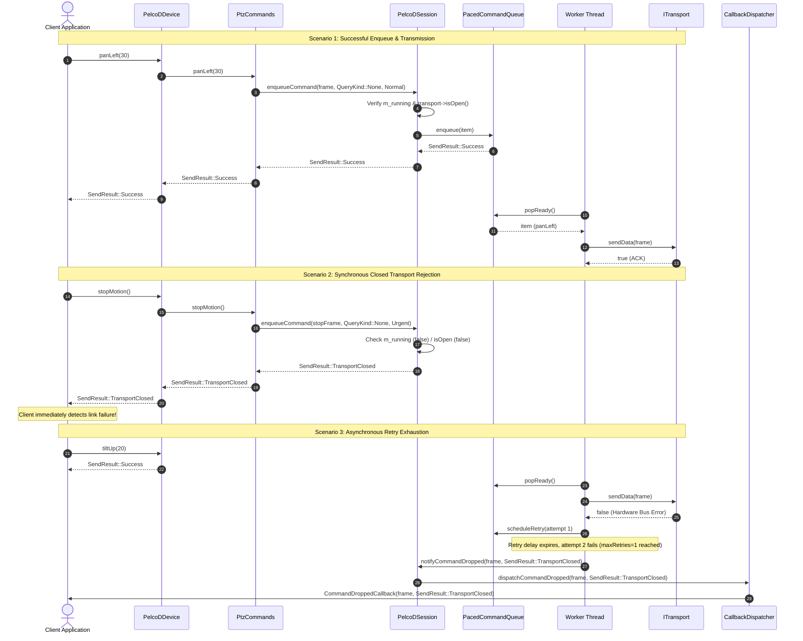

# Command Safety & `[[nodiscard]] SendResult` Architecture (Finding A3): Implementation Plan

## 1. Executive Summary & Problem Analysis

### 1.1 Context & Motivation
In [`docs/pelcodcore_review.md`](pelcodcore_review.md), finding **A3** identifies a critical architectural defect in the Pelco-D command dispatch pipeline:
- **Current State:** The entire public command API across [`PelcoDDevice`](../libs/PelcoDCore/PelcoDDevice.h) (~110 methods: `panLeft`, `tiltUp`, `move`, `stopMotion`, `zoomTele`, `goToPreset`, `setPower`, etc.), [`FujinonSX800Device`](../libs/PelcoDFujinon/FujinonSX800Device.h), and base protected helpers (`enqueueCommand`, `sendRawFrame`, `sendQueryFrame`) returns `void`.
- **Defect Mechanism:**
  1. When a client calls a command method (e.g. `device.panLeft(30)` or `device.stopMotion()`), the call delegates into [`PtzCommands`](../libs/PelcoDCore/PtzCommands.cpp), which in turn calls [`PelcoDSession::enqueueCommand`](../libs/PelcoDCore/PelcoDSession.cpp).
  2. While `PelcoDSession::enqueueCommand` returns `SendResult`, [`PelcoDDevice`](../libs/PelcoDCore/PelcoDDevice.cpp) explicitly discards this return value with `void` signatures.
  3. Furthermore, [`PelcoDSession::enqueueCommand`](../libs/PelcoDCore/PelcoDSession.cpp:176-228) itself never checks whether the transport is open/connected (`m_transport && m_transport->isOpen()`) or whether the worker strand is running (`m_running.load()`). Submissions on closed links or dead sessions are unconditionally enqueued to `PacedCommandQueue` and return `SendResult::Success`.
  4. [`PacedCommandQueue::enqueue`](../libs/PelcoDCore/PacedCommandQueue.cpp:23-86) returns `void`. When the queue reaches its maximum capacity (`m_maxCapacity`), it drops items or evicts them without returning any status or signaling queue overflow to the caller.
  5. In [`PelcoDSession::workerLoop`](../libs/PelcoDCore/PelcoDSession.cpp:594-623), if physical transport transmission fails (`m_transport->sendData()` returns `false`) and backoff retries are either exhausted or disabled (`retryCfg.retryOnTransportError == false`), non-query commands are dropped completely silently. No callback is notified and no counter is incremented.
- **Safety Impact:**
  - **Runaway Camera / Physical Collision:** If a safety-critical `stopMotion()` or limit command is issued over a broken transport, dropped due to queue overflow, or abandoned after failed retries, the calling application receives no indication of the failure. The PTZ camera continues moving indefinitely at physical hardware limits.
  - **Checklist Item 8 Violation:** Project rule 8 in [`.agents/rules/verification-checklist.md`](../.agents/rules/verification-checklist.md) requires `[[nodiscard]]` on all functions returning status or safety-critical data. The current codebase fails this requirement because command APIs return `void` and status-returning methods (`remove*Callback`, `RttProfiler::exportCsv/exportJson`) lack `[[nodiscard]]`.

### 1.2 Target Objectives
1. **Strongly-Typed, Non-Discardable Return Code (`[[nodiscard]] SendResult`):**
   - Annotate `enum class [[nodiscard]] SendResult : std::uint8_t` in [`libs/PelcoDCore/PelcoDTypes.h`](../libs/PelcoDCore/PelcoDTypes.h).
   - Update all ~110 command methods on [`PelcoDDevice`](../libs/PelcoDCore/PelcoDDevice.h), [`PtzCommands`](../libs/PelcoDCore/PtzCommands.h), and [`FujinonSX800Device`](../libs/PelcoDFujinon/FujinonSX800Device.h) to return `[[nodiscard]] SendResult`.
   - Update `sendRawFrame`, `sendQueryFrame`, and `enqueueCommand` to return `[[nodiscard]] SendResult`.
2. **Immediate Synchronous Failure Detection:**
   - **Closed Transport / Inactive Session:** If `!m_running.load()` or `!m_transport || !m_transport->isOpen()`, immediately return `SendResult::TransportClosed` without enqueuing into a dead strand.
   - **Queue Overflow:** If the queue is at capacity (`m_queue.size() >= m_maxCapacity`) and cannot accept a non-urgent command, reject it and return `SendResult::QueueFull`. (Urgent stop commands retain priority pre-emption).
   - **Malformed / Invalid Frames:** If frame validation or checksum fails, return `SendResult::InvalidFrame`.
   - **Motion Purge:** If a motion command is superseded by a newer motion generation or preempted, return `SendResult::MotionPurged`.
3. **Visibility for Asynchronous Dropped Commands & Exhausted Retries:**
   - Introduce `CommandDroppedCallback` on [`PelcoDDevice`](../libs/PelcoDCore/PelcoDDevice.h) and [`CallbackDispatcher`](../libs/PelcoDCore/CallbackDispatcher.h):
     ```cpp
     using CommandDroppedCallback = std::function<void(const std::vector<std::uint8_t>& frame, SendResult reason)>;
     ```
   - Track asynchronous drops in [`PelcoDProtocolStats`](../libs/PelcoDCore/PelcoDStats.h) (`commandsDropped`, `commandRetriesExhausted`, `queueOverflows`).
   - Trigger notification whenever a queued command is evicted or abandoned after transport retry exhaustion.
4. **Complete Checklist Item 8 Compliance (`[[nodiscard]]` Audit):**
   - Apply `[[nodiscard]]` to all callback removal functions across [`PelcoDDevice`](../libs/PelcoDCore/PelcoDDevice.h) (`removeStatusCallback`, `removeTrafficCallback`, `removeTimeoutCallback`, `removeQueryCompletedCallback`, `removeRetryCallback`, `removeQueryLatencyCallback`, and `removeCommandDroppedCallback`).
   - Apply `[[nodiscard]]` to `removeFujinonStatusCallback` in [`FujinonSX800Device`](../libs/PelcoDFujinon/FujinonSX800Device.h).
   - Apply `[[nodiscard]]` to `exportCsv` and `exportJson` in [`RttProfiler`](../libs/PelcoDCore/RttProfiler.h).
5. **Strict Standards & Compilation Verification:**
   - Comply with MISRA C++:2023, SEI CERT C++, and all 14 checklist items in [`.agents/rules/verification-checklist.md`](../.agents/rules/verification-checklist.md).
   - Ensure 100% clean compilation under `-Wall -Wextra -pedantic -Werror` (GCC/Clang) and `/W4 /WX` (MSVC).

---

## 2. Architecture & Design Specification

### 2.1 Current Architecture vs. Target Non-Discardable Result Pipeline

#### ASCII Diagram
```
CURRENT ARCHITECTURE (Fire-and-forget, Silent Failures):
  Client Application
        │
        ├─ device.panLeft(30) ──────────────► returns void (Result Dropped!)
        ├─ device.stopMotion() ─────────────► returns void (Result Dropped!)
        │
        ▼
  PelcoDDevice Facade
        │  m_commands->panLeft(30)
        ▼
  PtzCommands
        │  m_session->enqueueCommand(frame, ...)
        ▼
  PelcoDSession
        │  (No check for transport state! Always enqueues!)
        ▼
  PacedCommandQueue
        │  (m_queue.size() >= maxCapacity ──► Silently drops oldest item!)
        ▼
  Worker Thread (m_transport->sendData())
        │
        └─ [Send Failed & Retries Exhausted] ──► Silently abandoned!
                                                 (Caller has no idea stop/motion was lost!)

TARGET ARCHITECTURE (Non-Discardable [[nodiscard]] SendResult & Dropped Notifications):
  Client Application
        │
        ├─ [[nodiscard]] const SendResult res = device.panLeft(30);
        │  ├── Success          ──► Frame accepted & scheduled in queue
        │  ├── TransportClosed  ──► Immediate notification: Link down!
        │  ├── QueueFull        ──► Immediate notification: Queue saturated!
        │  └── InvalidFrame     ──► Immediate notification: Bad frame/checksum!
        │
        ▼
  PelcoDDevice Facade
        │  return m_commands->panLeft(30);
        ▼
  PtzCommands
        │  return dispatch(frame);
        ▼
  PelcoDSession
        │  1. Check m_running & transport->isOpen() ──► Return TransportClosed
        │  2. Check frame.isValid()                ──► Return InvalidFrame
        │  3. Submit to PacedCommandQueue
        ▼
  PacedCommandQueue (Priority-aware bounded capacity)
        │  ├── Urgent (stopMotion) ──► Evicts lower priority, pushes front
        │  └── Normal / Low        ──► Saturated? Returns QueueFull!
        ▼
  Worker Thread Strand (m_transport->sendData())
        │
        ├─ Send Success ──► Dispatches TrafficCallback
        └─ Retries Exhausted / Evicted:
              │
              ├── protocolStats.commandsDropped++
              └── CallbackGate ──► Dispatches CommandDroppedCallback(frame, reason)
```

#### Mermaid Diagram
```mermaid
flowchart TD
    subgraph Client["Client Application"]
        CMD["device.panLeft(30) / device.stopMotion()"]
        CHECK{"Inspect [[nodiscard]] SendResult"}
        ON_DROP["CommandDroppedCallback Subscriber"]
    end

    subgraph Facade["PelcoDDevice Facade"]
        DEV["PelcoDDevice::panLeft() [[nodiscard]]"]
        PTZ["PtzCommands::panLeft() [[nodiscard]]"]
    end

    subgraph Session["PelcoDSession Strand"]
        GATE{"Check State:\nm_running && isOpen()"}
        VALID{"Validate:\nPelcoDFrame::isValidFrame()"}
        Q_SUBMIT["m_queue.enqueue(item)"]
    end

    subgraph Queue["PacedCommandQueue"]
        CAP{"Capacity Check:\nsize < maxCapacity?"}
        EVICT["Evict Normal/Low Priority"]
        PUSH_Q["Enqueue Item"]
        REJECT["Reject (QueueFull)"]
    end

    subgraph Worker["Worker Strand & Error Observer"]
        TX{"m_transport->sendData()"}
        RETRY{"scheduleRetry() < maxRetries?"}
        DROP["notifyCommandDropped(frame, reason)\nprotocolStats.commandsDropped++"]
    end

    CMD --> DEV
    DEV --> PTZ
    PTZ --> GATE
    GATE -- "Closed / Not Running" -->|Return TransportClosed| CHECK
    GATE -- "Active" --> VALID
    VALID -- "Corrupt / Invalid" -->|Return InvalidFrame| CHECK
    VALID -- "Valid" --> Q_SUBMIT
    Q_SUBMIT --> CAP
    CAP -- "Urgent Command" --> EVICT --> PUSH_Q
    CAP -- "Normal & Saturated" --> REJECT -->|Return QueueFull| CHECK
    CAP -- "Space Available" --> PUSH_Q -->|Return Success| CHECK

    PUSH_Q --> TX
    TX -- "Failed" --> RETRY
    RETRY -- "Exhausted" --> DROP
    EVICT -.->|Evicted Item| DROP
    DROP --> ON_DROP
```

---

### 2.2 Sequence Diagram: Command Submission & Asynchronous Delivery



---

## 3. Detailed Technical Design & API Changes

### 3.1 `SendResult` Enum Hardening ([`libs/PelcoDCore/PelcoDTypes.h`](../libs/PelcoDCore/PelcoDTypes.h))
Add `[[nodiscard]]` to the enum declaration itself so the compiler warns if *any* function returning `SendResult` has its return value ignored:
```cpp
/// @enum SendResult
/// @brief Status return code for command submission across session and queue.
/// @details Marked [[nodiscard]] to enforce caller handling of safety and transport outcomes.
enum class [[nodiscard]] SendResult : std::uint8_t {
    Success = 0U,       ///< Frame accepted and queued/transmitted successfully
    TransportClosed,    ///< Transport link is down, not opened, or device stopped
    QueueFull,          ///< Paced command queue capacity exceeded
    InvalidFrame,       ///< Frame failed validation, checksum check, or is empty
    MotionPurged        ///< Replaced by newer motion generation or preempted
};

/// @brief Converts a SendResult code to human-readable string view.
/// @param[in] result Outcome status code.
/// @return String representation suitable for logging.
[[nodiscard]] constexpr std::string_view sendResultToString(SendResult result) noexcept
{
    switch (result) {
    case SendResult::Success:
        return "Success";
    case SendResult::TransportClosed:
        return "TransportClosed";
    case SendResult::QueueFull:
        return "QueueFull";
    case SendResult::InvalidFrame:
        return "InvalidFrame";
    case SendResult::MotionPurged:
        return "MotionPurged";
    default:
        return "Unknown";
    }
}
```

### 3.2 Protocol Statistics Hardening ([`libs/PelcoDCore/PelcoDStats.h`](../libs/PelcoDCore/PelcoDStats.h) & [`ProtocolMetrics.h`](../libs/PelcoDCore/ProtocolMetrics.h))
Extend `PelcoDProtocolStats` to capture command drop metrics:
```cpp
struct PelcoDProtocolStats {
    std::uint64_t queriesSent { 0U };
    std::uint64_t queriesCompleted { 0U };
    std::uint64_t queryTimeouts { 0U };
    std::uint64_t queryRetries { 0U };
    std::uint64_t checksumErrors { 0U };
    std::uint64_t discardedSyncBytes { 0U };
    std::uint64_t commandsDropped { 0U };          ///< Total commands dropped asynchronously
    std::uint64_t commandRetriesExhausted { 0U };  ///< Commands abandoned after max retries
    std::uint64_t queueOverflows { 0U };           ///< Commands rejected due to queue capacity
    std::size_t pendingCommands { 0U };
    double lastRttMs { 0.0 };
    double minRttMs { 0.0 };
    double maxRttMs { 0.0 };
    double avgRttMs { 0.0 };
};
```

### 3.3 Bounded Queue Admission & Status Return ([`libs/PelcoDCore/PacedCommandQueue.h`](../libs/PelcoDCore/PacedCommandQueue.h))
Update `PacedCommandQueue` methods to return `SendResult`:
```cpp
/// @brief Enqueues a command item according to its priority with capacity enforcement.
/// @param[in] item Command packet and metadata.
/// @return SendResult::Success on successful insertion, SendResult::QueueFull if rejected.
[[nodiscard]] SendResult enqueue(CommandItem item);

/// @brief Helper to construct and enqueue a command item with strongly-typed QueryKind.
[[nodiscard]] SendResult enqueue(std::vector<std::uint8_t> frame, QueryKind queryKind,
    CommandPriority priority = CommandPriority::Normal, std::uint64_t motionGeneration = 0U);

/// @brief Helper to construct and enqueue a command item with string query tag.
[[nodiscard]] SendResult enqueue(std::vector<std::uint8_t> frame, std::string queryTag,
    CommandPriority priority = CommandPriority::Normal, std::uint64_t motionGeneration = 0U);
```
**Queue Logic in `PacedCommandQueue.cpp`:**
- If `item.priority == CommandPriority::Urgent`:
  - Evict Low-priority items or oldest non-urgent items if size >= capacity.
  - Insert at front.
  - Return `SendResult::Success`.
- If `item.priority != CommandPriority::Urgent`:
  - If `m_queue.size() >= m_maxCapacity`:
    - Check if any `Low` priority items exist that can be evicted:
      - If yes, evict oldest Low item and insert incoming item.
      - If no lower-priority item can be evicted (all existing items are Normal or Urgent), **reject** the incoming item, trigger `evictionHandler(item)`, and return `SendResult::QueueFull`.

### 3.4 Session State Gating & Dropped Callbacks ([`libs/PelcoDCore/PelcoDSession.h`](../libs/PelcoDCore/PelcoDSession.h))
Update `PelcoDSession`:
1. Verify `m_running.load()` and transport connection before enqueuing:
   ```cpp
   if (!m_running.load() || !m_transport || !m_transport->isOpen()) {
       return SendResult::TransportClosed;
   }
   if (frame.empty() || !PelcoDFrame::isValidFrame(frame)) {
       return SendResult::InvalidFrame;
   }
   ```
2. In `workerLoop`: on retry exhaustion for non-queries, invoke `notifyCommandDropped(item.frame, SendResult::TransportClosed)`.
3. Support registering a `CommandDroppedHandler`:
   ```cpp
   using CommandDroppedHandler = std::function<void(const std::vector<std::uint8_t>& frame, SendResult reason)>;
   void setCommandDroppedHandler(CommandDroppedHandler handler);
   ```

### 3.5 Command Facade Transformation ([`libs/PelcoDCore/PtzCommands.h`](../libs/PelcoDCore/PtzCommands.h) & [`PelcoDDevice.h`](../libs/PelcoDCore/PelcoDDevice.h))
1. Annotate all methods in [`PtzCommands.h`](../libs/PelcoDCore/PtzCommands.h) with `[[nodiscard]]`:
   ```cpp
   [[nodiscard]] SendResult panLeft(std::uint8_t speed);
   [[nodiscard]] SendResult panRight(std::uint8_t speed);
   [[nodiscard]] SendResult tiltUp(std::uint8_t speed);
   [[nodiscard]] SendResult tiltDown(std::uint8_t speed);
   [[nodiscard]] SendResult stopMotion();
   [[nodiscard]] SendResult move(PanDirection panDir, std::uint8_t panSpeed, TiltDirection tiltDir, std::uint8_t tiltSpeed);
   ...
   ```
2. Refactor all ~110 command methods on [`PelcoDDevice.h`](../libs/PelcoDCore/PelcoDDevice.h):
   ```cpp
   // Before:
   // void panLeft(std::uint8_t speed);
   // After:
   [[nodiscard]] SendResult panLeft(std::uint8_t speed);
   [[nodiscard]] SendResult panRight(std::uint8_t speed);
   [[nodiscard]] SendResult tiltUp(std::uint8_t speed);
   [[nodiscard]] SendResult tiltDown(std::uint8_t speed);
   [[nodiscard]] SendResult stopMotion();
   [[nodiscard]] SendResult move(...);
   [[nodiscard]] SendResult setPower(bool on);
   [[nodiscard]] SendResult setAutoScan(bool enable);
   [[nodiscard]] SendResult zoomTele();
   ...
   [[nodiscard]] SendResult sendRawFrame(const std::vector<std::uint8_t>& frame);
   [[nodiscard]] SendResult sendQueryFrame(const std::vector<std::uint8_t>& frame, std::string queryTag = "Query");
   ```
3. Implementation in `PelcoDDevice.cpp`:
   ```cpp
   SendResult PelcoDDevice::panLeft(std::uint8_t speed)
   {
       return m_commands->panLeft(speed);
   }
   ```
4. Callback Registration on `PelcoDDevice`:
   ```cpp
   using CommandDroppedCallback = std::function<void(const std::vector<std::uint8_t>& frame, SendResult reason)>;
   Connection addCommandDroppedCallback(CommandDroppedCallback cb);
   [[nodiscard]] bool removeCommandDroppedCallback(CallbackId id);
   ```

### 3.6 Checklist Item 8 Audit Across Core
Add `[[nodiscard]]` to all status-returning functions:
1. In [`PelcoDDevice.h`](../libs/PelcoDCore/PelcoDDevice.h):
   ```cpp
   [[nodiscard]] bool removeStatusCallback(CallbackId id);
   [[nodiscard]] bool removeTrafficCallback(CallbackId id);
   [[nodiscard]] bool removeTimeoutCallback(CallbackId id);
   [[nodiscard]] bool removeQueryCompletedCallback(CallbackId id);
   [[nodiscard]] bool removeRetryCallback(CallbackId id);
   [[nodiscard]] bool removeQueryLatencyCallback(CallbackId id);
   [[nodiscard]] bool removeCommandDroppedCallback(CallbackId id);
   ```
2. In [`FujinonSX800Device.h`](../libs/PelcoDFujinon/FujinonSX800Device.h):
   - All ~40 specialized optics methods return `[[nodiscard]] SendResult`.
   - `[[nodiscard]] bool removeFujinonStatusCallback(CallbackId id);`
3. In [`RttProfiler.h`](../libs/PelcoDCore/RttProfiler.h):
   ```cpp
   [[nodiscard]] bool exportCsv(std::ostream& os) const;
   [[nodiscard]] bool exportJson(std::ostream& os) const;
   ```

---

## 4. Safety, Standards & Compliance Verification

| Standard / Checklist Item | Requirement | Implementation in A3 | Verification Method |
|---|---|---|---|
| **MISRA C++:2023 Rule 0.1.2** | Dead / unused code | All command return values carry `[[nodiscard]]`, preventing unhandled failures. | Compiler check (`-Wunused-result` under `-Werror`). |
| **SEI CERT ERR50-CPP / ERR51-CPP** | Exception safety & handling boundaries | Callback invocations for `CommandDroppedCallback` run across `CallbackGate` with `noexcept` catch-all boundaries. | Unit test with throwing subscriber. |
| **SEI CERT CON50-CPP** | Race conditions & TOCTOU | Transport state and queue capacity checks are atomized under `m_sessionMutex` and `m_queue.m_mutex`. | ThreadSanitizer (`-fsanitize=thread`) clean run. |
| **Checklist Item 1** | No raw `new`/`delete` | RAII only; `std::make_shared` / `std::make_unique`. | Static source scan. |
| **Checklist Item 2** | `#pragma once` only | Preserved across all modified headers. | Header inspection. |
| **Checklist Item 4** | Zero Qt dependencies in Core | Pure standard C++17 (`<cstdint>`, `<vector>`, `<functional>`). | Header scan for `#include <Q...>` in `libs/PelcoDCore/`. |
| **Checklist Item 5** | Function names < 30 chars | `sendResultToString` (18), `addCommandDroppedCallback` (25), `removeCommandDroppedCallback` (28). All < 30 chars. | Mechanical length verification. |
| **Checklist Item 6** | Linux & Windows support | Zero OS-specific calls in Core; transport abstraction delegates to `libs/Transport`. | Dual-platform CI verification. |
| **Checklist Item 7** | `{}` initialization | All variables use uniform brace initialization (`SendResult res { SendResult::Success };`). | Code review & compiler verification. |
| **Checklist Item 8** | `[[nodiscard]]` on status returns | Applied to all command APIs, `SendResult` enum class, `remove*Callback`, and profiler exports. | Compiler check (`-Wunused-result` fatal error). |
| **Checklist Item 9** | Full Doxygen templates | Every new and modified API fully documented with `/// @brief`, `@details`, `@param`, `@return`. | Doxygen build verification. |
| **Checklist Item 11** | Failing test first (TDD) | Regression tests written and asserted to fail prior to implementation changes. | TDD commit history verification. |
| **Checklist Item 12** | `-Wall -Wextra -pedantic -Werror` | 100% warning-free build under GCC/Clang and MSVC `/W4 /WX`. | Clean build log. |

---

## 5. Implementation Phases & Step-by-Step Roadmap

### Phase 1: Core Types & Queue Admission Hardening
- [ ] **Step 1.1 (TDD Regression Tests):** Create unit tests in [`libs/PelcoDCore/tests/TestCommandQueue.cpp`](../libs/PelcoDCore/tests/TestCommandQueue.cpp) verifying that `enqueue()` returns `SendResult::QueueFull` when capacity is exceeded for normal priority, and `SendResult::Success` for urgent commands.
- [ ] **Step 1.2:** Update [`PelcoDTypes.h`](../libs/PelcoDCore/PelcoDTypes.h) to mark `enum class [[nodiscard]] SendResult : std::uint8_t` and implement `sendResultToString`.
- [ ] **Step 1.3:** Update [`PelcoDStats.h`](../libs/PelcoDCore/PelcoDStats.h) and [`ProtocolMetrics`](../libs/PelcoDCore/ProtocolMetrics.h) to track `commandsDropped`, `commandRetriesExhausted`, and `queueOverflows`.
- [ ] **Step 1.4:** Update [`PacedCommandQueue.h`](../libs/PelcoDCore/PacedCommandQueue.h) and [`PacedCommandQueue.cpp`](../libs/PelcoDCore/PacedCommandQueue.cpp) so `enqueue()` returns `[[nodiscard]] SendResult` with capacity rejection. Verify Phase 1 tests pass.

### Phase 2: Session Transport Gating & Asynchronous Failure Notification
- [ ] **Step 2.1 (TDD Regression Tests):** Add tests in [`libs/PelcoDCore/tests/TestPelcoDSession.cpp`](../libs/PelcoDCore/tests/TestPelcoDSession.cpp) and [`TestPelcoDDevice.cpp`](../libs/PelcoDCore/tests/TestPelcoDDevice.cpp) verifying:
  - Submitting command when `session->stop()` or transport closed immediately returns `SendResult::TransportClosed`.
  - Submitting an empty or malformed frame returns `SendResult::InvalidFrame`.
  - Dropped retries trigger `CommandDroppedCallback` and increment `commandsDropped`.
- [ ] **Step 2.2:** Update [`PelcoDSession.h`](../libs/PelcoDCore/PelcoDSession.h) and [`PelcoDSession.cpp`](../libs/PelcoDCore/PelcoDSession.cpp) to validate `m_running` and transport connectivity on `enqueueCommand`.
- [ ] **Step 2.3:** Wire `CommandDroppedHandler` in `PelcoDSession::workerLoop` for non-query commands when retries are exhausted.
- [ ] **Step 2.4:** Update [`CallbackDispatcher`](../libs/PelcoDCore/CallbackDispatcher.h) to add `CommandDroppedCallback` channel with copy-on-write subscription and exception boundaries.

### Phase 3: PtzCommands, Facade Transformation & Checklist Item 8 Audit
- [ ] **Step 3.1:** Annotate all public methods in [`PtzCommands.h`](../libs/PelcoDCore/PtzCommands.h) with `[[nodiscard]]`.
- [ ] **Step 3.2:** Transform all ~110 command methods in [`PelcoDDevice.h`](../libs/PelcoDCore/PelcoDDevice.h) and [`PelcoDDevice.cpp`](../libs/PelcoDCore/PelcoDDevice.cpp) from `void` to `[[nodiscard]] SendResult`.
- [ ] **Step 3.3:** Transform `sendRawFrame`, `sendQueryFrame`, and `enqueueCommand` to return `[[nodiscard]] SendResult`.
- [ ] **Step 3.4:** Add `addCommandDroppedCallback` and `removeCommandDroppedCallback` to `PelcoDDevice`.
- [ ] **Step 3.5:** Mark all `remove*Callback` methods in `PelcoDDevice` with `[[nodiscard]]`.
- [ ] **Step 3.6:** Mark `RttProfiler::exportCsv` and `exportJson` with `[[nodiscard]]`.
- [ ] **Step 3.7:** Transform [`FujinonSX800Device.h`](../libs/PelcoDFujinon/FujinonSX800Device.h) and [`FujinonSX800Device.cpp`](../libs/PelcoDFujinon/FujinonSX800Device.cpp) methods to return `[[nodiscard]] SendResult` and mark `removeFujinonStatusCallback` as `[[nodiscard]]`.

### Phase 4: Downstream Adapters, Applications & Test Modernization
- [ ] **Step 4.1:** Update Qt adapter forwarding macros in [`libs/PelcoDQt/QPelcoDDevice.cpp`](../libs/PelcoDQt/QPelcoDDevice.cpp) (`FORWARD_CORE_0`, `FORWARD_CORE_1`, `FORWARD_CORE_SWITCH`) to cast return values (`static_cast<void>(...)`) or handle `SendResult`.
- [ ] **Step 4.2:** Update `app-pelcod-tui` views ([`PtzView.cpp`](../app-pelcod-tui/views/PtzView.cpp), [`VideoView.cpp`](../app-pelcod-tui/views/VideoView.cpp)) to inspect `SendResult` and display status messages on transmission failure.
- [ ] **Step 4.3:** Update unit test suites across [`libs/PelcoDCore/tests/`](../libs/PelcoDCore/tests/) and [`libs/PelcoDFujinon/tests/`](../libs/PelcoDFujinon/tests/) to explicitly assert `EXPECT_EQ(device.panLeft(30), SendResult::Success)` or cast where intentionally ignored.

### Phase 5: Verification, Hardening & CI Validation
- [ ] **Step 5.1:** Compile full codebase with `-Wall -Wextra -pedantic -Werror` to verify zero `unused-result` compiler warnings remain.
- [ ] **Step 5.2:** Run full automated test suite: `ctest --output-on-failure`.
- [ ] **Step 5.3:** Run ThreadSanitizer and AddressSanitizer builds.
- [ ] **Step 5.4:** Update [`docs/pelcodcore_review.md`](pelcodcore_review.md) marking **A3** and checklist item **8** as fixed.

---

## 6. Test Strategy & Test-Driven Development (TDD) Plan

### 6.1 Failing Regression Tests (To Be Implemented First)
1. **`CommandRejectionOnClosedTransport`:**
   - Construct a `PelcoDDevice` without calling `start()`.
   - Call `device.panLeft(20)`.
   - **Expectation:** Must return `SendResult::TransportClosed`. (Currently returns `void` and pushes into queue).
2. **`CommandRejectionOnQueueFull`:**
   - Configure a `PacedCommandQueue` with capacity 2.
   - Enqueue 2 normal commands.
   - Enqueue a 3rd normal command.
   - **Expectation:** Must return `SendResult::QueueFull`. An urgent stop command must return `SendResult::Success` and evict a lower priority item.
3. **`InvalidFrameRejection`:**
   - Attempt to call `device.sendRawFrame({})` with empty bytes or corrupt checksum.
   - **Expectation:** Must return `SendResult::InvalidFrame`.
4. **`CommandDroppedCallbackOnRetryExhaustion`:**
   - Configure a mock transport that fails all TX. Set `maxRetries = 1`.
   - Issue `device.panLeft(30)`.
   - Register `addCommandDroppedCallback`.
   - Wait for worker thread retry expiration.
   - **Expectation:** Callback fires with `SendResult::TransportClosed` and `protocolStats.commandsDropped == 1`.
5. **`NodiscardCompilerEnforcement`:**
   - Compile test harness verifying that discarding a call to `device.stopMotion()` produces a compile-time warning/error under `-Werror=unused-result`.

---

## 7. Risk Assessment & Mitigation

| Risk | Severity | Likelihood | Mitigation Strategy |
|---|---|---|---|
| **Breaking Existing Callers with `-Wunused-result` Errors** | High | High | Explicitly audit every usage in `PelcoDQt`, `app-pelcod-tui`, and unit test suites. Provide clear documentation and cast unused returns (`static_cast<void>(...)`) where fire-and-forget is intentionally desired. |
| **Performance Overhead on Command Hot Path** | Low | Low | `SendResult` is a single-byte `enum class` (`std::uint8_t`) returned in CPU registers by value with zero heap allocations. |
| **Re-entrancy Deadlock in `CommandDroppedCallback`** | Medium | Low | Use established `CallbackDispatcher` / `CallbackGate` COW pattern: snapshots of callback lists are copied under lock, and subscribers are invoked completely unlocked. |
| **Urgent Motion Safety Preemption Regression** | High | Low | Urgent commands (`stopMotion`, `zoomStop`, `focusStop`, `irisStop`) always bypass capacity rejections by evicting low-priority or normal items, guaranteeing that emergency stops are never dropped due to full queues. |

---

## 8. Acceptance Criteria & Definition of Done

- [ ] All ~110 command methods on `PelcoDDevice`, `PtzCommands`, and `FujinonSX800Device` return `[[nodiscard]] SendResult`.
- [ ] `SendResult` enum class is marked `[[nodiscard]]`.
- [ ] Submitting commands while disconnected or stopped returns `SendResult::TransportClosed`.
- [ ] Queue capacity exhaustion returns `SendResult::QueueFull` for non-urgent commands while urgent stops always succeed.
- [ ] Asynchronous command drops and retry exhaustions trigger `CommandDroppedCallback` and increment protocol metrics.
- [ ] All checklist item 8 status functions (`remove*Callback`, profiler export) carry `[[nodiscard]]`.
- [ ] Zero compiler warnings under `-Wall -Wextra -pedantic -Werror` and `/W4 /WX`.
- [ ] 100% test pass rate across all unit and integration test suites.
- [ ] [`docs/pelcodcore_review.md`](pelcodcore_review.md) updated to document A3 remediation.
