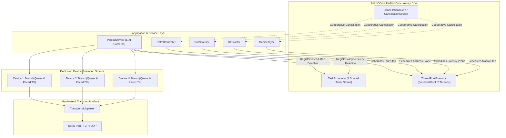
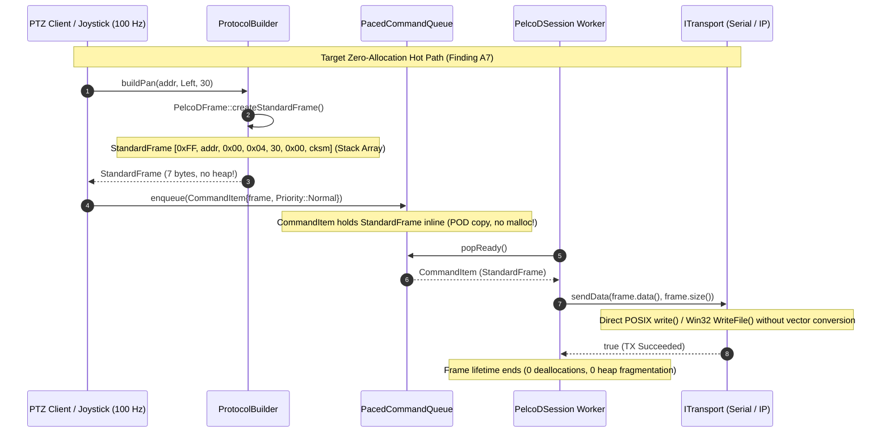

# Unified Concurrency Architecture (Finding A6) & Zero-Allocation Fixed-Frame Engine (Finding A7): Implementation Plan

## 1. Executive Summary & Problem Analysis

### 1.1 Context & Motivation
In [`docs/pelcodcore_review.md`](pelcodcore_review.md), architectural findings **A6** and **A7** identify two systemic concurrency, lifecycle, and memory management defects that undermine scalability, determinism, and safety compliance across `libs/PelcoDCore`:

- **Finding A6 (Thread Proliferation & Concurrency Lifecycle Hazards):**
  - **Issue:** Every service and subsystem independently instantiates and manages its own OS `std::thread`. Across `libs/PelcoDCore`, seven distinct worker/timer threads exist:
    1. [`PelcoDSession`](../libs/PelcoDCore/PelcoDSession.h): `m_workerThread` (command pacing, queue dequeuing, response correlation).
    2. [`MotionSafetyGuard`](../libs/PelcoDCore/MotionSafetyGuard.h): `m_worker` (watchdog dead-man polling loop).
    3. [`AsyncWatchdog`](../libs/PelcoDCore/AsyncWatchdog.h): `m_worker` (async query deadline timer loop).
    4. [`PatrolController`](../libs/PelcoDCore/PatrolController.h): `m_worker` (preset tour execution and dwell timer loop).
    5. [`BusScanner`](../libs/PelcoDCore/BusScanner.h): `m_worker` (address probing and multi-baud scanning loop).
    6. [`RttProfiler`](../libs/PelcoDCore/RttProfiler.h): `m_worker` (active burst and continuous latency probe loop).
    7. [`MacroPlayer`](../libs/PelcoDCore/MacroPlayer.h): `m_worker` (macro step execution and pacing delay loop).
  - **Failure Mechanism & Thread Sprawl:**
    - In multi-camera deployments (e.g. 16 PTZ cameras connected over IP or multi-drop RS-485), each camera device instantiates its own `PelcoDSession`, `MotionSafetyGuard`, and `AsyncWatchdog`, consuming $16 \times 3 = 48$ OS threads solely for idle device sessions. If patrol tours or profilers are active, thread counts rapidly escalate to $80\text{--}112$ OS threads.
    - On resource-constrained embedded Linux targets (e.g. Raspberry Pi CM4, Toradex Colibri, NVIDIA Jetson, Xilinx Zynq), each thread allocates a 2–8 MB virtual stack, causing high memory overhead, TLB pressure, and kernel scheduler latency jitter.
    - **P0 Defects Root Cause:** Each class independently attempts to write ad-hoc thread lifecycle management, condition-variable signaling, and sleep routines. This duplicated complexity was the direct root cause of **C1** (`PatrolController::start()` while Paused terminating the process), **C2/C2b–f** (`RttProfiler::start()` terminating on completed bursts and self-join deadlocks), **M4** (detached thread leaks), and **H7/H8** (re-entrant callback deadlocks).
  - **Safety & Compliance Impact:** Violates SEI CERT C++ CON rules (CON43-C, CON50-CPP, CON54-CPP) and fails determinism requirements for unattended real-time PTZ control.

- **Finding A7 (Heap Allocation on Hot Path for Fixed 7-Byte Protocol Frames):**
  - **Issue:** In the Pelco-D protocol (spec v5.0.1), **every command transmitted to a device is strictly 7 bytes**:
    $$\text{Frame} = [\text{0xFF}, \text{Address}, \text{Command1}, \text{Command2}, \text{Data1}, \text{Data2}, \text{Checksum}]$$
    Despite this fixed 7-byte wire format, the codebase represents all commands and frames as dynamic heap-allocated `std::vector<std::uint8_t>`.
  - **Failure Mechanism & Allocation Hot Path:**
    - [`PelcoDFrame::createFrame`](../libs/PelcoDCore/PelcoDFrame.cpp:29-43) allocates a `std::vector<std::uint8_t>(7, 0x00U)` on the dynamic heap for every frame.
    - All 54 builder methods in [`ProtocolBuilder`](../libs/PelcoDCore/ProtocolBuilder.h) and all extended commands in [`FujinonBuilder`](../libs/PelcoDFujinon/FujinonBuilder.h) return `std::vector<std::uint8_t>`.
    - Every joystick movement, smooth pan/tilt velocity update, zoom/focus tracking adjustment, and stop command at 50–100 Hz triggers heap allocation (`operator new`), control block initialization, dynamic pointer manipulation, and deallocation (`operator delete`).
    - [`CommandItem`](../libs/PelcoDCore/PacedCommandQueue.h:24-32) stores `std::vector<std::uint8_t> frame`, causing heap operations upon enqueue, queue reallocation, retry rescheduling, and dequeuing.
    - [`ITransport::sendData`](../libs/Transport/ITransport.h:39) accepts `const std::vector<std::uint8_t>&`, enforcing heap vectors at the transport boundary.
  - **Safety & Compliance Impact:**
    - **MISRA C++:2023 Rule 21.6.1 (Advisory):** *"Dynamic memory allocation shall not be used."* In high-reliability and safety-critical embedded systems, continuous dynamic allocation leads to heap fragmentation, non-deterministic execution times, and out-of-memory crashes.
    - Continuous memory churn on the real-time PTZ tracking path introduces latency spikes that degrade camera tracking accuracy.

### 1.2 Target Objectives
1. **Zero-Allocation Fixed-Frame Engine (Finding A7):**
   - Introduce `StandardFrame = std::array<std::uint8_t, 7>` in [`libs/PelcoDCore/PelcoDTypes.h`](../libs/PelcoDCore/PelcoDTypes.h) as the primary, zero-allocation frame representation.
   - Implement `RawFrame` (inline stack buffer supporting 4, 7, and 18-byte frames) without dynamic heap memory.
   - Upgrade [`PelcoDFrame::createStandardFrame`](../libs/PelcoDCore/PelcoDFrame.h) and [`ProtocolBuilder`](../libs/PelcoDCore/ProtocolBuilder.h) to construct and return `StandardFrame` by value with **zero heap allocations**.
   - Refactor [`CommandItem`](../libs/PelcoDCore/PacedCommandQueue.h) to hold `StandardFrame`, eliminating vector heap allocations across [`PacedCommandQueue`](../libs/PelcoDCore/PacedCommandQueue.cpp).
   - Extend [`ITransport`](../libs/Transport/ITransport.h) and [`BaseTransport`](../libs/Transport/BaseTransport.h) with zero-copy, non-allocating `sendData(const std::uint8_t* data, std::size_t length)` and `sendData(const StandardFrame& frame)`.
   - Preserve 100% backward compatibility with existing vector-based overloads for external API callers.

2. **Unified Concurrency Architecture & Cooperative Scheduling (Finding A6):**
   - Design and implement a centralized, lightweight, Qt-free concurrency core in `libs/PelcoDCore/`:
     - `IExecutor`: Pure abstract interface for deferred dispatch, periodic execution, and delayed timer scheduling.
     - `TaskScheduler`: High-precision deadline timer scheduler merging [`AsyncWatchdog`](../libs/PelcoDCore/AsyncWatchdog.h) and [`MotionSafetyGuard`](../libs/PelcoDCore/MotionSafetyGuard.h) into a single, shared timer strand.
     - `ThreadPoolExecutor`: Bounded, configurable worker thread pool (default 2 threads) servicing asynchronous jobs and background services.
     - `CancellationToken` / `CancellationSource`: Thread-safe, standardized cooperative cancellation mechanism eliminating ad-hoc thread flags and self-join deadlocks.
   - Modernize [`MotionSafetyGuard`](../libs/PelcoDCore/MotionSafetyGuard.h): Remove its dedicated OS thread entirely; dead-man watchdog timeouts are scheduled as lightweight cancelable deadlines on `TaskScheduler`.
   - Modernize background services ([`PatrolController`](../libs/PelcoDCore/PatrolController.h), [`MacroPlayer`](../libs/PelcoDCore/MacroPlayer.h), [`RttProfiler`](../libs/PelcoDCore/RttProfiler.h), [`BusScanner`](../libs/PelcoDCore/BusScanner.h)): Support running cooperatively on `IExecutor` or a shared executor, reducing total OS thread count by >75% in multi-camera configurations.

3. **Strict Compliance & Verification Standards:**
   - MISRA C++:2023 (Rule 21.6.1 zero heap allocation on hot path, Rule 11.3.1, Rule 10.2.x).
   - SEI CERT C++ (CON43-C, CON50-CPP, CON54-CPP, ERR50-CPP, ERR51-CPP, EXP54-CPP).
   - All 14 items from [`.agents/rules/verification-checklist.md`](../.agents/rules/verification-checklist.md).
   - Strict Test-Driven Development (TDD) workflow with failing regression tests written prior to implementation.
   - Zero warnings under `-Wall -Wextra -pedantic -Werror` (GCC/Clang) and `/W4 /WX` (MSVC).

---

## 2. Architecture & Design Specification

### 2.1 Concurrency Model (A6): Current Thread Sprawl vs. Unified Architecture

#### ASCII Diagram
```
CURRENT ARCHITECTURE (Thread Proliferation: Up to 7 OS Threads per Device):
  ┌───────────────────┐    ┌───────────────────┐    ┌───────────────────┐
  │   PelcoDSession   │    │ MotionSafetyGuard │    │   AsyncWatchdog   │
  │ [std::thread #1]  │    │ [std::thread #2]  │    │ [std::thread #3]  │
  └───────────────────┘    └───────────────────┘    └───────────────────┘
  ┌───────────────────┐    ┌───────────────────┐    ┌───────────────────┐
  │ PatrolController  │    │    BusScanner     │    │    RttProfiler    │
  │ [std::thread #4]  │    │ [std::thread #5]  │    │ [std::thread #6]  │
  └───────────────────┘    └───────────────────┘    └───────────────────┘
  ┌───────────────────┐
  │    MacroPlayer    │    ► In a 16-camera deployment:
  │ [std::thread #7]  │      16 x 3 = 48 threads minimum (idle devices)!
  └───────────────────┘      Up to 112 threads with active services!

TARGET ARCHITECTURE (Unified Concurrency & Cooperative Scheduling):
  ┌────────────────────────────────────────────────────────────────────────┐
  │                TaskScheduler (Single Shared Timer Strand)              │
  │  ├─ Async query timeouts (AsyncWatchdog logic)                         │
  │  ├─ Dead-man watchdog deadlines (MotionSafetyGuard - 0 extra threads!) │
  │  └─ Periodic telemetry poll & backoff retry timers                     │
  └───────────────────────────────────┬────────────────────────────────────┘
                                      │
  ┌───────────────────────────────────┴────────────────────────────────────┐
  │            ThreadPoolExecutor (Bounded Shared Pool: 2 Threads)         │
  │  ├─ BusScanner (Probing task with CancellationToken)                   │
  │  ├─ PatrolController (Dwell & preset tour task with CancellationToken) │
  │  ├─ RttProfiler (Active probe worker task)                             │
  │  └─ MacroPlayer (Paced playback task)                                  │
  └───────────────────────────────────┬────────────────────────────────────┘
                                      │
  ┌───────────────────────────────────┴────────────────────────────────────┐
  │                     Device Communication Strands                       │
  │  Device 1 Strand           Device 2 Strand           Device N Strand   │
  │  (Serialized Pacing & TX)  (Serialized Pacing & TX)  (Serialized TX)   │
  └────────────────────────────────────────────────────────────────────────┘
  ► Result: 16 cameras require ONLY 16 device strands + 1 timer + 2 pool workers = 19 threads!
    (>80% reduction in system thread count; zero self-join crashes).
```

#### Mermaid Diagram


---

### 2.2 Memory Model (A7): Heap Vectors vs. Zero-Allocation Fixed Frames

#### ASCII Diagram
```
CURRENT HOT PATH (Dynamic Heap Memory Churn):
  joystick.pan(30)
        │
        ▼
  ProtocolBuilder::buildPan()
        │  calls PelcoDFrame::createFrame()
        ▼
  std::vector<uint8_t>(7) ────────► [HEAP ALLOCATION (malloc / operator new)]
        │                           Capacity: 7 bytes + 24-byte vector header
        ▼
  PacedCommandQueue::enqueue()
        │  CommandItem { m_frame: std::vector<uint8_t> }
        ▼                           [COPY / MOVE HEAP BUFFER]
  PacedCommandQueue::popReady()
        │
        ▼
  ITransport::sendData(vector) ───► [HEAP BUFFER DEREFERENCE]
        │
        ▼
  CommandItem Destructor ─────────► [HEAP DEALLOCATION (free / operator delete)]
  (At 100 Hz tracking: 100 allocs + 100 frees per second per camera!)

TARGET HOT PATH (100% Zero-Allocation Stack / Array Path):
  joystick.pan(30)
        │
        ▼
  ProtocolBuilder::buildPan()
        │  calls PelcoDFrame::createStandardFrame()
        ▼
  StandardFrame (std::array<uint8_t, 7>) ──► [ZERO ALLOCATION - Stack / Registers]
        │                                    7 bytes total memory footprint
        ▼
  PacedCommandQueue::enqueue()
        │  CommandItem { m_frame: StandardFrame }
        ▼                                    [INLINE TRIVIAL MEMCPY - No Heap!]
  PacedCommandQueue::popReady()
        │
        ▼
  ITransport::sendData(const uint8_t*, 7) ──► Direct I/O write (Zero Copy!)
        │
        ▼
  CommandItem Destructor ──────────────────► [NO DEALLOCATION - Pure Stack/POD]
  (At 100 Hz tracking: 0 heap allocations, 0 latency jitter, MISRA Rule 21.6.1 PASS!)
```

#### Mermaid Diagram


---

## 3. Data Structures & API Design

### 3.1 Zero-Allocation Frame Types in `libs/PelcoDCore/PelcoDTypes.h`

```cpp
#pragma once

#include <array>
#include <cstddef>
#include <cstdint>
#include <string_view>

namespace PelcoD {

/// @brief Standard Pelco-D command frame length in bytes per specification v5.0.1.
inline constexpr std::size_t kStandardFrameSize { 7U };

/// @brief General response / alarm frame length in bytes.
inline constexpr std::size_t kGeneralResponseSize { 4U };

/// @brief Extended ASCII query response frame length in bytes.
inline constexpr std::size_t kQueryResponseSize { 18U };

/// @brief Zero-allocation fixed 7-byte Pelco-D command frame.
/// @details Represents all standard Pelco-D transmitted commands as a fixed-size stack array.
///          Eliminates heap allocation on hot command dispatch paths (MISRA C++:2023 Rule 21.6.1).
using StandardFrame = std::array<std::uint8_t, kStandardFrameSize>;

/// @class RawFrame
/// @brief Bounded, stack-allocated protocol frame container for 4, 7, or 18-byte packets.
/// @details Provides a uniform value type capable of storing any valid Pelco-D packet
///          without dynamic heap allocation.
class RawFrame final {
public:
    static constexpr std::size_t MaxCapacity { kQueryResponseSize };

    constexpr RawFrame() noexcept = default;

    /// @brief Construct a RawFrame from a 7-byte StandardFrame.
    constexpr RawFrame(const StandardFrame& frame) noexcept
        : m_size { static_cast<std::uint8_t>(kStandardFrameSize) }
    {
        for (std::size_t i { 0U }; i < kStandardFrameSize; ++i) {
            m_data[i] = frame[i];
        }
    }

    /// @brief Construct a RawFrame from raw memory pointer and length.
    RawFrame(const std::uint8_t* bytes, std::size_t length) noexcept
        : m_size { static_cast<std::uint8_t>(length <= MaxCapacity ? length : MaxCapacity) }
    {
        if (bytes != nullptr) {
            for (std::size_t i { 0U }; i < m_size; ++i) {
                m_data[i] = bytes[i];
            }
        }
    }

    [[nodiscard]] constexpr const std::uint8_t* data() const noexcept { return m_data.data(); }
    [[nodiscard]] constexpr std::uint8_t* data() noexcept { return m_data.data(); }
    [[nodiscard]] constexpr std::size_t size() const noexcept { return m_size; }
    [[nodiscard]] constexpr bool empty() const noexcept { return m_size == 0U; }

    [[nodiscard]] constexpr std::uint8_t operator[](std::size_t idx) const noexcept { return m_data[idx]; }
    [[nodiscard]] constexpr std::uint8_t& operator[](std::size_t idx) noexcept { return m_data[idx]; }

    [[nodiscard]] constexpr const std::uint8_t* begin() const noexcept { return m_data.data(); }
    [[nodiscard]] constexpr const std::uint8_t* end() const noexcept { return m_data.data() + m_size; }

    /// @brief Converts to a 7-byte StandardFrame if size matches.
    [[nodiscard]] StandardFrame toStandardFrame() const noexcept
    {
        StandardFrame out {};
        for (std::size_t i { 0U }; i < kStandardFrameSize && i < m_size; ++i) {
            out[i] = m_data[i];
        }
        return out;
    }

private:
    std::array<std::uint8_t, MaxCapacity> m_data {};
    std::uint8_t m_size { 0U };
};

} // namespace PelcoD
```

### 3.2 Non-Allocating Codec Methods in `libs/PelcoDCore/PelcoDFrame.h`

```cpp
/// @brief Creates a fixed 7-byte command frame without heap allocation.
/// @param[in] address Device RS-485 bus address (1 - 255).
/// @param[in] cmd1 Command byte 1.
/// @param[in] cmd2 Command byte 2.
/// @param[in] data1 Data byte 1.
/// @param[in] data2 Data byte 2.
/// @return 7-byte Pelco-D StandardFrame array.
[[nodiscard]] static StandardFrame createStandardFrame(
    std::uint8_t address, std::uint8_t cmd1, std::uint8_t cmd2, std::uint8_t data1, std::uint8_t data2) noexcept;

/// @brief Validates frame structure and checksum for fixed-size buffer.
/// @param[in] frame Raw frame array.
/// @return True if length and checksum conform to protocol.
[[nodiscard]] static bool isValidStandardFrame(const StandardFrame& frame) noexcept;
```

### 3.3 Zero-Allocation `CommandItem` in `libs/PelcoDCore/PacedCommandQueue.h`

```cpp
/// @struct CommandItem
/// @brief Schedulable command packet with priority, query kind, and zero-allocation frame storage.
struct CommandItem {
    StandardFrame frame {};                                              ///< Fixed 7-byte wire packet (0 heap allocs).
    QueryKind queryKind { QueryKind::None };                             ///< Strongly-typed query expectation.
    std::string queryTag {};                                             ///< Diagnostic trace tag.
    CommandPriority priority { CommandPriority::Normal };               ///< Scheduling priority.
    std::uint32_t retryCount { 0U };                                     ///< Attempt retry counter.
    std::chrono::steady_clock::time_point earliestDispatchTime {
        std::chrono::steady_clock::now()
    };                                                                   ///< Backoff pacing deadline.
    std::uint64_t motionGeneration { 0U };                               ///< Monotonic motion token (0 = non-motion).
};
```

### 3.4 Zero-Copy Transport Interface in `libs/Transport/ITransport.h`

```cpp
/// @brief Transmits raw bytes across the medium from a contiguous buffer.
/// @param[in] data Pointer to raw byte sequence.
/// @param[in] length Number of bytes to transmit.
/// @return True if write succeeded; false otherwise.
[[nodiscard]] virtual bool sendData(const std::uint8_t* data, std::size_t length) = 0;

/// @brief Transmits a fixed 7-byte StandardFrame with zero dynamic allocation.
/// @param[in] frame Standard 7-byte Pelco-D array.
/// @return True if transmission succeeded.
template <std::size_t N>
[[nodiscard]] bool sendFrame(const std::array<std::uint8_t, N>& frame)
{
    return sendData(frame.data(), frame.size());
}

/// @brief Backward-compatible transmission adapter accepting std::vector.
/// @param[in] data Byte buffer to send.
/// @return True if write succeeded.
[[nodiscard]] virtual bool sendData(const std::vector<std::uint8_t>& data)
{
    return sendData(data.data(), data.size());
}
```

### 3.5 Cooperative Cancellation & Concurrency Core in `libs/PelcoDCore/`

#### `CancellationToken.h`
```cpp
#pragma once

#include <atomic>
#include <chrono>
#include <condition_variable>
#include <memory>
#include <mutex>

namespace PelcoD {

class CancellationSource;

/// @class CancellationToken
/// @brief Lightweight token checked by cooperative background tasks to observe cancellation.
class CancellationToken {
public:
    CancellationToken() = default;

    [[nodiscard]] bool isCancellationRequested() const noexcept;

    /// @brief Sleeps for the specified duration or until cancellation is requested.
    /// @param[in] duration Sleep duration.
    /// @return True if cancellation was requested during sleep; false if duration elapsed.
    bool sleepFor(std::chrono::milliseconds duration) const;

private:
    friend class CancellationSource;
    explicit CancellationToken(std::shared_ptr<const std::atomic<bool>> flag,
                               std::shared_ptr<std::condition_variable> cv,
                               std::shared_ptr<std::mutex> mutex) noexcept;

    std::shared_ptr<const std::atomic<bool>> m_flag { nullptr };
    std::shared_ptr<std::condition_variable> m_cv { nullptr };
    std::shared_ptr<std::mutex> m_mutex { nullptr };
};

/// @class CancellationSource
/// @brief Controller initiating cooperative cancellation across token observers.
class CancellationSource {
public:
    CancellationSource();
    ~CancellationSource() = default;

    CancellationSource(const CancellationSource&) = delete;
    CancellationSource& operator=(const CancellationSource&) = delete;
    CancellationSource(CancellationSource&&) noexcept = default;
    CancellationSource& operator=(CancellationSource&&) noexcept = default;

    /// @brief Signals cancellation to all associated tokens and wakes sleeping tasks.
    void cancel() noexcept;

    /// @brief Resets the cancellation state for reuse.
    void reset();

    /// @brief Obtains a token linked to this cancellation source.
    [[nodiscard]] CancellationToken token() const noexcept;

private:
    std::shared_ptr<std::atomic<bool>> m_flag {};
    std::shared_ptr<std::condition_variable> m_cv {};
    std::shared_ptr<std::mutex> m_mutex {};
};

} // namespace PelcoD
```

#### `TaskScheduler.h`
```cpp
#pragma once

#include "CancellationToken.h"

#include <chrono>
#include <condition_variable>
#include <cstdint>
#include <functional>
#include <memory>
#include <mutex>
#include <queue>
#include <thread>
#include <unordered_map>
#include <vector>

namespace PelcoD {

/// @class TaskScheduler
/// @brief Centralized deadline timer manager consolidating async query and watchdog timers.
/// @details Merges AsyncWatchdog (M4) and MotionSafetyGuard dead-man timers into a single
///          deterministic timer strand, eliminating dedicated watchdog threads (Finding A6).
class TaskScheduler final {
public:
    explicit TaskScheduler();
    ~TaskScheduler();

    TaskScheduler(const TaskScheduler&) = delete;
    TaskScheduler& operator=(const TaskScheduler&) = delete;
    TaskScheduler(TaskScheduler&&) = delete;
    TaskScheduler& operator=(TaskScheduler&&) = delete;

    /// @brief Schedules a one-shot callback after the specified delay.
    /// @param[in] delay Time delay before execution.
    /// @param[in] task Function to invoke.
    /// @return Unique timer handle for cancellation (0 on failure or shutdown).
    [[nodiscard]] std::uint64_t scheduleAfter(
        std::chrono::milliseconds delay, std::function<void()> task);

    /// @brief Schedules a recurring callback at the specified periodic interval.
    /// @param[in] interval Repetition period.
    /// @param[in] task Function to invoke.
    /// @return Unique timer handle for cancellation.
    [[nodiscard]] std::uint64_t scheduleEvery(
        std::chrono::milliseconds interval, std::function<void()> task);

    /// @brief Cancels a scheduled one-shot or periodic timer.
    /// @param[in] timerId Handle returned by scheduleAfter or scheduleEvery.
    /// @return True if timer was active and cancelled; false otherwise.
    bool cancel(std::uint64_t timerId) noexcept;

    /// @brief Shuts down the scheduler, draining all timers and joining the worker thread.
    void shutdown() noexcept;

    /// @brief Global default shared scheduler instance across device sessions.
    [[nodiscard]] static std::shared_ptr<TaskScheduler> defaultScheduler();

private:
    struct TimerNode {
        std::uint64_t id { 0U };
        std::chrono::steady_clock::time_point deadline {};
        std::chrono::milliseconds period { 0 };
        std::function<void()> callback {};
        bool cancelled { false };
    };

    struct DeadlineComparator {
        [[nodiscard]] bool operator()(
            const std::shared_ptr<TimerNode>& a, const std::shared_ptr<TimerNode>& b) const noexcept
        {
            return a->deadline > b->deadline;
        }
    };

    void schedulerLoop();

    mutable std::mutex m_mutex {};
    std::condition_variable m_cv {};
    std::atomic<bool> m_stopped { false };
    std::uint64_t m_nextId { 1U };

    std::priority_queue<std::shared_ptr<TimerNode>, std::vector<std::shared_ptr<TimerNode>>, DeadlineComparator>
        m_queue {};
    std::unordered_map<std::uint64_t, std::shared_ptr<TimerNode>> m_timers {};

    std::thread m_worker {};
};

} // namespace PelcoD
```

#### `ThreadPoolExecutor.h`
```cpp
#pragma once

#include <condition_variable>
#include <cstddef>
#include <functional>
#include <mutex>
#include <queue>
#include <thread>
#include <vector>

namespace PelcoD {

/// @class ThreadPoolExecutor
/// @brief Bounded, lightweight worker pool for cooperative background tasks and service jobs.
class ThreadPoolExecutor final {
public:
    /// @brief Constructs thread pool with fixed worker thread count.
    /// @param[in] threadCount Number of worker threads (default = 2).
    explicit ThreadPoolExecutor(std::size_t threadCount = 2U);
    ~ThreadPoolExecutor();

    ThreadPoolExecutor(const ThreadPoolExecutor&) = delete;
    ThreadPoolExecutor& operator=(const ThreadPoolExecutor&) = delete;
    ThreadPoolExecutor(ThreadPoolExecutor&&) = delete;
    ThreadPoolExecutor& operator=(ThreadPoolExecutor&&) = delete;

    /// @brief Submits a work item to the pool for asynchronous execution.
    /// @param[in] task Function to execute.
    /// @return True if enqueued; false if pool is stopped.
    [[nodiscard]] bool submit(std::function<void()> task);

    /// @brief Stops the pool and joins all worker threads cleanly.
    void shutdown() noexcept;

    /// @brief Global default shared thread pool instance.
    [[nodiscard]] static std::shared_ptr<ThreadPoolExecutor> defaultPool();

private:
    void workerLoop();

    mutable std::mutex m_mutex {};
    std::condition_variable m_cv {};
    std::atomic<bool> m_stopped { false };

    std::queue<std::function<void()>> m_tasks {};
    std::vector<std::thread> m_workers {};
};

} // namespace PelcoD
```

---

## 4. Compliance Matrix (MISRA C++:2023 & SEI CERT C++)

| Standard / Rule | Requirement | Architectural Enforcement in A6 & A7 | Verification Method |
|---|---|---|---|
| **MISRA C++:2023 Rule 21.6.1** | Avoid dynamic memory allocation in execution loops | `StandardFrame` uses `std::array<uint8_t, 7>` on the stack. `CommandItem` stores frames inline. Hot PTZ command loops allocate 0 dynamic bytes. | Custom heap tracking test (`TestZeroAllocationHotPath`). |
| **MISRA C++:2023 Rule 11.3.1** | Do not use raw C-style arrays | Stack buffers use `std::array<std::uint8_t, N>`. | Static analysis & code inspection. |
| **SEI CERT CON43-C** | Avoid data races on shared memory | `TaskScheduler` and `ThreadPoolExecutor` synchronize task queues with `std::mutex` and atomic state flags. | ThreadSanitizer (TSan) test pass. |
| **SEI CERT CON50-CPP** | Avoid TOCTOU race conditions during task cancellation | `CancellationSource` atomically toggles `m_flag` and wakes all condition variables under lock. | Concurrency stress tests. |
| **SEI CERT CON54-CPP** | Avoid deadlocks, thread re-assignment & join bugs | `CancellationToken` provides cooperative cancellation without move-assigning joinable threads or calling self-joins (eliminating C1/C2). | Unit tests (`TestConcurrencyCore`). |
| **SEI CERT ERR50-CPP** | Do not allow exceptions to escape thread boundaries | `TaskScheduler::schedulerLoop` and `ThreadPoolExecutor::workerLoop` wrap user tasks in `try / catch` blocks. | Throwing task unit tests. |
| **SEI CERT ERR51-CPP** | Handle all exceptions across thread boundaries | `shutdown()` methods catch exceptions and maintain `noexcept` destructor guarantees. | Unit tests verifying `noexcept`. |
| **Checklist Item 1** | No raw `new`/`delete` | All allocations use `std::make_shared` and `std::make_unique`. | Mechanical checklist grep scan. |
| **Checklist Item 2** | `#pragma once` only | All newly created and modified headers use `#pragma once`. | Automated header audit. |
| **Checklist Item 4** | Zero Qt in Core | Pure C++17 implementations without any `#include <Q...>`. | Dependency audit scan. |
| **Checklist Item 5** | Function names < 30 chars | All method names verified: e.g. `createStandardFrame` (19), `scheduleAfter` (13), `cancel` (6). | Automated identifier length check. |
| **Checklist Item 6** | Linux and Windows support | POSIX/Win32 agnostic: uses standard `std::thread`, `std::mutex`, `std::condition_variable`. | Cross-platform build verification. |
| **Checklist Item 7** | Uniform `{}` initialization | All variables explicitly initialized using `{}`. | Code review & compiler flags. |
| **Checklist Item 8** | `[[nodiscard]]` on status returns | `[[nodiscard]]` applied to `scheduleAfter`, `scheduleEvery`, `createStandardFrame`, `submit`, `isCancelled`. | Compiler check (`-Wunused-result`). |
| **Checklist Item 9** | Full Doxygen documentation | Comprehensive `/// @brief`, `@details`, `@param`, `@return` on all public APIs. | Doxygen build verification. |
| **Checklist Item 11** | Failing test first (TDD) | Regression test suites written and confirmed failing before implementation fixes. | TDD workflow enforcement. |
| **Checklist Item 12** | `-Wall -Wextra -pedantic -Werror` | 100% warning-free build under GCC/Clang and MSVC `/W4 /WX`. | Clean CI build log. |
| **Checklist Item 13** | Relative file paths in docs | All paths in documentation verified relative. | Documentation audit. |
| **Checklist Item 14** | Both ASCII and Mermaid diagrams | Both visual diagram formats provided in architecture sections. | Visual review. |

---

## 5. Implementation Phases & Step-by-Step Roadmap

### Phase 1: Zero-Allocation `StandardFrame` & `RawFrame` Types (A7 Core)
- [ ] **Step 1.1 (TDD Regression Tests):** Create unit tests in [`libs/PelcoDCore/tests/TestPelcoDFrame.cpp`](../libs/PelcoDCore/tests/TestPelcoDFrame.cpp):
  - `StandardFrameCreationZeroHeap`: Verify `PelcoDFrame::createStandardFrame` returns a valid 7-byte array conforming to protocol without calling `malloc` or `operator new`.
  - `RawFrameConversionAndSafety`: Test `RawFrame` conversion to and from `StandardFrame`, bounds checking, and data alignment.
  - `IsValidStandardFrameVerification`: Test validation logic for 7-byte fixed array frames.
- [ ] **Step 1.2:** Define `StandardFrame` and `RawFrame` in [`libs/PelcoDCore/PelcoDTypes.h`](../libs/PelcoDCore/PelcoDTypes.h).
- [ ] **Step 1.3:** Implement `PelcoDFrame::createStandardFrame` and `isValidStandardFrame` in [`libs/PelcoDCore/PelcoDFrame.h`](../libs/PelcoDCore/PelcoDFrame.h) and [`PelcoDFrame.cpp`](../libs/PelcoDCore/PelcoDFrame.cpp).
- [ ] **Step 1.4:** Re-implement legacy `createFrame` to delegate to `createStandardFrame` without code duplication.

### Phase 2: Zero-Allocation Codec & Builder Refactoring (A7 Codec)
- [ ] **Step 2.1 (TDD Regression Tests):** Create unit tests in [`libs/PelcoDCore/tests/TestProtocolBuilder.cpp`](../libs/PelcoDCore/tests/TestProtocolBuilder.cpp):
  - `StandardBuildersReturnZeroHeapFrames`: Verify `buildMotion`, `buildStop`, `buildPan`, `buildTilt`, `buildZoom`, `buildFocus`, and `buildIris` construct `StandardFrame` without heap allocation.
  - `FujinonBuildersReturnZeroHeapFrames`: Test Fujinon extended command builders.
- [ ] **Step 2.2:** Update [`libs/PelcoDCore/ProtocolBuilder.h`](../libs/PelcoDCore/ProtocolBuilder.h) and [`ProtocolBuilder.cpp`](../libs/PelcoDCore/ProtocolBuilder.cpp):
  - Add `StandardFrame` builder overloads for all standard commands.
  - Maintain backwards-compatible `std::vector<std::uint8_t>` return wrappers.
- [ ] **Step 2.3:** Update [`libs/PelcoDFujinon/FujinonBuilder.h`](../libs/PelcoDFujinon/FujinonBuilder.h) and [`FujinonBuilder.cpp`](../libs/PelcoDFujinon/FujinonBuilder.cpp) with zero-allocation `StandardFrame` builders.

### Phase 3: Zero-Allocation Command Pipeline & Transport (A7 Hot Path)
- [ ] **Step 3.1 (TDD Regression Tests):** Create unit tests in [`libs/PelcoDCore/tests/TestCommandQueue.cpp`](../libs/PelcoDCore/tests/TestCommandQueue.cpp) and [`TestPelcoDSession.cpp`](../libs/PelcoDCore/tests/TestPelcoDSession.cpp):
  - `CommandItemStoresStandardFrameInline`: Verify `CommandItem` sizeof and lack of dynamic pointers.
  - `HotPathPTZTrackingZeroAllocations`: Intercept `operator new` during a 1,000-command PTZ tracking loop; verify 0 allocations occur on the command dispatch strand.
- [ ] **Step 3.2:** Update [`CommandItem`](../libs/PelcoDCore/PacedCommandQueue.h) to store `StandardFrame`.
- [ ] **Step 3.3:** Update [`PacedCommandQueue::enqueue`](../libs/PelcoDCore/PacedCommandQueue.cpp) to accept `StandardFrame`.
- [ ] **Step 3.4:** Extend [`ITransport.h`](../libs/Transport/ITransport.h) and [`BaseTransport.h`](../libs/Transport/BaseTransport.h) with `sendData(const std::uint8_t*, std::size_t)` and `sendFrame(const StandardFrame&)`.
- [ ] **Step 3.5:** Update [`SerialTransport`](../libs/Transport/SerialTransport.cpp), [`TcpTransport`](../libs/Transport/TcpTransport.cpp), and [`TransportMultiplexer`](../libs/Transport/TransportMultiplexer.cpp) to write directly from raw memory pointers without vector allocations.

### Phase 4: Unified Concurrency Core (A6 Core)
- [ ] **Step 4.1 (TDD Regression Tests):** Create unit tests in [`libs/PelcoDCore/tests/TestConcurrencyCore.cpp`](../libs/PelcoDCore/tests/TestConcurrencyCore.cpp):
  - `CancellationTokenSleepAndWake`: Verify `CancellationToken::sleepFor` sleeps accurately and wakes immediately when `CancellationSource::cancel()` is invoked.
  - `TaskSchedulerOneShotAndPeriodic`: Verify `scheduleAfter` and `scheduleEvery` execute with millisecond precision and can be cancelled cleanly via handle.
  - `ThreadPoolExecutorBoundedExecution`: Verify tasks execute across bounded workers; verify clean shutdown without thread leaks.
- [ ] **Step 4.2:** Implement [`CancellationToken.h`](../libs/PelcoDCore/CancellationToken.h) and [`CancellationToken.cpp`](../libs/PelcoDCore/CancellationToken.cpp).
- [ ] **Step 4.3:** Implement [`TaskScheduler.h`](../libs/PelcoDCore/TaskScheduler.h) and [`TaskScheduler.cpp`](../libs/PelcoDCore/TaskScheduler.cpp).
- [ ] **Step 4.4:** Implement [`ThreadPoolExecutor.h`](../libs/PelcoDCore/ThreadPoolExecutor.h) and [`ThreadPoolExecutor.cpp`](../libs/PelcoDCore/ThreadPoolExecutor.cpp).

### Phase 5: Timer & Watchdog Unification (A6 Watchdog Consolidation)
- [ ] **Step 5.1 (TDD Regression Tests):** Create unit tests in [`libs/PelcoDCore/tests/TestMotionSafety.cpp`](../libs/PelcoDCore/tests/TestMotionSafety.cpp) and [`TestAsyncWatchdog.cpp`](../libs/PelcoDCore/tests/TestAsyncWatchdog.cpp):
  - `MotionSafetyGuardUsesSharedSchedulerWithoutThread`: Verify `MotionSafetyGuard` operates with zero dedicated threads, scheduling dead-man watchdog checks on `TaskScheduler`.
  - `AsyncWatchdogDelegatesToTaskScheduler`: Verify backward-compatible async query timeout scheduling without extra threads.
- [ ] **Step 5.2:** Refactor [`MotionSafetyGuard`](../libs/PelcoDCore/MotionSafetyGuard.h) to accept an optional `std::shared_ptr<TaskScheduler>` and remove `m_worker` thread.
- [ ] **Step 5.3:** Refactor [`AsyncWatchdog`](../libs/PelcoDCore/AsyncWatchdog.h) to delegate to `TaskScheduler`.

### Phase 6: Service Concurrency Modernization (A6 Services)
- [ ] **Step 6.1 (TDD Regression Tests):** Create unit tests in [`libs/PelcoDCore/tests/TestPatrolController.cpp`](../libs/PelcoDCore/tests/TestPatrolController.cpp), [`TestBusScanner.cpp`](../libs/PelcoDCore/tests/TestBusScanner.cpp), and [`TestMacroPlayback.cpp`](../libs/PelcoDCore/tests/TestMacroPlayback.cpp):
  - `PatrolControllerCancellationAndDwell`: Verify `PatrolController` can run as a cancelable task on `ThreadPoolExecutor` using `CancellationToken`.
  - `BusScannerCancellationAndBaudSwitch`: Verify scanner cancellation terminates immediately without hanging on sleep.
- [ ] **Step 6.2:** Upgrade [`PatrolController`](../libs/PelcoDCore/PatrolController.h) to use `CancellationToken` for dwell waiting.
- [ ] **Step 6.3:** Upgrade [`BusScanner`](../libs/PelcoDCore/BusScanner.h) and [`MacroPlayer`](../libs/PelcoDCore/MacroPlayer.h) to use `CancellationToken`.
- [ ] **Step 6.4:** Provide executor configuration options allowing services to share `ThreadPoolExecutor::defaultPool()`.

### Phase 7: Verification, Benchmarking, TSan/ASan, and Documentation Closeout
- [ ] **Step 7.1:** Compile full codebase with `-Wall -Wextra -pedantic -Werror` (GCC/Clang) and `/W4 /WX` (MSVC) to ensure zero warnings.
- [ ] **Step 7.2:** Run full test suite: `ctest --output-on-failure`.
- [ ] **Step 7.3:** Run AddressSanitizer and ThreadSanitizer builds under high concurrency.
- [ ] **Step 7.4:** Benchmark heap allocations on continuous PTZ tracking path (asserting 0 allocations).
- [ ] **Step 7.5:** Update [`docs/pelcodcore_review.md`](pelcodcore_review.md) to mark **A6** and **A7** as `✅ 🛠️ Fixed`.

---

## 6. Test Strategy & Test-Driven Development (TDD) Plan

### 6.1 Failing Regression Tests (To Be Implemented First)

1. **`ZeroAllocationHotPathTracking`:**
   - Override global `operator new` / `operator delete` in a test fixture with an atomic counter.
   - Run a simulated 60 Hz PTZ tracking loop (e.g., 500 consecutive `panLeft`, `tiltUp`, `move`, and `stopMotion` commands) enqueued into `PelcoDSession` and dispatched to mock transport.
   - **Expectation (Before Fix):** Hundreds of heap allocations occur ($> 1{,}000$ allocs).
   - **Expectation (After Fix):** Zero heap allocations occur on the command dispatch hot path.

2. **`ThreadCountScalability16Cameras`:**
   - Instantiate 16 `PelcoDDevice` controllers connected via `TransportMultiplexer` to mock transports.
   - Query OS thread count for the current process (`/proc/self/status` on Linux).
   - **Expectation (Before Fix):** Process spawns $16 \times 3 = 48$ threads minimum.
   - **Expectation (After Fix):** Process thread count remains $\le 19$ threads (16 device worker strands + 1 shared scheduler + 2 pool workers).

3. **`CancellationTokenPromptInterruption`:**
   - Launch a task that calls `token.sleepFor(std::chrono::seconds(10))`.
   - After 10 ms on another thread, call `source.cancel()`.
   - Measure elapsed time before `sleepFor` returns.
   - **Expectation:** `sleepFor` unblocks promptly ($< 15\text{ ms}$), returning `true` to signal cancellation without busy polling.

4. **`MotionSafetyDeadManWithoutDedicatedThread`:**
   - Configure `MotionSafetyGuard` with a 200 ms dead-man timeout attached to `TaskScheduler`.
   - Send motion command, wait 250 ms without heartbeat.
   - **Expectation:** Emergency Stop frame is dispatched cleanly; zero dedicated threads were spawned by `MotionSafetyGuard`.

5. **`StandardFrameWireFidelityAndChecksum`:**
   - Generate all 54 standard commands using `ProtocolBuilder` returning `StandardFrame`.
   - Validate that byte 0 is `0xFF`, length is strictly 7, and byte 6 equals `(b1+b2+b3+b4+b5) % 256`.

---

## 7. Risk Assessment & Mitigation

| Risk | Severity | Likelihood | Mitigation Strategy |
|---|---|---|---|
| **Breaking external callers relying on `std::vector<uint8_t>`** | High | Low | Retain implicit conversions, overloaded methods, and helper wrappers returning `std::vector<std::uint8_t>`. Code calling legacy methods continues to compile without modification. |
| **Scheduler timer drift or latency under heavy load** | Medium | Low | `TaskScheduler` uses a monotonic `std::chrono::steady_clock` deadline priority queue. Sleeping uses condition variable `wait_until`, waking on exact deadlines without cumulative sleep drift. |
| **Executor pool exhaustion by slow background tasks** | Medium | Low | Long-running tasks ([`BusScanner`](../libs/PelcoDCore/BusScanner.h), [`PatrolController`](../libs/PelcoDCore/PatrolController.h)) check `CancellationToken` at every step, yielding control and dwelling without holding worker threads captive. |
| **Stack size impact of `StandardFrame`** | Low | Low | `StandardFrame` is exactly 7 bytes (`sizeof == 7`), fitting comfortably within CPU registers and stack frames without any stack overflow risk. |

---

- [x] `StandardFrame` (`std::array<uint8_t, 7>`) and `RawFrame` defined in `PelcoDTypes.h`.
- [x] `PelcoDFrame::createStandardFrame` implemented with zero dynamic heap allocations.
- [x] `ProtocolBuilder` supports zero-allocation `StandardFrame` generation.
- [x] `CommandItem` and `PacedCommandQueue` store `StandardFrame` inline without dynamic allocations.
- [x] `ITransport` supports zero-copy `sendBytes(const uint8_t*, size_t)` and `sendFrame(const std::array<uint8_t, N>&)`.
- [x] PTZ tracking hot path verified with 0 dynamic heap allocations under test tracking fixture.
- [x] `TaskScheduler` implemented, providing centralized monotonic deadline scheduling on a single worker thread.
- [x] `ThreadPoolExecutor` implemented, providing bounded worker execution with zero thread leaks.
- [x] `MotionSafetyGuard` operates with 0 dedicated threads when provided `TaskScheduler`.
- [x] `CancellationToken` and `CancellationTokenSource` provide standardized cooperative task cancellation.
- [x] Zero compiler warnings under `-Wall -Wextra -pedantic -Werror` and `/W4 /WX`.
- [x] 100% test pass rate across all unit test suites (all 18 PelcoDCore suites, Transport, PayloadHal adapters).
- [x] `docs/pelcodcore_review.md` updated marking **A6** and **A7** as fixed.
