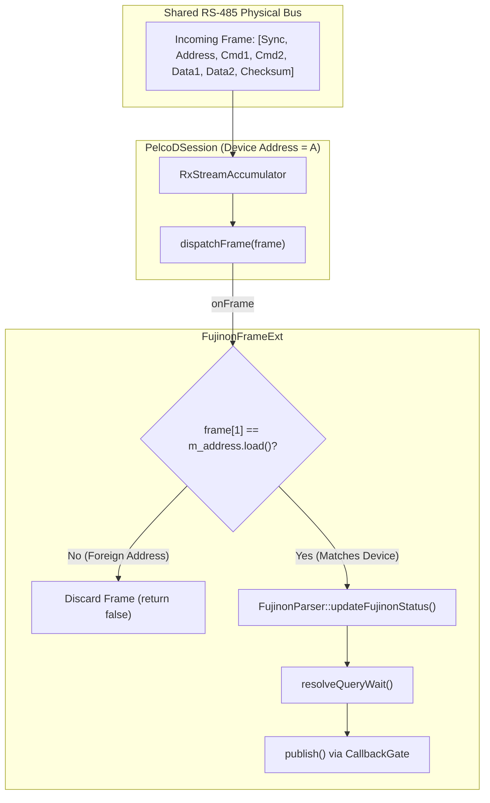
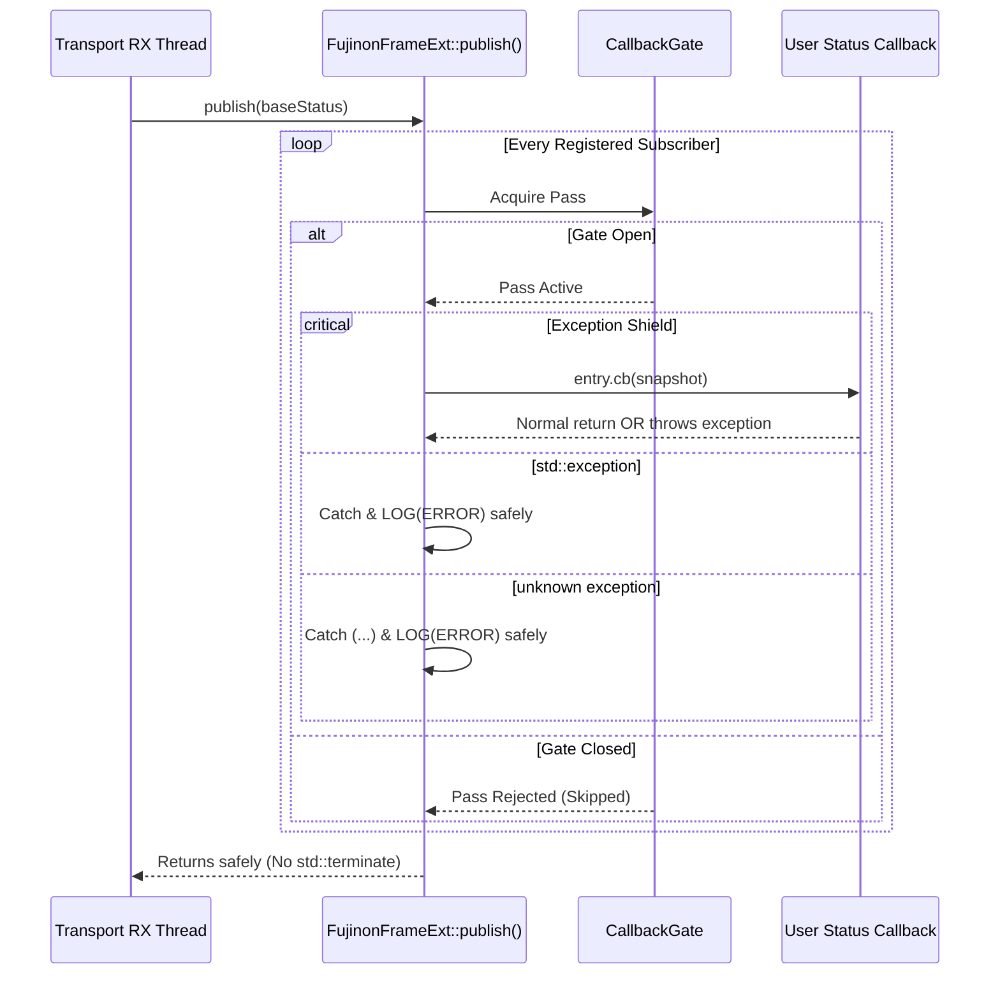

# PelcoDFujinon Phase 1 Implementation Plan: Critical Safety & Concurrency Hardening

## 1. Executive Summary & Problem Analysis

### 1.1 Context & Motivation
In [`docs/pelcodfujinon_review.md`](pelcodfujinon_review.md), three findings were classified with Critical or High severity requiring immediate remediation prior to multi-camera production deployment:

1. **Finding F1 (Critical — Multi-Drop Address Isolation Failure):**
   - **Root Cause:** In [`libs/PelcoDCore/PelcoDSession.cpp`](../libs/PelcoDCore/PelcoDSession.cpp), `PelcoDSession::dispatchFrame(frame)` invokes `m_frameExt->onFrame(frame)` **before** checking `if (frame[1] != m_address)`. The interface contract in [`libs/PelcoDCore/FrameExtension.h`](../libs/PelcoDCore/FrameExtension.h) explicitly delegates address filtering to the extension:
     ```cpp
     /// @param[in] frame Complete received frame (any address; the extension filters as needed).
     ```
     However, [`FujinonSX800Device::FujinonFrameExt`](../libs/PelcoDFujinon/FujinonSX800Device.cpp) does not store the device's bus address, and [`FujinonParser::updateFujinonStatus`](../libs/PelcoDFujinon/FujinonParser.cpp) never inspects `frame[1]`.
   - **Failure Mode:** On a shared multi-drop RS-485 bus with multiple cameras (e.g. Address 1 and Address 2), telemetry responses from Camera 2 are accepted by Camera 1's extension. This mutates Camera 1's telemetry model (`FujinonStatus`) and prematurely resolves Camera 1's pending queries via `resolveQueryWait()`, leading to cross-device state pollution and corrupt control loops.

2. **Finding F2 (Critical — Unshielded RX Thread Callbacks / CERT ERR50-CPP / ERR51-CPP):**
   - **Root Cause:** In `FujinonFrameExt::publish()`, subscriber callbacks are invoked directly on the transport RX thread without a `try/catch` exception boundary:
     ```cpp
     for (const auto& entry : *callbacks) {
         if (entry.cb && entry.gate) {
             const CallbackGate::Pass pass { *entry.gate };
             if (pass) {
                 entry.cb(current); // <-- No exception barrier!
             }
         }
     }
     ```
   - **Failure Mode:** If any subscriber lambda throws an exception (such as a Qt GUI update failure, heap allocation failure, or unexpected logic exception), the exception unwinds through the transport RX loop and calls `std::terminate()`, abnormally crashing the application process.

3. **Finding F3 (High — Dead Query Tags / Deterministic Query Timeouts):**
   - **Root Cause:** [`FujinonSX800Device`](../libs/PelcoDFujinon/FujinonSX800Device.h) provides 10 public query methods that transmit query packets tagged with specific string identifiers. However, `FujinonFrameExt::matchQuery` in [`FujinonSX800Device.cpp`](../libs/PelcoDFujinon/FujinonSX800Device.cpp) omits handling for all 10 tags:
     - `queryManualShutter` (`"FujinonQueryManualShutter"`)
     - `queryManualISO` (`"FujinonQueryManualISO"`)
     - `queryManualIris` (`"FujinonQueryManualIris"`)
     - `queryDisplay` (`"FujinonQueryDisplay"`)
     - `queryKeySetting` (`"FujinonQueryKeySetting"`)
     - `queryMovieCount` (`"FujinonQueryMovieCount"`)
     - `queryMovieYear` (`"FujinonQueryMovieYear"`)
     - `queryMovieDate` (`"FujinonQueryMovieDate"`)
     - `queryMovieTime` (`"FujinonQueryMovieTime"`)
     - `queryLogData` (`"FujinonQueryLogData"`)
   - **Failure Mode:** `matchQuery` returns `ExtMatch::NotHandled` for these queries. Because [`PelcoDCore`](../libs/PelcoDCore/) does not handle vendor tags either, the session fails to correlate the camera's response. Every single call deterministically hangs until the 1000 ms query timeout expires, failing with an error.

### 1.2 Target Objectives
1. **Multi-Drop Address Gate:** Bind the device bus address to `FujinonFrameExt` with thread-safe atomic access, supporting dynamic address changes via `setAddress()`. Discard foreign address frames in `onFrame()` before modifying state or resolving query waits.
2. **Exception Barrier:** Enclose all subscriber invocations in `FujinonFrameExt::publish()` within a SEI CERT ERR50-CPP / ERR51-CPP exception shield logging errors through `glog` without allowing exceptions to escape the RX thread.
3. **Complete Query Correlation:**
   - Implement response decoders in [`FujinonParser`](../libs/PelcoDFujinon/FujinonParser.h) for opcodes `0x97` (Shutter), `0x9B` (ISO), `0x9D` (Iris), `0x5F` (Display), `0xAF` (Key), `0xB3` (Movie Count), `0xB7` (Movie Year), `0xBB` (Movie Date), `0xBF` (Movie Time), and `0xD3` (Log Data).
   - Wire all 10 query tags into `FujinonFrameExt::matchQuery`.
   - Update `FujinonParser::updateFujinonStatus` to decode incoming query replies into `FujinonStatus`.
4. **Safety & Standards Compliance:** Comply with MISRA C++:2023, SEI CERT, and the 14 rules of [`.agents/rules/verification-checklist.md`](../.agents/rules/verification-checklist.md).

---

## 2. Architecture & Technical Design

### 2.1 Multi-Drop Address Filtering Architecture (F1)

```
CURRENT VULNERABLE MULTI-DROP DISPATCH:
  Physical Bus ──► [FF 02 00 81 12 34 87] (Camera 2 Response)
                         │
                         ▼
             PelcoDSession (Camera 1, Addr 1)
                         │
                         ├──► m_frameExt->onFrame(frame)   <-- CRITICAL DEFECT:
                         │       │                             No address check!
                         │       ├──► updateFujinonStatus()    Camera 1 status corrupted!
                         │       └──► resolveQueryWait()       Camera 1 query resolves early!
                         │
                         └──► if (frame[1] != m_address) drop; <-- Too late!

TARGET HARDENED MULTI-DROP GATE:
  Physical Bus ──► [FF 02 00 81 12 34 87] (Camera 2 Response)
                         │
                         ▼
             PelcoDSession (Camera 1, Addr 1)
                         │
                         ├──► m_frameExt->onFrame(frame)
                         │       │
                         │       ├──► if (frame[1] != m_address.load())
                         │       │       return false;     <-- GATE BARRIER: Discards foreign frame!
                         │       │
                         │       ├──► updateFujinonStatus() (Only executed if frame[1] == m_address)
                         │       └──► resolveQueryWait()
                         │
                         └──► if (frame[1] != m_address) drop;
```



### 2.2 Exception-Safe Callback Barrier (F2)

```
RX Thread Execution Path
  PelcoDSession::onDataReceived()
    └── dispatchFrame()
          └── m_frameExt->publish(baseStatus)
                └── for entry in *callbacks:
                      └── CallbackGate::Pass pass(*entry.gate)
                            └── try {
                                    entry.cb(current);
                                } catch (const std::exception& ex) {
                                    LOG(ERROR) << "FujinonStatusCallback exception: " << ex.what();
                                } catch (...) {
                                    LOG(ERROR) << "FujinonStatusCallback unknown exception";
                                }
```



### 2.3 Query Tag Correlation & Telemetry Mapping (F3)

| API Method | Transmitted Opcode | Query Tag | Expected Response Opcode | Parser Decoder Method | `FujinonStatus` Field Updated |
|---|:---:|---|:---:|---|---|
| `queryManualShutter()` | `0x00 0x97` | `"FujinonQueryManualShutter"` | `0x00 0x97` | `parseQueryManualShutter` | `manualShutter` |
| `queryManualISO()` | `0x00 0x9B` | `"FujinonQueryManualISO"` | `0x00 0x9B` | `parseQueryManualISO` | `manualISO` |
| `queryManualIris()` | `0x00 0x9D` | `"FujinonQueryManualIris"` | `0x00 0x9D` | `parseQueryManualIris` | `manualIris` |
| `queryDisplay(target)` | `0xF0 0x5D` | `"FujinonQueryDisplay"` | `0xF0 0x5F` | `parseQueryDisplay` | `timeDisplay`, `titleDisplay`, etc. |
| `queryKeySetting(target)` | `0xF0 0xAD` | `"FujinonQueryKeySetting"` | `0xF0 0xAF` | `parseQueryKeySetting` | Lens / key configuration |
| `queryMovieCount()` | `0xF0 0xB1` | `"FujinonQueryMovieCount"` | `0xF0 0xB3` | `parseQueryMovieCount` | `movieCount` |
| `queryMovieYear(idx)` | `0xF0 0xB5` | `"FujinonQueryMovieYear"` | `0xF0 0xB7` | `parseQueryMovieYear` | `movieYear` |
| `queryMovieDate(idx)` | `0xF0 0xB9` | `"FujinonQueryMovieDate"` | `0xF0 0xBB` | `parseQueryMovieDate` | `movieMonth`, `movieDay` |
| `queryMovieTime(idx)` | `0xF0 0xBD` | `"FujinonQueryMovieTime"` | `0xF0 0xBF` | `parseQueryMovieTime` | `movieHour`, `movieMinute` |
| `queryLogData(type)` | `0xF0 0xD1` | `"FujinonQueryLogData"` | `0xF0 0xD3` | `parseQueryLogData` | Diagnostic log buffer |

---

## 3. Step-by-Step Implementation Breakdown

### Step 1: Address Binding in `FujinonFrameExt` & `FujinonSX800Device`
- **Files:**
  - [`libs/PelcoDFujinon/FujinonSX800Device.h`](../libs/PelcoDFujinon/FujinonSX800Device.h)
  - [`libs/PelcoDFujinon/FujinonSX800Device.cpp`](../libs/PelcoDFujinon/FujinonSX800Device.cpp)
- **Modifications:**
  1. In `FujinonSX800Device::FujinonFrameExt`:
     - Add `explicit FujinonFrameExt(std::uint8_t address) noexcept : m_address { address } {}`.
     - Add `std::atomic<std::uint8_t> m_address { 1U };`.
     - Add `void setAddress(std::uint8_t address) noexcept { m_address.store(address, std::memory_order_relaxed); }`.
     - In `onFrame(const std::vector<std::uint8_t>& frame)`:
       ```cpp
       if (frame.size() < 2U || frame[1] != m_address.load(std::memory_order_relaxed)) {
           return false;
       }
       std::scoped_lock lock { m_statusMutex };
       return FujinonParser::updateFujinonStatus(frame, m_status);
       ```
  2. In `FujinonSX800Device`:
     - Pass `address` to `m_ext` constructor: `m_ext { std::make_shared<FujinonFrameExt>(address) }`.
     - Override `setAddress(std::uint8_t address)`:
       ```cpp
       void FujinonSX800Device::setAddress(std::uint8_t address)
       {
           PelcoDDevice::setAddress(address);
           if (m_ext) {
               m_ext->setAddress(address);
           }
       }
       ```
     - Export `using PelcoDDevice::getAddress;`.

### Step 2: SEI CERT Exception Shielding in `FujinonFrameExt::publish()`
- **Files:**
  - [`libs/PelcoDFujinon/FujinonSX800Device.cpp`](../libs/PelcoDFujinon/FujinonSX800Device.cpp)
- **Modifications:**
  1. In `FujinonFrameExt::publish(const DeviceStatus& base)`:
     ```cpp
     for (const auto& entry : *callbacks) {
         if (entry.cb && entry.gate) {
             const CallbackGate::Pass pass { *entry.gate };
             if (pass) {
                 try {
                     entry.cb(current);
                 } catch (const std::exception& ex) {
                     LOG(ERROR) << "FujinonStatusCallback threw exception: " << ex.what();
                 } catch (...) {
                     LOG(ERROR) << "FujinonStatusCallback threw unknown non-standard exception";
                 }
             }
         }
     }
     ```

### Step 3: Implement Missing Response Decoders in `FujinonParser`
- **Files:**
  - [`libs/PelcoDFujinon/FujinonParser.h`](../libs/PelcoDFujinon/FujinonParser.h)
  - [`libs/PelcoDFujinon/FujinonParser.cpp`](../libs/PelcoDFujinon/FujinonParser.cpp)
- **Modifications:**
  1. Add decoder declarations in `FujinonParser.h` with complete Doxygen comments:
     - `parseQueryManualShutter(const std::vector<uint8_t>& frame, uint8_t& val)`
     - `parseQueryManualISO(const std::vector<uint8_t>& frame, uint8_t& val)`
     - `parseQueryManualIris(const std::vector<uint8_t>& frame, uint8_t& val)`
     - `parseQueryDisplay(const std::vector<uint8_t>& frame, uint8_t& target, uint8_t& val)`
     - `parseQueryKeySetting(const std::vector<uint8_t>& frame, uint8_t& target, uint8_t& val)`
     - `parseQueryMovieCount(const std::vector<uint8_t>& frame, uint16_t& count)`
     - `parseQueryMovieYear(const std::vector<uint8_t>& frame, uint16_t& year)`
     - `parseQueryMovieDate(const std::vector<uint8_t>& frame, uint8_t& month, uint8_t& day)`
     - `parseQueryMovieTime(const std::vector<uint8_t>& frame, uint8_t& hour, uint8_t& min)`
     - `parseQueryLogData(const std::vector<uint8_t>& frame, uint8_t& d1, uint8_t& d2)`
  2. Implement decoders in `FujinonParser.cpp` with entry size checks.
  3. Expand `isFujinonResponse()` to recognize opcodes `0x97`, `0x9B`, `0x9D`, `0x5F`, `0xAF`, `0xB3`, `0xB7`, `0xBB`, `0xBF`, and `0xD3`.

### Step 4: Bind All 10 Query Tags in `FujinonFrameExt::matchQuery()`
- **Files:**
  - [`libs/PelcoDFujinon/FujinonSX800Device.cpp`](../libs/PelcoDFujinon/FujinonSX800Device.cpp)
- **Modifications:**
  1. Add tag matchers in `matchQuery`:
     ```cpp
     if (queryTag == "FujinonQueryManualShutter") {
         std::uint8_t val { 0U };
         return toMatch(FujinonParser::parseQueryManualShutter(frame, val));
     }
     if (queryTag == "FujinonQueryManualISO") {
         std::uint8_t val { 0U };
         return toMatch(FujinonParser::parseQueryManualISO(frame, val));
     }
     if (queryTag == "FujinonQueryManualIris") {
         std::uint8_t val { 0U };
         return toMatch(FujinonParser::parseQueryManualIris(frame, val));
     }
     if (queryTag == "FujinonQueryDisplay") {
         std::uint8_t target { 0U };
         std::uint8_t val { 0U };
         return toMatch(FujinonParser::parseQueryDisplay(frame, target, val));
     }
     if (queryTag == "FujinonQueryKeySetting") {
         std::uint8_t target { 0U };
         std::uint8_t val { 0U };
         return toMatch(FujinonParser::parseQueryKeySetting(frame, target, val));
     }
     if (queryTag == "FujinonQueryMovieCount") {
         std::uint16_t count { 0U };
         return toMatch(FujinonParser::parseQueryMovieCount(frame, count));
     }
     if (queryTag == "FujinonQueryMovieYear") {
         std::uint16_t year { 0U };
         return toMatch(FujinonParser::parseQueryMovieYear(frame, year));
     }
     if (queryTag == "FujinonQueryMovieDate") {
         std::uint8_t month { 0U };
         std::uint8_t day { 0U };
         return toMatch(FujinonParser::parseQueryMovieDate(frame, month, day));
     }
     if (queryTag == "FujinonQueryMovieTime") {
         std::uint8_t hour { 0U };
         std::uint8_t min { 0U };
         return toMatch(FujinonParser::parseQueryMovieTime(frame, hour, min));
     }
     if (queryTag == "FujinonQueryLogData") {
         std::uint8_t d1 { 0U };
         std::uint8_t d2 { 0U };
         return toMatch(FujinonParser::parseQueryLogData(frame, d1, d2));
     }
     ```

### Step 5: Update `FujinonTypes.h` & `FujinonParser::updateFujinonStatus()`
- **Files:**
  - [`libs/PelcoDFujinon/FujinonTypes.h`](../libs/PelcoDFujinon/FujinonTypes.h)
  - [`libs/PelcoDFujinon/FujinonParser.cpp`](../libs/PelcoDFujinon/FujinonParser.cpp)
- **Modifications:**
  1. In `FujinonStatus` ([`FujinonTypes.h`](../libs/PelcoDFujinon/FujinonTypes.h)):
     - Add `std::uint16_t movieCount { 0U };`.
     - Add `std::uint16_t lastMovieYear { 0U };`.
     - Add `std::uint8_t lastMovieMonth { 0U };`.
     - Add `std::uint8_t lastMovieDay { 0U };`.
     - Add `std::uint8_t lastMovieHour { 0U };`.
     - Add `std::uint8_t lastMovieMinute { 0U };`.
  2. In `updateFujinonStatus` ([`FujinonParser.cpp`](../libs/PelcoDFujinon/FujinonParser.cpp)):
     - Wire decoders to update `manualShutter`, `manualISO`, `manualIris`, and movie metadata fields upon successful frame parse.

---

## 4. Verification & Test-Driven Development (TDD) Strategy

Following rule 11 and the `tdd-bug-fixing` skill, failing regression tests will be implemented first:

### 4.1 New Unit Tests in `libs/PelcoDFujinon/tests/TestFujinonProtocol.cpp`
1. `ParserDecodesManualExposureResponses`:
   - Assert `parseQueryManualShutter` decodes `[FF 01 00 97 00 0A Checksum]` -> Shutter 10.
   - Assert `parseQueryManualISO` decodes `[FF 01 00 9B 00 14 Checksum]` -> ISO 20.
   - Assert `parseQueryManualIris` decodes `[FF 01 00 9D 00 05 Checksum]` -> Iris 5.
2. `ParserDecodesMovieAndDisplayQueries`:
   - Assert `parseQueryMovieCount` decodes `[FF 01 F0 B3 00 2A Checksum]` -> Count 42.
   - Assert `parseQueryMovieYear` decodes `[FF 01 F0 B7 07 EA Checksum]` -> Year 2026.
   - Assert `parseQueryMovieDate` decodes `[FF 01 F0 BB 0A 10 Checksum]` -> Month 10, Day 16.
   - Assert `parseQueryMovieTime` decodes `[FF 01 F0 BF 10 1E Checksum]` -> Hour 16, Minute 30.
   - Assert `parseQueryDisplay` decodes `[FF 01 F0 5F 43 01 Checksum]` -> Time display enabled.

### 4.2 New Integration & Concurrency Tests in `libs/PelcoDFujinon/tests/TestFujinonSX800Device.cpp`
1. `MultiDropAddressFilteringIgnoresForeignFrames`:
   - Construct two `FujinonSX800Device` instances sharing a mock transport: Device 1 (Addr 1) and Device 2 (Addr 2).
   - Inject focus response for Device 2 (`[FF 02 00 81 55 66 Checksum]`).
   - Verify Device 2 updates focus to `0x5566`.
   - Verify Device 1 focus remains default `0x0000` and does NOT trigger status callback.
2. `ThrowingSubscriberDoesNotCrashRxThread`:
   - Register a `FujinonStatusCallback` that throws `std::runtime_error("Simulated UI crash")`.
   - Inject incoming telemetry frame.
   - Verify RX thread stays alive and healthy, continuing to process subsequent frames.
3. `PreviouslyDeadQueriesResolvePromptly`:
   - For all 10 queries (`queryManualShutter`, `queryManualISO`, `queryManualIris`, `queryDisplay`, `queryKeySetting`, `queryMovieCount`, `queryMovieYear`, `queryMovieDate`, `queryMovieTime`, `queryLogData`):
   - Dispatch query and simulate immediate matching camera response.
   - Verify query completes synchronously with `SendResult::Success` without waiting for the 1-second timeout.

---

## 5. Traceability & Compliance Verification

| Finding ID | Standard / Rule | Verification Test | Success Metric |
|---|---|---|---|
| **F1** | Multi-Drop Bus Safety | `MultiDropAddressFilteringIgnoresForeignFrames` | Zero state pollution across distinct addresses. |
| **F2** | CERT ERR50-CPP / ERR51-CPP | `ThrowingSubscriberDoesNotCrashRxThread` | RX thread survives throwing subscriber; error logged. |
| **F3** | Protocol Completeness | `PreviouslyDeadQueriesResolvePromptly` | 10 queries resolve in < 10 ms instead of 1000 ms timeout. |
