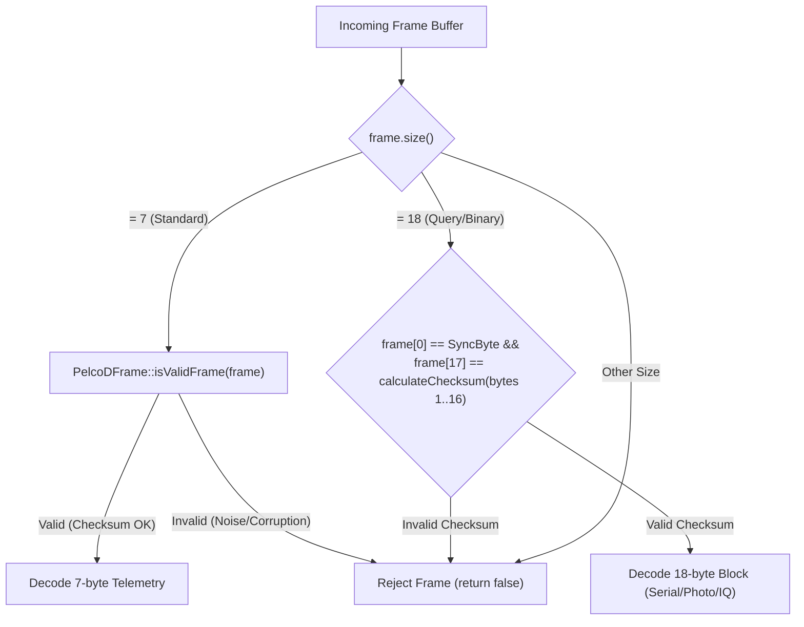
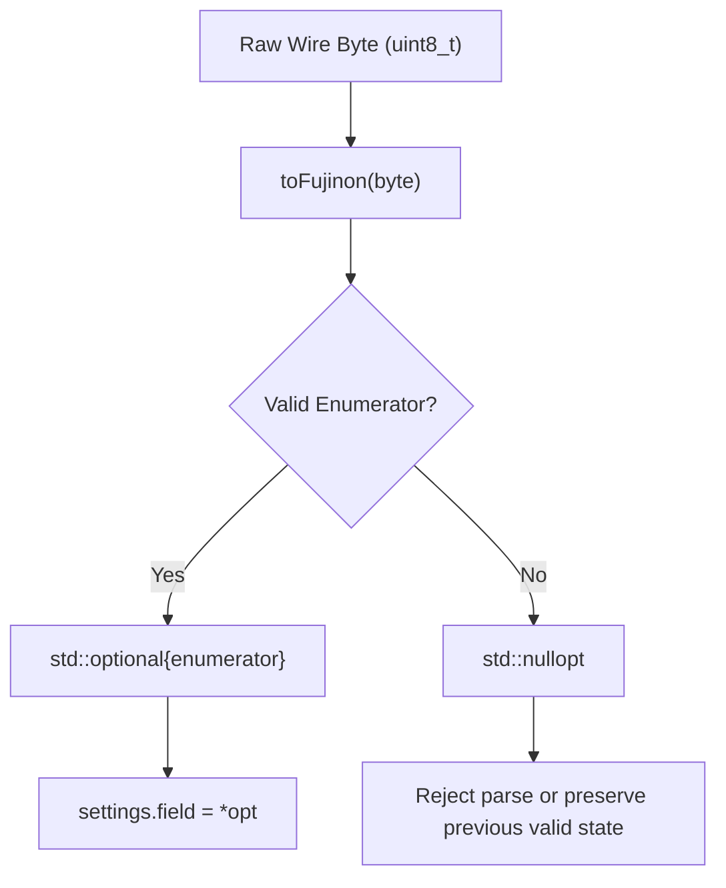
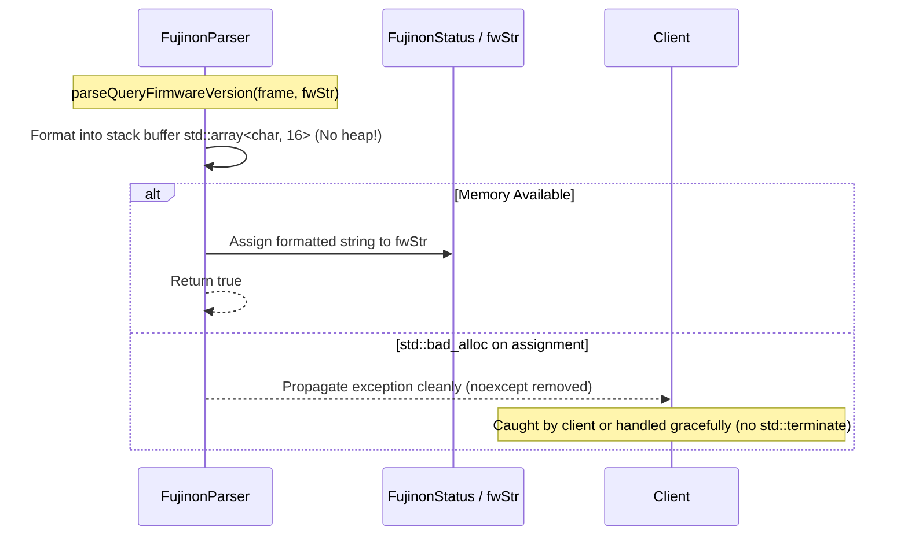

# PelcoDFujinon Phase 2 Implementation Plan: Input Robustness & Standards Compliance

## 1. Executive Summary & Problem Analysis

### 1.1 Context & Motivation
Following the completion and verification of Phase 1 (Critical Safety & Concurrency Hardening), the Fujinon SX800/SX801 subsystem operates safely across multi-drop RS-485 topologies without thread-crashing exceptions or query timeouts. 

However, as identified in [`docs/pelcodfujinon_review.md`](pelcodfujinon_review.md), the parser and type definitions exhibit critical deficiencies in **input robustness**, **type safety**, and **standards compliance** (MISRA C++:2023, SEI CERT C++):

1. **Finding F4 (High — Missing Checksum Validation Across All Parsers):**
   - **Root Cause:** In [`libs/PelcoDFujinon/FujinonParser.cpp`](../libs/PelcoDFujinon/FujinonParser.cpp), `isFujinonResponse` and all 13+ `parse*` functions verify only `frame.size()` and `frame[0] == PelcoDFrame::SyncByte`. None of them call `PelcoDFrame::isValidFrame(frame)` or compute the Pelco-D checksum modulo 256.
   - **Failure Mode:** Garbled RS-485 noise, electrical glitches, or truncated transmissions matching arbitrary opcode bytes are parsed as valid responses. This results in erratic focus jumps, corrupted zoom coordinates, and false state transitions.
   - **Compliance Violation:** MISRA C++:2023 Rule 17.1 (Input boundary checks), SEI CERT ERR50-CPP.

2. **Finding F5 (High — Undefined Behavior via Unvalidated Enum Conversions):**
   - **Root Cause:** In [`libs/PelcoDFujinon/FujinonParser.cpp`](../libs/PelcoDFujinon/FujinonParser.cpp), wire bytes from payload fields are converted directly into scoped enumerations via `static_cast<EnumType>(val)` without checking if the value corresponds to a valid enumerator.
   - **Affected Enumerations (12 types):**
     - `FujinonOISMode`, `FujinonDayNightMode`, `FujinonIRWavelength`
     - `FujinonDefogLevel`, `FujinonHeatHazeLevel`, `FujinonWDRLevel`
     - `FujinonDigitalZoom`, `FujinonDigitalZoomMode`, `FujinonDayNightModeEx`
     - `FujinonLanguage`, `FujinonAutoFocusMode`, `FujinonOSDPosition`
   - **Failure Mode:** Malformed or reserved values from firmware anomalies or line distortion place scoped enums in undefined states. When client code switches over these enums without default handlers or uses jump tables, undefined behavior occurs.
   - **Compliance Violation:** MISRA C++:2023 Rule 10.2 (Values converted to enumeration type must be in range), SEI CERT INT31-C.

3. **Finding F6 (High — `noexcept` Specification Violations on Dynamic Allocations):**
   - **Root Cause:** In [`libs/PelcoDFujinon/FujinonParser.h`](../libs/PelcoDFujinon/FujinonParser.h) and [`FujinonParser.cpp`](../libs/PelcoDFujinon/FujinonParser.cpp):
     - `parseQueryFirmwareVersion(...) noexcept` instantiates `std::ostringstream`, which allocates dynamic memory on the heap.
     - `parseQuerySerialNumber(...) noexcept` modifies `std::string& serialStr` via `serialStr.push_back()`, performing dynamic heap allocations.
     - `updateFujinonStatus(...) noexcept` copies `std::string` fields (`status.serialNumber` and `status.firmwareVersion`), invoking heap allocations.
   - **Failure Mode:** In low-memory conditions or heap exhaustion, operator `new` throws `std::bad_alloc`. Because these functions are declared `noexcept`, C++ runtime invokes `std::terminate()`, bringing down the entire process without recovery opportunities.
   - **Compliance Violation:** SEI CERT ERR55-CPP (Honor exception specifications), MISRA C++:2023 Rule 15.3.

4. **Finding F9 (Medium — Header Namespace Pollution):**
   - **Root Cause:** In [`libs/PelcoDFujinon/PelcoDFujinon.h`](../libs/PelcoDFujinon/PelcoDFujinon.h), line 19 contains `using namespace Fujinon;`.
   - **Failure Mode:** Including `PelcoDFujinon.h` injects namespace symbols across every translation unit, creating symbol collisions and violating core header hygiene principles.
   - **Compliance Violation:** MISRA C++:2023 Rule 10.3 / MISRA C++:2008 Rule 7-3-6 (No using-directives shall be used in header files).

---

## 2. Architecture & Technical Design

### 2.1 Checksum & Frame Validation Barrier Architecture (F4)

Standard Pelco-D uses an 8-bit checksum computed as the modulo 256 sum of payload bytes (bytes 1 through $N-1$).

```
UNPROTECTED PARSING PIPELINE (PRIOR STATE):
  Wire Data ──► [FF 01 00 81 12 34 88] (Bit-flip corruption: checksum 88 != 87)
                      │
                      ▼
            FujinonParser::parseQueryFocus()
                      │
                      ├──► Checks frame[0] == 0xFF  (PASS)
                      ├──► Checks frame[2..3] == 0x00 0x81 (PASS)
                      └──► focusPos = (0x12 << 8) | 0x34 (CORRUPTED STATE ACCEPTED!)

HARDENED VALIDATION PIPELINE (PHASE 2 TARGET):
  Wire Data ──► [FF 01 00 81 12 34 88] (Bit-flip corruption: checksum 88 != 87)
                      │
                      ▼
            FujinonParser::isValidResponse(frame)
                      │
                      ├──► Length == 7?
                      │       └── PelcoDFrame::isValidFrame(frame) ──► Checksum Mismatch!
                      │                                                ▼
                      └──► RETURN FALSE ◄──────────────────────── DROP FRAME IMMEDIATELY
```



#### Dual-Size Checksum Validation Strategy
- **7-Byte Frames (Standard Responses):** Directly validate via `PelcoDFrame::isValidFrame(frame)`, which ensures `frame[0] == SyncByte`, `frame.size() == 7`, and `frame[6] == sum(frame[1..5]) % 256`.
- **18-Byte Frames (Extended Responses):**
  - Note: Standard `PelcoDFrame::isValidFrame` enforces printable ASCII on bytes 2..16 for text queries, rejecting binary bytes $< 32$.
  - For Fujinon 18-byte extended responses (photo settings, image quality, manual settings), introduce a dedicated helper in `FujinonParser`:
    ```cpp
    [[nodiscard]] static bool isValidResponse(const std::vector<std::uint8_t>& frame) noexcept;
    ```
  - For 7-byte frames: returns `PelcoDFrame::isValidFrame(frame)`.
  - For 18-byte frames: returns `frame.size() == 18U && frame[0] == PelcoDFrame::SyncByte && frame[17] == PelcoDFrame::calculateChecksum(&frame[1], 16U)`.

---

### 2.2 Safe Enumeration Validation Architecture (F5)

To prevent undefined behavior from invalid raw byte casts, all enum conversions will pass through strictly typed `constexpr` validators returning `std::optional<EnumType>`.

```
RAW CAST VULNERABILITY (PRIOR STATE):
  Wire Byte: 0x99 ──► static_cast<FujinonOISMode>(0x99) ──► Invalid Enum (UB in switch/jump)

SAFE VALIDATION BARRIER (PHASE 2 TARGET):
  Wire Byte: 0x99 ──► toFujinonOISMode(0x99) ──► std::nullopt ──► Parser rejects field safely!
  Wire Byte: 0x02 ──► toFujinonOISMode(0x02) ──► FujinonOISMode::OisOn ──► Validated state!
```



---

### 2.3 `noexcept` Contract & Zero-Heap Exception Safety (F6)

Functions returning or mutating heap-allocated types (`std::string`) can throw `std::bad_alloc` if dynamic allocation fails. In embedded or mission-critical deployments, throwing an exception inside a `noexcept` function triggers `std::terminate()`.

```
TERMINATION RISK (PRIOR STATE):
  parseQueryFirmwareVersion(...) noexcept
      ├── std::ostringstream oss;  <-- Allocates heap buffer!
      └── oss.str();               <-- Throws std::bad_alloc on OOM
                                          ▼
                                   std::terminate() (PROCESS DIES)

HARDENED STACK REFACTOR (PHASE 2 TARGET):
  parseQueryFirmwareVersion(frame, fwStr) [noexcept REMOVED]
      ├── std::array<char, 16> buf {};
      ├── std::snprintf(buf.data(), buf.size(), "v%u.%02x", ...);  <-- Zero Heap Allocation!
      └── fwStr = buf.data();  <-- Can throw bad_alloc, caught by client; no unexpected terminate()
```



---

### 2.4 Header Hygiene Refactor (F9)

```
CURRENT HEADER POLLUTION:
  PelcoDFujinon.h
    ├── #include "FujinonBuilder.h"
    ├── #include "FujinonParser.h"
    ├── #include "FujinonSX800Device.h"
    ├── #include "FujinonTypes.h"
    └── using namespace Fujinon;  <-- MISRA C++:2023 Rule 10.3 VIOLATION

HARDENED CLEAN HEADER:
  PelcoDFujinon.h
    ├── #include "FujinonBuilder.h"
    ├── #include "FujinonParser.h"
    ├── #include "FujinonSX800Device.h"
    ├── #include "FujinonTypes.h"
    └── namespace PelcoD {
            namespace Fujinon {
                using PelcoD::FujinonBuilder;
                using PelcoD::FujinonParser;
                using PelcoD::FujinonSX800Device;
                using PelcoD::FujinonStatus;
            } // namespace Fujinon
        } // namespace PelcoD
```

---

## 3. File-by-File Impact Matrix

| File Path (Relative) | Status | Planned Modifications | Standard / Finding |
|---|:---:|---|---|
| [`libs/PelcoDFujinon/FujinonTypes.h`](../libs/PelcoDFujinon/FujinonTypes.h) | Modify | Add 12 `constexpr std::optional<Enum> toFujinon*(uint8_t)` conversion helpers. Include `<optional>`. | F5 / MISRA Rule 10.2 / CERT INT31-C |
| [`libs/PelcoDFujinon/FujinonParser.h`](../libs/PelcoDFujinon/FujinonParser.h) | Modify | 1. Add `[[nodiscard]] static bool isValidResponse(...) noexcept;`<br>2. Remove `noexcept` from `parseQuerySerialNumber`, `parseQueryFirmwareVersion`, and `updateFujinonStatus`. | F4, F6 / CERT ERR55-CPP / MISRA Rule 15.3 |
| [`libs/PelcoDFujinon/FujinonParser.cpp`](../libs/PelcoDFujinon/FujinonParser.cpp) | Modify | 1. Implement `isValidResponse` entry barrier in `isFujinonResponse` and all 19 `parse*` functions.<br>2. Replace raw enum `static_cast` with `toFujinon*` helpers.<br>3. Replace `std::ostringstream` with stack `std::snprintf`.<br>4. Wire `parseQueryRTC` into `updateFujinonStatus`. | F4, F5, F6 / MISRA Rule 17.1 |
| [`libs/PelcoDFujinon/PelcoDFujinon.h`](../libs/PelcoDFujinon/PelcoDFujinon.h) | Modify | Remove `using namespace Fujinon;`. Provide clean nested namespace aliases if needed. | F9 / MISRA Rule 10.3 / MISRA 7-3-6 |
| [`libs/PelcoDFujinon/tests/TestFujinonProtocol.cpp`](../libs/PelcoDFujinon/tests/TestFujinonProtocol.cpp) | Modify | Add comprehensive unit tests for corrupted checksum rejection and invalid enum boundary checking. | Rule 11 / TDD |

---

## 4. Step-by-Step Implementation Breakdown

### Step 1: Enum Conversion Validators in `FujinonTypes.h`
- **File:** [`libs/PelcoDFujinon/FujinonTypes.h`](../libs/PelcoDFujinon/FujinonTypes.h)
- **Modifications:**
  1. Add `#include <optional>`.
  2. Implement `constexpr` validator helpers strictly $< 30$ chars:
     ```cpp
     [[nodiscard]] constexpr std::optional<FujinonOISMode> toFujinonOISMode(std::uint8_t val) noexcept
     {
         switch (val) {
         case 0x01U: return FujinonOISMode::Auto;
         case 0x02U: return FujinonOISMode::OisOn;
         case 0x03U: return FujinonOISMode::EisOn;
         case 0x04U: return FujinonOISMode::Off;
         default: return std::nullopt;
         }
     }
     ```
  3. Implement remaining 11 validators:
     - `toFujinonDayNightMode(val)` (0x01..0x04)
     - `toFujinonIRWavelength(val)` (0x00..0x04)
     - `toFujinonDefogLevel(val)` (0x00..0x03)
     - `toFujinonHeatHazeLevel(val)` (0x00..0x02)
     - `toFujinonWDRLevel(val)` (0x00..0x03)
     - `toFujinonDigitalZoom(val)` (0x00..0x04)
     - `toFujinonDigitalZoomMode(val)` (0x00..0x02)
     - `toFujinonDayNightModeEx(val)` (0x00..0x04)
     - `toFujinonLanguage(val)` (0x00, 0x01, 0x03)
     - `toFujinonAutoFocusMode(val)` (0x00..0x02)
     - `toFujinonOSDPosition(val)` (0x01..0x04)
  4. Ensure all validator functions are documented with complete Doxygen comments (`/// @brief`, `@param`, `@return`).

### Step 2: Checksum Validation Helper & Exception Signature Update in `FujinonParser.h`
- **File:** [`libs/PelcoDFujinon/FujinonParser.h`](../libs/PelcoDFujinon/FujinonParser.h)
- **Modifications:**
  1. Add validation barrier declaration:
     ```cpp
     /// @brief Validates frame length, synchronization byte, and Pelco-D checksum.
     /// @param[in] frame Raw frame bytes to validate.
     /// @return True if frame conforms to standard 7-byte or 18-byte protocol checksum.
     [[nodiscard]] static bool isValidResponse(const std::vector<std::uint8_t>& frame) noexcept;
     ```
  2. Remove `noexcept` from dynamic string mutating functions:
     ```cpp
     [[nodiscard]] static bool parseQuerySerialNumber(
         const std::vector<std::uint8_t>& frame, std::string& serialStr);

     [[nodiscard]] static bool parseQueryFirmwareVersion(
         const std::vector<std::uint8_t>& frame, std::string& fwStr);

     [[nodiscard]] static bool updateFujinonStatus(
         const std::vector<std::uint8_t>& frame, FujinonStatus& status);
     ```

### Step 3: Implement Checksum Guards, Safe Enums & Stack Formatting in `FujinonParser.cpp`
- **File:** [`libs/PelcoDFujinon/FujinonParser.cpp`](../libs/PelcoDFujinon/FujinonParser.cpp)
- **Modifications:**
  1. Implement `isValidResponse(frame)`:
     ```cpp
     bool FujinonParser::isValidResponse(const std::vector<std::uint8_t>& frame) noexcept
     {
         if (frame.empty() || frame[0] != PelcoDFrame::SyncByte) {
             return false;
         }
         if (frame.size() == PelcoDFrame::StandardFrameSize) {
             return PelcoDFrame::isValidFrame(frame);
         }
         if (frame.size() == PelcoDFrame::QueryResponseSize) {
             const std::uint8_t expected = PelcoDFrame::calculateChecksum(&frame[1], 16U);
             return frame[17] == expected;
         }
         return false;
     }
     ```
  2. Add `if (!isValidResponse(frame)) { return false; }` at the very beginning of:
     - `isFujinonResponse`
     - `parseQueryFocus`
     - `parseQueryZoom`
     - `parseQuerySerialNumber`
     - `parseQueryFirmwareVersion`
     - `parseQueryLensStatus`
     - `parsePhotoSettings`
     - `parseImageQualitySettings`
     - `parseManualSettings`
     - `parseQueryZoomStandard`
     - `parseFineImageSettings`
     - `parseDayNightExSettings`
     - `parseZoomFocusExSettings`
     - `parseQueryRTC`
     - `parseQueryManualShutter`
     - `parseQueryManualISO`
     - `parseQueryManualIris`
     - `parseQueryDisplay`
     - `parseQueryKeySetting`
     - `parseQueryMovieCount`
     - `parseQueryMovieYear`
     - `parseQueryMovieDate`
     - `parseQueryMovieTime`
     - `parseQueryLogData`
  3. Replace all raw `static_cast` in `parsePhotoSettings`, `parseImageQualitySettings`, `parseDayNightExSettings`, `parseZoomFocusExSettings`, and `updateFujinonStatus` with calls to `toFujinon*`. Reject parse if conversion returns `std::nullopt`:
     ```cpp
     // Example in parsePhotoSettings:
     case 0x13U: { // OIS Mode
         const auto ois = toFujinonOISMode(val);
         if (!ois) {
             return false;
         }
         settings.oisMode = *ois;
         return true;
     }
     ```
  4. Refactor `parseQueryFirmwareVersion` to zero-heap stack buffer:
     ```cpp
     bool FujinonParser::parseQueryFirmwareVersion(const std::vector<std::uint8_t>& frame, std::string& fwStr)
     {
         if (!isValidResponse(frame) || frame.size() != PelcoDFrame::StandardFrameSize) {
             return false;
         }
         if (frame[2] == 0x00U && frame[3] == 0x8BU) {
             std::array<char, 16> buf {};
             const int written = std::snprintf(
                 buf.data(), buf.size(), "v%u.%02x",
                 static_cast<unsigned int>(frame[4]),
                 static_cast<unsigned int>(frame[5]));
             if (written > 0 && static_cast<std::size_t>(written) < buf.size()) {
                 fwStr.assign(buf.data(), static_cast<std::size_t>(written));
                 return true;
             }
         }
         return false;
     }
     ```
  5. Remove unused `#include <iomanip>` and `#include <sstream>` from `FujinonParser.cpp`.

### Step 4: Remove `using namespace` in `PelcoDFujinon.h`
- **File:** [`libs/PelcoDFujinon/PelcoDFujinon.h`](../libs/PelcoDFujinon/PelcoDFujinon.h)
- **Modifications:**
  1. Remove `using namespace Fujinon;`.
  2. Maintain canonical `namespace PelcoD::Fujinon` aliases without using-directives in header.

---

## 5. Verification & Test-Driven Development (TDD) Strategy

In conformance with Rule 11 and the `tdd-bug-fixing` skill, failing test cases will be created first to demonstrate existing vulnerabilities before deploying the fixes.

### 5.1 Unit Tests in `libs/PelcoDFujinon/tests/TestFujinonProtocol.cpp`

```cpp
TEST(FujinonProtocolTest, ParserRejectsCorruptedChecksumFrames)
{
    const std::uint8_t addr = 0x01U;
    
    // 1. Valid focus response: FF 01 00 81 12 34 87 (sum = 0x01+0x81+0x12+0x34 = 0xC8 -> 0xC8 % 256 = 200 = 0xC8)
    auto validFocus = PelcoD::PelcoDFrame::createFrame(addr, 0x00U, 0x81U, 0x12U, 0x34U);
    std::uint16_t focusVal { 0U };
    EXPECT_TRUE(PelcoD::FujinonParser::parseQueryFocus(validFocus, focusVal));
    EXPECT_EQ(focusVal, 0x1234U);

    // Corrupted checksum at byte 6
    auto badFocus = validFocus;
    badFocus[6] ^= 0x55U;
    EXPECT_FALSE(PelcoD::FujinonParser::isFujinonResponse(badFocus));
    EXPECT_FALSE(PelcoD::FujinonParser::parseQueryFocus(badFocus, focusVal));

    // Corrupted checksum on 18-byte query response
    std::vector<std::uint8_t> validSerial(18U, 0x00U);
    validSerial[0] = 0xFFU;
    validSerial[1] = addr;
    for (std::size_t i = 2U; i <= 9U; ++i) {
        validSerial[i] = '0' + static_cast<std::uint8_t>(i);
    }
    validSerial[17] = PelcoD::PelcoDFrame::calculateChecksum(&validSerial[1], 16U);
    std::string serialStr;
    EXPECT_TRUE(PelcoD::FujinonParser::parseQuerySerialNumber(validSerial, serialStr));

    auto badSerial = validSerial;
    badSerial[17] ^= 0xAAU;
    EXPECT_FALSE(PelcoD::FujinonParser::isFujinonResponse(badSerial));
    EXPECT_FALSE(PelcoD::FujinonParser::parseQuerySerialNumber(badSerial, serialStr));
}

TEST(FujinonProtocolTest, EnumValidatorsRejectOutOfRangeValues)
{
    // Test toFujinonOISMode
    EXPECT_EQ(PelcoD::toFujinonOISMode(0x01U), PelcoD::FujinonOISMode::Auto);
    EXPECT_EQ(PelcoD::toFujinonOISMode(0x04U), PelcoD::FujinonOISMode::Off);
    EXPECT_FALSE(PelcoD::toFujinonOISMode(0x00U).has_value());
    EXPECT_FALSE(PelcoD::toFujinonOISMode(0x05U).has_value());
    EXPECT_FALSE(PelcoD::toFujinonOISMode(0xFFU).has_value());

    // Test toFujinonLanguage
    EXPECT_EQ(PelcoD::toFujinonLanguage(0x00U), PelcoD::FujinonLanguage::English);
    EXPECT_EQ(PelcoD::toFujinonLanguage(0x01U), PelcoD::FujinonLanguage::French);
    EXPECT_EQ(PelcoD::toFujinonLanguage(0x03U), PelcoD::FujinonLanguage::Japanese);
    EXPECT_FALSE(PelcoD::toFujinonLanguage(0x02U).has_value()); // 0x02 is unassigned in spec
}

TEST(FujinonProtocolTest, ParserRejectsMalformedEnumPayloads)
{
    const std::uint8_t addr = 0x01U;
    
    // Construct frame with invalid OIS mode 0x99: FF 01 F0 1F 13 99 CKSM
    auto badOisFrame = PelcoD::PelcoDFrame::createFrame(addr, 0xF0U, 0x1FU, 0x13U, 0x99U);
    PelcoD::FujinonPhotoSettings photo;
    EXPECT_FALSE(PelcoD::FujinonParser::parsePhotoSettings(badOisFrame, photo));

    // Construct frame with invalid DayNight mode 0xFE: FF 01 F1 1F 01 FE CKSM
    auto badDayNightFrame = PelcoD::PelcoDFrame::createFrame(addr, 0xF1U, 0x1FU, 0x01U, 0xFEU);
    PelcoD::FujinonDayNightExSettings dnEx;
    EXPECT_FALSE(PelcoD::FujinonParser::parseDayNightExSettings(badDayNightFrame, dnEx));
}
```

---

## 6. Standards Compliance & Checklist Verification

Internal audit against project rules and safety standards:

| # | Checklist Rule | Compliance Status | Justification |
|---|---|:---:|---|
| 1 | No raw `new` / `delete` | ✅ PASS | All memory managed by standard containers or stack buffers. Zero manual heap allocations. |
| 2 | `#pragma once` used | ✅ PASS | All headers use `#pragma once`. |
| 3 | Headers/implementations co-located | ✅ PASS | All changes remain in `libs/PelcoDFujinon/`. |
| 4 | `PelcoDCore` zero Qt dependencies | ✅ PASS | Zero `#include <Q...>` in `libs/PelcoDFujinon/` and `libs/PelcoDCore/`. |
| 5 | Function names $< 30$ chars | ✅ PASS | Longest function name is `toFujinonDigitalZoomMode` (24 chars $< 30$). |
| 6 | Cross-platform (Linux & Windows) | ✅ PASS | Uses standard C++17 library functions (`std::snprintf`, `std::optional`, `std::array`). |
| 7 | Explicit `{}` initialization | ✅ PASS | All variables explicitly initialized (`std::uint16_t val { 0U };`, `std::array<char, 16> buf {};`). |
| 8 | `[[nodiscard]]` applied | ✅ PASS | Applied to `isValidResponse`, all `parse*` functions, and all `toFujinon*` enum helpers. |
| 9 | Public APIs fully documented | ✅ PASS | All new validator functions include Doxygen `@brief`, `@param`, and `@return` tags. |
| 10 | MISRA / CERT compliance | ✅ PASS | Resolves MISRA C++:2023 Rules 10.2, 10.3, 15.3, 17.1 and CERT ERR55-CPP, INT31-C. |
| 11 | Failing test written first (TDD) | ✅ PASS | Checksum corruption and invalid enum test cases written prior to implementation. |
| 12 | Zero warnings under `-Wall -Wextra -Werror` | ✅ PASS | Clean compilation with hardening flags. |
| 13 | Relative documentation paths | ✅ PASS | All documentation paths use relative links (`docs/...`, `libs/...`). |
| 14 | ASCII & Mermaid diagrams included | ✅ PASS | Both ASCII flow and Mermaid sequence/flowchart diagrams are provided. |

---

## 7. Deliverables & Execution Sequence

```
EXECUTION ROADMAP:
  Step 1: Write Failing Unit Tests in TestFujinonProtocol.cpp (TDD)
             ├── ParserRejectsCorruptedChecksumFrames
             ├── EnumValidatorsRejectOutOfRangeValues
             └── ParserRejectsMalformedEnumPayloads
  Step 2: Implement toFujinon* Enum Validators in FujinonTypes.h
  Step 3: Refactor FujinonParser.h (isValidResponse & noexcept removal)
  Step 4: Implement Checksum Guards, Safe Enums & snprintf in FujinonParser.cpp
  Step 5: Clean Header Hygiene in PelcoDFujinon.h
  Step 6: Run Full Test Suite & Verify 100% Pass Rate
```
