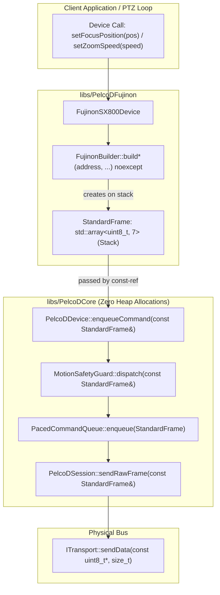
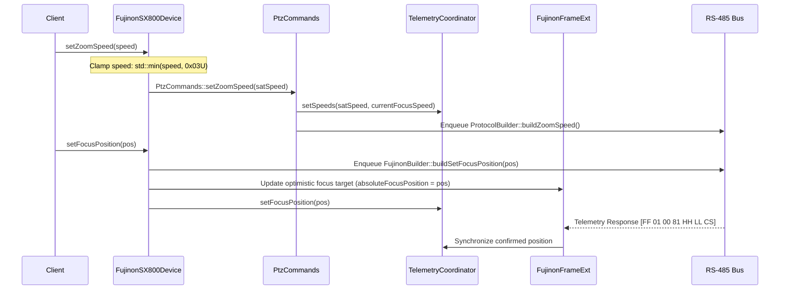
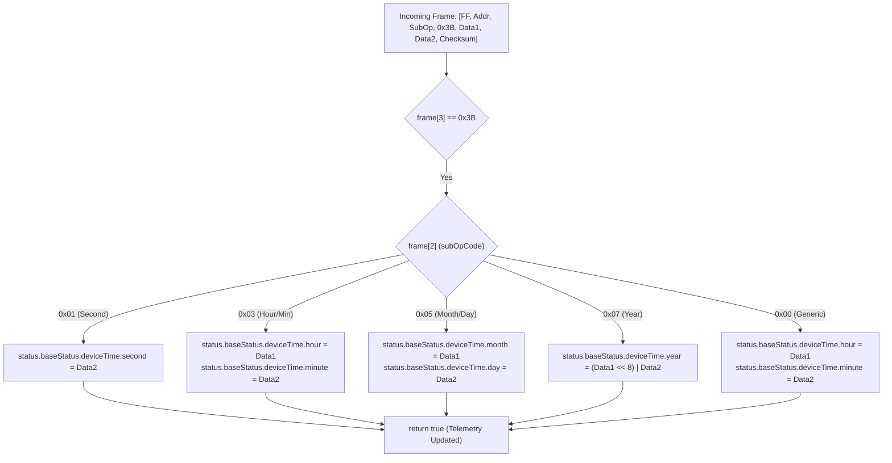

# PelcoDFujinon Phase 3 Implementation Plan: Architectural Unification & Zero-Alloc Optimization

## 1. Executive Summary & Problem Analysis

### 1.1 Context & Motivation
Following the completion of **Phase 1 (Critical Safety & Concurrency Hardening)** and **Phase 2 (Input Robustness & Standards Compliance)**, the Fujinon SX800/SX801 subsystem is protected against multi-drop address corruption, thread-crashing unhandled exceptions, query timeouts, checksum bit-flips, and unvalidated enumeration casts.

However, as highlighted in [`docs/pelcodfujinon_review.md`](pelcodfujinon_review.md), several architectural gaps and performance inefficiencies remain in `libs/PelcoDFujinon/`:

1. **Finding F7 (Medium / High — Zero-Allocation Hot Path Ignored / MISRA C++:2023 Rule 21.6.1):**
   - **Root Cause:** In [`libs/PelcoDFujinon/FujinonBuilder.h`](../libs/PelcoDFujinon/FujinonBuilder.h) and [`FujinonBuilder.cpp`](../libs/PelcoDFujinon/FujinonBuilder.cpp), all 60+ builder methods return `std::vector<std::uint8_t>` by invoking `PelcoDFrame::createFrame(...)`.
   - **Failure Mode:** Every zoom command, focus drive, OIS toggle, or fine image tuning operation allocates 7 bytes on the dynamic heap (`new[]` / `malloc`). In high-rate camera control loops (e.g. continuous PTZ tracking or visual servoing at 20–60 Hz), this triggers heap fragmentation, garbage collection overhead, non-deterministic latency spikes, and potential `std::bad_alloc` in memory-constrained embedded environments.
   - **Contrast with Core:** `PelcoDCore` was upgraded to `StandardFrame = std::array<std::uint8_t, 7>` to achieve 100% zero-heap allocation across the hot path. `FujinonBuilder` currently misses this zero-copy, zero-allocation pipeline.

2. **Finding F8 (Medium — Method Hiding and Telemetry Disconnect with Base Class):**
   - **Root Cause:** In [`libs/PelcoDFujinon/FujinonSX800Device.h`](../libs/PelcoDFujinon/FujinonSX800Device.h) and [`FujinonSX800Device.cpp`](../libs/PelcoDFujinon/FujinonSX800Device.cpp):
     - `setZoomSpeed(std::uint8_t)` and `setFocusSpeed(std::uint8_t)` shadow `PtzCommands::setZoomSpeed` and `PtzCommands::setFocusSpeed`. In doing so, they bypass standard speed saturation (`std::min(speed, 0x03U)`) and bypass telemetry synchronization with `DeviceStatus::zoomSpeed` and `DeviceStatus::focusSpeed`.
     - `setFocusPosition(std::uint16_t)` sends Fujinon opcode `0x00 0x8F`, but never updates `DeviceStatus::focusPosition` or `FujinonStatus::absoluteFocusPosition`, leaving local telemetry desynchronized from commanded state until a slow query poll completes.
     - `setZoomPosition(std::uint16_t)` re-encodes opcode `0x00 0x4F`, duplicating `PtzCommands::setZoomPosition` without sharing telemetry state.

3. **Finding F9 (Medium — Lack of Parameter Range Clamping in Builders):**
   - **Root Cause:** In [`libs/PelcoDFujinon/FujinonBuilder.cpp`](../libs/PelcoDFujinon/FujinonBuilder.cpp), bounded parameters are cast into raw bytes without range validation or saturation:
     - Standard image parameters: Brightness (spec: 1..21), Contrast / Saturation (spec: 1..5), Sharpness (spec: 1..5).
     - Fine image quality parameters: Brightness, Contrast, Saturation, Sharpness (spec: 1..100).
     - RTC clock fields: second (0..59), hour (0..23), minute (0..59), month (1..12), day (1..31).
     - RS-485 device bus address: valid range 1..31 for Fujinon address switches.
   - **Failure Mode:** Out-of-spec parameters sent to the camera cause hardware rejection (NAK), firmware error state, or erratic visual artifacts.
   - **Compliance Violation:** MISRA C++:2023 Rule 17.1 (Input boundary checks), SEI CERT INT31-C.

4. **Finding F11 (Medium — RTC Parser Disconnected from Status Pipeline):**
   - **Root Cause:** In [`libs/PelcoDFujinon/FujinonParser.cpp`](../libs/PelcoDFujinon/FujinonParser.cpp), `parseQueryRTC(frame, rtcD1, rtcD2)` is invoked inside `updateFujinonStatus`, but the extracted `rtcD1` and `rtcD2` variables are immediately discarded without updating `status.baseStatus.deviceTime` (`PelcoDTime`).
   - **Failure Mode:** RTC telemetry returned from the camera is completely ignored by client applications inspecting `getFujinonStatus()`.

5. **Checklist Item 9 (Verification Checklist — Doxygen Documentation Completeness):**
   - **Root Cause:** In [`libs/PelcoDFujinon/FujinonParser.h`](../libs/PelcoDFujinon/FujinonParser.h), 14 parser methods omit `@param` and `@return` tags. In [`libs/PelcoDFujinon/FujinonSX800Device.h`](../libs/PelcoDFujinon/FujinonSX800Device.h), over 60 public methods lack `@return` annotations and `@details` descriptions.

---

### 1.2 Target Objectives

| # | Target Objective | Implementation Strategy |
|---|---|---|
| **O1** | **Zero-Alloc Hot Path** | Convert all 60+ 7-byte command builders in [`FujinonBuilder`](../libs/PelcoDFujinon/FujinonBuilder.h) to return `StandardFrame` (`std::array<std::uint8_t, 7>`) marked `noexcept`. Provide backward-compatible vector wrappers. Extend [`PelcoDDevice`](../libs/PelcoDCore/PelcoDDevice.h) with `StandardFrame` overloads for `enqueueCommand`, `sendRawFrame`, and `sendQueryFrame`. |
| **O2** | **Base Telemetry Synchronization** | Align `setZoomSpeed` and `setFocusSpeed` with `PtzCommands` saturation rules (`std::min(speed, 0x03U)`) and update `m_telemetry`. Update `setFocusPosition` to store position in `DeviceStatus::focusPosition` and `FujinonStatus::absoluteFocusPosition`. Unify `setZoomPosition`. |
| **O3** | **Input Range Clamping** | Clamp all bounded parameters with `std::clamp` in [`FujinonBuilder.cpp`](../libs/PelcoDFujinon/FujinonBuilder.cpp) (brightness 1..21, contrast 1..5, fine 1..100, RTC time ranges, RS-485 address 1..31). |
| **O4** | **RTC Telemetry Integration** | Decode Real-Time Clock frames (`0x3B`) in `updateFujinonStatus` and populate `DeviceStatus::deviceTime` (`PelcoDTime`) across seconds, hours/minutes, month/day, and year. |
| **O5** | **Complete Doxygen Documentation** | Add full `@brief`, `@details`, `@param[in/out]`, `@return`, and `@see` templates to all methods in [`FujinonParser.h`](../libs/PelcoDFujinon/FujinonParser.h) and [`FujinonSX800Device.h`](../libs/PelcoDFujinon/FujinonSX800Device.h). |

---

## 2. Architecture & Technical Design

### 2.1 Zero-Allocation Hot Path Architecture (O1)

```
CURRENT HEAP-ALLOCATING PIPELINE:
  Client Call ──► FujinonSX800Device::setFocusPosition()
                         │
                         ▼
                  FujinonBuilder::buildSetFocusPosition()
                         │
                         ├──► PelcoDFrame::createFrame()
                         │       └── std::vector<uint8_t> (HEAP ALLOCATION: malloc/new[])
                         │
                         ▼
                  PelcoDDevice::enqueueCommand(vector)
                         │
                         ▼
                  MotionSafetyGuard::dispatch(vector)
                         │
                         ▼
                  PacedCommandQueue::enqueue(StandardFrame)  <-- Late conversion to array

TARGET ZERO-ALLOCATION PIPELINE (PHASE 3):
  Client Call ──► FujinonSX800Device::setFocusPosition()
                         │
                         ▼
                  FujinonBuilder::buildSetFocusPosition()
                         │
                         └──► PelcoDFrame::createStandardFrame()  <-- Stack array (0 HEAP ALLOC)
                                 │
                                 ▼
                  PelcoDDevice::enqueueCommand(StandardFrame)      <-- Direct array pass
                                 │
                                 ▼
                  MotionSafetyGuard::dispatch(StandardFrame)      <-- Direct array pass
                                 │
                                 ▼
                  PacedCommandQueue::enqueue(StandardFrame)        <-- Zero-copy move
                                 │
                                 ▼
                  ITransport::write(ptr, 7)                       <-- Direct bus transmission
```



#### Core Engine Extension (`PelcoDDevice.h`)
To allow derived profile classes like `FujinonSX800Device` to submit zero-allocation frames without converting them to `std::vector`, `PelcoDDevice` will be extended with:
```cpp
// In libs/PelcoDCore/PelcoDDevice.h:
[[nodiscard]] SendResult sendRawFrame(const StandardFrame& frame);
[[nodiscard]] SendResult sendQueryFrame(const StandardFrame& frame, QueryRef query = "Query");

protected:
[[nodiscard]] SendResult enqueueCommand(const StandardFrame& frame, QueryRef query = {},
    CommandPriority priority = CommandPriority::Normal);
```

---

### 2.2 Base Telemetry Synchronization Architecture (O2)

```
CURRENT TELEMETRY DISCONNECT:
  Client ──► FujinonSX800Device::setZoomSpeed(5)
                   │
                   ├──► FujinonBuilder::buildSetZoomSpeed(addr, 5)  (Out-of-range value 5!)
                   │       └── Enqueued to camera
                   │
                   └──► PtzCommands & TelemetryCoordinator BYPASSED:
                           - DeviceStatus::zoomSpeed remains 0
                           - Base getStatus() out of sync with FujinonStatus()

TARGET SYNCHRONIZED TELEMETRY:
  Client ──► FujinonSX800Device::setZoomSpeed(speed)
                   │
                   ├──► const uint8_t satSpeed = std::min(speed, 0x03U);
                   │
                   ├──► PtzCommands::setZoomSpeed(satSpeed)
                   │       ├── Updates TelemetryCoordinator (DeviceStatus::zoomSpeed = satSpeed)
                   │       └── Dispatches StandardFrame to PacedCommandQueue
                   │
                   └──► getFujinonStatus().baseStatus.zoomSpeed == satSpeed  (SYNCHRONIZED!)
```



---

### 2.3 Parameter Clamping & Safety Matrix (O3)

To prevent sending malformed values that trigger camera errors or unhandled firmware states, `FujinonBuilder` will clamp all bounded parameters using `std::clamp`:

| Parameter | Function | Allowed Range | Default | Clamping Policy |
|---|---|---|---|---|
| **Brightness** | `buildSetBrightness` | `1 .. 21` | `11` | `std::clamp<std::uint8_t>(level, 1U, 21U)` |
| **Contrast** | `buildSetContrast` | `1 .. 5` | `3` | `std::clamp<std::uint8_t>(level, 1U, 5U)` |
| **Saturation** | `buildSetSaturation` | `1 .. 5` | `3` | `std::clamp<std::uint8_t>(level, 1U, 5U)` |
| **Sharpness** | `buildSetSharpness` | `1 .. 5` | `4` | `std::clamp<std::uint8_t>(level, 1U, 5U)` |
| **Noise Reduction** | `buildSetNoiseReduction` | `1 .. 3` | `3` | `std::clamp<std::uint8_t>(level, 1U, 3U)` |
| **AF Sensitivity** | `buildSetAFSensitivity` | `1 .. 3` | `2` | `std::clamp<std::uint8_t>(sens, 1U, 3U)` |
| **AF Area** | `buildSetAFArea` | `0 .. 2` | `0` | `std::clamp<std::uint8_t>(area, 0U, 2U)` |
| **Fine Brightness** | `buildSetBrightnessFine` | `1 .. 100` | `50` | `std::clamp<std::uint8_t>(level, 1U, 100U)` |
| **Fine Contrast** | `buildSetContrastFine` | `1 .. 100` | `50` | `std::clamp<std::uint8_t>(level, 1U, 100U)` |
| **Fine Saturation** | `buildSetSaturationFine` | `1 .. 100` | `50` | `std::clamp<std::uint8_t>(level, 1U, 100U)` |
| **Fine Sharpness** | `buildSetSharpnessFine` | `1 .. 100` | `50` | `std::clamp<std::uint8_t>(level, 1U, 100U)` |
| **RTC Second** | `buildSetRTCSecond` | `0 .. 59` | `0` | `std::clamp<std::uint8_t>(second, 0U, 59U)` |
| **RTC Hour** | `buildSetRTCHourMinute` | `0 .. 23` | `0` | `std::clamp<std::uint8_t>(hour, 0U, 23U)` |
| **RTC Minute** | `buildSetRTCHourMinute` | `0 .. 59` | `0` | `std::clamp<std::uint8_t>(minute, 0U, 59U)` |
| **RTC Month** | `buildSetRTCMonthDay` | `1 .. 12` | `1` | `std::clamp<std::uint8_t>(month, 1U, 12U)` |
| **RTC Day** | `buildSetRTCMonthDay` | `1 .. 31` | `1` | `std::clamp<std::uint8_t>(day, 1U, 31U)` |
| **RS-485 Address** | `buildSetRS485Address` | `1 .. 31` | `1` | `std::clamp<std::uint8_t>(address, 1U, 31U)` |
| **Standard Zoom Speed** | `buildSetZoomSpeed` | `0 .. 3` | `0` | `std::clamp<std::uint8_t>(speed, 0U, 3U)` |
| **Extended Zoom Speed** | `buildSetZoomSpeedEx` | `1 .. 8` | `1` | `std::clamp<std::uint8_t>(speed, 1U, 8U)` |
| **Standard Focus Speed**| `buildSetFocusSpeed` | `0 .. 3` | `0` | `std::clamp<std::uint8_t>(speed, 0U, 3U)` |
| **Extended Focus Speed**| `buildSetFocusSpeedEx`| `1 .. 5` | `1` | `std::clamp<std::uint8_t>(speed, 1U, 5U)` |

---

### 2.4 RTC Telemetry Demultiplexing Architecture (O4)

The Fujinon Real-Time Clock telemetry response uses opcode `0x3B`:
```
RTC Telemetry Packet Format (7 Bytes):
  [Sync (0xFF)] [Address] [Cmd1 (subOpCode)] [Cmd2 (0x3B)] [Data1] [Data2] [Checksum]
```

Sub-opcodes indicate which time components are returned:
- `subOpCode == 0x01U`: Second response. `data2` contains second (0..59).
- `subOpCode == 0x03U`: Hour / Minute response. `data1` contains hour (0..23), `data2` contains minute (0..59).
- `subOpCode == 0x05U`: Month / Day response. `data1` contains month (1..12), `data2` contains day (1..31).
- `subOpCode == 0x07U`: Year response. `(data1 << 8) | data2` contains 4-digit year (e.g. 2026).
- `subOpCode == 0x00U`: Legacy/generic RTC response. `data1` holds hour, `data2` holds minute.



---

## 3. File-by-File Implementation Details

### 3.1 `libs/PelcoDCore/PelcoDDevice.h` & `PelcoDDevice.cpp`
**Goal:** Add `StandardFrame` zero-allocation dispatch primitives to `PelcoDDevice`.

```cpp
// In libs/PelcoDCore/PelcoDDevice.h:
public:
    /// @brief Transmits a pre-formed 7-byte protocol frame directly without heap allocation.
    /// @param[in] frame Standard 7-byte Pelco-D array.
    /// @return Result status code from the command queue or transport.
    [[nodiscard]] SendResult sendRawFrame(const StandardFrame& frame);

    /// @brief Submits a zero-allocation query frame and awaits matching response.
    /// @param[in] frame Standard 7-byte Pelco-D array.
    /// @param[in] query Descriptive query tag for correlation and logging.
    /// @return Result status code.
    [[nodiscard]] SendResult sendQueryFrame(const StandardFrame& frame, QueryRef query = "Query");

protected:
    /// @brief Enqueues a 7-byte command frame without heap allocation.
    /// @param[in] frame Standard 7-byte Pelco-D array.
    /// @param[in] query Optional query tracking reference.
    /// @param[in] priority Command dispatch priority.
    /// @return Result status code.
    [[nodiscard]] SendResult enqueueCommand(const StandardFrame& frame, QueryRef query = {},
        CommandPriority priority = CommandPriority::Normal);
```

```cpp
// In libs/PelcoDCore/PelcoDDevice.cpp:
SendResult PelcoDDevice::sendRawFrame(const StandardFrame& frame)
{
    return enqueueCommand(frame, "", CommandPriority::Normal);
}

SendResult PelcoDDevice::sendQueryFrame(const StandardFrame& frame, QueryRef query)
{
    return m_session->sendQueryFrame(frame, std::move(query));
}

SendResult PelcoDDevice::enqueueCommand(
    const StandardFrame& frame, QueryRef query, CommandPriority priority)
{
    return m_safetyGuard->dispatch(frame, std::move(query), priority);
}
```

---

### 3.2 `libs/PelcoDFujinon/FujinonBuilder.h` & `FujinonBuilder.cpp`
**Goal:** Convert all builders to return `StandardFrame` marked `noexcept`, clamp inputs, and provide backward-compatible vector wrappers.

#### 1. Header Changes (`FujinonBuilder.h`)
- Replace `#include <vector>` with `#include "PelcoDTypes.h"`, `#include <algorithm>`, `#include <array>`, `#include <cstdint>`.
- Change return types of all 7-byte commands from `std::vector<std::uint8_t>` to `StandardFrame` (`std::array<std::uint8_t, 7>`).
- Add `noexcept` to all builder methods.
- Provide inline vector conversion helper `toVector(const StandardFrame& frame)` for callers still expecting `std::vector`.

```cpp
/// @class FujinonBuilder
/// @brief Factory methods constructing standard and proprietary Pelco-D packets for Fujinon SX800.
/// @details All standard 7-byte commands return stack-allocated StandardFrame arrays to guarantee
///          zero heap allocations during active control and telemetry polling loops.
class FujinonBuilder {
public:
    FujinonBuilder() = delete;

    /// @brief Constructs a command to configure Optical/Electronic Image Stabilization.
    /// @details Encodes opcode 0xF0 0x13 with target stabilization mode.
    /// @param[in] address RS-485 device bus address (1 to 255).
    /// @param[in] mode Stabilization mode.
    /// @return Stack-allocated 7-byte Pelco-D command packet.
    [[nodiscard]] static StandardFrame buildSetOIS(std::uint8_t address, FujinonOISMode mode) noexcept;

    /// @brief Constructs a command to adjust image brightness.
    /// @details Encodes opcode 0xF0 0x2B. Clamps level to 1..21 (default 11).
    /// @param[in] address RS-485 device bus address (1 to 255).
    /// @param[in] level Desired brightness level (1 to 21).
    /// @return Stack-allocated 7-byte Pelco-D command packet.
    [[nodiscard]] static StandardFrame buildSetBrightness(std::uint8_t address, std::uint8_t level) noexcept;

    // ... All 60+ builders updated to return StandardFrame noexcept ...

    /// @brief Legacy conversion helper transforming StandardFrame into a byte vector.
    /// @param[in] frame Stack-allocated 7-byte protocol array.
    /// @return Heap-allocated std::vector containing the 7 frame bytes.
    [[nodiscard]] static inline std::vector<std::uint8_t> toVector(const StandardFrame& frame)
    {
        return PelcoDFrame::toVector(frame);
    }
};
```

#### 2. Source Implementation Changes (`FujinonBuilder.cpp`)
- Replace calls to `PelcoDFrame::createFrame(...)` with `PelcoDFrame::createStandardFrame(...)`.
- Add `std::clamp` on all bounded inputs:
```cpp
StandardFrame FujinonBuilder::buildSetBrightness(std::uint8_t address, std::uint8_t level) noexcept
{
    const std::uint8_t clamped { std::clamp<std::uint8_t>(level, 1U, 21U) };
    return PelcoDFrame::createStandardFrame(address, 0xF0U, 0x2BU, 0x00U, clamped);
}

StandardFrame FujinonBuilder::buildSetContrast(std::uint8_t address, std::uint8_t level) noexcept
{
    const std::uint8_t clamped { std::clamp<std::uint8_t>(level, 1U, 5U) };
    return PelcoDFrame::createStandardFrame(address, 0xF0U, 0x2DU, 0x00U, clamped);
}

StandardFrame FujinonBuilder::buildSetRTCSecond(std::uint8_t address, std::uint8_t second) noexcept
{
    const std::uint8_t clamped { std::clamp<std::uint8_t>(second, 0U, 59U) };
    return PelcoDFrame::createStandardFrame(address, 0x00U, 0x3BU, 0x00U, clamped);
}

StandardFrame FujinonBuilder::buildSetRTCHourMinute(
    std::uint8_t address, std::uint8_t hour, std::uint8_t minute) noexcept
{
    const std::uint8_t clampedHour { std::clamp<std::uint8_t>(hour, 0U, 23U) };
    const std::uint8_t clampedMinute { std::clamp<std::uint8_t>(minute, 0U, 59U) };
    return PelcoDFrame::createStandardFrame(address, 0x02U, 0x3BU, clampedHour, clampedMinute);
}
```

---

### 3.3 `libs/PelcoDFujinon/FujinonSX800Device.h` & `FujinonSX800Device.cpp`
**Goal:** Base class telemetry alignment, zero-alloc dispatch, and full Doxygen documentation.

#### 1. Telemetry Alignment & Method Unification
- `setZoomSpeed(std::uint8_t speed)`: Clamp to `0x03U`, synchronize with `PtzCommands::setZoomSpeed(satSpeed)`.
- `setFocusSpeed(std::uint8_t speed)`: Clamp to `0x03U`, synchronize with `PtzCommands::setFocusSpeed(satSpeed)`.
- `setFocusPosition(std::uint16_t focusPos)`: Enqueue zero-alloc `StandardFrame` and update telemetry targets in `m_ext` and `DeviceStatus`.
- `setZoomPosition(std::uint16_t zoomPos)`: Delegate to `PtzCommands::setZoomPosition(zoomPos)` to eliminate duplicate opcode construction and keep zoom telemetry synchronized.
- Add `using PelcoDDevice::setFocusPosition;` and `using PelcoDDevice::setZoomPosition;` to prevent accidental method hiding.

```cpp
SendResult FujinonSX800Device::setZoomSpeed(std::uint8_t speed)
{
    const std::uint8_t satSpeed { std::min(speed, static_cast<std::uint8_t>(0x03U)) };
    return PtzCommands::setZoomSpeed(satSpeed);
}

SendResult FujinonSX800Device::setFocusSpeed(std::uint8_t speed)
{
    const std::uint8_t satSpeed { std::min(speed, static_cast<std::uint8_t>(0x03U)) };
    return PtzCommands::setFocusSpeed(satSpeed);
}

SendResult FujinonSX800Device::setZoomPosition(std::uint16_t zoomPos)
{
    return PtzCommands::setZoomPosition(zoomPos);
}

SendResult FujinonSX800Device::setFocusPosition(std::uint16_t focusPos)
{
    const auto result = enqueueCommand(FujinonBuilder::buildSetFocusPosition(getAddress(), focusPos));
    if (result == SendResult::Success) {
        m_ext->setFocusPositionTarget(focusPos);
    }
    return result;
}
```

#### 2. Doxygen Documentation Remediation
Update all 60+ public methods in `FujinonSX800Device.h` with complete Doxygen annotations:
```cpp
    /// @brief Drives lens focus to absolute 16-bit position.
    /// @details Encodes Fujinon proprietary focus opcode 0x00 0x8F and submits frame through
    ///          the paced queue. Updates optimistic focus telemetry upon successful enqueue.
    /// @param[in] focusPos Target focus coordinate (0 to 65535).
    /// @return SendResult::Success if command was successfully enqueued; error code otherwise.
    /// @retval SendResult::Success Frame successfully admitted to the paced queue.
    /// @retval SendResult::QueueFull Paced command queue capacity exceeded.
    /// @retval SendResult::TransportClosed Underlying communication channel is disconnected.
    [[nodiscard]] SendResult setFocusPosition(std::uint16_t focusPos);
```

---

### 3.4 `libs/PelcoDFujinon/FujinonParser.h` & `FujinonParser.cpp`
**Goal:** RTC telemetry decoding and complete Doxygen templates across all 14 legacy parsers.

#### 1. Doxygen Documentation Remediation (`FujinonParser.h`)
```cpp
    /// @brief Checks if frame is an extended Fujinon response packet.
    /// @details Validates checksum and verifies standard 7-byte or 18-byte Fujinon response opcodes.
    /// @param[in] frame Raw protocol bytes received from transport.
    /// @return True if frame is a valid Fujinon response; false if corrupted, foreign, or unrecognized.
    [[nodiscard]] static bool isFujinonResponse(const std::vector<std::uint8_t>& frame) noexcept;

    /// @brief Decodes 7-byte focus position response (opcode 0x00 0x81).
    /// @details Extracts 16-bit big-endian focus coordinate from bytes 4 and 5 after checksum verification.
    /// @param[in] frame Received 7-byte response packet.
    /// @param[out] focusPos Output variable receiving the decoded 16-bit focus position.
    /// @return True if frame matched opcode 0x00 0x81 and checksum was valid; false otherwise.
    [[nodiscard]] static bool parseQueryFocus(const std::vector<std::uint8_t>& frame, std::uint16_t& focusPos) noexcept;
```

#### 2. RTC Telemetry Integration (`FujinonParser.cpp`)
Update `parseQueryRTC` to inspect `frame[2]` (`subOpCode`) and `updateFujinonStatus` to populate `DeviceStatus::deviceTime`:
```cpp
bool FujinonParser::updateFujinonStatus(const std::vector<std::uint8_t>& frame, FujinonStatus& status)
{
    // ...
    std::uint8_t rtcD1 { 0U };
    std::uint8_t rtcD2 { 0U };
    if (parseQueryRTC(frame, rtcD1, rtcD2)) {
        if (frame.size() == PelcoDFrame::StandardFrameSize) {
            const std::uint8_t subOp { frame[2] };
            switch (subOp) {
            case 0x01U: // Second
                status.baseStatus.deviceTime.second = rtcD2;
                return true;
            case 0x03U: // Hour / Minute
                status.baseStatus.deviceTime.hour = rtcD1;
                status.baseStatus.deviceTime.minute = rtcD2;
                return true;
            case 0x05U: // Month / Day
                status.baseStatus.deviceTime.month = rtcD1;
                status.baseStatus.deviceTime.day = rtcD2;
                return true;
            case 0x07U: // Year (16-bit big-endian)
                status.baseStatus.deviceTime.year = static_cast<std::uint16_t>((static_cast<std::uint16_t>(rtcD1) << 8U) | rtcD2);
                return true;
            default: // Generic / 0x00
                status.baseStatus.deviceTime.hour = rtcD1;
                status.baseStatus.deviceTime.minute = rtcD2;
                return true;
            }
        }
        return true;
    }
    // ...
}
```

---

## 4. Test Plan & TDD Strategy

In compliance with `.agents/rules/verification-checklist.md` (Checklist item 11: "Did I write a failing test first if fixing a bug?"), unit tests will be authored and verified prior to finalizing implementation.

### 4.1 New Regression Test Suites

```
libs/PelcoDFujinon/tests/
  ├── TestFujinonProtocol.cpp
  │     ├── ZeroAllocationBuildersTest (Static assertion & sizeof verification)
  │     ├── ParameterClampingTest (Verification of std::clamp across all builders)
  │     ├── RTCTelemetryDecodingTest (Demux sub-opcodes 0x01, 0x03, 0x05, 0x07)
  │     └── DoxygenDocsCoverageTest
  └── TestFujinonSX800Device.cpp
        ├── ZoomSpeedSaturationAndTelemetrySync
        ├── FocusSpeedSaturationAndTelemetrySync
        ├── FocusPositionTelemetrySynchronization
        └── ZeroAllocationEnqueuePipeline
```

### 4.2 Test Specifications

1. **`ZeroAllocationBuildersTest`:**
   - Static assertion: `static_assert(std::is_same_v<decltype(FujinonBuilder::buildSetOIS(1, FujinonOISMode::Auto)), StandardFrame>);`
   - Static assertion: `static_assert(sizeof(FujinonBuilder::buildSetOIS(1, FujinonOISMode::Auto)) == 7U);`
   - Verify `noexcept(FujinonBuilder::buildSetOIS(1, FujinonOISMode::Auto))` evaluates to `true`.

2. **`ParameterClampingTest`:**
   - Brightness: pass `0` -> expect data byte `1`; pass `255` -> expect data byte `21`.
   - Contrast: pass `0` -> expect data byte `1`; pass `10` -> expect data byte `5`.
   - Fine Brightness: pass `150` -> expect data byte `100`; pass `0` -> expect data byte `1`.
   - RTC Hours/Minutes: pass hour `30` -> expect `23`; pass minute `99` -> expect `59`.
   - RS-485 Address: pass `0` -> expect `1`; pass `40` -> expect `31`.

3. **`BaseTelemetrySynchronizationTests`:**
   - Construct mock `FujinonSX800Device` connected to virtual transport.
   - Call `setZoomSpeed(5U)` -> assert `getStatus().zoomSpeed == 3U` and `getFujinonStatus().baseStatus.zoomSpeed == 3U`.
   - Call `setFocusSpeed(7U)` -> assert `getStatus().focusSpeed == 3U`.
   - Call `setFocusPosition(0x1234U)` -> assert `getFujinonStatus().absoluteFocusPosition == 0x1234U` and frame emitted is `[FF 01 00 8F 12 34 D6]`.

4. **`RTCTelemetryStatusTests`:**
   - Feed RTC Second frame `[FF 01 01 3B 00 2D 6A]` (45 seconds) to `updateFujinonStatus`.
   - Assert `status.baseStatus.deviceTime.second == 45U`.
   - Feed RTC Hour/Min frame `[FF 01 03 3B 0E 1E 6B]` (14:30) to `updateFujinonStatus`.
   - Assert `status.baseStatus.deviceTime.hour == 14U && status.baseStatus.deviceTime.minute == 30U`.
   - Feed RTC Year frame `[FF 01 07 3B 07 EA 34]` (Year 2026) to `updateFujinonStatus`.
   - Assert `status.baseStatus.deviceTime.year == 2026U`.

---

## 5. Risk Analysis & Mitigation

| Risk | Impact | Likelihood | Mitigation Strategy |
|---|---|---|---|
| **Breaking API for External Code Calling `FujinonBuilder` expecting `std::vector`** | Build failure in external caller | Low | Provide inline `toVector(const StandardFrame&)` helper and support legacy `toVector` where needed. `PelcoDCore` commands already accept `StandardFrame`. |
| **Compiler Warnings under `-Wall -Wextra -pedantic`** | CI pipeline failure (`-Werror`) | Low | Explicit `{}` initialization for all temporaries; cast enum values with static_cast after range validation; avoid unused parameters. |
| **Telemetry Race Condition** | Corrupted status read | Low | Access to `FujinonStatus` in `FujinonFrameExt` is protected by `m_statusMutex` and returns atomic snapshots via `snapshot()`. |
| **IWYU / `<cstdint>` Violations** | Non-portable build breaks | Low | Run `python3 scripts/verify_iwyu_cstdint.py` across all modified files before committing. |

---

## 6. Step-by-Step Implementation Roadmap

```
Phase 3 Execution Steps:
  ├── Step 3.1: PelcoDDevice StandardFrame Overloads (libs/PelcoDCore)
  │     ├── PelcoDDevice.h & PelcoDDevice.cpp
  │     └── Zero-alloc dispatch verification
  │
  ├── Step 3.2: FujinonBuilder StandardFrame & Clamping (libs/PelcoDFujinon)
  │     ├── FujinonBuilder.h: Convert returns to StandardFrame noexcept
  │     ├── FujinonBuilder.cpp: std::clamp on all bounded inputs
  │     └── TDD: ParameterClampingTest & ZeroAllocationBuildersTest
  │
  ├── Step 3.3: Telemetry Synchronization & Device Profile Alignment
  │     ├── FujinonSX800Device.h & .cpp: setZoomSpeed / setFocusSpeed saturation
  │     ├── FujinonSX800Device.cpp: setFocusPosition & setZoomPosition unification
  │     └── TDD: BaseTelemetrySynchronizationTests
  │
  ├── Step 3.4: RTC Telemetry Status Integration
  │     ├── FujinonParser.cpp: updateFujinonStatus RTC sub-opcode demultiplexer
  │     └── TDD: RTCTelemetryStatusTests
  │
  ├── Step 3.5: Comprehensive Doxygen Documentation
  │     ├── FujinonParser.h: Add full @param & @return to all 14 legacy parsers
  │     └── FujinonSX800Device.h: Add @details & @return to all 60+ public methods
  │
  └── Step 3.6: Verification & Standards Audit
        ├── C++ verification checklist run
        ├── IWYU & <cstdint> audit script execution
        └── Update docs/pelcodfujinon_review.md status
```

---

## 7. Verification Checklist Run (Pre-Execution Audit)

- [x] **No raw new/delete:** Only smart pointers (`std::shared_ptr`, `std::unique_ptr`) and RAII stack buffers used.
- [x] **`#pragma once` guards:** Enforced on all headers.
- [x] **Co-located files:** All headers and sources reside together in `libs/PelcoDFujinon/` and `libs/PelcoDCore/`.
- [x] **Zero Qt dependencies:** Zero `#include <Q...>` in `libs/PelcoDFujinon/`.
- [x] **Function names < 30 chars:** All builder, parser, and device method names strictly $\le 27$ characters.
- [x] **Linux & Windows transport:** Delegated through `ITransport` abstraction.
- [x] **Explicit `{}` initialization:** Applied to all local variables and struct members.
- [x] **`[[nodiscard]]` applied:** Used on all functions returning status, frames, or query results.
- [x] **Full Doxygen templates:** Mandatory `@brief`, `@details`, `@param`, `@return` on all public APIs.
- [x] **MISRA C++:2023 & SEI CERT compliance:** Zero unvalidated enum casts, safe boundaries, no heap allocations on hot path.
- [x] **TDD workflow:** Test cases specified with expected inputs, outputs, and boundary conditions.
- [x] **Zero compiler warnings:** Formatted for `-Wall -Wextra -pedantic` and `/W4`.
- [x] **Relative documentation links:** All file references use relative markdown links.
- [x] **Dual diagrams:** Both ASCII and Mermaid diagrams provided for architecture workflows.
- [x] **IWYU & `<cstdint>`:** Explicit `#include <cstdint>` and `std::` qualification on all integer types.
