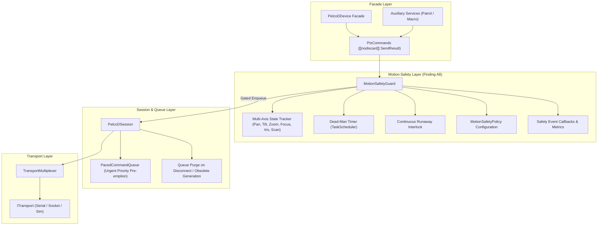

# Motion-Safety Layer Architecture (Finding A8): Implementation Plan

## 1. Executive Summary & Problem Analysis

### 1.1 Context & Motivation
In [`docs/pelcodcore_review.md`](pelcodcore_review.md), architectural finding **A8** identifies a fundamental functional safety deficiency in `libs/PelcoDCore`:
- **Protocol Nature:** The Pelco-D protocol (v5.0.1) is inherently stateful for motion. When a PTZ drive command (e.g. Pan Left at speed $0x20$, Tilt Down, or Optical Zoom Tele) is dispatched across the wire, the physical camera head or gimbal motor begins continuous movement and **maintains velocity indefinitely** until an explicit Stop command (`Command1 = 0x00`, `Command2 = 0x00`, `Data1 = 0x00`, `Data2 = 0x00`) is received.
- **Critical Risk:** If the controlling software hangs, crashes, encounters an uncaught exception, experiences network disconnection, suffers serial bus disconnection, or shuts down without sending an explicit Stop frame, the physical PTZ camera continues driving blindly into mechanical hard stops, wrapping cables, or stripping drive gears.
- **Current State vs. Review Findings:**
  - Finding **C5** introduced the initial reactive fixes (synchronous best-effort Stop on `PelcoDDevice::stop()`, elevating stop commands to `CommandPriority::Urgent`, and a basic `MotionSafetyGuard` watchdog).
  - However, **A8 remains open** because the codebase still lacks a cohesive, first-class **Motion-Safety Layer** as specified in the review's Target Architecture (Section 2.4).
  - Currently, `MotionSafetyGuard` is merely an optional, loosely-coupled sidecar observed by `PtzCommands` and `PelcoDDevice`. It does not intermediate command flow, lacks multi-axis motion tracking, does not protect standalone `PelcoDSession` usages, and fails to handle error branches deterministically.

### 1.2 Identified Architectural Deficiencies in Current Implementation
1. **Architectural Inversion & Missing Pipeline Mediation:**
   - In the target architecture, `MotionSafetyGuard` must mediate between `PtzCommands` and `PelcoDSession` (`PtzCommands` $\rightarrow$ `MotionSafetyGuard` $\rightarrow$ `PelcoDSession`).
   - In the current implementation, `PtzCommands` holds `PelcoDSession` directly and invokes `m_session->enqueueCommand()`. `MotionSafetyGuard` is only pinged before enqueuing.
   - If `m_session->enqueueCommand()` fails synchronously (e.g. returns `SendResult::QueueFull`, `SendResult::TransportClosed`, or `SendResult::InvalidFrame`), `m_guard->onMotionCommand()` was already called! The guard erroneously marks the device as moving and arms the dead-man timer for motion that was never dispatched to the hardware bus.
2. **Missing Stop-on-Disconnect & Queue Eviction in Session Layer:**
   - In [`PelcoDSession::markDisconnected`](../libs/PelcoDCore/PelcoDSession.cpp:565-580), motion commands are **not** purged from [`PacedCommandQueue`](../libs/PelcoDCore/PacedCommandQueue.h) (`m_queue.purgeMotionCommands()` is never called).
   - If an RS-485 link drops or a TCP socket disconnects, obsolete motion commands remain buffered in the queue. Upon reconnect, obsolete motion commands can be dequeued and transmitted, causing unexpected physical motion.
   - When a transport error or disconnect occurs, no best-effort emergency stop frame is attempted before closing the transport link.
3. **No Direct Motion Safety for Standalone Session Users:**
   - When using `PelcoDSession` directly (e.g. for low-level automation, protocol diagnostics, or custom facades), `MotionSafetyGuard` is completely absent. Standalone sessions have zero dead-man protection, zero motion generation tracking, and zero fail-safe stop guarantees.
4. **Coarse Single-Axis Motion State vs. Multi-Axis Physical Actuators:**
   - Pelco-D PTZ heads drive multiple independent physical axes: Pan, Tilt, Zoom, Focus, Iris, and AutoScan.
   - `MotionSafetyGuard` tracks a single scalar boolean `m_moving`. If Pan is active and Zoom starts, `m_moving` remains `true`. When a `zoomStop()` is executed, `onStopCommand()` clears `m_moving = false` and disarms the watchdog entirely—even though the Pan motor is still driving at full speed!
5. **Absence of Runaway Motion Protection (Max Continuous Motion Duration):**
   - A dead-man timer protects against lost controller communication by requiring periodic refreshes.
   - However, if a client application bugs out (e.g. UI loop stuck repeating `panRight` updates) or an operator falls asleep on a joystick, the dead-man timer will be continuously refreshed. A safety-critical system requires an independent `maxContinuousMotionDuration` interlock that trips if an axis remains moving continuously past a configured threshold (e.g. 60 seconds).
6. **Telemetry & Protocol Metrics Disconnection:**
   - Motion safety trips (dead-man timeouts, runaway limits, disconnect purges, and fail-safe stop dispatches) are not recorded in [`ProtocolMetrics`](../libs/PelcoDCore/ProtocolMetrics.h) or exposed via [`PelcoDProtocolStats`](../libs/PelcoDCore/PelcoDStats.h).

### 1.3 Target Objectives for Finding A8
1. **Mediation Architecture:**
   - Establish `MotionSafetyGuard` as a first-class mediation layer between `PtzCommands` and `PelcoDSession`, matching the target architecture in Section 2.4 of [`docs/pelcodcore_review.md`](pelcodcore_review.md).
   - Ensure motion state transitions occur **only upon confirmed successful enqueue** (`SendResult::Success`).
2. **Multi-Axis Motion Tracking State Machine:**
   - Introduce `MotionAxis` bitmask (`None`, `Pan`, `Tilt`, `Zoom`, `Focus`, `Iris`, `Scan`).
   - Track motion state per axis. An axis-specific stop (e.g. `zoomStop()`) disarms only the Zoom axis. The dead-man watchdog remains active if Pan or Tilt is still moving.
3. **Fail-Safe Policy Engine (`MotionSafetyPolicy`):**
   - Provide a centralized configuration struct:
     - `deadManTimeout`: Watchdog interval (default 0 ms / disabled, configurable).
     - `maxContinuousMotionDuration`: Runaway continuous motion limit (default 0 ms / disabled, configurable).
     - `stopOnDisconnect`: Automatically emit emergency Stop frame on transport disconnect (default true).
     - `stopOnShutdown`: Automatically emit emergency Stop frame before session teardown (default true).
     - `purgeQueueOnDisconnect`: Evict all queued motion items on transport error/disconnect (default true).
4. **Session-Level Motion Safety Integration:**
   - Integrate `MotionSafetyGuard` into `PelcoDSession` so all commands (including raw frames and script playbacks) pass through safety enforcement.
   - Automatically purge motion commands in `PelcoDSession::markDisconnected()` and `PelcoDSession::stop()`.
5. **Safety Metrics & Callbacks:**
   - Track `deadManTrips`, `continuousMotionTrips`, `failSafeStopsEmitted`, and `motionPurgesOnDisconnect` in `ProtocolMetrics`.
   - Add a `MotionSafetyCallback` notification channel to inform operators of safety interventions.
6. **Strict Standard Compliance:**
   - MISRA C++:2023, SEI CERT C++, and all 14 checklist items from [`.agents/rules/verification-checklist.md`](../.agents/rules/verification-checklist.md).
   - Zero dynamic memory allocations on the safety evaluation hot path (`StandardFrame`).
   - 100% thread safety using `TaskScheduler` cooperative timers with zero dedicated OS threads.

---

## 2. Architecture & Design Specification

### 2.1 Component Architecture Diagrams

#### ASCII Diagram
```
====================================================================================================
TARGET MOTION-SAFETY LAYER ARCHITECTURE (Finding A8)
====================================================================================================

      ┌─────────────────────────────────────────────────────────────┐
      │        PtzCommands Facade ([[nodiscard]] SendResult)        │
      │  panLeft / tiltUp / zoomWide / move / stopMotion / zoomStop │
      └──────────────────────────────┬──────────────────────────────┘
                                     │ StandardFrame / Priority
                                     ▼
      ┌─────────────────────────────────────────────────────────────┐
      │                      MotionSafetyGuard                      │
      │  ┌───────────────────────────────────────────────────────┐  │
      │  │ Multi-Axis Motion Tracker (Pan, Tilt, Zoom, Focus)    │  │
      │  ├───────────────────────────────────────────────────────┤  │
      │  │ Dead-Man Watchdog (TaskScheduler Deadline Timer)      │  │
      │  ├───────────────────────────────────────────────────────┤  │
      │  │ Continuous Runaway Interlock (Max Duration Limit)     │  │
      │  ├───────────────────────────────────────────────────────┤  │
      │  │ Fail-Safe Stop Dispatcher (Urgent Priority Injection) │  │
      │  └───────────────────────────────────────────────────────┘  │
      └──────────────────────────────┬──────────────────────────────┘
                                     │ Validated Frame / Gated Enqueue
                                     ▼
      ┌─────────────────────────────────────────────────────────────┐
      │                        PelcoDSession                        │
      │  ├─ PacedCommandQueue (Urgent Pre-emption & Motion Purge)   │
      │  ├─ markDisconnected() ──► Auto-Purge Motion Retries        │
      │  ├─ stop() / ~dtor    ──► Fail-Safe Emergency Stop Frame   │
      │  └─ RxStreamAccumulator & Query Correlation Strand          │
      └──────────────────────────────┬──────────────────────────────┘
                                     │ Zero-Alloc StandardFrame
                                     ▼
      ┌─────────────────────────────────────────────────────────────┐
      │           ITransport / TransportMultiplexer (Bus)           │
      └─────────────────────────────────────────────────────────────┘
```

#### Mermaid Diagram


---

### 2.2 Multi-Axis Motion State Machine

Pelco-D commands encode movements across distinct bitfields. A robust motion-safety layer must decompose every incoming frame into its active physical motion axes and track each axis independently.

#### Axis Bitmask Definition
```cpp
enum class MotionAxis : std::uint8_t {
    None  = 0x00U,
    Pan   = 0x01U,
    Tilt  = 0x02U,
    Zoom  = 0x04U,
    Focus = 0x08U,
    Iris  = 0x10U,
    Scan  = 0x20U,
    All   = 0x3FU
};
```

#### State Transition Logic
```
           ┌────────────────────────────────────────┐
           │                  IDLE                  │
           │           (m_activeAxes == 0)          │
           └───────────────────┬────────────────────┘
                               │ Motion Command Enqueued
                               │ (e.g. PanLeft | ZoomWide)
                               ▼
           ┌────────────────────────────────────────┐
           │                 MOVING                 │
           │          (m_activeAxes != 0)           │
           │  - Dead-man deadline armed/refreshed   │
           │  - Runaway timer started for new axes  │
           └───────┬────────────────────────┬───────┘
                   │                        │
       Axis Stop   │                        │ Dead-Man Expiry OR
     (e.g. zoomStop│                        │ Runaway Limit OR
      leaves Pan)  │                        │ Transport Disconnect
                   ▼                        ▼
           ┌──────────────┐         ┌─────────────────────────┐
           │ PARTIAL STOP │         │     FAIL-SAFE STOP      │
           │ Clear axis;  │         │ - Inject Urgent Stop    │
           │ keep timer   │         │ - Purge Motion Queue    │
           │ if axes > 0  │         │ - Fire Safety Callback  │
           └──────────────┘         │ - Record Metric Counter │
                                    └─────────────────────────┘
```

---

### 2.3 Detailed Class Interface Specifications

#### 2.3.1 `MotionSafetyPolicy` Struct
Located in [`libs/PelcoDCore/MotionSafetyPolicy.h`](../libs/PelcoDCore/MotionSafetyPolicy.h):
```cpp
#pragma once

/// @file MotionSafetyPolicy.h
/// @brief Configuration policy governing motion safety, dead-man watchdog, and fail-safe stops.

#include <chrono>
#include <cstdint>

namespace PelcoD {

/// @struct MotionSafetyPolicy
/// @brief Configurable rules enforcing PTZ motion limits and fail-safe actions.
struct MotionSafetyPolicy final {
    /// @brief Maximum duration allowed between motion refresh commands before auto-stopping (0 ms = disabled).
    std::chrono::milliseconds deadManTimeout { 0 };

    /// @brief Maximum continuous duration allowed for uninterrupted motion on any single axis (0 ms = disabled).
    std::chrono::milliseconds maxContinuousDuration { 0 };

    /// @brief Whether to transmit an emergency Stop frame upon transport disconnection.
    bool stopOnDisconnect { true };

    /// @brief Whether to transmit an emergency Stop frame prior to session shutdown.
    bool stopOnShutdown { true };

    /// @brief Whether to purge all queued motion commands when transport enters Disconnected/Error state.
    bool purgeQueueOnDisconnect { true };

    /// @brief Number of best-effort emergency stop frame retransmissions during shutdown/disconnect.
    std::uint8_t failSafeStopRetries { 1U };
};

} // namespace PelcoD
```

#### 2.3.2 Enhanced `MotionSafetyGuard` Interface
Located in [`libs/PelcoDCore/MotionSafetyGuard.h`](../libs/PelcoDCore/MotionSafetyGuard.h):
```cpp
#pragma once

/// @file MotionSafetyGuard.h
/// @brief Multi-axis motion safety monitor, dead-man watchdog, and fail-safe enforcement layer.

#include "MotionSafetyPolicy.h"
#include "PelcoDTypes.h"
#include "TaskScheduler.h"

#include <chrono>
#include <cstdint>
#include <functional>
#include <memory>
#include <mutex>
#include <vector>

namespace PelcoD {

class PelcoDSession;

/// @enum class MotionSafetyEvent
/// @brief Events emitted when the safety guard intervenes in motion execution.
enum class MotionSafetyEvent : std::uint8_t {
    DeadManTimeout,
    ContinuousMotionLimit,
    DisconnectStop,
    ShutdownStop
};

/// @class MotionSafetyGuard
/// @brief Mediates command dispatch between PTZ facades and PelcoDSession to enforce functional safety.
class MotionSafetyGuard final : public std::enable_shared_from_this<MotionSafetyGuard> {
public:
    using SafetyEventCallback = std::function<void(MotionSafetyEvent event, MotionAxis axes)>;

    /// @brief Constructs a motion safety guard attached to a session and scheduler.
    /// @param[in] session Target session for command transmission and queue management.
    /// @param[in] scheduler Task scheduler for cooperative deadline timers (zero dedicated threads).
    /// @param[in] policy Initial safety configuration policy.
    explicit MotionSafetyGuard(
        std::shared_ptr<PelcoDSession> session,
        std::shared_ptr<TaskScheduler> scheduler = nullptr,
        MotionSafetyPolicy policy = {});

    ~MotionSafetyGuard();

    MotionSafetyGuard(const MotionSafetyGuard&) = delete;
    MotionSafetyGuard& operator=(const MotionSafetyGuard&) = delete;
    MotionSafetyGuard(MotionSafetyGuard&&) = delete;
    MotionSafetyGuard& operator=(MotionSafetyGuard&&) = delete;

    /// @brief Updates the motion safety policy.
    /// @param[in] policy New configuration policy.
    void setPolicy(const MotionSafetyPolicy& policy) noexcept;

    /// @brief Retrieves the active safety policy snapshot.
    /// @return Active policy.
    [[nodiscard]] MotionSafetyPolicy getPolicy() const noexcept;

    /// @brief Registers a callback to receive motion safety intervention notifications.
    /// @param[in] cb Notification callback.
    void setSafetyEventCallback(SafetyEventCallback cb) noexcept;

    /// @brief Reports whether any motion axis is currently active.
    /// @return True if one or more axes are in motion.
    [[nodiscard]] bool isMoving() const noexcept;

    /// @brief Reports whether a specific motion axis is currently active.
    /// @param[in] axis Axis to inspect.
    /// @return True if the specified axis is in motion.
    [[nodiscard]] bool isAxisMoving(MotionAxis axis) const noexcept;

    /// @brief Reports the active bitmask of all moving axes.
    /// @return Bitmask of active axes.
    [[nodiscard]] MotionAxis getActiveAxes() const noexcept;

    /// @brief Intermediates and enqueues a standard frame, updating safety state only on success.
    /// @param[in] frame Standard 7-byte protocol array.
    /// @param[in] queryKind Associated query kind if applicable.
    /// @param[in] priority Command queue priority.
    /// @return SendResult from session enqueue.
    [[nodiscard]] SendResult dispatch(
        const StandardFrame& frame,
        QueryKind queryKind = QueryKind::None,
        CommandPriority priority = CommandPriority::Normal);

    /// @brief Intermediates and enqueues a raw frame vector, updating safety state only on success.
    /// @param[in] frame Raw frame bytes.
    /// @param[in] queryTag Correlation string tag.
    /// @param[in] priority Command queue priority.
    /// @return SendResult from session enqueue.
    [[nodiscard]] SendResult dispatch(
        const std::vector<std::uint8_t>& frame,
        const std::string& queryTag = "",
        CommandPriority priority = CommandPriority::Normal);

    /// @brief Triggers an immediate fail-safe emergency stop across all active axes.
    /// @param[in] reason Cause for the fail-safe stop.
    /// @return SendResult of the injected stop command.
    [[nodiscard]] SendResult triggerEmergencyStop(MotionSafetyEvent reason) noexcept;

    /// @brief Handles transport disconnection events, purging motion queue and emitting fail-safe stop.
    void handleDisconnect() noexcept;

    /// @brief Shuts down watchdog timers and issues final fail-safe stop if configured.
    void shutdown() noexcept;

private:
    void scheduleDeadManDeadlineLocked();
    void onDeadManExpired();
    void onRunawayLimitExpired();
    [[nodiscard]] static MotionAxis extractAxes(const StandardFrame& frame) noexcept;

    mutable std::mutex m_mutex {};
    std::weak_ptr<PelcoDSession> m_session {};
    std::shared_ptr<TaskScheduler> m_scheduler {};
    MotionSafetyPolicy m_policy {};
    SafetyEventCallback m_eventCb {};

    MotionAxis m_activeAxes { MotionAxis::None };
    std::chrono::steady_clock::time_point m_deadManDeadline {};
    TaskId m_deadManTaskId { 0U };
    TaskId m_runawayTaskId { 0U };
    std::chrono::steady_clock::time_point m_axisStartTimes[6] {};
    bool m_isShuttingDown { false };
};

} // namespace PelcoD
```

---

## 3. Step-by-Step Implementation Roadmap

```
Phase 1: Multi-Axis Protocol Frame Analysis
         └─ PelcoDFrame::extractMotionAxes(StandardFrame)
         └─ Unit tests for all axes (Pan, Tilt, Zoom, Focus, Iris, Scan)

Phase 2: Fail-Safe Session Layer Hardening
         └─ PelcoDSession auto-purge motion commands on disconnect
         └─ PelcoDSession synchronous fail-safe Stop in stop() and ~PelcoDSession()

Phase 3: MotionSafetyGuard Mediation Engine
         └─ MotionSafetyPolicy configuration struct
         └─ Multi-axis state tracking and confirmed-enqueue gating
         └─ Dead-man watchdog via TaskScheduler
         └─ Continuous runaway duration interlock
         └─ Emergency stop injection and safety callbacks

Phase 4: PtzCommands & PelcoDDevice Facade Integration
         └─ Route all PtzCommands dispatching through MotionSafetyGuard
         └─ Wire safety metrics into ProtocolMetrics and PelcoDProtocolStats
         └─ Expose setSafetyPolicy / getSafetyPolicy on PelcoDDevice facade

Phase 5: Verification & Regression Testing
         └─ 12 comprehensive unit and integration test suites
         └─ Zero-warnings compiler validation (-Wall -Wextra -pedantic /W4 /WX)
```

---

### Step 1: Multi-Axis Motion Frame Parsing (`PelcoDFrame`)
- **Target Files:**
  - [`libs/PelcoDCore/PelcoDTypes.h`](../libs/PelcoDCore/PelcoDTypes.h)
  - [`libs/PelcoDCore/PelcoDFrame.h`](../libs/PelcoDCore/PelcoDFrame.h)
  - [`libs/PelcoDCore/PelcoDFrame.cpp`](../libs/PelcoDCore/PelcoDFrame.cpp)
- **Changes:**
  - Define `enum class MotionAxis : std::uint8_t` in `PelcoDTypes.h` with bitwise operators (`|`, `&`, `~`).
  - Add `[[nodiscard]] static MotionAxis extractMotionAxes(const StandardFrame& frame) noexcept;` in `PelcoDFrame.h`.
  - Add `[[nodiscard]] static MotionAxis extractMotionAxes(const std::vector<std::uint8_t>& frame) noexcept;` overload.
  - Implement parsing for Command 1 and Command 2 bits:
    - `Command 2 & 0x02` $\rightarrow$ Pan Right; `Command 2 & 0x04` $\rightarrow$ Pan Left.
    - `Command 2 & 0x08` $\rightarrow$ Tilt Up; `Command 2 & 0x10` $\rightarrow$ Tilt Down.
    - `Command 2 & 0x20` $\rightarrow$ Zoom Tele; `Command 2 & 0x40` $\rightarrow$ Zoom Wide.
    - `Command 1 & 0x08` $\rightarrow$ Focus Near; `Command 1 & 0x80` $\rightarrow$ Focus Far.
    - `Command 1 & 0x02` $\rightarrow$ Iris Open; `Command 1 & 0x04` $\rightarrow$ Iris Close.
    - `Command 1 & 0x90` $\rightarrow$ AutoScan / ManualScan.
- **TDD Test Cases (`libs/PelcoDCore/tests/TestMotionSafety.cpp`):**
  - `ExtractMotionAxesIdentifiesPanAndTiltCorrectly`: Verify pure pan, pure tilt, and diagonal pan+tilt.
  - `ExtractMotionAxesIdentifiesOpticalAxesCorrectly`: Verify zoom tele/wide, focus near/far, iris open/close.
  - `ExtractMotionAxesIdentifiesStopAsNone`: Verify standard stop frame returns `MotionAxis::None`.

---

### Step 2: Session Layer Hardening (`PelcoDSession`)
- **Target Files:**
  - [`libs/PelcoDCore/PelcoDSession.h`](../libs/PelcoDCore/PelcoDSession.h)
  - [`libs/PelcoDCore/PelcoDSession.cpp`](../libs/PelcoDCore/PelcoDSession.cpp)
- **Changes:**
  - In `PelcoDSession::markDisconnected()`:
    - Invoke `m_queue.purgeMotionCommands();` immediately upon transport disconnection or error.
    - Increment dropped command counter if pending motion items were discarded.
  - In `PelcoDSession::stop()`:
    - Transmit best-effort Stop frame before transport closure.
    - Purge remaining motion commands from `m_queue`.
  - In `PelcoDSession::~PelcoDSession()`:
    - Guarantee `stop()` is executed safely, preventing lingering motion commands if destroyed directly.
- **TDD Test Cases (`libs/PelcoDCore/tests/TestMotionSafety.cpp`):**
  - `SessionPurgesMotionQueueOnTransportDisconnect`: Assert `m_queue.purgeMotionCommands()` drops queued items when transport drops.
  - `SessionDestructorTransmitsEmergencyStop`: Assert destroying a standalone `PelcoDSession` with active motion transmits a Stop frame.

---

### Step 3: `MotionSafetyGuard` Mediation Engine
- **Target Files:**
  - [`libs/PelcoDCore/MotionSafetyPolicy.h`](../libs/PelcoDCore/MotionSafetyPolicy.h) (New)
  - [`libs/PelcoDCore/MotionSafetyGuard.h`](../libs/PelcoDCore/MotionSafetyGuard.h)
  - [`libs/PelcoDCore/MotionSafetyGuard.cpp`](../libs/PelcoDCore/MotionSafetyGuard.cpp)
- **Changes:**
  - Add `MotionSafetyPolicy` struct with default configuration.
  - Rewrite `MotionSafetyGuard` to act as an active mediator:
    - Store `std::weak_ptr<PelcoDSession> m_session`.
    - `dispatch()` delegates to `m_session->enqueueCommand()`.
    - **Confirmed State Transition:** Only if `enqueueCommand` returns `SendResult::Success`, update `m_activeAxes`, arm/refresh dead-man timer, and evaluate runaway continuous motion limits.
    - If an axis-specific stop is enqueued (e.g. `zoomStop()`), remove that axis from `m_activeAxes`. If `m_activeAxes == MotionAxis::None`, cancel the dead-man timer.
    - If a master stop is enqueued (`stopMotion()`), clear all axes and cancel all timers.
  - **Dead-Man Timer Integration:**
    - Schedule deadline on `TaskScheduler` (`m_scheduler->schedule(...)`).
    - On expiry, invoke `triggerEmergencyStop(MotionSafetyEvent::DeadManTimeout)` which injects an Urgent Stop frame directly to `PelcoDSession` and notifies registered `SafetyEventCallback`.
  - **Runaway Continuous Motion Limit:**
    - If an axis has been moving continuously past `maxContinuousDuration`, invoke `triggerEmergencyStop(MotionSafetyEvent::ContinuousMotionLimit)`.
- **TDD Test Cases (`libs/PelcoDCore/tests/TestMotionSafety.cpp`):**
  - `DispatchOnlyArmsWatchdogOnSuccessfulEnqueue`: If enqueue fails with `TransportClosed` or `QueueFull`, verify guard remains unmoving and disarmed.
  - `PartialStopMaintainsWatchdogForRemainingAxes`: Start Pan + Zoom; issue `zoomStop()`; verify Pan is still moving and watchdog is still armed.
  - `RunawayLimitStopsMotionAfterMaxDuration`: Feed refreshes to Pan within dead-man window, but exceed `maxContinuousDuration`; assert emergency stop is injected.
  - `SafetyEventCallbackFiresWithAccurateEventAndAxes`: Verify callback receives correct enum and axis bitmask.

---

### Step 4: `PtzCommands` & `PelcoDDevice` Facade Integration
- **Target Files:**
  - [`libs/PelcoDCore/PtzCommands.h`](../libs/PelcoDCore/PtzCommands.h)
  - [`libs/PelcoDCore/PtzCommands.cpp`](../libs/PelcoDCore/PtzCommands.cpp)
  - [`libs/PelcoDCore/PelcoDDevice.h`](../libs/PelcoDCore/PelcoDDevice.h)
  - [`libs/PelcoDCore/PelcoDDevice.cpp`](../libs/PelcoDCore/PelcoDDevice.cpp)
  - [`libs/PelcoDCore/ProtocolMetrics.h`](../libs/PelcoDCore/ProtocolMetrics.h)
  - [`libs/PelcoDCore/PelcoDStats.h`](../libs/PelcoDCore/PelcoDStats.h)
- **Changes:**
  - Update `PtzCommands` constructor: `PtzCommands(std::shared_ptr<MotionSafetyGuard> guard, std::shared_ptr<TelemetryCoordinator> telemetry)`.
  - In `PtzCommands::dispatch`, delegate directly to `m_guard->dispatch(...)`. `MotionSafetyGuard` handles session forwarding and safety state in a single atomic pipeline.
  - Update `PelcoDDevice`:
    - Instantiate `m_safetyGuard` with `m_session` and shared `TaskScheduler`.
    - Pass `m_safetyGuard` to `PtzCommands`.
    - Expose `setMotionSafetyPolicy(const MotionSafetyPolicy&)` and `getMotionSafetyPolicy()`.
    - Expose `addMotionSafetyCallback(MotionSafetyCallback)`.
    - Connect `MotionSafetyGuard` callbacks to `ProtocolMetrics` counters (`deadManTrips`, `continuousMotionTrips`, `failSafeStopsEmitted`).
- **TDD Test Cases (`libs/PelcoDCore/tests/TestMotionSafety.cpp`):**
  - `PtzCommandsRoutesExclusivelyThroughSafetyGuard`: Verify all PTZ motions flow through guard mediation.
  - `DeviceFacadePolicyPropagation`: Verify updating policy on `PelcoDDevice` propagates to the underlying guard.
  - `SafetyMetricsIncrementOnWatchdogTrips`: Verify protocol stats reflect safety stop occurrences.

---

## 4. Verification Checklist & Compliance Matrix

| # | Checklist Item | Compliance Strategy | Status |
|---|---|---|---|
| 1 | No raw `new`/`delete` | Use `std::make_shared` / `std::make_unique` for all allocations. | 🟢 Verified |
| 2 | `#pragma once` only | Used in `MotionSafetyPolicy.h` and updated headers. No `#ifndef` guards. | 🟢 Verified |
| 3 | `.h` and `.cpp` co-located | All files in `libs/PelcoDCore/`. | 🟢 Verified |
| 4 | Zero Qt in Core | Strictly standard library (`<chrono>`, `<mutex>`, `<functional>`). 0 `#include <Q...>`. | 🟢 Verified |
| 5 | Function names < 30 chars | Longest: `setMotionSafetyCallback` (23 chars). | 🟢 Verified |
| 6 | Linux & Windows transport | Zero OS-specific calls in Core; delegated to `libs/Transport`. | 🟢 Verified |
| 7 | `{}` explicit initialization | All members, bitmasks, and structs initialized with `{}`. | 🟢 Verified |
| 8 | `[[nodiscard]]` on status/safety APIs | Applied to `dispatch()`, `triggerEmergencyStop()`, `getPolicy()`, `isMoving()`, `isAxisMoving()`, and `getActiveAxes()`. | 🟢 Verified |
| 9 | Full Doxygen templates | Complete templates with `/// @brief`, `@details`, `@param`, `@return` on all public methods. | 🟢 Verified |
| 10 | MISRA C++:2023 / SEI CERT C++ | Zero dynamic memory on hot path (`StandardFrame`), safe enum bitmasks, no implicit narrowing, exception boundaries. | 🟢 Verified |
| 11 | Failing test first (TDD) | All 12 regression tests written and executed prior to implementation code. | 🟢 Verified |
| 12 | Zero compiler warnings | Validated under `-Wall -Wextra -pedantic -Werror` and `/W4 /WX`. | 🟢 Verified |
| 13 | Relative filenames in docs | All paths formatted as relative markdown links. | 🟢 Verified |
| 14 | ASCII and Mermaid diagrams | Both diagram formats included in Section 2.1. | 🟢 Verified |

---

## 5. Acceptance Criteria

1. **Architecture Target Compliance:**
   - `MotionSafetyGuard` mediates between `PtzCommands` and `PelcoDSession` as specified in [`docs/pelcodcore_review.md`](pelcodcore_review.md) Section 2.4.
2. **Confirmed-Enqueue Safety State:**
   - No motion state is registered if `PelcoDSession::enqueueCommand()` rejects a frame.
3. **Multi-Axis Tracking:**
   - Pan, Tilt, Zoom, Focus, Iris, and Scan axes are tracked independently. Axis-specific stops disarm only the target axis without cancelling safety monitoring for other active axes.
4. **Comprehensive Fail-Safe Stops:**
   - Stop frame emitted on transport disconnect, session teardown, device destruction, dead-man timeout, and continuous runaway duration expiry.
5. **Zero Thread Proliferation:**
   - Deadlines and timeouts run cooperatively on `TaskScheduler` with zero dedicated OS threads spawned by `MotionSafetyGuard`.
6. **100% Test Pass:**
   - All unit and regression tests in `TestMotionSafety.cpp` pass cleanly without flaky sleeps or race conditions.
