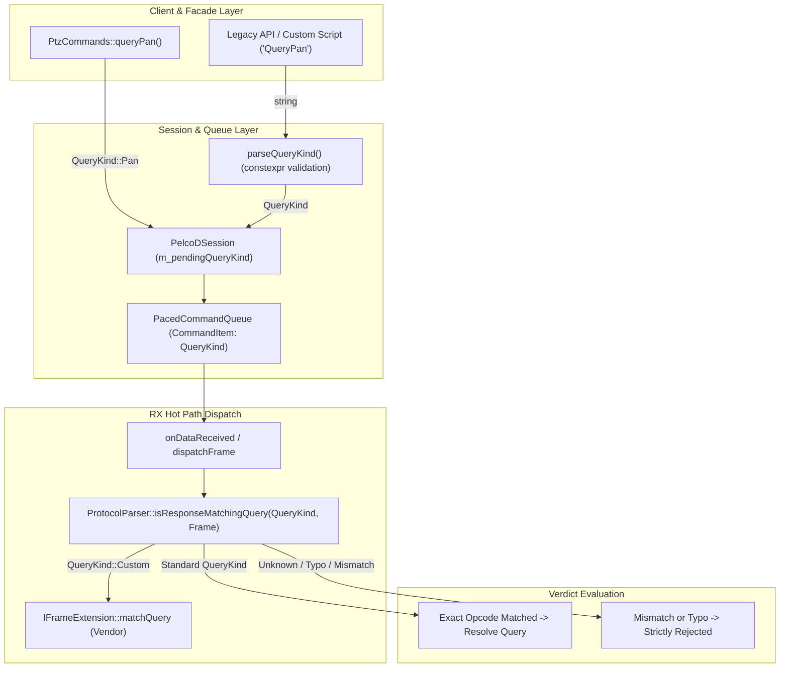

# Strongly-Typed Query Correlation (Finding A2): Implementation Plan

## 1. Executive Summary & Problem Analysis

### 1.1 Context & Motivation
In [`docs/pelcodcore_review.md`](pelcodcore_review.md), finding **A2** identifies a critical type-safety and protocol correctness vulnerability in the query-response correlation engine:
- **Current State:** Queries are tracked and correlated across `PelcoDSession`, `PacedCommandQueue`, `PtzCommands`, and `ProtocolParser` using raw strings (`"QueryPan"`, `"QueryTilt"`, `"QueryZoom"`, `"QueryMagnification"`, etc.).
- **Vulnerability Mechanism (`ProtocolParser.cpp:1132-1148`):**
  When evaluating whether an incoming frame satisfies a pending query via `ProtocolParser::isResponseMatchingQuery(queryTag, frame)`, any tag that is not recognized by explicit string equality checks falls through to a generic fallback block:
  ```cpp
  // Generic query fallback: any recognized standard query response opcode or 18-byte query response
  if (frame.size() == PelcoDFrame::StandardFrameSize) {
      const std::uint8_t op = frame[3];
      return op == static_cast<std::uint8_t>(ResponseOpcode::QueryPan)
          || op == static_cast<std::uint8_t>(ResponseOpcode::QueryTilt)
          || ...;
  }
  if (frame.size() == PelcoDFrame::QueryResponseSize) {
      return true;
  }
  return false;
  ```
- **Consequences & Impact:**
  1. **Silent Miscorrelation on Typos:** If an application, script, or caller passes a mistyped tag (e.g. `"QueryPann"`, `"QueryTiltt"`, or an unsupported custom tag), the parser does **not** reject it. Instead, **any** incoming 7-byte query response (e.g. a periodic Pan position response) or 18-byte query response is treated as matching the mistyped query. The pending query is resolved with the wrong data, corrupting the caller's state model or async future.
  2. **No Compile-Time Safety:** Callers have no compiler verification when dispatching queries.
  3. **Performance Overhead on Hot RX Strand:** On every received frame, multiple string allocations and `std::string::operator==` comparisons are executed in the transport RX dispatch path.
  4. **Violation of SEI CERT C++ and MISRA C++:2023:** Relies on loose string matching rather than strongly-typed, bounded enumerations for safety-critical PTZ command correlation.

### 1.2 Target Objectives
1. **Define a Strongly-Typed `QueryKind` Enumeration:**
   - Introduce `QueryKind` in [`libs/PelcoDCore/PelcoDTypes.h`](../libs/PelcoDCore/PelcoDTypes.h) representing every discrete standard and vendor query response category.
   - Implement zero-allocation, `constexpr`/`noexcept` bidirectional conversion functions:
     - `toQueryTagName(QueryKind kind) noexcept -> std::string_view`
     - `parseQueryKind(std::string_view tag) noexcept -> QueryKind`
2. **Eliminate Silent Fallthrough / Match-Any Vulnerability:**
   - Unknown tags or typos (e.g. `"QueryPann"`, `"InvalidTag"`) **must strictly return `false`** when matched against standard responses, unless explicitly configured with a dedicated wildcard token (`QueryKind::AnyStandard` or `"GenericQuery"`).
   - Require exact opcode and sub-opcode matching for each discrete `QueryKind`.
3. **Upgrade Core Subsystems to Use `QueryKind`:**
   - `ProtocolParser`: Implement `[[nodiscard]] static bool isResponseMatchingQuery(QueryKind kind, const std::vector<std::uint8_t>& frame) noexcept`.
   - `CommandItem` and `PacedCommandQueue`: Store `QueryKind` directly, avoiding string heap allocations on the command queuing path.
   - `PelcoDSession`: Correlate queries using `QueryKind` on the RX strand for O(1) integer matching.
   - `PtzCommands`: Dispatch queries with `QueryKind` literals.
4. **Preserve 100% Backward Compatibility:**
   - Overloads accepting `const std::string& queryTag` are retained for external API consumers, converting to `QueryKind` via `parseQueryKind()`.
   - External callbacks (`QueryCompletedCallback`, `TimeoutCallback`, `QueryLatencyCallback`, `RetryCallback`) continue to receive string tags via `toQueryTagName()`.
   - Vendor extension hook (`IFrameExtension`) retains existing virtual signatures while adding `QueryKind`-aware overloads.
5. **Comply Strictly with Project Standards:**
   - Full alignment with [`.agents/rules/compliance.md`](../.agents/rules/compliance.md) (MISRA C++:2023, SEI CERT C++).
   - All 14 items in [`.agents/rules/verification-checklist.md`](../.agents/rules/verification-checklist.md).
   - Strict Test-Driven Development (TDD) workflow with failing regression tests written before fixes.

---

## 2. Architecture & Design Specification

### 2.1 Current Architecture vs. Target Decomposed Query Correlation

#### ASCII Diagram
```
Current Architecture (Stringly-Typed Fallthrough):
  PtzCommands::queryPan()
        │
        ▼ (passes "QueryPan" string)
  PelcoDSession::sendQueryFrame(frame, "QueryPan")
        │
        ▼
  PacedCommandQueue::enqueue(CommandItem { tag: "QueryPan" })
        │
        ▼ (RX Thread)
  ProtocolParser::isResponseMatchingQuery(m_pendingQueryTag, frame)
        │
        ├─ tag == "QueryPan" ──────► matches Pan response
        ├─ tag == "QueryTilt" ─────► matches Tilt response
        │  ...
        └─ [UNKNOWN / TYPO TAG] ──► FALLS THROUGH TO GENERIC MATCHER!
                                    (Matches ANY 7-byte or 18-byte frame!)

Target Architecture (Strongly-Typed Enum with Strict Matching):
  PtzCommands::queryPan()
        │
        ▼ (passes QueryKind::Pan)
  PelcoDSession::sendQueryFrame(frame, QueryKind::Pan)
        │
        ▼
  PacedCommandQueue::enqueue(CommandItem { kind: QueryKind::Pan })
        │
        ▼ (RX Thread - O(1) integer opcode match)
  ProtocolParser::isResponseMatchingQuery(m_pendingQueryKind, frame)
        │
        ├─ QueryKind::Pan ─────────► matches ONLY opcode 0x59
        ├─ QueryKind::Tilt ────────► matches ONLY opcode 0x5B
        ├─ QueryKind::AnyStandard ─► matches any recognized query (Explicit!)
        ├─ QueryKind::Custom ──────► defers to IFrameExtension
        └─ [UNKNOWN / TYPO] ───────► STRICTLY REJECTED (returns false)
```

#### Mermaid Diagram


---

## 3. Data Structures & API Design

### 3.1 `QueryKind` Enumeration in `libs/PelcoDCore/PelcoDTypes.h`

```cpp
/// @enum QueryKind
/// @brief Strongly-typed enumeration of all recognized Pelco-D query response categories.
/// @details Eliminates stringly-typed query correlation defects (Finding A2) by enforcing
///          compile-time safety, bounded categories, and exact opcode dispatch.
enum class QueryKind : std::uint16_t {
    None = 0x0000U,            ///< No query expected (unsolicited command / motion frame).
    Pan = 0x0001U,             ///< Standard Pan position query (opcode 0x59).
    Tilt = 0x0002U,            ///< Standard Tilt position query (opcode 0x5B).
    Zoom = 0x0003U,            ///< Standard Zoom position query (opcode 0x5D).
    Magnification = 0x0004U,   ///< Standard Magnification query (opcode 0x63).
    DeviceType = 0x0005U,      ///< Device type query (opcode 0x6D).
    Diagnostics = 0x0006U,     ///< Camera diagnostics query (opcode 0x71).
    SoftwareVersion = 0x0007U, ///< Software version query (opcode 0x73, sub 0x00).
    BuildNumber = 0x0008U,     ///< Build number query (opcode 0x73, sub 0x01).
    Time = 0x0009U,            ///< Time Macro query (opcode 0x77).
    AzimuthZero = 0x000AU,     ///< Everest Azimuth zero query (opcode 0x75, sub 0x00).
    ZoomLimit = 0x000BU,       ///< Everest Zoom limit query (opcode 0x75, sub 0x01).
    EverestAlarms = 0x000CU,   ///< Everest Alarms query (opcode 0x75, sub 0x02).
    Limit = 0x000DU,           ///< Everest Limit query (opcode 0x75, sub 0x03).
    DefinedPresets = 0x000EU,  ///< Everest Defined Presets query (opcode 0x75, sub 0x04).
    DefinedPatterns = 0x000FU, ///< Everest Defined Patterns query (opcode 0x75, sub 0x05).
    EverestGeneric = 0x0010U,  ///< Generic Everest query (opcode 0x75).
    General = 0x0011U,         ///< Extended 18-byte general query response.
    SerialNumber = 0x0012U,    ///< Serial number query (18-byte general response).
    AnyStandard = 0x00F0U,     ///< Explicit wildcard matching any standard query response.
    Custom = 0x00FFU           ///< Custom / Vendor extension query (e.g. Fujinon).
};
```

### 3.2 Conversion & Introspection Utilities
To be declared in [`libs/PelcoDCore/PelcoDTypes.h`](../libs/PelcoDCore/PelcoDTypes.h) and defined in [`libs/PelcoDCore/PelcoDTypes.cpp`](../libs/PelcoDCore/PelcoDTypes.cpp):

```cpp
/// @brief Converts a QueryKind enumeration to its canonical string representation.
/// @param[in] kind Query enumeration value.
/// @return String view of the canonical query tag name.
[[nodiscard]] constexpr std::string_view toQueryTagName(QueryKind kind) noexcept;

/// @brief Parses a string tag into its corresponding QueryKind enumeration value.
/// @details Handles legacy query tags (e.g., "QueryPan", "QueryTilt"), active RTT probe prefixes
///          (e.g., "RttProbe:QueryPan"), and explicit wildcards ("GenericQuery"). Unknown tags
///          return QueryKind::Custom (if non-empty) or QueryKind::None (if empty).
/// @param[in] tag Query tag string view.
/// @return Resolved QueryKind enumeration value.
[[nodiscard]] QueryKind parseQueryKind(std::string_view tag) noexcept;

/// @brief Validates whether a QueryKind corresponds to a standard query expectation.
/// @param[in] kind Query enumeration value.
/// @return True if kind represents an active query expectation.
[[nodiscard]] constexpr bool isQueryExpected(QueryKind kind) noexcept
{
    return kind != QueryKind::None;
}
```

### 3.3 Enhanced `CommandItem` Structure in `libs/PelcoDCore/PacedCommandQueue.h`

```cpp
/// @struct CommandItem
/// @brief Single schedulable command packet with priority, query expectation, and timing.
struct CommandItem {
    std::vector<std::uint8_t> frame {};
    QueryKind queryKind { QueryKind::None };
    std::string queryTag {};
    CommandPriority priority { CommandPriority::Normal };
    std::uint32_t retryCount { 0U };
    std::chrono::steady_clock::time_point earliestDispatchTime { std::chrono::steady_clock::now() };
    std::uint64_t motionGeneration { 0U };
};
```

### 3.4 Hardened `ProtocolParser::isResponseMatchingQuery` Specification

```cpp
/// @brief Classifies whether an incoming frame matches an expected QueryKind.
/// @param[in] kind Expected query kind.
/// @param[in] frame Complete received frame.
/// @param[in] limitId Optional Everest limit identifier when kind == QueryKind::Limit.
/// @return True if frame definitively answers the expected query; false otherwise.
[[nodiscard]] static bool isResponseMatchingQuery(
    QueryKind kind, const std::vector<std::uint8_t>& frame,
    std::optional<EverestLimitId> limitId = std::nullopt) noexcept;

/// @brief Backward-compatible query response classifier accepting string tags.
/// @param[in] queryTag Tag identifying expected query.
/// @param[in] frame Complete received frame.
/// @return True if frame satisfies the expected query tag.
[[nodiscard]] static bool isResponseMatchingQuery(
    const std::string& queryTag, const std::vector<std::uint8_t>& frame) noexcept;
```

#### Strict Fallthrough Elimination Logic:
```cpp
bool ProtocolParser::isResponseMatchingQuery(
    const std::string& queryTag, const std::vector<std::uint8_t>& frame) noexcept
{
    if (frame.empty() || queryTag.empty()) {
        return false;
    }

    const QueryKind kind = parseQueryKind(queryTag);
    if (kind == QueryKind::Custom) {
        // Unknown or custom tag: MUST NOT match arbitrary standard responses!
        // Defer solely to explicit vendor frame extensions or return false.
        return false;
    }

    return isResponseMatchingQuery(kind, frame);
}
```

---

## 4. Compliance & Verification Matrix

| Checklist Item | Requirement | Implementation Strategy for A2 |
|---|---|---|
| **1. RAII / Memory** | No raw `new`/`delete` | `QueryKind` is a value type (`enum class`). All conversions return `std::string_view` or value types with zero heap allocation. |
| **2. Header Guards** | `#pragma once` only | All updated headers use `#pragma once`. |
| **3. Co-location** | `.h` and `.cpp` co-located | `PelcoDTypes.h`/`PelcoDTypes.cpp`, `ProtocolParser.h`/`ProtocolParser.cpp` are co-located in `libs/PelcoDCore/`. |
| **4. Zero Qt in Core** | No `#include <Q...>` in PelcoDCore | Pure C++17 standard library types (`<cstdint>`, `<string>`, `<string_view>`, `<optional>`). |
| **5. Function Names** | Concise (< 30 chars) | `toQueryTagName` (14), `parseQueryKind` (14), `isQueryExpected` (15), `isResponseMatchingQuery` (23). |
| **6. Transport Portability** | POSIX / Win32 agnostic | Query correlation operates purely at the protocol/codec level above transport. |
| **7. `{}` Initialization** | Uniform initialization | All enum members and structs use uniform `{}` syntax. |
| **8. `[[nodiscard]]`** | Applied to status/result returns | Applied to `toQueryTagName`, `parseQueryKind`, `isQueryExpected`, `isResponseMatchingQuery`. |
| **9. Full Doxygen** | Full templates (`@brief`, `@param`, `@return`) | Complete Doxygen documentation for `QueryKind`, functions, and overloaded signatures. |
| **10. MISRA / CERT** | No implicit conversions, CERT safe | Explicit underlying type `std::uint16_t`, `noexcept` contracts, no unchecked integer-to-enum casts. |
| **11. Failing Test First** | TDD bug reproduction | Write failing regression test demonstrating the typo/fallback bug (`QueryPann` falsely matching) prior to implementing the fix. |
| **12. Zero Warnings** | `-Wall -Wextra -pedantic` & `/W4` | Strict compiler settings verified with zero warnings. |
| **13. Relative Paths** | Relative paths in docs | Relative markdown file links used across all documentation. |
| **14. Diagrams** | Both ASCII and Mermaid | Both ASCII and Mermaid architectural diagrams provided in §2.1. |

---

## 5. Step-by-Step Implementation Plan

### Step 1: Write Failing Regression Tests (TDD Workflow)
- **Target File:** [`libs/PelcoDCore/tests/TestProtocolParser.cpp`](../libs/PelcoDCore/tests/TestProtocolParser.cpp)
- **Test Cases:**
  1. `QueryMatchingRejectsTypoAndUnknownTags`:
     - Assert that `ProtocolParser::isResponseMatchingQuery("QueryPann", panFrame)` returns `false` (currently returns `true`!).
     - Assert that `ProtocolParser::isResponseMatchingQuery("QueryTiltt", tiltFrame)` returns `false`.
     - Assert that `ProtocolParser::isResponseMatchingQuery("UnknownCustomQuery", panFrame)` returns `false`.
  2. `StronglyTypedQueryMatching`:
     - Verify exact opcode matching for all `QueryKind` variants.
     - Verify that `QueryKind::Pan` rejects `tiltFrame`, `zoomFrame`, and 18-byte responses.
     - Verify explicit wildcard `QueryKind::AnyStandard` matches recognized query frames while rejecting non-telemetry command frames.
  3. `QueryKindStringConversions`:
     - Test round-trip conversion between canonical strings and `QueryKind`.
     - Test stripping of `"RttProbe:"` prefixes.

### Step 2: Implement `QueryKind` and Conversion Utilities
- **Target Files:**
  - [`libs/PelcoDCore/PelcoDTypes.h`](../libs/PelcoDCore/PelcoDTypes.h)
  - [`libs/PelcoDCore/PelcoDTypes.cpp`](../libs/PelcoDCore/PelcoDTypes.cpp)
- **Actions:**
  - Define `QueryKind` enum class with explicit `std::uint16_t` underlying type.
  - Implement `toQueryTagName(QueryKind)` and `parseQueryKind(std::string_view)` with full Doxygen templates.

### Step 3: Refactor `ProtocolParser::isResponseMatchingQuery`
- **Target Files:**
  - [`libs/PelcoDCore/ProtocolParser.h`](../libs/PelcoDCore/ProtocolParser.h)
  - [`libs/PelcoDCore/ProtocolParser.cpp`](../libs/PelcoDCore/ProtocolParser.cpp)
- **Actions:**
  - Implement strongly-typed `isResponseMatchingQuery(QueryKind, frame, limitId) noexcept`.
  - Rewrite string overload `isResponseMatchingQuery(queryTag, frame)` to delegate via `parseQueryKind()`.
  - **Remove the generic fallthrough for unrecognized string tags.** Only explicit `QueryKind::AnyStandard` (or `"GenericQuery"`) evaluates the generic response set.

### Step 4: Upgrade `CommandItem` and `PacedCommandQueue`
- **Target Files:**
  - [`libs/PelcoDCore/PacedCommandQueue.h`](../libs/PelcoDCore/PacedCommandQueue.h)
  - [`libs/PelcoDCore/PacedCommandQueue.cpp`](../libs/PelcoDCore/PacedCommandQueue.cpp)
- **Actions:**
  - Add `QueryKind queryKind { QueryKind::None };` to `CommandItem`.
  - Provide `enqueue` overloads accepting `QueryKind`:
    ```cpp
    void enqueue(std::vector<std::uint8_t> frame, QueryKind queryKind,
        CommandPriority priority = CommandPriority::Normal, std::uint64_t motionGeneration = 0U);
    ```
  - Preserve backward-compatible string overload delegating to `parseQueryKind()`.

### Step 5: Update `PelcoDSession`
- **Target Files:**
  - [`libs/PelcoDCore/PelcoDSession.h`](../libs/PelcoDCore/PelcoDSession.h)
  - [`libs/PelcoDCore/PelcoDSession.cpp`](../libs/PelcoDCore/PelcoDSession.cpp)
- **Actions:**
  - Store `std::atomic<QueryKind> m_pendingQueryKind { QueryKind::None };` alongside `m_pendingQueryTag`.
  - Provide strongly-typed `sendQueryFrame(frame, QueryKind)` overload.
  - In `dispatchFrame()`, evaluate `isResponseMatchingQuery(m_pendingQueryKind, frame, m_pendingLimitId)`.
  - Pass canonical tag name to handlers and callbacks.

### Step 6: Update `PtzCommands` Command Dispatcher
- **Target Files:**
  - [`libs/PelcoDCore/PtzCommands.h`](../libs/PelcoDCore/PtzCommands.h)
  - [`libs/PelcoDCore/PtzCommands.cpp`](../libs/PelcoDCore/PtzCommands.cpp)
- **Actions:**
  - Update `queryPan()`, `queryTilt()`, `queryZoom()`, `queryMagnification()`, etc. to dispatch `QueryKind` literals directly instead of string literals:
    ```cpp
    SendResult PtzCommands::queryPan()
    {
        return dispatch(ProtocolBuilder::buildQueryPan(m_session->getAddress()), QueryKind::Pan, CommandPriority::Low);
    }
    ```

### Step 7: Update `RttProfiler` and Extension Hooks
- **Target Files:**
  - [`libs/PelcoDCore/RttProfiler.h`](../libs/PelcoDCore/RttProfiler.h)
  - [`libs/PelcoDCore/RttProfiler.cpp`](../libs/PelcoDCore/RttProfiler.cpp)
  - [`libs/PelcoDCore/FrameExtension.h`](../libs/PelcoDCore/FrameExtension.h)
  - [`libs/PelcoDFujinon/FujinonSX800Device.cpp`](../libs/PelcoDFujinon/FujinonSX800Device.cpp)
- **Actions:**
  - Ensure `RttProfiler` active probes work seamlessly with `QueryKind` and string tags.
  - Update `IFrameExtension` and `FujinonFrameExt` to support `QueryKind::Custom` dispatch.

### Step 8: Build, Test, and Verify
- Run test suite under GCC/Clang with `-Wall -Wextra -pedantic -Werror` and sanitizers.
- Verify 100% pass across all unit test suites (`TestProtocolParser`, `TestMockDevice`, `TestPelcoDDevice`, `TestRttProfiler`, `TestConnection`).
- Update `docs/pelcodcore_review.md` marking **A2** as ✅ 🛠️ **Fixed**.
