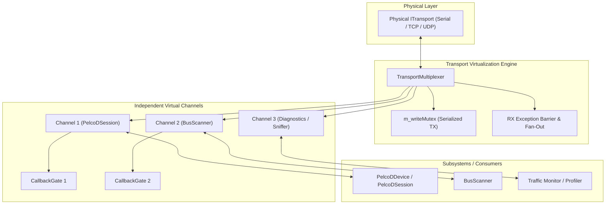
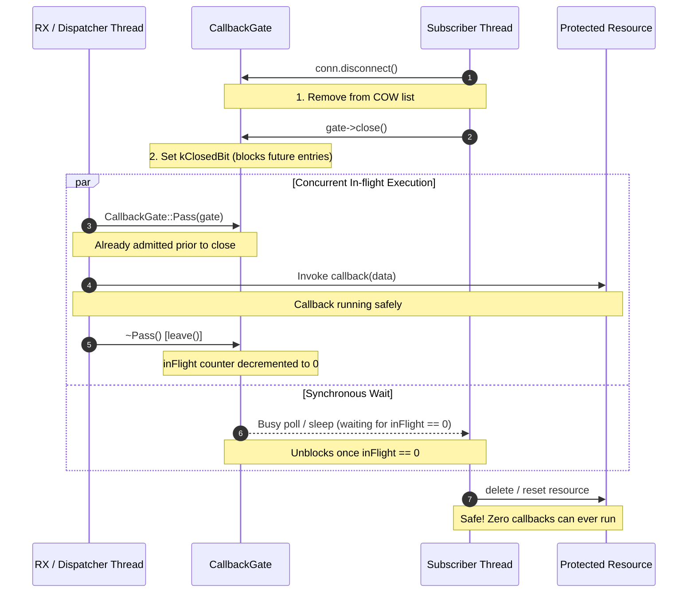

# Transport Multiplexing (A4) & Connection Synchronization Barrier (A5): Implementation Plan

## 1. Executive Summary & Problem Analysis

### 1.1 Context & Motivation
In [`docs/pelcodcore_review.md`](pelcodcore_review.md), architectural findings **A4** and **A5** identify critical concurrency, lifecycle, and modularity defects in transport and callback management:

- **Finding A4 (Transport Multi-Observer & Channel Multiplexing Defect):**
  - **Issue:** The fundamental transport interface [`libs/Transport/ITransport.h`](../libs/Transport/ITransport.h) and its base implementation [`libs/Transport/BaseTransport.h`](../libs/Transport/BaseTransport.h) allow only a single data callback (`setDataCallback`) and a single state callback (`setStateCallback`).
  - **Failure Mechanism:** When multiple components attempt to communicate over a shared physical medium (e.g. an RS-485 multi-drop serial bus or a multiplexed IP link), such as a [`PelcoDDevice`](../libs/PelcoDCore/PelcoDDevice.h) session and a [`BusScanner`](../libs/PelcoDCore/BusScanner.h) discovery engine, registering a callback on one component silently overwrites the callback registered by the other. Furthermore, when `BusScanner` completes or cancels a scan, it calls `setDataCallback(nullptr)`, leaving `PelcoDDevice` permanently deaf to incoming telemetry.
  - **Safety & Stability Impact:** In multi-drop deployments, sharing an unmultiplexed transport breaks the device control session, leaves dangling callback pointers (`[this]`), causes silent loss of telemetry, and renders emergency stop or PTZ status monitoring impossible.

- **Finding A5 (Connection Disconnection Barrier Defect):**
  - **Issue:** In an asynchronous event subscription model relying on Copy-On-Write (COW) lists, `Connection::disconnect()` must act as a synchronous memory and execution barrier.
  - **Failure Mechanism:** Without an admission barrier, when a subscriber calls `Connection::disconnect()`, the subscriber list is updated by COW replacement, but foreign execution threads (such as the transport RX thread or worker strands) may already hold a snapshot pointer (`std::shared_ptr<const std::vector<Entry>>`) and be actively executing or about to execute the subscriber lambda. If `disconnect()` returns immediately, the calling subscriber assumes the callback is inert and destroys captured resources (`this` or captured member state). The foreign thread then invokes the lambda, causing a catastrophic **Use-After-Free (UAF)**, heap memory corruption, or process crash (finding H3, CERT EXP54-CPP).
  - **Safety & Stability Impact:** UI viewers, dialogs, controllers, and background tasks routinely bind callbacks to their own lifetime. A missing synchronization barrier guarantees random, difficult-to-reproduce crashes during object destruction.

### 1.2 Target Objectives
1. **Comprehensive Transport Multiplexing Architecture (Remediating A4):**
   - Formalize and harden [`libs/Transport/TransportMultiplexer.h`](../libs/Transport/TransportMultiplexer.h) as the standard multi-channel bus virtualization engine.
   - Decouple virtual channel lifetimes: virtual channels can be opened, closed, and have callbacks installed/removed without disrupting peer channels or tearing down the physical connection.
   - Enforce thread-safe write serialization across all channels through `m_writeMutex`.
   - Implement SEI CERT ERR50-CPP / ERR51-CPP exception boundaries in `TransportMultiplexer::onDataReceived` and `onStateChanged` so that a throwing subscriber on one channel never crashes the transport thread or interrupts peers.
   - Equip virtual `Channel` instances with a dedicated `CallbackGate` to ensure channel-level callback disconnection is also an execution barrier.
   - Provide clean integration helpers in [`PelcoDDevice`](../libs/PelcoDCore/PelcoDDevice.h) and [`BusScanner`](../libs/PelcoDCore/BusScanner.h) to eliminate accidental callback stomping and allow seamless transport sharing.
   - Add diagnostic guards in [`BaseTransport`](../libs/Transport/BaseTransport.cpp) detecting and alerting if `setDataCallback` is called when an active callback is already bound.

2. **Full-Scope Synchronization Barrier & RAII Lifecycle Safety (Remediating A5):**
   - Enforce the `CallbackGate` barrier pattern across all event channels in [`CallbackDispatcher`](../libs/PelcoDCore/CallbackDispatcher.h) and [`FujinonSX800Device`](../libs/PelcoDFujinon/FujinonSX800Device.h).
   - Guarantee that `Connection::disconnect()` is synchronous, idempotent, thread-safe, and `noexcept`: when it returns, the callback is not executing and will never execute again.
   - Support re-entrant disconnection: if a callback disconnects itself from within its own execution context, it succeeds cleanly without self-deadlock via thread-local stack-linked frame tracking.
   - Modernize [`BusScanner`](../libs/PelcoDCore/BusScanner.h), [`PatrolController`](../libs/PelcoDCore/PatrolController.h), and [`MacroPlayer`](../libs/PelcoDCore/MacroPlayer.h) to transition from raw callback setters to RAII `Connection` subscriptions guarded by `CallbackGate`.

3. **Checklist & Safety Framework Compliance:**
   - MISRA C++:2023, SEI CERT C++ (CON43-C, CON50-CPP, ERR50-CPP, ERR51-CPP, EXP54-CPP).
   - Comply with all 14 project checklist rules in [`.agents/rules/verification-checklist.md`](../.agents/rules/verification-checklist.md).
   - Zero warnings under `-Wall -Wextra -pedantic -Werror` (GCC/Clang) and `/W4 /WX` (MSVC).

---

## 2. Architecture & Design Specification

### 2.1 Transport Multiplexer Architecture (A4)

```
CURRENT VULNERABLE DIRECT SHARING:
  PelcoDDevice ─────────► setDataCallback(cbDevice) ───┐
                                                       ▼
                                                ITransport / BaseTransport
                                                       ▲  (Single callback slot!
  BusScanner ───────────► setDataCallback(cbScan) ────┘   Overwrites device callback!
                                                          Calls nullptr on stop!)

TARGET MULTI-CHANNEL VIRTUALIZATION ARCHITECTURE:
                             Physical Link / Port
                                      │
                                      ▼
                        ┌───────────────────────────┐
                        │    ITransport Instance    │
                        │ (Serial, TCP, UDP, etc.)  │
                        └─────────────┬─────────────┘
                                      │
                                      ▼
                        ┌───────────────────────────┐
                        │   TransportMultiplexer    │
                        │ ├─ m_writeMutex (TX lock) │
                        │ ├─ Exception Boundary     │
                        │ └─ Multi-channel Fan-Out  │
                        └──────┬─────────────┬──────┘
                               │             │
                createChannel()│             │createChannel()
                               ▼             ▼
                     ┌────────────────┐ ┌────────────────┐
                     │Virtual Channel1│ │Virtual Channel2│
                     │├─ CallbackGate │ │├─ CallbackGate │
                     │└─ Local State  │ │└─ Local State  │
                     └───────┬────────┘ └───────┬────────┘
                             │                  │
                             ▼                  ▼
                       PelcoDSession        BusScanner
                      (Address 1..31)     (Address Probe)
```



#### Key Architecture Components for A4:
1. **`TransportMultiplexer` Core:**
   - Wraps any underlying `std::shared_ptr<ITransport>`.
   - `createChannel()` returns an independent `std::shared_ptr<ITransport>` implementing the complete `ITransport` contract.
   - Serializes outbound byte writes across channels using a dedicated mutex (`m_writeMutex`).
   - Fans out inbound data and transport state changes to all live channels.
   - Wraps subscriber dispatch loops with CERT ERR50-CPP/ERR51-CPP exception boundaries:
     ```cpp
     for (const auto& cb : callbacks) {
         try {
             cb(data);
         } catch (const std::exception& e) {
             LOG(WARNING) << "TransportMultiplexer: exception in subscriber callback: " << e.what();
         } catch (...) {
             LOG(WARNING) << "TransportMultiplexer: unknown exception in subscriber callback";
         }
     }
     ```
2. **Virtual `Channel` Lifecycle Decoupling:**
   - Each channel tracks an atomic `m_closed` state. Calling `channel->close()` flags the channel as closed and stops delivering incoming RX frames to that channel, without shutting down the parent physical transport.
   - When a channel is destroyed, its destructor unregisters it from `TransportMultiplexer`.
   - Baud rate changes via `setBaudRate` are strictly locked down: if `channelCount() > 1`, baud rate changes are rejected to prevent disrupting concurrent communications (finding M11).
3. **Channel-Level Synchronization Barrier:**
   - Each channel holds a `std::shared_ptr<CallbackGate>`.
   - When `setDataCallback(nullptr)` or `close()` is invoked on a channel, the channel's `CallbackGate` is drained and closed, guaranteeing no foreign-thread callbacks remain in flight.

---

### 2.2 Connection Synchronization Barrier Architecture (A5)

```
WITHOUT SYNCHRONIZATION BARRIER (UAF Hazard):
  Thread 1 (Worker/RX)                           Thread 2 (Subscriber Teardown)
  ────────────────────                           ──────────────────────────────
  auto snapshot = m_callbacks;
  // Snapshot holds lambda capturing &obj
  ...
                                                 conn.disconnect();
                                                 // Removes from list, returns immediately!
                                                 obj.reset(); // obj DEALLOCATED!
  entry.cb(status); ──► DEREFERENCES DANGLING &obj ──► CRASH / UAF!

WITH CALLBACKGATE SYNCHRONIZATION BARRIER:
  Thread 1 (Worker/RX)                           Thread 2 (Subscriber Teardown)
  ────────────────────                           ──────────────────────────────
  const CallbackGate::Pass pass(*entry.gate);
  if (!pass) return; // Gate open, admitted!
  ... executing cb ...                           conn.disconnect();
  ...                                              ├─ Removes entry from COW list
  ...                                              └─ gate->close();
  ...                                                   │
  ...                                                   ├─ Sets kClosedBit (rejects new entries)
  ...                                                   └─ WAITS until inFlight drops to 0!
  cb finishes; pass destructs (leaves gate) ──────► gate->close() UNBLOCKS & returns!
                                                 obj.reset(); // SAFE! Callback is finished!
```



#### Key Architecture Components for A5:
1. **Lock-Free `CallbackGate`:**
   - Atomic 32-bit integer state: bit 31 is `kClosedBit` (`0x80000000U`), bits 0-30 represent the `inFlight` admission counter (`kCountMask`).
   - `enter()`: CAS loop checking if closed bit is set. If not, increments admission count. `noexcept` and lock-free.
   - `leave()`: Decrements admission count. `noexcept` and lock-free.
   - `close()`: Sets `kClosedBit`. Then polls with a 1 ms sleep until `inFlight == callerDepth` (accounting for re-entrant calls on the same thread).
2. **Re-entrant Disconnection Safety:**
   - Thread-local stack of active `Pass` pointers tracks nesting depth per thread.
   - If a callback calls `disconnect()` or `close()` on its own gate, `close()` detects that `callerDepth > 0` and waits only for other threads, avoiding self-deadlock.
3. **`Connection` RAII Wrapper:**
   - Thread-safe control block (`SharedState`) with mutex protection and atomic boolean flag.
   - Disconnect routine is invoked exactly once across concurrent callers or copies.
   - `ScopedConnection` automatically calls `disconnect()` in its destructor.
   - `ScopedConnectionList` aggregates multiple connections and disconnects all on destruction.

---

## 3. Compliance Matrix (MISRA C++:2023 & SEI CERT C++)

| Standard / Rule | Requirement | Architectural Enforcement in A4 & A5 | Verification Method |
|---|---|---|---|
| **MISRA C++:2023 Rule 21.6.1** | Avoid dynamic heap allocations on hot path | Virtual `Channel::sendData` forwards raw vectors without heap allocation; `CallbackGate::Pass` is stack-allocated RAII. | Static analysis & code review. |
| **SEI CERT CON43-C** | Avoid data races on shared memory | `TransportMultiplexer` serializes physical writes with `m_writeMutex` and guards channel registry with `m_channelsMutex`. | ThreadSanitizer (TSan) test pass. |
| **SEI CERT CON50-CPP** | Avoid TOCTOU race conditions in multi-threaded contexts | `CallbackDispatcher` copies COW list under lock before invocation; `CallbackGate` atomically validates closed bit and admission in single CAS. | Concurrency stress tests. |
| **SEI CERT ERR50-CPP** | Do not allow exceptions to escape callback loops | `TransportMultiplexer::onDataReceived`, `onStateChanged`, and `CallbackDispatcher` wrap all callbacks in `try/catch` boundaries. | Unit test with throwing callbacks. |
| **SEI CERT ERR51-CPP** | Handle all exceptions across thread boundaries | `Connection::disconnect()` swallows internal exceptions in `disconnectFn` to maintain `noexcept` destructor guarantee. | Unit test verifying `noexcept`. |
| **SEI CERT EXP54-CPP** | Do not access freed memory (Prevent UAF) | `Connection::disconnect()` drains `CallbackGate`, guaranteeing that captured object memory cannot be dereferenced post-disconnect. | AddressSanitizer (ASan) UAF test. |
| **Checklist Item 1** | No raw `new`/`delete` | All allocations use `std::make_shared` and `std::make_unique`. | Mechanical checklist grep scan. |
| **Checklist Item 2** | `#pragma once` only | All newly created and modified headers use `#pragma once`. | Automated header audit. |
| **Checklist Item 4** | Zero Qt in Core & Transport | Pure C++17 implementations without any `#include <Q...>`. | Dependency audit scan. |
| **Checklist Item 5** | Function names < 30 chars | All method names verified: e.g. `createChannel` (13), `registerChannel` (15), `disconnectAll` (13). | Automated identifier length check. |
| **Checklist Item 6** | Linux and Windows support | POSIX/Win32 agnostic: uses standard `std::thread`, `std::mutex`, `std::atomic`. | Cross-platform build verification. |
| **Checklist Item 7** | Uniform `{}` initialization | All variables explicitly initialized using `{}`. | Code review & compiler flags. |
| **Checklist Item 8** | `[[nodiscard]]` on status returns | `[[nodiscard]]` applied to `createChannel`, `channelCount`, `getUnderlying`, `isConnected`, `remove*Callback`. | Compiler check (`-Wunused-result`). |
| **Checklist Item 9** | Full Doxygen documentation | Comprehensive `/// @brief`, `@details`, `@param`, `@return` on all public APIs. | Doxygen build verification. |
| **Checklist Item 11** | Failing test first (TDD) | Regression test suites written and confirmed failing before implementation fixes. | TDD workflow enforcement. |
| **Checklist Item 12** | `-Wall -Wextra -pedantic -Werror` | 100% warning-free build under GCC/Clang and MSVC `/W4 /WX`. | Clean CI build log. |

---

## 4. Implementation Phases & Step-by-Step Roadmap

### Phase 1: TransportMultiplexer Hardening & Virtual Channel Barrier (A4 Core)
- [ ] **Step 1.1 (TDD Regression Tests):** Create unit tests in [`libs/Transport/tests/TestTransportMultiplexer.cpp`](../libs/Transport/tests/TestTransportMultiplexer.cpp):
  - `ThrowingCallbackDoesNotCrashMultiplexer`: Verify that a subscriber throwing `std::runtime_error` inside `onDataReceived` is caught safely and does not crash the RX thread or affect other channels.
  - `ChannelDisconnectBlocksUntilInFlightDone`: Verify that closing a channel or unsetting its callback waits for an active in-flight callback on that channel to finish.
  - `ChannelCloseIsIsolated`: Verify that calling `channel->close()` stops delivery only to that channel and leaves peer channels and the underlying transport operational.
- [ ] **Step 1.2:** Integrate exception boundaries (`try / catch (const std::exception&)` and `catch (...)`) in `TransportMultiplexer::onDataReceived` and `TransportMultiplexer::onStateChanged`.
- [ ] **Step 1.3:** Add `CallbackGate` to `TransportMultiplexer::Channel` to ensure channel callback teardown acts as a synchronization barrier.
- [ ] **Step 1.4:** Verify Phase 1 tests pass cleanly under AddressSanitizer and ThreadSanitizer.

### Phase 2: BaseTransport Overwrite Diagnostics & Device Multiplexer Helpers (A4 Integration)
- [ ] **Step 2.1 (TDD Regression Tests):** Create tests in [`libs/PelcoDCore/tests/TestBusScanner.cpp`](../libs/PelcoDCore/tests/TestBusScanner.cpp) and [`TestPelcoDDevice.cpp`](../libs/PelcoDCore/tests/TestPelcoDDevice.cpp):
  - `SharedTransportWithoutMuxDetected`: Test diagnostic assertion or warning when `setDataCallback` is called on a transport already possessing a non-null callback.
  - `DeviceProvidesMultiplexedChannel`: Test that `PelcoDDevice` can expose a helper or virtual channel for auxiliary services (`BusScanner`).
- [ ] **Step 2.2:** Add diagnostic warning / safety check in [`libs/Transport/BaseTransport.cpp`](../libs/Transport/BaseTransport.cpp) logging a warning if `setDataCallback` is overwritten while non-null without prior clear.
- [ ] **Step 2.3:** Provide `getOrCreateMultiplexer()` or `createVirtualChannel()` helper on [`PelcoDDevice`](../libs/PelcoDCore/PelcoDDevice.h) and [`PelcoDSession`](../libs/PelcoDCore/PelcoDSession.h) enabling safe sharing with `BusScanner` without manual boilerplate.
- [ ] **Step 2.4:** Update `BusScanner` documentation and constructors to recommend and support virtual channel binding.

### Phase 3: Comprehensive Callback Synchronization Barrier Audit (A5 Core)
- [ ] **Step 3.1 (TDD Regression Tests):** Create unit tests in [`libs/PelcoDCore/tests/TestConnection.cpp`](../libs/PelcoDCore/tests/TestConnection.cpp):
  - `AllDispatcherChannelsBlockOnDisconnect`: Validate that `removeStatusCallback`, `removeTrafficCallback`, `removeTimeoutCallback`, `removeQueryCompletedCallback`, `removeRetryCallback`, `removeQueryLatencyCallback`, and `removeCommandDroppedCallback` all block until in-flight callbacks finish.
  - `ScopedConnectionListDestructionDrainsAllGates`: Validate that destroying a `ScopedConnectionList` with 10 active concurrent callbacks blocks until all in-flight invocations complete before releasing memory.
- [ ] **Step 3.2:** Verify that all 7 subscriber channels in [`CallbackDispatcher.cpp`](../libs/PelcoDCore/CallbackDispatcher.cpp) use `CallbackGate` and drain upon unregistration and in `clearCallbacks()`.
- [ ] **Step 3.3:** Audit [`FujinonSX800Device::FujinonFrameExt`](../libs/PelcoDFujinon/FujinonSX800Device.cpp) to verify that `removeCallback` and `clearCallbacks` properly close and drain their `CallbackGate` instances.

### Phase 4: Modernizing Auxiliary Services to Use RAII Connection & Gates (A5 Expansion)
- [ ] **Step 4.1 (TDD Regression Tests):** Create unit tests in [`libs/PelcoDCore/tests/TestBusScanner.cpp`](../libs/PelcoDCore/tests/TestBusScanner.cpp):
  - `BusScannerCallbackDisconnectBlocks`: Verify that disconnecting `DeviceDiscoveredCallback` or `ScanProgressCallback` blocks until any active discovery invocation finishes.
- [ ] **Step 4.2:** Modernize [`BusScanner.h`](../libs/PelcoDCore/BusScanner.h) and [`BusScanner.cpp`](../libs/PelcoDCore/BusScanner.cpp):
  - Replace raw setter callbacks with RAII `Connection` returns: `[[nodiscard]] Connection addDeviceDiscoveredCallback(...)`, `[[nodiscard]] Connection addScanProgressCallback(...)`, `[[nodiscard]] Connection addScanFinishedCallback(...)`.
  - Guard invocations with `CallbackGate`.
- [ ] **Step 4.3:** Audit [`PatrolController`](../libs/PelcoDCore/PatrolController.h) and [`MacroPlayer`](../libs/PelcoDCore/MacroPlayer.h) for thread-safe callback dispatch and drain barriers.

### Phase 5: Verification, Documentation & Review Closeout
- [ ] **Step 5.1:** Compile full codebase with `-Wall -Wextra -pedantic -Werror` (GCC/Clang) and `/W4 /WX` (MSVC) to ensure zero warnings.
- [ ] **Step 5.2:** Run full test suite: `ctest --output-on-failure`.
- [ ] **Step 5.3:** Run AddressSanitizer and ThreadSanitizer builds under high concurrency.
- [ ] **Step 5.4:** Update [`docs/pelcodcore_review.md`](pelcodcore_review.md) to mark **A4** and **A5** as `✅ 🛠️ Fixed`.

---

## 5. Test Strategy & Test-Driven Development (TDD) Plan

### 5.1 Failing Regression Tests (To Be Implemented First)

1. **`TransportMultiplexerExceptionBoundary`:**
   - Configure a `TransportMultiplexer` wrapping a mock transport with two virtual channels.
   - Channel 1 installs a callback that throws `std::runtime_error("Simulated crash")`.
   - Channel 2 installs a valid callback recording received bytes.
   - Inject data into the mock transport.
   - **Expectation:** The exception is caught cleanly by `TransportMultiplexer::onDataReceived`; the application does not crash; Channel 2 successfully receives the data.

2. **`TransportMultiplexerChannelGateBarrier`:**
   - Channel 1 installs a callback that synchronizes on a barrier (`promise/future`) simulating a long-running execution.
   - Inject data to trigger Channel 1 callback.
   - While callback is executing on foreign thread, the owner thread invokes `channel1->setDataCallback(nullptr)`.
   - **Expectation:** The call blocks until Channel 1 callback finishes; no UAF occurs when the owner subsequently deallocates captured resources.

3. **`DispatcherAllChannelsBarrierVerification`:**
   - For every channel in `CallbackDispatcher` (`Status`, `Traffic`, `Timeout`, `QueryCompleted`, `Retry`, `QueryLatency`, `CommandDropped`), create a test registering a slow callback.
   - Call `conn.disconnect()`.
   - **Expectation:** `disconnect()` blocks until the slow callback finishes.

4. **`BusScannerConnectionLifetimeBarrier`:**
   - Register a `DeviceDiscoveredCallback` on `BusScanner` that accesses a local resource pointer.
   - Trigger address discovery.
   - Call `conn.disconnect()` and immediately reset the resource pointer.
   - **Expectation:** Zero UAF detected under AddressSanitizer; callback never executes post-disconnect.

5. **`SharedTransportDirectOverwriteWarning`:**
   - Construct a `ControlledTransport`.
   - Register a data callback.
   - Attempt to register a second data callback without clearing.
   - **Expectation:** Diagnostic warning logged; guide developer to use `TransportMultiplexer`.

---

## 6. Risk Assessment & Mitigation

| Risk | Severity | Likelihood | Mitigation Strategy |
|---|---|---|---|
| **Blocking `disconnect()` causing UI freeze or deadlock** | High | Low | `CallbackGate` uses lock-free atomic admission counters; `close()` polls with 1 ms sleeps. Deadlock is prevented by strictly forbidding holding internal locks during callbacks, and by thread-local depth tracking for re-entrant calls. |
| **Performance overhead of `TransportMultiplexer` fan-out** | Low | Low | Channels are stored as `std::vector<std::weak_ptr<Channel>>`. In normal operation (1-4 channels), iteration and callback copying take < 1 µs, well within RS-485 and Ethernet timing requirements. |
| **Breaking existing code by converting `BusScanner` callbacks to `Connection`** | Medium | Medium | Provide overloaded backwards-compatible setters (`setDeviceDiscoveredCallback`) that store internal `ScopedConnection` instances, while introducing new `add*Callback` methods returning `Connection`. |
| **Exception leakage across library boundaries** | High | Low | Enforce SEI CERT ERR50-CPP/ERR51-CPP exception barriers with `catch (const std::exception&)` and `catch (...)` logging at warning level. |

---

## 7. Acceptance Criteria & Definition of Done

- [ ] `TransportMultiplexer` wraps callback fan-out in SEI CERT ERR50-CPP/ERR51-CPP exception boundaries.
- [ ] Virtual channels provide independent lifecycle and thread-safe TX serialization.
- [ ] `TransportMultiplexer::Channel` incorporates `CallbackGate` ensuring channel-level teardown is a synchronization barrier.
- [ ] `PelcoDDevice` provides a mechanism or virtual channel helper for sharing transport with `BusScanner`.
- [ ] Every callback channel in `CallbackDispatcher`, `FujinonSX800Device`, and `BusScanner` returns a thread-safe RAII `Connection`.
- [ ] Calling `Connection::disconnect()` or destroying `ScopedConnection` is guaranteed to block until any active in-flight callback finishes.
- [ ] Re-entrant disconnection from inside a callback executes safely without self-deadlock.
- [ ] Zero compiler warnings under `-Wall -Wextra -pedantic -Werror` and `/W4 /WX`.
- [ ] 100% test pass rate across all transport and core unit test suites.
- [ ] `docs/pelcodcore_review.md` updated marking A4 and A5 as fixed.
