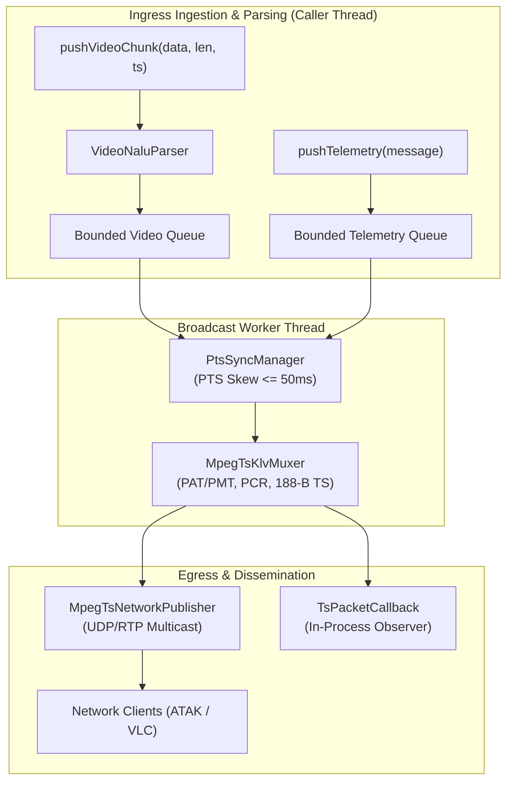
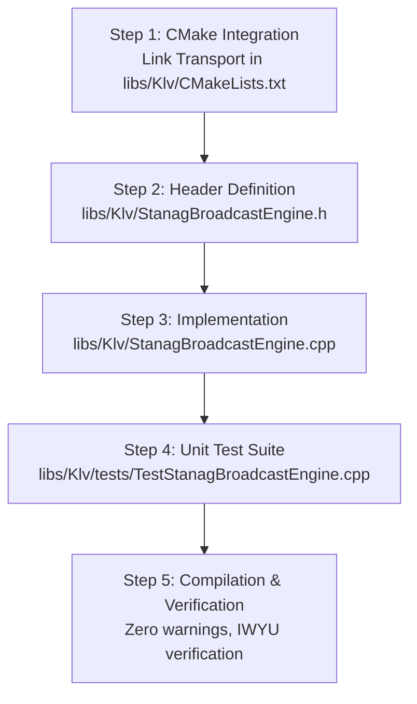

# Implementation Plan: STANAG Broadcast Engine Orchestrator (`StanagBroadcastEngine`)

This document defines the architectural design, safety compliance, interface contract, and implementation steps for **Phase 1: Broadcast Engine Orchestrator (`StanagBroadcastEngine`)** in `libs/Klv`.

---

## 1. Architectural Overview

### 1.1 Objective
`StanagBroadcastEngine` serves as the high-level, thread-safe master coordinator for the entire STANAG 4609 broadcast pipeline. It encapsulates and orchestrates five distinct subsystems:
1. **Video Ingestion & Framing**: Annex B Access Unit assembly via [VideoNaluParser.h](../libs/Klv/VideoNaluParser.h).
2. **Master Timing & Clock Scaling**: 90 kHz PTS/DTS and 27 MHz PCR timebase management via [MasterTimeBase.h](../libs/Klv/MasterTimeBase.h).
3. **PTS Synchronization**: Enforcing STANAG 4609 temporal skew clamping ($\le 50\text{ ms}$) via [PtsSyncManager.h](../libs/Klv/PtsSyncManager.h).
4. **Transport Stream Multiplexing**: 188-byte MPEG-TS packet framing, PAT/PMT insertion, and PCR stamping via [MpegTsKlvMuxer.h](../libs/Klv/MpegTsKlvMuxer.h).
5. **Network Dissemination**: High-throughput MTU-safe UDP multicast/unicast and RFC 3550 RTP streaming via [MpegTsNetworkPublisher.h](../libs/Transport/MpegTsNetworkPublisher.h).

---

### 1.2 Pipeline & Data Flow Architecture

#### ASCII Architecture Diagram
```
+-------------------------------------------------------------------------------------------------------------------------+
|                                              StanagBroadcastEngine Pipeline                                             |
+-------------------------------------------------------------------------------------------------------------------------+
|                                                                                                                         |
|    Caller Threads (Video Source, Telemetry Feed)                                                                        |
|         |                                            |                                                                  |
|         v (pushVideoChunk / pushVideoAccessUnit)     v (pushTelemetry / pushRawKlv)                                     |
|    +--------------------------+                 +--------------------------+                                            |
|    |     VideoNaluParser      |                 |     MasterTimeBase       |                                            |
|    +--------------------------+                 +--------------------------+                                            |
|                 |                                            |                                                          |
|                 v                                            v                                                          |
|    +--------------------------+                 +--------------------------+                                            |
|    |   Bounded Video Queue    |                 |  Bounded Telemetry Queue |                                            |
|    | (Atomic Drop on Overflow)|                 | (Atomic Drop on Overflow)|                                            |
|    +--------------------------+                 +--------------------------+                                            |
|                 \                                            /                                                          |
|                  \                                          /                                                           |
|                   +--------------------+-------------------+                                                            |
|                                        |                                                                                |
|                                        v  Worker Thread Execution                                                       |
|                         +------------------------------+                                                                |
|                         |        PtsSyncManager        |                                                                |
|                         | - Sliding Jitter Buffer      |                                                                |
|                         | - Skew Clamped to <= 50 ms   |                                                                |
|                         +------------------------------+                                                                |
|                                        |                                                                                |
|                                        v                                                                                |
|                         +------------------------------+                                                                |
|                         |        MpegTsKlvMuxer        |                                                                |
|                         | - PAT/PMT (Periodic 40 pkts) |                                                                |
|                         | - 27 MHz PCR on Video PID    |                                                                |
|                         | - 188-byte Packet Formatting |                                                                |
|                         +------------------------------+                                                                |
|                                        |                                                                                |
|                         +--------------+---------------+                                                                |
|                         |                              |                                                                |
|                         v                              v                                                                |
|         +------------------------------+    +------------------------------+                                            |
|         |    MpegTsNetworkPublisher    |    |  User-Defined TsCallback     |                                            |
|         | - 1316-byte UDP Multicast    |    | (In-process packet tap /     |                                            |
|         | - 1328-byte RTP MP2T Payload |    |  custom egress hook)         |                                            |
|         +------------------------------+    +------------------------------+                                            |
|                         |                                                                                               |
|                         v                                                                                               |
|         Network (VLC, ATAK, Downlinks)                                                                                  |
+-------------------------------------------------------------------------------------------------------------------------+
```

#### Mermaid Architecture Diagram


---

## 2. Standards Compliance & Safety Intersection

The design strictly complies with the repository's safety standards:
1. **MISRA C++:2023 Rule 7.0.6 & SEI CERT INT31-C**:
   - Explicit `<cstdint>` inclusion with all integer types prefixed with `std::` (`std::uint8_t`, `std::uint16_t`, `std::uint32_t`, `std::uint64_t`, `std::size_t`).
   - Range validation and explicit `static_cast` for all coordinate, timing, and buffer calculations.
2. **SEI CERT ERR55-CPP & Zero-Heap Fast Paths**:
   - The worker packet processing loop utilizes pre-allocated buffers. Bounded queues reject or drop overflowing packets rather than allocating unbounded heap memory.
   - Destructor is strictly `noexcept` and guarantees complete thread termination before tearing down member objects.
3. **Zero Qt Dependencies**:
   - Pure C++17 implementation in `libs/Klv` utilizing `std::thread`, `std::mutex`, `std::condition_variable`, and standard containers.
4. **IWYU & Canonical Include Grouping**:
   - Strict IWYU enforcement with self-contained headers and Pimpl pattern to decouple internal worker state and dependencies from client translation units.

---

## 3. Public Interface Specification

### `libs/Klv/StanagBroadcastEngine.h`
```cpp
#pragma once

/// @file StanagBroadcastEngine.h
/// @brief Master orchestrator coordinating live video, KLV telemetry, and MPEG-TS broadcasting.

#include <cstddef>
#include <cstdint>

#include <functional>
#include <memory>
#include <optional>

#include "KlvTypes.h"
#include "MpegTsMuxerTypes.h"
#include "TsNetworkTypes.h"
#include "VideoTypes.h"

namespace Klv {

/// @struct StanagBroadcastConfig
/// @brief Master configuration bundle for StanagBroadcastEngine.
struct StanagBroadcastConfig {
    MpegTsMuxerConfig muxerConfig {};
    Transport::TsNetworkConfig networkConfig {};
    bool enableNetworkPublishing { true };
    std::size_t maxVideoQueueSize { 128U };
    std::size_t maxTelemetryQueueSize { 256U };
};

/// @struct StanagBroadcastStats
/// @brief Runtime diagnostics and performance metrics.
struct StanagBroadcastStats {
    std::size_t videoFramesIngested { 0U };
    std::size_t videoFramesProcessed { 0U };
    std::size_t telemetryIngested { 0U };
    std::size_t telemetryProcessed { 0U };
    std::size_t droppedVideoFrames { 0U };
    std::size_t droppedTelemetry { 0U };
    std::size_t tsPacketsEmitted { 0U };
    double currentBitrateKbps { 0.0 };
    double averagePtsSkewMs { 0.0 };
    bool isNetworkOpen { false };
};

/// @class StanagBroadcastEngine
/// @brief High-level facade providing thread-safe STANAG 4609 multiplexing and network broadcast.
class StanagBroadcastEngine {
public:
    /// @brief Callback signature for custom packet tapping.
    using TsPacketCallback = std::function<void(const std::uint8_t* packet, std::size_t size)>;

    /// @brief Constructs engine with specified configuration.
    /// @param[in] config Broadcaster configuration.
    explicit StanagBroadcastEngine(StanagBroadcastConfig config = {});

    /// @brief Destructor. Stops worker thread and closes network sockets cleanly.
    ~StanagBroadcastEngine();

    StanagBroadcastEngine(const StanagBroadcastEngine&) = delete;
    StanagBroadcastEngine& operator=(const StanagBroadcastEngine&) = delete;
    StanagBroadcastEngine(StanagBroadcastEngine&&) = delete;
    StanagBroadcastEngine& operator=(StanagBroadcastEngine&&) = delete;

    /// @brief Starts worker thread and opens network publisher socket if enabled.
    /// @return True if initialized and started successfully.
    [[nodiscard]] bool start();

    /// @brief Stops worker thread and shuts down network streaming.
    void stop();

    /// @brief Checks if broadcast engine is currently running.
    /// @return True if worker thread is active.
    [[nodiscard]] bool isRunning() const noexcept;

    /// @brief Sets optional packet callback to receive emitted 188-byte TS packets.
    /// @param[in] callback Packet observer callback.
    void setPacketCallback(TsPacketCallback callback);

    /// @brief Pushes a raw Annex B video frame or chunk for NALU parsing and broadcast.
    /// @param[in] data Pointer to Annex B buffer.
    /// @param[in] size Buffer size in bytes.
    /// @param[in] timestampUs Microsecond presentation timestamp (PTS).
    /// @return True if queued successfully; false if queue overflowed.
    bool pushVideoChunk(const std::uint8_t* data, std::size_t size, std::uint64_t timestampUs);

    /// @brief Pushes a parsed VideoAccessUnit directly into the broadcast pipeline.
    /// @param[in] au Assembled video access unit.
    /// @return True if queued successfully; false if queue overflowed.
    bool pushVideoAccessUnit(VideoAccessUnit au);

    /// @brief Pushes a high-level UasDatalinkMessage into the broadcast pipeline.
    /// @param[in] message Telemetry message.
    /// @return True if queued successfully; false if queue overflowed.
    bool pushTelemetry(UasDatalinkMessage message);

    /// @brief Pushes a pre-encoded KLV byte packet into the broadcast pipeline.
    /// @param[in] data Pointer to raw KLV bytes.
    /// @param[in] size Size of packet in bytes.
    /// @param[in] timestampUs Microsecond timestamp.
    /// @return True if queued successfully; false if queue overflowed.
    bool pushRawKlv(const std::uint8_t* data, std::size_t size, std::uint64_t timestampUs);

    /// @brief Flushes all queued frames through synchronization and multiplexer.
    void flush();

    /// @brief Retrieves real-time runtime diagnostics.
    /// @return Current snapshot of broadcast metrics.
    [[nodiscard]] StanagBroadcastStats stats() const;

private:
    class Impl;
    std::unique_ptr<Impl> m_impl;
};

} // namespace Klv
```

---

## 4. Implementation Steps & Work Plan



### Step 1: CMake Configuration
- Update [libs/Klv/CMakeLists.txt](../libs/Klv/CMakeLists.txt):
  - Add `StanagBroadcastEngine.h` and `StanagBroadcastEngine.cpp` to target sources.
  - Link `Transport` to `Klv`:
    ```cmake
    target_link_libraries(Klv PUBLIC
        Threads::Threads
        Transport
    )
    ```
  - In [libs/Klv/tests/CMakeLists.txt](../libs/Klv/tests/CMakeLists.txt), register `TestStanagBroadcastEngine`.

### Step 2: Implement Header & Value Types
- Author `libs/Klv/StanagBroadcastEngine.h` adhering strictly to:
  - Canonical include ordering and `#pragma once`.
  - Scoped `std::` integer types and `[[nodiscard]]` methods.
  - Pimpl idiom to isolate worker thread implementation and mutex primitives.

### Step 3: Implement Engine Core (`libs/Klv/StanagBroadcastEngine.cpp`)
- Implement `StanagBroadcastEngine::Impl`:
  - **Worker Thread Loop**:
    - Uses `std::condition_variable` with bounded waiting for low CPU consumption when idle.
    - Drains video queue and incoming telemetry.
    - Feeds `VideoNaluParser` to slice incoming chunks into complete `VideoAccessUnit`s.
    - Feeds `PtsSyncManager` with video access units and telemetry.
    - Configures `PtsSyncManager` callback to invoke `MpegTsKlvMuxer::muxSynchronizedFrame`.
    - Routes emitted 188-byte TS packets simultaneously to:
      1. `MpegTsNetworkPublisher::pushPacket` (if `enableNetworkPublishing` is true).
      2. User-provided `TsPacketCallback` (if registered).
  - **Thread-safe Metrics Engine**:
    - Measures packet throughput, drop counts, rolling PTS skew, and bitrate.
  - **Graceful Lifecycle Management**:
    - Atomic running flag (`std::atomic<bool>`).
    - Flushes remaining queue items during `stop()` or destruction.

### Step 4: Unit Test Implementation (`libs/Klv/tests/TestStanagBroadcastEngine.cpp`)
Develop test suite with minimum 7 test cases covering:
1. `LifecycleStartStop`: Verify start, stop, double-start, double-stop, and `isRunning()`.
2. `VideoChunkIngestAndMuxing`: Push H.264 Annex B chunks, verify TS packets emitted with PAT/PMT/Video PES.
3. `SynchronizedVideoTelemetryMuxing`: Push video frames alongside `UasDatalinkMessage`, verify synchronized TS packet emission within $\le 50\text{ ms}$.
4. `InProcessCallback`: Verify `setPacketCallback` receives 188-byte packets with sync byte `0x47`.
5. `NetworkPublishing`: Verify UDP loopback packet transmission when `enableNetworkPublishing` is enabled.
6. `QueueBackpressureAndDrop`: Saturate queues, verify bounded capacity and drop counter increments without deadlock.
7. `StatsAndBitrateTracking`: Verify frame counters, drop counters, and calculated bitrate.

### Step 5: Verification & Safety Audit
- Compile under MSVC `/W4` and `-Wall -Wextra -pedantic` with zero warnings.
- Run all unit tests to ensure 100% pass rate.
- Run IWYU verification script: `python scripts/verify_iwyu_cstdint.py`.

