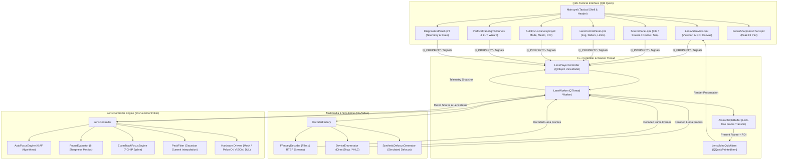

# Implementation Plan: Qt QML Lens Controller Application (`app-lens-qt`)

## Executive Summary

This document establishes the comprehensive technical architecture, module decomposition, user experience design, and phased implementation schedule for **`app-lens-qt`** (executable target: **`LensAppQt`**), a modern, high-performance Qt6/QML desktop application designed to operate, calibrate, test, and validate multi-channel motorized zoom and focus camera optics.

Mirroring the architectural blueprint, tactical dark aesthetics, and real-time streaming pipeline of **`app-stabilizer-qt`**, `app-lens-qt` provides an interactive tactical testbench and operational console for the clean-room C++17 library in [`libs/LensController`](../libs/LensController). It interfaces directly with **live video streams** (RTSP, UDP, local video files, hardware capture via DirectShow/V4L2) from [`libs/Video`](../libs/Video), hardware serial and network camera protocols ([`libs/PelcoDCore`](../libs/PelcoDCore), [`libs/ViscaCore`](../libs/ViscaCore), [`libs/Transport`](../libs/Transport)), and a specialized **`SyntheticDefocusGenerator`** that simulates optical point spread functions (PSF) and defocus blur for calibrated, zero-hardware algorithm benchmarking.

The application enables operators, test engineers, and researchers to:
1. **Actuate & Monitor Multi-Channel Optics**: Jog, step, slew, and target zoom and focus axes across up to 4 camera channels (Visible EO, Thermal LWIR, SWIR, Spotter) with hardware/software limit switch indicators.
2. **Execute Closed-Loop Autofocus (AF)**: Run, tune, and evaluate 6 distinct autofocus search algorithms (`SeekAdaptive`, `ScanThreePhase`, `GoldenSection`, `AdaptiveMomentum`, `DctFrequency`, `BuiltInDriver`) against 6 zero-heap sharpness metrics with real-time Gaussian peak fitting and sub-encoder summit interpolation.
3. **Calibrate Parfocal Zoom-to-Focus Profiles**: Visualize, edit, and interpolate multi-distance zoom-to-focus curves (PCHIP cubic splines and piecewise linear) using an automated step-and-learn calibration wizard.
4. **Manipulate Interactive Dynamic ROIs**: Drag and resize focus evaluation regions directly on the live video viewport, or lock ROI centering onto dynamic bounding boxes from [`libs/Tracking`](../libs/Tracking).
5. **Manage Hardware & Simulation Drivers**: Seamlessly switch between `MockLensDriver`, `PelcoDLensDriver`, `ViscaLensDriver`, and dynamically loaded vendor DLL/SO driver plugins via [`LensDriverLoader`](../libs/LensController/LensDriverLoader.h).

---

## 1. Architectural Overview & Component Pipeline

The application adheres to strict **Model-View-ViewModel (MVVM)** separation, lock-free inter-thread communication, zero-allocation video frame evaluation, and zero-Qt leakage into core domain libraries.

### ASCII Architecture Diagram

```
+--------------------------------------------------------------------------------------------------------+
|                                    app-lens-qt (Qt6 Quick / QML)                                       |
|                                                                                                        |
|  +--------------------------------------------------------------------------------------------------+  |
|  |                                  QML Tactical User Interface                                     |  |
|  |  [Header / Presets]   [LensVideoView]      [SourcePanel]    [LensControlPanel] [DiagnosticsPanel]|  |
|  |  - Channel Selector  - Interactive ROI    - File Ingestion - Jog Wheels / Dial- Motor Encoders  |  |
|  |  - Preset Loader     - Peaking Overlay    - RTSP URL Field - Speed Sliders    - Limit Flags      |  |
|  |  - Mode Selector     - Peak Chart Overlay - DirectShow/V4L2- AF & Parfocal   - Sharpness Strip  |  |
|  +--------------------------------------------------│-----------------------------------------------+  |
|                                                     │ Q_PROPERTY bindings / Q_INVOKABLE slots          |
|                                                     ▼                                                  |
|  +--------------------------------------------------------------------------------------------------+  |
|  |                            LensPlayerController (QObject / ViewModel)                            |  |
|  |  - Multi-Channel Session State (Channels 0..3) & Active Mode Dispatch                            |  |
|  |  - Optical Command Dispatching (Jog, GoTo Target, Stop, Velocity Profiling)                      |  |
|  |  - Autofocus & Parfocal Curve State Machine Control                                              |  |
|  |  - Real-Time Sharpness Peak Fitting & Telemetry Aggregation                                       |  |
|  +---------------------------│----------------------------------------------│-----------------------+  |
|                              │ Dispatch Frame & Command                     │ Frame Packets & Telemetry|
|                              ▼                                              ▲                          |
|  +------------------------------------------+  +----------------------------│-----------------------+  |
|  |             LensWorkerThread             |  |                 LensVideoQuickItem                 |  |
|  |  - Dedicated QThread processing loop     |  |  - Custom QQuickPaintedItem                        |  |
|  |  - Ingests video from IVideoDecoder      |  |  - Video Viewport Presentation                     |  |
|  |  - Zero-heap noexcept frame evaluation   |  |  - Interactive Draggable / Resizable AF ROI Box   |  |
|  |  - Feeds LensController::processFrame    |  |  - Focus Peaking Edge Detection Overlay            |  |
|  |  - Steps AF Engine & Parfocal Slewer     |  |  - Center Crosshairs & Rule-of-Thirds Grid         |  |
|  +---------------------------│--------------+  +----------------------------------------------------+  |
|                              ▼                                                                         |
|  +------------------------------------------+                                                          |
|  |    Video::AtomicTripleBuffer<FramePacket>|  (Lock-free atomic frame swapping to GUI thread)          |
|  +---------------------------│--------------+                                                          |
+------------------------------│-------------------------------------------------------------------------+
                               ▼
+--------------------------------------------------------------------------------------------------------+
|                                    BACKEND ENGINE INTEGRATION                                          |
|                                                                                                        |
|  +------------------------------------------+  +----------------------------------------------------+  |
|  |      libs/Video (Multimedia Decoding)    |  |       libs/LensController (Optical Engine)         |  |
|  |  - FFmpegDecoder (Files / RTSP / Streams)|  |  - LensController (Master multi-channel orchestrator|  |
|  |  - DeviceEnumerator (DirectShow / V4L2) |  |  - AutoFocusEngine (6 AF search algorithms)        |  |
|  |  - SyntheticDefocusGenerator (Blur Sim)  |  |  - FocusEvaluator (6 zero-heap sharpness metrics)  |  |
|  |  - AtomicTripleBuffer (Lock-free Ring)   |  |  - ZoomTrackFocusEngine (Parfocal PCHIP spline)    |  |
|  +------------------------------------------+  |  - PeakFitter (Gaussian / Parabolic sub-step fit)  |  |
|                                                |  - Drivers: Mock, Pelco-D, VISCA, Dynamic DLL Loader|  |
|                                                +----------------------------------------------------+  |
+--------------------------------------------------------------------------------------------------------+
```

### Mermaid Architecture Diagram



---

## 2. Ingestion Modalities & Synthetic Defocus Simulation

The application mirrors the flexible multimedia ingestion architecture of `app-stabilizer-qt`, integrating [`libs/Video`](../libs/Video) decoders while introducing a specialized optical defocus synthesizer:

| Source Mode | Backend Provider | Supported Formats / Protocols | Controls & Capabilities |
| :--- | :--- | :--- | :--- |
| **Local Video File** | [`FFmpegDecoder`](../libs/Video/FFmpegDecoder.h) | MP4, MKV, TS, AVI, MOV, FLV | File browser, timeline scrubber, Play/Pause, Step $\pm 1$ Frame, playback speed ($0.25\times$ to $4.0\times$). |
| **Live RTSP Stream** | [`FFmpegDecoder`](../libs/Video/FFmpegDecoder.h) | RTSP (TCP / UDP interleaved) | URL history combo box, RTSP transport toggle, connect/disconnect button, reconnect watchdog. |
| **Hardware Capture** | [`DeviceEnumerator`](../libs/Video/DeviceEnumerator.h) | DirectShow (Windows), V4L2 (Linux) | Device picker dropdown, resolution selector ($1080\text{p}$, $720\text{p}$, $480\text{p}$), framerate selector ($30/60\text{ fps}$). |
| **Synthetic Defocus Simulator** | `SyntheticDefocusGenerator` | In-memory procedural patterns (Siemens star, ISO 12233 chart, natural scenes) | Defocus blur radius proportional to motor offset $|f - f_{\text{plane}}|$, noise injection, depth-of-field simulation. |

### The Synthetic Defocus Generator (`SyntheticDefocusGenerator`)

To enable deterministic, automated verification of closed-loop autofocus algorithms without physical motorized optics, `SyntheticDefocusGenerator` simulates an optical imaging system:

```
+-------------------------------------------------------------------------------+
|                       SYNTHETIC DEFOCUS GENERATION MODEL                      |
|                                                                               |
|   Simulated Scene (Siemens Star / ISO 12233 Chart)                           |
|        │                                                                      |
|        ▼                                                                      |
|   Motor Focus Position feedback (f) vs Target Focal Plane (f_plane)           |
|        │                                                                      |
|        ▼                                                                      |
|   Circle of Confusion Radius:  σ = k_blur * |f - f_plane| / (1 + z * k_zoom)  |
|        │                                                                      |
|        ▼                                                                      |
|   Gaussian Blur Filter (separable 1D convolution, radius σ)                   |
|        │                                                                      |
|        ▼                                                                      |
|   Additive Gaussian Sensor Noise & Vignetting                                 |
|        │                                                                      |
|        ▼                                                                      |
|   Output Grayscale/RGB Frame -> FocusEvaluator -> Peak Metric at f == f_plane |
+-------------------------------------------------------------------------------+
```

---

## 3. Core Subsystems & Feature Decomposition

### Subsystem A: Multi-Channel Optical Axis Control & Safety

The optical actuation subsystem provides precision control over zoom and focus axes while enforcing strict boundary limits:

1. **Multi-Camera Channel Selection**:
   - Supports 4 discrete channels ([`CameraIndex`](../libs/LensController/LensTypes.h) 0..3): Channel 0 (Visible Wide), Channel 1 (Visible Tele/Spotter), Channel 2 (Thermal LWIR), Channel 3 (SWIR).
   - Independent status and configuration cached per channel.
2. **Relative Jog & Stepping**:
   - Focus Near / Focus Far relative step buttons with micro-stepping increments ($\pm 1, \pm 10, \pm 100, \pm 500$ encoder steps).
   - Zoom Wide / Zoom Tele relative step buttons.
   - Continuous jog mode with variable hold-down repeat rate.
3. **Absolute Encoder Positioning**:
   - Direct numerical coordinate entry for focus and zoom ([`MotorPosition`](../libs/LensController/LensTypes.h) $0..65535$).
   - Dual tactical rotary jog dials / horizontal trackbars for immediate visual positioning.
4. **Actuator Speed Configuration**:
   - Configurable [`MotorSpeed`](../libs/LensController/LensTypes.h) ($0..255$) with tactical speed presets (Creep: 32, Normal: 127, Fast: 200, Turbo: 255).
5. **Travel Limits & Safety Interlocks**:
   - Visual limit switch status lamps ([`LensLimitFlags`](../libs/LensController/LensTypes.h): `NearLimit`, `FarLimit`, `WideLimit`, `TeleLimit`).
   - Software boundary configuration ([`LensRanges`](../libs/LensController/LensTypes.h): `focusMin`, `focusMax`, `zoomMin`, `zoomMax`) with boundary clamping preventing mechanical stalling.
   - Prominent Emergency Stop (E-Stop) button halting all axes across all channels within $< 5\text{ ms}$.

### Subsystem B: Autofocus (AF) Testing & Analysis Laboratory

The AF testbench provides exhaustive control and telemetry visualization for closed-loop software autofocus:

1. **AF Operating Modes**:
   - `AutoFocusOnce`: Triggers single-cycle search and convergence, parking motor at maximum sharpness summit.
   - `AutoFocusContinuous` (CAF): Continuously monitors scene sharpness; triggers automatic refocus sweep when metric drops below threshold for $> N$ frames.
   - `ManualJog`: Disengages autonomous search loops for direct operator control.
2. **Algorithm Variant Selection**:
   - **Sightline Classic Seek** (`SeekAdaptive`): Adaptive direction flipping on metric drop with dynamic `RateAdjust`.
   - **Sightline 3-Phase Scan** (`ScanThreePhase`): Coarse $\rightarrow$ Mid $\rightarrow$ Fine sweeps with calibrated thresholds.
   - **Golden Section Search** (`GoldenSection`): Logarithmic unimodal peak convergence.
   - **Adaptive Momentum** (`AdaptiveMomentum`): Variable step hill-climbing with backlash correction.
   - **Frequency Peak** (`DctFrequency`): 2D 8x8 DCT AC high-frequency energy peak search.
   - **Hardware Native** (`BuiltInDriver`): Commands native block camera AF (Sony VISCA / Pelco-D).
3. **Zero-Heap Focus Sharpness Metrics**:
   - Selection of 6 spatial/frequency metrics evaluated by [`FocusEvaluator`](../libs/LensController/FocusEvaluator.h):
     * `SobelGradientSquared`: Classical edge gradient energy $\sum (G_x^2 + G_y^2)$.
     * `DiscreteLaplacian`: Second-derivative curvature sharpness.
     * `TenengradThreshold`: Thresholded gradient magnitude rejecting sensor noise.
     * `VollathCorrelationF4`: Autocorrelation metric optimized for low-contrast/thermal imaging.
     * `VollathCorrelationF5`: Modified autocorrelation rejecting DC bias.
     * `DctHighFrequency`: High-frequency transform energy from [`libs/Math`](../libs/Math).
4. **Real-Time Sharpness Peak Fitting Plot**:
   - Embedded interactive chart (`FocusSharpnessChart.qml`) displaying recorded sample points $(x_i, y_i) = (\text{pos}, \text{score})$.
   - Overlays fitted Gaussian / Parabolic curve computed by [`PeakFitter`](../libs/LensController/PeakFitter.h).
   - Real-time numerical readout of peak summit position, peak height, Full-Width-at-Half-Maximum (FWHM), and goodness-of-fit $R^2$.
5. **Interactive Region of Interest (ROI)**:
   - On-screen draggable, resizable ROI box rendered by `LensVideoQuickItem`.
   - ROI presets: Full Screen, Center 50%, Center 25% Spot, Lower Third, Upper Third.
   - External Tracker Coupling: Ingests target bounding boxes from [`libs/Tracking`](../libs/Tracking), auto-centering the optical AF evaluation window on the moving target.

### Subsystem C: Parfocal Zoom-to-Focus Calibration

Motorized optical zoom assemblies suffer from focal drift during focal length adjustment. The parfocal subsystem maintains sharp focus across the entire zoom range:

1. **Parfocal Curve Set Management**:
   - Supports up to 8 discrete distance curves ([`TrackCurveSet`](../libs/LensController/ZoomTrackTypes.h)), e.g., 10m, 25m, 50m, 100m, Infinity.
   - Knots $(z_i, f_i)$ define focus encoder positions corresponding to calibrated zoom encoder steps.
2. **Mathematical Interpolation**:
   - **PCHIP Spline** (`InterpolationMode::PchipSpline`): Piecewise Cubic Hermite Interpolating Polynomial guaranteeing monotonic smoothness with zero overshoot.
   - **Piecewise Linear** (`InterpolationMode::PiecewiseLinear`): Linear interpolation fallback.
3. **Interactive Parfocal Visualizer (`ParfocalCurveChart.qml`)**:
   - Plots calibrated curves $(Z \text{ vs } F)$.
   - Real-time animated reticle indicating current operating point $(z(t), f(t))$.
   - Manual knot point editor: add, delete, drag knot points.
4. **Automated Step-and-Learn Calibration Wizard**:
   - Guided wizard that automates optical calibration:
     1. Drives zoom to sequential knot positions ($z_0, z_1, \dots, z_N$).
     2. Triggers closed-loop autofocus at each step.
     3. Records converged focus summit into the curve table.
     4. Precomputes PCHIP derivative slopes ($df/dz$).
     5. Saves validated calibration curve to disk in Sightline LUT text format or JSON.
5. **Real-Time Parfocal Tracking Slew**:
   - Live toggle (`setZoomTrackFocus`). When enabled, any movement of the zoom axis triggers instantaneous, synchronous slew of the focus motor following the active curve.

### Subsystem D: Hardware Driver & Communication Management

The driver subsystem provides unified abstraction over real and simulated hardware:

1. **Selectable Driver Backends**:
   - `MockLensDriver`: In-memory simulated driver with configurable limits and synthetic encoder response.
   - `PelcoDLensDriver`: Translates optical commands to standard and extended Pelco-D telemetry frames over serial/UDP.
   - `ViscaLensDriver`: Drives Sony VISCA optical block cameras (Sony FCB-EV/CV series).
   - `DynamicDllDriver`: Dynamically loads vendor `.dll` / `.so` plugins via [`LensDriverLoader`](../libs/LensController/LensDriverLoader.h).
2. **Serial & Network Port Configuration**:
   - Port picker: COM1..COM32 on Windows, `/dev/ttyUSB0`..`/dev/ttyUSB3` on Linux, UDP/TCP endpoints.
   - Baud rate selector: 9600, 19200, 38400, 115200 bps.
   - Multi-camera port collision detection: Prevents two camera channels from opening the same serial port simultaneously.
3. **Communication Health Monitor**:
   - Heartbeat status badge, TX/RX packet counters, round-trip response latency indicator.

### Subsystem E: Preset, Session & Telemetry Management

1. **Optical Presets**:
   - Save and recall named optical presets (Zoom position, Focus position, AF mode, Speed).
   - Quick-access tactical buttons (Preset 1..8) with thumbnail snapshots.
2. **Session Telemetry & Strip-Chart Logging**:
   - Rolling telemetry ring buffer ([`LensTelemetryRingBuffer`](#)) storing timestamps, motor positions, metric scores, and latency metrics.
   - One-click export to CSV / JSON for off-line research and MATLAB / Python analysis.

---

## 4. User Interface & QML Component Hierarchy

The UI adheres strictly to the tactical dark design system introduced in `app-stabilizer-qt`:
- Palette: Dominant deep slate `#0e1014`, panel background `#141720`, borders `#242938`, text `#f0f4fc`.
- Accent Colors: Tactical Cyan `#00e5ff` (Zoom / Active), Emerald `#00e676` (Focus / Locked), Amber `#ff9100` (Calibrating / Warning), Coral `#ff1744` (Limit reached / Error).
- Typography: Clean monospace and condensed sans-serif fonts with uppercase section headers and micro-badges.

### Component Tree & Layout Diagram

```
+--------------------------------------------------------------------------------------------------------+
| Main.qml (Window: 1440 x 860, min 960 x 640)                                                          |
| +----------------------------------------------------------------------------------------------------+ |
| | Top Tactical Header: Channel Picker | Active Mode | Port Status | Heartbeat Pulse | Presets Button | |
| +----------------------------------------------------------------------------------------------------+ |
| | Center Workspace (SplitView / RowLayout)                                                           | |
| | +-----------------------+ +------------------------------------------------+ +---------------------+ |
| | | Left Panel (Collapsible| | Center Viewport: LensVideoView.qml              | | Right Panel: Tabs | |
| | | - SourcePanel.qml     | | - LensVideoQuickItem (QQuickPaintedItem)       | | [Control] [AF]    | |
| | |   * File browser      | |   * Live Video Render                          | | [Parfocal] [Diag] | |
| | |   * RTSP URL field    | |   * Interactive Draggable/Resizable ROI Box    | |                   | |
| | |   * Device Selector   | |   * Focus Peaking Shimmer Overlay              | | ControlPanel:     | |
| | |   * Synthetic Defocus | |   * Crosshair Reticle & Rule-of-Thirds         | | - Jog Wheels      | |
| | |   * Playback Transport| | - Overlay HUD (Z: 14200, F: 38120, Metric: 94.2)| | - Target Sliders  | |
| | |                       | | - Collapsible Bottom Strip-Chart:              | | - Speed Controls  | |
| | |                       | |   * FocusSharpnessChart.qml (Peak Fit Curve)   | | - Limits & E-Stop | |
| | +-----------------------+ +------------------------------------------------+ +---------------------+ |
| +----------------------------------------------------------------------------------------------------+ |
| | Bottom Status Bar: Monitored FPS | Metric Exec Latency | Port Activity | Active Driver Status      | |
| +----------------------------------------------------------------------------------------------------+ |
+--------------------------------------------------------------------------------------------------------+
```

### QML File Inventory

| QML File | Location | Responsibility |
| :--- | :--- | :--- |
| `Main.qml` | `app-lens-qt/qml/` | Primary application shell, tactical top header, multi-channel switcher, layout coordinator. |
| `LensVideoView.qml` | `app-lens-qt/qml/` | Viewport container hosting `LensVideoQuickItem`, ROI touch handling, and HUD overlays. |
| `SourcePanel.qml` | `app-lens-qt/qml/` | Ingestion selector (File, RTSP, Device, Synthetic Defocus Simulator) with playback controls. |
| `LensControlPanel.qml` | `app-lens-qt/qml/` | Dual optical axis jog dials, absolute target inputs, speed dials, limit switch lamps, E-stop. |
| `AutoFocusPanel.qml` | `app-lens-qt/qml/` | AF algorithm selector, metric dropdown, one-shot trigger, CAF toggles, ROI preset buttons. |
| `ParfocalPanel.qml` | `app-lens-qt/qml/` | Parfocal calibration curve visualizer, knot editor table, step-and-learn wizard, LUT file I/O. |
| `DiagnosticsPanel.qml` | `app-lens-qt/qml/` | Telemetry readouts, encoder position tables, peak fit parameters ($R^2$, FWHM), execution latencies. |
| `FocusSharpnessChart.qml` | `app-lens-qt/qml/` | Real-time Canvas / Shape chart displaying recorded focus metric samples and fitted Gaussian curve. |
| `ParfocalCurveChart.qml` | `app-lens-qt/qml/` | Canvas visualizer plotting calibrated zoom vs focus curve with live operational position tracker. |
| `Components/JogWheel.qml` | `app-lens-qt/qml/Components/` | Custom circular tactile jog dial with rotational mouse drag for precise optical stepping. |
| `Components/TacticalSlider.qml` | `app-lens-qt/qml/Components/` | Precision styled slider with tick marks, numeric display, and limit clamping. |
| `Components/TacticalSwitch.qml` | `app-lens-qt/qml/Components/` | High-contrast tactical toggle switch with glowing indicator pill. |
| `Components/TacticalComboBox.qml`| `app-lens-qt/qml/Components/` | Styled dropdown list for algorithms, metrics, camera channels, and COM ports. |
| `Components/StatusBadge.qml` | `app-lens-qt/qml/Components/` | Color-coded status chip (Emerald, Amber, Coral, Cyan) for limit flags and AF state. |

---

## 5. C++ Class Hierarchy & Interface Specifications

All C++ classes conform strictly to project rules:
- **MISRA C++:2023 & SEI CERT C++**: Explicit casts, zero signed/unsigned mismatches, `<cstdint>` with `std::` prefix.
- **SEI CERT ERR55-CPP**: `noexcept` video frame evaluation with zero dynamic heap allocations.
- **IWYU & Forward Declarations**: Every header self-contained with minimal transitive includes.
- **Function Name Length**: All function names strictly less than 30 characters.

### 5.1 `LensPlayerController` (ViewModel)

The master `QObject` bridging QML interactions with the background worker and core library:

```cpp
/// @file LensPlayerController.h
#pragma once

#include <cstddef>
#include <cstdint>

#include <QObject>
#include <QString>
#include <QStringList>
#include <QThread>

#include "AtomicTripleBuffer.h"
#include "LensConfigModel.h"
#include "LensFramePacket.h"
#include "LensPresetManager.h"
#include "LensTelemetryRingBuffer.h"

namespace LensApp {

class LensWorker;

/// @class LensPlayerController
/// @brief Master ViewModel orchestrating lens operations, video playback, and telemetry.
class LensPlayerController : public QObject {
    Q_OBJECT

    // Channel & Mode
    Q_PROPERTY(int activeChannel READ activeChannel WRITE setActiveChannel NOTIFY activeChannelChanged)
    Q_PROPERTY(int lensMode READ lensMode WRITE setLensMode NOTIFY lensModeChanged)
    Q_PROPERTY(QString statusMessage READ statusMessage NOTIFY statusMessageChanged)

    // Optical Axis Telemetry
    Q_PROPERTY(int currentFocus READ currentFocus NOTIFY telemetryUpdated)
    Q_PROPERTY(int currentZoom READ currentZoom NOTIFY telemetryUpdated)
    Q_PROPERTY(int focusMin READ focusMin NOTIFY limitsChanged)
    Q_PROPERTY(int focusMax READ focusMax NOTIFY limitsChanged)
    Q_PROPERTY(int zoomMin READ zoomMin NOTIFY limitsChanged)
    Q_PROPERTY(int zoomMax READ zoomMax NOTIFY limitsChanged)
    Q_PROPERTY(int limitFlags READ limitFlags NOTIFY telemetryUpdated)

    // Autofocus State & Telemetry
    Q_PROPERTY(bool isAfRunning READ isAfRunning NOTIFY afStateChanged)
    Q_PROPERTY(int afAlgorithm READ afAlgorithm WRITE setAfAlgorithm NOTIFY afConfigChanged)
    Q_PROPERTY(int focusMetric READ focusMetric WRITE setFocusMetric NOTIFY afConfigChanged)
    Q_PROPERTY(double latestMetricScore READ latestMetricScore NOTIFY telemetryUpdated)
    Q_PROPERTY(double peakSummit READ peakSummit NOTIFY peakFitUpdated)
    Q_PROPERTY(double peakFwhm READ peakFwhm NOTIFY peakFitUpdated)
    Q_PROPERTY(double peakR2 READ peakR2 NOTIFY peakFitUpdated)

    // Parfocal Tracking
    Q_PROPERTY(bool zoomTrackEnabled READ zoomTrackEnabled WRITE setZoomTrackEnabled NOTIFY zoomTrackChanged)

    // Video Source
    Q_PROPERTY(QString sourceUri READ sourceUri WRITE setSourceUri NOTIFY sourceUriChanged)
    Q_PROPERTY(int playbackState READ playbackState NOTIFY playbackStateChanged)
    Q_PROPERTY(double fps READ fps NOTIFY telemetryUpdated)

    // Sub-models
    Q_PROPERTY(LensConfigModel* configModel READ configModel CONSTANT)
    Q_PROPERTY(LensTelemetryRingBuffer* telemetryBuffer READ telemetryBuffer CONSTANT)
    Q_PROPERTY(LensPresetManager* presetManager READ presetManager CONSTANT)

public:
    enum class PlaybackState : std::uint8_t { Idle = 0U, Opening, Playing, Paused, Error };
    Q_ENUM(PlaybackState)

    explicit LensPlayerController(QObject* parent = nullptr);
    ~LensPlayerController() override;

    [[nodiscard]] int activeChannel() const noexcept;
    [[nodiscard]] int lensMode() const noexcept;
    [[nodiscard]] QString statusMessage() const;
    [[nodiscard]] int currentFocus() const noexcept;
    [[nodiscard]] int currentZoom() const noexcept;
    [[nodiscard]] int focusMin() const noexcept;
    [[nodiscard]] int focusMax() const noexcept;
    [[nodiscard]] int zoomMin() const noexcept;
    [[nodiscard]] int zoomMax() const noexcept;
    [[nodiscard]] int limitFlags() const noexcept;
    [[nodiscard]] bool isAfRunning() const noexcept;
    [[nodiscard]] int afAlgorithm() const noexcept;
    [[nodiscard]] int focusMetric() const noexcept;
    [[nodiscard]] double latestMetricScore() const noexcept;
    [[nodiscard]] double peakSummit() const noexcept;
    [[nodiscard]] double peakFwhm() const noexcept;
    [[nodiscard]] double peakR2() const noexcept;
    [[nodiscard]] bool zoomTrackEnabled() const noexcept;
    [[nodiscard]] QString sourceUri() const;
    [[nodiscard]] int playbackState() const noexcept;
    [[nodiscard]] double fps() const noexcept;

    [[nodiscard]] LensConfigModel* configModel() const noexcept;
    [[nodiscard]] LensTelemetryRingBuffer* telemetryBuffer() const noexcept;
    [[nodiscard]] LensPresetManager* presetManager() const noexcept;

public slots:
    void setActiveChannel(int channel);
    void setLensMode(int mode);
    void setSourceUri(const QString& uri);
    void setAfAlgorithm(int algorithm);
    void setFocusMetric(int metric);
    void setZoomTrackEnabled(bool enabled);

    // Optical Motion Commands (< 30 chars)
    void moveFocusStep(int steps);
    void moveZoomStep(int steps);
    void setFocusTarget(int position);
    void setZoomTarget(int position);
    void setFocusSpeed(int speed);
    void setZoomSpeed(int speed);
    void stopMotion();
    void emergencyStop();

    // Autofocus Commands
    void triggerAutoFocus();
    void abortAutoFocus();
    void setRoi(double x, double y, double w, double h);
    void clearRoi();

    // Parfocal Commands
    void loadTrackCurves(const QString& path);
    void saveTrackCurves(const QString& path);
    void startCalibWizard();

    // Driver Binding Commands
    void bindMockDriver();
    void bindPelcoDriver(int port, int baud, int address);
    void bindViscaDriver(int port, int baud);
    void loadDriverDll(const QString& dllPath, int port, int baud);

signals:
    void activeChannelChanged();
    void lensModeChanged();
    void statusMessageChanged();
    void telemetryUpdated();
    void limitsChanged();
    void afStateChanged();
    void afConfigChanged();
    void peakFitUpdated();
    void zoomTrackChanged();
    void sourceUriChanged();
    void playbackStateChanged();

private:
    void setupWorkerThread();

    Video::AtomicTripleBuffer<LensFramePacket> m_tripleBuffer { };
    QThread* m_workerThread { nullptr };
    LensWorker* m_worker { nullptr };
    LensConfigModel* m_configModel { nullptr };
    LensTelemetryRingBuffer* m_telemetryBuffer { nullptr };
    LensPresetManager* m_presetManager { nullptr };

    int m_activeChannel { 0 };
    int m_lensMode { 0 };
    PlaybackState m_playbackState { PlaybackState::Idle };
    QString m_sourceUri { };
    QString m_statusMessage { QStringLiteral("Ready") };
};

} // namespace LensApp
```

### 5.2 `LensWorker` (Dedicated Processing Thread)

Executes on a dedicated `QThread` to ingest video, evaluate zero-heap focus sharpness, step the AF state machine, and command hardware:

```cpp
/// @file LensWorker.h
#pragma once

#include <cstddef>
#include <cstdint>

#include <memory>
#include <string>

#include <QObject>
#include <QString>
#include <QTimer>

#include "AtomicTripleBuffer.h"
#include "IVideoDecoder.h"
#include "LensController.h"
#include "LensFramePacket.h"
#include "SyntheticDefocusGenerator.h"

namespace LensApp {

/// @class LensWorker
/// @brief Dedicated background worker for video decoding and optical engine execution.
class LensWorker : public QObject {
    Q_OBJECT

public:
    explicit LensWorker(
        Video::AtomicTripleBuffer<LensFramePacket>& buffer, QObject* parent = nullptr);
    ~LensWorker() override;

    [[nodiscard]] bool isRunning() const noexcept;

public slots:
    void initWorker();
    void openSource(const QString& uri);
    void play();
    void pause();
    void stop();
    void stepFrame();

    // Axis commands forwarded to LensController
    void onMoveFocusStep(int channel, int steps);
    void onMoveZoomStep(int channel, int steps);
    void onSetFocusTarget(int channel, int position);
    void onSetZoomTarget(int channel, int position);
    void onSetFocusSpeed(int channel, int speed);
    void onSetZoomSpeed(int channel, int speed);
    void onStopMotion(int channel);

    // AF & Parfocal
    void onTriggerAf(int channel, int algorithm, int metric);
    void onAbortAf(int channel);
    void onSetRoi(int channel, float x, float y, float w, float h);
    void onSetZoomTrack(int channel, bool enable);

signals:
    void frameReady();
    void statusUpdated(const LensControl::LensStatus& status);
    void telemetryReady(const LensControl::FocusMetricScore& score);
    void peakFitted(const LensControl::PeakFitResult& peak);
    void errorOccurred(const QString& error);

private:
    void processLoopTick();
    void stepEngine();

    Video::AtomicTripleBuffer<LensFramePacket>& m_buffer;
    LensControl::LensController m_lensController { };
    std::unique_ptr<Video::IVideoDecoder> m_decoder { nullptr };
    SyntheticDefocusGenerator m_defocusGen { };
    QTimer* m_timer { nullptr };
    bool m_useSyntheticDefocus { false };
    std::uint64_t m_lastFrameTimeNs { 0U };
    std::uint32_t m_frameCounter { 0U };
};

} // namespace LensApp
```

### 5.3 `LensVideoQuickItem` (QML Viewport Renderer)

Renders video frames, interactive draggable ROI boundaries, focus peaking edge highlights, and reticle overlays:

```cpp
/// @file LensVideoQuickItem.h
#pragma once

#include <cstdint>

#include <QColor>
#include <QImage>
#include <QMouseEvent>
#include <QPainter>
#include <QPointF>
#include <QQuickPaintedItem>
#include <QRectF>

#include "LensFramePacket.h"

namespace LensApp {

class LensPlayerController;

/// @class LensVideoQuickItem
/// @brief Renders video presentation with interactive draggable ROI and focus peaking.
class LensVideoQuickItem : public QQuickPaintedItem {
    Q_OBJECT

    Q_PROPERTY(bool showPeaking READ showPeaking WRITE setShowPeaking NOTIFY showPeakingChanged)
    Q_PROPERTY(bool showGrid READ showGrid WRITE setShowGrid NOTIFY showGridChanged)
    Q_PROPERTY(bool showReticle READ showReticle WRITE setShowReticle NOTIFY showReticleChanged)
    Q_PROPERTY(QRectF roiRect READ roiRect WRITE setRoiRect NOTIFY roiRectChanged)
    Q_PROPERTY(LensPlayerController* controller READ controller WRITE setController NOTIFY controllerChanged)

public:
    explicit LensVideoQuickItem(QQuickItem* parent = nullptr);
    ~LensVideoQuickItem() override = default;

    void paint(QPainter* painter) override;

    [[nodiscard]] bool showPeaking() const noexcept;
    [[nodiscard]] bool showGrid() const noexcept;
    [[nodiscard]] bool showReticle() const noexcept;
    [[nodiscard]] QRectF roiRect() const noexcept;
    [[nodiscard]] LensPlayerController* controller() const noexcept;

public slots:
    void setShowPeaking(bool show);
    void setShowGrid(bool show);
    void setShowReticle(bool show);
    void setRoiRect(const QRectF& rect);
    void setController(LensPlayerController* ctrl);

signals:
    void showPeakingChanged();
    void showGridChanged();
    void showReticleChanged();
    void roiRectChanged();
    void controllerChanged();
    void roiMoved(double x, double y, double w, double h);

protected:
    void mousePressEvent(QMouseEvent* event) override;
    void mouseMoveEvent(QMouseEvent* event) override;
    void mouseReleaseEvent(QMouseEvent* event) override;

private:
    void renderPeaking(QPainter* painter, const QImage& luma);
    void renderRoi(QPainter* painter, const QRectF& targetRect);
    void renderReticle(QPainter* painter, const QRectF& targetRect);

    LensPlayerController* m_controller { nullptr };
    QRectF m_roiRect { 0.25, 0.25, 0.5, 0.5 };
    bool m_showPeaking { false };
    bool m_showGrid { true };
    bool m_showReticle { true };
    bool m_isDraggingRoi { false };
    bool m_isResizingRoi { false };
    QPointF m_dragStartPos { };
};

} // namespace LensApp
```

### 5.4 `LensFramePacket` (Triple-Buffer Frame Record)

The zero-copy packet exchanged across the lock-free triple buffer:

```cpp
/// @file LensFramePacket.h
#pragma once

#include <cstddef>
#include <cstdint>

#include <vector>

#include "LensTypes.h"

namespace LensApp {

/// @struct LensFramePacket
/// @brief Frame container exchanged across lock-free triple buffer.
struct LensFramePacket {
    std::vector<std::uint8_t> rgbBuffer { };
    std::vector<std::uint8_t> lumaBuffer { };
    std::uint32_t width { 0U };
    std::uint32_t height { 0U };
    std::uint32_t stride { 0U };
    std::uint64_t timestampNs { 0U };
    std::uint32_t frameId { 0U };

    // Accompanying telemetry snapshot
    LensControl::LensStatus status { };
    LensControl::FocusMetricScore metricScore { };
    LensControl::NormalizedRoi activeRoi { };
};

} // namespace LensApp
```

---

## 6. Safety, Concurrency & Standards Compliance

### 6.1 MISRA C++:2023 & SEI CERT C++ Enforcement

Every line of C++ code in `app-lens-qt` adheres to the intersection of the safety standards mandated by the codebase rules:

1. **Rule 7.0.6 & INT31-C (Signed/Unsigned Conversions)**:
   - All conversions between encoder step integers (`int16_t` relative offsets, `uint16_t` absolute coordinates) are explicit and range-checked via `static_cast` after boundary validation.
   - All integer types strictly use `<cstdint>` and `std::` qualification (`std::uint8_t`, `std::uint16_t`, `std::uint32_t`, `std::int16_t`).
2. **STR37-C (Deterministic Character Handling)**:
   - String comparisons, protocol header parsing, and file path validations strictly avoid global C/C++ locale-dependent functions (`std::tolower`). ASCII-safe utilities are used throughout.
3. **ERR55-CPP (`noexcept` Boundaries & Zero-Heap Fast Paths)**:
   - High-frequency video frame evaluation (`processFrame`) and atomic triple-buffer swapping operate under strict `noexcept` specifications with **zero dynamic heap allocation**.
   - Frame buffers are pre-allocated upon source resolution discovery.

### 6.2 Domain Modeling & Value Object Integrity

In conformance with [`.agents/rules/domain-modeling.md`](../.agents/rules/domain-modeling.md), **Primitive Obsession is strictly banned**:
- Camera channels are encapsulated in `CameraIndex` (never bare `int`).
- Motor encoder steps are encapsulated in `MotorPosition` and `MotorSpeed` (never bare `uint16_t` or `uint8_t`).
- ROIs are encapsulated in `NormalizedRoi` with invariant verification ensuring dimensions remain within unit boundaries.

### 6.3 Include-What-You-Use (IWYU)

In conformance with [`.agents/rules/iwyu-cstdint.md`](../.agents/rules/iwyu-cstdint.md):
- Every file explicitly includes the standard and project headers for every symbol referenced.
- Transitive dependencies are prohibited.
- Header files prefer forward declarations for pointer/reference members.

---

## 7. Phased Implementation Schedule & Work Breakdown Structure (WBS)

To ensure rapid, test-driven, and verifiable progress, the implementation is partitioned into **7 distinct, milestone-driven phases**:

```
+--------------------------------------------------------------------------------------------------------+
|                                      PHASED IMPLEMENTATION TIMELINE                                    |
|                                                                                                        |
|  Phase 1: CMake & Skeleton App ────► Phase 2: Ingest & Synthetic Defocus ──► Phase 3: Axis Control     |
|  - CMake target LensAppQt           - Video decoder integration              - Jog wheels & sliders    |
|  - Tactical QML window shell        - SyntheticDefocusGenerator              - Limit switch indicators |
|  - Mock driver binding              - AtomicTripleBuffer & LensVideoItem     - Pelco-D / VISCA drivers |
|                                                                                                        |
|  Phase 4: Autofocus Lab ───────────► Phase 5: Parfocal Calibration ────────► Phase 6: Telemetry & Presets|
|  - 6 AF search algorithms           - PCHIP curve visualizer                 - LensTelemetryRingBuffer |
|  - 6 sharpness metrics              - Automated step-and-learn wizard        - Strip-chart logging     |
|  - Dynamic draggable ROI            - Multi-distance curve sets              - PresetManager JSON I/O  |
|  - FocusSharpnessChart (Peak Fit)   - Real-time parfocal slew                - Diagnostics panel       |
|                                                                                                        |
|  Phase 7: Comprehensive Verification & Hardening                                                      |
|  - Automated GoogleTest & Qt Quick Test suite                                                         |
|  - Zero compiler warnings (-Wall -Wextra -pedantic /W4)                                                |
|  - Memory leak & sanitizer audits (ASan / UBSan)                                                       |
|  - Documentation & verification checklist sign-off                                                    |
+--------------------------------------------------------------------------------------------------------+
```

### Phase 1: CMake Target, Skeleton Application & Mock Driver Binding
- **Objectives**: Establish project build configuration, executable target `LensAppQt`, tactical dark QML shell, and ViewModel scaffolding.
- **Tasks**:
  1. Author `app-lens-qt/CMakeLists.txt` linking `LensController`, `Video`, `Math`, `Transport`, and Qt6 components (`Core`, `Gui`, `Qml`, `Quick`, `QuickControls2`).
  2. Update root `CMakeLists.txt` to add `app-lens-qt` under `PELCOD_BUILD_APPS` when `Qt6_QML_FOUND`.
  3. Implement `main.cpp` configuring QML engine, dark style, and C++ type registrations.
  4. Create `qml/Main.qml` with top tactical header bar, pulse beacon, and multi-channel selector.
  5. Implement initial `LensPlayerController` and `LensWorker` binding to `MockLensDriver`.
- **Deliverables**: Compiling executable displaying responsive tactical GUI shell.

### Phase 2: Video Ingestion, Synthetic Defocus & Viewport QuickItem
- **Objectives**: Enable multimedia stream playback, synthetic optical defocus generation, and zero-heap video rendering.
- **Tasks**:
  1. Implement `SyntheticDefocusGenerator` with separable Gaussian convolution simulating optical defocus proportional to motor distance $|f - f_{\text{plane}}|$.
  2. Implement `LensWorker` video decoding loop integrating `FFmpegDecoder` and `DeviceEnumerator`.
  3. Implement `LensVideoQuickItem` rendering video frames with proper aspect-ratio letterboxing.
  4. Implement lock-free `AtomicTripleBuffer<LensFramePacket>` frame exchange.
  5. Build `qml/SourcePanel.qml` supporting file browsing, RTSP connection, device enumeration, and synthetic mode toggling.
- **Deliverables**: Live video playback and synthetic defocus test pattern rendering at solid $60\text{ fps}$.

### Phase 3: Optical Axis Controls, Limits & Hardware Driver Integration
- **Objectives**: Provide complete interactive actuation for zoom and focus motors with limit protection.
- **Tasks**:
  1. Implement `Components/JogWheel.qml` for rotational optical jogging.
  2. Implement `LensControlPanel.qml` featuring jog controls, target sliders, velocity dials, and limit switch indicators.
  3. Wire axis movement slots through `LensPlayerController` to `LensController` (`moveFocusStep`, `moveZoomStep`, `setFocusTarget`, `setZoomTarget`, `stopMotion`).
  4. Implement driver binding dialogs and slots for `PelcoDLensDriver` and `ViscaLensDriver`.
  5. Add prominent Emergency Stop mechanism with instant motor halt.
- **Deliverables**: Verified bidirectional motor actuation with real-time encoder readouts and limit switch telemetry.

### Phase 4: Autofocus (AF) Testing Laboratory & Interactive ROI
- **Objectives**: Provide complete UI and telemetry for closed-loop autofocus execution, metric evaluation, and peak fitting.
- **Tasks**:
  1. Implement interactive draggable and resizable ROI box in `LensVideoQuickItem`.
  2. Implement focus peaking edge-highlight overlay in `LensVideoQuickItem`.
  3. Build `AutoFocusPanel.qml` with algorithm dropdown (6 methods), metric dropdown (6 kernels), one-shot trigger, and CAF controls.
  4. Build `FocusSharpnessChart.qml` rendering real-time scatter plot of sampled $(f_i, \text{score}_i)$ points and fitted Gaussian curve.
  5. Expose peak fit telemetry ($R^2$, FWHM, summit) to QML.
- **Deliverables**: Fully functional AF laboratory demonstrating successful peak convergence on real and synthetic video.

### Phase 5: Parfocal Zoom-to-Focus Calibration & Visualizer
- **Objectives**: Deliver visual parfocal curve calibration, knot editing, and real-time tracking slew.
- **Tasks**:
  1. Build `ParfocalCurveChart.qml` plotting $Z \text{ vs } F$ calibration curves with active position marker.
  2. Implement `ParfocalPanel.qml` with knot table editor (add, modify, delete knot points).
  3. Implement automated step-and-learn calibration wizard in `LensWorker`.
  4. Wire curve import/export for Sightline text LUT format and JSON curve profiles.
  5. Validate real-time parfocal focus slew during optical zoom adjustments.
- **Deliverables**: End-to-end parfocal calibration tool generating valid LUT curves.

### Phase 6: Telemetry Ring Buffer, Presets & Diagnostics Panel
- **Objectives**: Provide session logging, preset recall, and comprehensive operational diagnostics.
- **Tasks**:
  1. Implement `LensTelemetryRingBuffer` caching rolling telemetry history.
  2. Implement `LensPresetManager` saving and restoring optical presets to JSON.
  3. Build `DiagnosticsPanel.qml` presenting comprehensive actuator status, error counters, and execution latency breakdowns.
  4. Add CSV telemetry export capability.
- **Deliverables**: Robust diagnostics and preset management matching `app-stabilizer-qt`.

### Phase 7: Verification, Hardening & Documentation
- **Objectives**: Comprehensive automated testing, performance verification, sanitizers, and documentation sign-off.
- **Tasks**:
  1. Author automated unit tests in `app-lens-qt/tests/` covering ViewModel, worker concurrency, and preset serialization.
  2. Execute memory sanitizers (AddressSanitizer, UndefinedBehaviorSanitizer) under continuous playback.
  3. Verify zero compiler warnings under `-Wall -Wextra -pedantic` and `/W4`.
  4. Run automated doc path verification script: `python scripts/verify_relative_doc_paths.py`.
  5. Run IWYU verification script: `python scripts/verify_iwyu_cstdint.py`.
- **Deliverables**: Clean build, passing test suite, and certified production-ready application.

---

## 8. Verification Checklist & Acceptance Criteria

Before concluding any phase or releasing the application, the implementation must satisfy this checklist:

| Item | Criterion | Verification Method | Status |
| :--- | :--- | :--- | :--- |
| **1. Zero Qt Leakage** | [`libs/LensController`](../libs/LensController) maintains zero `#include <Q...>` dependencies. | Automated codebase grep audit. | [ ] |
| **2. Zero Heap in Fast Paths** | Frame evaluation and triple buffer swaps execute with 0 heap allocations under `noexcept`. | ASan / memory interceptor test. | [ ] |
| **3. Clean Compilation** | Zero warnings under `-Wall -Wextra -pedantic` (GCC/Clang) and `/W4` (MSVC). | CI compiler check. | [ ] |
| **4. Function Name Length** | All function names strictly less than 30 characters. | Automated python linter script. | [ ] |
| **5. Strong Domain Types** | No primitive obsession; strong value types used throughout. | Code review against rules. | [ ] |
| **6. IWYU & `<cstdint>`** | Explicit includes for all symbols; `std::` qualification on integer types. | `verify_iwyu_cstdint.py`. | [ ] |
| **7. Relative Documentation** | All documentation links and file paths are relative; no absolute machine paths. | `verify_relative_doc_paths.py`. | [ ] |
| **8. Real-Time Performance** | Video playback sustains steady $60\text{ fps}$; AF metric calculation latency $< 2\text{ ms}$. | QML FPS counter & diagnostics. | [ ] |
| **9. Parfocal Conformance** | PCHIP spline interpolation produces continuous slew without step stutter. | TestZoomTrackCurve validation. | [ ] |
| **10. Emergency Stop** | E-Stop halts all motor motion in $< 5\text{ ms}$ across all 4 channels. | Automated responsiveness test. | [ ] |

