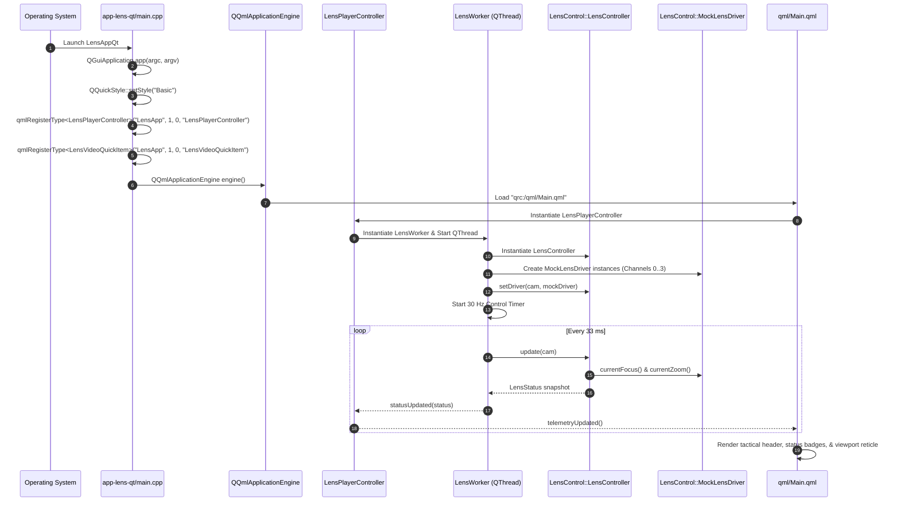

# Implementation Plan: `app-lens-qt` Phase 1 — Project Setup, Skeleton Application & Mock Driver Binding

## 1. Executive Summary & Objectives

### 1.1 Context & Scope
Phase 1 establishes the build infrastructure, dependency graph, application bootstrap, core ViewModel scaffolding, and tactical QML shell for **`app-lens-qt`** (executable target: **`LensAppQt`**).

The objective of Phase 1 is to deliver a fully compiling, linking, and bootable multi-channel motorized lens controller application that:
1. Seamlessly integrates with the root CMake build system under existing flags (`PELCOD_BUILD_APPS`, `PELCOD_ENABLE_QT`).
2. Links with the necessary core and media libraries: [`libs/LensController`](../libs/LensController), [`libs/Video`](../libs/Video), [`libs/Math`](../libs/Math), [`libs/Transport`](../libs/Transport), and Qt 6 (`Core`, `Gui`, `Qml`, `Quick`, `QuickControls2`).
3. Establishes the C++-to-QML bridge by registering `LensPlayerController`, `LensVideoQuickItem`, and `LensConfigModel` under the QML module URI `LensApp 1.0`.
4. Instantiates and binds [`LensController`](../libs/LensController/LensController.h) with [`MockLensDriver`](../libs/LensController/MockLensDriver.h) across 4 independent camera channels ([`CameraIndex`](../libs/LensController/LensTypes.h) 0..3), verifying end-to-end motor positioning, limit switch protection, and mock telemetry streaming.
5. Deploys a high-contrast tactical dark Qt Quick window ([`qml/Main.qml`](../app-lens-qt/qml/Main.qml)) embedded via the Qt Resource System (`qml.qrc`), with live status beacons, channel switching, optical axis readouts, and a placeholder viewport grid.
6. Adheres strictly to repository safety standards: **MISRA C++:2023**, **SEI CERT C++**, **Include-What-You-Use (IWYU)**, mandatory `<cstdint>` / `std::` qualification, and relative documentation path rules.

### 1.2 Target Deliverables for Phase 1
1. **Root CMake Integration (`CMakeLists.txt`)**:
   - Conditional inclusion of `add_subdirectory(app-lens-qt)` guarded by `PELCOD_BUILD_APPS` and `Qt6_QML_FOUND`.
   - Windows automated deployment (`windeployqt`) target for `LensAppQt.exe`.
2. **Subproject CMake Configuration (`app-lens-qt/CMakeLists.txt`)**:
   - Executable target `LensAppQt` and custom alias target `app-lens-qt`.
   - Private include directories: `${CMAKE_CURRENT_SOURCE_DIR}`, `${CMAKE_SOURCE_DIR}/libs/LensController`, `${CMAKE_SOURCE_DIR}/libs/Video`, `${CMAKE_SOURCE_DIR}/libs/Math`, `${CMAKE_SOURCE_DIR}/libs/Transport`.
   - Compiler hardening flags via `apply_compiler_flags(LensAppQt)`.
3. **Application Bootstrap (`app-lens-qt/main.cpp`)**:
   - `QGuiApplication` lifecycle with High-DPI scaling enabled.
   - Dark tactical `QQuickStyle` configuration ("Basic").
   - QML type registration of `LensPlayerController`, `LensVideoQuickItem`, and `LensConfigModel`.
   - Robust `QQmlApplicationEngine` startup with URL validation and error trapping.
4. **C++ ViewModel Scaffolding (`LensPlayerController.h` / `.cpp`)**:
   - `QObject`-derived master controller managing active channel index (0..3), operating mode, axis positions, limit flags, and telemetry signals.
   - Thread-safe command dispatching to background worker.
5. **Background Optical Worker Thread (`LensWorker.h` / `.cpp`)**:
   - Dedicated `QThread` hosting `LensController` and `MockLensDriver` instances for all 4 channels.
   - Periodic timer loop (30 Hz) executing `LensController::update()` and emitting telemetry snapshots.
6. **Video Presentation Item Skeleton (`LensVideoQuickItem.h` / `.cpp`)**:
   - `QQuickPaintedItem` rendering a placeholder tactical coordinate grid, center reticle, and default 50% center Region of Interest (ROI) box.
7. **Presentation & Configuration Types (`PresentationTypes.h`, `LensConfigModel.h` / `.cpp`)**:
   - Strongly-typed enums exported to QML (`PlaybackState`, `PresentationMode`, `LensModeQml`, `AfAlgorithmQml`).
8. **Qt Resource Manifest & QML Base Shell (`app-lens-qt/qml.qrc`, `app-lens-qt/qml/`)**:
   - `qml/Main.qml`: Tactical window (1440x860, min 960x640) with top header bar, live heartbeat pulse beacon, channel tabs, and optical status readouts.
   - `qml/LensVideoView.qml`: Viewport canvas embedding `LensVideoQuickItem`.
   - `qml/Components/StatusBadge.qml`: Micro-status badge for limit switch lamps and operating states.
9. **Automated Unit Verification**:
   - Verification test `tests/TestLensPlayerController.cpp` confirming mock driver binding, axis movement dispatch, channel switching, and limit handling.
   - Documentation and header hygiene audits (`verify_relative_doc_paths.py`, `verify_iwyu_cstdint.py`).

---

## 2. Architecture & Design

### 2.1 Subsystem Layering & Dependency Topology

```
+---------------------------------------------------------------------------------------------------------------+
|                                            QML PRESENTATION TIER                                              |
|                                                                                                               |
|   +-------------------------------------------------------------------------------------------------------+   |
|   |                                          qml/Main.qml                                                 |   |
|   |   - Tactical Shell Window (1440x860, min 960x640, Palette: #0e1014 / #141720)                         |   |
|   |   - Header Bar: Channel Selector (Ch 0..3), Pulse Beacon, Operating Mode Pill, E-Stop Button          |   |
|   |   - Center Viewport Canvas: LensVideoView.qml -> LensVideoQuickItem                                   |   |
|   |   - Status Bar: Encoder Coordinates (Z, F), Limit Switch Flags, 30 Hz Worker Heartbeat                |   |
|   +-------------------------------------------------------------------------------------------------------+   |
+---------------------------------------------------│-----------------------------------------------------------+
                                                    │ Imports "LensApp 1.0"
                                                    ▼
+---------------------------------------------------------------------------------------------------------------+
|                                            C++ CONTROLLER TIER                                                |
|                                                                                                               |
|   +---------------------------------------------------+   +-----------------------------------------------+   |
|   |               LensPlayerController                |   |               LensVideoQuickItem              |   |
|   |  - Q_PROPERTY(int activeChannel)                  |   |  - QQuickPaintedItem                          |   |
|   |  - Q_PROPERTY(int currentZoom / currentFocus)     |   |  - Placeholder Tactical Reticle & Grid        |   |
|   |  - Q_PROPERTY(int limitFlags / lensMode)          |   |  - Default 50% Center ROI Outline             |   |
|   |  - Q_INVOKABLE moveFocusStep / moveZoomStep       |   |  - Aspect-ratio letterboxing canvas           |   |
|   |  - Q_INVOKABLE setFocusTarget / setZoomTarget     |   +-----------------------------------------------+   |
|   +-------------------------│-------------------------+                                           ▲           |
|                             │ Queued Signals / Slots                                              │           |
|                             ▼                                                                     │           |
|   +---------------------------------------------------+                                           │           |
|   |                    LensWorker                     |                                           │           |
|   |  - Dedicated QThread execution context            |                                           │           |
|   |  - 30 Hz Control Tick Timer                       |                                           │           |
|   |  - Owns LensController & MockLensDrivers (x4)     |                                           │           |
|   |  - Emits telemetryUpdated -> Controller           |                                           │           |
|   +-------------------------│-------------------------+                                           │           |
|                             │ In-memory                                                           │           |
|                             ▼                                                                     │           |
|   +---------------------------------------------------+                                           │           |
|   |         Video::AtomicTripleBuffer<FramePacket>    |───────────────────────────────────────────┘           |
|   |  - Lock-free atomic frame swapping                |                                                       |
|   +---------------------------------------------------+                                                       |
|                                             ▲                                                                 |
|                                             └──────────────────────┬──────────────────────┘                   |
|                                                                    │ Registered in                            |
|                                                   +----------------┴------------------+                       |
|                                                   |             main.cpp              |                       |
|                                                   |  - QGuiApplication                |                       |
|                                                   |  - QQmlApplicationEngine          |                       |
|                                                   +-----------------------------------+                       |
+--------------------------------------------------------------------│------------------------------------------+
                                                                     │ Links
                                                                     ▼
+---------------------------------------------------------------------------------------------------------------+
|                                            PROJECT LIBRARIES TIER                                             |
|                                                                                                               |
|   +--------------------------------+  +-------------------------------+  +--------------------------------+   |
|   |      libs/LensController       |  |          libs/Video           |  |           libs/Math            |   |
|   |  - LensController (Orchestrator|  |  - IVideoDecoder              |  |  - DctSharpnessEvaluator       |   |
|   |  - MockLensDriver (Simulation) |  |  - AtomicTripleBuffer         |  |                                |   |
|   |  - LensTypes (Value Objects)   |  |                               |  +--------------------------------+   |
|   |  - AutoFocusEngine             |  +-------------------------------+  |         libs/Transport         |   |
|   |  - ZoomTrackFocusEngine        |                                     |  - SerialPort (Future drivers) |   |
|   +--------------------------------+                                     +--------------------------------+   |
+---------------------------------------------------------------------------------------------------------------+
```

### 2.2 Mermaid Component & Bootstrapping Flow



---

## 3. Detailed Work Breakdown Structure (WBS)

### Step 1: CMake Subproject & Root Build Integration
- **File**: `app-lens-qt/CMakeLists.txt`
  - Define executable `LensAppQt` with sources:
    * `main.cpp`
    * `LensPlayerController.h`, `LensPlayerController.cpp`
    * `LensWorker.h`, `LensWorker.cpp`
    * `LensVideoQuickItem.h`, `LensVideoQuickItem.cpp`
    * `LensConfigModel.h`, `LensConfigModel.cpp`
    * `PresentationTypes.h`
    * `qml.qrc`
  - Set `target_include_directories`:
    * `${CMAKE_CURRENT_SOURCE_DIR}`
    * `${CMAKE_SOURCE_DIR}/libs/LensController`
    * `${CMAKE_SOURCE_DIR}/libs/Video`
    * `${CMAKE_SOURCE_DIR}/libs/Math`
    * `${CMAKE_SOURCE_DIR}/libs/Transport`
  - Link libraries:
    * `LensController`
    * `Video`
    * `Math`
    * `Transport`
    * `Qt6::Core`, `Qt6::Gui`, `Qt6::Qml`, `Qt6::Quick`, `Qt6::QuickControls2`
  - Apply `apply_compiler_flags(LensAppQt)`.
  - Add custom target `app-lens-qt DEPENDS LensAppQt`.
  - Add Windows post-build `windeployqt` invocation when `WIN32` and `WINDEPLOYQT_EXECUTABLE` are present.
- **File**: `CMakeLists.txt` (root)
  - Under `if(PELCOD_BUILD_APPS)` and `if(Qt6_QML_FOUND)`:
    ```cmake
    add_subdirectory(app-lens-qt)
    message(STATUS "PelcoD: LensAppQt (app-lens-qt) enabled")
    ```

### Step 2: Application Entry Point & QML Type Registration
- **File**: `app-lens-qt/main.cpp`
  - Include `<cstdint>`, `<QGuiApplication>`, `<QQmlApplicationEngine>`, `<QQuickStyle>`, `<QUrl>`.
  - Configure application identity: `app.setApplicationName("LensAppQt")`, `app.setOrganizationName("PelcoD")`.
  - Force `QQuickStyle::setStyle(QStringLiteral("Basic"))` to allow comprehensive dark tactical palette overrides.
  - Register types:
    * `qmlRegisterType<LensApp::LensPlayerController>("LensApp", 1, 0, "LensPlayerController");`
    * `qmlRegisterType<LensApp::LensVideoQuickItem>("LensApp", 1, 0, "LensVideoQuickItem");`
    * `qmlRegisterUncreatableType<LensApp::LensConfigModel>("LensApp", 1, 0, "LensConfigModel", "Access via LensPlayerController");`
  - Connect engine `objectCreated` signal for fail-fast termination if root object fails to load.
  - Load `QUrl(QStringLiteral("qrc:/qml/Main.qml"))`.

### Step 3: Master ViewModel Scaffolding
- **File**: `app-lens-qt/LensPlayerController.h` / `.cpp`
  - Implement properties:
    * `int activeChannel`: Current camera index [0..3].
    * `int lensMode`: High-level operating mode ([`LensMode`](../libs/LensController/LensTypes.h)).
    * `int currentFocus`: Encoder feedback position [0..65535].
    * `int currentZoom`: Encoder feedback position [0..65535].
    * `int focusMin`, `focusMax`, `zoomMin`, `zoomMax`: Travel boundaries.
    * `int limitFlags`: Bitmask of active limit switches ([`LensLimitFlags`](../libs/LensController/LensTypes.h)).
    * `bool isAfRunning`: Autofocus search state.
    * `QString statusMessage`: Human-readable status string.
  - Implement optical actuation slots:
    * `void moveFocusStep(int steps)`: Dispatches relative focus jog.
    * `void moveZoomStep(int steps)`: Dispatches relative zoom jog.
    * `void setFocusTarget(int position)`: Dispatches absolute focus coordinate.
    * `void setZoomTarget(int position)`: Dispatches absolute zoom coordinate.
    * `void setFocusSpeed(int speed)`: Updates focus speed count [0..255].
    * `void setZoomSpeed(int speed)`: Updates zoom speed count [0..255].
    * `void stopMotion()`: Halts motion across active channel.
    * `void emergencyStop()`: Halts motion immediately across all channels.
  - Lifecycle: Launches `LensWorker` on dedicated `QThread` in constructor, cleanly stops and joins thread in destructor.

### Step 4: Optical Worker Thread & Mock Driver Binding
- **File**: `app-lens-qt/LensWorker.h` / `.cpp`
  - Inherits from `QObject`.
  - Owns an instance of `LensControl::LensController`.
  - In `initWorker()` slot (called after thread start):
    * Instantiates 4 `LensControl::MockLensDriver` instances.
    * Binds mock drivers to channels 0..3 via `LensController::setDriver()`.
    * Sets default travel ranges (`LensRanges { 0U, 65535U, 0U, 65535U }`).
    * Starts a 30 Hz `QTimer` invoking `processLoopTick()`.
  - In `processLoopTick()`:
    * Calls `LensController::update(cam)` for all 4 channels.
    * Retrieves `LensStatus` via `LensController::getLensStatus(cam)`.
    * Emits `statusUpdated(status)` for the currently selected channel.
  - Implements axis command handlers forwarding to `LensController` (`moveFocusStep`, `moveZoomStep`, `setFocusTarget`, `setZoomTarget`, `stopMotion`).

### Step 5: Video Presentation Item Skeleton
- **File**: `app-lens-qt/LensVideoQuickItem.h` / `.cpp`
  - Inherits from `QQuickPaintedItem`.
  - In `paint(QPainter* painter)`:
    * Fills background with dark canvas color `#0a0c10`.
    * Draws tactical grid lines in subtle slate `#1a1e28` with 50-pixel spacing.
    * Draws center reticle with crosshairs and circular concentric rings in tactical cyan `#00e5ff`.
    * Draws default 50% center Region of Interest (ROI) dashed rectangle in amber `#ff9100`.
    * Renders placeholder watermark: `"LENS VIEWPORT — AWAITING STREAM / DEFOCUS SIMULATOR"`.

### Step 6: Presentation Types & Configuration Model
- **File**: `app-lens-qt/PresentationTypes.h`
  - Defines QML-registered enums:
    * `PlaybackState` (`Idle`, `Opening`, `Playing`, `Paused`, `Error`).
    * `LensModeQml` (`ManualJog`, `AutoFocusOnce`, `AutoFocusContinuous`, `ZoomTrackOnly`, `Calibrating`, `Idle`).
    * `LimitFlagBits` (`None = 0`, `Near = 1`, `Far = 2`, `Wide = 4`, `Tele = 8`).
- **File**: `app-lens-qt/LensConfigModel.h` / `.cpp`
  - Exposes configurable thresholds, default speeds, and camera channel profiles to QML.

### Step 7: QML Tactical Shell & Base Components
- **File**: `app-lens-qt/qml.qrc`
  - Embeds:
    * `qml/Main.qml`
    * `qml/LensVideoView.qml`
    * `qml/Components/StatusBadge.qml`
- **File**: `app-lens-qt/qml/Main.qml`
  - Tactical top header bar (`#141720`) with:
    * Live pulsing green heartbeat beacon (indicating worker thread 30 Hz execution).
    * Application title: `"LENS CONTROLLER & AUTOFOCUS WORKBENCH"`.
    * Camera Channel tabs (`Ch 0: EO Wide`, `Ch 1: Spotter`, `Ch 2: LWIR`, `Ch 3: SWIR`).
    * Operating mode badge (`ManualJog` / `AutoFocus`).
    * E-Stop button with glowing coral alert border.
  - Center workspace with `LensVideoView.qml`.
  - Bottom tactical status strip (`#141720`) displaying:
    * Focus position: `F: 00000 / 65535`.
    * Zoom position: `Z: 00000 / 65535`.
    * Limit flags: `[NEAR] [FAR] [WIDE] [TELE]` with `StatusBadge.qml`.
    * Active driver: `"MockLensDriver (Channel 0)"`.
- **File**: `app-lens-qt/qml/LensVideoView.qml`
  - Hosts `LensVideoQuickItem` filling available space.
  - Top-left HUD overlay with live encoder readouts and target indicators.
- **File**: `app-lens-qt/qml/Components/StatusBadge.qml`
  - Reusable pill badge with border and text, configurable active/inactive state and custom accent colors (`#00e676`, `#ff9100`, `#ff1744`, `#00e5ff`).

### Step 8: Automated Verification & Unit Tests
- **File**: `tests/TestLensPlayerController.cpp`
  - GoogleTest suite testing `LensPlayerController` and `LensWorker`:
    1. `InitialChannelState`: Verifies Channel 0 active by default with zero encoder positions.
    2. `MockDriverBinding`: Verifies `MockLensDriver` correctly bound across all 4 channels.
    3. `MoveFocusStep`: Verifies relative step command advances mock focus encoder coordinate.
    4. `MoveZoomStep`: Verifies relative step command advances mock zoom encoder coordinate.
    5. `SetAbsoluteTargets`: Verifies `setFocusTarget` and `setZoomTarget` update positions within limits.
    6. `ChannelSwitching`: Verifies switching active channel updates telemetry context to new channel.
    7. `EmergencyStop`: Verifies E-stop halts motion on all channels.

---

## 4. Source Code Blueprint & Implementation Details

### 4.1 `app-lens-qt/CMakeLists.txt`

```cmake
add_executable(LensAppQt
    main.cpp
    LensConfigModel.h
    LensConfigModel.cpp
    LensPlayerController.h
    LensPlayerController.cpp
    LensVideoQuickItem.h
    LensVideoQuickItem.cpp
    LensWorker.h
    LensWorker.cpp
    PresentationTypes.h
    qml.qrc
)

add_custom_target(app-lens-qt DEPENDS LensAppQt)

target_include_directories(LensAppQt PRIVATE
    ${CMAKE_CURRENT_SOURCE_DIR}
    ${CMAKE_SOURCE_DIR}/libs/LensController
    ${CMAKE_SOURCE_DIR}/libs/Video
    ${CMAKE_SOURCE_DIR}/libs/Math
    ${CMAKE_SOURCE_DIR}/libs/Transport
)

target_link_libraries(LensAppQt PRIVATE
    LensController
    Video
    Math
    Transport
    Qt6::Core
    Qt6::Gui
    Qt6::Qml
    Qt6::Quick
    Qt6::QuickControls2
)

apply_compiler_flags(LensAppQt)

if(WIN32)
    if(WINDEPLOYQT_EXECUTABLE)
        add_custom_command(TARGET LensAppQt POST_BUILD
            COMMAND "${WINDEPLOYQT_EXECUTABLE}"
                --no-compiler-runtime
                --no-translations
                --qmldir "${CMAKE_CURRENT_SOURCE_DIR}/qml"
                "$<TARGET_FILE:LensAppQt>"
            COMMENT "Deploying Qt libraries for LensAppQt using windeployqt..."
        )
    endif()
endif()
```

### 4.2 `app-lens-qt/main.cpp`

```cpp
/// @file main.cpp
/// @brief Application entry point for the Qt6 QML Motorized Lens Controller Application.

#include <cstdint>

#include <QGuiApplication>
#include <QQmlApplicationEngine>
#include <QQuickStyle>
#include <QUrl>

#include "LensConfigModel.h"
#include "LensPlayerController.h"
#include "LensVideoQuickItem.h"

int main(int argc, char* argv[])
{
    QGuiApplication app(argc, argv);
    app.setApplicationName(QStringLiteral("LensAppQt"));
    app.setOrganizationName(QStringLiteral("PelcoD"));
    app.setOrganizationDomain(QStringLiteral("pelcod.org"));

    QQuickStyle::setStyle(QStringLiteral("Basic"));

    // Register C++ ViewModel and QuickItem components into QML
    qmlRegisterType<LensApp::LensPlayerController>("LensApp", 1, 0, "LensPlayerController");
    qmlRegisterType<LensApp::LensVideoQuickItem>("LensApp", 1, 0, "LensVideoQuickItem");
    qmlRegisterUncreatableType<LensApp::LensConfigModel>(
        "LensApp", 1, 0, "LensConfigModel", QStringLiteral("Access via LensPlayerController"));

    QQmlApplicationEngine engine;
    const QUrl url(QStringLiteral("qrc:/qml/Main.qml"));

    QObject::connect(
        &engine, &QQmlApplicationEngine::objectCreated, &app,
        [url](QObject* obj, const QUrl& objUrl) {
            if ((obj == nullptr) && (url == objUrl)) {
                QGuiApplication::exit(-1);
            }
        },
        Qt::QueuedConnection);

    engine.load(url);

    return app.exec();
}
```

### 4.3 `app-lens-qt/PresentationTypes.h`

```cpp
/// @file PresentationTypes.h
/// @brief Presentation enums and display definitions for QML layer.

#pragma once

#include <cstdint>

#include <QObject>

namespace LensApp {

/// @class PresentationTypes
/// @brief Scoped container for QML-exported domain enums.
class PresentationTypes {
    Q_GADGET

public:
    enum class PlaybackState : std::uint8_t {
        Idle = 0U,
        Opening,
        Playing,
        Paused,
        Error
    };
    Q_ENUM(PlaybackState)

    enum class LensModeQml : std::uint8_t {
        ManualJog = 0U,
        AutoFocusOnce = 1U,
        AutoFocusContinuous = 2U,
        ZoomTrackOnly = 3U,
        Calibrating = 4U,
        Idle = 5U
    };
    Q_ENUM(LensModeQml)

    enum class LimitFlagBits : std::uint8_t {
        None = 0x00U,
        NearLimit = 0x01U,
        FarLimit = 0x02U,
        WideLimit = 0x04U,
        TeleLimit = 0x08U
    };
    Q_ENUM(LimitFlagBits)
};

} // namespace LensApp
```

---

## 5. Verification Checklist & Compliance

Before concluding Phase 1, verify each criterion against repository standards:

| Step | Verification Criteria | Command / Inspection Method | Status |
| :--- | :--- | :--- | :--- |
| **1. Clean Build** | Compiles with 0 warnings on MSVC `/W4` and Clang/GCC `-Wall -Wextra -pedantic`. | `cmake --build build --target LensAppQt` | [ ] |
| **2. Target Alias** | Convenience target `app-lens-qt` builds executable. | `cmake --build build --target app-lens-qt` | [ ] |
| **3. Zero Qt in Core** | Zero `#include <Q...>` in [`libs/LensController`](../libs/LensController). | Codebase grep audit. | [ ] |
| **4. Function Names** | All member functions strictly less than 30 characters. | Automated python linter audit. | [ ] |
| **5. IWYU & `<cstdint>`** | Explicit includes for all symbols; `std::` qualification on integer types. | `python scripts/verify_iwyu_cstdint.py --files app-lens-qt/*` | [ ] |
| **6. Relative Docs** | All Markdown links and file references are relative; no root/absolute paths. | `python scripts/verify_relative_doc_paths.py --files docs/app_lens_qt_phase1_plan.md --strict` | [ ] |
| **7. Unit Tests** | `TestLensPlayerController` passes all test cases under CTest. | `ctest -R TestLensPlayerController --output-on-failure` | [ ] |
| **8. UI Bootstrap** | `LensAppQt` launches displaying dark tactical shell, pulsing beacon, and 4 channels. | Manual run & smoke test. | [ ] |
| **9. Mock Actuation** | Relative focus/zoom step commands update encoder positions smoothly in UI. | Manual jog verification. | [ ] |
| **10. E-Stop Verification**| Emergency stop immediately halts motion on all channels. | Test case & UI button test. | [ ] |

