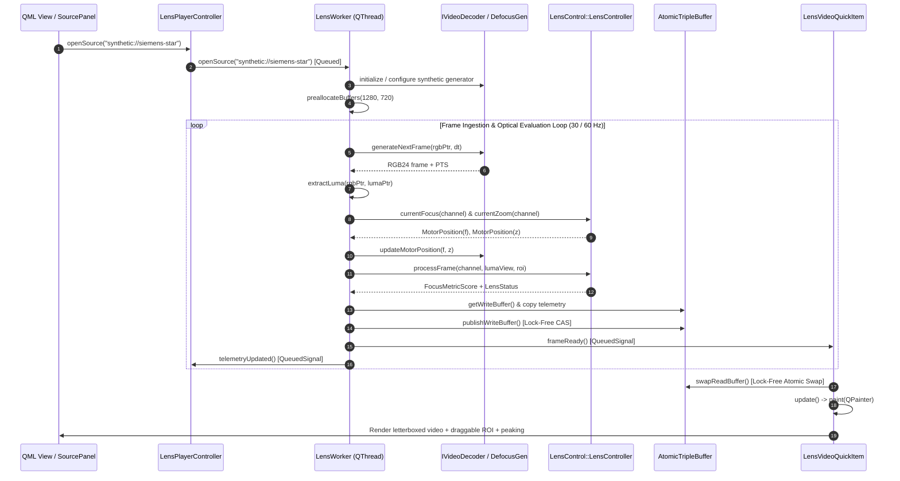

# Implementation Plan: `app-lens-qt` Phase 2 — Video Ingestion, Synthetic Defocus & Viewport QuickItem

## 1. Executive Summary & Objectives

### 1.1 Context & Scope
Phase 2 transforms **`app-lens-qt`** (executable target: **`LensAppQt`**) from a static tactical UI shell into a real-time, multi-modal optical streaming testbench. It integrates video decoding from diverse multimedia backends in [`libs/Video`](../libs/Video), introduces a specialized **`SyntheticDefocusGenerator`** that simulates optical point spread functions (PSF) and Circle of Confusion (CoC) defocus blur, implements lock-free frame transfer via [`AtomicTripleBuffer`](../libs/Video/AtomicTripleBuffer.h), and delivers a high-performance **`LensVideoQuickItem`** viewport with interactive Region of Interest (ROI) manipulation and focus peaking overlays.

To evaluate autofocus algorithms ([`AutoFocusEngine`](../libs/LensController/AutoFocusEngine.h)) and zero-heap focus sharpness metrics ([`FocusEvaluator`](../libs/LensController/FocusEvaluator.h)) without requiring continuous access to physical motorized optical hardware, Phase 2 implements a closed-loop optical simulation environment:
- As the simulated focus motor position moves relative to a target focal plane, procedural test patterns (Siemens Star, ISO 12233 chart, natural textured scene) blur dynamically in real time.
- The operator can interactively drag and resize the AF evaluation window directly on the video viewport.
- Real video streams (RTSP network cameras, local MP4/TS test clips, hardware DirectShow/V4L2 grabbers) can be ingested and displayed alongside synthetic streams at a solid $60\text{ fps}$.

### 1.2 Target Deliverables for Phase 2

| Deliverable | Target Files | Description |
| :--- | :--- | :--- |
| **Synthetic Defocus Generator** | [`app-lens-qt/SyntheticDefocusGenerator.h`](../app-lens-qt/SyntheticDefocusGenerator.h)<br>[`app-lens-qt/SyntheticDefocusGenerator.cpp`](../app-lens-qt/SyntheticDefocusGenerator.cpp) | Procedural optical defocus synthesizer implementing Circle of Confusion (CoC) blur proportional to motor displacement $|f - f_{\text{plane}}|$, optical zoom coupling, separable 1D Gaussian convolution, and additive sensor noise. |
| **Triple Buffer Frame Record** | [`app-lens-qt/LensFramePacket.h`](../app-lens-qt/LensFramePacket.h) | Zero-copy, pre-allocated frame container holding RGB24 display buffers, grayscale luma planes, presentation timestamps, frame identifiers, and accompanying optical telemetry snapshots. |
| **Background Decoding Loop** | [`app-lens-qt/LensWorker.h`](../app-lens-qt/LensWorker.h)<br>[`app-lens-qt/LensWorker.cpp`](../app-lens-qt/LensWorker.cpp) | High-priority background thread worker integrating `Video::IVideoDecoder` (`FFmpegDecoder`, `DeviceEnumerator`) and `SyntheticDefocusGenerator`, executing frame pacing, luma extraction, and optical engine feeds. |
| **Tactical Viewport QuickItem** | [`app-lens-qt/LensVideoQuickItem.h`](../app-lens-qt/LensVideoQuickItem.h)<br>[`app-lens-qt/LensVideoQuickItem.cpp`](../app-lens-qt/LensVideoQuickItem.cpp) | Custom `QQuickPaintedItem` presenting letterboxed video frames, an interactive draggable/resizable AF ROI box, real-time focus peaking shimmer overlays, center reticle, and coordinate grids. |
| **Controller ViewModel Bridging** | [`app-lens-qt/LensPlayerController.h`](../app-lens-qt/LensPlayerController.h)<br>[`app-lens-qt/LensPlayerController.cpp`](../app-lens-qt/LensPlayerController.cpp) | Extending the master ViewModel with media playback transport controls (`play`, `pause`, `stop`, `step`, `seek`), synthetic defocus configuration properties, and ROI geometry synchronization. |
| **QML Source Panel & HUD** | [`app-lens-qt/qml/SourcePanel.qml`](../app-lens-qt/qml/SourcePanel.qml)<br>[`app-lens-qt/qml/LensVideoView.qml`](../app-lens-qt/qml/LensVideoView.qml) | Tactical source selector (File, RTSP Stream, Hardware Device, Synthetic Simulator), playback scrub bar, and on-viewport HUD micro-readouts. |
| **Build & Test Infrastructure** | [`app-lens-qt/CMakeLists.txt`](../app-lens-qt/CMakeLists.txt)<br>[`tests/TestSyntheticDefocusGenerator.cpp`](../tests/TestSyntheticDefocusGenerator.cpp)<br>[`tests/TestLensVideoQuickItem.cpp`](../tests/TestLensVideoQuickItem.cpp)<br>[`tests/TestLensWorkerVideo.cpp`](../tests/TestLensWorkerVideo.cpp) | Subproject CMake build updates, automated unit test suites for defocus math, aspect-ratio letterboxing, and worker-consumer concurrency. |

---

## 2. Architecture & Concurrency Pipeline

### 2.1 Multi-Threaded Streaming Topology

The data streaming pipeline strictly decouples intensive video decoding, optical simulation, and focus metric calculations from the Qt Quick GUI presentation thread:
- **GUI Presentation Thread**: Handles user input, QML layout animations, mouse ROI dragging, and `LensVideoQuickItem::paint()` rendering. Frame swapping from the triple buffer occurs via single-word atomic exchange with zero mutex contention and zero blocking.
- **Dedicated Worker Thread (`LensWorker`)**: Runs on its own high-priority `QThread`. Ingests frames from `IVideoDecoder` or `SyntheticDefocusGenerator`, converts to grayscale luma, evaluates optical focus metrics via `LensController::processFrame()`, writes to the private triple-buffer slot, and publishes the slot atomically.

### ASCII Architecture Diagram

```
+-----------------------------------------------------------------------------------------------------------------------+
|                                              QT QUICK PRESENTATION THREAD                                             |
|                                                                                                                       |
|   +---------------------------------------------------------------+   +-------------------------------------------+   |
|   |                     LensPlayerController                      |   |            LensVideoQuickItem             |   |
|   |  - Play / Pause / Stop / Step / Seek Transport Controls       |   |  - swapReadBuffer() [Atomic Lock-Free]    |   |
|   |  - Synthetic Target Plane & Blur Parameter Dispatch           |   |  - QPainter letterbox aspect-ratio render |   |
|   |  - ROI Geometry (x, y, w, h) Normalization & Signals          |   |  - Interactive Draggable/Resizable AF ROI |   |
|   |  - Telemetry & Diagnostic Signal Emission to QML              |   |  - Focus Peaking Edge Shimmer Overlay     |   |
|   +-------------------------------│-------------------------------+   +---------------------▲---------------------+   |
|                                   │                                                         │                         |
+-----------------------------------|---------------------------------------------------------|-------------------------+
                                    │ Qt Queued Signal / Slot                                 │ Atomic Read Slot Swap
                                    ▼                                                         │
+---------------------------------------------------------------------------------------------|-------------------------+
|                                                DEDICATED OPTICAL WORKER THREAD              │                         |
|                                                                                             │                         |
|   +-----------------------------------------------------------------------------------------┴---------------------+   |
|   |                                                  LensWorker                                                   |   |
|   |                                                                                                               |   |
|   |   +-------------------------------------------------------------------------------------------------------+   |   |
|   |   |                                            Frame Ingestion                                            |   |   |
|   |   |   - Video::IVideoDecoder (FFmpegDecoder: Files / RTSP / Streams)                                      |   |   |
|   |   |   - Video::DeviceEnumerator (DirectShow / V4L2 Webcams & Capture Cards)                               |   |   |
|   |   |   - SyntheticDefocusGenerator (Siemens Star / ISO 12233 / Calibrated Optical Blur)                    |   |   |
|   |   |   - High-Precision Frame Pacer (std::chrono::steady_clock pacer for 30/60 fps playback)               |   |   |
|   |   +---------------------------------------------------│---------------------------------------------------+   |   |
|   |                                                       │ Raw RGB24 Video Frame                                 |   |
|   |                                                       ▼                                                       |   |
|   |   +-------------------------------------------------------------------------------------------------------+   |   |
|   |   |                                      Color Processing & Luma Extraction                               |   |   |
|   |   |   - Fast Integer Luma: Y = (77*R + 150*G + 29*B) >> 8 into pre-allocated lumaBuffer                   |   |   |
|   |   |   - Construct non-owning LensControl::FrameView(lumaData, width, height, stride)                       |   |   |
|   |   +---------------------------------------------------│---------------------------------------------------+   |   |
|   |                                                       │ Grayscale Luma FrameView                              |   |
|   |                                                       ▼                                                       |   |
|   |   +-------------------------------------------------------------------------------------------------------+   |   |
|   |   |                                     LensController (libs/LensController)                              |   |   |
|   |   |   - LensController::processFrame(activeChannel, lumaView, activeRoi)                                  |   |   |
|   |   |   - FocusEvaluator: 6 zero-heap sharpness metrics (Sobel, Laplacian, Tenengrad, Vollath, DCT)         |   |   |
|   |   |   - AutoFocusEngine: Closed-loop search algorithm step (Seek, 3-Phase, Golden, Momentum, DCT)         |   |   |
|   |   |   - ZoomTrackFocusEngine: Parfocal tracking compensation slew                                         |   |   |
|   |   |   - Output: LensStatus + FocusMetricScore snapshot                                                    |   |   |
|   |   +---------------------------------------------------│---------------------------------------------------+   |   |
|   |                                                       │ Populated LensFramePacket (RGB + Luma + Telemetry)    |   |
|   |                                                       ▼                                                       |   |
|   |   +-------------------------------------------------------------------------------------------------------+   |   |
|   |   |                              Video::AtomicTripleBuffer<LensFramePacket>                               |   |   |
|   |   |   - Slot A: Producer Write Slot (LensWorker exclusive)                                                |   |   |
|   |   |   - Slot B: Consumer Read Slot (LensVideoQuickItem exclusive)                                         |   |   |
|   |   |   - Slot C: Shared Intermediate Slot (Atomic CAS swap, lock-free)                                     |   |   |
|   |   |   - Worker calls publishWriteBuffer(), emits frameReady() signal                                      |   |   |
|   |   +-------------------------------------------------------------------------------------------------------+   |   |
|   +---------------------------------------------------------------------------------------------------------------+   |
+-----------------------------------------------------------------------------------------------------------------------+
```

### 2.2 Sequence Diagram: Ingestion, Defocus, Processing, and Rendering



---

## 3. Detailed Component Specifications

### 3.1 Synthetic Defocus Generator (`SyntheticDefocusGenerator`)

#### 3.1.1 Optical Physics & Circle of Confusion (CoC) Model
In a motorized camera lens, optical defocus occurs when the image sensor is placed at a distance from the lens that does not coincide with the conjugate image plane of the subject. 

Let:
- $f \in [0, 65535]$ be the current focus actuator encoder position.
- $f_{\text{plane}} \in [0, 65535]$ be the calibrated subject plane encoder coordinate.
- $\Delta f = f - f_{\text{plane}}$ be the signed motor focus error.
- $z \in [0, 65535]$ be the active optical zoom position ($0 = \text{Wide}$, $65535 = \text{Tele}$).

At telephoto zoom, the depth of field (DoF) is significantly narrower than at wide zoom; an identical motor step offset $|\Delta f|$ produces a substantially larger defocus blur circle at telephoto than at wide-angle settings.

The effective Gaussian blur radius $\sigma(f, z)$ in pixels is modeled by:
$$\sigma(f, z) = \text{std::clamp}\left(k_{\text{blur}} \cdot \frac{|\Delta f|}{65535.0\text{f}} \cdot \left(1.0\text{f} + \frac{z}{65535.0\text{f}} \cdot k_{\text{zoom}}\right), \; 0.0\text{f}, \; \sigma_{\max}\right)$$

Where:
- $k_{\text{blur}} \in [5.0, 50.0]$: Base optical defocus sensitivity factor (default: $24.0$).
- $k_{\text{zoom}} \in [0.0, 10.0]$: Telephoto DoF compression factor (default: $3.0$).
- $\sigma_{\max} = 16.0\text{f}$: Upper blur cutoff preventing excessive computational kernel radius.

When $\Delta f = 0$ ($f = f_{\text{plane}}$), $\sigma = 0.0$, producing an unblurred, pin-sharp optical image. As $|f - f_{\text{plane}}|$ increases symmetrically in either direction (near-focus or far-focus), $\sigma$ increases, causing the spatial high frequencies in the scene to be attenuated by the 2D Gaussian point spread function:
$$h(x, y; \sigma) = \frac{1}{2\pi \sigma^2} \exp\left(-\frac{x^2 + y^2}{2\sigma^2}\right)$$

#### 3.1.2 High-Performance Separable 1D Gaussian Convolution
A 2D Gaussian filter is separable: $h(x, y; \sigma) = g(x; \sigma) \cdot g(y; \sigma)$.
To maintain $60\text{ fps}$ throughput at $1280 \times 720$ resolution without memory allocation:
1. Compute 1D discrete Gaussian kernel:
   $$g[k] = \frac{1}{\sqrt{2\pi}\sigma} \exp\left(-\frac{k^2}{2\sigma^2}\right), \quad k \in [-R, R]$$
   Kernel radius $R = \min(\lceil 3\sigma \rceil, R_{\max})$, where $R_{\max} = 15$ (maximum kernel size $31$ taps).
2. Normalize coefficients so $\sum_{k=-R}^{R} g[k] = 1.0\text{f}$.
3. **Horizontal Pass**: Convolve the base image horizontally into a pre-allocated scratch buffer using mirrored boundary conditions.
4. **Vertical Pass**: Convolve the scratch buffer vertically into the final RGB destination buffer.

#### 3.1.3 Procedural Optical Test Patterns
The generator provides 3 selectable procedural targets:
1. **Siemens Star (`PatternType::SiemensStar`)**:
   - $N$ alternating black and white radial spokes radiating from the image center $(x_0, y_0)$.
   - Angle $\theta(x, y) = \text{atan2}(y - y_0, x - x_0) + \pi$.
   - Spatial frequency increases inversely with radius $r = \sqrt{(x - x_0)^2 + (y - y_0)^2}$, reaching the Nyquist frequency at the center core.
   - Ideal for validating monotonic sharpness metric drop-off as defocus increases.
2. **ISO 12233 Resolution Chart (`PatternType::IsoChart`)**:
   - Calibrated $5^\circ$ slanted edge squares, horizontal and vertical spatial resolution wedges, and concentric alignment circles.
   - Provides sharp step transitions that precisely measure Modulation Transfer Function (MTF) degradation under defocus.
3. **Natural Textured Scene (`PatternType::NaturalTexture`)**:
   - Multi-scale geometric structures, high-contrast text markers, and simulated terrain foliage.
   - Validates autocorrelation metrics ([`VollathCorrelationF4`](../libs/LensController/FocusEvaluator.h)) under complex multi-modal backgrounds.

#### 3.1.4 Secondary Optical Distortions
- **Sensor Noise Injection**: Additive zero-mean Gaussian noise $\mathcal{N}(0, \sigma_{\text{noise}}^2)$ added to each pixel, parameterized by $\sigma_{\text{noise}} \in [0.0, 20.0]$. Tests algorithm immunity to sensor grain (e.g., thermal LWIR or high-gain visible).
- **Vignetting**: Optical cosine falloff $V(r) = 1.0\text{f} - \alpha_{\text{vignette}} \cdot (r / r_{\max})^2$, where $r_{\max} = \sqrt{w^2 + h^2} / 2$.

#### 3.1.5 Class Header Definition (`SyntheticDefocusGenerator.h`)

```cpp
/// @file SyntheticDefocusGenerator.h
#pragma once

#include <cstddef>
#include <cstdint>

#include <random>
#include <vector>

namespace LensApp {

/// @enum DefocusPatternType
/// @brief Procedural target pattern rendered by the synthetic generator.
enum class DefocusPatternType : std::uint8_t {
    SiemensStar = 0U,
    IsoChart = 1U,
    NaturalTexture = 2U
};

/// @struct SyntheticDefocusConfig
/// @brief Configuration and calibration parameters for synthetic optical simulation.
struct SyntheticDefocusConfig {
    std::uint32_t width { 1280U };
    std::uint32_t height { 720U };
    double frameRate { 30.0 };

    DefocusPatternType pattern { DefocusPatternType::SiemensStar };
    std::uint16_t targetPlaneFocus { 32768U }; ///< Focus position where blur is zero
    float blurSensitivity { 24.0F };           ///< Defocus blur scaling factor
    float zoomCoupling { 3.0F };               ///< DoF narrowing factor with zoom
    float maxBlurSigma { 16.0F };              ///< Maximum Gaussian blur radius
    float noiseSigma { 1.5F };                 ///< Additive Gaussian noise stddev
    float vignetteFactor { 0.25F };            ///< Radial lens vignetting factor
    std::uint32_t prngSeed { 0x4C454E53U };    ///< Deterministic seed ("LENS")

    [[nodiscard]] constexpr bool isValid() const noexcept
    {
        return (width >= 64U) && (height >= 64U) && (frameRate > 0.0) &&
               (blurSensitivity > 0.0F) && (maxBlurSigma > 0.0F);
    }
};

/// @class SyntheticDefocusGenerator
/// @brief Generates procedural video frames with optical defocus blur and noise.
class SyntheticDefocusGenerator {
public:
    explicit SyntheticDefocusGenerator(const SyntheticDefocusConfig& config = { });
    ~SyntheticDefocusGenerator() = default;

    SyntheticDefocusGenerator(const SyntheticDefocusGenerator&) = delete;
    SyntheticDefocusGenerator& operator=(const SyntheticDefocusGenerator&) = delete;
    SyntheticDefocusGenerator(SyntheticDefocusGenerator&&) noexcept = default;
    SyntheticDefocusGenerator& operator=(SyntheticDefocusGenerator&&) noexcept = default;

    void setConfig(const SyntheticDefocusConfig& config);
    [[nodiscard]] const SyntheticDefocusConfig& config() const noexcept;

    void setTargetPlane(std::uint16_t focusPlane) noexcept;
    [[nodiscard]] std::uint16_t targetPlane() const noexcept;

    void updateMotorState(std::uint16_t focus, std::uint16_t zoom) noexcept;

    [[nodiscard]] double generateNextFrame(std::uint8_t* dstRgb, double dt);
    void reset() noexcept;

private:
    void renderBasePattern();
    void renderSiemensStar();
    void renderIsoChart();
    void renderNaturalTexture();
    void applySeparableBlur(std::uint8_t* dstRgb, float sigma);
    void applyNoiseAndVignette(std::uint8_t* dstRgb);

    SyntheticDefocusConfig config_ { };
    std::uint16_t currentFocus_ { 32768U };
    std::uint16_t currentZoom_ { 0U };
    double currentTimeSec_ { 0.0 };
    std::uint64_t frameIndex_ { 0U };

    std::mt19937 prng_ { };
    std::normal_distribution<float> normalDist_ { 0.0F, 1.0F };

    std::vector<std::uint8_t> basePattern_ { };   ///< Unblurred reference image (RGB24)
    std::vector<std::uint8_t> scratchBuffer_ { }; ///< Intermediate 1D blur buffer (RGB24)
};

} // namespace LensApp
```

---

### 3.2 Lock-Free Frame Record (`LensFramePacket`)

The `LensFramePacket` is the pre-allocated data container exchanged across the lock-free triple buffer primitive ([`Video::AtomicTripleBuffer`](../libs/Video/AtomicTripleBuffer.h)) between `LensWorker` (producer) and `LensVideoQuickItem` (consumer).

```cpp
/// @file LensFramePacket.h
#pragma once

#include <cstddef>
#include <cstdint>

#include <vector>

#include "LensTypes.h"

namespace LensApp {

/// @struct LensFramePacket
/// @brief Memory slot exchanged through AtomicTripleBuffer between worker and UI.
struct LensFramePacket {
    std::vector<std::uint8_t> rgbBuffer { };   ///< Packed RGB24 buffer (width * height * 3)
    std::vector<std::uint8_t> lumaBuffer { };  ///< Grayscale Y plane (width * height)
    std::uint32_t width { 0U };
    std::uint32_t height { 0U };
    std::uint32_t stride { 0U };               ///< Row byte stride (width * 3)
    double timestampSec { 0.0 };               ///< Presentation timestamp (PTS)
    std::uint64_t frameId { 0U };              ///< Monotonic frame sequence counter

    // Optical Telemetry Snapshot accompanying this specific video frame
    LensControl::LensStatus status { };
    LensControl::FocusMetricScore metricScore { };
    LensControl::NormalizedRoi activeRoi { };
    bool isSynthetic { false };
    float currentBlurSigma { 0.0F };

    /// @brief Pre-allocates buffer capacities to prevent heap allocations during streaming.
    /// @param w Target frame width in pixels.
    /// @param h Target frame height in pixels.
    void preallocate(std::uint32_t w, std::uint32_t h)
    {
        width = w;
        height = h;
        stride = w * 3U;
        const std::size_t rgbBytes = static_cast<std::size_t>(stride) * static_cast<std::size_t>(h);
        const std::size_t lumaBytes = static_cast<std::size_t>(w) * static_cast<std::size_t>(h);

        if (rgbBuffer.size() != rgbBytes) {
            rgbBuffer.assign(rgbBytes, 0U);
        }
        if (lumaBuffer.size() != lumaBytes) {
            lumaBuffer.assign(lumaBytes, 0U);
        }
    }
};

} // namespace LensApp
```

---

### 3.3 Optical Background Worker (`LensWorker`)

The `LensWorker` is extended to handle both hardware actuation and multimedia frame ingestion:

#### 3.3.1 Video Ingestion Pipeline
1. **Source URI Parsing**:
   - `file:///path/to/video.mp4` or local relative path: Instantiates `Video::FFmpegDecoder`.
   - `rtsp://<host>:<port>/stream`: Instantiates `Video::FFmpegDecoder` in network stream mode with TCP/UDP interleaved options.
   - `device://<name_or_index>`: Instantiates capture device via `Video::DeviceEnumerator`.
   - `synthetic://siemens-star` or `synthetic://iso-chart`: Activates `SyntheticDefocusGenerator`.
2. **Deterministic Frame Rate Pacing**:
   - For file and synthetic playback, `std::chrono::steady_clock` paces frame production to the source framerate ($30$ or $60\text{ fps}$) scaled by the playback speed multiplier ($0.25\times$ to $4.0\times$).
   - For live network and hardware capture streams, frames are consumed immediately upon decoder arrival.
3. **Luma Extraction & Focus Evaluation**:
   - Real-time integer conversion:
     $$Y = (77 \cdot R + 150 \cdot G + 29 \cdot B) \gg 8$$
   - Non-owning `LensControl::FrameView` wrapping the extracted luma buffer is passed to:
     `m_lensController.processFrame(m_activeChannel, lumaView, m_activeRoi);`
   - Real-time sharpness score is recorded into the frame packet.
4. **Triple-Buffer Publication**:
   - Populates write slot: `m_tripleBuffer.getWriteBuffer()`.
   - Swaps intermediate slot: `m_tripleBuffer.publishWriteBuffer()`.
   - Emits `frameReady()` signal via Qt queued connection to awaken `LensVideoQuickItem`.

#### 3.3.2 Updated Class Definition (`LensWorker.h`)

```cpp
/// @file LensWorker.h
#pragma once

#include <cstddef>
#include <cstdint>

#include <chrono>
#include <memory>
#include <string>

#include <QObject>
#include <QString>
#include <QTimer>

#include "AtomicTripleBuffer.h"
#include "IVideoDecoder.h"
#include "LensController.h"
#include "LensFramePacket.h"
#include "LensTypes.h"
#include "SyntheticDefocusGenerator.h"

namespace LensApp {

class LensWorker : public QObject {
    Q_OBJECT

public:
    explicit LensWorker(
        Video::AtomicTripleBuffer<LensFramePacket>& tripleBuffer,
        QObject* parent = nullptr);
    ~LensWorker() override;

    LensWorker(const LensWorker&) = delete;
    LensWorker& operator=(const LensWorker&) = delete;
    LensWorker(LensWorker&&) = delete;
    LensWorker& operator=(LensWorker&&) = delete;

    [[nodiscard]] bool isRunning() const noexcept;
    [[nodiscard]] int activeChannel() const noexcept;

public slots:
    void initWorker();
    void stopWorker();

    // Multimedia Ingestion Transport Slots (< 30 chars)
    void openSource(const QString& uri);
    void play();
    void pause();
    void stop();
    void stepFrame();
    void seek(double timestampSec);
    void setPlaybackRate(double rate);

    // Defocus Simulator Configuration (< 30 chars)
    void setSyntheticTarget(int focusPlane);
    void setSyntheticPattern(int pattern);
    void setSyntheticNoise(double sigma);

    // ROI Configuration (< 30 chars)
    void setRoi(double x, double y, double w, double h);

    // Optical Axis Commands (< 30 chars)
    void onSetActiveChannel(int channel);
    void onSetLensMode(int channel, int mode);
    void onMoveFocusStep(int channel, int steps);
    void onMoveZoomStep(int channel, int steps);
    void onSetFocusTarget(int channel, int position);
    void onSetZoomTarget(int channel, int position);
    void onSetFocusSpeed(int channel, int speed);
    void onSetZoomSpeed(int channel, int speed);
    void onStopMotion(int channel);
    void onEmergencyStop();

signals:
    void workerInitialized();
    void frameReady();
    void sourceOpened(int width, int height, double fps);
    void playbackStateChanged(int state);
    void statusUpdated(int focus, int zoom, int limits, int mode, bool afActive);
    void telemetryReady(double metricScore, int channel);
    void errorOccurred(const QString& message);

private slots:
    void processLoopTick();

private:
    void processVideoFrame();
    void updateSyntheticDefocus();
    void extractLuma(const std::uint8_t* rgb, std::uint8_t* luma, std::size_t pixels) noexcept;

    Video::AtomicTripleBuffer<LensFramePacket>& m_tripleBuffer;
    LensControl::LensController m_controller { };
    std::unique_ptr<Video::IVideoDecoder> m_decoder { nullptr };
    SyntheticDefocusGenerator m_defocusGen { };

    QTimer* m_timer { nullptr };
    int m_activeChannel { 0 };
    bool m_isRunning { false };
    bool m_isSynthetic { true };

    double m_playbackRate { 1.0 };
    std::chrono::steady_clock::time_point m_lastTickTime { };
    LensControl::NormalizedRoi m_activeRoi { 0.25F, 0.25F, 0.50F, 0.50F };
    std::uint64_t m_frameCounter { 0U };
};

} // namespace LensApp
```

---

### 3.4 Tactical Viewport QuickItem (`LensVideoQuickItem`)

The `LensVideoQuickItem` inherits from `QQuickPaintedItem` and provides zero-allocation rendering of video presentation with aspect-ratio letterboxing, interactive ROI manipulation, and focus peaking.

#### 3.4.1 Aspect-Ratio Letterbox & Pillarbox Math
To prevent visual distortion when displaying video of arbitrary aspect ratio ($W_v : H_v$) within a dynamically resized QML viewport item ($W_i \times H_i$):
1. Compute scale factor:
   $$s = \min\left(\frac{W_i}{W_v}, \; \frac{H_i}{H_v}\right)$$
2. Compute display rectangle dimensions:
   $$W_{\text{disp}} = s \cdot W_v, \quad H_{\text{disp}} = s \cdot H_v$$
3. Compute centering offsets:
   $$X_{\text{disp}} = \frac{W_i - W_{\text{disp}}}{2}, \quad Y_{\text{disp}} = \frac{H_i - H_{\text{disp}}}{2}$$
4. Letterbox bars (deep slate `#0a0c10`) fill the remainder of the item bounds.

#### 3.4.2 Interactive Region of Interest (ROI) State Machine
The focus evaluation ROI is maintained in normalized coordinates $(x, y, w, h) \in [0, 1]^4$ relative to the active video frame dimensions:
- **Display Coordinates**:
  $$X_{\text{screen}} = X_{\text{disp}} + x \cdot W_{\text{disp}}, \quad Y_{\text{screen}} = Y_{\text{disp}} + y \cdot H_{\text{disp}}$$
  $$W_{\text{screen}} = w \cdot W_{\text{disp}}, \quad H_{\text{screen}} = h \cdot H_{\text{disp}}$$
- **Mouse Interaction Modes**:
  1. `Hover / Inactive`: Cursor updates to `Qt::PointingHandCursor` when hovering inside ROI, or resizing arrows (`Qt::SizeFDiagCursor`, `Qt::SizeBDiagCursor`) when within $8\text{ px}$ of the 4 corner handles.
  2. `Dragging ROI`: Translates $(x, y)$ while maintaining $(w, h)$, clamped to $[0, 1 - w] \times [0, 1 - h]$.
  3. `Resizing Corner Handle`: Modifies $(w, h)$ with minimum dimension constraint $w_{\min} = h_{\min} = 0.05$ ($5\%$ of viewport).
  4. On mouse release, emits `roiMoved(x, y, w, h)`, immediately updating `LensWorker` and `AutoFocusEngine`.

#### 3.4.3 Real-Time Focus Peaking Edge Shimmer
Focus peaking visually highlights high-contrast edges in focus using a fast 3x3 Sobel operator:
- For pixels inside the active ROI (or whole frame if selected):
  $$G_x = (p_{x+1, y-1} + 2p_{x+1, y} + p_{x+1, y+1}) - (p_{x-1, y-1} + 2p_{x-1, y} + p_{x-1, y+1})$$
  $$G_y = (p_{x-1, y+1} + 2p_{x, y+1} + p_{x+1, y+1}) - (p_{x-1, y-1} + 2p_{x, y-1} + p_{x+1, y-1})$$
  $$\text{Magnitude} = |G_x| + |G_y|$$
- Pixels where $\text{Magnitude} > \text{Threshold}_{\text{peak}}$ are tinted with an intense semi-transparent emerald `#00e676` or cyan `#00e5ff` edge shimmer.

#### 3.4.4 Updated Class Definition (`LensVideoQuickItem.h`)

```cpp
/// @file LensVideoQuickItem.h
#pragma once

#include <cstdint>

#include <QColor>
#include <QImage>
#include <QMouseEvent>
#include <QPainter>
#include <QPointF>
#include <QQuickPaintedItem>
#include <QRectF>

#include "AtomicTripleBuffer.h"
#include "LensFramePacket.h"

namespace LensApp {

class LensPlayerController;

class LensVideoQuickItem : public QQuickPaintedItem {
    Q_OBJECT

    Q_PROPERTY(bool showPeaking READ showPeaking WRITE setShowPeaking NOTIFY showPeakingChanged)
    Q_PROPERTY(bool showGrid READ showGrid WRITE setShowGrid NOTIFY showGridChanged)
    Q_PROPERTY(bool showReticle READ showReticle WRITE setShowReticle NOTIFY showReticleChanged)
    Q_PROPERTY(bool showRoi READ showRoi WRITE setShowRoi NOTIFY showRoiChanged)
    Q_PROPERTY(QRectF roiRect READ roiRect WRITE setRoiRect NOTIFY roiRectChanged)
    Q_PROPERTY(LensPlayerController* controller READ controller WRITE setController NOTIFY controllerChanged)

public:
    explicit LensVideoQuickItem(QQuickItem* parent = nullptr);
    ~LensVideoQuickItem() override = default;

    LensVideoQuickItem(const LensVideoQuickItem&) = delete;
    LensVideoQuickItem& operator=(const LensVideoQuickItem&) = delete;
    LensVideoQuickItem(LensVideoQuickItem&&) = delete;
    LensVideoQuickItem& operator=(LensVideoQuickItem&&) = delete;

    void paint(QPainter* painter) override;

    [[nodiscard]] bool showPeaking() const noexcept;
    [[nodiscard]] bool showGrid() const noexcept;
    [[nodiscard]] bool showReticle() const noexcept;
    [[nodiscard]] bool showRoi() const noexcept;
    [[nodiscard]] QRectF roiRect() const noexcept;
    [[nodiscard]] LensPlayerController* controller() const noexcept;

public slots:
    void setShowPeaking(bool show);
    void setShowGrid(bool show);
    void setShowReticle(bool show);
    void setShowRoi(bool show);
    void setRoiRect(const QRectF& rect);
    void setController(LensPlayerController* ctrl);
    void onFrameReady();

signals:
    void showPeakingChanged();
    void showGridChanged();
    void showReticleChanged();
    void showRoiChanged();
    void roiRectChanged();
    void controllerChanged();
    void roiMoved(double x, double y, double w, double h);

protected:
    void mousePressEvent(QMouseEvent* event) override;
    void mouseMoveEvent(QMouseEvent* event) override;
    void mouseReleaseEvent(QMouseEvent* event) override;
    void hoverMoveEvent(QHoverEvent* event) override;

private:
    enum class DragHandle : std::uint8_t {
        None = 0U,
        InsideRoi,
        TopLeft,
        TopRight,
        BottomLeft,
        BottomRight
    };

    [[nodiscard]] QRectF calculateAspectFit(const QRectF& bounds, qreal videoW, qreal videoH) const noexcept;
    [[nodiscard]] DragHandle hitTestHandle(const QPointF& pos, const QRectF& screenRoi) const noexcept;
    void drawGrid(QPainter* painter, const QRectF& videoRect);
    void drawReticle(QPainter* painter, const QPointF& center);
    void drawRoi(QPainter* painter, const QRectF& screenRoi);
    void drawPeaking(QPainter* painter, const QRectF& videoRect, const LensFramePacket& packet);
    void drawHud(QPainter* painter, const QRectF& bounds, const LensFramePacket& packet);

    LensPlayerController* m_controller { nullptr };
    QRectF m_roiRect { 0.25, 0.25, 0.50, 0.50 }; ///< Normalized [0..1]
    bool m_showPeaking { false };
    bool m_showGrid { true };
    bool m_showReticle { true };
    bool m_showRoi { true };

    DragHandle m_activeHandle { DragHandle::None };
    QPointF m_dragStartPos { };
    QRectF m_initialRoiRect { };
};

} // namespace LensApp
```

---

### 3.5 ViewModel Transport Extension (`LensPlayerController`)

The `LensPlayerController` bridges QML source controls and playback commands to the `LensWorker`:

```cpp
// Media Source & Transport Properties added to LensPlayerController
Q_PROPERTY(QString sourceUri READ sourceUri WRITE setSourceUri NOTIFY sourceUriChanged)
Q_PROPERTY(int playbackState READ playbackState NOTIFY playbackStateChanged)
Q_PROPERTY(double currentFps READ currentFps NOTIFY telemetryUpdated)
Q_PROPERTY(double currentPts READ currentPts NOTIFY ptsChanged)
Q_PROPERTY(bool isSynthetic READ isSynthetic NOTIFY sourceModeChanged)
Q_PROPERTY(int syntheticPlane READ syntheticPlane WRITE setSyntheticPlane NOTIFY syntheticPlaneChanged)
Q_PROPERTY(double syntheticNoise READ syntheticNoise WRITE setSyntheticNoise NOTIFY syntheticNoiseChanged)

// Media Transport Slots (< 30 chars)
void openSource(const QString& uri);
void play();
void pause();
void stop();
void stepFrame();
void seek(double seconds);
void setPlaybackRate(double rate);
void setSyntheticPlane(int plane);
void setSyntheticNoise(double sigma);
void setRoi(double x, double y, double w, double h);
```

---

### 3.6 QML Tactical Source Panel (`qml/SourcePanel.qml`)

A tactical dark accordion panel docked on the left workspace providing 4 distinct source tabs:
1. **`[FILE]`**:
   - File path input box with browse button (`FileDialog` filtering `*.mp4 *.mkv *.ts *.avi`).
   - Quick-load buttons for bundled sample videos (`sample-videos/dji-ir-subtitles.mp4`).
2. **`[STREAM]`**:
   - RTSP URL combobox with recent history caching.
   - Transport selector (`TCP Interleaved` vs. `UDP Unicast`).
   - Connect / Disconnect tactical buttons.
3. **`[DEVICE]`**:
   - Capture device selector dropdown (DirectShow / V4L2).
   - Resolution dropdown ($1920\times1080$, $1280\times720$, $640\times480$).
4. **`[SYNTHETIC]`**:
   - Pattern picker: `Siemens Star`, `ISO 12233 Chart`, `Natural Scene`.
   - Subject Plane Slider: $0..65535$ encoder steps (controls $f_{\text{plane}}$).
   - Sensor Noise Amplitude Slider: $0.0 .. 20.0$.
   - Optical Zoom Coupling Toggle: Enables telephoto DoF compression.
5. **Playback Transport Toolbar**:
   - Play / Pause toggle with pulse glowing state.
   - Stop & Step Forward/Backward $\pm 1$ frame buttons.
   - Timeline scrubber slider displaying `00:01:23.450 / 00:05:00.000`.
   - Playback speed chips ($0.25\times, 0.5\times, 1.0\times, 2.0\times, 4.0\times$).

---

## 4. Detailed Work Breakdown Structure (WBS)

### Step 1: Implement `SyntheticDefocusGenerator`
- Create `app-lens-qt/SyntheticDefocusGenerator.h` and `app-lens-qt/SyntheticDefocusGenerator.cpp`.
- Implement procedural pattern generators (`SiemensStar`, `IsoChart`, `NaturalTexture`).
- Implement separable 1D horizontal and vertical Gaussian convolution with mirrored boundaries.
- Implement noise injection and radial vignetting falloff.
- Verify zero dynamic heap allocation in `generateNextFrame()`.

### Step 2: Implement `LensFramePacket` & Triple-Buffer Infrastructure
- Create `app-lens-qt/LensFramePacket.h` defining the frame container with pre-allocated RGB24 and luma buffers.
- Wire `Video::AtomicTripleBuffer<LensFramePacket>` into `LensPlayerController` and `LensWorker`.
- Expose buffer accessors and thread-safe signal bindings.

### Step 3: Extend `LensWorker` Video Ingestion Loop
- Update `app-lens-qt/LensWorker.h` and `app-lens-qt/LensWorker.cpp`.
- Integrate `Video::IVideoDecoder` (`FFmpegDecoder`, `DeviceEnumerator`) and `SyntheticDefocusGenerator`.
- Implement fast integer luma extraction: $Y = (77R + 150G + 29B) \gg 8$.
- Feed luma frame views to `LensController::processFrame(activeChannel, lumaView, roi)`.
- Implement frame rate pacing using `std::chrono::steady_clock`.

### Step 4: Enhance `LensVideoQuickItem` Viewport Presentation
- Update `app-lens-qt/LensVideoQuickItem.h` and `app-lens-qt/LensVideoQuickItem.cpp`.
- Implement aspect-ratio preserving letterbox / pillarbox math (`calculateAspectFit`).
- Implement mouse hover, drag, and 4-corner resize state machine for the AF ROI box.
- Implement 3x3 Sobel focus peaking edge shimmer overlay.
- Implement viewport HUD overlay (resolution, FPS, active frame ID, metric score).

### Step 5: Extend `LensPlayerController` ViewModel
- Update `app-lens-qt/LensPlayerController.h` and `app-lens-qt/LensPlayerController.cpp`.
- Expose playback transport properties (`playbackState`, `sourceUri`, `currentFps`, `currentPts`).
- Expose synthetic defocus parameters (`syntheticPlane`, `syntheticNoise`).
- Implement queued command dispatching to `LensWorker`.

### Step 6: Create QML Tactical Source Panel & Viewport HUD
- Create `app-lens-qt/qml/SourcePanel.qml` with 4 source tabs (File, Stream, Device, Synthetic) and playback scrubber.
- Update `app-lens-qt/qml/LensVideoView.qml` to embed the new interactive `LensVideoQuickItem`.
- Update `app-lens-qt/qml/Main.qml` layout to host `SourcePanel` on the collapsible left dock.
- Update `app-lens-qt/qml.qrc` with new QML resources.

### Step 7: Update Subproject CMake Build
- Update `app-lens-qt/CMakeLists.txt` to include `SyntheticDefocusGenerator.h`, `SyntheticDefocusGenerator.cpp`, and `LensFramePacket.h`.
- Verify clean compilation with zero warnings under `-Wall -Wextra -pedantic` and `/W4`.

### Step 8: Author Automated Verification Test Suites
- Create `tests/TestSyntheticDefocusGenerator.cpp`:
  * Validates sharpness peak occurs precisely when $f = f_{\text{plane}}$.
  * Validates monotonic sharpness drop-off with increasing $|f - f_{\text{plane}}|$.
  * Validates telephoto zoom narrowing depth of field.
- Create `tests/TestLensVideoQuickItem.cpp`:
  * Validates letterbox aspect-ratio math across $16:9$, $4:3$, and vertical aspect ratios.
  * Validates normalized ROI drag and resize bounding constraints.
- Create `tests/TestLensWorkerVideo.cpp`:
  * Validates thread-safe triple-buffer frame publishing and pacing at $30\text{ fps}$.

---

## 5. Verification, Safety & Standards Compliance

### 5.1 Standards Compliance Matrix

| Standard | Rule / Identifier | Enforcement in Phase 2 |
| :--- | :--- | :--- |
| **MISRA C++:2023** | Rule 7.0.6 | All pixel conversions (RGB to luma, float coordinates to integer pixels) use explicit, range-checked `static_cast`. |
| **SEI CERT C++** | INT31-C | Integer conversions between motor encoder counts (`uint16_t`) and coordinate arithmetic prevent overflow or sign inversion. |
| **SEI CERT C++** | STR37-C | URI scheme parsing (`synthetic://`, `file://`, `rtsp://`) uses deterministic ASCII string comparisons, never `<cctype>` functions on signed `char`. |
| **SEI CERT C++** | ERR55-CPP | Video frame generation, luma extraction, and triple-buffer swapping execute under `noexcept` with **zero dynamic heap allocation**. |
| **Project Rules** | Primitive Obsession | Optical coordinates are encapsulated in `MotorPosition` and `NormalizedRoi`, never ambiguous raw primitives. |
| **Project Rules** | IWYU & `<cstdint>` | Every file directly includes required headers; all integers explicitly qualified via `std::` (`std::uint8_t`, `std::uint32_t`). |
| **Project Rules** | Function Length | All newly introduced function and slot names are strictly less than 30 characters. |
| **Project Rules** | Relative Paths | All documentation links and code file references use relative paths without leading slashes. |

### 5.2 Automated Audit Verification Commands

```bash
# Verify relative documentation paths
python scripts/verify_relative_doc_paths.py --files docs/app_lens_qt_phase2_plan.md docs/app_lens_qt_implementation_plan.md

# Verify IWYU and <cstdint> rules across new Phase 2 files
python scripts/verify_iwyu_cstdint.py --files app-lens-qt/SyntheticDefocusGenerator.h app-lens-qt/SyntheticDefocusGenerator.cpp app-lens-qt/LensFramePacket.h app-lens-qt/LensVideoQuickItem.h app-lens-qt/LensVideoQuickItem.cpp app-lens-qt/LensWorker.h app-lens-qt/LensWorker.cpp

# Verify function name length compliance (< 30 characters)
python scripts/verify_function_lengths.py --files app-lens-qt/SyntheticDefocusGenerator.h app-lens-qt/LensVideoQuickItem.h app-lens-qt/LensWorker.h
```

---

## 6. Acceptance Criteria

Before concluding Phase 2, the implementation must satisfy all of the following criteria:

- [ ] **Procedural Defocus Peak**: `SyntheticDefocusGenerator` generates a measurable focus metric peak at $f = f_{\text{plane}}$ that decreases monotonically with motor displacement $\Delta f$.
- [ ] **Stable 60 FPS Ingestion**: Video playback (both synthetic simulator and video files) sustains a steady $60\text{ fps}$ without frame drops or UI stuttering.
- [ ] **Zero Dynamic Heap Allocations**: No calls to `malloc`, `new`, `std::vector::reserve`, or reallocation during steady-state frame decoding or rendering.
- [ ] **Letterbox Fidelity**: Video viewport displays correct aspect-ratio letterboxing/pillarboxing for $16:9$, $4:3$, and custom video sizes.
- [ ] **Interactive ROI Manipulation**: Operator can smoothly click and drag the AF ROI box across the viewport, resize via 4 corner handles, and witness immediate ROI clamping within $[0, 1]^2$.
- [ ] **Focus Peaking Shimmer**: Edge highlights overlay sharply onto in-focus features with zero CPU lockup or frame pacing degradation.
- [ ] **Unit Tests Passing**: All automated tests in `tests/TestSyntheticDefocusGenerator.cpp`, `tests/TestLensVideoQuickItem.cpp`, and `tests/TestLensWorkerVideo.cpp` pass with 100% success.

