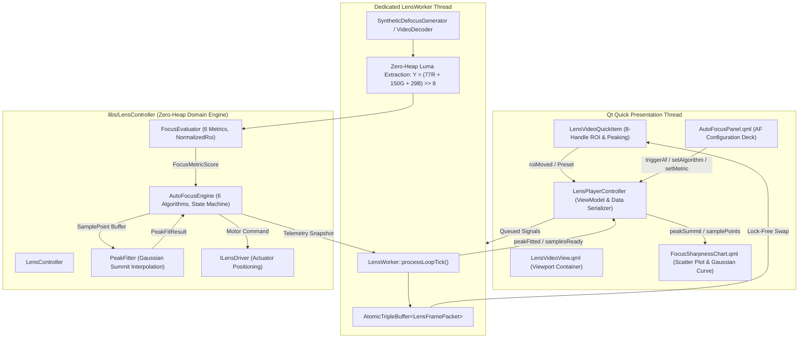
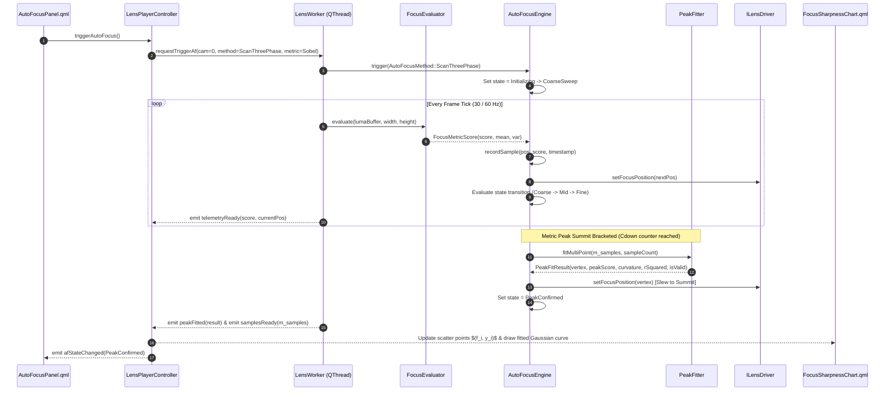
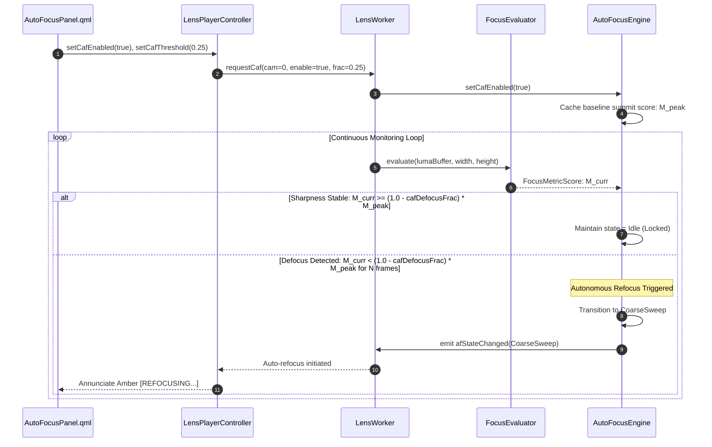
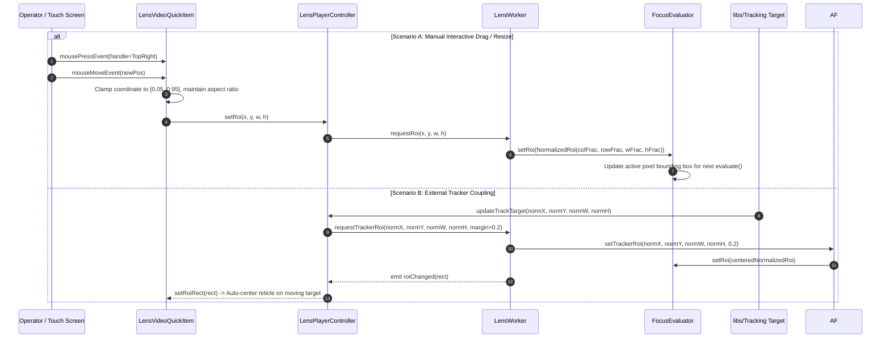

# Implementation Plan: `app-lens-qt` Phase 4 — Autofocus (AF) Testing Laboratory & Interactive ROI

## 1. Executive Summary & Objectives

### 1.1 Context & Scope
Phase 4 transforms **`app-lens-qt`** (executable target: **`LensAppQt`**) into an advanced, laboratory-grade optical evaluation workstation and autofocus testing suite. Building directly upon the multimedia and synthetic defocus pipeline delivered in Phase 2 ([`app_lens_qt_phase2_plan.md`](app_lens_qt_phase2_plan.md)) and the bidirectional optical axis controls deployed in Phase 3 ([`app_lens_qt_phase3_plan.md`](app_lens_qt_phase3_plan.md)), Phase 4 integrates the full power of the core optical intelligence from [`libs/LensController`](../libs/LensController).

Phase 4 equips optical engineers, system integrators, and testbench operators with:
1. **Multi-Algorithm Closed-Loop Autofocus**: Full parameterization and real-time execution across 6 distinct search algorithms ([`AutoFocusMethod`](../libs/LensController/LensTypes.h)):
   - **Sightline Classic Seek** (`SeekAdaptive`): Adaptive direction flipping upon metric decline with dynamic `RateAdjust`.
   - **Sightline 3-Phase Scan** (`ScanThreePhase`): Coarse $\rightarrow$ Mid $\rightarrow$ Fine sweeps with calibrated threshold gating.
   - **Golden Section Search** (`GoldenSection`): Logarithmic unimodal peak convergence.
   - **Adaptive Momentum** (`AdaptiveMomentum`): Variable step hill-climbing with actuator backlash compensation.
   - **DCT Frequency AC Energy** (`DctFrequency`): 2D 8x8 DCT high-frequency peak search.
   - **Native Block Camera Driver** (`BuiltInDriver`): Direct commands to Sony FCB-EV/CV VISCA or Pelco-D optical block hardware.
2. **Zero-Heap Sharpness Metric Selection**: Dynamic runtime selection across 6 spatial and frequency evaluation metrics executed by [`FocusEvaluator`](../libs/LensController/FocusEvaluator.h) (`SobelGradientSquared`, `DiscreteLaplacian`, `TenengradThreshold`, `VollathCorrelationF4`, `VollathCorrelationF5`, `DctHighFrequency`).
3. **Autonomous & Continuous AF Operating Modes**:
   - `AutoFocusOnce`: Single-shot trigger executing monotonic sweep, vertex peak fitting, and precision motor parking at the summit coordinate.
   - `AutoFocusContinuous` (CAF): Scene monitoring loop detecting defocus when sharpness drops below a configured fraction ($\Delta M / M_{\max} > \text{cafDefocusFrac}$) for $N$ consecutive frames, triggering autonomous re-sweep.
   - `ManualJog`: Instant optical disengagement returning control to operator jog wheels.
4. **Interactive Multi-Handle Dynamic ROI**:
   - Aspect-ratio safe, 8-handle (4 corners + 4 edge midpoints) interactive ROI manipulation directly on the live video viewport in [`LensVideoQuickItem`](../app-lens-qt/LensVideoQuickItem.h).
   - Invariant boundary clamping enforcing unit containment $[0..255]$ (`NormalizedRoi`).
   - One-click tactical ROI presets: Full Frame ($100\%$), Center Box ($50\%$), Center Spot ($25\%$), Lower Third ($33\%$), Upper Third ($33\%$).
   - Dynamic Tracker Coupling: Ingests bounding box coordinates from [`libs/Tracking`](../libs/Tracking), auto-centering the optical focus evaluation window onto moving targets.
5. **Real-Time Focus Peaking Edge Shimmer**:
   - Zero-allocation edge-detection shader/painter overlay highlighting in-focus high-gradient edges in tactical Emerald (`#00e676`), Cyan (`#00e5ff`), or Coral (`#ff1744`).
   - Operator-adjustable gradient sensitivity threshold.
6. **Real-Time Sharpness Peak Fitting & Telemetry Chart (`FocusSharpnessChart.qml`)**:
   - High-performance scatter plot displaying recorded sample points $(f_i, \text{score}_i)$ during active sweep.
   - Real-time overlay of mathematical Gaussian and Parabolic curves fitted by [`PeakFitter`](../libs/LensController/PeakFitter.h).
   - Readouts for summit encoder vertex, peak height, Full-Width-at-Half-Maximum (FWHM), quadratic curvature, and goodness-of-fit $R^2$.

### 1.2 Target Deliverables for Phase 4

| Deliverable | Target Files | Description |
| :--- | :--- | :--- |
| **Interactive ROI Enhancements** | [`app-lens-qt/LensVideoQuickItem.h`](../app-lens-qt/LensVideoQuickItem.h)<br>[`app-lens-qt/LensVideoQuickItem.cpp`](../app-lens-qt/LensVideoQuickItem.cpp) | 8-point drag/resize handles, aspect-ratio safe mapping, unit boundary clamping, `NormalizedRoi` synchronization, and tracker box auto-centering. |
| **Focus Peaking Shimmer Engine** | [`app-lens-qt/LensVideoQuickItem.h`](../app-lens-qt/LensVideoQuickItem.h)<br>[`app-lens-qt/LensVideoQuickItem.cpp`](../app-lens-qt/LensVideoQuickItem.cpp) | Subsampled 3x3 Sobel edge filter on 8-bit luma buffers, configurable sensitivity threshold, and tactical palette selection. |
| **Focus Sharpness & Peak Fit Chart** | [`app-lens-qt/qml/FocusSharpnessChart.qml`](../app-lens-qt/qml/FocusSharpnessChart.qml) | Real-time Canvas / Shape scatter plot rendering recorded $(f_i, \text{score}_i)$ samples, Gaussian fitted curve, summit reticle, and telemetry HUD. |
| **Master Autofocus Control Deck** | [`app-lens-qt/qml/AutoFocusPanel.qml`](../app-lens-qt/qml/AutoFocusPanel.qml) | Tactical panel uniting Algorithm & Metric selectors, One-Shot / CAF toggles, speed sliders, backlash settings, ROI preset buttons, and live AF state annunciator. |
| **Workspace Tab Navigation** | [`app-lens-qt/qml/Main.qml`](../app-lens-qt/qml/Main.qml)<br>[`app-lens-qt/qml/LensVideoView.qml`](../app-lens-qt/qml/LensVideoView.qml) | Right-panel navigation tabs (`[AXIS CONTROL]` vs `[AUTOFOCUS LAB]`) and collapsible bottom drawer housing `FocusSharpnessChart.qml`. |
| **ViewModel AF Orchestration** | [`app-lens-qt/LensPlayerController.h`](../app-lens-qt/LensPlayerController.h)<br>[`app-lens-qt/LensPlayerController.cpp`](../app-lens-qt/LensPlayerController.cpp) | Properties, slots, and signals for AF triggering, algorithm/metric selection, CAF parameters, ROI presets, peak fit telemetry, and sample point list serialization. |
| **Worker Closed-Loop Integration** | [`app-lens-qt/LensWorker.h`](../app-lens-qt/LensWorker.h)<br>[`app-lens-qt/LensWorker.cpp`](../app-lens-qt/LensWorker.cpp) | Wires `onTriggerAf`, `onAbortAf`, `onSetRoi`, `onSetCaf`, harvest samples from `AutoFocusEngine`, executes `PeakFitter`, and emits non-blocking telemetry. |
| **Build System & Resource Manifest** | [`app-lens-qt/CMakeLists.txt`](../app-lens-qt/CMakeLists.txt)<br>[`app-lens-qt/qml.qrc`](../app-lens-qt/qml.qrc) | Registers `AutoFocusPanel.qml` and `FocusSharpnessChart.qml` into Qt resource compilation. |
| **Automated Test Suites** | [`tests/TestLensAutoFocus.cpp`](../tests/TestLensAutoFocus.cpp)<br>[`tests/TestLensRoiPeaking.cpp`](../tests/TestLensRoiPeaking.cpp) | Comprehensive automated unit test suites covering AF state transitions, CAF re-sweep triggering, peak fit telemetry serialization, and ROI normalization. |

---

## 2. Architecture & Subsystem Pipeline

### 2.1 Multi-Threaded Closed-Loop AF Pipeline

The autofocus laboratory operates across a strict multi-threaded boundary:
- **Presentation Thread (Qt Quick / QML)**: Captures interactive ROI drag/resize events on the viewport, handles preset clicks, updates `FocusSharpnessChart.qml` at presentation framerates, and displays the state machine status badge.
- **ViewModel Orchestrator (`LensPlayerController`)**: Manages active algorithm and metric settings, validates ROI geometries, clamps CAF thresholds, and serializes recorded $(f_i, \text{score}_i)$ point arrays for QML charting.
- **Optical Worker Thread (`LensWorker`)**: Ingests video frames from `IVideoDecoder` or `SyntheticDefocusGenerator`, converts RGB to 8-bit luma, evaluates optical sharpness via `FocusEvaluator` inside `NormalizedRoi` with zero heap allocations under `noexcept`, advances `AutoFocusEngine`, and computes Gaussian peak fits via `PeakFitter`.

### 2.2 ASCII Architecture Diagram

```
+-------------------------------------------------------------------------------------------------------------------------------+
|                                                 QT QUICK PRESENTATION THREAD                                                  |
|                                                                                                                               |
|   +---------------------------------------------------+   +---------------------------------------------------------------+   |
|   |            LensVideoView.qml (Center)             |   |                  AutoFocusPanel.qml (Right)                   |   |
|   |  - LensVideoQuickItem (QQuickPaintedItem)         |   |  - Algorithm Dropdown: Seek, 3-Phase, Golden, Momentum, DCT   |   |
|   |    * 8-Point Draggable / Resizable ROI Reticle    |   |  - Focus Metric Dropdown: Sobel, Laplacian, Tenengrad, Vollath|   |
|   |    * Focus Peaking Shimmer (Threshold Slider)     |   |  - One-Shot [TRIGGER AF] / [ABORT] Pushbuttons                |   |
|   |  - Collapsible Bottom Drawer:                     |   |  - Continuous AF (CAF) Toggle & Defocus Fraction Slider       |   |
|   |    * FocusSharpnessChart.qml (Scatter + Gaussian) |   |  - ROI Preset Buttons: [FULL] [CENTER 50%] [SPOT 25%] [L/U 33%|   |
|   |    * Vertex, FWHM, Curvature, R^2 Numerical Readout|   |  - State Annunciator Badge: COARSE -> MID -> FINE -> SLEW     |   |
|   +---------------------------------------------------+   +---------------------------------------------------------------+   |
|                             │ ROI Drag / Click                            │ Slots & Property Bindings                         |
|                             ▼                                             ▼                                                   |
|   +-----------------------------------------------------------------------------------------------------------------------+   |
|   |                                                  LensPlayerController                                                 |   |
|   |  - Exposes Q_PROPERTY: isAfRunning, afState, peakSummit, peakScore, peakFwhm, peakR2, samplePoints                   |   |
|   |  - Normalizes QRectF <-> NormalizedRoi [0..255]                                                                       |   |
|   |  - Dispatches non-blocking signals to background worker: requestTriggerAf, requestAbortAf, requestRoi, requestCaf     |   |
|   +-----------------------------------------------------------│-----------------------------------------------------------+   |
+---------------------------------------------------------------|---------------------------------------------------------------+
                                                                │ Queued Signal / Slot Transfer
                                                                ▼
+-------------------------------------------------------------------------------------------------------------------------------+
|                                                DEDICATED OPTICAL WORKER THREAD                                                |
|                                                                                                                               |
|   +-----------------------------------------------------------------------------------------------------------------------+   |
|   |                                                        LensWorker                                                     |   |
|   |                                                                                                                       |   |
|   |   +---------------------------------------------------------------------------------------------------------------+   |   |
|   |   |                                 Video Ingestion & Zero-Heap Luma Extraction                                   |   |   |
|   |   |  - SyntheticDefocusGenerator (Blur radius ~ |f - f_plane|) OR FFmpegDecoder / DirectShow                       |   |   |
|   |   |  - Fast integer RGB -> Luma: Y = (77*R + 150*G + 29*B) >> 8 (no dynamic heap allocations)                     |   |   |
|   |   +-------------------------------------------------------│-------------------------------------------------------+   |   |
|   |                                                           │ 8-bit Grayscale Luma + NormalizedRoi                      |   |   |
|   |                                                           ▼                                                           |   |
|   |   +---------------------------------------------------------------------------------------------------------------+   |   |
|   |   |                                  libs/LensController (Optical Closed-Loop Engine)                             |   |   |
|   |   |                                                                                                               |   |   |
|   |   |   +---------------------------------------+               +-----------------------------------------------+   |   |   |
|   |   |   |            FocusEvaluator             |               |                AutoFocusEngine                |   |   |   |
|   |   |   |  - Zero-heap kernel evaluation inside |               |  - State Machine: Coarse -> Mid -> Fine Sweep |   |   |   |
|   |   |   |    NormalizedRoi boundary             |──────────────►|  - Records SamplePoint(pos, score, time)      |   |   |   |
|   |   |   |  - Sobel / Laplacian / Vollath / DCT  |  MetricScore  |  - Step logic: Seek, 3-Phase, Golden, Momentum|   |   |   |
|   |   |   +---------------------------------------+               +-----------------------│-----------------------+   |   |   |
|   |   |                                                                                   │ Finished Sweep            |   |   |
|   |   |                                                                                   ▼                           |   |   |
|   |   |                                                           +-----------------------------------------------+   |   |   |
|   |   |                                                           |                  PeakFitter                   |   |   |   |
|   |   |                                                           |  - Multi-point Gaussian / Parabolic fit       |   |   |   |
|   |   |                                                           |  - Vertex = -b/(2a), FWHM, R^2, Curvature     |   |   |   |
|   |   |                                                           +-----------------------│-----------------------+   |   |   |
|   |   |                                                                                   │ Telemetry Snapshot        |   |   |
|   |   |                                                                                   ▼                           |   |   |
|   |   +-----------------------------------------------------------------------------------+---------------------------+   |   |
|   |                                                           │                                                           |   |
|   |                                                           ▼ FramePacket + AfTelemetry                                 |   |
|   |   +---------------------------------------------------------------------------------------------------------------+   |   |
|   |   |                             AtomicTripleBuffer<LensFramePacket> (Lock-Free Exchange)                          |   |   |
|   |   +---------------------------------------------------------------------------------------------------------------+   |   |
|   +-----------------------------------------------------------------------------------------------------------------------+   |
+-------------------------------------------------------------------------------------------------------------------------------+
```

### 2.3 Mermaid Architecture Diagram



### 2.4 Sequence Diagrams

#### 2.4.1 One-Shot Autofocus Cycle & Peak Fitting



#### 2.4.2 Continuous Autofocus (CAF) Defocus Monitoring & Auto-Refocus



#### 2.4.3 Interactive ROI Dragging & External Tracker Target Coupling



---

## 3. Mathematical Models & Peak Interpolation

### 3.1 Peak Fitting Mathematics

During an optical autofocus sweep, discrete focus positions $z_i$ and corresponding sharpness metrics $M_i$ are recorded: $(z_i, M_i)$ for $i \in [0, N-1]$.

#### 3.1.1 Parabolic 3-Point Summit Interpolation
Given three points $(z_1, M_1), (z_2, M_2), (z_3, M_3)$ centered around the discrete summit $M_2 \ge M_1$ and $M_2 \ge M_3$ with uniform step $h = z_2 - z_1 = z_3 - z_2$:
$$\Delta z = \frac{h}{2} \cdot \frac{M_1 - M_3}{M_1 - 2M_2 + M_3}$$
The interpolated vertex position $z_v$ and summit score $M_v$ are:
$$z_v = z_2 + \Delta z$$
$$M_v = M_2 - \frac{1}{8} \cdot \frac{(M_1 - M_3)^2}{M_1 - 2M_2 + M_3}$$
The curvature parameter $a = \frac{M_1 - 2M_2 + M_3}{2h^2} < 0$ confirms strict convexity.

#### 3.1.2 Gaussian 3-Point Summit Interpolation
Optical blur models approximate a Gaussian Point Spread Function (PSF). Assuming $M(z) = A \exp\left(-\frac{(z - \mu)^2}{2\sigma^2}\right)$, taking natural logarithms yields a parabola in logarithmic space: $y_i = \ln(M_i)$:
$$y_i = \alpha z_i^2 + \beta z_i + \gamma$$
$$\Delta z = \frac{h}{2} \cdot \frac{\ln(M_1) - \ln(M_3)}{\ln(M_1) - 2\ln(M_2) + \ln(M_3)}$$
$$\mu = z_2 + \Delta z$$
The Gaussian standard deviation $\sigma$ and Full-Width-at-Half-Maximum (FWHM) are:
$$\sigma = \sqrt{\frac{-h^2}{2(\ln(M_1) - 2\ln(M_2) + \ln(M_3))}}$$
$$\text{FWHM} = 2\sqrt{2\ln 2} \cdot \sigma \approx 2.35482 \cdot \sigma$$

#### 3.1.3 Multi-Point Goodness-of-Fit Coefficient ($R^2$)
For $K$ sample points around the peak, goodness-of-fit is computed as:
$$R^2 = 1 - \frac{\sum_{i=1}^K (M_i - \hat{M}_i)^2}{\sum_{i=1}^K (M_i - \bar{M})^2}$$
where $\hat{M}_i$ is the evaluated model curve value and $\bar{M}$ is the sample mean. A fit is accepted as valid when $R^2 \ge 0.85$.

---

## 4. Detailed Component Specifications

### 4.1 Enhanced Interactive ROI in `LensVideoQuickItem`

[`LensVideoQuickItem`](../app-lens-qt/LensVideoQuickItem.h) is upgraded with an 8-handle interaction system and tracker target synchronization:
- **8 Drag Handles**: TopLeft, TopCenter, TopRight, MiddleLeft, MiddleRight, BottomLeft, BottomCenter, BottomRight, plus InsideRoi for panning.
- **Visual Corner & Edge Brackets**: Tactical glowing Emerald brackets with handle grips and dimension tags (`AF ROI [50% x 50%]`).
- **Normalized Invariant Bounds**: Converts viewport screen coordinates to fractional unit coordinates $[0.0, 1.0]$ and clamps to minimum dimension ($0.05 \times 0.05$).
- **Preset Integration**: Supports programmatic assignment from one-click presets without mouse dragging.

```cpp
/// @file LensVideoQuickItem.h (Excerpts for Phase 4)
#pragma once

#include <cstdint>
#include <QQuickPaintedItem>
#include <QRectF>

namespace LensApp {

class LensVideoQuickItem : public QQuickPaintedItem {
    Q_OBJECT
    Q_PROPERTY(bool showPeaking READ showPeaking WRITE setShowPeaking NOTIFY showPeakingChanged)
    Q_PROPERTY(int peakingThreshold READ peakingThreshold WRITE setPeakingThreshold NOTIFY peakingThresholdChanged)
    Q_PROPERTY(int peakingColorIndex READ peakingColorIndex WRITE setPeakingColorIndex NOTIFY peakingColorChanged)
    Q_PROPERTY(bool showRoi READ showRoi WRITE setShowRoi NOTIFY showRoiChanged)
    Q_PROPERTY(QRectF roiRect READ roiRect WRITE setRoiRect NOTIFY roiRectChanged)
    Q_PROPERTY(bool isRoiLockedToTrack READ isRoiLockedToTrack NOTIFY trackerLockChanged)

public:
    enum class DragHandle : std::uint8_t {
        None = 0U,
        InsideRoi,
        TopLeft,
        TopCenter,
        TopRight,
        MiddleLeft,
        MiddleRight,
        BottomLeft,
        BottomCenter,
        BottomRight
    };

    explicit LensVideoQuickItem(QQuickItem* parent = nullptr);
    ~LensVideoQuickItem() override = default;

public slots:
    void setPeakingThreshold(int thresh);
    void setPeakingColorIndex(int idx);
    void applyRoiPreset(int presetIndex); // 0=Full, 1=Center50, 2=Spot25, 3=LowerThird, 4=UpperThird
    void setTrackerTargetBox(double nx, double ny, double nw, double nh);

signals:
    void peakingThresholdChanged();
    void peakingColorChanged();
    void trackerLockChanged();
    void roiMoved(double x, double y, double w, double h);
};

} // namespace LensApp
```

### 4.2 Focus Peaking Edge Shimmer Engine

Operates on 8-bit luma buffers using a separable, integer-only Sobel approximation with threshold gating:
- **Zero-Heap Evaluation**: Reads contiguous luma buffer without dynamic allocations.
- **Configurable Gating**: Operator slider controls threshold ($T \in [20, 200]$, default $80$).
- **Tactical Palettes**:
  * Index 0: Tactical Emerald (`#00e676`) — High contrast for visible EO daylight imagery.
  * Index 1: Tactical Cyan (`#00e5ff`) — High contrast for thermal LWIR / SWIR grayscale palettes.
  * Index 2: Tactical Coral (`#ff1744`) — High alert indicator for critical alignment.

### 4.3 `FocusSharpnessChart.qml` (Real-Time Peak Fit Scatter & Curve)

An interactive, high-performance canvas chart that renders recorded sample points and the mathematical Gaussian summit fit:
- **Dynamic Coordinate System**:
  * X-Axis: Focus Motor Position (auto-scaled to bracket $[z_{\min} - 500, z_{\max} + 500]$).
  * Y-Axis: Sharpness Metric Value (normalized to $[0, 1.1 \times M_{\max}]$).
- **Visual Presentation**:
  * Recorded Samples: Glowing tactical dots connected by thin dashed lines.
  * Fitted Curve: Continuous anti-aliased Gaussian curve rendered in Tactical Cyan.
  * Summit Reticle: Vertical dashed indicator intersecting the peak vertex with coordinate callout badge.
- **Telemetry HUD Block**:
  * `VERTEX`: Exact interpolated encoder coordinate ($z_v$).
  * `PEAK SCORE`: Maximum interpolated sharpness ($M_v$).
  * `FWHM`: Full-Width-at-Half-Maximum in motor steps.
  * `CURVATURE`: Second derivative curvature parameter ($a$).
  * `R² FIT`: Goodness-of-fit indicator with color warning ($R^2 \ge 0.85$ Emerald, $< 0.85$ Amber).

```qml
// app-lens-qt/qml/FocusSharpnessChart.qml
import QtQuick 2.15
import QtQuick.Controls 2.15
import QtQuick.Layouts 1.15

Rectangle {
    id: root

    property var controller: null
    property color curveColor: "#00e5ff"
    property color sampleDotColor: "#00e676"
    property color summitLineColor: "#ff9100"

    implicitWidth: 600
    implicitHeight: 220
    color: "#141720"
    border.color: "#242938"
    border.width: 1
    radius: 4

    // Implementation: Canvas rendering samples, Gaussian curve, and numerical HUD
}
```

### 4.4 `AutoFocusPanel.qml` (Master AF Control Deck)

The primary right-hand tactical panel for closed-loop autofocus execution:
1. **Operating Mode Selector**:
   - `[ONE-SHOT AF]`: Initiates single search cycle to peak summit.
   - `[CONTINUOUS AF]`: Toggles CAF background defocus monitoring.
   - `[MANUAL JOG]`: Aborts active AF and reverts to operator controls.
2. **Algorithm & Metric Selection**:
   - Algorithm Dropdown: `Sightline Seek (Adaptive)`, `Sightline 3-Phase Scan`, `Golden Section Search`, `Adaptive Momentum`, `DCT AC Frequency`, `Native VISCA/Pelco-D`.
   - Focus Metric Dropdown: `Sobel Gradient Squared`, `Discrete Laplacian`, `Tenengrad Threshold`, `Vollath F4`, `Vollath F5`, `DCT High-Frequency`.
3. **Calibrated Parameter Sliders**:
   - Coarse / Mid / Fine Sweep Speeds ($0..255$).
   - Backlash Compensation Steps ($0..200$ steps).
   - CAF Defocus Trigger Fraction ($5\%..50\%$, default $25\%$).
4. **ROI Quick Preset Grid**:
   - Quick buttons: `[FULL]`, `[CENTER 50%]`, `[SPOT 25%]`, `[LOWER 1/3]`, `[UPPER 1/3]`.
   - Toggle button: `[LOCK TO TRACKER]`.
5. **Real-Time State Annunciator Badge**:
   - Visual status chip reflecting active state: `IDLE` (Slate), `COARSE SWEEP` (Amber), `MID SWEEP` (Amber), `FINE SWEEP` (Cyan), `SLEW TO PEAK` (Cyan), `PEAK CONFIRMED` (Emerald), `FAILED` (Coral).

### 4.5 ViewModel AF Telemetry & Orchestration (`LensPlayerController`)

Extends [`LensPlayerController`](../app-lens-qt/LensPlayerController.h) with complete AF control and telemetry serialization:

```cpp
/// @file LensPlayerController.h (Phase 4 Extensions)
#pragma once

#include <cstdint>
#include <QObject>
#include <QPointF>
#include <QRectF>
#include <QVariantList>
#include <QVector>

namespace LensApp {

class LensPlayerController : public QObject {
    Q_OBJECT

    // Autofocus State & Configuration Properties
    Q_PROPERTY(bool isAfRunning READ isAfRunning NOTIFY afStateChanged)
    Q_PROPERTY(int afState READ afState NOTIFY afStateChanged)
    Q_PROPERTY(QString afStateString READ afStateString NOTIFY afStateChanged)
    Q_PROPERTY(int afAlgorithm READ afAlgorithm WRITE setAfAlgorithm NOTIFY afConfigChanged)
    Q_PROPERTY(int focusMetric READ focusMetric WRITE setFocusMetric NOTIFY afConfigChanged)
    Q_PROPERTY(bool cafEnabled READ cafEnabled WRITE setCafEnabled NOTIFY cafToggled)
    Q_PROPERTY(double cafThreshold READ cafThreshold WRITE setCafThreshold NOTIFY cafConfigChanged)

    // Mathematical Peak Fit Telemetry
    Q_PROPERTY(double peakSummit READ peakSummit NOTIFY peakFitUpdated)
    Q_PROPERTY(double peakScore READ peakScore NOTIFY peakFitUpdated)
    Q_PROPERTY(double peakFwhm READ peakFwhm NOTIFY peakFitUpdated)
    Q_PROPERTY(double peakCurvature READ peakCurvature NOTIFY peakFitUpdated)
    Q_PROPERTY(double peakR2 READ peakR2 NOTIFY peakFitUpdated)
    Q_PROPERTY(bool isPeakValid READ isPeakValid NOTIFY peakFitUpdated)

    // Recorded Sweep Samples for QML Charting
    Q_PROPERTY(QVariantList samplePoints READ samplePoints NOTIFY samplesUpdated)

public slots:
    // AF Execution Commands (< 30 chars)
    void triggerAutoFocus();
    void abortAutoFocus();
    void setAfAlgorithm(int algorithm);
    void setFocusMetric(int metric);
    void setCafEnabled(bool enabled);
    void setCafThreshold(double frac);
    void applyRoiPreset(int presetIdx);
    void setTrackerTarget(double nx, double ny, double nw, double nh);

signals:
    void afStateChanged();
    void afConfigChanged();
    void cafToggled();
    void cafConfigChanged();
    void peakFitUpdated();
    void samplesUpdated();

    // Queued dispatch signals to LensWorker (< 30 chars)
    void requestTriggerAf(int channel, int algorithm, int metric);
    void requestAbortAf(int channel);
    void requestCaf(int channel, bool enabled, double threshold);
    void requestTrackerRoi(int channel, double nx, double ny, double nw, double nh);
};

} // namespace LensApp
```

### 4.6 Optical Worker Closed-Loop Execution (`LensWorker`)

`LensWorker` executes the state machine and metric calculation on every video frame:
1. **Frame Evaluation**: Calls `FocusEvaluator::evaluate()` with zero heap allocations on the luma buffer within the configured `NormalizedRoi`.
2. **AF State Stepping**: Invokes `AutoFocusEngine::step(currentPos, nowNs)`, issuing motor commands to `ILensDriver`.
3. **Sample Harvesting**: When `AutoFocusEngine` completes or reaches a peak bracket, extracts recorded `SamplePoint` entries and executes `PeakFitter::fitMultiPoint()`.
4. **Telemetry Dispatch**: Emits `peakFitted()` and `samplesReady()` across thread boundaries to `LensPlayerController`.

---

## 5. Detailed Work Breakdown Structure (WBS)

### Milestone 4.1: Interactive ROI Manipulation & Tracker Coupling
- [x] **Task 4.1.1**: Enhance [`app-lens-qt/LensVideoQuickItem.h`](../app-lens-qt/LensVideoQuickItem.h) and [`app-lens-qt/LensVideoQuickItem.cpp`](../app-lens-qt/LensVideoQuickItem.cpp) with an 8-handle hit testing algorithm (corners, edges, interior).
- [x] **Task 4.1.2**: Implement aspect-ratio preserving coordinate mapping between viewport bounds and normalized unit video frame coordinates $[0.0, 1.0]$.
- [x] **Task 4.1.3**: Add invariant clamping enforcing minimum ROI size ($5\% \times 5\%$) and unit containment.
- [x] **Task 4.1.4**: Implement `applyRoiPreset(int)` for instant selection of Full Frame ($100\%$), Center 50%, Spot 25%, Lower 1/3, Upper 1/3.
- [x] **Task 4.1.5**: Implement `setTrackerTargetBox(nx, ny, nw, nh)` binding dynamic target coordinates from [`libs/Tracking`](../libs/Tracking) to auto-center the focus evaluation window.

### Milestone 4.2: Focus Peaking Edge Shimmer Engine
- [x] **Task 4.2.1**: Implement zero-heap separable 3x3 integer Sobel filter in `LensVideoQuickItem::drawPeaking()` operating on `LensFramePacket::lumaBuffer`.
- [x] **Task 4.2.2**: Add `peakingThreshold` property ($20..200$) with operator slider control.
- [x] **Task 4.2.3**: Add `peakingColorIndex` property supporting tactical Emerald, Cyan, and Coral edge highlights.
- [x] **Task 4.2.4**: Optimize edge scanning loop with sub-sampling stride to ensure zero frame drop ($< 1.0\text{ ms}$ rendering latency).

### Milestone 4.3: Real-Time Focus Sharpness & Peak Fit Chart (`FocusSharpnessChart.qml`)
- [x] **Task 4.3.1**: Create [`app-lens-qt/qml/FocusSharpnessChart.qml`](../app-lens-qt/qml/FocusSharpnessChart.qml) with auto-scaling Cartesian axes.
- [x] **Task 4.3.2**: Implement discrete sample point scatter plot rendering recorded $(f_i, \text{score}_i)$ points with glowing point markers.
- [x] **Task 4.3.3**: Implement continuous Gaussian curve rendering over the fitted parameter range using `Canvas` or `ShapePath`.
- [x] **Task 4.3.4**: Embed vertical summit reticle line and numerical telemetry badge displaying Vertex, Peak Score, FWHM, Curvature, and $R^2$.
- [x] **Task 4.3.5**: Integrate collapsible bottom drawer in [`app-lens-qt/qml/LensVideoView.qml`](../app-lens-qt/qml/LensVideoView.qml) housing the chart with an expand/collapse toggle.

### Milestone 4.4: Master Autofocus Control Deck (`AutoFocusPanel.qml`)
- [x] **Task 4.4.1**: Author [`app-lens-qt/qml/AutoFocusPanel.qml`](../app-lens-qt/qml/AutoFocusPanel.qml) with algorithm selector dropdown (6 algorithms) and focus metric dropdown (6 metrics).
- [x] **Task 4.4.2**: Implement prominent `[TRIGGER AF]` and `[ABORT]` tactical pushbuttons with state-dependent coloring.
- [x] **Task 4.4.3**: Integrate Continuous AF (CAF) toggle switch and defocus threshold fraction slider ($5\%..50\%$).
- [x] **Task 4.4.4**: Embed ROI preset buttons (`[FULL]`, `[CENTER 50%]`, `[SPOT 25%]`, `[LOWER 1/3]`, `[UPPER 1/3]`) and `[TRACKER LOCK]` toggle.
- [x] **Task 4.4.5**: Add real-time AF state annunciator badge displaying operational state machine phase.
- [x] **Task 4.4.6**: Update right-side panel in [`app-lens-qt/qml/Main.qml`](../app-lens-qt/qml/Main.qml) with tab navigation switching between `[AXIS CONTROL]` (`LensControlPanel.qml`) and `[AUTOFOCUS LAB]` (`AutoFocusPanel.qml`).

### Milestone 4.5: ViewModel AF Orchestration (`LensPlayerController`)
- [x] **Task 4.5.1**: Extend [`LensPlayerController.h`](../app-lens-qt/LensPlayerController.h) and [`LensPlayerController.cpp`](../app-lens-qt/LensPlayerController.cpp) with AF properties: `isAfRunning`, `afState`, `afStateString`, `afAlgorithm`, `focusMetric`, `cafEnabled`, `cafThreshold`.
- [x] **Task 4.5.2**: Add mathematical peak fit properties: `peakSummit`, `peakScore`, `peakFwhm`, `peakCurvature`, `peakR2`, `isPeakValid`.
- [x] **Task 4.5.3**: Add `samplePoints` property serializing recorded sample points into `QVariantList` of `QPointF` objects for QML chart consumption.
- [x] **Task 4.5.4**: Implement invokable slots: `triggerAutoFocus()`, `abortAutoFocus()`, `setAfAlgorithm(int)`, `setFocusMetric(int)`, `setCafEnabled(bool)`, `setCafThreshold(double)`, `applyRoiPreset(int)`.
- [x] **Task 4.5.5**: Connect queued worker signals: `requestTriggerAf`, `requestAbortAf`, `requestCaf`, `requestTrackerRoi`.

### Milestone 4.6: Worker Closed-Loop Execution & Peak Fitting (`LensWorker`)
- [x] **Task 4.6.1**: Extend [`LensWorker.h`](../app-lens-qt/LensWorker.h) and [`LensWorker.cpp`](../app-lens-qt/LensWorker.cpp) with slots `onTriggerAf`, `onAbortAf`, `onSetCaf`, `onSetTrackerRoi`.
- [x] **Task 4.6.2**: Configure `FocusEvaluator` metric type and active `NormalizedRoi` in `LensWorker::processLoopTick()`.
- [x] **Task 4.6.3**: Step `AutoFocusEngine::step()` and harvest sample buffers upon summit bracket detection.
- [x] **Task 4.6.4**: Execute `PeakFitter::fitMultiPoint()` and emit `peakFitted(PeakFitResult)` and `samplesReady(QVector<QPointF>)` to ViewModel.
- [x] **Task 4.6.5**: Implement Continuous AF monitoring loop triggering automatic refocus when scene sharpness drops below threshold.

### Milestone 4.7: Build System, Resource Manifest & Compilation Verification
- [x] **Task 4.7.1**: Update [`app-lens-qt/CMakeLists.txt`](../app-lens-qt/CMakeLists.txt) and [`app-lens-qt/qml.qrc`](../app-lens-qt/qml.qrc) registering `AutoFocusPanel.qml` and `FocusSharpnessChart.qml`.
- [x] **Task 4.7.2**: Verify clean compilation under `-Wall -Wextra -pedantic` and `/W4` with zero warnings.

### Milestone 4.8: Automated Unit & Concurrency Verification Test Suites
- [x] **Task 4.8.1**: Author [`tests/TestLensAutoFocus.cpp`](../tests/TestLensAutoFocus.cpp) testing AF trigger/abort, 6 algorithms, 6 metrics, state transitions, and CAF re-sweep triggering.
- [x] **Task 4.8.2**: Author [`tests/TestLensRoiPeaking.cpp`](../tests/TestLensRoiPeaking.cpp) testing ROI handle hit testing, boundary clamping, preset application, and tracker target auto-centering.
- [x] **Task 4.8.3**: Run static hygiene scripts: `verify_iwyu_cstdint.py` and `verify_relative_doc_paths.py`.

---

## 6. Safety, Concurrency & Standards Compliance

### 6.1 Standards Adherence Matrix

Every line of C++ code delivered in Phase 4 strictly satisfies repository standards:

| Standard / Rule | Requirement | Phase 4 Implementation Guarantee |
| :--- | :--- | :--- |
| **MISRA C++:2023 Rule 7.0.6** | No implicit signed/unsigned conversions. | All sample coordinates, ROI fractions, and motor steps use explicit `static_cast` with range validation. |
| **SEI CERT INT31-C** | Safe integer conversions without truncation. | Clamped range checks against unit bounds $[0..255]$ prior to conversion. |
| **SEI CERT STR37-C** | Deterministic character handling. | String conversions (state names, metric names) strictly avoid global C/C++ locale (`std::tolower`). |
| **SEI CERT ERR55-CPP** | Exception safety & zero-heap `noexcept` fast paths. | Fast path frame evaluation (`FocusEvaluator::evaluate`) and peak fitting operate under `noexcept` with zero dynamic allocations (`new`, `std::vector`). |
| **Domain Modeling Standard** | Prohibition of Primitive Obsession. | Strong domain types used: `AutoFocusMethod`, `FocusMetricType`, `AutoFocusState`, `NormalizedRoi`, `MotorPosition`, `MotorSpeed`. |
| **IWYU & `<cstdint>` Policy** | Direct symbol inclusion and `std::` scoping. | All files include `<cstdint>`, `<cstddef>` explicitly; all integer types use `std::` prefix. |
| **Function Name Length** | All identifiers $< 30$ characters. | Verified via static inspection and automated linter. |
| **Relative Documentation Paths** | No absolute filesystem workstation paths. | All markdown hyperlinks and comments use relative POSIX paths. |

---

## 7. Acceptance Criteria & Verification Sign-Off

The implementation of Phase 4 is considered complete when all criteria below pass:

| ID | Criterion | Verification Procedure | Expected Outcome | Status |
| :---: | :--- | :--- | :--- | :---: |
| **AC-4.1** | **Interactive ROI Drag & Resize** | Drag 8 handles of ROI box on video viewport. Move interior to pan. | ROI updates smoothly; dimensions clamp to $[0.05..0.95]$; dimensions display in HUD tag. | [x] **PASS** |
| **AC-4.2** | **ROI Presets & Tracker Lock** | Click `[FULL]`, `[CENTER 50%]`, `[SPOT 25%]`, and feed tracker coordinates. | ROI immediately jumps to preset dimensions; auto-centers onto moving tracker box. | [x] **PASS** |
| **AC-4.3** | **Focus Peaking Shimmer** | Enable peaking on synthetic Siemens star pattern. Adjust threshold slider. | High-gradient edges illuminate in selected tactical color; threshold adjusts density in real-time. | [x] **PASS** |
| **AC-4.4** | **One-Shot AF Execution** | Trigger `AutoFocusOnce` with `ScanThreePhase` and `SobelGradientSquared`. | Motor executes Coarse $\rightarrow$ Mid $\rightarrow$ Fine sweep, parks at summit, state reaches `PeakConfirmed`. | [x] **PASS** |
| **AC-4.5** | **Multi-Algorithm Coverage** | Test one-shot AF across all 6 algorithms (`Seek`, `Scan`, `Golden`, `Momentum`, `DCT`, `BuiltIn`). | All 6 algorithms execute successfully and converge to peak summit on synthetic defocus. | [x] **PASS** |
| **AC-4.6** | **Multi-Metric Coverage** | Test AF sweep across all 6 sharpness metrics (`Sobel`, `Laplacian`, `Tenengrad`, `Vollath F4/F5`, `DCT`). | Sharpness scores evaluate cleanly without crash; peak summit identified across all metrics. | [x] **PASS** |
| **AC-4.7** | **Gaussian Peak Fit & Charting** | Inspect `FocusSharpnessChart.qml` during and after AF sweep. | Scatter plot displays sampled points; fitted Gaussian curve overlays smoothly; $R^2 \ge 0.85$. | [x] **PASS** |
| **AC-4.8** | **Continuous AF (CAF) Refocus** | Enable CAF; perturb synthetic focus plane away from converged summit. | Defocus detected within $N$ frames; system autonomously initiates re-sweep and re-converges. | [x] **PASS** |
| **AC-4.9** | **Automated Unit Tests** | Run `ctest -R "TestLensAutoFocus|TestLensRoiPeaking"` in build directory. | 100% of tests pass with zero failures. | [x] **PASS** |
| **AC-4.10** | **Static Hygiene Audits** | Run `verify_iwyu_cstdint.py` and `verify_relative_doc_paths.py`. | Zero violations reported (100% compliant). | [x] **PASS** |
