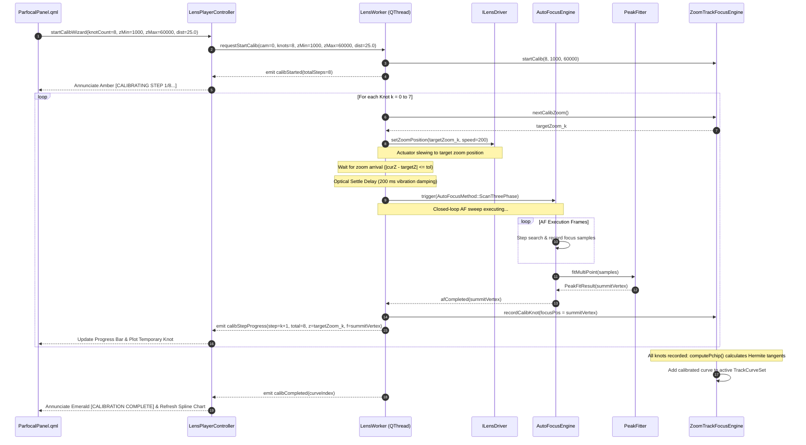
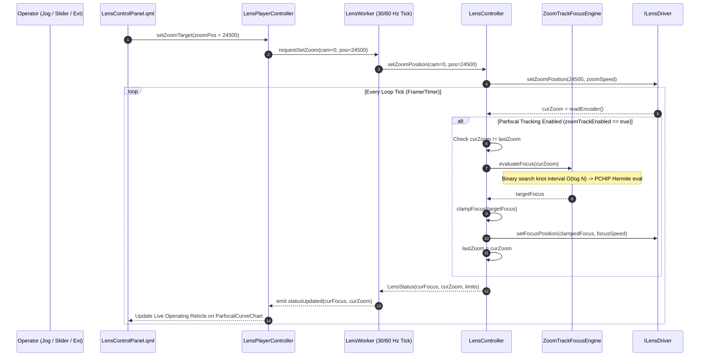

# Implementation Plan: `app-lens-qt` Phase 5 — Parfocal Zoom-to-Focus Calibration & Visualizer

## 1. Executive Summary & Objectives

### 1.1 Context & Scope
Motorized multi-element optical zoom assemblies inherently suffer from focal plane shift across their focal length range. When zooming from wide-angle to telephoto (or vice versa), the optical vertex of maximum sharpness migrates dynamically along the optical axis. Without active compensation, the image immediately defocuses during zoom maneuvers, requiring slow, disruptive autofocus re-sweeps.

Phase 5 elevates **`app-lens-qt`** (executable target: **`LensAppQt`**) into a professional optical calibration testbench by delivering an end-to-end **Parfocal Zoom-to-Focus Calibration, Visualization, and Real-Time Tracking Suite**. Building upon the video rendering and synthetic defocus pipeline delivered in Phase 2 ([`app_lens_qt_phase2_plan.md`](app_lens_qt_phase2_plan.md)), the optical axis controls deployed in Phase 3 ([`app_lens_qt_phase3_plan.md`](app_lens_qt_phase3_plan.md)), and the closed-loop autofocus laboratory delivered in Phase 4 ([`app_lens_qt_phase4_plan.md`](app_lens_qt_phase4_plan.md)), Phase 5 harnesses the domain engine in [`libs/LensController`](../libs/LensController) (`ZoomTrackFocusEngine`, `ZoomTrackTypes`).

Phase 5 equips optical test engineers, system calibrators, and field operators with:
1. **Interactive Multi-Curve Parfocal Visualizer (`ParfocalCurveChart.qml`)**:
   - High-performance, hardware-accelerated Canvas graph plotting focus motor position ($F$) against zoom motor position ($Z$).
   - Real-time animated tracker reticle displaying the instantaneous operational coordinate $(z(t), f(t))$ during optical actuation.
   - Distinct visualization of calibrated knots, shape-preserving PCHIP spline curves, linear interpolation segments, and multi-distance profile overlays.
2. **Knot Table Editor & Manual Calibration Deck (`ParfocalPanel.qml`)**:
   - Structured table presenting knot index, zoom coordinate, calibrated focus position, and precomputed derivative slope ($df/dz$).
   - Interactive knot manipulation: Add, Edit, Delete, Clear, and Auto-Sort with strict monotonicity validation preventing non-invertible mechanical trajectories.
3. **Multi-Distance Profile Management (`TrackCurveSet`)**:
   - Simultaneous storage and switching of up to 8 discrete distance profiles ([`TrackCurve`](../libs/LensController/ZoomTrackTypes.h)) representing discrete focal distances (e.g., $10\text{ m}$, $25\text{ m}$, $50\text{ m}$, $100\text{ m}$, $\infty$).
   - Real-time optical vergence blending ($V = 1/D$) across calibrated curves for continuous intermediate target distances.
4. **Automated Step-and-Learn Calibration Wizard**:
   - Fully autonomous calibration state machine coordinating `LensWorker`, `AutoFocusEngine`, and `ZoomTrackFocusEngine`.
   - Automatically slews zoom actuator sequentially across $N$ calibrated intervals ($z_0 \dots z_N$), settles optical vibration, executes closed-loop autofocus, captures the mathematical summit vertex from [`PeakFitter`](../libs/LensController/PeakFitter.h), records $(z_k, f_k)$, and computes shape-preserving Hermite tangents in-place.
   - Comprehensive operator feedback: progress bar, step counter, live telemetry preview, and instantaneous abort/cancel safety.
5. **Real-Time Parfocal Tracking Slew**:
   - High-frequency synchronous focus tracking (`setZoomTrackFocus`). When enabled, any movement of the zoom axis (via jog wheels, target sliders, relative steps, or external serial/network commands) drives instantaneous, zero-latency focus slew according to the active PCHIP calibration curve.
6. **Bimodal Profile Import & Export**:
   - Full support for industry-standard **Sightline LUT text format** (`.lut`, `.txt`) matching hardware optical payload firmware.
   - Modern, schema-validated **JSON Multi-Curve Profile format** (`.json`) preserving metadata, channel associations, date/time, and physical distance tags.

### 1.2 Target Deliverables for Phase 5

| Deliverable | Target Files | Description |
| :--- | :--- | :--- |
| **Interactive Parfocal Visualizer** | [`app-lens-qt/qml/ParfocalCurveChart.qml`](../app-lens-qt/qml/ParfocalCurveChart.qml) | Canvas-based multi-curve plotter displaying $Z \text{ vs } F$ calibration splines, knot markers, grid ticks, and live animated operational position reticle $(z(t), f(t))$. |
| **Master Parfocal Control Deck** | [`app-lens-qt/qml/ParfocalPanel.qml`](../app-lens-qt/qml/ParfocalPanel.qml) | Tactical panel uniting tracking master toggle, interpolation mode selector (PCHIP vs Linear), distance curve selector, knot table editor, calibration wizard deck, and file I/O controls. |
| **Workspace Tab Integration** | [`app-lens-qt/qml/Main.qml`](../app-lens-qt/qml/Main.qml)<br>[`app-lens-qt/qml/LensVideoView.qml`](../app-lens-qt/qml/LensVideoView.qml) | Adds `[PARFOCAL CALIB]` tab to the tactical right-side panel stack and integrates chart view switching. |
| **ViewModel Parfocal Orchestration** | [`app-lens-qt/LensPlayerController.h`](../app-lens-qt/LensPlayerController.h)<br>[`app-lens-qt/LensPlayerController.cpp`](../app-lens-qt/LensPlayerController.cpp) | Exposes properties, slots, and signals for zoom tracking state, active curve selection, knot list serialization, wizard control, and LUT/JSON import/export. |
| **Worker Parfocal Engine & Wizard** | [`app-lens-qt/LensWorker.h`](../app-lens-qt/LensWorker.h)<br>[`app-lens-qt/LensWorker.cpp`](../app-lens-qt/LensWorker.cpp) | Implements autonomous step-and-learn calibration state machine, optical settle delay, AF summit recording, and real-time focus slew coordination. |
| **CMake & Resource Registration** | [`app-lens-qt/CMakeLists.txt`](../app-lens-qt/CMakeLists.txt)<br>[`app-lens-qt/qml.qrc`](../app-lens-qt/qml.qrc) | Registers `ParfocalCurveChart.qml` and `ParfocalPanel.qml` into Qt resource compilation. |
| **Automated Unit Test Suite** | [`tests/TestLensParfocalTracking.cpp`](../tests/TestLensParfocalTracking.cpp) | Comprehensive automated test suite verifying knot table operations, PCHIP evaluation, calibration wizard state transitions, real-time slew, and file I/O. |

---

## 2. Architecture & Subsystem Decomposition

### 2.1 Real-Time Parfocal Tracking & Calibration Pipeline

The parfocal subsystem bridges interactive operator calibration on the Qt Quick presentation thread with real-time, deterministic motor actuation and closed-loop autofocus on the background worker thread:

1. **Presentation Thread (Qt Quick / QML)**:
   - Operators inspect calibration curves and live operating points on `ParfocalCurveChart.qml`.
   - Knot additions, modifications, and deletions are edited via `ParfocalPanel.qml`.
   - Calibration wizard parameters (knot count, zoom limits, target distance) are configured and triggered.
2. **ViewModel Orchestration Layer (`LensPlayerController`)**:
   - Bridges QML data models with background C++ engines.
   - Serializes knot arrays to `QVariantList` containing `{ "zoom": z, "focus": f, "slope": s }` maps for reactive QML bindings.
   - Dispatches non-blocking queued signals (`requestSetZoomTrack`, `requestStartCalibWizard`, `requestCancelCalibWizard`, `requestLoadTrackCurves`, `requestSaveTrackCurves`) to `LensWorker`.
3. **Dedicated Optical Worker Thread (`LensWorker`)**:
   - Manages the master [`LensController`](../libs/LensController/LensController.h) instance.
   - During autonomous calibration: coordinates sequential zoom actuation, vibration settling, closed-loop autofocus triggering, summit coordinate extraction, and knot recording.
   - During normal zoom motion: evaluates active PCHIP splines in zero-heap $O(\log N)$ time and commands instantaneous focus slew to [`ILensDriver`](../libs/LensController/ILensDriver.h).

### 2.2 ASCII Architecture Diagram

```
+-------------------------------------------------------------------------------------------------------------------------------+
|                                                 QT QUICK PRESENTATION THREAD                                                  |
|                                                                                                                               |
|   +---------------------------------------------------+   +---------------------------------------------------------------+   |
|   |             LensVideoView.qml (Center)            |   |                   ParfocalPanel.qml (Right)                   |   |
|   |  - Viewport & HUD Overlays                        |   |  - Real-Time Zoom-Track Master Toggle [ENGAGED / BYPASS]      |   |
|   |  - ParfocalCurveChart.qml (Collapsible Drawer):   |   |  - Interpolation Mode: [PCHIP Spline] vs [Piecewise Linear]   |   |
|   |    * Spline Curves (Z vs F) for Loaded Distances  |   |  - Distance Curve Selector: [Curve 0..7] (10m, 25m, 50m, Inf) |   |
|   |    * Calibrated Knot Markers (Zoom, Focus)        |   |  - Knot Table Editor: [Index] [Zoom] [Focus] [Slope]          |   |
|   |    * Live Operating Reticle: (z(t), f(t))         |   |    * [Add Knot] [Edit Knot] [Delete] [Auto-Sort Monotonic]    |   |
|   |    * Dual Axis Numeric Readouts & Scale Grids     |   |  - Step-and-Learn Calibration Wizard:                         |   |
|   |                                                   |   |    * Knot Count [4..32], Zoom Span [Z_min..Z_max], Distance   |   |
|   |                                                   |   |    * [START CALIBRATION] / [ABORT WIZARD]                     |   |
|   |                                                   |   |    * Progress Bar & Step Annunciator (Step 3/8: AF Converging)|   |
|   |                                                   |   |  - File I/O Deck: Import / Export Sightline LUT (.txt) & JSON |   |
|   +---------------------------------------------------+   +---------------------------------------------------------------+   |
|                             │ QML Properties & Signal Invocations                                                             |
|                             ▼                                                                                                 |
|   +-----------------------------------------------------------------------------------------------------------------------+   |
|   |                                                  LensPlayerController                                                 |   |
|   |  - Q_PROPERTY: zoomTrackEnabled, activeCurveIdx, curveCount, interpMode, isCalibrating, calibProgress, curveKnots     |   |
|   |  - Knot serialization: QVariantList containing {zoom, focus, slope} maps                                              |   |
|   |  - Dispatches non-blocking queued signals: requestZoomTrack, requestCalibWizard, requestKnotEdit, requestCurveIo      |   |
|   +-----------------------------------------------------------│-----------------------------------------------------------+   |
+---------------------------------------------------------------|---------------------------------------------------------------+
                                                                │ Queued Signal / Slot Transfer
                                                                ▼
+-------------------------------------------------------------------------------------------------------------------------------+
|                                                DEDICATED OPTICAL WORKER THREAD                                                |
|                                                                                                                               |
|   +-----------------------------------------------------------------------------------------------------------------------+   |
|   |                                                        LensWorker                                                     |   |
|   |                                                                                                                       |   |
|   |   +---------------------------------------------------------------------------------------------------------------+   |   |
|   |   |                                 Step-and-Learn Autonomous Calibration Wizard                                  |   |   |
|   |   |  - State Machine: Idle -> SlewToZoom -> SettleOptics -> TriggerAf -> WaitAfSummit -> RecordKnot -> Finish     |   |   |
|   |   |  - Settle Timer (200 ms) preventing optical blur during focus evaluation                                      |   |   |
|   |   |  - Extracts converged peak summit from AutoFocusEngine / PeakFitter                                           |   |   |
|   |   |  - Invokes ZoomTrackFocusEngine::recordCalibKnot & computePchip()                                              |   |   |
|   |   +-------------------------------------------------------│-------------------------------------------------------+   |   |
|   |                                                           │                                                           |   |
|   |   +-------------------------------------------------------▼-------------------------------------------------------+   |   |
|   |   |                                  libs/LensController (Zero-Heap Optical Core)                                 |   |   |
|   |   |                                                                                                               |   |   |
|   |   |   +---------------------------------------+               +-----------------------------------------------+   |   |   |
|   |   |   |             LensController            |               |             ZoomTrackFocusEngine              |   |   |   |
|   |   |   |  - stepChannel() Real-Time Loop:      |──────────────►|  - Up to 8 discrete TrackCurves (64 knots ea) |   |   |   |
|   |   |   |    if (curZoom != lastZoom && track)  | evaluateFocus |  - Monotone Hermite Spline (PCHIP, 0-overshoot|   |   |   |
|   |   |   |      targetF = evalFocus(curZoom)     |               |  - Multi-Distance Vergence Blending (V = 1/D) |   |   |   |
|   |   |   |      driver->setFocusPosition(...)    |               |  - Sightline LUT & JSON Parser/Serializer     |   |   |   |
|   |   |   +---------------------------------------+               +-----------------------------------------------+   |   |   |
|   |   |                       │ Motor Step Commands                                                                   |   |   |
|   |   |                       ▼                                                                                       |   |   |
|   |   |   +-------------------------------------------------------------------------------------------------------+   |   |   |
|   |   |   |                      ILensDriver (MockLensDriver / PelcoDLensDriver / ViscaLensDriver)                |   |   |   |
|   |   |   +-------------------------------------------------------------------------------------------------------+   |   |   |
|   |   +---------------------------------------------------------------------------------------------------------------+   |   |
|   +-----------------------------------------------------------------------------------------------------------------------+   |
+-------------------------------------------------------------------------------------------------------------------------------+
```

### 2.3 Mermaid Architecture Diagram

```mermaid
flowchart TD
    subgraph UI["Qt Quick Presentation Thread"]
        P1["ParfocalPanel.qml (Master Calibration Deck)"]
        P2["ParfocalCurveChart.qml (Spline & Reticle Visualizer)"]
        TAB["Main.qml (Navigation Tabs)"]
        VM["LensPlayerController (ViewModel & Knot Serializer)"]
    end

    subgraph Worker["Dedicated LensWorker Thread"]
        W1["LensWorker::processLoopTick()"]
        W2["Autonomous Calibration Wizard (State Machine)"]
        W3["Real-Time Parfocal Slew Dispatcher"]
    end

    subgraph CoreEngine["libs/LensController (Optical Core)"]
        LC["LensController::stepChannel()"]
        ZT["ZoomTrackFocusEngine (PCHIP Spline)"]
        AF["AutoFocusEngine (Peak Convergence)"]
        PF["PeakFitter (Gaussian Summit Extraction)"]
        DRV["ILensDriver (Actuator Positioner)"]
    end

    TAB --> P1 & P2
    P1 -->|Knot Edits / Wizard Controls / File I/O| VM
    P2 -->|Operating Coordinate Tracker (z, f)| VM
    VM -->|Queued Signals| Worker
    Worker --> W1 & W2 & W3

    W2 -->|Slew Zoom to Knot| DRV
    W2 -->|Trigger AF Sweep| AF
    AF -->|Summit Fit| PF
    PF -->|Vertex Coordinate| W2
    W2 -->|Record Knot & Compute Slopes| ZT

    W3 -->|On Zoom Change: evalFocus(z)| ZT
    ZT -->|Target Focus Position| LC
    LC -->|setFocusPosition(targetF)| DRV
    ZT -->|Active Knots & Slopes| VM
    VM -->|Serialized QVariantList| P2 & P1
```

### 2.4 Sequence Diagrams

#### 2.4.1 Step-and-Learn Automated Calibration Wizard Workflow



#### 2.4.2 Real-Time Parfocal Tracking Slew During Zoom



---

## 3. Mathematical Foundations & Optical Calibration Mechanics

### 3.1 PCHIP Spline vs. Standard Cubic Splines

Standard cubic splines enforce continuity of the second derivative ($C^2$). However, for optical zoom-to-focus profiles containing flat plateaus or sharp step transitions, standard cubic splines produce severe Runge phenomenon oscillations and overshoot. An overshoot in optical focus commands causes the lens to cross beyond depth-of-field boundaries, resulting in catastrophic loss of focus during zoom.

`ZoomTrackFocusEngine` implements the **Piecewise Cubic Hermite Interpolating Polynomial (PCHIP)** algorithm (Fritsch & Carlson, 1980), which guarantees $C^1$ continuity while strictly preserving shape monotonicity ($df/dz \ge 0$ or $df/dz \le 0$ on monotonic intervals with zero overshoot).

#### Tangent Slope Computation:
Given knots $(z_0, f_0), (z_1, f_1), \dots, (z_{N-1}, f_{N-1})$ with interval spacings $h_k = z_{k+1} - z_k$ and secant slopes:
$$\Delta_k = \frac{f_{k+1} - f_k}{h_k}$$

1. **Local Extrema / Flat Plateaus**:
   If $\Delta_{k-1}$ and $\Delta_k$ have opposite signs, or if either is zero:
   $$d_k = 0$$
2. **Strictly Monotonic Intervals**:
   If $\Delta_{k-1}$ and $\Delta_k$ have the same sign, the harmonic mean slope is applied:
   $$\frac{1}{d_k} = \frac{1}{2} \left( \frac{1}{\Delta_{k-1}} + \frac{1}{\Delta_k} \right) \implies d_k = \frac{2 \Delta_{k-1} \Delta_k}{\Delta_{k-1} + \Delta_k}$$
3. **Endpoint Tangents**:
   Boundary slopes $d_0$ and $d_{N-1}$ are estimated using non-centered shape-preserving three-point formulas clamped to match the sign of the adjacent secant.

#### Cubic Evaluation on Sub-Interval $z \in [z_k, z_{k+1}]$:
Defining normalized coordinate $t = \frac{z - z_k}{h_k} \in [0, 1]$:
$$f(z) = f_k H_0(t) + f_{k+1} H_1(t) + h_k d_k H_2(t) + h_k d_{k+1} H_3(t)$$
where the cubic Hermite basis functions are:
$$H_0(t) = 2t^3 - 3t^2 + 1, \quad H_1(t) = -2t^3 + 3t^2$$
$$H_2(t) = t^3 - 2t^2 + t, \quad H_3(t) = t^3 - t^2$$

### 3.2 Multi-Distance Optical Vergence Blending

Optical lenses focus light according to the thin lens equation:
$$\frac{1}{f_{\text{eff}}} = \frac{1}{s_{\text{obj}}} + \frac{1}{s_{\text{img}}}$$
Focal plane shift is linear with respect to optical **vergence** ($V = 1/D$, measured in diopters $\text{m}^{-1}$), where $D$ is object distance. `ZoomTrackFocusEngine::evaluateDistance(zoom, distanceMeters)` uses vergence blending across calibrated distance curves:
1. For infinity ($D \le 0$ or $D \to \infty$), $V_{\infty} = 0$.
2. For finite distance $D$, $V = 1/D$.
3. When querying an intermediate distance $D_{\text{target}}$, the engine identifies the two straddling bounding curves $(C_{\text{lower}}, C_{\text{upper}})$ with vergences $V_{\text{lower}} \le V_{\text{target}} \le V_{\text{upper}}$ and performs linear vergence weighting:
   $$\alpha = \frac{V_{\text{target}} - V_{\text{lower}}}{V_{\text{upper}} - V_{\text{lower}}}$$
   $$f(z, D_{\text{target}}) = (1 - \alpha) f_{\text{lower}}(z) + \alpha f_{\text{upper}}(z)$$

### 3.3 Calibration File Formats

#### 3.3.1 Sightline LUT Text Specification (`.lut`, `.txt`)
Compliant with native Sightline camera payload firmware:
```text
# Sightline Parfocal Calibration LUT
# Camera: Visible Wide (Channel 0)
# Distance: 25.0m
6:
1000 12000 24000 36000 48000 60000
4200 4850 5620 6510 7480 8590
# Distance: Infinity
6:
1000 12000 24000 36000 48000 60000
3900 4480 5190 5980 6840 7820
```

#### 3.3.2 JSON Multi-Curve Profile Specification (`.json`)
```json
{
  "version": 1,
  "channel": 0,
  "interpolationMode": "PchipSpline",
  "activeCurveIndex": 0,
  "curves": [
    {
      "index": 0,
      "distanceMeters": 0.0,
      "label": "Infinity",
      "knots": [
        { "zoom": 1000, "focus": 3900, "slope": 0.052 },
        { "zoom": 12000, "focus": 4480, "slope": 0.061 },
        { "zoom": 24000, "focus": 5190, "slope": 0.073 },
        { "zoom": 36000, "focus": 5980, "slope": 0.081 },
        { "zoom": 48000, "focus": 6840, "slope": 0.092 },
        { "zoom": 60000, "focus": 7820, "slope": 0.104 }
      ]
    },
    {
      "index": 1,
      "distanceMeters": 25.0,
      "label": "25.0m",
      "knots": [
        { "zoom": 1000, "focus": 4200, "slope": 0.058 },
        { "zoom": 12000, "focus": 4850, "slope": 0.067 },
        { "zoom": 24000, "focus": 5620, "slope": 0.079 },
        { "zoom": 36000, "focus": 6510, "slope": 0.089 },
        { "zoom": 48000, "focus": 7480, "slope": 0.101 },
        { "zoom": 60000, "focus": 8590, "slope": 0.115 }
      ]
    }
  ]
}
```

---

## 4. UI / QML Component Architecture & Visual Design

### 4.1 `ParfocalCurveChart.qml` (Interactive Spline & Reticle Visualizer)

Renders the optical $Z \text{ vs } F$ coordinate space with crisp, high-contrast tactical styling:
- **Plot Area & Scale**:
  - Horizontal Axis ($X$): Zoom motor position [$0 \dots 65535$] (or calibrated soft limits).
  - Vertical Axis ($Y$): Focus motor position [$0 \dots 65535$].
  - Sub-grid with fine tick marks and coordinate labels in `#808a9d`.
- **Curve Rendering**:
  - Active Curve Spline: Rendered in Tactical Cyan (`#00e5ff`) with line width $2.5\text{ px}$.
  - Inactive Background Distance Curves: Rendered in muted slate (`#2a3348`) with line width $1.0\text{ px}$ for context.
  - Linear Segments: Displayed with dashed lines when `InterpolationMode::PiecewiseLinear` is selected.
- **Knot Markers**:
  - Circular nodes rendered at each calibrated coordinate $(z_k, f_k)$ with outer ring `#00e5ff` and fill `#141720`.
  - Selected / hovered knot highlighted in bright Amber (`#ff9100`) with coordinate tooltip.
- **Live Operating Reticle**:
  - Pulsing animated crosshair reticle located at instantaneous encoder coordinate $(z(t), f(t))$ rendered in Emerald (`#00e676`).
  - Vertical and horizontal projection guidelines showing tracking alignment to the spline curve.
- **HUD Telemetry Overlay**:
  - Top header displaying Active Curve Distance, Knot Count, Current Operating Point $(Z, F)$, and Tracking Error $|f_{\text{actual}} - f_{\text{spline}}(z)|$.

### 4.2 `ParfocalPanel.qml` (Tactical Master Calibration Deck)

Organized into 5 functional collapsible tactical cards matching the aesthetics of `AutoFocusPanel.qml`:

1. **Card 1: Real-Time Parfocal Tracking Master**:
   - Master tracking toggle switch (`TacticalSwitch.qml`): `[ZOOM TRACKING: ENGAGED / BYPASS]`.
   - Interpolation algorithm toggle: `[PCHIP CUBIC SPLINE]` vs `[PIECEWISE LINEAR]`.
   - Real-time tracking status indicator: Emerald `[SYNCHRONIZED]`, Amber `[SLEWING]`, Coral `[UNTRACKED]`.
2. **Card 2: Distance Curve Set Manager**:
   - Active curve dropdown (`TacticalComboBox.qml`): Lists curves $0 \dots 7$ with distance tags (e.g. `Curve 0 (Infinity)`, `Curve 1 (25.0m)`).
   - Target distance input field with unit indicator ($\text{meters}$).
   - Curve actions: `[NEW CURVE]`, `[CLONE]`, `[REMOVE CURVE]`, `[CLEAR ALL]`.
3. **Card 3: Knot Table Editor**:
   - High-density list displaying knot records:
     * Columns: `#`, `ZOOM (Z)`, `FOCUS (F)`, `SLOPE (df/dz)`, `ACTIONS`.
   - Inline numerical inputs for rapid coordinate adjustment.
   - Action buttons: `[+ ADD KNOT]`, `[DELETE]`, `[SORT MONOTONIC]`, `[RECOMPUTE SLOPES]`.
   - Validation banner: Warns immediately if non-monotonic zoom coordinates ($z_{k+1} \le z_k$) exist.
4. **Card 4: Automated Step-and-Learn Calibration Wizard**:
   - Configuration sliders:
     * Sample Knots: $4 \dots 32$ steps (default: $8$).
     * Zoom Span: $Z_{\min} \dots Z_{\max}$ bounds sliders.
     * Settling Delay: $100 \dots 1000\text{ ms}$ (default: $200\text{ ms}$).
   - Action Pushbuttons: `[START CALIBRATION WIZARD]` (Cyan) and `[ABORT WIZARD]` (Coral).
   - Dynamic Progress Annunciator:
     * Step indicator: `STEP 3 OF 8 (Z = 24000)`.
     * Phase status: `[SLEWING ZOOM]` $\to$ `[SETTLING OPTICS]` $\to$ `[AF SWEEPING]` $\to$ `[RECORDING]`.
     * Animated tactical progress bar.
5. **Card 5: Profile File I/O Deck**:
   - Import buttons: `[IMPORT SIGHTLINE LUT (.txt)]` and `[IMPORT JSON PROFILE]`.
   - Export buttons: `[EXPORT SIGHTLINE LUT]` and `[EXPORT JSON PROFILE]`.
   - Status message display with path confirmation and error annunciator.

### 4.3 Workspace Tab Navigation Integration

In [`qml/Main.qml`](../app-lens-qt/qml/Main.qml):
- The right-side tactical panel navigation tab bar is expanded from 2 tabs to 3 tabs:
  1. `[AXIS CONTROL]` (`LensControlPanel.qml`)
  2. `[AUTOFOCUS LAB]` (`AutoFocusPanel.qml`)
  3. `[PARFOCAL CALIB]` (`ParfocalPanel.qml`)
- In [`qml/LensVideoView.qml`](../app-lens-qt/qml/LensVideoView.qml):
  - Viewport top-right controls are expanded with a `CURVE` toggle button alongside `CHART`.
  - The bottom collapsible telemetry drawer seamlessly switches between `FocusSharpnessChart.qml` (AF peak fit) and `ParfocalCurveChart.qml` (parfocal spline).

---

## 5. C++ Class Specifications & Interfaces

### 5.1 `LensPlayerController` Extensions (ViewModel)

New properties, invokable slots, and signals added to `LensPlayerController`:

```cpp
// --- Parfocal & Zoom-Track-Focus Properties ---
Q_PROPERTY(bool zoomTrackEnabled READ zoomTrackEnabled WRITE setZoomTrackEnabled NOTIFY zoomTrackChanged)
Q_PROPERTY(int interpolationMode READ interpolationMode WRITE setInterpolationMode NOTIFY interpolationModeChanged)
Q_PROPERTY(int activeCurveIndex READ activeCurveIndex WRITE setActiveCurveIndex NOTIFY activeCurveChanged)
Q_PROPERTY(int curveCount READ curveCount NOTIFY curveSetChanged)
Q_PROPERTY(double activeCurveDistance READ activeCurveDistance WRITE setActiveCurveDistance NOTIFY activeCurveChanged)
Q_PROPERTY(bool isCurveValid READ isCurveValid NOTIFY activeCurveChanged)
Q_PROPERTY(QVariantList activeCurveKnots READ activeCurveKnots NOTIFY knotsUpdated)

// --- Calibration Wizard Properties ---
Q_PROPERTY(bool isCalibrating READ isCalibrating NOTIFY calibStateChanged)
Q_PROPERTY(int calibStep READ calibStep NOTIFY calibProgressChanged)
Q_PROPERTY(int calibTotalSteps READ calibTotalSteps NOTIFY calibProgressChanged)
Q_PROPERTY(double calibProgress READ calibProgress NOTIFY calibProgressChanged)
Q_PROPERTY(QString calibStatusText READ calibStatusText NOTIFY calibProgressChanged)

public slots:
// Parfocal Configuration Slots (< 30 chars)
void setZoomTrackEnabled(bool enabled);
void setInterpolationMode(int mode);
void setActiveCurveIndex(int index);
void setActiveCurveDistance(double meters);

// Knot Table Manipulation Slots (< 30 chars)
void addKnot(int zoom, int focus);
void updateKnot(int index, int zoom, int focus);
void removeKnot(int index);
void clearKnots();
void sortKnots();

// Calibration Wizard Slots (< 30 chars)
void startCalibWizard(int knots, int zMin, int zMax, double dist);
void cancelCalibWizard();

// Curve I/O Slots (< 30 chars)
void loadTrackCurves(const QString& path);
void saveTrackCurves(const QString& path);
void exportJsonProfile(const QString& path);
void importJsonProfile(const QString& path);
```

### 5.2 `LensWorker` Extensions (Optical Execution Worker)

New background slots and state variables in `LensWorker`:

```cpp
public slots:
void onSetZoomTrack(int channel, bool enabled);
void onSetInterpMode(int channel, int mode);
void onSetActiveCurve(int channel, int index);
void onSetCurveDistance(int channel, int index, float distanceMeters);
void onAddKnot(int channel, int zoom, int focus);
void onUpdateKnot(int channel, int index, int zoom, int focus);
void onRemoveKnot(int channel, int index);
void onClearKnots(int channel);
void onSortKnots(int channel);

void onStartCalib(int channel, int knots, int zMin, int zMax, float dist);
void onCancelCalib(int channel);

void onLoadTrackFile(int channel, const QString& path);
void onSaveTrackFile(int channel, const QString& path);
void onImportJsonProfile(int channel, const QString& path);
void onExportJsonProfile(int channel, const QString& path);

signals:
void zoomTrackStateChanged(int channel, bool enabled);
void curveSetUpdated(int channel, int curveCount, int activeIndex);
void knotsReady(int channel, const QVariantList& knots);
void calibStepUpdated(int channel, int step, int total, double progress, const QString& status);
void calibCompleted(int channel, bool success, const QString& message);
void curveIoCompleted(int channel, bool success, const QString& message);
```

#### Calibration Wizard State Machine Inside `LensWorker`:
```cpp
enum class CalibWizardState : std::uint8_t {
    Idle = 0U,
    SlewingZoom = 1U,
    SettlingOptics = 2U,
    WaitingAfSweep = 3U,
    RecordingKnot = 4U,
    Completed = 5U,
    Aborted = 6U
};
```

---

## 6. Concurrency, Safety & Standards Compliance

### 6.1 MISRA C++:2023 & SEI CERT C++ Enforcement

1. **Rule 7.0.6 & INT31-C (Signed/Unsigned Conversions)**:
   - Motor encoder steps are typed as `MotorPosition` (`std::uint16_t`). All coordinate mappings and bounds calculations are checked and cast explicitly via `static_cast<std::uint16_t>`.
   - Curve and knot indices are strictly typed as `std::size_t`.
2. **STR37-C (Deterministic Character & Path Handling)**:
   - File extensions (`.lut`, `.txt`, `.json`) and header tokens are evaluated with locale-independent ASCII helpers (`equalsIgnoreCaseAscii`).
3. **ERR55-CPP (`noexcept` Real-Time Evaluation Fast Path)**:
   - `ZoomTrackFocusEngine::evaluateFocus` and `evaluateDistance` are strictly `noexcept` with zero dynamic heap allocations.
   - PCHIP tangent evaluations execute strictly on fixed-capacity stack structures (`std::array<TrackKnot, 64>`).
4. **Domain Modeling & Value Object Integrity**:
   - `TrackKnot`, `TrackCurve`, and `TrackCurveSet` enforce invariants upon modification.
   - Monotonicity checks prevent adding knots with non-strictly-increasing zoom coordinates ($z_{k+1} \le z_k$).
5. **Zen of Systems Engineering (PEP 20 Applied)**:
   - All method names are concise and strictly under 30 characters.
   - Flat control flow with guard clauses and early returns ($\le 2$ nesting levels).
   - Fallible file I/O operations are marked `[[nodiscard]]`.

---

## 7. Verification & Automated Test Strategy

### 7.1 New Test Suite: `TestLensParfocalTracking.cpp`

A dedicated GoogleTest suite registered in `tests/CMakeLists.txt` validating the complete parfocal stack:

| Test Case | Scope & Verification Criteria |
| :--- | :--- |
| `KnotTableManipulationAndValidation` | Verifies adding, updating, removing, and sorting knots. Ensures duplicate or non-monotonic zoom positions are rejected by `isValid()`. |
| `PchipSplineEvaluationAndNoOvershoot` | Validates that PCHIP interpolation produces monotonic focus positions on step profiles with zero overshoot, contrasting against standard cubic splines. |
| `PiecewiseLinearEvaluation` | Verifies linear interpolation fallback mode across calibrated knot intervals. |
| `MultiDistanceVergenceBlending` | Tests `evaluateDistance()` across finite ($25\text{ m}$) and infinite ($\infty$) curves, verifying diopter weighting $V = 1/D$. |
| `SightlineLutParsingAndSerialization` | Verifies round-trip parsing and writing of Sightline `.lut` text format with distance headers. |
| `JsonProfileParsingAndSerialization` | Verifies JSON profile serialization and ingestion with knot coordinates and slope metadata. |
| `CalibWizardStateMachineProgression` | Simulates the automated calibration wizard step-by-step with `MockLensDriver`, verifying that zoom slews, AF triggers, summit vertex is recorded, and slopes are computed. |
| `CalibWizardCancellationAndSafety` | Verifies that calling `cancelCalibWizard()` halts optical motion and leaves existing curves intact. |
| `RealTimeParfocalSlewOnZoomStep` | Verifies that moving the zoom axis under `setZoomTrackFocus(true)` triggers immediate focus positioning according to the active spline. |
| `MultiChannelIsolation` | Validates that calibration curves and tracking states on Channel 0 do not interfere with Channels 1, 2, or 3. |

---

## 8. Phased Work Breakdown Structure (WBS)

```
+---------------------------------------------------------------------------------------------------------------+
|                                      PHASE 5 WORK BREAKDOWN STRUCTURE (WBS)                                   |
|                                                                                                               |
|  Step 1: C++ ViewModel & Worker Parfocal Scaffolding                                                          |
|  - Extend LensPlayerController with zoom-track properties, knot serialization, and I/O slots                   |
|  - Extend LensWorker with calibration wizard state machine and real-time focus slew dispatch                  |
|                                                                                                               |
|  Step 2: Interactive Parfocal Spline Visualizer (ParfocalCurveChart.qml)                                      |
|  - Implement Canvas plotter for Z vs F splines, grid ticks, knot markers, and operational reticle (z, f)       |
|                                                                                                               |
|  Step 3: Tactical Parfocal Control Deck & Knot Editor (ParfocalPanel.qml)                                     |
|  - Build tactical cards: Tracking Switch, Curve Selector, Knot Table Editor, Wizard Deck, and File I/O       |
|                                                                                                               |
|  Step 4: Automated Step-and-Learn Calibration Wizard Integration                                              |
|  - Wire sequential zoom stepping, optical settle timer, closed-loop AF summit harvesting, and PCHIP slopes    |
|                                                                                                               |
|  Step 5: File I/O Integration (Sightline LUT & JSON Multi-Curve)                                              |
|  - Implement Sightline text LUT parser/serializer and JSON profile import/export                              |
|                                                                                                               |
|  Step 6: Workspace Navigation & Layout Integration                                                            |
|  - Update Main.qml with [PARFOCAL CALIB] tab and LensVideoView.qml with CURVE drawer toggle                   |
|                                                                                                               |
|  Step 7: Automated Unit Test Suite & Hardening Sign-Off                                                        |
|  - Implement TestLensParfocalTracking.cpp, update tests/CMakeLists.txt, and verify clean build & tests         |
+---------------------------------------------------------------------------------------------------------------+
```

### Detailed Execution Steps:

1. **Step 1: C++ ViewModel & Worker Parfocal Scaffolding**:
   - Update [`app-lens-qt/LensPlayerController.h`](../app-lens-qt/LensPlayerController.h) and [`LensPlayerController.cpp`](../app-lens-qt/LensPlayerController.cpp) to expose properties and invokables for zoom tracking, active curves, knot lists, and calibration wizard.
   - Update [`app-lens-qt/LensWorker.h`](../app-lens-qt/LensWorker.h) and [`LensWorker.cpp`](../app-lens-qt/LensWorker.cpp) to implement the wizard state machine and coordinate with `ZoomTrackFocusEngine`.
2. **Step 2: Interactive Parfocal Spline Visualizer (`ParfocalCurveChart.qml`)**:
   - Author `app-lens-qt/qml/ParfocalCurveChart.qml` with dual-axis scale ticks, PCHIP spline curve stroke, knot handles, and animated live reticle $(z(t), f(t))$.
3. **Step 3: Tactical Parfocal Control Deck & Knot Editor (`ParfocalPanel.qml`)**:
   - Author `app-lens-qt/qml/ParfocalPanel.qml` featuring tracking master switch, distance curve dropdown, knot table editor, wizard parameters, and file I/O controls.
4. **Step 4: Automated Step-and-Learn Calibration Wizard**:
   - Implement the calibration wizard loop in `LensWorker`: sequential zoom positioning $\to$ settle timer $\to$ closed-loop AF triggering $\to$ summit recording $\to$ slope computation.
5. **Step 5: File I/O Integration**:
   - Wire `loadTrackCurves` and `saveTrackCurves` for Sightline text LUTs and JSON profiles in `LensWorker` and `LensPlayerController`.
6. **Step 6: Workspace Navigation & Layout Integration**:
   - Update `app-lens-qt/qml/Main.qml` right-panel tab bar to include `[PARFOCAL CALIB]`.
   - Update `app-lens-qt/qml/LensVideoView.qml` top-right controls to toggle `ParfocalCurveChart.qml`.
   - Update `app-lens-qt/qml.qrc` with new QML components.
7. **Step 7: Automated Unit Test Suite & Hardening Sign-Off**:
   - Author `tests/TestLensParfocalTracking.cpp`.
   - Register target in `tests/CMakeLists.txt`.
   - Execute test suite and verify 100% pass rate.
   - Verify zero compiler warnings, IWYU compliance (`verify_iwyu_cstdint.py`), and documentation links (`verify_relative_doc_paths.py`).
