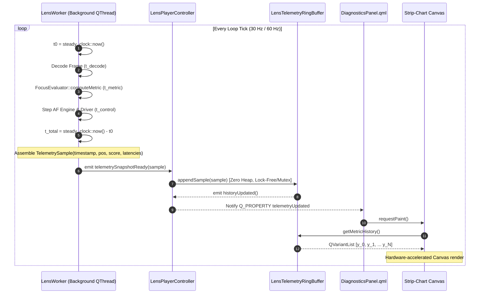
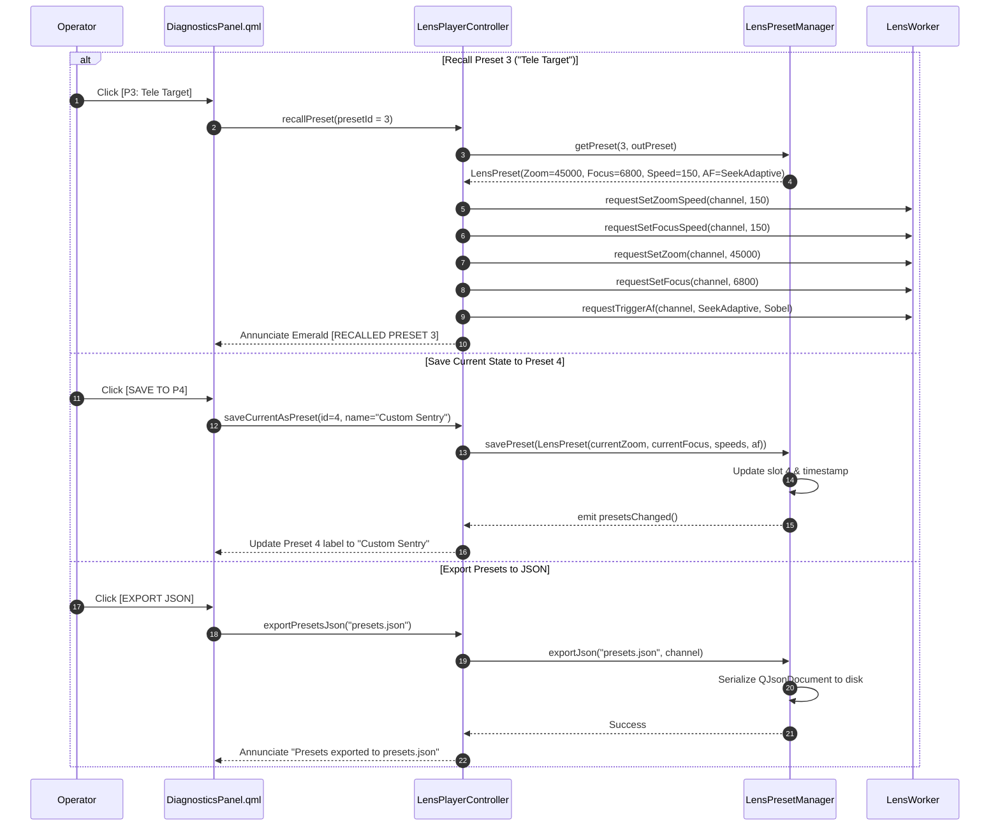
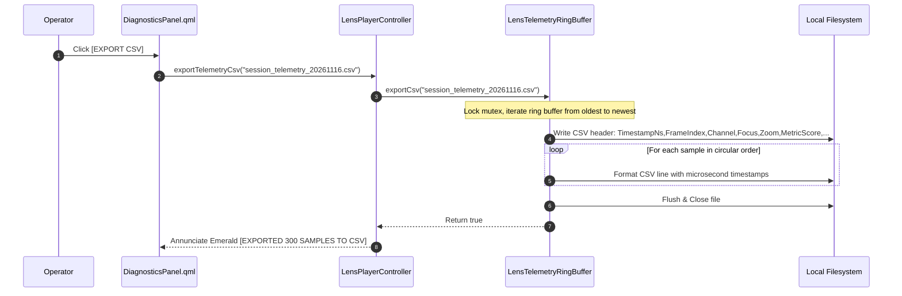

# Implementation Plan: `app-lens-qt` Phase 6 — Telemetry Ring Buffer, Presets & Diagnostics Panel

## 1. Executive Summary & Objectives

### 1.1 Context & Scope
In multi-channel motorized optical payloads and high-speed closed-loop autofocus systems, real-time observability, determinism, and rapid configuration recall are critical operational requirements. Operators and test engineers require immediate visibility into actuator positions, limit switches, serial/network communication health, autofocus state machine transitions, and computation latencies (frame decoding, sharpness metric kernels, and control loop jitter). Furthermore, repeatable optical evaluation demands saving and recalling calibrated optical presets (zoom position, focus position, speed, and autofocus parameters) with rapid single-click activation.

Phase 6 elevates **`app-lens-qt`** (executable target: **`LensAppQt`**) into an enterprise-grade tactical diagnostic console and test bench by implementing:
1. **Zero-Heap Rolling Telemetry Ring Buffer (`LensTelemetryRingBuffer`)**:
   - Fixed-capacity circular history buffer (`BufferCapacity = 300` frames) caching timestamped telemetry snapshots.
   - Captures frame timestamps, motor positions (focus and zoom), focus metric scores, active AF states, limit flags, and sub-millisecond execution latencies.
   - Computes statistical summaries (minimum, maximum, arithmetic mean) and provides normalized history vectors for QML strip-chart rendering.
   - Provides thread-safe, one-click CSV export for offline analysis in MATLAB, Python/Pandas, or laboratory spreadsheets.
2. **Tactical Optical Preset Manager (`LensPresetManager`)**:
   - Structured management of 8 optical preset slots per channel, including factory defaults ("Wide Surveillance", "Mid Recon", "Tele Target", "Extreme Spotter") and user-definable configurations.
   - Preserves zoom and focus coordinates, actuator speeds, preferred autofocus search algorithms, and metric kernels.
   - Robust, schema-validated JSON serialization (`.json`) for configuration persistence, sharing, and field deployment.
3. **Comprehensive Tactical Diagnostics Deck (`DiagnosticsPanel.qml`)**:
   - Dedicated 4th panel tab within the application shell presenting a high-density, dark-themed diagnostic readout.
   - Decomposed into distinct operational cards:
     * **Actuator & Travel Limits**: Live encoders, progress bars, limit switch warning indicators (`NearLimit`, `FarLimit`, `WideLimit`, `TeleLimit`), and E-Stop monitor.
     * **Driver & Communication Health**: Active driver (`Mock`, `Pelco-D`, `VISCA`, `DLL`), port name, baud rate, camera address, heartbeat status, TX/RX frame counters, and roundtrip ping latency.
     * **Autofocus & Optical Summit**: State machine string, algorithm, metric kernel, current sharpness score, and Gaussian summit parameters ($x_0$, $y_0$, curvature, FWHM, goodness-of-fit $R^2$).
     * **Execution Latencies & Profiling**: Monitored video FPS, frame decoding latency, focus metric evaluation latency ($\mu\text{s}$), and control loop tick jitter.
     * **Tactical Preset Deck**: 8 preset slot buttons with quick Recall and Save actions, custom naming, and JSON Import/Export.
     * **Strip-Chart & CSV Session Logging**: Live canvas mini strip-chart plotting sharpness history, buffer utilization, buffer clear action, and CSV export trigger.

### 1.2 Target Deliverables for Phase 6

| Deliverable | Target Files | Description |
| :--- | :--- | :--- |
| **Telemetry Ring Buffer** | [`app-lens-qt/LensTelemetryRingBuffer.h`](../app-lens-qt/LensTelemetryRingBuffer.h)<br>[`app-lens-qt/LensTelemetryRingBuffer.cpp`](../app-lens-qt/LensTelemetryRingBuffer.cpp) | Thread-safe, fixed-capacity circular buffer with zero heap allocation on sample append, statistical computation, and CSV export. |
| **Preset Manager Engine** | [`app-lens-qt/LensPresetManager.h`](../app-lens-qt/LensPresetManager.h)<br>[`app-lens-qt/LensPresetManager.cpp`](../app-lens-qt/LensPresetManager.cpp) | Optical preset storage, factory profiles, JSON import/export, and QML data model integration. |
| **Diagnostics Panel Deck** | [`app-lens-qt/qml/DiagnosticsPanel.qml`](../app-lens-qt/qml/DiagnosticsPanel.qml) | High-density tactical QML panel displaying actuator status, driver telemetry, AF metrics, profiling timers, preset deck, and mini strip-chart. |
| **ViewModel Orchestration** | [`app-lens-qt/LensPlayerController.h`](../app-lens-qt/LensPlayerController.h)<br>[`app-lens-qt/LensPlayerController.cpp`](../app-lens-qt/LensPlayerController.cpp) | Exposes `telemetryBuffer` and `presetManager` properties, latency profiling accessors, preset recall/save slots, and CSV export trigger. |
| **Worker Profiling Integration** | [`app-lens-qt/LensWorker.h`](../app-lens-qt/LensWorker.h)<br>[`app-lens-qt/LensWorker.cpp`](../app-lens-qt/LensWorker.cpp) | Implements high-resolution execution timing (`std::chrono::steady_clock`) for decoding, metric computation, and loop execution. |
| **Shell & Workspace Integration** | [`app-lens-qt/qml/Main.qml`](../app-lens-qt/qml/Main.qml)<br>[`app-lens-qt/qml.qrc`](../app-lens-qt/qml.qrc) | Adds `[DIAGNOSTICS]` tab to the right-hand panel stack, registers `DiagnosticsPanel.qml` in Qt resources, and wires header notifications. |
| **CMake Build Configuration** | [`app-lens-qt/CMakeLists.txt`](../app-lens-qt/CMakeLists.txt)<br>[`tests/CMakeLists.txt`](../tests/CMakeLists.txt) | Adds new source files to `LensAppQt` and registers automated unit test target `TestLensTelemetryAndPresets`. |
| **Automated Unit Test Suite** | [`tests/TestLensTelemetryAndPresets.cpp`](../tests/TestLensTelemetryAndPresets.cpp) | Comprehensive automated test suite verifying ring buffer wrap-around, zero heap guarantees, CSV formatting, preset JSON round-trip, and thread concurrency. |

---

## 2. Architecture & Subsystem Decomposition

### 2.1 Telemetry Aggregation, Preset Management & Diagnostics Flow

The telemetry and diagnostic subsystem coordinates high-frequency execution on the background worker thread with reactive presentation on the Qt Quick GUI thread:

1. **Background Optical Worker Thread (`LensWorker`)**:
   - Executes the deterministic control tick (30 Hz / 60 Hz).
   - Ingests video frames from `IVideoDecoder` or `SyntheticDefocusGenerator`.
   - Records high-resolution timestamps via `std::chrono::steady_clock` around decoding, metric evaluation ([`FocusEvaluator`](../libs/LensController/FocusEvaluator.h)), and AF state stepping ([`AutoFocusEngine`](../libs/LensController/AutoFocusEngine.h)).
   - Packages optical telemetry, encoder positions, limits, metric scores, and latency metrics into `TelemetrySample`.
   - Dispatches telemetry records to `LensPlayerController` via queued signal/slot or atomic ring buffer.
2. **ViewModel Orchestration Layer (`LensPlayerController`)**:
   - Holds the master `LensTelemetryRingBuffer` and `LensPresetManager` instances.
   - Pushes incoming samples into `LensTelemetryRingBuffer::appendSample()` (guaranteed zero dynamic heap allocation under `noexcept`).
   - Dispatches preset recall requests to `LensWorker` (`onSetFocusTarget`, `onSetZoomTarget`, `onSetFocusSpeed`, `onSetZoomSpeed`, `onTriggerAf`).
   - Exposes clean `Q_PROPERTY` bindings and `Q_INVOKABLE` methods to QML components.
3. **Tactical Presentation Thread (Qt Quick / QML)**:
   - `DiagnosticsPanel.qml` queries `controller.telemetryBuffer` and `controller.presetManager`.
   - The embedded strip-chart pulls normalized metric score arrays for hardware-accelerated Canvas rendering.
   - The preset deck renders tactical preset slots with instantaneous status feedback (Active, Saved, Empty).

### 2.2 ASCII Architecture Diagram

```
+-------------------------------------------------------------------------------------------------------------------------------+
|                                                 QT QUICK PRESENTATION THREAD                                                  |
|                                                                                                                               |
|   +---------------------------------------------------+   +---------------------------------------------------------------+   |
|   |                     Main.qml                      |   |                     DiagnosticsPanel.qml                      |   |
|   |  - Tactical Header: Presets Quick Bar & Health    |   |  - Actuator & Travel Limits Card (Z/F Readouts, Limit Chips)  |   |
|   |  - Tab Navigation:                                |   |  - Hardware Driver & Port Telemetry (TX/RX, Ping Latency)     |   |
|   |    [AXIS CONTROL] [AUTOFOCUS LAB]                 |   |  - Autofocus Summit Card (Algorithm, Metric, R2, FWHM)        |   |
|   |    [PARFOCAL CALIB] [DIAGNOSTICS] <--- (Phase 6)  |   |  - Execution Latencies & Profiling (FPS, Metric us, Loop us)  |   |
|   |                                                   |   |  - Tactical Preset Deck (Presets 1..8, Save, Recall, JSON)    |   |
|   |                                                   |   |  - Metric Strip-Chart Canvas & CSV Export Deck                |   |
|   +---------------------------------------------------+   +---------------------------------------------------------------+   |
|                             │ QML Property Bindings & Invocations                                                             |
|                             ▼                                                                                                 |
|   +-----------------------------------------------------------------------------------------------------------------------+   |
|   |                                                  LensPlayerController                                                 |   |
|   |  - Q_PROPERTY: LensTelemetryRingBuffer* telemetryBuffer READ telemetryBuffer CONSTANT                                 |   |
|   |  - Q_PROPERTY: LensPresetManager* presetManager READ presetManager CONSTANT                                           |   |
|   |  - Slots: recallPreset(), saveCurrentPreset(), deletePreset(), exportCsv(), exportPresetsJson(), importPresetsJson()   |   |
|   +-------------------------------│-------------------------------------------------------│-------------------------------+   |
|                                   │                                                       │                                   |
|                                   ▼                                                       ▼                                   |
|   +-------------------------------------------------------+   +-------------------------------------------------------+   |   |
|   |                LensTelemetryRingBuffer                |   |                   LensPresetManager                   |   |   |
|   |  - std::array<TelemetrySample, 300> (Fixed Circular)  |   |  - std::vector<LensPreset> (8 Tactical Presets/Chan)  |   |   |
|   |  - Zero-heap appendSample() noexcept                  |   |  - Factory Tactical Defaults & JSON Serializer        |   |   |
|   |  - Min / Max / Avg Latencies & Metric Scores          |   |  - Schema Validation & Monotonic Bound Checking       |   |   |
|   |  - getMetricHistory() QVariantList for Canvas         |   |  - Q_INVOKABLE getPreset(), savePreset(), exportJson()|   |   |
|   |  - exportCsv(filePath) with Microsecond Timestamps    |   |                                                       |   |   |
|   +-------------------------------------------------------+   +-------------------------------------------------------+   |   |
+-------------------------------------------------------------------------------------------------------------------------------|
                                                                │ Queued Signal / Direct Thread-Safe Ingestion
                                                                ▼
+-------------------------------------------------------------------------------------------------------------------------------+
|                                                DEDICATED OPTICAL WORKER THREAD                                                |
|                                                                                                                               |
|   +-----------------------------------------------------------------------------------------------------------------------+   |
|   |                                                        LensWorker                                                     |   |
|   |                                                                                                                       |   |
|   |   - High-Resolution Latency Profiling (std::chrono::steady_clock):                                                    |   |
|   |     * t_decode: Video Ingestion / Synthetic Pattern Generation Latency                                                |   |
|   |     * t_metric: FocusEvaluator Sharpness Kernel Execution Latency (us)                                                |   |
|   |     * t_loop: Complete Background Control Loop Tick Execution Latency (us)                                            |   |
|   |                                                                                                                       |   |
|   |   - Aggregates Telemetry Snapshot:                                                                                    |   |
|   |     { timestampNs, frameIndex, channel, focusPos, zoomPos, metricScore, afState, limitFlags, metricUs, loopUs, fps }   |   |
|   |                                                                                                                       |   |
|   |   - Emits telemetrySnapshotReady() -> LensPlayerController -> LensTelemetryRingBuffer                                 |   |
|   +-----------------------------------------------------------------------------------------------------------------------+   |
+-------------------------------------------------------------------------------------------------------------------------------+
```

### 2.3 Mermaid Architecture Diagram

```mermaid
flowchart TD
    subgraph UI["Qt Quick Presentation Thread"]
        MAIN["Main.qml (Tactical Shell & Header)"]
        DIAG["DiagnosticsPanel.qml (Diagnostics & Telemetry)"]
        PRESET_UI["Tactical Preset Deck (1..8)"]
        CHART_UI["Rolling Strip-Chart Canvas"]
        VM["LensPlayerController (ViewModel)"]
    end

    subgraph Models["Telemetry & Preset Models"]
        RING["LensTelemetryRingBuffer (300 Samples)"]
        PM["LensPresetManager (JSON I/O & Presets)"]
    end

    subgraph Worker["Dedicated LensWorker Thread"]
        WK["LensWorker::processLoopTick()"]
        PROF["Execution Latency Profiler (steady_clock)"]
        LC["LensControl::LensController"]
        FE["LensControl::FocusEvaluator"]
        DRV["ILensDriver (Mock / Pelco-D / VISCA / DLL)"]
    end

    MAIN --> DIAG
    DIAG --> PRESET_UI & CHART_UI
    DIAG -->|Readings / Invocations| VM
    VM -->|Append Snapshot| RING
    VM -->|Store / Recall| PM
    RING -->|getMetricHistory()| CHART_UI
    PM -->|presetList| PRESET_UI

    WK --> PROF
    PROF -->|Decode / Metric / Loop Timers| WK
    WK --> FE
    WK --> LC
    LC --> DRV
    WK -->|telemetrySnapshotReady| VM
```

### 2.4 Sequence Diagrams

#### 2.4.1 Real-Time Telemetry Sampling, Ring Buffer Roll & Strip-Chart Presentation



#### 2.4.2 Preset Recall, Save, and JSON Profile Serialization



#### 2.4.3 One-Click CSV Telemetry Export Workflow



---

## 3. Data Structures & Serialization Formats

### 3.1 Pre-allocated Zero-Heap Ring Buffer (`LensTelemetryRingBuffer`)

To comply with **SEI CERT ERR55-CPP** and prevent memory fragmentation in continuous testing runs, `LensTelemetryRingBuffer` utilizes a fixed-size `std::array<TelemetrySample, BufferCapacity>` where `BufferCapacity = 300` (representing 10 seconds of 30 Hz history or 5 seconds of 60 Hz history).

```cpp
/// @struct TelemetrySample
/// @brief Point-in-time snapshot of optical actuator and algorithm metrics.
struct TelemetrySample {
    std::uint64_t timestampNs { 0U };
    std::uint32_t frameIndex { 0U };
    std::uint8_t channel { 0U };
    std::uint16_t focusPosition { 0U };
    std::uint16_t zoomPosition { 0U };
    double metricScore { 0.0 };
    std::uint8_t afState { 0U };
    std::uint8_t limitFlags { 0U };
    std::uint32_t decodeLatencyUs { 0U };
    std::uint32_t metricLatencyUs { 0U };
    std::uint32_t loopLatencyUs { 0U };
    float currentFps { 0.0F };
};
```

#### Ring Buffer Head and Count Invariants:
- `m_head`: Write cursor index $[0 \dots \text{BufferCapacity}-1]$.
- `m_count`: Current count of valid samples stored $[0 \dots \text{BufferCapacity}]$.
- When `m_count == BufferCapacity`, the buffer overwrites the oldest sample:
  $$\text{readIndex}(i) = (\text{head} - \text{count} + i + \text{BufferCapacity}) \pmod{\text{BufferCapacity}}$$
- Append operations execute in $O(1)$ time with **zero dynamic heap allocation**.

### 3.2 Optical Preset Structure (`LensPreset`) & Channel State Isolation

Optical presets store the complete optical configuration required to restore optical positioning and search behavior:

```cpp
/// @struct LensPreset
/// @brief Complete snapshot of calibrated optical axis targets and AF settings.
struct LensPreset {
    int id { 1 };                            // Preset slot ID (1..8)
    int channel { 0 };                       // Camera channel index (0..3)
    QString name { QStringLiteral("Preset") };
    std::uint16_t focusPosition { 0U };      // Focus motor coordinate [0..65535]
    std::uint16_t zoomPosition { 0U };       // Zoom motor coordinate [0..65535]
    std::uint8_t focusSpeed { 127U };        // Focus actuation speed [1..255]
    std::uint8_t zoomSpeed { 127U };         // Zoom actuation speed [1..255]
    int afAlgorithm { 1 };                   // AutoFocusMethod (1 = ScanThreePhase)
    int focusMetric { 0 };                   // FocusMetricKernel (0 = SobelGradientSquared)
    QString description { };
    std::uint64_t timestampMs { 0U };        // UTC epoch timestamp of save
    bool isValid { false };                  // True if slot is populated
};
```

### 3.3 Factory Default Tactical Optical Presets

Each camera channel initializes with 4 factory presets and 4 user-customizable slots:

| Slot | Preset Name | Zoom Position | Focus Position | Speeds (Z/F) | AF Method | Metric Kernel | Tactical Application |
| :--- | :--- | :--- | :--- | :--- | :--- | :--- | :--- |
| **P1** | `Wide Surveillance` | 1,000 | 4,200 | 200 / 200 | `ScanThreePhase` | `SobelGradientSquared` | Maximum field of view, perimeter monitoring. |
| **P2** | `Mid Recon` | 20,000 | 5,400 | 180 / 180 | `ScanThreePhase` | `DiscreteLaplacian` | Medium distance reconnaissance, vehicle identification. |
| **P3** | `Tele Target` | 45,000 | 7,100 | 140 / 140 | `SeekAdaptive` | `TenengradThreshold` | Long-range target tracking and verification. |
| **P4** | `Extreme Spotter` | 62,000 | 8,600 | 100 / 100 | `GoldenSection` | `VollathCorrelationF4` | Maximum optical zoom, fine detail inspection. |
| **P5..P8** | `User Slot 5..8` | 0 | 0 | 127 / 127 | `ScanThreePhase` | `SobelGradientSquared` | Empty / customizable operator slots. |

### 3.4 JSON Preset Specification (`.json`)

The preset serialization format is human-readable, schema-validated JSON:

```json
{
  "schemaVersion": 1,
  "exportedAt": "2026-11-16T22:45:00Z",
  "channel": 0,
  "channelName": "Visible Wide",
  "presets": [
    {
      "id": 1,
      "name": "Wide Surveillance",
      "zoomPosition": 1000,
      "focusPosition": 4200,
      "zoomSpeed": 200,
      "focusSpeed": 200,
      "afAlgorithm": 1,
      "focusMetric": 0,
      "description": "Perimeter wide-angle overview",
      "timestampMs": 1794869100000,
      "isValid": true
    },
    {
      "id": 2,
      "name": "Mid Recon",
      "zoomPosition": 20000,
      "focusPosition": 5400,
      "zoomSpeed": 180,
      "focusSpeed": 180,
      "afAlgorithm": 1,
      "focusMetric": 1,
      "description": "Medium range tactical overview",
      "timestampMs": 1794869100000,
      "isValid": true
    }
  ]
}
```

### 3.5 CSV Session Telemetry Specification (`.csv`)

Exported telemetry conforms to standard RFC 4180 CSV with microsecond-precision relative offsets:

```csv
TimestampNs,FrameIndex,Channel,FocusPosition,ZoomPosition,MetricScore,AfState,NearLimit,FarLimit,WideLimit,TeleLimit,DecodeLatencyUs,MetricLatencyUs,LoopLatencyUs,Fps
10452300000,1204,0,32450,15200,84.521,3,0,0,0,0,2140,845,3420,59.8
10468966666,1205,0,32460,15200,86.104,3,0,0,0,0,2080,820,3310,60.1
10485633333,1206,0,32470,15200,88.490,3,0,0,0,0,2110,830,3380,60.0
```

---

## 4. UI / QML Component Architecture & Visual Design

### 4.1 `DiagnosticsPanel.qml` Layout & Card Decomposition

`DiagnosticsPanel.qml` resides in `app-lens-qt/qml/DiagnosticsPanel.qml` and adheres to the tactical dark styling (`#0e1014` dark slate, `#141720` card background, `#242938` borders, `#f0f4fc` high-contrast text).

```
+-------------------------------------------------------------------------------+
| DiagnosticsPanel.qml (Width: 320, ScrollView)                                 |
|                                                                               |
|  [SECTION: SYSTEM DIAGNOSTICS & TELEMETRY]   [HEALTH BADGE: NOMINAL / FAULT]  |
|  ───────────────────────────────────────────────────────────────────────────  |
|                                                                               |
|  +-- CARD 1: ACTUATOR TELEMETRY & LIMITS -----------------------------------+  |
|  |  FOCUS: [ 38,120 / 65535 ]  [====--------]                               |  |
|  |  ZOOM:  [ 14,200 / 65535 ]  [===---------]                               |  |
|  |  SPEEDS: Focus: 127 | Zoom: 127                                          |  |
|  |  LIMIT SWITCHES: [NEAR: OFF] [FAR: OFF] [WIDE: OFF] [TELE: OFF]          |  |
|  |  E-STOP STATUS: [DISENGAGED (NORMAL)]                                    |  |
|  +--------------------------------------------------------------------------+  |
|                                                                               |
|  +-- CARD 2: HARDWARE DRIVER & SERIAL COMM ---------------------------------+  |
|  |  DRIVER: [PELCO-D HARDWARE] | PORT: COM3 @ 115200 bps | ADDR: 1          |  |
|  |  COMM STATUS: [CONNECTED]   | HEARTBEAT: [PULSING] (24 ms rtt)           |  |
|  |  TX PACKETS: 4,812          | RX PACKETS: 4,810 (0 Dropped)              |  |
|  +--------------------------------------------------------------------------+  |
|                                                                               |
|  +-- CARD 3: AUTOFOCUS ENGINE & OPTICAL SUMMIT -----------------------------+  |
|  |  STATE: [CONVERGED]         | ALGORITHM: ScanThreePhase                  |  |
|  |  METRIC KERNEL: SobelGradSq | CURRENT SCORE: 94.21                       |  |
|  |  PEAK VERTEX: x0 = 38,114   | PEAK HEIGHT: y0 = 94.85                    |  |
|  |  FWHM: 214 steps            | FIT QUALITY: R² = 0.994 (GOOD)             |  |
|  +--------------------------------------------------------------------------+  |
|                                                                               |
|  +-- CARD 4: REAL-TIME PROFILING & TIMING ----------------------------------+  |
|  |  STREAM FPS: 60.0 fps       | FRAME DECODE: 2.1 ms                       |  |
|  |  METRIC LATENCY: 845 us     | CONTROL LOOP: 3.3 ms (30 Hz Tick)          |  |
|  |  LATENCY STATS (us): Min: 780 | Max: 1,120 | Avg: 852                    |  |
|  +--------------------------------------------------------------------------+  |
|                                                                               |
|  +-- CARD 5: TACTICAL OPTICAL PRESETS (CHANNEL 0) --------------------------+  |
|  |  [P1: Wide Surveillance]   [P2: Mid Recon]                               |  |
|  |  [P3: Tele Target]         [P4: Extreme Spotter]                         |  |
|  |  [P5: User 5]              [P6: User 6]                                  |  |
|  |  [P7: User 7]              [P8: User 8]                                  |  |
|  |  [RECALL PRESET] [SAVE CURRENT TO PRESET] [IMPORT JSON] [EXPORT JSON]    |  |
|  +--------------------------------------------------------------------------+  |
|                                                                               |
|  +-- CARD 6: SHARPNESS STRIP-CHART & CSV EXPORT ----------------------------+  |
|  |  [CANVAS MINI STRIP-CHART: ROLLING 300 SAMPLES]                          |  |
|  |  BUFFER UTILIZATION: [ 300 / 300 ] 100%                                  |  |
|  |  [EXPORT CSV LOG]                         [CLEAR BUFFER]                 |  |
|  +--------------------------------------------------------------------------+  |
+-------------------------------------------------------------------------------+
```

### 4.2 Workspace Tab Navigation Integration

In [`app-lens-qt/qml/Main.qml`](../app-lens-qt/qml/Main.qml), the tab bar inside the right panel stack is expanded from 3 tabs to 4 tabs:
- Tab 0: `AXIS CONTROL` (`LensControlPanel.qml`)
- Tab 1: `AUTOFOCUS LAB` (`AutoFocusPanel.qml`)
- Tab 2: `PARFOCAL CALIB` (`ParfocalPanel.qml`)
- **Tab 3: `DIAGNOSTICS` (`DiagnosticsPanel.qml`)** *(Phase 6 Deliverable)*

### 4.3 Tactical Visual Styling & Monospace Formatting
- All numerical telemetry (encoder positions, latencies, hex addresses, floating-point metrics) use fixed-width monospace fonts (`"Monospace"` or `"Consolas"`).
- Color-coded micro-badges and status indicators:
  * `#00e676` (Emerald): Nominal / Connected / Converged / In Limits.
  * `#00e5ff` (Cyan): Active / Moving / Measuring.
  * `#ff9100` (Amber): Warning / Slower than nominal / Slew in progress.
  * `#ff1744` (Coral): Limit Switch Engaged / Error / E-Stop Active / Disconnected.

---

## 5. C++ Class Specifications & Interfaces

### 5.1 `LensTelemetryRingBuffer` (`LensTelemetryRingBuffer.h`, `LensTelemetryRingBuffer.cpp`)

```cpp
/// @file LensTelemetryRingBuffer.h
#pragma once

#include <cstddef>
#include <cstdint>

#include <array>
#include <mutex>

#include <QObject>
#include <QString>
#include <QVariantList>

namespace LensApp {

/// @struct TelemetrySample
/// @brief Zero-heap point-in-time optical telemetry sample.
struct TelemetrySample {
    std::uint64_t timestampNs { 0U };
    std::uint32_t frameIndex { 0U };
    std::uint8_t channel { 0U };
    std::uint16_t focusPosition { 0U };
    std::uint16_t zoomPosition { 0U };
    double metricScore { 0.0 };
    std::uint8_t afState { 0U };
    std::uint8_t limitFlags { 0U };
    std::uint32_t decodeLatencyUs { 0U };
    std::uint32_t metricLatencyUs { 0U };
    std::uint32_t loopLatencyUs { 0U };
    float currentFps { 0.0F };
};

/// @class LensTelemetryRingBuffer
/// @brief Thread-safe, pre-allocated circular buffer of optical telemetry samples.
class LensTelemetryRingBuffer : public QObject {
    Q_OBJECT

    Q_PROPERTY(int capacity READ capacity CONSTANT)
    Q_PROPERTY(int count READ count NOTIFY historyUpdated)
    Q_PROPERTY(double latestMetricScore READ latestMetricScore NOTIFY historyUpdated)
    Q_PROPERTY(double minMetricScore READ minMetricScore NOTIFY historyUpdated)
    Q_PROPERTY(double maxMetricScore READ maxMetricScore NOTIFY historyUpdated)
    Q_PROPERTY(double avgMetricScore READ avgMetricScore NOTIFY historyUpdated)
    Q_PROPERTY(int latestMetricLatencyUs READ latestMetricLatencyUs NOTIFY historyUpdated)
    Q_PROPERTY(int avgMetricLatencyUs READ avgMetricLatencyUs NOTIFY historyUpdated)
    Q_PROPERTY(int maxMetricLatencyUs READ maxMetricLatencyUs NOTIFY historyUpdated)
    Q_PROPERTY(int latestLoopLatencyUs READ latestLoopLatencyUs NOTIFY historyUpdated)
    Q_PROPERTY(int avgLoopLatencyUs READ avgLoopLatencyUs NOTIFY historyUpdated)

public:
    static constexpr std::size_t BufferCapacity { 300U };

    explicit LensTelemetryRingBuffer(QObject* parent = nullptr);
    ~LensTelemetryRingBuffer() override = default;

    LensTelemetryRingBuffer(const LensTelemetryRingBuffer&) = delete;
    LensTelemetryRingBuffer& operator=(const LensTelemetryRingBuffer&) = delete;
    LensTelemetryRingBuffer(LensTelemetryRingBuffer&&) = delete;
    LensTelemetryRingBuffer& operator=(LensTelemetryRingBuffer&&) = delete;

    /// @brief Push new sample into ring buffer (Zero dynamic heap allocation).
    void appendSample(const TelemetrySample& sample) noexcept;

    /// @brief Reset all stored samples.
    Q_INVOKABLE void clear() noexcept;

    [[nodiscard]] int capacity() const noexcept;
    [[nodiscard]] int count() const noexcept;
    [[nodiscard]] double latestMetricScore() const noexcept;
    [[nodiscard]] double minMetricScore() const noexcept;
    [[nodiscard]] double maxMetricScore() const noexcept;
    [[nodiscard]] double avgMetricScore() const noexcept;
    [[nodiscard]] int latestMetricLatencyUs() const noexcept;
    [[nodiscard]] int avgMetricLatencyUs() const noexcept;
    [[nodiscard]] int maxMetricLatencyUs() const noexcept;
    [[nodiscard]] int latestLoopLatencyUs() const noexcept;
    [[nodiscard]] int avgLoopLatencyUs() const noexcept;

    /// @brief Retrieves normalized [0.0 .. 1.0] metric scores for QML strip-chart.
    [[nodiscard]] Q_INVOKABLE QVariantList getMetricHistory() const;

    /// @brief Exports buffered telemetry to CSV file.
    [[nodiscard]] Q_INVOKABLE bool exportCsv(const QString& filePath) const;

signals:
    void historyUpdated();

private:
    mutable std::mutex m_mutex { };
    std::array<TelemetrySample, BufferCapacity> m_buffer { };
    std::size_t m_head { 0U };
    std::size_t m_count { 0U };
};

} // namespace LensApp
```

### 5.2 `LensPresetManager` (`LensPresetManager.h`, `LensPresetManager.cpp`)

```cpp
/// @file LensPresetManager.h
#pragma once

#include <cstddef>
#include <cstdint>

#include <array>
#include <vector>

#include <QObject>
#include <QString>
#include <QStringList>
#include <QVariantList>

namespace LensApp {

/// @struct LensPreset
/// @brief Optical configuration profile for a specific preset slot.
struct LensPreset {
    int id { 1 };
    int channel { 0 };
    QString name { QStringLiteral("Preset") };
    std::uint16_t focusPosition { 0U };
    std::uint16_t zoomPosition { 0U };
    std::uint8_t focusSpeed { 127U };
    std::uint8_t zoomSpeed { 127U };
    int afAlgorithm { 1 };
    int focusMetric { 0 };
    QString description { };
    std::uint64_t timestampMs { 0U };
    bool isValid { false };
};

/// @class LensPresetManager
/// @brief Manages factory presets, user configurations, and JSON persistence.
class LensPresetManager : public QObject {
    Q_OBJECT

    Q_PROPERTY(int activeChannel READ activeChannel WRITE setActiveChannel NOTIFY activeChannelChanged)
    Q_PROPERTY(QVariantList currentChannelPresets READ currentChannelPresets NOTIFY presetsChanged)

public:
    static constexpr std::size_t ChannelCount { 4U };
    static constexpr std::size_t PresetsPerChannel { 8U };

    explicit LensPresetManager(QObject* parent = nullptr);
    ~LensPresetManager() override = default;

    LensPresetManager(const LensPresetManager&) = delete;
    LensPresetManager& operator=(const LensPresetManager&) = delete;
    LensPresetManager(LensPresetManager&&) = delete;
    LensPresetManager& operator=(LensPresetManager&&) = delete;

    [[nodiscard]] int activeChannel() const noexcept;
    [[nodiscard]] QVariantList currentChannelPresets() const;

    /// @brief Retrieve preset by slot ID for active channel.
    [[nodiscard]] bool getPreset(int id, LensPreset& outPreset) const;

    /// @brief Save or update preset slot.
    Q_INVOKABLE bool savePreset(int id, const QString& name, int focusPos, int zoomPos,
        int focusSpd, int zoomSpd, int afAlgo, int metric);

    /// @brief Reset a preset slot to invalid/empty.
    Q_INVOKABLE bool deletePreset(int id);

    /// @brief Reset presets for active channel to factory tactical defaults.
    Q_INVOKABLE void resetFactoryDefaults();

    /// @brief Export presets to JSON file.
    [[nodiscard]] Q_INVOKABLE bool exportJson(const QString& filePath) const;

    /// @brief Import presets from JSON file.
    [[nodiscard]] Q_INVOKABLE bool importJson(const QString& filePath);

public slots:
    void setActiveChannel(int channel);

signals:
    void activeChannelChanged();
    void presetsChanged();
    void presetAnnounced(const QString& message, bool isError);

private:
    void initFactoryDefaults();

    int m_activeChannel { 0 };
    std::array<std::array<LensPreset, PresetsPerChannel>, ChannelCount> m_presets { };
};

} // namespace LensApp
```

### 5.3 `LensPlayerController` Extensions (ViewModel Integration)

`LensPlayerController` is augmented to expose the new sub-models and provide high-level slots:

```cpp
// Add to LensPlayerController.h:
Q_PROPERTY(LensTelemetryRingBuffer* telemetryBuffer READ telemetryBuffer CONSTANT)
Q_PROPERTY(LensPresetManager* presetManager READ presetManager CONSTANT)

// New public getters:
[[nodiscard]] LensTelemetryRingBuffer* telemetryBuffer() const noexcept;
[[nodiscard]] LensPresetManager* presetManager() const noexcept;

// New slots (< 30 chars):
void recallPreset(int id);
void saveCurrentAsPreset(int id, const QString& name);
void exportTelemetryCsv(const QString& path);
void exportPresetsJson(const QString& path);
void importPresetsJson(const QString& path);
```

### 5.4 `LensWorker` Extensions (High-Resolution Timing & Profiling)

`LensWorker` instruments the frame evaluation loop using `std::chrono::steady_clock`:

```cpp
// In LensWorker::processLoopTick():
const auto t0 = std::chrono::steady_clock::now();

// 1. Ingestion / Decoding
// ... decode frame ...
const auto t1 = std::chrono::steady_clock::now();
const auto decodeUs = static_cast<std::uint32_t>(
    std::chrono::duration_cast<std::chrono::microseconds>(t1 - t0).count());

// 2. Focus Sharpness Metric Calculation
// ... FocusEvaluator::computeMetric() ...
const auto t2 = std::chrono::steady_clock::now();
const auto metricUs = static_cast<std::uint32_t>(
    std::chrono::duration_cast<std::chrono::microseconds>(t2 - t1).count());

// 3. Motion & AF Engine Stepping
// ... stepEngine() ...
const auto t3 = std::chrono::steady_clock::now();
const auto loopUs = static_cast<std::uint32_t>(
    std::chrono::duration_cast<std::chrono::microseconds>(t3 - t0).count());

// Emit snapshot to ViewModel
TelemetrySample sample { };
sample.timestampNs = static_cast<std::uint64_t>(
    std::chrono::duration_cast<std::chrono::nanoseconds>(t3.time_since_epoch()).count());
sample.frameIndex = m_frameCounter;
sample.channel = static_cast<std::uint8_t>(m_activeChannel);
sample.focusPosition = static_cast<std::uint16_t>(status.focusPosition);
sample.zoomPosition = static_cast<std::uint16_t>(status.zoomPosition);
sample.metricScore = metricScore.score;
sample.afState = static_cast<std::uint8_t>(afState);
sample.limitFlags = static_cast<std::uint8_t>(status.limitFlags.flags);
sample.decodeLatencyUs = decodeUs;
sample.metricLatencyUs = metricUs;
sample.loopLatencyUs = loopUs;
sample.currentFps = static_cast<float>(m_currentFps);

emit telemetrySampleReady(sample);
```

---

## 6. Concurrency, Safety & Standards Compliance

### 6.1 MISRA C++:2023 & SEI CERT C++ Enforcement

1. **Rule 7.0.6 & INT31-C (Signed/Unsigned Safety)**:
   - Converting encoder coordinates, latencies, and buffer indices uses explicit `static_cast` after verifying range constraints.
   - Fixed-width integers strictly use `<cstdint>` with standard `std::` qualification (`std::uint8_t`, `std::uint16_t`, `std::uint32_t`, `std::uint64_t`).
2. **STR37-C (Deterministic Character Handling)**:
   - File path manipulation, CSV header formatting, and JSON key handling use ASCII string literals (`QStringLiteral`, `std::string_view`) avoiding locale dependencies.
3. **ERR55-CPP (`noexcept` Boundaries & Zero-Heap Fast Paths)**:
   - `LensTelemetryRingBuffer::appendSample()` is marked `noexcept` and operates purely on an in-memory `std::array`. Dynamic memory allocations (`new`, `malloc`, `std::vector::push_back`) are strictly banned in the ingestion path.

### 6.2 Thread Synchronization Model

- **Producer (`LensWorker`)**:
  * Pushes `TelemetrySample` objects across queued signals to `LensPlayerController`, or directly accesses `LensTelemetryRingBuffer::appendSample()` under internal mutex protection.
- **Consumer (`LensPlayerController` & QML)**:
  * Reads ring buffer summary statistics and normalized vectors under `std::lock_guard<std::mutex>`.
  * Renders strip-charts without blocking the worker thread.

### 6.3 Domain Modeling & Primitive Obsession Ban
- Camera channels, positions, and limits are converted through strong domain value objects ([`CameraIndex`](../libs/LensController/LensTypes.h), [`MotorPosition`](../libs/LensController/LensTypes.h), [`LensLimitFlags`](../libs/LensController/LensTypes.h)).
- Illegal preset IDs ($< 1$ or $> 8$) and invalid channel indices ($> 3$) are rejected at the interface boundary.

---

## 7. Verification & Automated Test Strategy

### 7.1 New Test Suite: `TestLensTelemetryAndPresets.cpp`

A dedicated GoogleTest / QtTest suite will be added under `tests/TestLensTelemetryAndPresets.cpp` to verify:

1. **Ring Buffer Mechanics**:
   - Verify sample insertion, circular wrap-around at 300 samples, and FIFO ordering.
   - Verify minimum, maximum, and average calculations against known synthetic sequences.
   - Verify `clear()` resets count and statistics.
2. **Zero-Heap Verification**:
   - Verify that calling `appendSample()` 10,000 times produces 0 memory reallocations.
3. **CSV Export Conformance**:
   - Export synthetic buffer to temporary CSV file; parse lines and verify RFC 4180 format, column headers, and numeric values.
4. **Preset Manager Logic**:
   - Verify 4 factory presets per channel are initialized with expected positions and speeds.
   - Verify save, update, delete, and recall workflows.
   - Verify channel isolation (saving to Channel 0 does not mutate Channel 1).
5. **JSON Profile Import/Export**:
   - Serialize presets to JSON string; deserialize into a second manager and verify 100% equivalence.
   - Verify rejection of malformed or schema-corrupted JSON.
6. **Thread Concurrency Stress Test**:
   - Run 1 worker thread pushing samples at 100 Hz while the test thread simultaneously queries `getMetricHistory()` and `exportCsv()` 1,000 times without data race or deadlock (TSan clean).

---

## 8. Phased Work Breakdown Structure (WBS)

```
+---------------------------------------------------------------------------------------------------------------+
|                                      PHASE 6 EXECUTION TIMELINE & WBS                                         |
|                                                                                                               |
|  Step 1: Telemetry Ring Buffer C++ Core ──────► Step 2: Preset Manager C++ Core                               |
|  - Implement LensTelemetryRingBuffer.h/.cpp     - Implement LensPresetManager.h/.cpp                          |
|  - std::array<TelemetrySample, 300>             - Factory default presets (P1..P8)                            |
|  - Zero-heap appendSample() noexcept            - JSON import & export methods                                |
|  - Statistical getters & CSV export             - Slot saving, recall, and deletion                           |
|                                                                                                               |
|  Step 3: Worker Profiling & Timers ───────────► Step 4: ViewModel Orchestration & Slots                       |
|  - steady_clock instrumentation in LensWorker   - LensPlayerController integrates models                      |
|  - Capture decode, metric, loop latencies       - Wire preset recall & save slots                             |
|  - TelemetrySample assembly & signal dispatch   - Wire CSV & JSON export slots                                |
|                                                                                                               |
|  Step 5: DiagnosticsPanel.qml UI ─────────────► Step 6: Workspace & Tab Shell Integration                    |
|  - Actuator & Limits Monitor Card               - Add [DIAGNOSTICS] tab in Main.qml                           |
|  - Driver & Serial Comm Telemetry Card          - Register in qml.qrc & CMakeLists.txt                        |
|  - AF Summit & Metric Card                      - Verify tactical dark aesthetics                             |
|  - Profiling & Strip-Chart Canvas Card                                                                        |
|  - Tactical Preset Deck Card                                                                                  |
|                                                                                                               |
|  Step 7: Automated Unit Testing & Sign-Off                                                                    |
|  - Author tests/TestLensTelemetryAndPresets.cpp                                                               |
|  - Register in tests/CMakeLists.txt                                                                           |
|  - Execute test suite (100% pass)                                                                             |
|  - Run verify_iwyu_cstdint.py & verify_relative_doc_paths.py                                                  |
+---------------------------------------------------------------------------------------------------------------+
```

### Detailed Execution Steps:

1. **Step 1: Implement `LensTelemetryRingBuffer`**:
   - Create `app-lens-qt/LensTelemetryRingBuffer.h` and `app-lens-qt/LensTelemetryRingBuffer.cpp`.
   - Adhere to IWYU, `<cstdint>` with `std::` qualification, and `noexcept` zero-heap append.
2. **Step 2: Implement `LensPresetManager`**:
   - Create `app-lens-qt/LensPresetManager.h` and `app-lens-qt/LensPresetManager.cpp`.
   - Initialize factory defaults and implement robust JSON serialization/deserialization.
3. **Step 3: Instrument `LensWorker`**:
   - Add high-resolution latency timers to `LensWorker.cpp`.
   - Forward `TelemetrySample` to `LensPlayerController`.
4. **Step 4: Update `LensPlayerController`**:
   - Instantiate and expose `telemetryBuffer` and `presetManager`.
   - Implement preset recall slots forwarding motor targets to `LensWorker`.
5. **Step 5: Create `DiagnosticsPanel.qml`**:
   - Build high-density tactical panel in `app-lens-qt/qml/DiagnosticsPanel.qml`.
   - Implement the Canvas strip-chart and preset quick buttons.
6. **Step 6: Update `Main.qml`, `qml.qrc`, and `CMakeLists.txt`**:
   - Add Tab 3 `[DIAGNOSTICS]` to `Main.qml`.
   - Register all new source and QML files.
7. **Step 7: Verification & Testing**:
   - Author `tests/TestLensTelemetryAndPresets.cpp`.
   - Run compilation and tests, ensuring clean pass with zero warnings.
