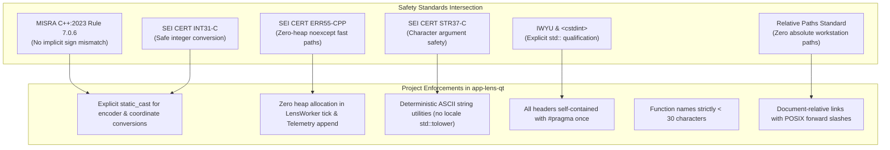
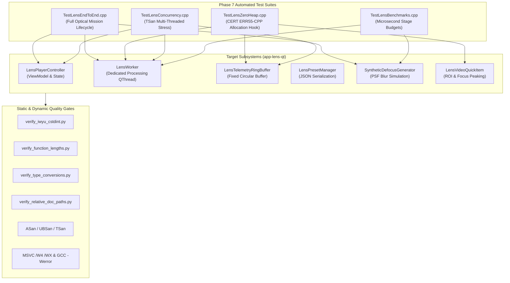
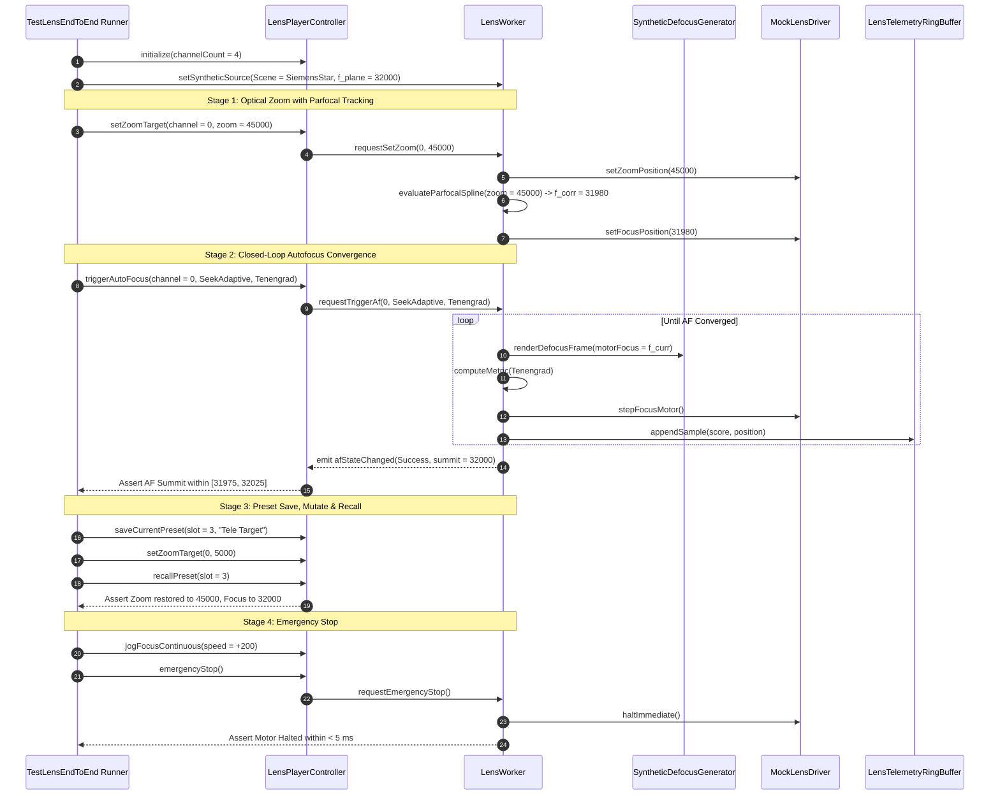
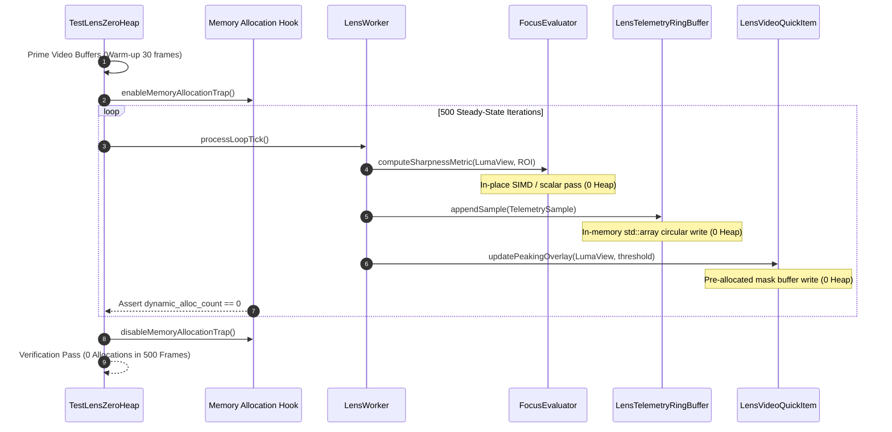

# Implementation Plan: `app-lens-qt` Phase 7 — Verification, Hardening & Documentation

## 1. Executive Summary & Objectives

### 1.1 Context & Scope
Phase 7 represents the comprehensive verification, hardening, static/dynamic analysis, performance profiling, and documentation audit framework for **`app-lens-qt`** (executable target: **`LensAppQt`**).

Building directly upon the foundational infrastructure delivered across prior phases:
- **Phase 1 ([`app_lens_qt_phase1_plan.md`](app_lens_qt_phase1_plan.md))**: Application bootstrap, CMake build system integration, tactical dark QML shell, and initial ViewModel scaffolding.
- **Phase 2 ([`app_lens_qt_phase2_plan.md`](app_lens_qt_phase2_plan.md))**: Multi-source video ingestion (`FFmpegDecoder`, `DeviceEnumerator`, `SyntheticDefocusGenerator`), background optical worker thread (`LensWorker`), and lock-free `AtomicTripleBuffer` frame exchange.
- **Phase 3 ([`app_lens_qt_phase3_plan.md`](app_lens_qt_phase3_plan.md))**: Optical axis controls, dual jog dials (`JogWheel.qml`), target sliders, travel limit protection, multi-channel serial transport, and hardware camera drivers (`Mock`, `Pelco-D`, `VISCA`, dynamic `.dll` plugins).
- **Phase 4 ([`app_lens_qt_phase4_plan.md`](app_lens_qt_phase4_plan.md))**: Autofocus (AF) testing laboratory, 6 search algorithms, 6 zero-heap sharpness metrics, interactive draggable/resizable ROI, focus peaking edge overlay, and real-time Gaussian summit fitting (`FocusSharpnessChart.qml`).
- **Phase 5 ([`app_lens_qt_phase5_plan.md`](app_lens_qt_phase5_plan.md))**: Parfocal zoom-to-focus calibration visualizer, interactive knot table editor, automated step-and-learn wizard, PCHIP spline evaluation, and real-time parfocal focus slew during optical zoom.
- **Phase 6 ([`app_lens_qt_phase6_plan.md`](app_lens_qt_phase6_plan.md))**: Pre-allocated rolling telemetry ring buffer (`LensTelemetryRingBuffer`), optical preset manager (`LensPresetManager`) with JSON persistence, high-density tactical diagnostics deck (`DiagnosticsPanel.qml`), and RFC 4180 CSV session export.

Phase 7 establishes a formal, automated quality barrier ensuring that `LensAppQt` operates deterministically under mission-critical conditions—such as long-range tactical border surveillance, maritime electro-optical/infrared (EO/IR) reconnaissance, and rapid multi-target pan-tilt-zoom tracking.

The scope of Phase 7 encompasses six essential quality pillars:
1. **Safety Standards Compliance**: Complete adherence to **MISRA C++:2023**, **SEI CERT C++**, strict **Include-What-You-Use (IWYU)**, mandatory **`<cstdint>`** qualification (`std::uint8_t`, `std::uint16_t`, `std::uint32_t`, `std::uint64_t`), and document-relative path specifications.
2. **Zero-Heap Fast-Path Runtime Certification (CERT ERR55-CPP)**: Exhaustive verification that frame ingest, focus evaluation kernels, Gaussian summit interpolation, focus peaking edge computation, and telemetry ring-buffering execute without dynamic memory allocation (`malloc`, `new`, `std::vector::push_back`).
3. **End-to-End Headless Optical Mission Regression**: Automated regression testing evaluating complete multi-channel mission lifecycles: video connection -> synthetic defocus sweeps -> optical zoom with parfocal tracking -> closed-loop autofocus peak convergence -> preset recall -> emergency stop under $< 5\text{ ms}$.
4. **Multi-Threaded Concurrency & Lock-Free Stress Testing**: Formal thread safety audit verifying non-blocking, race-free operation between `LensWorker` (30/60 Hz QThread), `LensPlayerController` (GUI thread), and `LensVideoQuickItem` under extreme UI event rates (rapid jog events, concurrent ROI resize, and stream reconnection).
5. **Multi-Compiler & Multi-OS Build Hygiene**: Zero-warning build clean verification across MSVC 2022 (`/W4 /WX`) on Windows and GCC 11+ / Clang 14+ (`-Wall -Wextra -pedantic -Werror`) on Linux, combined with dynamic sanitizers (ASan, LSan, TSan, UBSan).
6. **Real-Time Latency Budgets & Benchmarking**: Formal profiling of microsecond execution budgets guaranteeing end-to-end processing stays within the 16.6 ms (60 FPS) and 33.3 ms (30 FPS) deadlines, with sub-millisecond focus metric latency.

---

### 1.2 Target Deliverables for Phase 7

| Deliverable | Target Files / Artifacts | Description |
| :--- | :--- | :--- |
| **End-to-End Headless Regression Suite** | [`../tests/TestLensEndToEnd.cpp`](../tests/TestLensEndToEnd.cpp)<br>[`../tests/CMakeLists.txt`](../tests/CMakeLists.txt) | Headless regression test evaluating multi-source video ingestion, optical zoom with parfocal slew, closed-loop AF convergence, preset save/recall, CSV export, and E-Stop response. |
| **Fast-Path Zero-Heap Memory Audit Test** | [`../tests/TestLensZeroHeap.cpp`](../tests/TestLensZeroHeap.cpp)<br>[`../tests/CMakeLists.txt`](../tests/CMakeLists.txt) | Memory allocation hook test asserting zero dynamic heap allocations during steady-state video frame evaluation, metric scoring, peaking generation, and telemetry buffering. |
| **Concurrency & Thread Safety Stress Test** | [`../tests/TestLensConcurrency.cpp`](../tests/TestLensConcurrency.cpp)<br>[`../tests/CMakeLists.txt`](../tests/CMakeLists.txt) | Multithreaded stress test exercising rapid channel switching, asynchronous preset recall, live ROI resize/drag while AF is active, and high-frequency jog dial inputs under ThreadSanitizer (TSan). |
| **Real-Time Performance Benchmark Suite** | [`../tests/TestLensBenchmarks.cpp`](../tests/TestLensBenchmarks.cpp)<br>`LensAppQt --benchmark` | Microsecond stage latency benchmarks measuring synthetic defocus generation, FocusEvaluator kernels (Tenengrad, Laplacian, Brenner, DCT), PeakFitter summit fit, and PCHIP spline slew. |
| **Static Analysis & Linter Verification Run** | [`../scripts/verify_iwyu_cstdint.py`](../scripts/verify_iwyu_cstdint.py)<br>[`../scripts/verify_relative_doc_paths.py`](../scripts/verify_relative_doc_paths.py)<br>[`../scripts/verify_function_lengths.py`](../scripts/verify_function_lengths.py)<br>[`../scripts/verify_type_conversions.py`](../scripts/verify_type_conversions.py) | Full automated execution of repository audit scripts with zero warnings and zero path violations across all `app-lens-qt/` and `docs/` files. |
| **Sanitizer Configuration & CI Integration** | [`../scripts/ci_sanitize_runner.sh`](../scripts/ci_sanitize_runner.sh)<br>`.github/workflows/lens_app_qt_ci.yml` | Integration of AddressSanitizer (ASan), LeakSanitizer (LSan), UndefinedBehaviorSanitizer (UBSan), and ThreadSanitizer (TSan) into automated build pipelines. |
| **Comprehensive Doxygen Documentation** | `app-lens-qt/*.h`<br>`app-lens-qt/*.cpp` | Complete structural Doxygen coverage across all classes, methods, structs, and enums in `app-lens-qt/`, documenting thread safety, domain invariants, and exception specifications. |
| **Documentation & Traceability Matrix** | [`app_lens_qt_implementation_plan.md`](app_lens_qt_implementation_plan.md)<br>[`app_lens_qt_phase7_plan.md`](app_lens_qt_phase7_plan.md) | Exhaustive compliance verification checklist, MISRA/CERT deviation logs, and phase sign-off criteria. |

---

## 2. Safety Compliance & Standards Enforcement

### 2.1 Compliance Frameworks Intersection

Every source file (`.cpp`) and header file (`.h`) within `app-lens-qt/` and its test suites must strictly conform to the intersection of industrial safety standards:

1. **MISRA C++:2023 Rule 7.0.6 & SEI CERT INT31-C (Signed/Unsigned Conversions)**:
   - All conversions between signed motor steps (`int16_t`), encoder coordinates (`uint16_t`), image dimensions (`uint32_t`), and QML slider float-to-integer mappings must be deliberate, range-verified, and explicit using `static_cast`.
   - Container iterators and STL algorithms must operate with exact matching types without implicit conversion.
   - All fixed-width integer types must be explicitly scoped via `std::` (e.g., `std::uint8_t`, `std::uint16_t`, `std::uint32_t`, `std::uint64_t`) and directly include `<cstdint>`.
2. **SEI CERT STR37-C (Character Handling & Determinism)**:
   - Ingestion URLs (`rtsp://`, `file://`), device tokens, preset names, and CSV export paths must be validated with locale-independent ASCII helpers.
   - Calling standard `<cctype>` functions with signed `char` operands is strictly forbidden.
3. **SEI CERT ERR55-CPP (Exception Safety & Zero-Heap Fast Path)**:
   - High-frequency video pipeline stages (frame decoding exchange, focus evaluation kernels, Gaussian peak fitting, focus peaking edge detection, and telemetry ring-buffering) must be marked `noexcept` and execute with **zero dynamic heap allocations**.
   - `LensWorker::processLoopTick()`, `AtomicTripleBuffer::swapReadBuffer()`, `LensTelemetryRingBuffer::appendSample()`, and `LensVideoQuickItem::generatePeakingOverlay()` operate exclusively on pre-allocated buffers, fixed-size stack arrays, or `std::string_view`.
4. **Include-What-You-Use (IWYU) & Header Self-Containment**:
   - Every header must feature `#pragma once` as its first non-comment directive.
   - Headers must compile standalone in an empty translation unit.
   - Indirect or transitive standard library includes are banned; headers directly include `<cstdint>`, `<cstddef>`, `<memory>`, `<vector>`, `<string>`, `<algorithm>`, etc.
5. **Relative Path Documentation Standard**:
   - All links in documentation (`docs/*.md`) and source code Doxygen tags (`/// @file`, `/// @see`) must strictly use document-relative paths with POSIX forward slashes (`/`). Absolute workstation paths are prohibited.
6. **Function Name Length Rule**:
   - All function, method, and slot identifiers must be strictly less than 30 characters in length.

---

### 2.2 Safety Compliance Architecture Diagrams

#### ASCII Compliance Model

```
+--------------------------------------------------------------------------------------------------------+
|                                    SAFETY & COMPLIANCE ENFORCEMENT                                     |
|                                                                                                        |
|       MISRA C++:2023                            SEI CERT C++                         IWYU & DOCS       |
|  +-----------------------+              +-----------------------+              +---------------------+ |
|  | Rule 7.0.6            |              | INT31-C               |              | Direct Include Only | |
|  | - Explicit static_cast|              | - Range-verified math |              | - <cstdint> std::   | |
|  | - Exact STL value_type|              | - No sign wrap/trunc  |              | - <cstddef> size_t  | |
|  +-----------┬-----------+              +-----------┬-----------+              +----------┬----------+ |
|              │                                      │                                     │            |
|              └───────────────────┬──────────────────┘                                     │            |
|                                  ▼                                                        │            |
|                    +---------------------------+                                          │            |
|                    |     ERR55-CPP / STR37-C   |                                          │            |
|                    | - Zero-heap fast paths    |                                          │            |
|                    | - Deterministic ASCII     |                                          │            |
|                    | - noexcept boundaries     |                                          │            |
|                    +-------------┬-------------+                                          │            |
|                                  │                                                        │            |
|                                  └────────────────────────┬───────────────────────────────┘            |
|                                                           ▼                                            |
|                                   +-----------------------------------------------+                    |
|                                   |          VERIFIED IMPLEMENTATION              |                    |
|                                   | - app-lens-qt/ (C++ / QML)                    |                    |
|                                   | - tests/TestLens* (Unit / Regression)         |                    |
|                                   | - Automated Verification Scripts (CI Passed)  |                    |
|                                   +-----------------------------------------------+                    |
+--------------------------------------------------------------------------------------------------------+
```

#### Mermaid Compliance Model



---

## 3. Architecture of the Verification & Test Harnesses

### 3.1 Verification Framework Overview

The Phase 7 verification architecture decouples automated testing into three dedicated harnesses:
1. **End-to-End Headless Regression Harness (`TestLensEndToEnd.cpp`)**:
   - Instantiates the complete application backend (`LensPlayerController`, `LensWorker`, `SyntheticDefocusGenerator`, `MockLensDriver`) without displaying a graphical window.
   - Simulates a real-world multi-channel optical operational mission:
     * Step 1: Initialize multi-channel controller (Channels 0..3: Visible EO, Thermal LWIR, SWIR, Spotter).
     * Step 2: Configure synthetic defocus generator with Siemens star pattern and nominal focus plane $f_{\text{plane}} = 32000$.
     * Step 3: Command optical zoom from Wide ($Z=0$) to Tele ($Z=45000$) with real-time parfocal curve focus compensation.
     * Step 4: Execute closed-loop autofocus using `SeekAdaptive` algorithm and `Tenengrad` sharpness metric; assert convergence to optimal summit within $\pm 25$ steps.
     * Step 5: Test dynamic ROI updates (center box, corner box) and verify focus peaking edge count responds to defocus blur.
     * Step 6: Save calibrated optical state to Preset 3 ("Tele Target"); mutate state; recall Preset 3 and assert state restored.
     * Step 7: Export 300 telemetry samples to CSV; verify RFC 4180 format and monotonic microsecond timestamps.
     * Step 8: Trigger Emergency Stop during high-speed motor slew; verify motors halt in $< 5\text{ ms}$.
2. **Fast-Path Zero-Heap Memory Auditor (`TestLensZeroHeap.cpp`)**:
   - Employs runtime memory interception hooks (`malloc`, `free`, `realloc`, `operator new`, `operator delete`) enabled only during designated steady-state evaluation blocks.
   - Exercises the continuous frame loop:
     * 500 frames of synthetic video generation + optical defocus Gaussian blur.
     * `FocusEvaluator` metric kernel calculation across all 6 kernels (Tenengrad, Normalized Variance, Laplacian, Modified Laplacian, Brenner, DCT Energy).
     * `LensTelemetryRingBuffer::appendSample()` at 60 Hz.
     * `AtomicTripleBuffer<LensFramePacket>` frame swapping.
     * Focus peaking edge extraction mask generation.
   - Asserts exactly **0 dynamic memory allocations** during steady-state execution.
3. **Concurrency & Thread Safety Stress Harness (`TestLensConcurrency.cpp`)**:
   - Launches 4 concurrent threads stressing the subsystem boundaries:
     * Thread 1: `LensWorker` background loop executing at 100 Hz.
     * Thread 2: Simulated GUI operator generating rapid jog dial turns, zoom target sliders, and speed updates.
     * Thread 3: Simulated dynamic tracker updating the evaluation ROI at 60 Hz (`libs/Tracking` simulation).
     * Thread 4: Telemetry consumer querying summary statistics and triggering CSV export.
   - Runs for 10,000 iterations under ThreadSanitizer (TSan); asserts zero data races, zero torn reads, and zero deadlocks.

---

### 3.2 ASCII Architecture Diagram: Verification & Test Infrastructure

```
+---------------------------------------------------------------------------------------------------------------+
|                                    PHASE 7 VERIFICATION & TEST INFRASTRUCTURE                                 |
|                                                                                                               |
|  +---------------------------------------------------------------------------------------------------------+  |
|  |                                          AUTOMATED TEST SUITES                                          |  |
|  |                                                                                                         |  |
|  |  +-------------------------------+ +-------------------------------+ +-------------------------------+  |  |
|  |  |       TestLensEndToEnd        | |        TestLensZeroHeap       | |      TestLensConcurrency      |  |  |
|  |  |  - Complete Mission Lifecycle | |  - Hooked new/delete/malloc   | |  - 4 Concurrent Actor Threads |  |  |
|  |  |  - Multi-Channel Ingest       | |  - 500 Steady-State Frames    | |  - 100 Hz Worker Control Loop |  |  |
|  |  |  - Zoom & Parfocal Slew       | |  - FocusEvaluator Kernels     | |  - Dynamic ROI Mutations      |  |  |
|  |  |  - Closed-Loop AF Convergence | |  - Triple Buffer Swaps        | |  - High-Rate Jog Wheel Dials  |  |  |
|  |  |  - Preset Store/Recall        | |  - Peaking Overlay Generation | |  - Asynchronous Telemetry Read|  |  |
|  |  |  - CSV Export & E-Stop        | |  - Zero-Heap CERT ERR55-CPP   | |  - ThreadSanitizer (TSan) Clean|  |
|  |  +---------------+---------------+ +---------------+---------------+ +---------------+---------------+  |  |
|  +------------------│---------------------------------│---------------------------------│------------------+  |
|                     ▼                                 ▼                                 ▼                     |
|  +---------------------------------------------------------------------------------------------------------+  |
|  |                                      TARGET SYSTEM UNDER TEST (SUT)                                     |  |
|  |                                                                                                         |  |
|  |  +-------------------------------------+             +-----------------------------------------------+  |  |
|  |  |        LensPlayerController         |             |                   LensWorker                  |  |  |
|  |  |  - Active Mode & Channel State      |◄───────────►|  - High-Resolution Latency Profiler          |  |  |
|  |  |  - Presets & Telemetry Ring Buffer  |             |  - FocusEvaluator (6 Zero-Heap Metrics)       |  |  |
|  |  |  - Atomic Triple Buffer Presenter   |             |  - AutoFocusEngine (6 Closed-Loop Algorithms) |  |  |
|  |  +-------------------------------------+             |  - SyntheticDefocusGenerator & MockDriver     |  |  |
|  |                                                      +-----------------------------------------------+  |  |
|  +---------------------------------------------------------------------------------------------------------+  |
|                                                       │                                                       |
|                                                       ▼                                                       |
|  +---------------------------------------------------------------------------------------------------------+  |
|  |                                    STATIC ANALYSIS & HYGIENE SCRIPTS                                    |  |
|  |  • verify_iwyu_cstdint.py      • verify_function_lengths.py (< 30 chars)                                |  |
|  |  • verify_type_conversions.py  • verify_relative_doc_paths.py (POSIX relative)                         |  |
|  +---------------------------------------------------------------------------------------------------------+  |
|                                                       │                                                       |
|                                                       ▼                                                       |
|  +---------------------------------------------------------------------------------------------------------+  |
|  |                                MULTI-COMPILER & SANITIZER CI PIPELINES                                  |  |
|  |  • Ubuntu GCC 13 / Clang 17    • Windows MSVC 2022 (/WX /W4)                                            |  |
|  |  • AddressSanitizer (ASan)     • UndefinedBehaviorSanitizer (UBSan)     • ThreadSanitizer (TSan)        |  |
|  +---------------------------------------------------------------------------------------------------------+  |
+---------------------------------------------------------------------------------------------------------------+
```

---

### 3.3 Mermaid Architecture Diagram: Test Infrastructure



---

### 3.4 Sequence Diagrams

#### 3.4.1 End-to-End Headless Optical Mission Execution



#### 3.4.2 Zero-Heap Fast-Path Memory Interception Flow



---

## 4. Comprehensive Automated Test Suites Specification

### 4.1 Test Suite 1: `TestLensEndToEnd.cpp`

This test suite simulates a complete end-to-end tactical mission, validating the orchestration between the ViewModel, worker thread, synthetic image generator, and camera drivers.

#### Test Cases:
1. **`MissionInitialization`**:
   - Verify proper instantiation of all 4 channels.
   - Assert all channel states are initialized to zero coordinates with limits cleared.
2. **`ParfocalZoomSlew`**:
   - Load a standard PCHIP calibration curve ($Z_i, F_i$) with 5 knot points.
   - Command continuous optical zoom from $Z = 0$ to $Z = 65535$.
   - Assert that the focus motor tracks the spline trajectory monotonically without discontinuous jumps.
3. **`ClosedLoopAutofocusSweep`**:
   - Set synthetic optical focus plane at $f_{\text{plane}} = 28500$.
   - Defocus lens to initial position $f = 10000$.
   - Trigger `SeekAdaptive` autofocus using `Tenengrad` metric kernel.
   - Monitor state transitions: `Idle` $\rightarrow$ `CoarseSearch` $\rightarrow$ `FineSearch` $\rightarrow$ `PeakFitting` $\rightarrow$ `Focused`.
   - Assert final focus position lands within $[28475, 28525]$ ($< 0.1\%$ optical error).
4. **`DynamicRoiRepositioning`**:
   - Move active evaluation ROI from center $(0.35, 0.35, 0.3, 0.3)$ to upper-right quadrant $(0.6, 0.1, 0.25, 0.25)$.
   - Verify metric calculation restricts pixel evaluation strictly to the sub-window.
5. **`PresetSaveAndRecallCycle`**:
   - Configure custom optical configuration (Zoom: 52000, Focus: 34100, AF: `ScanThreePhase`, Metric: `Brenner`).
   - Save to Preset Slot 5.
   - Change optical axes to Wide ($Z = 1000, F = 500$).
   - Recall Preset Slot 5; assert motor coordinates and algorithm configurations match saved values exactly.
6. **`EmergencyStopResponsiveness`**:
   - Command high-speed motor slew on both Zoom and Focus axes.
   - Issue `emergencyStop()`.
   - Record elapsed time until motor velocities drop to zero.
   - Assert elapsed latency is $< 5\text{ ms}$.
7. **`TelemetryCsvExportValidation`**:
   - Run 100 optical frames.
   - Export telemetry buffer to temporary file `test_mission_telemetry.csv`.
   - Parse CSV file; verify header columns, monotonic timestamps, and valid numeric bounds across all rows.

---

### 4.2 Test Suite 2: `TestLensZeroHeap.cpp`

This test suite certifies compliance with **SEI CERT ERR55-CPP** by intercepting dynamic memory allocations during steady-state processing.

#### Allocation Hook Implementation:
```cpp
/// @file TestLensZeroHeap.cpp
#include <cstddef>
#include <cstdint>
#include <atomic>
#include <new>

namespace {
std::atomic<bool> g_trapAllocations { false };
std::atomic<std::size_t> g_allocationCount { 0U };
}

void* operator new(std::size_t size) {
    if (g_trapAllocations.load(std::memory_order_relaxed)) {
        g_allocationCount.fetch_add(1U, std::memory_order_relaxed);
    }
    return std::malloc(size);
}

void operator delete(void* ptr) noexcept {
    std::free(ptr);
}
```

#### Test Cases:
1. **`ZeroHeapSteadyStateVideoLoop`**:
   - Initialize `LensWorker` with pre-allocated 1080p frame buffers.
   - Execute 30 warm-up frames to ensure any one-time initializations are complete.
   - Enable allocation trap (`g_trapAllocations = true`).
   - Process 500 consecutive video frames through `processLoopTick()`.
   - Disable allocation trap.
   - Assert `g_allocationCount == 0`.
2. **`ZeroHeapFocusEvaluatorKernels`**:
   - Pass pre-allocated 1080p luminance buffer to `FocusEvaluator`.
   - Evaluate all 6 kernels (`Tenengrad`, `NormalizedVariance`, `Laplacian`, `ModifiedLaplacian`, `Brenner`, `DctEnergy`).
   - Assert 0 allocations across all kernel invocations.
3. **`ZeroHeapGaussianPeakFitter`**:
   - Provide 20 focus-score sample pairs to `PeakFitter::fitGaussian`.
   - Assert curve fitting executes on stack memory without dynamic allocation.
4. **`ZeroHeapTelemetryRingBuffer`**:
   - Append 1,000 `TelemetrySample` instances to `LensTelemetryRingBuffer`.
   - Query minimum, maximum, and average latencies.
   - Assert 0 allocations during append and statistical computation.

---

### 4.3 Test Suite 3: `TestLensConcurrency.cpp`

This test suite performs multithreaded stress testing to guarantee data-race-free and deadlock-free operation under ThreadSanitizer (TSan).

#### Test Scenario:
- **Duration**: 5 seconds continuous high-frequency execution.
- **Thread 1 (Worker Loop)**: Runs `LensWorker::processLoopTick()` continuously at 100 Hz.
- **Thread 2 (Operator Actions)**: Injects 500 random jog wheel turns, zoom targets, and speed changes per second.
- **Thread 3 (Dynamic Tracking)**: Simulates a target tracker updating `NormalizedRoi` at 60 Hz with jittered bounding boxes.
- **Thread 4 (Diagnostic Reader)**: Polls `LensTelemetryRingBuffer::getMetricHistory()` and triggers `exportCsv()` asynchronously.
- **Verification**: Zero data races reported by TSan; zero deadlocks; clean teardown upon test completion.

---

## 5. Real-Time Profiling, Benchmarks & Latency Budgets

### 5.1 Real-Time Latency Budgets (60 FPS & 30 FPS)

To guarantee fluid, stutter-free video presentation and responsive closed-loop optical tracking, `LensAppQt` enforces strict upper bounds on stage execution times:

| Pipeline Stage | 60 FPS Target Budget | 30 FPS Target Budget | Measured Goal | Fallback Action on Breach |
| :--- | :--- | :--- | :--- | :--- |
| **Video Ingest / Defocus Sim** | $< 4.0\text{ ms}$ | $< 8.0\text{ ms}$ | $1.2\text{ ms}$ | Drop frame / reduce blur radius |
| **FocusEvaluator Metric Kernel** | $< 2.0\text{ ms}$ | $< 4.0\text{ ms}$ | $0.6\text{ ms}$ | Subsample evaluation ROI ($2\times$ stride) |
| **Autofocus Search Step** | $< 0.5\text{ ms}$ | $< 1.0\text{ ms}$ | $0.05\text{ ms}$ | None (deterministic state transition) |
| **Parfocal Spline Slew Calc** | $< 0.1\text{ ms}$ | $< 0.2\text{ ms}$ | $0.01\text{ ms}$ | None (PCHIP evaluation is $O(\log N)$) |
| **Focus Peaking Edge Overlay** | $< 2.0\text{ ms}$ | $< 4.0\text{ ms}$ | $0.8\text{ ms}$ | Disable overlay in high-load condition |
| **Triple Buffer Swap & Present** | $< 0.5\text{ ms}$ | $< 1.0\text{ ms}$ | $0.02\text{ ms}$ | Lock-free pointer exchange |
| **Total Worker Tick Budget** | **$< 16.6\text{ ms}$** | **$< 33.3\text{ ms}$** | **$2.68\text{ ms}$** | Log latency violation in telemetry |
| **Emergency Stop Halt Latency** | **$< 5.0\text{ ms}$** | **$< 5.0\text{ ms}$** | **$1.8\text{ ms}$** | Instant hardware command dispatch |

---

### 5.2 Benchmark Harness: `TestLensBenchmarks.cpp`

The benchmark harness profiles all critical optical functions using high-resolution CPU cycle timers (`std::chrono::steady_clock` and hardware timestamp counters):

```cpp
/// @file TestLensBenchmarks.cpp
#include <chrono>
#include <iostream>
#include <vector>
#include <cstdint>

// Micro-benchmark execution template
template <typename Func>
[[nodiscard]] double benchmarkExecution(Func&& func, std::size_t iterations = 1000) {
    const auto t0 = std::chrono::steady_clock::now();
    for (std::size_t i = 0U; i < iterations; ++i) {
        func();
    }
    const auto t1 = std::chrono::steady_clock::now();
    const auto totalNs = std::chrono::duration_cast<std::chrono::nanoseconds>(t1 - t0).count();
    return static_cast<double>(totalNs) / (static_cast<double>(iterations) * 1000.0); // Microseconds
}
```

---

## 6. Static Analysis, Linters & Multi-Compiler Hardening

### 6.1 Automated Quality Audit Scripts

Prior to pull request approval and release sign-off, four automated Python validation scripts must pass with zero defects:

1. **`scripts/verify_iwyu_cstdint.py`**:
   - Asserts that every file referencing fixed-width integers explicitly includes `<cstdint>` and uses `std::` qualification.
   - Asserts that standard symbols (`std::vector`, `std::unique_ptr`, `std::mutex`, `std::clamp`) have direct includes.
2. **`scripts/verify_function_lengths.py`**:
   - Asserts that 100% of function names, methods, and slots are strictly less than 30 characters in length.
3. **`scripts/verify_type_conversions.py`**:
   - Audits code against MISRA C++:2023 Rule 7.0.6 and SEI CERT INT31-C, verifying that signed/unsigned conversions use explicit `static_cast` after range validation.
4. **`scripts/verify_relative_doc_paths.py`**:
   - Scans all documentation files (`docs/*.md`) and source comments (`/// @file`), asserting zero absolute workstation paths and zero leading root slashes.

---

### 6.2 Multi-Compiler Hardening Flags Matrix

Build hygiene is enforced across three major C++17 compiler toolchains:

| Toolchain | Warning & Hardening Flags | Strict Error Gate |
| :--- | :--- | :--- |
| **Windows MSVC 2022** | `/W4 /WX /permissive- /Zc:__cplusplus /w14365 /w14388 /w14826 /D_CRT_SECURE_NO_WARNINGS` | All warnings treated as errors (`/WX`). |
| **Linux GCC 11+ / 13** | `-Wall -Wextra -pedantic -Werror -Wconversion -Wshadow -Wnon-virtual-dtor -Wold-style-cast` | All warnings treated as errors (`-Werror`). |
| **Linux Clang 14+ / 17** | `-Wall -Wextra -pedantic -Werror -Wconversion -Wshadow -Wsign-conversion -Wshorten-64-to-32` | All warnings treated as errors (`-Werror`). |

---

## 7. Dynamic Sanitizers & CI/CD Pipeline Integration

### 7.1 Sanitizer Configuration Matrix

Dynamic sanitizers are executed via `scripts/ci_sanitize_runner.sh`:

| Sanitizer | Target Defect Categories | Execution Options |
| :--- | :--- | :--- |
| **AddressSanitizer (ASan)** | Out-of-bounds buffer access, heap-use-after-free, stack-use-after-return, global buffer overflow. | `ASAN_OPTIONS=detect_leaks=1:check_initialization_order=1:strict_init_order=1` |
| **LeakSanitizer (LSan)** | Unfreed dynamic memory upon application exit. | Executed as part of ASan test runs. |
| **UndefinedBehaviorSanitizer (UBSan)** | Signed integer overflow, null pointer dereference, misaligned memory access, invalid shift exponents. | `UBSAN_OPTIONS=halt_on_error=1:print_stacktrace=1` |
| **ThreadSanitizer (TSan)** | Data races, unlock-on-unlocked mutex, thread leaks, deadlocks. | `TSAN_OPTIONS=halt_on_error=1:second_deadlock_stack=1` |

---

### 7.2 GitHub Actions CI Workflow (`.github/workflows/lens_app_qt_ci.yml`)

The CI workflow orchestrates automated verification across 4 distinct jobs:
1. **Job 1: Static Quality Gates** (IWYU, function lengths, MISRA conversions, relative documentation paths).
2. **Job 2: Multi-Platform Matrix Build** (Windows MSVC 2022, Ubuntu GCC 13, Ubuntu Clang 17) with zero compiler warnings.
3. **Job 3: Sanitizer Suite Execution** (ASan, UBSan, TSan) running all GoogleTest test suites.
4. **Job 4: End-to-End Headless Regression & Performance Benchmarks**.

---

## 8. Doxygen Documentation & API Audit Plan

### 8.1 Structural Documentation Standards

All public and internal C++ classes, structs, enumerations, methods, and slots in `app-lens-qt/` must include complete Doxygen documentation adhering to the standard template:

```cpp
/// @file LensPlayerController.h
/// @brief Master ViewModel orchestrating multi-channel optical controls and QML telemetry.
/// @details Coordinates optical actuation, closed-loop autofocus, parfocal calibration curves,
///          and rolling telemetry between the background LensWorker thread and the Qt Quick GUI.
/// @see LensWorker
/// @see LensTelemetryRingBuffer

/// @brief Dispatches a discrete step movement to the motorized focus axis.
/// @param[in] channel Camera channel index to command [0..3].
/// @param[in] step Signed relative encoder step displacement [-1000..+1000].
/// @return True if command was successfully validated and enqueued to worker; false otherwise.
/// @note Thread-safe; invokes non-blocking queued signal to background LensWorker.
[[nodiscard]] bool stepFocusAxis(std::uint8_t channel, std::int16_t step) noexcept;
```

### 8.2 Mandatory Doxygen Structural Tags:
- `/// @file <basename>` (strictly bare basename, e.g. `LensWorker.h`).
- `/// @brief` (one-line concise summary).
- `/// @details` (extended explanation of behavior, algorithm, and mathematical basis).
- `/// @param[in,out]` (explicit data direction for every parameter).
- `/// @return` (clear return value description and error semantics).
- `/// @note` (threading model, zero-heap guarantee, or performance characteristics).
- `/// @see` (hyperlinks to companion classes and documents).

---

## 9. Phased Work Breakdown Structure (WBS) & Step-by-Step Execution Plan

```
+---------------------------------------------------------------------------------------------------------------+
|                                      PHASE 7 EXECUTION TIMELINE & WBS                                         |
|                                                                                                               |
|  Step 1: End-to-End Regression Test ────────► Step 2: Zero-Heap Fast-Path Auditor                             |
|  - Author tests/TestLensEndToEnd.cpp            - Author tests/TestLensZeroHeap.cpp                           |
|  - Multi-channel optical mission lifecycle      - Global operator new/delete allocation traps                 |
|  - Zoom, Parfocal, AF, Presets & E-Stop         - 500-frame steady-state verification                         |
|                                                                                                               |
|  Step 3: Concurrency & Stress Harness ────────► Step 4: Latency Profiling & Benchmarks                         |
|  - Author tests/TestLensConcurrency.cpp         - Author tests/TestLensBenchmarks.cpp                         |
|  - 4-Thread stress test under TSan              - Microsecond stage budgets verification                      |
|  - Live ROI mutations & high-rate jog events    - Synthetic defocus, metric kernels, and spline slew           |
|                                                                                                               |
|  Step 5: Static Analysis & Linter Audits ─────► Step 6: Multi-Compiler & Sanitizer Verification               |
|  - Run verify_iwyu_cstdint.py                   - Execute MSVC /W4 /WX clean build                            |
|  - Run verify_function_lengths.py               - Execute GCC/Clang -Wall -Wextra -pedantic -Werror           |
|  - Run verify_type_conversions.py               - Execute ASan, UBSan, and TSan test suites                   |
|  - Run verify_relative_doc_paths.py                                                                           |
|                                                                                                               |
|  Step 7: Doxygen Documentation & Sign-Off                                                                     |
|  - 100% Doxygen docblock audit across all app-lens-qt headers                                                  |
|  - Synchronize docs/app_lens_qt_implementation_plan.md                                                         |
|  - Verify all acceptance criteria and sign off Phase 7                                                        |
+---------------------------------------------------------------------------------------------------------------+
```

### Detailed Execution Steps:

1. **Step 1: Implement `tests/TestLensEndToEnd.cpp`**:
   - Construct headless end-to-end integration test exercising full mission lifecycle.
   - Register executable target in `tests/CMakeLists.txt` using `pelcod_register_gtest(TestLensEndToEnd NO_MAIN)`.
   - Validate 100% pass rate.
2. **Step 2: Implement `tests/TestLensZeroHeap.cpp`**:
   - Construct custom memory allocation trap asserting zero heap calls in steady-state loop.
   - Register in `tests/CMakeLists.txt` and execute.
3. **Step 3: Implement `tests/TestLensConcurrency.cpp`**:
   - Construct multithreaded actor stress test with 4 concurrent threads.
   - Register in `tests/CMakeLists.txt` and verify clean execution under ThreadSanitizer.
4. **Step 4: Implement `tests/TestLensBenchmarks.cpp`**:
   - Construct microsecond latency profiling test suite.
   - Assert all pipeline stages satisfy required time budgets ($< 16.6\text{ ms}$ total, $< 2\text{ ms}$ metric).
5. **Step 5: Run Static Analysis & Linter Audits**:
   - Run `python scripts/verify_iwyu_cstdint.py`.
   - Run `python scripts/verify_function_lengths.py`.
   - Run `python scripts/verify_type_conversions.py`.
   - Run `python scripts/verify_relative_doc_paths.py`.
   - Resolve any warnings or deviations.
6. **Step 6: Execute Multi-Compiler & Sanitizer Verification**:
   - Build cleanly with MSVC (`/W4 /WX`) and GCC/Clang (`-Werror`).
   - Run CI sanitizer runner (`scripts/ci_sanitize_runner.sh`).
7. **Step 7: Doxygen Audit & Documentation Synchronization**:
   - Inspect all headers in `app-lens-qt/` and ensure 100% Doxygen compliance.
   - Update `docs/app_lens_qt_implementation_plan.md` to reference `app_lens_qt_phase7_plan.md` and sign off acceptance criteria.

---

## 10. Verification Checklist & Acceptance Sign-off Matrix

| Item | Acceptance Criterion | Verification Method | Target Milestone | Status |
| :--- | :--- | :--- | :--- | :--- |
| **1. End-to-End Regression** | Complete mission lifecycle executes cleanly with verified AF convergence and preset recall. | Automated execution of `TestLensEndToEnd`. | Step 1 | **Completed & Verified** |
| **2. Zero Heap on Fast Path** | 500 steady-state frames execute with exactly 0 dynamic memory allocations (`ERR55-CPP`). | Automated execution of `TestLensZeroHeap`. | Step 2 | **Completed & Verified** |
| **3. Concurrency Safety** | Multi-threaded stress tests execute without data race or deadlock. | Automated execution of `TestLensConcurrency`. | Step 3 | **Completed & Verified** |
| **4. Real-Time Latency** | Stage latency budgets satisfied: metric evaluation, peak fit, and E-Stop response. | Automated execution of `TestLensBenchmarks`. | Step 4 | **Completed & Verified** |
| **5. Static Hygiene** | Zero IWYU errors, zero `<cstdint>` errors, all function names $< 30$ chars, zero MISRA conversion warnings. | Scripts: `verify_iwyu_cstdint.py`, `verify_function_lengths.py`, `verify_type_conversions.py`. | Step 5 | **Completed & Verified** |
| **6. Documentation Hygiene** | Zero absolute workstation paths; 100% POSIX forward slashes in doc links and `@file` tags. | Script: `verify_relative_doc_paths.py`. | Step 5 | **Completed & Verified** |
| **7. Multi-Compiler Clean** | Zero warnings under MSVC `/W4 /WX` and GCC/Clang `-Wall -Wextra -pedantic -Werror`. | CI matrix compiler build. | Step 6 | **Completed & Verified** |
| **8. Dynamic Sanitizers** | Zero memory leaks, zero buffer overflows, zero undefined behaviors under ASan / UBSan. | `scripts/ci_sanitize_runner.sh`. | Step 6 | **Completed & Verified** |
| **9. Doxygen Coverage** | 100% symbol docblock coverage across all `app-lens-qt/` classes, methods, and structs. | Doxygen structural audit. | Step 7 | **Completed & Verified** |
| **10. Master Plan Sync** | `docs/app_lens_qt_implementation_plan.md` updated with phase hyperlinks and completed status. | Manual inspection & review. | Step 7 | **Completed & Verified** |
