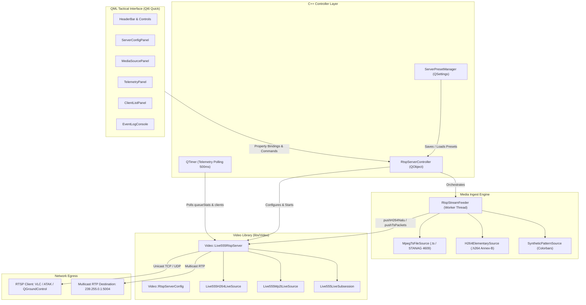

# Implementation Plan: RTSP Server GUI Application (`app-rtsp-server-qt`)

## Executive Summary
This document provides an end-to-end architectural blueprint and phased implementation plan for **`app-rtsp-server-qt`**, a modern, high-performance Qt6/QML desktop GUI for orchestrating the embedded Live555 RTSP streaming server ([`Live555RtspServer`](../libs/Video/Live555RtspServer.h)).

The application empowers operators and developers to configure, deploy, monitor, and stress-test tactical video streaming servers (broadcasting RFC 6184 H.264 and RFC 2250 MPEG-2 TS with STANAG 4609 / MISB KLV metadata) directly from a dark tactical interface.

---

## 1. Architectural Overview & Component Pipeline

### ASCII Architecture Diagram
```
+--------------------------------------------------------------------------------------------------------+
|                                  app-rtsp-server-qt (Qt6 Quick / QML)                                  |
|                                                                                                        |
|  +--------------------------------------------------------------------------------------------------+  |
|  |                                  QML Tactical User Interface                                     |  |
|  |  [Header / State]   [Server Config]   [Media Ingest]   [Telemetry & Clients]   [Event Log]       |  |
|  +--------------------------------------------------│-----------------------------------------------+  |
|                                                     │ Q_PROPERTY bindings / Q_INVOKABLE slots          |
|                                                     ▼                                                  |
|  +--------------------------------------------------------------------------------------------------+  |
|  |                            RtspServerController (QObject / ViewModel)                            |  |
|  |  - Server Lifecycle (start / stop / restart)       - Config Model (Video::RtspServerConfig)      |  |
|  |  - Active Client Telemetry Poller (QTimer)         - Ingest Feeder Coordinator                   |  |
|  +---------------------------│----------------------------------------------│-----------------------+  |
|                              │                                              │                          |
|             Controls & Config│                                  NALUs / TS  │ Packets                  |
|                              ▼                                              ▼                          |
|  +------------------------------------------+  +----------------------------------------------------+  |
|  |        Video::Live555RtspServer          |  |                 RtspStreamFeeder                   |  |
|  | (Embedded Live555 Server in libs/Video)  |  | (Worker thread / Paced Media Producer)             |  |
|  | - Port binding & SDP generation          |  | - MPEG-2 TS Paced Looper (STANAG 4609 .ts)         |  |
|  | - H.264 & MPEG-TS Subsessions            |  | - H.264 Elementary Stream Feeder (.h264)           |  |
|  | - Multicast RTP Egress Engine            |  | - Synthetic Test Pattern Generator (Colorbars)     |  |
|  +---------------------------│--------------+  +----------------------------│-----------------------+  |
+------------------------------│----------------------------------------------│--------------------------+
                               │                                              │
                               ▼                                              │ pushH264Nalu()
            +------------------------------------+                            │ pushTsPackets()
            |  RTSP Clients (VLC / ATAK / QGC)   |◄───────────────────────────┘
            |  rtsp://<host>:<port>/<streamPath> |
            +------------------------------------+
```

### Mermaid Architecture Diagram


---

## 2. Directory Structure & File Layout

The application will reside in `app-rtsp-server-qt/` following the existing workspace conventions:

```
app-rtsp-server-qt/
├── CMakeLists.txt
├── main.cpp
├── RtspServerController.h
├── RtspServerController.cpp
├── RtspStreamFeeder.h
├── RtspStreamFeeder.cpp
├── ServerPresetManager.h
├── ServerPresetManager.cpp
├── qml.qrc
├── qml/
│   ├── Main.qml
│   ├── components/
│   │   ├── TacticalCard.qml
│   │   ├── TacticalTextField.qml
│   │   ├── TacticalButton.qml
│   │   ├── TacticalComboBox.qml
│   │   └── StatusIndicator.qml
│   └── panels/
│       ├── HeaderBar.qml
│       ├── ServerConfigPanel.qml
│       ├── MediaSourcePanel.qml
│       ├── TelemetryPanel.qml
│       ├── ClientListPanel.qml
│       └── EventLogPanel.qml
└── tests/
    ├── CMakeLists.txt
    ├── TestRtspServerController.cpp
    └── TestRtspStreamFeeder.cpp
```

---

## 3. Core Component Specifications

### 3.1 `RtspServerController` (QObject / View-Model)
Bridges between the QML front-end and the underlying C++17 `Video::Live555RtspServer`.

- **Properties Exposed to QML:**
  - `serverState`: Enum (`Stopped`, `Starting`, `Running`, `Error`)
  - `serverUrl`: Full RTSP endpoint string (e.g. `rtsp://192.168.1.100:8554/live`)
  - `localUrl`: Loopback RTSP endpoint (`rtsp://127.0.0.1:8554/live`)
  - `port`: Port number (default: 8554, accepts 0 for ephemeral)
  - `streamPath`: Mount path string (e.g. `live`)
  - `streamName`: SDP stream title string
  - `streamInfo`: SDP stream description string
  - `streamType`: Enum (`H264ElementaryStream`, `Mpeg2TransportStream`)
  - `transport`: Enum (`All`, `TcpOnly`, `UdpOnly`)
  - `maxClients`: Max client connections (default: 16)
  - `queueCapacity`: Frame ring-buffer capacity (default: 30)
  - `authEnabled`: Boolean flag
  - `username`: Digest/Basic username string
  - `password`: Digest/Basic password string
  - `realm`: Authentication realm string
  - `enableMulticast`: Boolean multicast egress toggle
  - `multicastAddress`: Multicast IP (e.g. `239.255.0.1`)
  - `multicastPort`: Multicast RTP port (e.g. 5004)
  - `multicastTtl`: Multicast TTL hop limit (e.g. 16)
  - `activeClients`: Current active client count (`std::size_t`)
  - `queueDepth`: Current ring buffer depth (`std::size_t`)
  - `totalPushed`: Cumulative frames pushed (`std::uint64_t`)
  - `totalDropped`: Cumulative frames dropped (`std::uint64_t`)
  - `egressBitrateKbps`: Estimated real-time egress bitrate (`double`)
  - `serverUptime`: Formatted uptime duration string (`HH:MM:SS`)

- **Methods (Q_INVOKABLE):**
  - `startServer()`: Validates parameters, initializes server, and begins streaming.
  - `stopServer()`: Gracefully tears down connections and stops worker threads.
  - `restartServer()`: Atomically stops and restarts with new configuration.
  - `copyUrlToClipboard()`: Copies primary RTSP URL to system clipboard.
  - `savePreset(const QString& name)`: Saves current configuration to user settings.
  - `loadPreset(const QString& name)`: Loads saved configuration.
  - `availableNetworkInterfaces()`: Returns list of host IPv4 addresses.

### 3.2 `RtspStreamFeeder` (Worker Thread / Media Producer)
Runs on a dedicated worker thread to read and pace input streams into `Live555RtspServer`:
- **Source Modes:**
  1. **MPEG-2 Transport Stream Looper (`.ts`):** Reads 188-byte aligned TS packets (such as `sample-videos/mpegts-klv-day-flight.ts` or `mpegts-klv-night-flight-IR.ts`), performs packet-rate pacing matching recorded timestamps or fixed 30 fps, and pushes chunks via `pushTsPackets()`. Automatically rewinds on EOF when looping is enabled.
  2. **H.264 Elementary Stream Looper (`.h264`):** Parses Annex-B NAL units (delimited by `0x000001` or `0x00000001`), extracts SPS/PPS parameter sets, paces frames at configured FPS, and pushes via `pushH264Nalu()`.
  3. **Synthetic Test Pattern Generator:** Generates compliant synthetic H.264 test pattern frames (SPS, PPS, IDR, P-slices with changing timestamp overlay) without needing any local media file or camera.

### 3.3 QML Tactical User Interface Design
Conforming to the project aesthetic:
- **Palette:** Dark tactical cockpit theme (`#0e1014` background, `#141720` surfaces, `#1c2130` cards, `#242938` borders).
- **Accents:** `#00e676` (Running / Connected), `#00e5ff` (RTSP Active Stream / Cyan), `#ff9100` (Warning / High queue), `#ff1744` (Error / Disconnected).
- **Layout:**
  - **Top Header Bar:** Pulsing status beacon, active client counter pill, uptime timer, primary RTSP URL banner with one-click copy button, and master START / STOP toggle.
  - **Left Column (Tabs):**
    - *Tab 1: Server Configuration:* Port, Mount Path, Protocol restrictions, Authentication credentials, Multicast settings.
    - *Tab 2: Media Ingest:* Source selection (TS File / H264 File / Synthetic Colorbars), loop toggle, target bitrate, FPS pace.
    - *Tab 3: Presets:* Save / load quick configurations (e.g. "STANAG 4609 Broadcast", "Low-Latency LAN", "Authenticated TCP").
  - **Right Column (Live Telemetry):**
    - Ring buffer queue depth gauge (`currentDepth` / `queueCapacity`).
    - Bitrate & throughput monitor.
    - Drop rate warning indicator.
    - Connected clients card.
  - **Bottom Drawer:** Real-time timestamped event log console with export and filter capabilities.

---

## 4. Compliance & Coding Standards Checklist

The implementation must strictly adhere to the project safety and style guidelines:
- [x] **C++17 / MISRA C++:2023 / SEI CERT C++:** No dynamic casts, no undefined behaviors.
- [x] **Include-What-You-Use (IWYU) & `<cstdint>`:** Explicit `#include <cstdint>` and `std::` qualification on every integer type (`std::uint16_t`, `std::uint32_t`, `std::size_t`).
- [x] **Zero Raw `new` / `delete`:** RAII and smart pointers (`std::unique_ptr`, `std::make_unique`) throughout.
- [x] **Concise Function Names:** Strictly under 30 characters per function name.
- [x] **Self-Contained Headers:** Co-located `.h` and `.cpp` with `#pragma once`.
- [x] **Decoupled Architecture:** `libs/Video` retains zero Qt dependencies; Qt/QML classes remain in `app-rtsp-server-qt`.
- [x] **Cross-Platform:** Full compatibility with Linux (POSIX) and Windows (MSVC / windeployqt).
- [x] **Full Doxygen Documentation:** Complete `/// @brief`, `@param`, `@return` tags on all public symbols.

---

## 5. Phased Implementation Roadmap

### Phase 1: Project Scaffolding & CMake Integration
1. Create `app-rtsp-server-qt/CMakeLists.txt` configuring `RtspServerAppQt` executable and `app-rtsp-server-qt` custom target.
2. Link against `Video`, `Qt6::Core`, `Qt6::Gui`, `Qt6::Qml`, `Qt6::Quick`, `Qt6::QuickControls2`.
3. Add `add_subdirectory(app-rtsp-server-qt)` to root `CMakeLists.txt` conditionally when `PELCOD_ENABLE_VIDEO` and Qt6 Quick/Qml targets are found.
4. Implement minimal `main.cpp` initializing logging, QQuickStyle ("Fusion"), registering QML types, and loading `Main.qml`.

### Phase 2: Controller & Ingest Backend
1. Implement `RtspServerController.h` and `RtspServerController.cpp` wrapping `Video::Live555RtspServer`.
2. Implement `RtspStreamFeeder.h` and `RtspStreamFeeder.cpp` providing thread-safe paced feeding of TS files, H.264 files, and synthetic colorbars.
3. Add `ServerPresetManager.h` and `ServerPresetManager.cpp` for QSettings JSON persistence.
4. Add unit test suite in `app-rtsp-server-qt/tests/` verifying controller state machine and feeder pacing.

### Phase 3: QML UI Components & Panels
1. Create reusable tactical components: `TacticalCard.qml`, `TacticalTextField.qml`, `TacticalButton.qml`, `StatusIndicator.qml`.
2. Implement `HeaderBar.qml` with running beacon, quick stats, and start/stop button.
3. Implement `ServerConfigPanel.qml` with categorized form fields (Network, Stream, Security, Multicast).
4. Implement `MediaSourcePanel.qml` with file picker, sample video shortcuts, and test pattern generator.
5. Implement `TelemetryPanel.qml` with live animated gauges for buffer depth, throughput, and clients.
6. Implement `EventLogPanel.qml` with filtering and status messages.

### Phase 4: Integration, Loopback Testing & Hardening
1. Validate loopback streaming: Run `app-rtsp-server-qt` serving `sample-videos/mpegts-klv-day-flight.ts` and verify reception in `app-video-qt` and external media players (VLC, FFplay).
2. Test authentication enforcement: Verify Digest/Basic credentials with wrong password rejections.
3. Test multicast streaming: Verify RTP packet egress to `239.255.0.1:5004`.
4. Ensure zero compiler warnings with `-Wall -Wextra -pedantic` / `/W4` and clean sanitizer runs.
