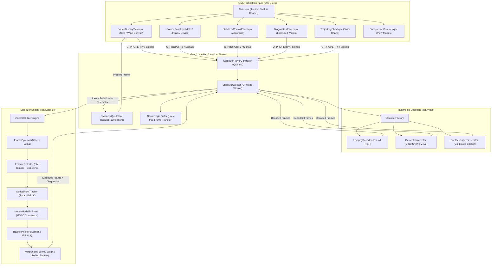

# Implementation Plan: Qt QML Video Stabilizer Testing Application (`app-stabilizer-qt`)

## Executive Summary

This document provides a comprehensive architectural blueprint and phased implementation plan for **`app-stabilizer-qt`** (executable target: **`StabilizerAppQt`**), a modern, high-performance Qt6/QML desktop application designed to test, validate, and tune the clean-room digital video stabilization library in [`libs/Stabilizer`](../libs/Stabilizer).

The application provides an interactive testbench allowing engineers and operators to ingest video from **local video files** (MP4, MKV, TS, AVI), **live low-latency network streams** (RTSP, UDP, RTP, HTTP), **hardware capture devices** (DirectShow on Windows, V4L2 on Linux), and a **synthetic shaking generator** (for calibrated benchmark regressions). Users can compare original unstabilized vs. stabilized video using an **interactive split-screen wipe**, **side-by-side view**, or **difference heatmap**, while tuning **all stabilization parameters** in real time across the feature detector, optical flow tracker, MSAC motion model estimator, trajectory smoothing filters (Kalman, Gaussian FIR, L1 optimization), and SIMD warp engine.

---

## 1. Architectural Overview & Component Pipeline

### ASCII Architecture Diagram

```
+--------------------------------------------------------------------------------------------------------+
|                                  app-stabilizer-qt (Qt6 Quick / QML)                                   |
|                                                                                                        |
|  +--------------------------------------------------------------------------------------------------+  |
|  |                                  QML Tactical User Interface                                     |  |
|  |  [Header / Presets]   [VideoDisplayView]   [SourcePanel]   [ControlPanel]   [DiagnosticsPanel]   |  |
|  |  - Mode Selector      - Split-Screen Wipe  - File Browser  - Detector Dial  - Latency Breakdown  |  |
|  |  - Preset Loader      - Side-by-Side Dual  - RTSP URL Field- Flow & MSAC    - Trajectory Chart   |  |
|  |  - Snapshot / Export  - Quiver / Points    - Device List   - Kalman / L1    - Inlier / Loss Pill |  |
|  +--------------------------------------------------│-----------------------------------------------+  |
|                                                     │ Q_PROPERTY bindings / Q_INVOKABLE slots          |
|                                                     ▼                                                  |
|  +--------------------------------------------------------------------------------------------------+  |
|  |                          StabilizerPlayerController (QObject / ViewModel)                        |  |
|  |  - Playback Transport (Play / Pause / Step / Seek / Speed)                                        |  |
|  |  - Parameter Serialization & Invariant Bounds Verification                                        |  |
|  |  - Telemetry Aggregation & Strip-Chart Ring Buffer                                                |  |
|  +---------------------------│----------------------------------------------│-----------------------+  |
|                              │ Dispatch Frame Command                       │ Telemetry & Transforms   |
|                              ▼                                              ▲                          |
|  +------------------------------------------+  +----------------------------│-----------------------+  |
|  |         StabilizerWorkerThread           |  |                 StabilizerQuickItem                |  |
|  |  - Dedicated QThread decoding loop       |  |  - Custom QQuickPaintedItem                        |  |
|  |  - Ingests from IVideoDecoder            |  |  - Interactive Split-Screen Wipe Divider           |  |
|  |  - Zero-heap noexcept processing path    |  |  - Feature Landmark Overlay (Inlier/Outlier)       |  |
|  |  - Feeds VideoStabilizerEngine           |  |  - Motion Vector Quiver Plot & Crop Outline        |  |
|  +---------------------------│--------------+  +----------------------------------------------------+  |
+------------------------------│-------------------------------------------------------------------------+
                               ▼
+--------------------------------------------------------------------------------------------------------+
|                                    BACKEND ENGINE INTEGRATION                                          |
|                                                                                                        |
|  +------------------------------------------+  +----------------------------------------------------+  |
|  |      libs/Video (Multimedia Decoding)    |  |       libs/Stabilizer (Stabilization Engine)       |  |
|  |  - FFmpegDecoder (Files / RTSP / Streams)|  |  - FramePyramid: Luma multi-scale pyramid          |  |
|  |  - Live555Decoder (Low-latency RTSP)     |  |  - FeatureDetector: Shi-Tomasi + Grid Bucketing    |  |
|  |  - DeviceEnumerator (DirectShow / V4L2) |  |  - OpticalFlowTracker: Lucas-Kanade + BiDir Check  |  |
|  |  - MockVideoDecoder / Synthetic Shaker   |  |  - MotionModelEstimator: MSAC Parametric 2D Model  |  |
|  |  - AtomicTripleBuffer (Lock-free Ring)   |  |  - TrajectoryFilter: Kalman / Gaussian / L1       |  |
|  +------------------------------------------+  |  - WarpEngine: SIMD Affine & Rolling Shutter       |  |
|                                                +----------------------------------------------------+  |
+--------------------------------------------------------------------------------------------------------+
```

### Mermaid Architecture Diagram



---

## 2. Ingestion Modalities & Source Management

The application integrates [`libs/Video`](../libs/Video) abstractions to support four input source modes:

| Source Mode | Backend Provider | Supported Protocols / Formats | Controls & Capabilities |
| :--- | :--- | :--- | :--- |
| **Local File** | [`FFmpegDecoder`](../libs/Video/FFmpegDecoder.h) | MP4, MKV, TS, AVI, MOV, FLV | File browser dialog, timeline scrubber, Play/Pause, Step $\pm 1$ Frame, Loop toggle, Playback speed ($0.25\times$ to $4.0\times$). |
| **Live Stream** | [`FFmpegDecoder`](../libs/Video/FFmpegDecoder.h) / [`Live555Decoder`](../libs/Video/Live555Decoder.h) | `rtsp://`, `udp://`, `rtp://`, `http://` | RTSP Transport toggle (TCP/UDP), Auto-reconnect with backoff, Low-latency buffer tuning, Connection health indicator. |
| **Hardware Device** | [`DeviceEnumerator`](../libs/Video/DeviceEnumerator.h) | DirectShow (Win32), V4L2 (Linux) | Automatic device discovery dropdown, resolution selector, target framerate setting. |
| **Synthetic Shaker** | `SyntheticJitterGenerator` | In-memory procedural patterns | Procedural high-contrast grid/checkerboard or static user photo with programmable mast vibration, sinusoidal jitter, and rolling shutter jello. |

### Synthetic Jitter Generator (Benchmark Mode)
To eliminate dependency on physical camera shaking during automated tests and algorithm verification, `SyntheticJitterGenerator` provides calibrated perturbation models:
- **Mast Oscillation**: High-frequency sine wave:
  $$x(t) = A_x \sin(2\pi f_x t), \quad y(t) = A_y \cos(2\pi f_y t)$$
  with adjustable frequency ($f \in [1 .. 60]\text{ Hz}$) and amplitude ($A \in [1 .. 50]\text{ px}$).
- **Random-Walk Handheld Drift**: Damped Brownian motion simulating human arm fatigue and telephoto tremor.
- **CMOS Rolling Shutter Wobble**: Row-dependent sinusoidal shear simulating sensor readout delay under vibration:
  $$dx(y, t) = A_{\text{rs}} \sin\left(2\pi f_{\text{rs}} t + \frac{2\pi y}{H}\right)$$

---

## 3. Video Presentation Engine & Visual Comparison

The video presentation is handled by `StabilizerQuickItem` (derived from `QQuickPaintedItem`), providing hardware-accelerated rendering and comparison modes:

### Presentation Modes
1. **Split-Screen Wipe (Interactive Divider)**:
   - Left / Top region: Raw unstabilized frame.
   - Right / Bottom region: Stabilized frame.
   - Draggable on-screen divider with position indicator ($0 .. 100\%$).
2. **Side-by-Side Synchronized Dual View**:
   - Left viewport: Raw unstabilized feed with feature landmark points.
   - Right viewport: Stabilized output with active crop border.
3. **Single Toggle View**:
   - Single-click toggle between Original and Stabilized (hotkey `Space`).
4. **Difference Heatmap**:
   - Displays $|I_{\text{stabilized}} - I_{\text{raw}}|$ colorized with an inferno/plasma colormap to visually emphasize residual motion cancellation.
5. **Interactive Canvas Navigation**:
   - Mouse wheel zoom ($1\times$ to $8\times$) and right-drag pan to inspect sub-pixel edge sharpness and boundary clamping.

### Diagnostic Overlays
- **Feature Landmarks**: Green dots for consensus inliers; red crosses for outliers / rejected points.
- **Optical Flow Quiver Plot**: Vector arrows representing $(dx, dy)$ displacement across the spatial grid.
- **Crop Margin Boundary**: Visual rectangular boundary showing auto-crop margin and soft damping threshold.
- **Center Reticle**: Fixed tactical crosshair to visually anchor horizon and center-point stability.

---

## 4. Exhaustive Stabilization Parameter Matrix

The UI exposes **all configuration parameters** defined in [`libs/Stabilizer/VideoStabilizerEngine.h`](../libs/Stabilizer/VideoStabilizerEngine.h), grouped into collapsible accordion panels:

### 4.1. Core Mode & Supervisory Parameters
*Maps to [`VideoStabilizerConfig`](../libs/Stabilizer/VideoStabilizerEngine.h)*

| Parameter | Type / Range | Default | Description |
| :--- | :--- | :--- | :--- |
| `mode` | Enum: `Disabled`, `TranslationOnly`, `TranslationRotation`, `Similarity`, `Affine`, `RollingShutterComp` | `Affine` | Degrees of freedom for parametric inter-frame transformation. |
| `fallback` | Enum: `IdentityHold`, `VelocityExtrapolate`, `BypassWarp` | `VelocityExtrapolate` | Fallback policy when feature tracking consensus fails. |
| `minTrackedFeatures` | `std::uint32_t` [$5 .. 200$] | $20$ | Minimum feature count threshold triggering replenishment. |
| `replenishIntervalFrames` | `std::uint32_t` [$1 .. 60$] | $15$ | Periodic frame interval for corner replenishment. |
| `maxDegradedFrames` | `std::uint32_t` [$1 .. 120$] | $30$ | Maximum consecutive degraded frames before state machine reset. |
| `minInlierRatio` | `float` [$0.05 .. 1.00$] | $0.25$ | Minimum consensus inlier fraction required to accept motion model. |

### 4.2. Trajectory Smoothing & Filter Parameters
*Maps to [`TrajectoryConfig`](../libs/Stabilizer/TrajectoryFilter.h)*

| Parameter | Type / Range | Default | Description |
| :--- | :--- | :--- | :--- |
| `method` | Enum: `KalmanFilter`, `GaussianFIR`, `L1Optimization` | `KalmanFilter` | Trajectory smoothing algorithm. |
| `windowSize` | `std::uint32_t` [$3 .. 63$] | $31$ | Sliding window depth for FIR and L1 path optimization. |
| `maxCropMargin` | `float` [$0.00 .. 0.30$] | $0.08$ | Maximum fractional border margin reserved for stabilization motion. |
| `softMarginRatio` | `float` [$0.10 .. 0.99$] | $0.80$ | Engagement threshold ratio for non-linear damping near crop borders. |
| `processNoiseBase` ($q_a$) | `float` [$10^{-6} .. 10^{-1}$] | $10^{-4}$ | EKF continuous acceleration noise variance. |
| `measurementNoise` ($R$) | `float` [$10^{-4} .. 1.0$] | $10^{-2}$ | EKF measurement noise variance. |
| `ptzFeedforwardGain` | `float` [$0.00 .. 1.50$] | $0.95$ | Coupling gain for external gimbal velocity feedforward gating. |
| `ptzDeadband` | `float` [$0.00 .. 5.00$] deg/s | $0.15$ | Intentional gimbal slew velocity deadband. |
| `focalLength` | `float` [$1.0 .. 50000.0$] px | $1000.0$ | Effective camera focal length in pixels for angular-to-pixel projection. |

### 4.3. Feature Detector Parameters
*Maps to [`FeatureDetectorConfig`](../libs/Stabilizer/FeatureDetector.h)*

| Parameter | Type / Range | Default | Description |
| :--- | :--- | :--- | :--- |
| `qualityThreshold` | `float` [$0.0001 .. 0.50$] | $0.01$ | Minimum corner eigenvalue quality fraction of peak score. |
| `borderMargin` | `std::uint16_t` [$3 .. 64$] px | $8$ | Outer border exclusion margin in pixels. |
| `maxTotalFeatures` | `std::uint32_t` [$10 .. 2048$] | $300$ | Maximum total features maintained across frame. |
| `gridCols` $\times$ `gridRows` | `std::uint16_t` [$1 .. 32$] | $8 \times 6$ | Spatial grid bucketing dimensions for uniform landmark distribution. |
| `maxFeaturesPerCell` | `std::uint16_t` [$1 .. 64$] | $8$ | Maximum capacity per bucketing cell. |
| `minDistance` | `float` [$0.0 .. 128.0$] px | $8.0$ | Minimum Euclidean separation between detected corners. |

### 4.4. Optical Flow Tracker Parameters
*Maps to [`OpticalFlowConfig`](../libs/Stabilizer/OpticalFlowTracker.h)*

| Parameter | Type / Range | Default | Description |
| :--- | :--- | :--- | :--- |
| `windowSize` (halfWidth) | `std::uint16_t` [$2 .. 16$] px | $5$ (11x11) | Pyramidal LK integration patch window extent. |
| `numPyramidLevels` | `std::uint8_t` [$1 .. 3$] | $3$ | Number of multi-scale Gaussian pyramid levels to track. |
| `maxIterations` | `std::uint16_t` [$1 .. 100$] | $25$ | Maximum Newton-Raphson iteration limit per pyramid level. |
| `minEpsilon` | `float` [$0.001 .. 0.10$] px | $0.01$ | Convergence displacement threshold for iteration termination. |
| `minEigenvalue` | `float` [$0.0001 .. 0.05$] | $0.001$ | Minimum eigenvalue threshold for well-conditioned structure tensor. |
| `maxForwardBackwardError` | `float` [$0.05 .. 5.00$] px | $0.50$ | Bidirectional loop-closure consistency threshold. |
| `enableBidirectional` | `bool` | `true` | Enable forward-backward optical flow verification pass. |

### 4.5. Parametric Motion Model Estimator Parameters
*Maps to [`MotionEstimatorConfig`](../libs/Stabilizer/MotionModelEstimator.h)*

| Parameter | Type / Range | Default | Description |
| :--- | :--- | :--- | :--- |
| `inlierThreshold` | `float` [$0.10 .. 20.0$] px | $2.0$ | Maximum Euclidean reprojection error for consensus inliers. |
| `maxIterations` | `std::uint32_t` [$10 .. 1000$] | $200$ | Maximum MSAC random consensus sampling iterations. |
| `minIterations` | `std::uint32_t` [$5 .. 500$] | $20$ | Minimum iterations executed before adaptive consensus stop. |
| `confidence` | `float` [$0.80 .. 0.999$] | $0.99$ | Target probabilistic confidence for consensus model. |
| `randomSeed` | `std::uint32_t` | `0x12345678` | Deterministic PRNG seed for reproducible RANSAC/MSAC sampling. |
| `enableRefinement` | `bool` | `true` | Enable linear least-squares consensus refinement on inliers. |

### 4.6. Warp Engine & Rolling Shutter Parameters
*Maps to [`WarpConfig`](../libs/Stabilizer/WarpEngine.h)*

| Parameter | Type / Range | Default | Description |
| :--- | :--- | :--- | :--- |
| `interpolation` | Enum: `NearestNeighbor`, `Bilinear`, `Bicubic` | `Bilinear` | Sub-pixel texture interpolation filtering algorithm. |
| `borderMode` | Enum: `Constant`, `Replicate`, `Reflect` | `Constant` | Out-of-bounds boundary handling strategy. |
| `borderValue` | `std::uint8_t` [$0 .. 255$] | $0$ (Black) | Constant fill value when `borderMode` is `Constant`. |
| `cropRatio` | `float` [$0.00 .. 0.30$] | $0.05$ | Auto-crop canvas zoom factor hiding outer border artifacts. |
| `enableAutoCrop` | `bool` | `true` | Enable dynamic canvas zoom. |
| `enableRollingShutter` | `bool` | `false` | Enable scanline-dependent affine transform interpolation. |
| `readoutRatio` | `float` [$0.00 .. 1.00$] | $0.80$ | Ratio of sensor scanline readout duration to frame interval. |
| `scanTopToBottom` | `bool` | `true` | CMOS scanline progression direction. |

---

## 5. Real-Time Telemetry & Trajectory Strip-Charts

The application includes a telemetry dashboard providing deep visibility into stabilization performance:

### Stage Execution Latency Profiling (Bar Chart HUD)
Displays microsecond latency breakdowns for each pipeline stage:
- **Pyramid Generation**: Scale decomposition ($\mu\text{s}$).
- **Feature Detection**: Shi-Tomasi Harris corner response and bucketing ($\mu\text{s}$).
- **Optical Flow Tracking**: Pyramidal Lucas-Kanade iterations ($\mu\text{s}$).
- **Motion Model Estimation**: MSAC consensus evaluation and least-squares refinement ($\mu\text{s}$).
- **Trajectory Filtering**: EKF / L1 optimization path smoothing ($\mu\text{s}$).
- **SIMD Warp Synthesis**: Scanline affine transformation ($\mu\text{s}$).
- **Total Pipeline Latency**: End-to-end frame processing time and real-time FPS.

### Real-Time Trajectory Strip-Charts
A custom QML Canvas strip-chart plots a rolling 150-frame history:
1. **Camera Position (X and Y)**: Raw cumulative camera trajectory (cyan) vs. Filtered smooth trajectory (green).
2. **Instantaneous Jitter Variance**: Residual high-frequency motion variance ($\text{px}^2$) plotted against frame index.
3. **Margin Utilization & Damping Engagement**: Visual bar indicating percentage of crop margin currently consumed, flashing amber when soft damping engages.

---

## 6. Source Tree & File Organization

The application will reside in `app-stabilizer-qt/` matching codebase conventions:

```
app-stabilizer-qt/
├── CMakeLists.txt                      # Build configuration, target linkage
├── main.cpp                            # Application entry point, QML engine startup
├── qml.qrc                             # Qt resource manifest
├── StabilizerPlayerController.h        # Master QObject controller & QML bridge
├── StabilizerPlayerController.cpp      # Controller logic, property setters & signals
├── StabilizerQuickItem.h               # Custom QQuickPaintedItem for split/dual rendering
├── StabilizerQuickItem.cpp             # Frame rendering, overlays & wipe interaction
├── StabilizerWorker.h                  # High-priority decoding & stabilization thread
├── StabilizerWorker.cpp                # Frame pump, lock-free ring buffer exchange
├── SyntheticJitterGenerator.h          # Procedural shaking/vibration frame synthesizer
├── SyntheticJitterGenerator.cpp        # Sine, random-walk, and rolling shutter models
└── qml/
    ├── Main.qml                        # Master tactical layout & header bar
    ├── VideoDisplayView.qml            # Video presentation area with wipe divider
    ├── SourcePanel.qml                 # File, RTSP, Device, and Synthetic source selector
    ├── StabilizerControlPanel.qml      # Categorized accordion parameter controls
    ├── DiagnosticsPanel.qml            # Telemetry readout, stage latency bars, matrix
    ├── TrajectoryChart.qml             # Real-time QML Canvas strip-chart
    ├── ComparisonControls.qml          # View mode switches (Wipe, Side-by-Side, Overlays)
    └── Components/
        ├── TacticalSlider.qml          # Reusable styled slider with numeric readout
        ├── TacticalSwitch.qml          # High-contrast toggle switch
        ├── TacticalComboBox.qml        # Dark tactical dropdown menu
        └── StatusBadge.qml             # Animated pulsing operational state pill
```

---

## 7. Phased Implementation Roadmap

### Phase 1: Project Setup & CMake Infrastructure
*(Detailed implementation plan: [`app_stabilizer_qt_phase1_plan.md`](app_stabilizer_qt_phase1_plan.md))*
- Define `StabilizerAppQt` in `app-stabilizer-qt/CMakeLists.txt`.
- Add `app-stabilizer-qt` to root `CMakeLists.txt` guarded by `PELCOD_BUILD_APPS`, `PELCOD_ENABLE_VIDEO`, and `PELCOD_ENABLE_QT`.
- Link `Stabilizer`, `Video`, `Math`, and `Qt6` (`Core`, `Gui`, `Qml`, `Quick`, `QuickControls2`).
- Setup `main.cpp` registering QML types in the `StabilizerApp 1.0` namespace.

### Phase 2: Frame Ingestion & Threading Subsystem
*(Detailed implementation plan: [`app_stabilizer_qt_phase2_plan.md`](app_stabilizer_qt_phase2_plan.md))*
- Implement `StabilizerWorker` on a dedicated `QThread`:
  - Connect to `Video::IVideoDecoder` (`FFmpegDecoder`, `Live555Decoder`, `DeviceEnumerator`, or `MockVideoDecoder`).
  - Convert input frames to grayscale luma view for `VideoStabilizerEngine::processFrame` or planar YUV for `processYuv420p`.
  - Provide direct RGB24/RGBA32 warping in `WarpEngine` or via channel-wise projection.
  - Implement zero-heap lock-free frame exchange via `AtomicTripleBuffer`.
- Implement `SyntheticJitterGenerator` for reproducible vibration testing without physical hardware.

### Phase 3: Presentation Engine & Visual Overlays
*(Detailed implementation plan: [`app_stabilizer_qt_phase3_plan.md`](app_stabilizer_qt_phase3_plan.md))*
- Implement `StabilizerQuickItem`:
  - Mouse-drag split-screen wipe divider.
  - Synchronized side-by-side presentation mode.
  - Sub-pixel feature landmark overlay (inliers = green, outliers = red).
  - Quiver motion vector arrows.
  - Crop boundary visualization and tactical center reticle.

### Phase 4: QML Tactical UI & Interactive Controls
*(Detailed implementation plan: [`app_stabilizer_qt_phase4_plan.md`](app_stabilizer_qt_phase4_plan.md))*
- Create `Main.qml`, `SourcePanel.qml`, `StabilizerControlPanel.qml`, `DiagnosticsPanel.qml`, `TrajectoryChart.qml`.
- Implement preset configurations ("Drone Gimbal", "Pole Vibration", "Handheld Action Cam", "Rolling Shutter", "Bypass").
- Implement real-time parameter hot-reloading without stream restart.

### Phase 5: Verification, Compliance & Quality Assurance
- Enforce strict `MISRA C++:2023`, `SEI CERT C++`, zero-heap fast-path execution.
- Run `verify_iwyu_cstdint.py` across all new headers and translation units.
- Run `verify_relative_doc_paths.py` across documentation.
- Test end-to-end with sample video clips (`sample-videos/dji-ir-subtitles.mp4`, `sample-videos/mpegts-klv-day-flight.ts`).

---

## 8. Verification & Compliance Checklist

Before committing or releasing `StabilizerAppQt`, verify against the project standards:

- [ ] **IWYU & `<cstdint>`**: Every header and source file explicitly includes `<cstdint>` and `<cstddef>` with all integers qualified via `std::` (verified by `scripts/verify_iwyu_cstdint.py`).
- [ ] **Relative Links**: All documentation references and markdown links use relative paths without leading root slashes (verified by `scripts/verify_relative_doc_paths.py`).
- [ ] **Zero-Heap Fast Path (CERT ERR55-CPP)**: Frame processing and telemetry dispatch loops execute without dynamic heap allocations.
- [ ] **Dual OS Compatibility**: Builds cleanly on Windows (MSVC `/W4 /WX`) and Linux (GCC/Clang `-Wall -Wextra -pedantic -Werror`).
- [ ] **Interactive Responsiveness**: Parameter changes apply immediately on the next incoming frame without video stuttering or decoder pipeline stalls.

