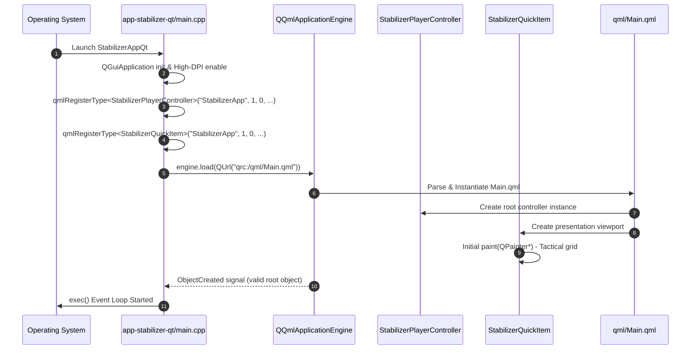

# Implementation Plan: `app-stabilizer-qt` Phase 1 — Project Setup & CMake Infrastructure

## 1. Executive Summary & Objectives

### 1.1 Context & Scope
Phase 1 establishes the build infrastructure, dependency graph, application bootstrap, and tactical QML shell for **`app-stabilizer-qt`** (executable target: **`StabilizerAppQt`**).

The purpose of Phase 1 is to create a fully compiling, linking, and bootable desktop application skeleton that:
1. Seamlessly integrates with the root CMake build system under existing configuration options (`PELCOD_BUILD_APPS`, `PELCOD_ENABLE_VIDEO`, `PELCOD_ENABLE_QT`).
2. Links with the necessary core and media libraries: [`Stabilizer`](../libs/Stabilizer), [`Video`](../libs/Video), [`Math`](../libs/Math), and Qt 6 (`Core`, `Gui`, `Qml`, `Quick`, `QuickControls2`).
3. Establishes the C++-to-QML bridge by registering `StabilizerPlayerController` and `StabilizerQuickItem` under the QML module URI `StabilizerApp 1.0`.
4. Deploys a minimal dark tactical Qt Quick window ([`qml/Main.qml`](../app-stabilizer-qt/qml/Main.qml)) embedded via Qt Resource System (`qml.qrc`), verifying clean application startup, window creation, and shutdown.
5. Complies strictly with the repository's safety standards: **MISRA C++:2023**, **SEI CERT C++**, **IWYU (Include-What-You-Use)**, mandatory `<cstdint>` qualification (`std::uint8_t`), and relative path documentation rules.

### 1.2 Target Deliverables for Phase 1
1. **Root CMake Integration (`CMakeLists.txt`)**:
   - Conditional inclusion of `add_subdirectory(app-stabilizer-qt)` guarded by `PELCOD_BUILD_APPS`, `PELCOD_ENABLE_VIDEO`, and `PELCOD_ENABLE_QT`.
   - Windows automated deployment (`windeployqt`) target for `StabilizerAppQt.exe`.
2. **Subproject CMake Configuration (`app-stabilizer-qt/CMakeLists.txt`)**:
   - Definition of `StabilizerAppQt` executable and companion convenience alias `app-stabilizer-qt`.
   - Private include directories: `${CMAKE_CURRENT_SOURCE_DIR}`, `${CMAKE_SOURCE_DIR}/libs/Stabilizer`, `${CMAKE_SOURCE_DIR}/libs/Video`, `${CMAKE_SOURCE_DIR}/libs/Math`.
   - Application of project compiler hardening flags (`apply_compiler_flags(StabilizerAppQt)`).
3. **Application Bootstrap (`app-stabilizer-qt/main.cpp`)**:
   - `QGuiApplication` lifecycle management with high-DPI scaling enabled.
   - Dark tactical `QQuickStyle` configuration ("Basic" / "Fusion").
   - Type registration of `StabilizerPlayerController` and `StabilizerQuickItem` into QML.
   - Robust `QQmlApplicationEngine` startup with URL validation and error trapping.
4. **Initial C++ Controller Skeleton (`StabilizerPlayerController.h` / `.cpp`)**:
   - `QObject`-derived ViewModel exposing operational state, source URI, playback state, and empty mock slots for Phase 2 implementation.
5. **Initial Video Presentation Item Skeleton (`StabilizerQuickItem.h` / `.cpp`)**:
   - `QQuickPaintedItem`-derived component with paint callback rendering a placeholder tactical grid and center reticle.
6. **Qt Resource Manifest & QML Base Shell (`app-stabilizer-qt/qml.qrc`, `app-stabilizer-qt/qml/Main.qml`)**:
   - High-contrast dark tactical window shell matching the project aesthetic (`#0e1014` background, `#141720` header bar, pulse beacon).
   - Placeholder slots for video canvas, left source drawer, right parameter panel, and bottom diagnostics bar.
7. **Automated Setup Verification**:
   - Compilation and link verification on both MSVC `/W4` and GCC/Clang `-Wall -Wextra -pedantic -Werror`.
   - Documentation hygiene check via `scripts/verify_relative_doc_paths.py`.
   - Header hygiene audit via `scripts/verify_iwyu_cstdint.py`.

---

## 2. Architecture & Design

### 2.1 Subsystem Layering & Dependency Topology

```
+---------------------------------------------------------------------------------------------------------------+
|                                            QML PRESENTATION TIER                                              |
|                                                                                                               |
|   +-------------------------------------------------------------------------------------------------------+   |
|   |                                          qml/Main.qml                                                 |   |
|   |   - Tactical Shell Window (1280x760, Min 800x600)                                                     |   |
|   |   - Header Bar with Live Pulse Beacon & Status Pill                                                   |   |
|   |   - Center Presentation Canvas: StabilizerQuickItem                                                   |   |
|   +-------------------------------------------------------------------------------------------------------+   |
+---------------------------------------------------│-----------------------------------------------------------+
                                                    │ Imports "StabilizerApp 1.0"
                                                    ▼
+---------------------------------------------------------------------------------------------------------------+
|                                            C++ CONTROLLER TIER                                                |
|                                                                                                               |
|   +---------------------------------------------------+   +-----------------------------------------------+   |
|   |             StabilizerPlayerController            |   |               StabilizerQuickItem             |   |
|   |  - Q_PROPERTY(PlaybackState playbackState)        |   |  - QQuickPaintedItem                          |   |
|   |  - Q_PROPERTY(QString sourceUri)                  |   |  - Placeholder Tactical Reticle & Grid        |   |
|   |  - Q_PROPERTY(QString statusMessage)              |   |  - Viewport dimension notification            |   |
|   +---------------------------------------------------+   +-----------------------------------------------+   |
|                                             ▲                                             ▲                   |
|                                             └──────────────────────┬──────────────────────┘                   |
|                                                                    │ Registered in                            |
|                                                   +----------------┴------------------+                       |
|                                                   |             main.cpp              |                       |
|                                                   |  - QGuiApplication                |                       |
|                                                   |  - QQmlApplicationEngine          |                       |
|                                                   +-----------------------------------+                       |
+--------------------------------------------------------------------│------------------------------------------+
                                                                     │ Links
                                                                     ▼
+---------------------------------------------------------------------------------------------------------------+
|                                            PROJECT LIBRARIES TIER                                             |
|                                                                                                               |
|   +--------------------------------+  +-------------------------------+  +--------------------------------+   |
|   |        libs/Stabilizer         |  |          libs/Video           |  |           libs/Math            |   |
|   |  - VideoStabilizerEngine       |  |  - IVideoDecoder              |  |  - Matrix2x3 / TransformMath   |   |
|   |  - StabilizerTypes             |  |  - DecoderFactory             |  |                                |   |
|   +--------------------------------+  +-------------------------------+  +--------------------------------+   |
+---------------------------------------------------------------------------------------------------------------+
```

### 2.2 Mermaid Component & Bootstrapping Flow



---

## 3. Detailed Technical Specifications

### 3.1 Subproject CMake Definition (`app-stabilizer-qt/CMakeLists.txt`)

The subproject build file must:
- Compile strictly as C++17 with hardening flags via `apply_compiler_flags(StabilizerAppQt)`.
- Link Qt6 modules: `Core`, `Gui`, `Qml`, `Quick`, `QuickControls2`.
- Link in-tree libraries: `Stabilizer`, `Video`, `Math`.
- Include Windows post-build deployment using `windeployqt` when available.

```cmake
add_executable(StabilizerAppQt
    main.cpp
    StabilizerPlayerController.h
    StabilizerPlayerController.cpp
    StabilizerQuickItem.h
    StabilizerQuickItem.cpp
    qml.qrc
)

add_custom_target(app-stabilizer-qt DEPENDS StabilizerAppQt)

target_include_directories(StabilizerAppQt PRIVATE
    ${CMAKE_CURRENT_SOURCE_DIR}
    ${CMAKE_SOURCE_DIR}/libs/Stabilizer
    ${CMAKE_SOURCE_DIR}/libs/Video
    ${CMAKE_SOURCE_DIR}/libs/Math
)

target_link_libraries(StabilizerAppQt PRIVATE
    Stabilizer
    Video
    Math
    Qt6::Core
    Qt6::Gui
    Qt6::Qml
    Qt6::Quick
    Qt6::QuickControls2
)

apply_compiler_flags(StabilizerAppQt)

if(WIN32)
    if(WINDEPLOYQT_EXECUTABLE)
        add_custom_command(TARGET StabilizerAppQt POST_BUILD
            COMMAND "${WINDEPLOYQT_EXECUTABLE}"
                --no-compiler-runtime
                --no-translations
                --qmldir "${CMAKE_CURRENT_SOURCE_DIR}/qml"
                "$<TARGET_FILE:StabilizerAppQt>"
            COMMENT "Deploying Qt runtime libraries for StabilizerAppQt using windeployqt..."
        )
    endif()
endif()

install(TARGETS StabilizerAppQt
    RUNTIME DESTINATION ${CMAKE_INSTALL_BINDIR}
    COMPONENT Application
)
```

### 3.2 Root `CMakeLists.txt` Modifications

In the top-level `CMakeLists.txt`, within the `if(PELCOD_BUILD_APPS)` section alongside `app-video-qt`, add the subproject inclusion:

```cmake
    if(PELCOD_ENABLE_VIDEO AND PELCOD_ENABLE_QT)
        if(TARGET Qt6::Quick AND TARGET Qt6::Qml AND TARGET Qt6::QuickControls2)
            add_subdirectory(app-video-qt)
            message(STATUS "PelcoD: VideoAppQt (app-video-qt) enabled")
            if(PELCOD_ENABLE_LIVE555 AND LIVE555_FOUND)
                add_subdirectory(app-rtsp-server-qt)
                message(STATUS "PelcoD: RtspServerAppQt (app-rtsp-server-qt) enabled")
            else()
                message(STATUS "PelcoD: RtspServerAppQt (app-rtsp-server-qt) disabled (requires Live555 backend)")
            endif()
            add_subdirectory(app-stabilizer-qt)
            message(STATUS "PelcoD: StabilizerAppQt (app-stabilizer-qt) enabled")
        else()
            message(STATUS "PelcoD: VideoAppQt (app-video-qt) disabled (requires Qt6 Quick, Qml, and QuickControls2)")
            message(STATUS "PelcoD: RtspServerAppQt (app-rtsp-server-qt) disabled (requires Qt6 Quick, Qml, and QuickControls2)")
            message(STATUS "PelcoD: StabilizerAppQt (app-stabilizer-qt) disabled (requires Qt6 Quick, Qml, and QuickControls2)")
        endif()
    endif()
```

Also add `StabilizerAppQt` to the `windeployqt` install section if building on Windows.

### 3.3 Application Entry Point (`app-stabilizer-qt/main.cpp`)

```cpp
/// @file main.cpp
/// @brief Application entry point for the Qt QML Video Stabilizer Testing Application.

#include <cstdint>

#include <QGuiApplication>
#include <QQmlApplicationEngine>
#include <QQuickStyle>
#include <QUrl>

#include "StabilizerPlayerController.h"
#include "StabilizerQuickItem.h"

int main(int argc, char* argv[])
{
    // High-DPI display attributes are enabled by default in Qt 6
    QGuiApplication app(argc, argv);
    app.setApplicationName(QStringLiteral("StabilizerAppQt"));
    app.setOrganizationName(QStringLiteral("PelcoD"));
    app.setOrganizationDomain(QStringLiteral("pelcod.org"));

    QQuickStyle::setStyle(QStringLiteral("Basic"));

    // Register C++ ViewModel and QuickItem components into QML
    qmlRegisterType<StabilizerApp::StabilizerPlayerController>(
        "StabilizerApp", 1, 0, "StabilizerPlayerController");
    qmlRegisterType<StabilizerApp::StabilizerQuickItem>(
        "StabilizerApp", 1, 0, "StabilizerQuickItem");

    QQmlApplicationEngine engine;
    const QUrl url(QStringLiteral("qrc:/qml/Main.qml"));

    QObject::connect(
        &engine,
        &QQmlApplicationEngine::objectCreated,
        &app,
        [url](QObject* obj, const QUrl& objUrl) {
            if ((obj == nullptr) && (url == objUrl)) {
                QGuiApplication::exit(-1);
            }
        },
        Qt::QueuedConnection);

    engine.load(url);

    return app.exec();
}
```

### 3.4 Initial Controller Interface (`StabilizerPlayerController.h` / `.cpp`)

```cpp
/// @file StabilizerPlayerController.h
/// @brief Master QML controller bridging UI events with Video and Stabilizer subsystems.
#pragma once

#include <cstdint>

#include <QObject>
#include <QString>

namespace StabilizerApp {

/// @class StabilizerPlayerController
/// @brief High-level ViewModel managing playback state, stream source, and stabilization telemetry.
class StabilizerPlayerController : public QObject {
    Q_OBJECT

    Q_PROPERTY(PlaybackState playbackState READ playbackState NOTIFY playbackStateChanged)
    Q_PROPERTY(QString sourceUri READ sourceUri WRITE setSourceUri NOTIFY sourceUriChanged)
    Q_PROPERTY(QString statusMessage READ statusMessage NOTIFY statusMessageChanged)
    Q_PROPERTY(int videoWidth READ videoWidth NOTIFY videoDimensionsChanged)
    Q_PROPERTY(int videoHeight READ videoHeight NOTIFY videoDimensionsChanged)
    Q_PROPERTY(double fps READ fps NOTIFY telemetryUpdated)

public:
    /// @enum PlaybackState
    /// @brief Playback lifecycle states.
    enum class PlaybackState : std::uint8_t {
        Idle = 0U,
        Opening,
        Playing,
        Paused,
        Error
    };
    Q_ENUM(PlaybackState)

    explicit StabilizerPlayerController(QObject* parent = nullptr);
    ~StabilizerPlayerController() override = default;

    StabilizerPlayerController(const StabilizerPlayerController&) = delete;
    StabilizerPlayerController& operator=(const StabilizerPlayerController&) = delete;
    StabilizerPlayerController(StabilizerPlayerController&&) = delete;
    StabilizerPlayerController& operator=(StabilizerPlayerController&&) = delete;

    [[nodiscard]] PlaybackState playbackState() const noexcept;
    [[nodiscard]] QString sourceUri() const;
    void setSourceUri(const QString& uri);

    [[nodiscard]] QString statusMessage() const;
    [[nodiscard]] int videoWidth() const noexcept;
    [[nodiscard]] int videoHeight() const noexcept;
    [[nodiscard]] double fps() const noexcept;

    Q_INVOKABLE void play();
    Q_INVOKABLE void pause();
    Q_INVOKABLE void stop();

signals:
    void playbackStateChanged();
    void sourceUriChanged();
    void statusMessageChanged();
    void videoDimensionsChanged();
    void telemetryUpdated();

private:
    PlaybackState playbackState_ { PlaybackState::Idle };
    QString sourceUri_ { };
    QString statusMessage_ { QStringLiteral("Ready") };
    int videoWidth_ { 0 };
    int videoHeight_ { 0 };
    double fps_ { 0.0 };
};

} // namespace StabilizerApp
```

### 3.5 Initial Presentation QuickItem (`StabilizerQuickItem.h` / `.cpp`)

```cpp
/// @file StabilizerQuickItem.h
/// @brief Custom QQuickPaintedItem presenting unstabilized and stabilized video frames.
#pragma once

#include <cstdint>

#include <QPainter>
#include <QQuickPaintedItem>

namespace StabilizerApp {

/// @class StabilizerQuickItem
/// @brief Renders video presentation viewport with interactive comparison wipe and overlays.
class StabilizerQuickItem : public QQuickPaintedItem {
    Q_OBJECT

    Q_PROPERTY(float splitPosition READ splitPosition WRITE setSplitPosition NOTIFY splitPositionChanged)
    Q_PROPERTY(bool showGrid READ showGrid WRITE setShowGrid NOTIFY showGridChanged)

public:
    explicit StabilizerQuickItem(QQuickItem* parent = nullptr);
    ~StabilizerQuickItem() override = default;

    StabilizerQuickItem(const StabilizerQuickItem&) = delete;
    StabilizerQuickItem& operator=(const StabilizerQuickItem&) = delete;
    StabilizerQuickItem(StabilizerQuickItem&&) = delete;
    StabilizerQuickItem& operator=(StabilizerQuickItem&&) = delete;

    [[nodiscard]] float splitPosition() const noexcept;
    void setSplitPosition(float pos) noexcept;

    [[nodiscard]] bool showGrid() const noexcept;
    void setShowGrid(bool show) noexcept;

    void paint(QPainter* painter) override;

signals:
    void splitPositionChanged();
    void showGridChanged();

private:
    float splitPosition_ { 0.50F };
    bool showGrid_ { true };
};

} // namespace StabilizerApp
```

### 3.6 Qt Resource File (`app-stabilizer-qt/qml.qrc`)

```xml
<RCC>
    <qresource prefix="/">
        <file>qml/Main.qml</file>
    </qresource>
</RCC>
```

### 3.7 Tactical Base Window (`app-stabilizer-qt/qml/Main.qml`)

```qml
import QtQuick
import QtQuick.Controls
import QtQuick.Layouts
import QtQuick.Window
import StabilizerApp 1.0

ApplicationWindow {
    id: root
    visible: true
    width: 1280
    height: 760
    minimumWidth: 800
    minimumHeight: 600
    title: "PelcoD Digital Video Stabilizer Workbench"
    color: "#0e1014"

    StabilizerPlayerController {
        id: controller
    }

    // Top Tactical Header Bar
    header: Rectangle {
        height: 48
        color: "#141720"
        border.color: "#242938"
        border.width: 1

        RowLayout {
            anchors.fill: parent
            anchors.leftMargin: 16
            anchors.rightMargin: 16
            spacing: 12

            // Tactical Pulse Beacon
            Rectangle {
                width: 10
                height: 10
                radius: 5
                color: {
                    switch (controller.playbackState) {
                    case StabilizerPlayerController.Playing: return "#00e676";
                    case StabilizerPlayerController.Opening: return "#ff9100";
                    case StabilizerPlayerController.Paused:  return "#00e5ff";
                    case StabilizerPlayerController.Error:   return "#ff1744";
                    default: return "#525c70";
                    }
                }
                SequentialAnimation on opacity {
                    running: controller.playbackState === StabilizerPlayerController.Playing
                             || controller.playbackState === StabilizerPlayerController.Opening
                    loops: Animation.Infinite
                    PropertyAnimation { to: 0.3; duration: 600 }
                    PropertyAnimation { to: 1.0; duration: 600 }
                }
            }

            Text {
                text: "VIDEO STABILIZER TESTBENCH"
                color: "#f0f4fc"
                font.pixelSize: 13
                font.bold: true
                font.letterSpacing: 1.5
            }

            Rectangle {
                width: 1
                height: 18
                color: "#2a2f40"
            }

            Text {
                text: controller.statusMessage.toUpperCase()
                color: "#8894ab"
                font.pixelSize: 11
            }

            Item { Layout.fillWidth: true }

            Text {
                text: "PHASE 1 SKELETON BUILD"
                color: "#ff9100"
                font.pixelSize: 11
                font.bold: true
            }
        }
    }

    // Central Presentation Viewport
    StabilizerQuickItem {
        id: videoView
        anchors.fill: parent
        splitPosition: 0.5
        showGrid: true
    }

    // Bottom Status Bar
    footer: Rectangle {
        height: 28
        color: "#11141c"
        border.color: "#1e2230"
        border.width: 1

        RowLayout {
            anchors.fill: parent
            anchors.leftMargin: 16
            anchors.rightMargin: 16
            spacing: 16

            Text {
                text: "FPS: " + controller.fps.toFixed(1)
                color: "#8894ab"
                font.pixelSize: 11
            }

            Text {
                text: "DIMENSIONS: " + (controller.videoWidth > 0 ? (controller.videoWidth + "x" + controller.videoHeight) : "NO SIGNAL")
                color: "#8894ab"
                font.pixelSize: 11
            }

            Item { Layout.fillWidth: true }

            Text {
                text: "PelcoD Stabilizer Subsystem"
                color: "#525c70"
                font.pixelSize: 10
            }
        }
    }
}
```

---

## 4. Implementation Task Breakdown

| Task ID | Item | Description | Files Affected |
| :--- | :--- | :--- | :--- |
| **T1.1** | Directory Skeleton | Create `app-stabilizer-qt/` and `app-stabilizer-qt/qml/` directories. | N/A (Directories) |
| **T1.2** | Subproject CMake | Author `app-stabilizer-qt/CMakeLists.txt` with compiler flags and library targets. | [`app-stabilizer-qt/CMakeLists.txt`](../app-stabilizer-qt/CMakeLists.txt) |
| **T1.3** | Root CMake Update | Add conditional `add_subdirectory(app-stabilizer-qt)` to root `CMakeLists.txt`. | [`CMakeLists.txt`](../CMakeLists.txt) |
| **T1.4** | C++ Controller | Implement `StabilizerPlayerController.h` and `.cpp` skeleton. | `app-stabilizer-qt/StabilizerPlayerController.*` |
| **T1.5** | QuickItem Presentation | Implement `StabilizerQuickItem.h` and `.cpp` with grid painter. | `app-stabilizer-qt/StabilizerQuickItem.*` |
| **T1.6** | Entry Point | Implement `main.cpp` with QML engine registration and style setup. | [`app-stabilizer-qt/main.cpp`](../app-stabilizer-qt/main.cpp) |
| **T1.7** | Resource & QML Shell | Author `qml.qrc` and `qml/Main.qml` with dark tactical layout. | `app-stabilizer-qt/qml.qrc`, `app-stabilizer-qt/qml/Main.qml` |
| **T1.8** | Windows Deployment Hook | Verify `windeployqt` configuration in CMake. | [`app-stabilizer-qt/CMakeLists.txt`](../app-stabilizer-qt/CMakeLists.txt) |
| **T1.9** | Standards Audit | Audit include hygiene (`verify_iwyu_cstdint.py`) and relative doc links (`verify_relative_doc_paths.py`). | Project root scripts |

---

## 5. Verification Plan

### 5.1 Build System & Compilation Verification
1. **CMake Configure**:
   ```bash
   cmake -B build -S . -DPELCOD_BUILD_APPS=ON -DPELCOD_ENABLE_VIDEO=ON -DPELCOD_ENABLE_QT=ON
   ```
   *Expected Outcome*: Message `PelcoD: StabilizerAppQt (app-stabilizer-qt) enabled` printed without warnings.
2. **Target Compilation**:
   ```bash
   cmake --build build --target StabilizerAppQt --config Release
   ```
   *Expected Outcome*: Clean compilation and link on MSVC and GCC/Clang with zero warnings (`/W4` / `-Wall -Wextra -pedantic`).

### 5.2 Runtime Smoke Verification
1. **Executable Launch**:
   Execute `StabilizerAppQt` (or `StabilizerAppQt.exe`).
   *Expected Outcome*:
   - Window opens at 1280x760 with title `"PelcoD Digital Video Stabilizer Workbench"`.
   - Dark background (`#0e1014`) renders with top header, pulse beacon, placeholder grid in central viewport, and bottom status bar.
   - Closing the window exits cleanly with code 0 without memory leaks or dangling threads.

### 5.3 Safety Standards & Code Hygiene Verification
1. **IWYU & `<cstdint>` Verification**:
   ```bash
   python scripts/verify_iwyu_cstdint.py --files app-stabilizer-qt/main.cpp app-stabilizer-qt/StabilizerPlayerController.h app-stabilizer-qt/StabilizerPlayerController.cpp app-stabilizer-qt/StabilizerQuickItem.h app-stabilizer-qt/StabilizerQuickItem.cpp
   ```
2. **Documentation Relative Paths Verification**:
   ```bash
   python scripts/verify_relative_doc_paths.py --files docs/app_stabilizer_qt_phase1_plan.md --strict
   ```

