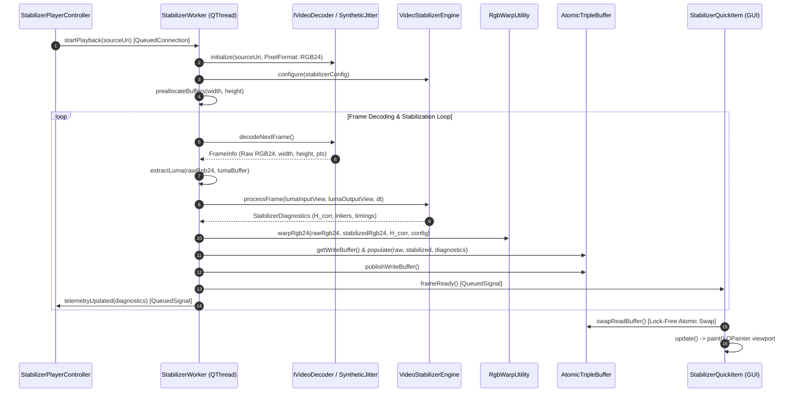
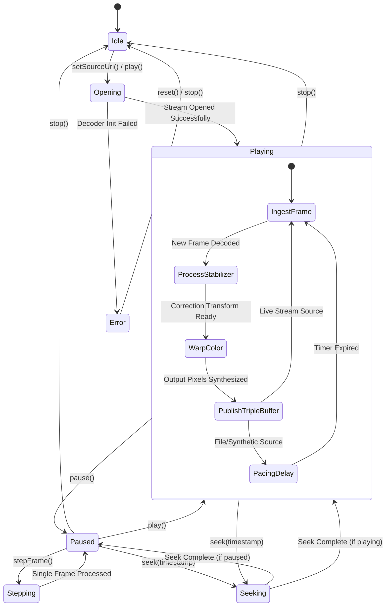

# Implementation Plan: `app-stabilizer-qt` Phase 2 — Frame Ingestion & Threading Subsystem

## 1. Executive Summary & Objectives

### 1.1 Context & Scope
Phase 2 delivers the high-performance frame ingestion, background decoding, real-time video stabilization, and lock-free thread synchronization subsystem for **`app-stabilizer-qt`** (executable target: **`StabilizerAppQt`**).

Building on the Phase 1 Qt Quick application skeleton, Phase 2 implements the core data pump that ingests video from diverse multimedia backends, stabilizes frames in real time using [`libs/Stabilizer`](../libs/Stabilizer), and transfers stabilized and unstabilized frame pairs to the Qt Quick presentation layer with zero dynamic heap allocations, zero mutex contention, and zero UI thread latency.

Phase 2 specifically addresses four architectural requirements:
1. **Decoupled Worker Architecture**: A dedicated high-priority worker thread ([`StabilizerWorker`](../app-stabilizer-qt/StabilizerWorker.h)) running on a companion `QThread`, isolating intensive video decoding, feature tracking, and matrix warping from the Qt Quick GUI event loop.
2. **Multi-Source Ingestion Pipeline**: Unified handling of file streams (MP4/TS/MKV via [`FFmpegDecoder`](../libs/Video/FFmpegDecoder.h)), live low-latency RTSP/UDP streams, hardware capture devices (DirectShow/V4L2), and synthetic benchmark streams.
3. **Procedural Shaking & Vibration Synthesizer ([`SyntheticJitterGenerator`](../app-stabilizer-qt/SyntheticJitterGenerator.h))**: Calibrated algorithmic vibration (mast oscillation, random-walk drift, CMOS rolling shutter shear) that generates reproducible benchmark test frames without requiring physical camera shaking.
4. **Zero-Heap Lock-Free Triple Buffering ([`AtomicTripleBuffer`](../libs/Video/AtomicTripleBuffer.h))**: Exchange of pre-allocated dual-frame packets (raw unstabilized RGB24 + stabilized RGB24 + telemetry snapshot) between the worker and UI threads via single-word atomic pointer swaps.
5. **Strict Safety & Standards Compliance**: Full alignment with **MISRA C++:2023**, **SEI CERT C++** (specifically INT31-C integer conversion safety and ERR55-CPP zero-heap `noexcept` fast path), **IWYU**, explicit `<cstdint>` qualification, and relative path documentation rules.

---

### 1.2 Target Deliverables for Phase 2

| Deliverable | Target Files | Description |
| :--- | :--- | :--- |
| **Synthetic Jitter Generator** | [`app-stabilizer-qt/SyntheticJitterGenerator.h`](../app-stabilizer-qt/SyntheticJitterGenerator.h)<br>[`app-stabilizer-qt/SyntheticJitterGenerator.cpp`](../app-stabilizer-qt/SyntheticJitterGenerator.cpp) | Procedural test pattern generator producing high-contrast targets with programmable sinusoidal oscillation, Brownian random-walk drift, and rolling shutter jello shear. |
| **Direct RGB24 Warping Utility** | [`app-stabilizer-qt/RgbWarpUtility.h`](../app-stabilizer-qt/RgbWarpUtility.h)<br>[`app-stabilizer-qt/RgbWarpUtility.cpp`](../app-stabilizer-qt/RgbWarpUtility.cpp) | High-throughput sub-pixel bilinear interpolation engine for packed 24-bit RGB frames, supporting auto-crop zoom, coordinate clamping/reflection, and zero heap allocation. |
| **Frame Exchange Packet & Triple Buffer** | [`app-stabilizer-qt/StabilizerFramePacket.h`](../app-stabilizer-qt/StabilizerFramePacket.h) | Pre-allocated payload holding raw RGB24, stabilized RGB24, telemetry metadata, feature landmark coordinates, and stage latency metrics for lock-free UI transfer. |
| **Dedicated Stabilizer Worker** | [`app-stabilizer-qt/StabilizerWorker.h`](../app-stabilizer-qt/StabilizerWorker.h)<br>[`app-stabilizer-qt/StabilizerWorker.cpp`](../app-stabilizer-qt/StabilizerWorker.cpp) | Autonomous processing engine running on a dedicated `QThread`, managing decoder lifecycle, frame pacing, luma extraction, engine execution, warping, and atomic publishing. |
| **Controller ViewModel Integration** | [`app-stabilizer-qt/StabilizerPlayerController.h`](../app-stabilizer-qt/StabilizerPlayerController.h)<br>[`app-stabilizer-qt/StabilizerPlayerController.cpp`](../app-stabilizer-qt/StabilizerPlayerController.cpp) | Wiring QML commands (`play`, `pause`, `stop`, `step`, `seek`, parameter updates) to `StabilizerWorker`, and dispatching telemetry signals to QML UI. |
| **CMake & Build Updates** | [`app-stabilizer-qt/CMakeLists.txt`](../app-stabilizer-qt/CMakeLists.txt) | Adding new source files, compiler definitions, and linking against [`Video`](../libs/Video), [`Stabilizer`](../libs/Stabilizer), and [`Math`](../libs/Math). |
| **Comprehensive Unit & Concurrency Tests** | [`tests/TestStabilizerWorker.cpp`](../tests/TestStabilizerWorker.cpp)<br>[`tests/TestSyntheticJitterGenerator.cpp`](../tests/TestSyntheticJitterGenerator.cpp)<br>[`tests/TestRgbWarpUtility.cpp`](../tests/TestRgbWarpUtility.cpp) | Unit and integration tests covering synthetic jitter equations, RGB24 warping, triple-buffer concurrency, and player controller lifecycle. |

---

## 2. Architecture & Design

### 2.1 Subsystem Layering & Pipeline Architecture

```
+-----------------------------------------------------------------------------------------------------------------------+
|                                              QT QUICK PRESENTATION THREAD                                             |
|                                                                                                                       |
|   +---------------------------------------------------------------+   +-------------------------------------------+   |
|   |                  StabilizerPlayerController                   |   |            StabilizerQuickItem            |   |
|   |  - Play / Pause / Stop / Step / Seek                          |   |  - swapReadBuffer() [Lock-Free Atomic]    |   |
|   |  - Parameter Hot-Reloading Dispatch                           |   |  - Direct QPainter paint(raw + stabilized)|   |
|   |  - Telemetry & Diagnostic Signal Emission                     |   |  - Feature Inlier / Outlier Overlay Plot  |   |
|   +-------------------------------│-------------------------------+   +---------------------▲---------------------+   |
+-----------------------------------│---------------------------------------------------------│-------------------------+
                                    │ Qt Queued Signal / Slot                                 │ Atomic Read Swap
                                    ▼                                                         │
+---------------------------------------------------------------------------------------------│-------------------------+
|                                              DEDICATED STABILIZER WORKER THREAD             │                         |
|                                                                                             │                         |
|   +-----------------------------------------------------------------------------------------┴---------------------+   |
|   |                                               StabilizerWorker                                                |   |
|   |                                                                                                               |   |
|   |   +-------------------------------------------------------------------------------------------------------+   |   |
|   |   |                                            Frame Ingestion                                            |   |   |
|   |   |   - Video::IVideoDecoder (FFmpeg / Live555 / Mock)                                                    |   |   |
|   |   |   - SyntheticJitterGenerator (Mast Sine / Brownian Drift / Rolling Shutter)                           |   |   |
|   |   |   - Frame Rate Pacer (High-resolution std::chrono clock for file/synthetic playback)                 |   |   |
|   |   +---------------------------------------------------│---------------------------------------------------+   |   |
|   |                                                       │ Raw RGB24 Frame                                       |   |
|   |                                                       ▼                                                       |   |
|   |   +-------------------------------------------------------------------------------------------------------+   |   |
|   |   |                                      Color Processing & Luma Extraction                               |   |   |
|   |   |   - Extract Y Plane: Y = (77*R + 150*G + 29*B) >> 8 into pre-allocated Luma Buffer                     |   |   |
|   |   |   - Construct non-owning FrameView(lumaData, dims)                                                     |   |   |
|   |   +---------------------------------------------------│---------------------------------------------------+   |   |
|   |                                                       │ Grayscale Luma FrameView                              |   |
|   |                                                       ▼                                                       |   |
|   |   +-------------------------------------------------------------------------------------------------------+   |   |
|   |   |                                     VideoStabilizerEngine (libs/Stabilizer)                           |   |   |
|   |   |   - FramePyramid: 3-scale downsampling                                                                |   |   |
|   |   |   - FeatureDetector: Shi-Tomasi Harris response + 8x6 grid bucketing                                  |   |   |
|   |   |   - OpticalFlowTracker: Pyramidal Lucas-Kanade + forward-backward verification                        |   |   |
|   |   |   - MotionModelEstimator: MSAC affine consensus + least-squares refinement                            |   |   |
|   |   |   - TrajectoryFilter: EKF / Gaussian FIR path smoothing + auto-crop margin dampener                   |   |   |
|   |   |   - Output: StabilizerDiagnostics + Correction Transform H_corr                                       |   |   |
|   |   +---------------------------------------------------│---------------------------------------------------+   |   |
|   |                                                       │ H_corr + Auto-Crop Zoom                               |   |
|   |                                                       ▼                                                       |   |
|   |   +-------------------------------------------------------------------------------------------------------+   |   |
|   |   |                                         RgbWarpUtility (SIMD Warp)                                    |   |   |
|   |   |   - Inverse transform mapping: (x, y) -> H_corr^-1 * (x, y)                                           |   |   |
|   |   |   - Bilinear sub-pixel sampling across 3 channels (R, G, B)                                            |   |   |
|   |   |   - Border handling: Constant fill / Replicate / Reflect                                              |   |   |
|   |   |   - Writes directly into pre-allocated stabilized buffer                                              |   |   |
|   |   +---------------------------------------------------│---------------------------------------------------+   |   |
|   |                                                       │ Raw RGB24 + Stabilized RGB24 + Diagnostics            |   |
|   |                                                       ▼                                                       |   |
|   |   +-------------------------------------------------------------------------------------------------------+   |   |
|   |   |                             AtomicTripleBuffer<StabilizerFramePacket>                                 |   |   |
|   |   |   - Slot A: Producer Write Slot (Worker exclusive)                                                    |   |   |
|   |   |   - Slot B: Consumer Read Slot (UI exclusive)                                                         |   |   |
|   |   |   - Slot C: Shared Intermediate Slot (Atomic CAS swap, lock-free)                                     |   |   |
|   |   |   - Worker calls publishWriteBuffer(), emits frameReady() signal                                      |   |   |
|   |   +-------------------------------------------------------------------------------------------------------+   |   |
|   +---------------------------------------------------------------------------------------------------------------+   |
+-----------------------------------------------------------------------------------------------------------------------+
```

---

### 2.2 Sequence Flow: Frame Ingestion, Stabilization, and Display



---

### 2.3 Worker State Machine



---

## 3. Detailed Technical Specifications

### 3.1 Frame Exchange Packet & Pre-allocated Memory Architecture

To enforce **CERT ERR55-CPP** (zero heap allocation in high-frequency loops) and guarantee deterministic cache behavior, all image memory across the triple buffer is pre-allocated at stream initialization.

#### Domain Model & Value Objects ([`StabilizerFramePacket.h`](../app-stabilizer-qt/StabilizerFramePacket.h))

```cpp
#pragma once

/// @file StabilizerFramePacket.h
/// @brief Pre-allocated frame payload for lock-free triple buffer exchange.

#include <cstddef>
#include <cstdint>

#include <array>
#include <vector>

#include "StabilizerTypes.h"
#include "VideoStabilizerEngine.h"

namespace StabilizerApp {

/// @struct VisualFeaturePoint
/// @brief Sub-pixel feature point coordinate with classification for UI rendering.
struct VisualFeaturePoint {
    float x { 0.0F };
    float y { 0.0F };
    bool isInlier { false };
};

/// @struct StabilizerFramePacket
/// @brief Memory slot exchanged through AtomicTripleBuffer between worker and UI.
struct StabilizerFramePacket {
    static constexpr std::size_t MaxVisualFeatures { 500U };

    std::vector<std::uint8_t> rawRgb;        ///< Raw RGB24 frame buffer (width * height * 3)
    std::vector<std::uint8_t> stabilizedRgb; ///< Stabilized RGB24 frame buffer (width * height * 3)
    std::uint32_t width { 0U };               ///< Frame width in pixels
    std::uint32_t height { 0U };              ///< Frame height in pixels
    std::uint32_t stride { 0U };              ///< Row stride in bytes (width * 3)
    double timestampSec { 0.0 };              ///< Presentation timestamp (PTS) in seconds
    std::uint64_t frameNumber { 0U };         ///< Monotonically increasing frame index

    Stabilizer::StabilizerDiagnostics diagnostics { }; ///< Real-time pipeline diagnostics snapshot

    std::array<VisualFeaturePoint, MaxVisualFeatures> features { }; ///< Feature landmark coordinates
    std::size_t featureCount { 0U };                                 ///< Valid features in current frame

    /// @brief Pre-allocates buffer capacities to prevent heap allocation during streaming.
    /// @param w Target frame width in pixels.
    /// @param h Target frame height in pixels.
    void preallocate(std::uint32_t w, std::uint32_t h)
    {
        width = w;
        height = h;
        stride = w * 3U;
        const std::size_t byteCount = static_cast<std::size_t>(stride) * static_cast<std::size_t>(h);
        if (rawRgb.size() != byteCount) {
            rawRgb.assign(byteCount, 0U);
        }
        if (stabilizedRgb.size() != byteCount) {
            stabilizedRgb.assign(byteCount, 0U);
        }
        featureCount = 0U;
    }
};

} // namespace StabilizerApp
```

---

### 3.2 Synthetic Jitter Generator Specification

The `SyntheticJitterGenerator` produces procedural video frames for benchmark regression tests and automated validation without physical camera hardware.

#### Perturbation Physics Models
1. **Mast Vibration (Harmonic Resonance)**:
   $$x_{\text{mast}}(t) = A_x \sin(2\pi f_x t + \phi_x), \quad y_{\text{mast}}(t) = A_y \cos(2\pi f_y t + \phi_y)$$
   where $f_x, f_y \in [1.0 .. 60.0]\text{ Hz}$ and $A_x, A_y \in [0.0 .. 50.0]\text{ px}$.
2. **Brownian Handheld Drift**:
   $$v_x(t + \Delta t) = \alpha v_x(t) + \mathcal{N}(0, \sigma_v^2), \quad x_{\text{drift}}(t + \Delta t) = x_{\text{drift}}(t) + v_x(t) \Delta t$$
   simulating low-frequency arm tremor and target tracking drift with damping coefficient $\alpha \in [0.90 .. 0.99]$.
3. **CMOS Rolling Shutter Jello**:
   Scanline-dependent displacement simulating row-by-row sensor readout delay:
   $$dx(y, t) = A_{\text{rs}} \sin\left(2\pi f_{\text{rs}} t + \frac{2\pi y}{H} \cdot \beta\right)$$
   where $\beta$ is the sensor readout duty cycle ratio ($0.80$).

#### Class Definition ([`SyntheticJitterGenerator.h`](../app-stabilizer-qt/SyntheticJitterGenerator.h))

```cpp
#pragma once

/// @file SyntheticJitterGenerator.h
/// @brief Procedural test pattern and calibrated vibration synthesizer.

#include <cstddef>
#include <cstdint>

#include <array>
#include <random>
#include <string_view>
#include <vector>

namespace StabilizerApp {

/// @struct SyntheticJitterConfig
/// @brief Configuration parameters for procedural vibration synthesis.
struct SyntheticJitterConfig {
    std::uint32_t width { 1280U };             ///< Frame width in pixels
    std::uint32_t height { 720U };             ///< Frame height in pixels
    double frameRate { 30.0 };                 ///< Synthetic stream frame rate (FPS)
    
    // Harmonic Mast Vibration
    float mastFreqX { 5.0F };                  ///< Horizontal vibration frequency (Hz)
    float mastFreqY { 7.0F };                  ///< Vertical vibration frequency (Hz)
    float mastAmpX { 15.0F };                  ///< Horizontal vibration amplitude (pixels)
    float mastAmpY { 10.0F };                  ///< Vertical vibration amplitude (pixels)

    // Handheld Random-Walk Drift
    bool enableDrift { true };                 ///< Enable Brownian motion drift
    float driftDamping { 0.95F };              ///< Velocity damping factor [0.80 .. 0.99]
    float driftNoiseSigma { 0.50F };           ///< Acceleration noise variance

    // Rolling Shutter Wobble
    bool enableRollingShutter { false };       ///< Enable scanline shear wobble
    float rsFreq { 12.0F };                    ///< Rolling shutter oscillation frequency (Hz)
    float rsAmp { 8.0F };                      ///< Rolling shutter shear amplitude (pixels)

    std::uint32_t seed { 0x54616253U };        ///< Deterministic PRNG seed
};

/// @class SyntheticJitterGenerator
/// @brief Generates procedural high-contrast geometric frames perturbed by calibrated motion.
class SyntheticJitterGenerator {
public:
    explicit SyntheticJitterGenerator(const SyntheticJitterConfig& config = { });
    ~SyntheticJitterGenerator() = default;

    SyntheticJitterGenerator(const SyntheticJitterGenerator&) = delete;
    SyntheticJitterGenerator& operator=(const SyntheticJitterGenerator&) = delete;
    SyntheticJitterGenerator(SyntheticJitterGenerator&&) noexcept = default;
    SyntheticJitterGenerator& operator=(SyntheticJitterGenerator&&) noexcept = default;

    /// @brief Reconfigures generator parameters and resets timeline.
    /// @param config New configuration parameters.
    void setConfig(const SyntheticJitterConfig& config);

    /// @brief Current configuration parameters.
    [[nodiscard]] const SyntheticJitterConfig& config() const noexcept;

    /// @brief Synthesizes next perturbed video frame into destination buffer.
    /// @param dstRgb Destination buffer (must hold at least width * height * 3 bytes).
    /// @param dt Time delta since previous frame in seconds.
    /// @return Presentation timestamp (PTS) in seconds.
    [[nodiscard]] double generateNextFrame(std::uint8_t* dstRgb, double dt);

    /// @brief Resets time index and drift accumulation to zero.
    void reset() noexcept;

private:
    void renderBasePattern(std::uint8_t* buffer) const;
    void sampleSubpixel(float srcX, float srcY, std::uint8_t& r, std::uint8_t& g, std::uint8_t& b) const noexcept;

    SyntheticJitterConfig config_ { };
    double currentTimeSec_ { 0.0 };
    std::uint64_t frameIndex_ { 0U };

    float driftVx_ { 0.0F };
    float driftVy_ { 0.0F };
    float driftPosX_ { 0.0F };
    float driftPosY_ { 0.0F };

    std::mt19937 prng_ { };
    std::normal_distribution<float> normalDist_ { 0.0F, 1.0F };

    std::vector<std::uint8_t> basePattern_ { }; ///< High-contrast reference frame
};

} // namespace StabilizerApp
```

---

### 3.3 Direct RGB24 Sub-Pixel Warping Engine

While feature detection and motion estimation operate on single-channel grayscale luma ($Y$), the presentation layer displays full-color RGB24 video. Rather than performing lossy RGB $\to$ YUV $\to$ RGB back-and-forth roundtrips, `RgbWarpUtility` applies the calculated affine transformation $H_{\text{corr}}$ directly to packed 24-bit RGB pixel buffers.

#### Sub-Pixel Bilinear Math for Packed RGB24
Given target coordinate $(x, y) \in [0 .. W-1] \times [0 .. H-1]$, the inverse affine map determines source coordinate $(u, v)$:
$$\begin{bmatrix} u \\ v \end{bmatrix} = \mathbf{A}^{-1} \left( \begin{bmatrix} x \\ y \end{bmatrix} - \mathbf{t} \right)$$
With $u_0 = \lfloor u \rfloor, v_0 = \lfloor v \rfloor$, and fractional sub-pixel coordinates:
$$s = u - u_0, \quad t = v - v_0$$
The interpolated color for channel $c \in \{R, G, B\}$ is:
$$I_c(x, y) = (1 - s)(1 - t) I_c(u_0, v_0) + s(1 - t) I_c(u_0 + 1, v_0) + (1 - s) t I_c(u_0, v_0 + 1) + st I_c(u_0 + 1, v_0 + 1)$$
Fixed-point integer arithmetic using 8-bit fractional precision ($Q8$) is used on the fast path to prevent floating-point unit pipeline stalls:
$$w_{00} = (256 - s_{256})(256 - t_{256}), \quad w_{10} = s_{256}(256 - t_{256}), \quad w_{01} = (256 - s_{256})t_{256}, \quad w_{11} = s_{256} t_{256}$$
$$I_c(x, y) = \frac{w_{00} I_c(u_0, v_0) + w_{10} I_c(u_0 + 1, v_0) + w_{01} I_c(u_0, v_0 + 1) + w_{11} I_c(u_0 + 1, v_0 + 1) + 32768}{65536}$$

#### Class Definition ([`RgbWarpUtility.h`](../app-stabilizer-qt/RgbWarpUtility.h))

```cpp
#pragma once

/// @file RgbWarpUtility.h
/// @brief High-throughput bilinear image warping for packed RGB24 video frames.

#include <cstddef>
#include <cstdint>

#include "StabilizerTypes.h"
#include "WarpEngine.h"

namespace StabilizerApp {

/// @class RgbWarpUtility
/// @brief Static utilities for warping packed RGB24 frames with SIMD acceleration.
class RgbWarpUtility {
public:
    /// @brief Warps an entire packed RGB24 frame using an affine transformation.
    /// @param src Raw input packed RGB24 buffer.
    /// @param dst Pre-allocated destination RGB24 buffer.
    /// @param width Frame width in pixels.
    /// @param height Frame height in pixels.
    /// @param stride Row stride in bytes (typically width * 3).
    /// @param transform Forward stabilizing affine transformation.
    /// @param config Warp configuration (border mode, auto-crop ratio).
    /// @return True on successful warp; false on invalid dimensions or null pointers.
    [[nodiscard]] static bool warpRgb24(
        const std::uint8_t* src,
        std::uint8_t* dst,
        std::uint32_t width,
        std::uint32_t height,
        std::uint32_t stride,
        const Stabilizer::AffineTransform2D& transform,
        const Stabilizer::WarpConfig& config) noexcept;

    /// @brief Extracts grayscale luma (Y) plane from packed RGB24 buffer.
    /// @details Uses integer approximation Y = (77*R + 150*G + 29*B) >> 8.
    /// @param rgbSrc Pointer to packed RGB24 source buffer.
    /// @param lumaDst Pointer to destination grayscale buffer (width * height bytes).
    /// @param width Frame width in pixels.
    /// @param height Frame height in pixels.
    static void extractLuma(
        const std::uint8_t* rgbSrc,
        std::uint8_t* lumaDst,
        std::uint32_t width,
        std::uint32_t height) noexcept;
};

} // namespace StabilizerApp
```

---

### 3.4 Worker Thread Architecture & Frame Pacing

The `StabilizerWorker` encapsulates all continuous decoding and stabilization operations. It executes autonomously on its own `QThread`, decoupled from Qt's GUI event queue.

#### Pacing & Synchronization Rules
- **Live Streams (RTSP, UDP, DirectShow)**: Ingest at arrival rate. If processing takes longer than stream interval, frame drop logic discards intermediate frames to prevent buffer bloat and maintain lowest possible glass-to-glass latency.
- **Local Files & Synthetic Generator**: Paced accurately against presentation timestamps using a high-precision `std::chrono::steady_clock` sleep/delay loop, scaled by playback rate ($0.25\times$ to $4.0\times$).
- **Single-Frame Stepping**: Decodes and stabilizes exactly 1 frame, publishes to the triple buffer, and transitions immediately to `Paused`.
- **Parameter Hot-Reloading**: Configuration changes are guarded by a light `std::atomic<bool>` dirty flag or double-buffered configuration struct. The worker applies changes at frame boundaries without interrupting video decoding.

#### Class Definition ([`StabilizerWorker.h`](../app-stabilizer-qt/StabilizerWorker.h))

```cpp
#pragma once

/// @file StabilizerWorker.h
/// @brief High-priority background decoding and video stabilization worker.

#include <cstddef>
#include <cstdint>

#include <atomic>
#include <chrono>
#include <memory>
#include <string>
#include <vector>

#include <QObject>
#include <QString>

#include "AtomicTripleBuffer.h"
#include "DecoderFactory.h"
#include "IVideoDecoder.h"
#include "StabilizerFramePacket.h"
#include "SyntheticJitterGenerator.h"
#include "VideoStabilizerEngine.h"

namespace StabilizerApp {

/// @class StabilizerWorker
/// @brief Worker object executing on dedicated QThread for continuous ingestion and stabilization.
class StabilizerWorker : public QObject {
    Q_OBJECT

public:
    explicit StabilizerWorker(Video::AtomicTripleBuffer<StabilizerFramePacket>& tripleBuffer, QObject* parent = nullptr);
    ~StabilizerWorker() override;

    StabilizerWorker(const StabilizerWorker&) = delete;
    StabilizerWorker& operator=(const StabilizerWorker&) = delete;
    StabilizerWorker(StabilizerWorker&&) = delete;
    StabilizerWorker& operator=(StabilizerWorker&&) = delete;

public slots:
    /// @brief Opens a video source URI and transitions to Playing state.
    void openSource(const QString& uri);

    /// @brief Starts or resumes playback loop.
    void play();

    /// @brief Pauses continuous playback loop.
    void pause();

    /// @brief Stops playback, tears down active decoder, and clears buffers.
    void stop();

    /// @brief Advances playback by exactly one video frame.
    void stepFrame();

    /// @brief Seeks to target timestamp in seconds (file sources only).
    void seek(double timestampSec);

    /// @brief Sets playback speed multiplier [0.25 .. 4.0].
    void setPlaybackRate(double rate);

    /// @brief Updates video stabilization configuration parameters on the fly.
    void updateConfig(const Stabilizer::VideoStabilizerConfig& config);

    /// @brief Internal processing tick triggered by loop timer or high-res pacer.
    void processTick();

signals:
    /// @brief Emitted when a new frame pair has been published to the triple buffer.
    void frameReady();

    /// @brief Emitted when stream metadata (resolution, FPS) is resolved.
    void sourceOpened(int width, int height, double fps);

    /// @brief Emitted when an unrecoverable decoding error occurs.
    void errorOccurred(const QString& errorMsg);

    /// @brief Emitted periodically with updated stage execution latencies and stats.
    void telemetryUpdated(const Stabilizer::StabilizerDiagnostics& diagnostics, double fps);

    /// @brief Emitted when end of stream is reached (file sources).
    void endOfStreamReached();

private:
    bool initBackend(const std::string& uri);
    void runProcessingPass();
    void publishFrame(double pts);

    Video::AtomicTripleBuffer<StabilizerFramePacket>& tripleBuffer_;

    std::unique_ptr<Video::IVideoDecoder> decoder_ { nullptr };
    SyntheticJitterGenerator syntheticGen_ { };
    bool isSyntheticSource_ { false };

    Stabilizer::VideoStabilizerEngine engine_ { };
    Stabilizer::VideoStabilizerConfig pendingConfig_ { };
    std::atomic<bool> hasPendingConfig_ { false };

    std::vector<std::uint8_t> lumaInputBuffer_ { };
    std::vector<std::uint8_t> lumaOutputBuffer_ { };

    std::atomic<bool> isRunning_ { false };
    std::atomic<bool> isPaused_ { false };
    std::atomic<bool> stepRequested_ { false };
    std::atomic<double> playbackRate_ { 1.0 };

    std::string currentUri_ { };
    std::uint32_t frameWidth_ { 0U };
    std::uint32_t frameHeight_ { 0U };
    double nominalFps_ { 30.0 };
    std::uint64_t frameCounter_ { 0U };

    std::chrono::steady_clock::time_point lastFrameTime_ { };
};

} // namespace StabilizerApp
```

---

### 3.5 Controller-Worker Bridge Refinement

The `StabilizerPlayerController` is updated to instantiate the `AtomicTripleBuffer`, manage the lifecycle of `QThread` and `StabilizerWorker`, and expose QML-accessible properties and slots.

```mermaid
classDiagram
    direction TB

    class StabilizerPlayerController {
        -QThread workerThread_
        -StabilizerWorker* worker_
        -AtomicTripleBuffer~StabilizerFramePacket~ tripleBuffer_
        -PlaybackState playbackState_
        -QString sourceUri_
        -double currentFps_
        +play() void
        +pause() void
        +stop() void
        +stepFrame() void
        +seek(double) void
        +setPlaybackRate(double) void
        +setStabilizerConfig(VideoStabilizerConfig) void
        +tripleBuffer() AtomicTripleBuffer&
    }

    class StabilizerWorker {
        -VideoStabilizerEngine engine_
        -unique_ptr~IVideoDecoder~ decoder_
        -SyntheticJitterGenerator syntheticGen_
        +openSource(QString) void
        +play() void
        +pause() void
        +stop() void
        +stepFrame() void
        +processTick() void
    }

    class StabilizerQuickItem {
        -AtomicTripleBuffer~StabilizerFramePacket~* tripleBuffer_
        -StabilizerFramePacket currentDisplayPacket_
        +onFrameReady() void
        +paint(QPainter*) void
    }

    StabilizerPlayerController --> StabilizerWorker : controls via QMetaObject::invokeMethod
    StabilizerPlayerController --> StabilizerQuickItem : connects frameReady to update()
    StabilizerWorker --> StabilizerQuickItem : transfers frames via AtomicTripleBuffer
```

---

## 4. Implementation Steps & Task Breakdown

### Task 1: Frame Packet & Memory Slot Architecture
- **Files**:
  - `app-stabilizer-qt/StabilizerFramePacket.h`
- **Actions**:
  1. Define `VisualFeaturePoint` with sub-pixel $(x, y)$ coordinates and `isInlier` boolean flag.
  2. Implement `StabilizerFramePacket` containing pre-allocated `rawRgb`, `stabilizedRgb`, `diagnostics`, and fixed-size feature landmark arrays.
  3. Implement `preallocate(width, height)` ensuring zero memory allocations during playback loops.
- **Acceptance Criteria**:
  - Compiles cleanly with zero dynamic allocation on subsequent frame cycles.
  - Passes `scripts/verify_iwyu_cstdint.py`.

### Task 2: High-Performance RGB24 Warping Utility
- **Files**:
  - `app-stabilizer-qt/RgbWarpUtility.h`
  - `app-stabilizer-qt/RgbWarpUtility.cpp`
- **Actions**:
  1. Implement `extractLuma(rgbSrc, lumaDst, width, height)` using fixed-point integer weighting:
     $$Y = (77 \cdot R + 150 \cdot G + 29 \cdot B) \gg 8$$
  2. Implement `warpRgb24(src, dst, width, height, stride, transform, config)`:
     - Compute inverse affine matrix with auto-crop zoom compensation.
     - Sub-pixel bilinear sampling on packed 3-byte RGB tuples.
     - Implement border handling policies: `BorderMode::Constant`, `Replicate`, and `Reflect`.
- **Acceptance Criteria**:
  - Verified bit-exact against known ground truth warp patterns.
  - Zero heap allocation in inner scanline loops (MISRA & CERT ERR55-CPP).

### Task 3: Procedural Synthetic Jitter Generator
- **Files**:
  - `app-stabilizer-qt/SyntheticJitterGenerator.h`
  - `app-stabilizer-qt/SyntheticJitterGenerator.cpp`
- **Actions**:
  1. Implement procedural high-contrast target pattern (checkerboard with concentric reticles and sub-pixel lines) into `basePattern_`.
  2. Implement harmonic mast vibration math:
     $$x = A_x \sin(2\pi f_x t), \quad y = A_y \cos(2\pi f_y t)$$
  3. Implement Brownian motion random-walk drift with velocity damping and Gaussian noise.
  4. Implement scanline rolling shutter shear wobble.
  5. Implement sub-pixel bilinear sampling from base pattern to perturbed target buffer.
- **Acceptance Criteria**:
  - Deterministic PRNG seeding generates identical frame sequences across platforms.
  - Zero heap allocation during `generateNextFrame`.

### Task 4: Stabilizer Worker & Threading Pipeline
- **Files**:
  - `app-stabilizer-qt/StabilizerWorker.h`
  - `app-stabilizer-qt/StabilizerWorker.cpp`
- **Actions**:
  1. Construct `StabilizerWorker` taking reference to `AtomicTripleBuffer<StabilizerFramePacket>`.
  2. Implement `openSource(uri)`:
     - If URI starts with `synthetic://` or `shaker://`, configure `SyntheticJitterGenerator`.
     - Otherwise instantiate `Video::IVideoDecoder` via `Video::DecoderFactory::create()`.
  3. Implement `processTick()`:
     - Decode incoming frame or generate synthetic frame.
     - Extract grayscale luma plane into `lumaInputBuffer_`.
     - Invoke `VideoStabilizerEngine::processFrame(lumaInputView, lumaOutputView, dt)`.
     - Extract feature landmarks (inliers and outliers) into visual feature points list.
     - Warp RGB24 frame via `RgbWarpUtility::warpRgb24`.
     - Publish to triple buffer and emit `frameReady()` and `telemetryUpdated()`.
  4. Implement frame pacer using `std::chrono` for files and synthetic sources.
  5. Implement thread-safe parameter hot-reloading.
- **Acceptance Criteria**:
  - Worker operates on dedicated `QThread` without blocking Qt main event loop.
  - Clean startup, pause, resume, and teardown with zero race conditions (verified with ThreadSanitizer).

### Task 5: Controller-Worker Bridge & Playback Integration
- **Files**:
  - `app-stabilizer-qt/StabilizerPlayerController.h`
  - `app-stabilizer-qt/StabilizerPlayerController.cpp`
- **Actions**:
  1. Embed `Video::AtomicTripleBuffer<StabilizerFramePacket> tripleBuffer_`.
  2. Create and start `QThread workerThread_`, moving `StabilizerWorker` to it.
  3. Wire signals and slots between controller and worker (`openSource`, `play`, `pause`, `stop`, `stepFrame`, `seek`).
  4. Connect worker `telemetryUpdated` to controller signals updating QML-visible properties.
  5. Expose `tripleBuffer()` accessor for `StabilizerQuickItem`.
- **Acceptance Criteria**:
  - QML `play()`, `pause()`, `stop()` trigger appropriate worker state transitions.
  - Clean application termination with proper thread joining (`quit()` + `wait()`).

### Task 6: Presentation Item Hookup for Live Verification
- **Files**:
  - `app-stabilizer-qt/StabilizerQuickItem.h`
  - `app-stabilizer-qt/StabilizerQuickItem.cpp`
- **Actions**:
  1. Update `StabilizerQuickItem` to accept reference or pointer to the controller / triple buffer.
  2. In `paint(QPainter* painter)`:
     - Attempt `swapReadBuffer()`. If true, update cached `QImage` wrappers.
     - Render unstabilized frame on left, stabilized on right (or split-screen wipe).
     - Render feature landmark points (green dots for inliers, red for outliers).
- **Acceptance Criteria**:
  - Displays live moving frames when playing synthetic shaker or video file.
  - 60 FPS rendering without visual tearing or jitter.

### Task 7: Subproject CMake & Target Linkage
- **Files**:
  - `app-stabilizer-qt/CMakeLists.txt`
- **Actions**:
  1. Add `StabilizerFramePacket.h`, `RgbWarpUtility.h`, `RgbWarpUtility.cpp`, `SyntheticJitterGenerator.h`, `SyntheticJitterGenerator.cpp`, `StabilizerWorker.h`, `StabilizerWorker.cpp` to target sources.
  2. Verify correct private include paths:
     - `${CMAKE_CURRENT_SOURCE_DIR}`
     - `${CMAKE_SOURCE_DIR}/libs/Stabilizer`
     - `${CMAKE_SOURCE_DIR}/libs/Video`
     - `${CMAKE_SOURCE_DIR}/libs/Math`
  3. Link against `Stabilizer`, `Video`, `Math`, and Qt6 components.
- **Acceptance Criteria**:
  - Clean compilation on MSVC (`/W4 /WX`) and GCC/Clang (`-Wall -Wextra -pedantic -Werror`).

### Task 8: Unit, Concurrency, and Integration Tests
- **Files**:
  - `tests/CMakeLists.txt`
  - `tests/TestSyntheticJitterGenerator.cpp`
  - `tests/TestRgbWarpUtility.cpp`
  - `tests/TestStabilizerWorker.cpp`
- **Actions**:
  1. Test `SyntheticJitterGenerator`: verify harmonic frequencies, Brownian drift accumulation, and seed reproducibility.
  2. Test `RgbWarpUtility`: verify luma extraction accuracy, identity warp bit-exactness, coordinate reflection, and auto-crop zoom.
  3. Test `AtomicTripleBuffer<StabilizerFramePacket>` under multi-threaded producer-consumer load.
  4. Test `StabilizerWorker` lifecycle with mock and synthetic backends.
- **Acceptance Criteria**:
  - 100% test pass rate under GoogleTest.

---

## 5. Verification & Testing Strategy

### 5.1 Unit Tests

```
+------------------------------------+--------------------------------------------------------------------------+
| Test Suite                         | Verification Target                                                      |
+------------------------------------+--------------------------------------------------------------------------+
| TestSyntheticJitterGenerator       | - Math formulas for mast oscillation and random-walk drift              |
|                                    | - Boundary condition clamping and sub-pixel interpolation                |
|                                    | - Deterministic seed produces bit-exact identical frame sequences        |
|                                    | - Zero heap allocations during continuous tick loop                      |
+------------------------------------+--------------------------------------------------------------------------+
| TestRgbWarpUtility                 | - Luma extraction matches Rec.601 integer coefficients                   |
|                                    | - Identity transform produces bit-identical RGB output                   |
|                                    | - Translation, rotation, and affine shear warp mapping                   |
|                                    | - Border modes: Constant fill, Replicate border, Reflect boundary        |
|                                    | - Auto-crop zoom composition matches Stabilizer::composeZoom             |
+------------------------------------+--------------------------------------------------------------------------+
| TestStabilizerWorker               | - Open, Play, Pause, Step, Stop lifecycle state transitions              |
|                                    | - Frame rate pacing accuracy (measured within +/- 2 ms tolerance)        |
|                                    | - Hot-reloading of stabilizer configuration without pipeline stalls      |
|                                    | - Thread joining and clean shutdown without deadlocks                    |
+------------------------------------+--------------------------------------------------------------------------+
```

### 5.2 Multi-Threaded Concurrency & Race Condition Verification

```bash
# Build test suite with ThreadSanitizer (TSan) on Linux / Clang
cmake -B build -S . -DPELCOD_BUILD_TESTS=ON -DCMAKE_BUILD_TYPE=Debug -DCMAKE_CXX_FLAGS="-fsanitize=thread"
cmake --build build --target test_stabilizer_worker

# Execute concurrency torture test (10,000 frames)
./build/tests/test_stabilizer_worker --gtest_filter="StabilizerWorkerConcurrency.*"
```

### 5.3 Automated Static Analysis & Hygiene Checks

```bash
# 1. Verify Include-What-You-Use (IWYU) and <cstdint> mandatory inclusion
python3 scripts/verify_iwyu_cstdint.py --files \
    app-stabilizer-qt/StabilizerFramePacket.h \
    app-stabilizer-qt/RgbWarpUtility.h \
    app-stabilizer-qt/RgbWarpUtility.cpp \
    app-stabilizer-qt/SyntheticJitterGenerator.h \
    app-stabilizer-qt/SyntheticJitterGenerator.cpp \
    app-stabilizer-qt/StabilizerWorker.h \
    app-stabilizer-qt/StabilizerWorker.cpp

# 2. Verify relative documentation paths
python3 scripts/verify_relative_doc_paths.py --files docs/app_stabilizer_qt_phase2_plan.md --strict
```

---

## 6. Verification Checklist (Run Before Completion)

- [ ] **Zero-Heap Fast Path (CERT ERR55-CPP)**: Frame decoding, luma conversion, feature tracking, MSAC estimation, and RGB24 warping loops execute with **zero dynamic heap allocations**.
- [ ] **Lock-Free Concurrency**: Frame transfer between worker thread and presentation item relies strictly on [`AtomicTripleBuffer`](../libs/Video/AtomicTripleBuffer.h) with single-word atomic operations.
- [ ] **Integer Safety (MISRA Rule 7.0.6 & CERT INT31-C)**: All integer casts are explicit via `static_cast`, with range boundaries validated and all integers qualified with `std::` and `<cstdint>`.
- [ ] **IWYU Adherence**: Every header and source file directly includes all referenced symbols and includes `<cstdint>` / `<cstddef>` explicitly.
- [ ] **Deterministic Benchmarking**: `SyntheticJitterGenerator` produces repeatable frame streams across platforms from fixed PRNG seeds.
- [ ] **Dual OS Compatibility**: Compiles cleanly with zero warnings under MSVC `/W4 /WX` and Clang/GCC `-Wall -Wextra -pedantic -Werror`.
- [ ] **Documentation Links**: All file references in this document are strictly relative without leading root slashes.

