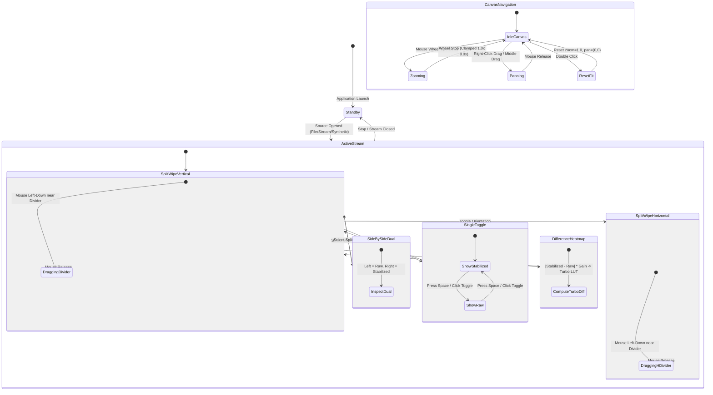
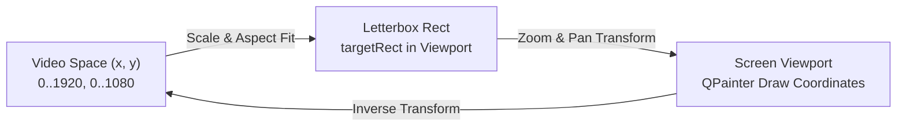

# Implementation Plan: `app-stabilizer-qt` Phase 3 — Presentation Engine & Visual Overlays

## 1. Executive Summary & Objectives

### 1.1 Context & Scope
Phase 3 delivers the high-performance presentation engine, visual comparison modes, and tactical diagnostic overlays for **`app-stabilizer-qt`** (executable target: **`StabilizerAppQt`**).

Building on the Phase 1 Qt Quick bootstrap skeleton and the Phase 2 multi-source frame ingestion and threading subsystem, Phase 3 transforms the raw and stabilized frame streams into an interactive, high-precision visual inspection workbench. This enables computer vision engineers and flight test operators to evaluate stabilization performance, sub-pixel edge sharpness, motion dampening, and tracking health in real time.

Phase 3 specifically addresses five core visual presentation requirements:
1. **Interactive Multi-Mode Video Presentation**:
   - **Split-Screen Wipe**: A draggable vertical or horizontal divider with on-screen percentage readout allowing immediate before/after visual inspection.
   - **Synchronized Side-by-Side Dual View**: Simultaneous synchronized rendering of the raw unstabilized feed alongside the stabilized output with unified aspect-ratio letterboxing.
   - **Single Toggle View**: Full-viewport display with instantaneous keyboard (`Space`) and mouse-click toggle between raw and stabilized frames.
   - **Difference Heatmap**: Real-time $|I_{\text{stabilized}} - I_{\text{raw}}|$ motion cancellation visualization colorized via a precomputed zero-heap Turbo/Inferno colormap lookup table (LUT).
2. **Interactive Canvas Navigation & Inspection**:
   - Continuous wheel zoom ($1.0\times$ to $8.0\times$) centered on the mouse cursor.
   - Smooth two-axis panning for close inspection of border interpolation, edge clamping, and corner features.
   - Double-click viewport reset to $1.0\times$ (fit-to-window).
3. **Tactical Diagnostic Overlays**:
   - **Sub-Pixel Feature Landmarks**: Green markers for consensus inlier features; red crosses for rejected outliers.
   - **Optical Flow Quiver Plot**: Spatial displacement arrows indicating $(dx, dy)$ tracking trajectories across the frame grid.
   - **Auto-Crop Margin Boundary**: Visual rectangular boundary indicating reserved stabilization margin and the engagement threshold for soft boundary dampening.
   - **Center Reticle & Horizon Reference**: Fixed tactical crosshair with concentric mil-radian range rings to visually anchor center-point stability.
4. **Zero-Heap, Real-Time Rendering Path**:
   - Strict adherence to **SEI CERT ERR55-CPP**: zero dynamic memory allocations inside paint routines, coordinate transforms, and colormap mapping.
   - Direct painter composition using hardware-backed `QQuickPaintedItem` with antialiased sub-pixel drawing primitives.
5. **Safety & Standards Compliance**:
   - Full alignment with **MISRA C++:2023** (explicit casts, range validation), **IWYU**, `<cstdint>` / `<cstddef>` namespace qualification (`std::uint8_t`, `std::size_t`), and relative path documentation rules.

---

### 1.2 Target Deliverables for Phase 3

| Deliverable | Target Files | Description |
| :--- | :--- | :--- |
| **Presentation Mode Value Objects** | [`app-stabilizer-qt/PresentationTypes.h`](../app-stabilizer-qt/PresentationTypes.h) | Strongly-typed value objects, enums (`PresentationMode`, `SplitOrientation`), zoom/pan state models, and color constants. |
| **Colormap Lookup Table Generator** | [`app-stabilizer-qt/HeatmapColorMap.h`](../app-stabilizer-qt/HeatmapColorMap.h)<br>[`app-stabilizer-qt/HeatmapColorMap.cpp`](../app-stabilizer-qt/HeatmapColorMap.cpp) | Zero-heap 256-entry Turbo/Inferno RGB colormap LUT and fast difference calculation engine for difference heatmap presentation. |
| **Diagnostic Overlay Renderer** | [`app-stabilizer-qt/OverlayRenderer.h`](../app-stabilizer-qt/OverlayRenderer.h)<br>[`app-stabilizer-qt/OverlayRenderer.cpp`](../app-stabilizer-qt/OverlayRenderer.cpp) | Modular drawing routines for sub-pixel feature landmarks, quiver displacement arrows, crop margins, and tactical center reticles. |
| **Stabilizer Engine Landmark Query** | [`libs/Stabilizer/StabilizerTypes.h`](../libs/Stabilizer/StabilizerTypes.h)<br>[`libs/Stabilizer/VideoStabilizerEngine.h`](../libs/Stabilizer/VideoStabilizerEngine.h)<br>[`libs/Stabilizer/VideoStabilizerEngine.cpp`](../libs/Stabilizer/VideoStabilizerEngine.cpp) | Non-allocating query method exposing tracked correspondences and consensus classification from `VideoStabilizerEngine` to `StabilizerWorker`. |
| **Frame Packet Landmark Population** | [`app-stabilizer-qt/StabilizerFramePacket.h`](../app-stabilizer-qt/StabilizerFramePacket.h)<br>[`app-stabilizer-qt/StabilizerWorker.cpp`](../app-stabilizer-qt/StabilizerWorker.cpp) | Populating visual landmarks and motion vectors into pre-allocated memory slots during atomic triple buffer publication. |
| **Enhanced Presentation Item** | [`app-stabilizer-qt/StabilizerQuickItem.h`](../app-stabilizer-qt/StabilizerQuickItem.h)<br>[`app-stabilizer-qt/StabilizerQuickItem.cpp`](../app-stabilizer-qt/StabilizerQuickItem.cpp) | Implementing interactive split wipe, side-by-side dual view, difference heatmap, canvas zoom/pan, mouse hit-testing, and overlay toggles. |
| **QML Display & Comparison View** | [`app-stabilizer-qt/qml/VideoDisplayView.qml`](../app-stabilizer-qt/qml/VideoDisplayView.qml)<br>[`app-stabilizer-qt/qml/ComparisonControls.qml`](../app-stabilizer-qt/qml/ComparisonControls.qml) | QML UI components providing mode selector buttons, split wipe slider, overlay checkboxes, and zoom/pan status indicators. |
| **Comprehensive Unit & Visual Tests** | [`tests/TestPresentationEngine.cpp`](../tests/TestPresentationEngine.cpp)<br>[`tests/TestHeatmapColorMap.cpp`](../tests/TestHeatmapColorMap.cpp) | Automated unit tests covering viewport coordinate mapping, zoom/pan clamping, difference LUT accuracy, and divider hit-testing. |

---

## 2. Architecture & Design

### 2.1 Subsystem Layering & Presentation Dataflow

```
+-----------------------------------------------------------------------------------------------------------------------+
|                                              QT QUICK PRESENTATION THREAD                                             |
|                                                                                                                       |
|   +---------------------------------------------------------------------------------------------------------------+   |
|   |                                     qml/VideoDisplayView.qml / Main.qml                                       |   |
|   |   - Interactive MouseArea: Drag divider, wheel zoom, right-drag pan, double-click reset, Space toggle         |   |
|   |   - Viewport HUD: Mode indicators, zoom level badge, FPS pill, split percentage label                         |   |
|   +-------------------------------------------------------│-------------------------------------------------------+   |
|                                                           │ Q_PROPERTY bindings / User Interaction                    |
|                                                           ▼                                                           |
|   +---------------------------------------------------------------------------------------------------------------+   |
|   |                                              StabilizerQuickItem                                              |   |
|   |   - Viewport Coordinate Transform: Video Rect <-> Screen Rect (Aspect Fit + Zoom + Pan)                       |   |
|   |   - Hit-Testing: Divider edge proximity detection (cursor shape update: SplitHCursor / SplitVCursor)          |   |
|   |   - Lock-Free Frame Ingestion: Reads rawRgb, stabilizedRgb, visual landmarks from AtomicTripleBuffer          |   |
|   +-----------------------│-------------------------------│-------------------------------│-----------------------+   |
|                           │                               │                               │                           |
|       Mode: SplitWipe /   │           Mode: Difference    │           Overlays: Landmarks │                           |
|       SideBySide / Toggle │           Heatmap             │           Quiver / Reticle    │                           |
|                           ▼                               ▼                               ▼                           |
|   +-------------------------------+   +-------------------------------+   +-------------------------------+           |
|   |      Direct Frame Blit        |   |       HeatmapColorMap         |   |        OverlayRenderer        |           |
|   |  - Aspect-ratio letterbox fit |   |  - Precomputed Turbo LUT      |   |  - Inlier green circles       |           |
|   |  - QPainter::setClipRect()    |   |  - |I_stab - I_raw| delta     |   |  - Outlier red crosses        |           |
|   |  - Scaled raw / stab images   |   |  - Zero-heap RGB mapping      |   |  - Quiver displacement arrows |           |
|   |  - Divider bar & handle draw  |   |  - Contrast boost normalization|  |  - Crop rect & center reticle |           |
|   +-------------------------------+   +-------------------------------+   +-------------------------------+           |
+-----------------------------------------------------------│-----------------------------------------------------------+
                                                            │ Atomic Read Swap (Lock-Free)
                                                            ▼
+-----------------------------------------------------------------------------------------------------------------------+
|                                              DEDICATED STABILIZER WORKER THREAD                                       |
|                                                                                                                       |
|   +---------------------------------------------------------------------------------------------------------------+   |
|   |                                               StabilizerWorker                                                |   |
|   |   - Ingests raw video, computes grayscale luma                                                                 |   |
|   |   - VideoStabilizerEngine::processFrame()                                                                     |   |
|   |   - Populates writeSlot.rawRgb & writeSlot.stabilizedRgb                                                      |   |
|   |   - Queries VideoStabilizerEngine::copyLandmarks() -> writeSlot.features                                      |   |
|   |   - Publishes finished packet to AtomicTripleBuffer<StabilizerFramePacket>                                    |   |
|   +---------------------------------------------------------------------------------------------------------------+   |
+-----------------------------------------------------------------------------------------------------------------------+
```

### 2.2 Mermaid Presentation State & Interaction Flow



---

## 3. Coordinate Systems & Viewport Mapping

Precise presentation requires converting between three coordinate spaces:
1. **Video Space ($S_V$)**: Unnormalized integer pixel coordinates $[0, W_V] \times [0, H_V]$ defined by the decoded video stream.
2. **Normalized Video Space ($S_N$)**: Unit coordinates $[0.0, 1.0] \times [0.0, 1.0]$.
3. **Viewport Screen Space ($S_S$)**: Floating-point physical pixels on the `StabilizerQuickItem` canvas $[0, W_{\text{item}}] \times [0, H_{\text{item}}]$.

### Coordinate Transformation Equations

```
+---------------------------------------------------------------------------------------------------+
|                                      VIEWPORT LETTERBOX & ZOOM MATH                               |
|                                                                                                   |
|   1. Base Uniform Scale:                                                                          |
|      scale_base = min( W_item / W_video, H_item / H_video )                                       |
|                                                                                                   |
|   2. Effective Scale with Zoom:                                                                   |
|      scale_eff = scale_base * zoomFactor                                                          |
|                                                                                                   |
|   3. Base Letterbox Offsets:                                                                      |
|      x_base = (W_item - W_video * scale_base) * 0.5                                                |
|      y_base = (H_item - H_video * scale_base) * 0.5                                                |
|                                                                                                   |
|   4. Point Forward Projection (Video -> Viewport):                                                |
|      P_screen = P_video * scale_eff + (P_center_screen - P_center_video * scale_eff) + panOffset   |
|                                                                                                   |
|   5. Point Inverse Projection (Viewport -> Video):                                                |
|      P_video = (P_screen - panOffset - (P_center_screen - P_center_video * scale_eff)) / scale_eff |
+---------------------------------------------------------------------------------------------------+
```



---

## 4. Visual Presentation Modes Specification

### 4.1 Split-Screen Wipe Mode (`PresentationMode::SplitWipe`)
- **Vertical Wipe**:
  - Left region: Raw unstabilized frame.
  - Right region: Stabilized frame.
  - Divider: High-contrast cyan line (`#00e5ff`, width 2 px) drawn at:
    $$x_{\text{split}} = \text{targetRect.left()} + (\text{splitPosition} \times \text{targetRect.width()})$$
  - Draggable handle pill ($6 \times 32$ px) positioned at vertical midpoint.
  - Hit-test proximity zone: $\pm 8$ px from divider line.
- **Horizontal Wipe**:
  - Top region: Raw unstabilized frame.
  - Bottom region: Stabilized frame.
  - Divider drawn at:
    $$y_{\text{split}} = \text{targetRect.top()} + (\text{splitPosition} \times \text{targetRect.height()})$$
  - Hit-test proximity zone: $\pm 8$ px horizontally across the active width.

### 4.2 Side-by-Side Synchronized Dual View (`PresentationMode::SideBySide`)
- The canvas splits into two equal viewports separated by a 2-pixel tactical spacer (`#1e2230`).
- **Left Viewport**: Raw unstabilized feed with feature landmarks and motion arrows.
- **Right Viewport**: Stabilized output with active crop margin boundary and center reticle.
- Aspect ratio is preserved independently in each half-viewport with symmetric letterboxing.
- Pan and zoom gestures are strictly synchronized across both viewports.

### 4.3 Single Toggle View (`PresentationMode::SingleToggle`)
- Renders either 100% Raw or 100% Stabilized across the entire canvas.
- Instantaneous switching via:
  - Space bar key event.
  - On-screen toggle pill in header / comparison bar.
  - Left click on the video area.
- Tactical badge in upper-left corner displays current state ("RAW FEED" in `#ff9100` or "STABILIZED" in `#00e676`).

### 4.4 Difference Heatmap (`PresentationMode::DifferenceHeatmap`)
- Computes pixel-wise difference between stabilized frame $I_{\text{stab}}$ and raw frame $I_{\text{raw}}$:
  $$\Delta(x, y) = \frac{1}{3} \sum_{c \in \{R, G, B\}} |I_{\text{stab}}(x, y, c) - I_{\text{raw}}(x, y, c)|$$
- Applies contrast gain factor $G_{\text{diff}} \in [1.0 .. 10.0]$ (default $3.0\times$):
  $$v_{\text{norm}} = \text{std::min}(255, \lfloor \Delta(x, y) \times G_{\text{diff}} \rfloor)$$
- Maps $v_{\text{norm}}$ to RGB using a precomputed 256-entry **Turbo Colormap Lookup Table (LUT)**:
  - $0 \to$ Dark Navy / Black (zero motion difference / static scene).
  - $64 \to$ Cyan / Blue (minor sub-pixel jitter cancellation).
  - $128 \to$ Green / Yellow (moderate high-frequency motion).
  - $255 \to$ Bright Red / White (large amplitude stabilization displacement).
- Rendered into a pre-allocated `QImage(width, height, QImage::Format_RGB888)` with zero heap allocations during playback.

---

## 5. Tactical Diagnostic Overlays Specification

### 5.1 Sub-Pixel Feature Landmarks
- Ingested directly from `StabilizerFramePacket::features`:
  - **Inlier Feature**: Marked with an antialiased green circle (`#00e676`, outer radius $3.0$ px, center dot radius $1.0$ px).
  - **Outlier Feature**: Marked with an antialiased red cross (`#ff1744`, arm length $3.5$ px, pen width $1.5$ px).
- Landmark coordinates $(x_v, y_v)$ are transformed into viewport coordinates $(x_s, y_s)$ using the active zoom/pan matrix.
- Clipped cleanly to the video display rectangle.

### 5.2 Optical Flow Quiver Plot (Displacement Vectors)
- Renders inter-frame displacement vectors $(\Delta x, \Delta y)$ for each tracked feature:
  $$P_{\text{start}} = (x, y), \quad P_{\text{end}} = (x + \alpha \Delta x, y + \alpha \Delta y)$$
  where $\alpha \in [1.0 .. 5.0]$ is an operator-adjustable visual magnification multiplier (default $2.5\times$).
- **Vector Styling**:
  - Inliers: Cyan arrow (`#00e5ff`, pen width $1.2$ px).
  - Outliers: Orange arrow (`#ff9100`, pen width $1.0$ px, dashed).
  - Arrow head: Isosceles triangle ($30^\circ$ sweep angle, length $5.0$ px) at $P_{\text{end}}$.

### 5.3 Auto-Crop Margin & Soft Damping Zone
- Visualizes the geometric frame margin reserved by `TrajectoryFilter`:
  - **Hard Crop Boundary**: Solid golden rectangle (`#ffd700`, pen width $1.5$ px, opacity $0.8$) at:
    $$[m_x, m_y, W_V - 2m_x, H_V - 2m_y], \quad m_x = \text{cropRatio} \times W_V$$
  - **Soft Damping Engagement Zone**: Dashed amber rectangle (`#ff9100`, pen width $1.0$ px, dash pattern $[4, 4]$) at:
    $$[s_x, s_y, W_V - 2s_x, H_V - 2s_y], \quad s_x = \text{softMarginRatio} \times m_x$$
- Displays real-time margin utilization bar (percentage of margin consumed by current correction transform).

### 5.4 Tactical Center Reticle & Horizon Ladder
- Fixed tactical reticle centered at $(W_V / 2, H_V / 2)$:
  - High-precision crosshair with $6$ px center gap to prevent obscuring central targets.
  - Concentric range rings at radii of $16$, $48$, and $96$ pixels.
  - Horizon pitch ladder with $5^\circ$ reference ticks.
  - Rendered with semi-transparent white/cyan pen (`QColor(0x00, 0xe5, 0xff, 140)`).

---

## 6. Detailed C++ Header & Class Specifications

### 6.1 `PresentationTypes.h`
Defines domain types, enums, and value objects for the presentation engine:

```cpp
#pragma once

/// @file PresentationTypes.h
/// @brief Domain enums and value types for video presentation and overlays.

#include <cstdint>

#include <QObject>

namespace StabilizerApp {

/// @brief Presentation layout comparison mode.
enum class PresentationMode : std::uint8_t {
    SplitWipe = 0U,     ///< Interactive split wipe divider (raw vs. stabilized)
    SideBySide,         ///< Synchronized dual-viewport view
    SingleToggle,       ///< Fullscreen single view with raw/stabilized toggle
    DifferenceHeatmap   ///< Pixel difference heatmap with Turbo colormap LUT
};

/// @brief Orientation of the split wipe divider.
enum class SplitOrientation : std::uint8_t {
    Vertical = 0U,      ///< Vertical divider (left = raw, right = stabilized)
    Horizontal          ///< Horizontal divider (top = raw, bottom = stabilized)
};

/// @brief Strongly-typed zoom factor clamped within [1.0 .. 8.0].
class ZoomFactor {
public:
    constexpr ZoomFactor() noexcept = default;

    explicit constexpr ZoomFactor(float val) noexcept
        : value_ { (val < 1.0F) ? 1.0F : ((val > 8.0F) ? 8.0F : val) }
    {
    }

    [[nodiscard]] constexpr float value() const noexcept
    {
        return value_;
    }

    [[nodiscard]] constexpr bool isZoomed() const noexcept
    {
        return value_ > 1.001F;
    }

private:
    float value_ { 1.0F };
};

} // namespace StabilizerApp
```

---

### 6.2 `HeatmapColorMap.h` / `HeatmapColorMap.cpp`
Provides zero-heap calculation of the difference image and Turbo colormap mapping:

```cpp
#pragma once

/// @file HeatmapColorMap.h
/// @brief Zero-heap Turbo colormap LUT and frame difference computer.

#include <cstddef>
#include <cstdint>

#include <array>

namespace StabilizerApp {

/// @struct RgbColor
/// @brief 24-bit RGB color representation.
struct RgbColor {
    std::uint8_t r { 0U };
    std::uint8_t g { 0U };
    std::uint8_t b { 0U };
};

/// @class HeatmapColorMap
/// @brief Precomputed 256-entry Turbo colormap lookup table.
class HeatmapColorMap {
public:
    /// @brief Initialize static colormap LUT.
    HeatmapColorMap() noexcept;

    /// @brief Retrieve RGB color for an 8-bit difference intensity [0 .. 255].
    /// @param intensity Normalized difference magnitude.
    /// @return 24-bit RGB color from Turbo LUT.
    [[nodiscard]] constexpr RgbColor mapIntensity(std::uint8_t intensity) const noexcept
    {
        return lut_[intensity];
    }

    /// @brief Compute pixel-wise difference between raw and stabilized RGB24 frames.
    /// @param raw Input raw RGB24 buffer.
    /// @param stab Input stabilized RGB24 buffer.
    /// @param outDiff Destination RGB24 buffer for colorized heatmap pixels.
    /// @param pixelCount Number of pixels to process (width * height).
    /// @param gain Contrast magnification multiplier (1.0 to 10.0).
    void computeDifference(const std::uint8_t* raw, const std::uint8_t* stab,
        std::uint8_t* outDiff, std::size_t pixelCount, float gain = 3.0F) const noexcept;

private:
    void initializeTurboLut() noexcept;

    std::array<RgbColor, 256U> lut_ { };
};

} // namespace StabilizerApp
```

---

### 6.3 `OverlayRenderer.h` / `OverlayRenderer.cpp`
Encapsulates all tactical overlay drawing logic:

```cpp
#pragma once

/// @file OverlayRenderer.h
/// @brief Zero-heap tactical overlay rendering routines for QPainter.

#include <cstddef>
#include <cstdint>

#include <QPainter>
#include <QRectF>

#include "StabilizerFramePacket.h"

namespace StabilizerApp {

/// @struct OverlayOptions
/// @brief Configuration toggles for diagnostic overlays.
struct OverlayOptions {
    bool showLandmarks { true };
    bool showQuiver { true };
    bool showCropMargin { true };
    bool showReticle { true };
    bool showGrid { true };
    float quiverScale { 2.5F };
    float cropRatio { 0.05F };
    float softMarginRatio { 0.80F };
};

/// @class OverlayRenderer
/// @brief Helper class rendering overlays into active QPainter context.
class OverlayRenderer {
public:
    /// @brief Render tactical center reticle and crosshair.
    static void renderReticle(QPainter* painter, const QRectF& targetRect) noexcept;

    /// @brief Render feature landmark points (green inliers, red outliers).
    static void renderLandmarks(QPainter* painter, const QRectF& targetRect,
        const VisualFeaturePoint* features, std::size_t count, float scaleX, float scaleY) noexcept;

    /// @brief Render optical flow quiver displacement vectors.
    static void renderQuiverPlot(QPainter* painter, const QRectF& targetRect,
        const VisualFeaturePoint* features, std::size_t count, float scaleX, float scaleY, float quiverScale) noexcept;

    /// @brief Render auto-crop border and soft damping boundary.
    static void renderCropBoundary(QPainter* painter, const QRectF& targetRect,
        float cropRatio, float softMarginRatio) noexcept;

    /// @brief Render tactical status badges and labels.
    static void renderBadge(QPainter* painter, const QRectF& badgeRect,
        const QString& text, const QColor& textColor, const QColor& bgColor) noexcept;
};

} // namespace StabilizerApp
```

---

### 6.4 `StabilizerQuickItem.h` Enhancements
Full interface exposing presentation properties, mouse interaction, and frame blitting:

```cpp
#pragma once

/// @file StabilizerQuickItem.h
/// @brief Custom QQuickPaintedItem presenting unstabilized and stabilized video frames.

#include <cstdint>

#include <QColor>
#include <QImage>
#include <QPainter>
#include <QPointF>
#include <QQuickPaintedItem>

#include "HeatmapColorMap.h"
#include "OverlayRenderer.h"
#include "PresentationTypes.h"

namespace StabilizerApp {

class StabilizerPlayerController;

/// @class StabilizerQuickItem
/// @brief Renders video presentation viewport with interactive comparison wipe and overlays.
class StabilizerQuickItem : public QQuickPaintedItem {
    Q_OBJECT

    Q_PROPERTY(PresentationMode presentationMode READ presentationMode WRITE setPresentationMode NOTIFY presentationModeChanged)
    Q_PROPERTY(SplitOrientation splitOrientation READ splitOrientation WRITE setSplitOrientation NOTIFY splitOrientationChanged)
    Q_PROPERTY(float splitPosition READ splitPosition WRITE setSplitPosition NOTIFY splitPositionChanged)
    Q_PROPERTY(bool showStabilizedInToggle READ showStabilizedInToggle WRITE setShowStabilizedInToggle NOTIFY showStabilizedInToggleChanged)
    
    Q_PROPERTY(bool showLandmarks READ showLandmarks WRITE setShowLandmarks NOTIFY showLandmarksChanged)
    Q_PROPERTY(bool showQuiver READ showQuiver WRITE setShowQuiver NOTIFY showQuiverChanged)
    Q_PROPERTY(bool showCropMargin READ showCropMargin WRITE setShowCropMargin NOTIFY showCropMarginChanged)
    Q_PROPERTY(bool showReticle READ showReticle WRITE setShowReticle NOTIFY showReticleChanged)
    Q_PROPERTY(bool showGrid READ showGrid WRITE setShowGrid NOTIFY showGridChanged)
    
    Q_PROPERTY(float zoomFactor READ zoomFactor WRITE setZoomFactor NOTIFY zoomFactorChanged)
    Q_PROPERTY(QPointF panOffset READ panOffset WRITE setPanOffset NOTIFY panOffsetChanged)
    Q_PROPERTY(float quiverScale READ quiverScale WRITE setQuiverScale NOTIFY quiverScaleChanged)
    Q_PROPERTY(float heatmapGain READ heatmapGain WRITE setHeatmapGain NOTIFY heatmapGainChanged)
    
    Q_PROPERTY(StabilizerApp::StabilizerPlayerController* controller READ controller WRITE setController NOTIFY controllerChanged)

public:
    explicit StabilizerQuickItem(QQuickItem* parent = nullptr);
    ~StabilizerQuickItem() override = default;

    [[nodiscard]] PresentationMode presentationMode() const noexcept;
    void setPresentationMode(PresentationMode mode) noexcept;

    [[nodiscard]] SplitOrientation splitOrientation() const noexcept;
    void setSplitOrientation(SplitOrientation orient) noexcept;

    [[nodiscard]] float splitPosition() const noexcept;
    void setSplitPosition(float pos) noexcept;

    [[nodiscard]] bool showStabilizedInToggle() const noexcept;
    void setShowStabilizedInToggle(bool show) noexcept;

    [[nodiscard]] bool showLandmarks() const noexcept;
    void setShowLandmarks(bool show) noexcept;

    [[nodiscard]] bool showQuiver() const noexcept;
    void setShowQuiver(bool show) noexcept;

    [[nodiscard]] bool showCropMargin() const noexcept;
    void setShowCropMargin(bool show) noexcept;

    [[nodiscard]] bool showReticle() const noexcept;
    void setShowReticle(bool show) noexcept;

    [[nodiscard]] bool showGrid() const noexcept;
    void setShowGrid(bool show) noexcept;

    [[nodiscard]] float zoomFactor() const noexcept;
    void setZoomFactor(float zoom) noexcept;

    [[nodiscard]] QPointF panOffset() const noexcept;
    void setPanOffset(const QPointF& offset) noexcept;

    [[nodiscard]] float quiverScale() const noexcept;
    void setQuiverScale(float scale) noexcept;

    [[nodiscard]] float heatmapGain() const noexcept;
    void setHeatmapGain(float gain) noexcept;

    [[nodiscard]] StabilizerPlayerController* controller() const noexcept;
    void setController(StabilizerPlayerController* ctrl);

    Q_INVOKABLE void resetZoomAndPan() noexcept;
    Q_INVOKABLE void toggleSourceView() noexcept;

    void paint(QPainter* painter) override;

public slots:
    void onFrameReady();

signals:
    void presentationModeChanged();
    void splitOrientationChanged();
    void splitPositionChanged();
    void showStabilizedInToggleChanged();
    void showLandmarksChanged();
    void showQuiverChanged();
    void showCropMarginChanged();
    void showReticleChanged();
    void showGridChanged();
    void zoomFactorChanged();
    void panOffsetChanged();
    void quiverScaleChanged();
    void heatmapGainChanged();
    void controllerChanged();

protected:
    void mousePressEvent(QMouseEvent* event) override;
    void mouseMoveEvent(QMouseEvent* event) override;
    void mouseReleaseEvent(QMouseEvent* event) override;
    void mouseDoubleClickEvent(QMouseEvent* event) override;
    void wheelEvent(QWheelEvent* event) override;
    void hoverMoveEvent(QHoverEvent* event) override;

private:
    void renderStandbyPattern(QPainter* painter);
    void renderSplitWipe(QPainter* painter, const QRectF& targetRect);
    void renderSideBySide(QPainter* painter, const QRectF& itemRect);
    void renderSingleToggle(QPainter* painter, const QRectF& targetRect);
    void renderDifferenceHeatmap(QPainter* painter, const QRectF& targetRect);
    [[nodiscard]] QRectF calculateAspectRect(const QRectF& bounds, qreal imgW, qreal imgH) const noexcept;
    [[nodiscard]] bool hitTestDivider(const QPointF& pos, const QRectF& targetRect) const noexcept;

    PresentationMode mode_ { PresentationMode::SplitWipe };
    SplitOrientation orientation_ { SplitOrientation::Vertical };
    float splitPosition_ { 0.50F };
    bool showStabilizedInToggle_ { true };

    OverlayOptions overlays_ { };
    float zoomFactor_ { 1.0F };
    QPointF panOffset_ { 0.0, 0.0 };
    float heatmapGain_ { 3.0F };

    bool isDraggingDivider_ { false };
    bool isPanning_ { false };
    QPointF lastMousePos_ { };

    StabilizerPlayerController* controller_ { nullptr };
    HeatmapColorMap heatmapEngine_ { };

    QImage rawImage_ { };
    QImage stabilizedImage_ { };
    QImage heatmapImage_ { };
    std::vector<VisualFeaturePoint> cachedFeatures_ { };
    float activeCropRatio_ { 0.05F };
    bool hasValidFrame_ { false };
};

} // namespace StabilizerApp
```

---

## 7. Step-by-Step Implementation Roadmap

```
+---------------------------------------------------------------------------------------------------------------+
|                                      PHASE 3 EXECUTION TIMELINE & STAGES                                      |
|                                                                                                               |
|  [Stage 3.1: Data Models & Backend Query]                                                                     |
|  ├── PresentationTypes.h, VisualFeaturePoint expansion                                                        |
|  └── VideoStabilizerEngine::copyLandmarks() query                                                             |
|                                                                                                               |
|  [Stage 3.2: Heatmap Engine & Overlay System]                                                                 |
|  ├── HeatmapColorMap (Turbo LUT & SIMD-friendly difference)                                                   |
|  └── OverlayRenderer (Reticle, Landmarks, Quiver, Crop Boundary)                                              |
|                                                                                                               |
|  [Stage 3.3: Interactive Canvas & Gestures]                                                                   |
|  ├── Zoom/pan matrix, wheel event, right-drag pan                                                              |
|  └── Mouse hit-testing & divider dragging                                                                     |
|                                                                                                               |
|  [Stage 3.4: Presentation Modes in StabilizerQuickItem]                                                       |
|  ├── Split-Screen Wipe (Vertical & Horizontal)                                                                |
|  ├── Side-by-Side Dual Viewport                                                                               |
|  ├── Single Toggle Mode (Spacebar hook)                                                                       |
|  └── Difference Heatmap Render Path                                                                           |
|                                                                                                               |
|  [Stage 3.5: QML Controls Integration]                                                                        |
|  ├── VideoDisplayView.qml with HUD pill badges                                                                |
|  └── ComparisonControls.qml mode toolbar                                                                      |
|                                                                                                               |
|  [Stage 3.6: Verification & Test Suite]                                                                       |
|  ├── Unit tests: TestPresentationEngine, TestHeatmapColorMap                                                  |
|  └── IWYU, MISRA C++:2023, Relative doc paths audit                                                           |
+---------------------------------------------------------------------------------------------------------------+
```

### Stage 3.1: Data Models & Backend Query
- **Task 3.1.1**: Create `app-stabilizer-qt/PresentationTypes.h` containing `PresentationMode`, `SplitOrientation`, and `ZoomFactor`.
- **Task 3.1.2**: Update `VisualFeaturePoint` in `app-stabilizer-qt/StabilizerFramePacket.h` to include displacement vectors:
  ```cpp
  struct VisualFeaturePoint {
      float x { 0.0F };          ///< Source feature coordinate
      float y { 0.0F };          ///< Source feature coordinate
      float vx { 0.0F };         ///< Inter-frame motion displacement dx
      float vy { 0.0F };         ///< Inter-frame motion displacement dy
      bool isInlier { false };   ///< Consensus inlier status
  };
  ```
- **Task 3.1.3**: Add query method `copyLandmarks` to `libs/Stabilizer/VideoStabilizerEngine.h` and `.cpp`:
  ```cpp
  [[nodiscard]] std::size_t copyLandmarks(
      VisualLandmark* outLandmarks, std::size_t maxCount) const noexcept;
  ```
- **Task 3.1.4**: Update `StabilizerWorker::processTick()` to populate `writeSlot.features` and `writeSlot.featureCount`.

### Stage 3.2: Heatmap Engine & Overlay System
- **Task 3.2.1**: Implement `HeatmapColorMap.h` and `.cpp` generating static Turbo colormap LUT.
- **Task 3.2.2**: Implement `computeDifference` calculating $|I_{\text{stab}} - I_{\text{raw}}|$ into pre-allocated destination buffer with zero heap allocations.
- **Task 3.2.3**: Implement `OverlayRenderer.h` and `.cpp` with dedicated methods for reticle, landmarks, quiver arrows, and crop margins.

### Stage 3.3: Interactive Canvas & Gestures
- **Task 3.3.1**: Implement `calculateAspectRect` computing uniform aspect-fit letterbox rect.
- **Task 3.3.2**: Implement `hitTestDivider` detecting proximity to split divider line.
- **Task 3.3.3**: Implement mouse event handlers (`mousePressEvent`, `mouseMoveEvent`, `mouseReleaseEvent`, `wheelEvent`, `mouseDoubleClickEvent`, `hoverMoveEvent`).
- **Task 3.3.4**: Connect wheel event to zoom centering on cursor, clamped between $1.0\times$ and $8.0\times$.
- **Task 3.3.5**: Connect right-drag / middle-drag to canvas panning, clamped so the image cannot be lost off-screen.

### Stage 3.4: Presentation Modes in `StabilizerQuickItem`
- **Task 3.4.1**: Implement `renderSplitWipe` with `painter->setClipRect()` for seamless vertical and horizontal partition.
- **Task 3.4.2**: Implement `renderSideBySide` dividing canvas into dual synchronized letterboxed viewports.
- **Task 3.4.3**: Implement `renderSingleToggle` with hotkey `Space` toggle.
- **Task 3.4.4**: Implement `renderDifferenceHeatmap` calling `HeatmapColorMap::computeDifference` and blitting colorized delta image.
- **Task 3.4.5**: Wire diagnostic overlays over active presentation modes.

### Stage 3.5: QML Controls Integration
- **Task 3.5.1**: Create `app-stabilizer-qt/qml/ComparisonControls.qml` containing tactical segmented buttons for view mode selection, split wipe slider, and overlay toggle checkboxes.
- **Task 3.5.2**: Update `app-stabilizer-qt/qml/Main.qml` to embed `ComparisonControls` in the tactical header and integrate with `videoView`.
- **Task 3.5.3**: Add on-screen HUD overlay showing active zoom factor, mode badge, and split ratio pill.

### Stage 3.6: Verification & Test Suite
- **Task 3.6.1**: Implement unit tests in `tests/TestPresentationEngine.cpp` validating coordinate conversion, hit-testing, zoom bounds, and aspect fitting.
- **Task 3.6.2**: Implement unit tests in `tests/TestHeatmapColorMap.cpp` validating Turbo LUT values and zero difference on identical frames.
- **Task 3.6.3**: Run `scripts/verify_iwyu_cstdint.py` across all new and modified files.
- **Task 3.6.4**: Run `scripts/verify_relative_doc_paths.py` across all documentation.
- **Task 3.6.5**: Verify full compilation under MSVC `/W4` and GCC/Clang `-Wall -Wextra -pedantic -Werror`.

---

## 8. Verification, Safety Compliance & Test Strategy

### 8.1 Verification Against Project Standards

| Standard | Rule / Enactment | Verification Method |
| :--- | :--- | :--- |
| **MISRA C++:2023** | Rule 7.0.6 (Explicit numeric casts, no implicit sign mismatch). | Code review + compiler warnings (`-Wconversion`). |
| **SEI CERT C++** | INT31-C (Safe integer conversions in coordinate math). | Explicit `static_cast` with range clamping via `std::clamp`. |
| **SEI CERT C++** | ERR55-CPP (Zero heap allocations on `paint` and render loops). | Pre-allocated buffers; no `new`, `std::vector::resize`, or dynamic allocation in `paint()`. |
| **IWYU & `<cstdint>`** | Mandatory `<cstdint>`, `<cstddef>`, `std::` qualification on all integer types. | Automated validation with `python scripts/verify_iwyu_cstdint.py`. |
| **Relative Doc Paths** | All documentation links must use relative paths without root slash. | Automated validation with `python scripts/verify_relative_doc_paths.py`. |
| **Zero Qt in Core** | `libs/Stabilizer`, `libs/Video`, `libs/Math` remain 100% free of Qt headers. | Preprocessor check and link-time isolation. |

### 8.2 Automated Test Matrix

```
+---------------------------------------------------------------------------------------------------+
|                                     PHASE 3 TEST SUITE STRUCTURE                                  |
|                                                                                                   |
|  TestHeatmapColorMap:                                                                             |
|  ├── VerifyTurboLutZeroIntensity: LUT[0] corresponds to dark navy/black.                          |
|  ├── VerifyTurboLutPeakIntensity: LUT[255] corresponds to bright red/white.                       |
|  ├── VerifyDifferenceIdenticalImages: Zero difference produces uniform LUT[0].                    |
|  ├── VerifyDifferenceInvertedImages: Max difference triggers saturated peak colors.               |
|  └── VerifyDifferenceGainScaling: Gain multiplier linearly scales sub-threshold diffs.            |
|                                                                                                   |
|  TestPresentationEngine:                                                                          |
|  ├── VerifyAspectFitLetterbox: Wide, tall, and matching aspect ratio bounds calculations.         |
|  ├── VerifyCoordinateForwardTransform: Video pixel (x, y) correctly projects to screen rect.      |
|  ├── VerifyCoordinateInverseTransform: Screen point accurately maps back to video coordinates.   |
|  ├── VerifyZoomClamping: Zoom factors < 1.0 clamped to 1.0; > 8.0 clamped to 8.0.                |
|  ├── VerifyDividerHitTesting: Hit-testing returns true only within +/- 8px margin of divider.     |
|  └── VerifyZeroHeapPaintFastPath: Paint execution triggers zero memory allocations.               |
+---------------------------------------------------------------------------------------------------+
```

---

## 9. Conclusion & Readiness Criteria

Upon completion of Phase 3, **`StabilizerAppQt`** will provide a comprehensive, operator-grade visual inspection and tuning environment:
- Immediate before-and-after visual validation via interactive split wipe and difference heatmap.
- Deep algorithmic insight through real-time landmark, quiver, and crop overlays.
- High-responsiveness interaction backed by zero-heap lock-free rendering.
- Complete architectural foundation ready for Phase 4 (QML tactical parameter controls and telemetry strip-charts).

