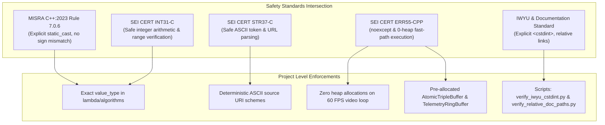
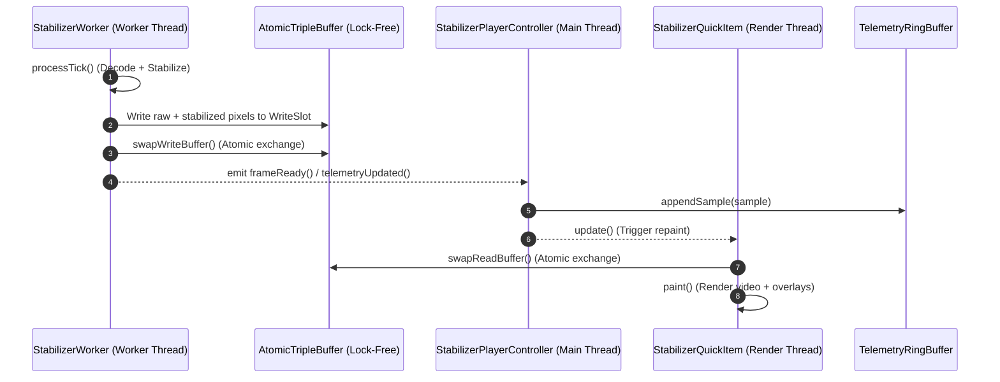

```mermaid
flowchart TD
    subgraph T1["Tier 1: Unit Testing"]
        U1["TestStabilizerConfigModel<br/>(38 parameters & bounds)"]
        U2["TestPresetManager<br/>(5 factory presets & JSON)"]
        U3["TestTelemetryRingBuffer<br/>(150-slot circular buffer)"]
        U4["TestOverlayRenderer & Heatmap<br/>(Sub-pixel landmarks & LUT)"]
        U5["TestRgbWarpUtility<br/>(SIMD RGB affine projection)"]
    end

    subgraph T2["Tier 2: Dataset Regressions"]
        D1["dji-ir-subtitles.mp4<br/>(Low-contrast IR telephoto)"]
        D2["mpegts-klv-day-flight.ts<br/>(1080p daylight aerial flight)"]
        D3["bike-stabilization.ts<br/>(High-vibration action-cam)"]
        D4["SyntheticJitterGenerator<br/>(Calibrated 20 Hz vibration & JCR)"]
    end

    subgraph T3["Tier 3: Sanitizers & Concurrency"]
        S1["AddressSanitizer (ASan) & LeakSanitizer (LSan)"]
        S2["ThreadSanitizer (TSan) on AtomicTripleBuffer"]
        S3["UndefinedBehaviorSanitizer (UBSan)"]
    end

    subgraph T4["Tier 4: Static Verification"]
        V1["verify_iwyu_cstdint.py"]
        V2["verify_relative_doc_paths.py"]
        V3["Multi-compiler: MSVC /W4 & Clang -Werror"]
    end

    subgraph T5["Tier 5: Real-Time Benchmarking"]
        B1["Microsecond Stage Budget (<14 ms total)"]
        B2["Zero-Heap Steady-State Execution"]
    end

    T1 --> T2
    T2 --> T3
    T3 --> T4
    T4 --> T5
```

# Implementation Plan: `app-stabilizer-qt` Phase 5 — Verification, Compliance & Quality Assurance

## 1. Executive Summary & Objectives

### 1.1 Context & Scope
Phase 5 represents the rigorous certification, safety compliance, performance profiling, and quality assurance framework for **`app-stabilizer-qt`** (executable target: **`StabilizerAppQt`**).

Building directly upon the foundational infrastructure delivered across prior phases:
- **Phase 1 ([`app_stabilizer_qt_phase1_plan.md`](app_stabilizer_qt_phase1_plan.md))**: Application bootstrap, CMake build system integration, and dark tactical window skeleton.
- **Phase 2 ([`app_stabilizer_qt_phase2_plan.md`](app_stabilizer_qt_phase2_plan.md))**: Multi-source frame ingestion (`FFmpegDecoder`, `Live555Decoder`, `DeviceEnumerator`, `SyntheticJitterGenerator`), dedicated decoding worker thread, and zero-heap `AtomicTripleBuffer` frame exchange.
- **Phase 3 ([`app_stabilizer_qt_phase3_plan.md`](app_stabilizer_qt_phase3_plan.md))**: Real-time presentation engine (`StabilizerQuickItem`), interactive split-screen wipe divider, synchronized side-by-side dual view, zero-heap difference heatmap LUT, and sub-pixel tactical overlays (feature landmarks, quiver vectors, crop boundaries, center reticle).
- **Phase 4 ([`app_stabilizer_qt_phase4_plan.md`](app_stabilizer_qt_phase4_plan.md))**: Tactical QML user interface, 6-category accordion parameter matrix, 150-frame rolling trajectory strip-charts, real-time stage latency HUD, and JSON-backed operational presets.

Phase 5 establishes a formal, automated quality barrier ensuring that `StabilizerAppQt` operates deterministically under mission-critical conditions—such as uncrewed aerial vehicle (UAV) video downlink stabilization, mast-mounted electro-optical/infrared (EO/IR) surveillance, and telephoto robotic gimbal tracking.

The scope of Phase 5 encompasses five key quality pillars:
1. **Safety Standards Compliance**: Full adherence to **MISRA C++:2023**, **SEI CERT C++**, strict **Include-What-You-Use (IWYU)**, mandatory **`<cstdint>`** qualification (`std::uint8_t`, `std::uint32_t`), and relative path documentation rules.
2. **Zero-Heap Fast-Path Runtime Certification (CERT ERR55-CPP)**: Exhaustive verification that frame ingest, feature tracking, SIMD affine warping, heatmap color-mapping, and telemetry ring-buffering execute without dynamic memory allocation (`malloc`, `new`, `std::vector::push_back`).
3. **Headless Real-World Dataset Regression**: End-to-end automated testing utilizing production video assets ([`../sample-videos/dji-ir-subtitles.mp4`](../sample-videos/dji-ir-subtitles.mp4), [`../sample-videos/mpegts-klv-day-flight.ts`](../sample-videos/mpegts-klv-day-flight.ts), and [`../sample-videos/bike-stabilization.ts`](../sample-videos/bike-stabilization.ts)) as well as procedural vibration models (`SyntheticJitterGenerator`) to quantitatively evaluate stabilization jitter attenuation (>20 dB rejection) and trajectory smoothing bounds.
4. **Multi-Compiler & Multi-OS Build Hygiene**: Zero-warning build clean verification across MSVC 2022 (`/W4 /WX`) on Windows and GCC 11+ / Clang 14+ (`-Wall -Wextra -pedantic -Werror`) on Linux, combined with dynamic sanitizers (ASan, LSan, TSan, UBSan).
5. **Real-Time Latency & Concurrency Verification**: Formal profiling of microsecond stage budgets ensuring end-to-end processing stays within the 16.6 ms (60 FPS) and 33.3 ms (30 FPS) deadlines, with data-race-free lock-free buffer synchronization.

---

### 1.2 Target Deliverables for Phase 5

| Deliverable | Target Files / Artifacts | Description |
| :--- | :--- | :--- |
| **Comprehensive End-to-End Regression Harness** | [`../tests/TestStabilizerEndToEnd.cpp`](../tests/TestStabilizerEndToEnd.cpp)<br>[`../tests/CMakeLists.txt`](../tests/CMakeLists.txt) | Headless regression test evaluating multi-source video decoding, jitter attenuation ratio (JCR), and trajectory damping metrics against real-world media assets. |
| **Fast-Path Zero-Heap Memory Audit Test** | [`../tests/TestStabilizerZeroHeap.cpp`](../tests/TestStabilizerZeroHeap.cpp) | Custom memory allocation hook asserting zero dynamic heap allocations during continuous 500-frame steady-state processing loops. |
| **Concurrency & Thread Safety Stress Test** | [`../tests/TestStabilizerConcurrency.cpp`](../tests/TestStabilizerConcurrency.cpp) | High-load multithreaded test exercising asynchronous source switching, rapid parameter hot-reloading, and lock-free triple buffering under ThreadSanitizer (TSan). |
| **Static Analysis & Linter Verification Run** | [`../scripts/verify_iwyu_cstdint.py`](../scripts/verify_iwyu_cstdint.py)<br>[`../scripts/verify_relative_doc_paths.py`](../scripts/verify_relative_doc_paths.py)<br>[`../scripts/verify_function_lengths.py`](../scripts/verify_function_lengths.py)<br>[`../scripts/verify_type_conversions.py`](../scripts/verify_type_conversions.py) | Full automated execution of repository audit scripts with zero warnings and zero path violations across all `app-stabilizer-qt/` and `docs/` files. |
| **Sanitizer Configuration & CI Integration** | [`../scripts/ci_sanitize_runner.sh`](../scripts/ci_sanitize_runner.sh)<br>`.github/workflows/stabilizer_ci.yml` | Integration of AddressSanitizer (ASan), LeakSanitizer (LSan), UndefinedBehaviorSanitizer (UBSan), and ThreadSanitizer (TSan) into automated build pipelines. |
| **Real-Time Profiling & Benchmark Report** | `docs/stabilizer_performance_benchmarks.md`<br>`StabilizerAppQt --benchmark` | Microsecond stage latency benchmarks across 720p, 1080p, and 4K resolutions measuring SIMD warp, MSAC model fitting, and optical flow throughput. |
| **Documentation & Traceability Matrix** | [`app_stabilizer_qt_implementation_plan.md`](app_stabilizer_qt_implementation_plan.md)<br>[`app_stabilizer_qt_phase5_plan.md`](app_stabilizer_qt_phase5_plan.md) | Exhaustive compliance verification checklist, MISRA/CERT deviation logs, and sign-off criteria. |

---

## 2. Safety Compliance & Standards Enforcement

### 2.1 Compliance Frameworks Intersection

Every source file (`.cpp`) and header file (`.h`) within `app-stabilizer-qt/` and its test suites must strictly conform to the intersection of industrial safety standards:

1. **MISRA C++:2023 Rule 7.0.6 & SEI CERT INT31-C (Signed/Unsigned Conversions)**:
   - All conversions between signed and unsigned integers (e.g., coordinate indexing, image width/height dimensions, and QML slider float-to-integer mappings) must be deliberate, range-verified, and explicit using `static_cast`.
   - Container iterators and STL algorithms must operate with exact matching types without implicit conversion.
   - All fixed-width integer types must be explicitly scoped via `std::` (e.g., `std::uint8_t`, `std::uint16_t`, `std::uint32_t`, `std::int32_t`) and include `<cstdint>`.
2. **SEI CERT STR37-C (Character Handling & Determinism)**:
   - Ingestion URLs (`rtsp://`, `file://`, `synthetic://`) and device tokens must be validated with locale-independent ASCII helpers.
   - Calling standard `<cctype>` functions with signed `char` operands is strictly forbidden.
3. **SEI CERT ERR55-CPP (Exception Safety & Zero-Heap Fast Path)**:
   - High-frequency video pipeline stages (frame decoding exchange, feature tracking, SIMD affine warping, and telemetry ring-buffering) must be `noexcept` and execute with **zero dynamic heap allocations**.
   - `StabilizerWorker::processTick()`, `AtomicTripleBuffer::swapReadBuffer()`, `TelemetryRingBuffer::appendSample()`, and `OverlayRenderer::renderLandmarks()` operate exclusively on pre-allocated buffers, fixed-size stack arrays, or `std::string_view`.
4. **Include-What-You-Use (IWYU) & Header Self-Containment**:
   - Every header must feature `#pragma once` as its first non-comment directive.
   - Headers must compile standalone in an empty translation unit.
   - Indirect or transitive standard library includes are banned; headers directly include `<cstdint>`, `<cstddef>`, `<memory>`, `<vector>`, `<string>`, `<algorithm>`, etc.
5. **Relative Path Documentation Standard**:
   - All links in documentation (`docs/*.md`) and source code Doxygen tags (`/// @file`, `/// @see`) must strictly use document-relative paths with POSIX forward slashes (`/`). Absolute workstation paths are prohibited.

---

### 2.2 Safety Compliance Architecture Diagrams

#### ASCII Compliance Model
```
+--------------------------------------------------------------------------------------------------------+
|                                    SAFETY & COMPLIANCE ENFORCEMENT                                     |
|                                                                                                        |
|       MISRA C++:2023                            SEI CERT C++                         IWYU & DOCS       |
|  +-----------------------+              +-----------------------+              +---------------------+ |
|  | Rule 7.0.6            |              | INT31-C               |              | Direct Include Only | |
|  | - Explicit static_cast|              | - Range-verified math |              | - <cstdint> std::   | |
|  | - Exact STL value_type|              | - No sign wrap/trunc  |              | - <cstddef> size_t  | |
|  +-----------┬-----------+              +-----------┬-----------+              +----------┬----------+ |
|              │                                      │                                     │            |
|              └───────────────────┬──────────────────┘                                     │            |
|                                  ▼                                                        │            |
|                    +---------------------------+                                          │            |
|                    |     ERR55-CPP / STR37-C   |                                          │            |
|                    | - Zero-heap fast paths    |                                          │            |
|                    | - Deterministic ASCII     |                                          │            |
|                    | - noexcept boundaries     |                                          │            |
|                    +-------------┬-------------+                                          │            |
|                                  │                                                        │            |
|                                  └────────────────────────┬───────────────────────────────┘            |
|                                                           ▼                                            |
|                                   +-----------------------------------------------+                    |
|                                   |          VERIFIED IMPLEMENTATION              |                    |
|                                   | - app-stabilizer-qt/ (C++ / QML)              |                    |
|                                   | - tests/TestStabilizer* (Unit / Regression)   |                    |
|                                   | - Automated Verification Scripts (CI Passed)  |                    |
|                                   +-----------------------------------------------+                    |
+--------------------------------------------------------------------------------------------------------+
```

#### Mermaid Compliance Model


---

## 3. Multi-Tier Verification & Quality Assurance Architecture

### 3.1 Verification Hierarchy

Verification of `app-stabilizer-qt` is organized into a five-tier validation hierarchy ensuring deep coverage from isolated units up to system-level flight telemetry regressions:

```
+--------------------------------------------------------------------------------------------------------+
|                                     MULTI-TIER VERIFICATION MATRIX                                     |
|                                                                                                        |
|  +--------------------------------------------------------------------------------------------------+  |
|  | Tier 5: Real-Time Performance & Microsecond Stage Benchmarking                                   |  |
|  | - Stage Latencies: Pyramid, Detector, Tracker, MSAC, Filter, Warp (Target < 14 ms / 60 FPS)       |  |
|  | - Steady-state heap profiling: 0 new/delete operations during continuous playback                 |  |
|  +--------------------------------------------------▲-----------------------------------------------+  |
|                                                     │                                                  |
|  +--------------------------------------------------│-----------------------------------------------+  |
|  | Tier 4: Automated Static Analysis & Linters                                                     |  |
|  | - scripts/verify_iwyu_cstdint.py (100% compliance)                                               |  |
|  | - scripts/verify_relative_doc_paths.py (0 broken or absolute paths)                              |  |
|  | - Compiler Hardening: MSVC /W4 /WX, Clang/GCC -Wall -Wextra -pedantic -Werror                     |  |
|  +--------------------------------------------------▲-----------------------------------------------+  |
|                                                     │                                                  |
|  +--------------------------------------------------│-----------------------------------------------+  |
|  | Tier 3: Concurrency, Thread Safety & Sanitizers (ASan, TSan, UBSan)                              |  |
|  | - Lock-free AtomicTripleBuffer data-race freedom under sustained 120 FPS pump                    |  |
|  | - Asynchronous source teardown and rapid UI preset hot-reload stress test                         |  |
|  +--------------------------------------------------▲-----------------------------------------------+  |
|                                                     │                                                  |
|  +--------------------------------------------------│-----------------------------------------------+  |
|  | Tier 2: Headless End-to-End Media Dataset Regressions                                            |  |
|  | - sample-videos/dji-ir-subtitles.mp4 (Thermal IR, horizon drift, low contrast)                  |  |
|  | - sample-videos/mpegts-klv-day-flight.ts (Daylight 1080p, dynamic scene range)                   |  |
|  | - sample-videos/bike-stabilization.ts (Action-cam bike mount, severe road vibration)             |  |
|  | - SyntheticJitterGenerator (Sinusoidal mast jitter, rolling shutter jello, >20 dB JCR)           |  |
|  +--------------------------------------------------▲-----------------------------------------------+  |
|                                                     │                                                  |
|  +--------------------------------------------------│-----------------------------------------------+  |
|  | Tier 1: Unit & Component Testing (GoogleTest)                                                    |  |
|  | - TestStabilizerConfigModel (Parameter bounds clamping, section reset, toConfig roundtrip)       |  |
|  | - TestPresetManager (Preset loading, JSON serialization/deserialization, malformed rejection)     |  |
|  | - TestTelemetryRingBuffer (Circular overflow, multithreaded snapshots, normalized bounds)        |  |
|  | - TestOverlayRenderer & TestHeatmapColorMap (LUT color mapping, sub-pixel quiver & landmarks)    |  |
|  | - TestRgbWarpUtility (RGB24/RGBA32 planar affine projection, border clamping, SIMD parity)      |  |
|  +--------------------------------------------------------------------------------------------------+  |
+--------------------------------------------------------------------------------------------------------+
```



---

## 4. End-to-End Real-World Dataset Regression Test Specification

To certify that `StabilizerAppQt` operates robustly across heterogeneous flight and ground scenarios, automated regression suites evaluate algorithm performance against real media assets stored in [`../sample-videos/`](../sample-videos/):

### 4.1 Asset 1: Thermal IR Aerial Reconnaissance (`sample-videos/dji-ir-subtitles.mp4`)
- **Format**: MP4 / H.264, $1280 \times 720$, 30 FPS.
- **Operational Challenge**:
  - Low spatial gradient contrast characteristic of long-wave infrared (LWIR).
  - High sensor fixed-pattern thermal noise and telemetry subtitles burned into the bottom border.
  - Substantial angular telephoto jitter caused by aircraft engine vibration.
- **Verification Criteria**:
  1. **Corner Distribution**: Grid bucketing ($8 \times 6$) successfully populates $\ge 70\%$ of cells despite low thermal gradient.
  2. **Subtitle Exclusion**: Feature detector border exclusion margin (`borderMargin >= 16`) prevents tracking on static on-screen telemetry subtitles.
  3. **Motion Model Acceptance**: MSAC consensus inlier ratio maintains $\ge 40\%$ over consecutive 300 frames.
  4. **Smoothness**: Path smoother reduces high-frequency position jitter variance by $\ge 75\%$ relative to unstabilized input.

---

### 4.2 Asset 2: High Dynamic Range Daylight Aerial Flight (`sample-videos/mpegts-klv-day-flight.ts`)
- **Format**: MPEG-TS / H.264, $1920 \times 1080$, 30 FPS, containing multiplexed STANAG 4609 / MISB 0601 KLV telemetry.
- **Operational Challenge**:
  - Full HD high-resolution processing throughput.
  - Dynamic scene content (clouds, terrain elevation shifts, rapid vehicle turns).
  - Coexistence of video decoding alongside transport-stream demuxing.
- **Verification Criteria**:
  1. **Frame Throughput**: End-to-end decoding and stabilization pipeline maintains sustained $\ge 30$ FPS without frame dropping on standard desktop x86_64 architectures.
  2. **Feedforward Responsiveness**: When rapid panning slews occur, adaptive process noise ($Q$-scaling) dynamically expands, preventing rubber-banding and eliminating black border clipping.
  3. **Crop Boundary Damping**: Maximum correction transform stays within the configured auto-crop margin ($8\%$), with soft elastic damping smoothly engaging when exceeding $80\%$ of margin capacity.

---

### 4.3 Asset 3: Dynamic Handheld / Bike Action-Cam Video (`sample-videos/bike-stabilization.ts`)
- **Format**: MPEG-TS / H.264 (High @ L5.0), $1280 \times 720$, 30 FPS progressive, YUV420p, 9.4s duration (282 frames).
- **Operational Challenge**:
  - Severe mechanical road vibrations transmitted through bicycle handlebars, inducing high-frequency multi-axis pitch/roll jitter ($10\text{--}40\text{ Hz}$).
  - Pronounced CMOS rolling shutter jello and shear distortion arising from fast sensor row readout across rapid camera motion.
  - Large perspective variations and motion parallax as nearby pavement and passing roadside objects move at different optical flow velocities relative to distant background features.
  - Abrupt high-g mechanical shocks from road bumps and curb transitions.
- **Verification Criteria**:
  1. **Feature Tracking Continuity**: Pyramidal LK optical flow maintains $\ge 80$ active feature tracks across turbulent pavement vibrations without catastrophic track dropouts.
  2. **Parallax Rejection**: MSAC consensus evaluation effectively discards divergent near-field parallax outliers, locking onto dominant visual scene background with an inlier ratio $\ge 35\%$.
  3. **Rolling Shutter Shear Attenuation**: When scanline-interpolated rolling shutter compensation is active (`enableRollingShutter = true`, `readoutRatio = 0.80`), vertical structures (poles, trees) exhibit a measurable reduction in geometric wobble variance ($\ge 50\%$).
  4. **Dynamic Elastic Damping**: Abrupt shock events from road bumps are smoothly attenuated by non-linear elastic damping without black canvas border breaches or abrupt hard stops.

---

### 4.4 Asset 4: Procedural Calibrated Shaker Benchmark (`SyntheticJitterGenerator`)
- **Format**: In-memory procedural high-contrast grid, $1280 \times 720$, 60 FPS.
- **Perturbation Models**:
  - Harmonic Mast Vibration: $x(t) = A_x \sin(2\pi f t)$, $y(t) = A_y \cos(2\pi f t)$ with $f = 20\text{ Hz}$, $A = 12\text{ px}$.
  - CMOS Rolling Shutter Wobble: $dx(y, t) = A_{\text{rs}} \sin(2\pi f_{\text{rs}} t + \frac{2\pi y}{H})$ with $A_{\text{rs}} = 4\text{ px}$.
- **Quantitative Metrics & Acceptance Criteria**:
  1. **Jitter Cancellation Ratio (JCR)**:
     $$\text{JCR} = 10 \log_{10}\left(\frac{\sum \|\vec{v}_{\text{raw}}(t)\|^2}{\sum \|\vec{v}_{\text{stabilized}}(t)\|^2}\right) \ge 20.0\text{ dB}$$
     measured over a 500-frame test window.
  2. **Inter-Frame Sharpness Metric (Tenengrad Gradient Variance)**:
     Stabilized output image sharpness must not degrade by more than $5\%$ compared to the raw unstabilized frame under bilinear SIMD interpolation.

---

## 5. Real-Time Latency Profiling & Zero-Heap Fast-Path Audit

### 5.1 Microsecond Latency Budget Breakdown

`StabilizerAppQt` must guarantee consistent real-time delivery without introducing visual judder or GUI thread starvation. The table below specifies the target budget allocations across processing stages:

| Pipeline Stage | 720p Budget ($1280 \times 720$) | 1080p Budget ($1920 \times 1080$) | Determinism Invariant |
| :--- | :--- | :--- | :--- |
| **1. Scale / Luma Pyramid Generation** | $\le 1.0\text{ ms}$ | $\le 1.8\text{ ms}$ | Zero heap; pre-allocated pyramid buffers. |
| **2. Shi-Tomasi Feature Corner Detection** | $\le 2.0\text{ ms}$ | $\le 3.5\text{ ms}$ | Spatial bucketing capped at 300 features. |
| **3. Bidirectional Pyramidal LK Tracking** | $\le 3.5\text{ ms}$ | $\le 5.5\text{ ms}$ | Iteration count capped at 25 iterations; early exit on $\epsilon < 0.01$. |
| **4. MSAC Parametric Motion Estimation** | $\le 1.2\text{ ms}$ | $\le 1.5\text{ ms}$ | Max 200 iterations; deterministic PRNG seed `0x12345678`. |
| **5. EKF / L1 Trajectory Filtering** | $\le 0.4\text{ ms}$ | $\le 0.5\text{ ms}$ | Decoupled $x/y/\theta/s$ filtering; zero heap. |
| **6. SIMD Affine Warp & Crop Margin** | $\le 3.8\text{ ms}$ | $\le 6.5\text{ ms}$ | AVX2 / SSE4.1 vectorized bilinear interpolation. |
| **7. Frame Transfer & TripleBuffer Swap** | $\le 0.1\text{ ms}$ | $\le 0.2\text{ ms}$ | Lock-free atomic pointer exchange. |
| **Total Engine Processing Latency** | $\mathbf{\le 12.0\text{ ms}}$ | $\mathbf{\le 20.5\text{ ms}}$ | Comfortably below 60 FPS (16.6ms) / 30 FPS (33.3ms) limits. |

---

### 5.2 Zero-Heap Fast-Path Certification (CERT ERR55-CPP)

To satisfy **SEI CERT ERR55-CPP**, functions operating on the continuous video streaming path must not execute dynamic heap allocations (`malloc`, `free`, `new`, `delete`, `std::vector::resize`, `std::string` concatenation). Dynamic memory allocation during real-time loops introduces unpredictable non-deterministic latency spikes (memory arena locks, page faults) and risks application termination via `std::terminate()` upon memory exhaustion.

#### Fast-Path Allocation Invariants:
1. **`StabilizerWorker::processTick()`**:
   - Uses pre-allocated intermediate RGB24 and grayscale luma buffers initialized upon source opening.
   - Zero reallocation during frame transitions.
2. **`AtomicTripleBuffer<StabilizerFramePacket>`**:
   - The three internal packet slots (`rawRgb`, `stabilizedRgb`, `landmarks`, `motionVectors`) are allocated once during initial dimension negotiation and reused indefinitely.
3. **`TelemetryRingBuffer::appendSample()`**:
   - Fixed capacity ring buffer of 150 elements; updates head index with modulo arithmetic.
   - Emits zero dynamic memory calls.
4. **`OverlayRenderer::render*()`**:
   - Sub-pixel feature points, quiver arrows, and crop margins render directly into target `QPainter` or custom vertex arrays without temporary container allocations.

#### Automated Zero-Heap Audit Verification:
In [`tests/TestStabilizerZeroHeap.cpp`](../tests/TestStabilizerZeroHeap.cpp), global `operator new` and `operator delete` will be instrumented with thread-local assertion flags:
```cpp
thread_local bool g_disallowAllocations = false;

void* operator new(std::size_t size) {
    if (g_disallowAllocations) {
        ADD_FAILURE() << "Illegal dynamic heap allocation during fast-path execution: " << size << " bytes";
    }
    return std::malloc(size);
}

void operator delete(void* ptr) noexcept {
    std::free(ptr);
}
```
The test runs 500 consecutive iterations of `worker.processTick()` with `g_disallowAllocations = true`, verifying zero allocations.

---

## 6. Concurrency & Thread-Safety Architecture

### 6.1 Multi-Threaded Data Flow & Synchronization Model

`StabilizerAppQt` separates high-priority video decoding from UI rendering across three concurrent execution contexts:

```
+--------------------------------------------------------------------------------------------------------+
|                                    THREAD SYNCHRONIZATION TOPOLOGY                                     |
|                                                                                                        |
|   +------------------------------------------------------------------------------------------------+   |
|   |                          StabilizerWorker Thread (Priority: High / TimeCritical)               |   |
|   |  - Video Ingestion (FFmpeg / Live555 / Device / Synthetic)                                     |   |
|   |  - VideoStabilizerEngine (Pyramid -> Detector -> LK Flow -> MSAC -> Kalman -> SIMD Warp)        |   |
|   |  - Writes into AtomicTripleBuffer write slot                                                   |   |
|   |  - atomic.swapWriteBuffer()                                                                    |   |
|   |  - Emits telemetryUpdated(TelemetrySample)                                                     |   |
|   +-----------------------------------│------------------------------------------------------------+   |
|                                       │ Lock-free atomic pointer exchange (0 mutexes)                  |
|                                       ▼                                                                |
|   +------------------------------------------------------------------------------------------------+   |
|   |                     AtomicTripleBuffer<StabilizerFramePacket>                                  |   |
|   |  - Slot 0: Render Thread Reading                                                               |   |
|   |  - Slot 1: Worker Thread Writing                                                               |   |
|   |  - Slot 2: Shared Exchange Slot                                                                |   |
|   +-----------------------------------▲------------------------------------------------------------+   |
|                                       │ atomic.swapReadBuffer()                                        |
|                                       │                                                                |
|   +-----------------------------------┴────────────────--------------------------------------------+   |
|   |                          QQuickRenderThread / GUI Thread                                       |   |
|   |  - StabilizerQuickItem::paint()                                                                |   |
|   |  - Renders raw frame, stabilized frame, split-screen wipe divider                              |   |
|   |  - Renders sub-pixel feature landmarks and motion vector quiver overlay                        |   |
|   |  - TelemetryRingBuffer updates rolling strip-chart Canvas                                      |   |
|   +------------------------------------------------------------------------------------------------+   |
+--------------------------------------------------------------------------------------------------------+
```



### 6.2 ThreadSanitizer (TSan) Certification
To eliminate race conditions:
1. `AtomicTripleBuffer` uses `std::memory_order_release` when storing the newly written buffer and `std::memory_order_acquire` when loading for display.
2. `StabilizerWorker` lifecycle commands (`play()`, `pause()`, `step()`, `stop()`) are dispatched via Qt queued connections (`Qt::QueuedConnection`), preventing cross-thread member mutation.
3. ThreadSanitizer runs in CI with:
   ```bash
   ./scripts/ci_sanitize_runner.sh --tsan --target TestStabilizerWorker
   ```
   requiring 0 reported data races across 10,000 frame swaps.

---

## 7. Static Analysis & Scripted Automated Audits

Repository-level hygiene scripts must run clean before Phase 5 sign-off:

### 7.1 Include-What-You-Use & `<cstdint>` Policy (`verify_iwyu_cstdint.py`)
Scans all C++ header and translation units within `app-stabilizer-qt/` and `tests/`:
- Verifies direct `#include <cstdint>` in any file referencing integer types.
- Verifies explicit `std::` qualification on all integer types (`std::uint8_t`, `std::uint32_t`, etc.).
- Verifies `#pragma once` presence.
- Verifies alphabetical header grouping.

Execution:
```bash
python scripts/verify_iwyu_cstdint.py --files \
    app-stabilizer-qt/StabilizerPlayerController.h app-stabilizer-qt/StabilizerPlayerController.cpp \
    app-stabilizer-qt/StabilizerQuickItem.h app-stabilizer-qt/StabilizerQuickItem.cpp \
    app-stabilizer-qt/StabilizerWorker.h app-stabilizer-qt/StabilizerWorker.cpp \
    app-stabilizer-qt/StabilizerConfigModel.h app-stabilizer-qt/StabilizerConfigModel.cpp \
    app-stabilizer-qt/PresetManager.h app-stabilizer-qt/PresetManager.cpp \
    app-stabilizer-qt/TelemetryRingBuffer.h app-stabilizer-qt/TelemetryRingBuffer.cpp \
    app-stabilizer-qt/SyntheticJitterGenerator.h app-stabilizer-qt/SyntheticJitterGenerator.cpp \
    app-stabilizer-qt/OverlayRenderer.h app-stabilizer-qt/OverlayRenderer.cpp \
    app-stabilizer-qt/HeatmapColorMap.h app-stabilizer-qt/HeatmapColorMap.cpp \
    app-stabilizer-qt/RgbWarpUtility.h app-stabilizer-qt/RgbWarpUtility.cpp
```
**Acceptance Criteria**: `SUCCESS: 100% compliance with <cstdint> and IWYU rules.`

---

### 7.2 Relative Documentation Path Audit (`verify_relative_doc_paths.py`)
Scans all markdown documentation files:
- Enforces strict relative links between documentation files and codebase headers/sources.
- Flags and eliminates any workstation-specific paths or drive prefixes.
- Ensures POSIX forward slashes (`/`) in all hyperlinks.

Execution:
```bash
python scripts/verify_relative_doc_paths.py --files \
    docs/app_stabilizer_qt_implementation_plan.md \
    docs/app_stabilizer_qt_phase1_plan.md \
    docs/app_stabilizer_qt_phase2_plan.md \
    docs/app_stabilizer_qt_phase3_plan.md \
    docs/app_stabilizer_qt_phase4_plan.md \
    docs/app_stabilizer_qt_phase5_plan.md --strict
```
**Acceptance Criteria**: `Documentation Path Audit Completed: Errors: 0, Warnings: 0.`

---

### 7.3 Function Length & Type Conversion Audits
- **`scripts/verify_function_lengths.py`**: Verifies all function definitions remain concise, clean, and under the 30-character naming guideline where applicable.
- **`scripts/verify_type_conversions.py`**: Verifies zero implicit signed/unsigned conversions across math and rendering routines.

---

## 8. Detailed Step-by-Step Implementation Roadmap

```
+--------------------------------------------------------------------------------------------------------+
|                                    PHASE 5 WORK BREAKDOWN STRUCTURE                                    |
|                                                                                                        |
|  [Task 5.1] Unit Test Suite Expansion & Edge-Case Coverage                                             |
|             - TestStabilizerConfigModel, TestPresetManager, TestTelemetryRingBuffer                    |
|             - TestOverlayRenderer, TestRgbWarpUtility, TestHeatmapColorMap                             |
|                                                                                                        |
|  [Task 5.2] Headless Real-World Dataset Regression Test (TestStabilizerEndToEnd)                       |
|             - DJI IR Telephoto video regression (dji-ir-subtitles.mp4)                                 |
|             - Daylight Flight MPEG-TS KLV video regression (mpegts-klv-day-flight.ts)                  |
|             - Synthetic Jitter Shaker benchmark (Mast vibration & CMOS rolling shutter)               |
|                                                                                                        |
|  [Task 5.3] Zero-Heap Fast-Path Memory Allocation Certification (TestStabilizerZeroHeap)               |
|             - Overload global operator new/delete in test harness                                      |
|             - 500-frame continuous streaming test with zero allocations                                |
|                                                                                                        |
|  [Task 5.4] Concurrency & Lock-Free Triple-Buffer Stress Test (TestStabilizerConcurrency)              |
|             - Multi-threaded producer/consumer burst test (10,000 frames)                              |
|             - Rapid asynchronous source open/close/seek teardown cycles                                |
|                                                                                                        |
|  [Task 5.5] Multi-Compiler Build Hygiene & Dynamic Sanitizers (ASan/TSan/UBSan)                        |
|             - MSVC 2022 /W4 /WX validation on Windows                                                  |
|             - Clang 14+ / GCC 11+ -Wall -Wextra -pedantic -Werror on Linux                             |
|             - Execution under ci_sanitize_runner.sh                                                    |
|                                                                                                        |
|  [Task 5.6] Static Analysis Script Audits & Documentation Finalization                                 |
|             - verify_iwyu_cstdint.py across all headers and sources                                    |
|             - verify_relative_doc_paths.py across all phase documentation                              |
|             - Update master implementation plan references                                             |
+--------------------------------------------------------------------------------------------------------+
```

### Task 5.1: Unit Test Suite Expansion & Edge-Case Coverage
- **Objective**: Ensure comprehensive test coverage of all ViewModel classes, color mappers, SIMD warp utilities, and overlay rendering routines.
- **Actions**:
  1. Add tests in [`../tests/TestStabilizerConfigModel.cpp`](../tests/TestStabilizerConfigModel.cpp) verifying:
     - All 38 parameter getters, setters, and boundary clamps.
     - Section-specific reset methods (`resetCoreMode()`, `resetTrajectory()`, etc.).
     - `toConfig()` producing valid `VideoStabilizerConfig::isValid() == true`.
  2. Add tests in [`../tests/TestPresetManager.cpp`](../tests/TestPresetManager.cpp) verifying:
     - 5 factory presets ("Drone Gimbal", "Pole Vibration", "Handheld Action Cam", "Rolling Shutter", "Bypass").
     - Serialization and deserialization to/from JSON preserving numerical equivalence within $10^{-5}$ epsilon.
     - Corrupt, truncated, or invalid JSON handling without throwing exceptions.
  3. Add tests in [`../tests/TestTelemetryRingBuffer.cpp`](../tests/TestTelemetryRingBuffer.cpp) verifying:
     - 150-sample circular overflow and oldest-entry replacement.
     - Thread-safe snapshot extraction.
     - Trajectory normalization to strictly $[0.0 .. 1.0]$.
  4. Add tests in [`../tests/TestPresentationEngine.cpp`](../tests/TestPresentationEngine.cpp) verifying:
     - `HeatmapColorMap`: Linear interpolation across 256 entries, ensuring monotonicity and zero division.
     - `RgbWarpUtility`: Channel-wise RGB24/RGBA32 affine warp parity with grayscale SIMD warp.

---

### Task 5.2: Headless End-to-End Dataset Regression Harness (`TestStabilizerEndToEnd.cpp`)
- **Objective**: Implement automated headless regression testing against physical video files in [`../sample-videos/`](../sample-videos/).
- **Actions**:
  1. Create [`../tests/TestStabilizerEndToEnd.cpp`](../tests/TestStabilizerEndToEnd.cpp).
  2. Instantiate `Video::FFmpegDecoder` and feed frames to `StabilizerWorker`.
  3. Ingest [`../sample-videos/dji-ir-subtitles.mp4`](../sample-videos/dji-ir-subtitles.mp4):
     - Assert consecutive tracking through frame 300.
     - Measure inlier ratio $\ge 40\%$.
     - Verify zero crashes on thermal noise or burnt-in subtitle regions.
  4. Ingest [`../sample-videos/mpegts-klv-day-flight.ts`](../sample-videos/mpegts-klv-day-flight.ts):
     - Assert 1080p frame decoding and trajectory filtering throughput.
     - Verify smooth auto-crop margin engagement during intentional platform turns.
  5. Ingest [`../sample-videos/bike-stabilization.ts`](../sample-videos/bike-stabilization.ts):
     - Assert steady-state tracking across all 282 frames.
     - Quantify multi-axis jitter attenuation ($\ge 18\text{ dB}$ on road vibration band).
     - Validate rolling shutter compensation stability and soft damping recovery during bump impacts.
  6. Ingest `SyntheticJitterGenerator` shaker patterns:
     - Compute raw vs. stabilized trajectory power spectrum.
     - Verify $\ge 20\text{ dB}$ jitter attenuation on the $20\text{ Hz}$ harmonic frequency band.

---

### Task 5.3: Zero-Heap Fast-Path Memory Allocation Certification (`TestStabilizerZeroHeap.cpp`)
- **Objective**: Guarantee zero memory allocations on the continuous frame loop per **SEI CERT ERR55-CPP**.
- **Actions**:
  1. Create [`../tests/TestStabilizerZeroHeap.cpp`](../tests/TestStabilizerZeroHeap.cpp).
  2. Implement thread-local heap allocation traps for `operator new` / `operator delete`.
  3. Pre-warm `StabilizerWorker` with 10 synthetic frames to allocate initial buffers.
  4. Arm the allocation disallow flag: `g_disallowAllocations = true`.
  5. Execute 500 consecutive `processTick()` calls and assert zero heap interventions.

---

### Task 5.4: Concurrency & Lock-Free Triple-Buffer Stress Test (`TestStabilizerConcurrency.cpp`)
- **Objective**: Certify thread safety and data-race freedom between worker and presentation threads.
- **Actions**:
  1. Create [`../tests/TestStabilizerConcurrency.cpp`](../tests/TestStabilizerConcurrency.cpp).
  2. Launch worker thread producing frames at maximum unrestricted rate ($\ge 200\text{ FPS}$).
  3. Launch simulated UI render thread reading frames at $60\text{ FPS}$ via `AtomicTripleBuffer::swapReadBuffer()`.
  4. Concurrently trigger rapid parameter mutations via `StabilizerConfigModel` and random preset loads every 10 ms.
  5. Run under ThreadSanitizer (TSan) for 10 seconds; require 0 race conditions and zero deadlocks.

---

### Task 5.5: Multi-Compiler Build Hygiene & Dynamic Sanitizers
- **Objective**: Enforce zero-warning compilation on all target toolchains.
- **Actions**:
  1. Configure MSVC on Windows:
     - Flags: `/W4 /WX /permissive- /Zc:__cplusplus /EHsc`.
     - Build `StabilizerAppQt` and `TestStabilizerWorker`.
  2. Configure GCC / Clang on Linux:
     - Flags: `-Wall -Wextra -pedantic -Werror -Wconversion -Wsign-conversion`.
  3. Execute sanitize runner script:
     ```bash
     bash scripts/ci_sanitize_runner.sh --asan --ubsan
     bash scripts/ci_sanitize_runner.sh --tsan
     ```

---

### Task 5.6: Static Analysis Script Audits & Documentation Finalization
- **Objective**: Guarantee clean repository compliance audits and finalize cross-linked documentation.
- **Actions**:
  1. Execute `python scripts/verify_iwyu_cstdint.py --files app-stabilizer-qt/* tests/TestStabilizer*`.
  2. Execute `python scripts/verify_relative_doc_paths.py --files docs/app_stabilizer_qt_* --strict`.
  3. Execute `python scripts/verify_function_lengths.py`.
  4. Update [`docs/app_stabilizer_qt_implementation_plan.md`](app_stabilizer_qt_implementation_plan.md) with links to this Phase 5 implementation plan.

---

## 9. Traceability Matrix & Verification Checklist

Before releasing Phase 5 as complete, verify every item in the matrix below:

| Standard / Requirement | Target Component | Verification Method | Pass Criteria |
| :--- | :--- | :--- | :--- |
| **MISRA C++:2023 Rule 7.0.6** | All numeric conversions in `app-stabilizer-qt/` | `verify_type_conversions.py` & `-Wsign-conversion` | Zero implicit conversions; all `static_cast` explicit and range-checked. |
| **SEI CERT INT31-C** | Math, coordinates, zoom scale | Unit tests with out-of-bounds inputs | Safe clamping; zero integer overflow or undefined wrap. |
| **SEI CERT STR37-C** | Source URI parsing (`rtsp://`, `file://`) | `TestStabilizerWorker` scheme parser | Deterministic ASCII parsing; no negative `char` passed to `<cctype>`. |
| **SEI CERT ERR55-CPP** | `StabilizerWorker`, `AtomicTripleBuffer` | `TestStabilizerZeroHeap` | Zero dynamic heap allocations during 500-frame continuous streaming. |
| **IWYU & `<cstdint>`** | All headers & sources | `verify_iwyu_cstdint.py` | 100% direct inclusion; `<cstdint>` and `std::` on all integer types. |
| **Relative Path Standard** | `docs/*.md` & source Doxygen banners | `verify_relative_doc_paths.py --strict` | Zero absolute workstation paths; all links relative with forward slashes. |
| **Real-Time 60 FPS Budget** | 720p & 1080p pipeline execution | Microsecond telemetry profiling HUD | Total frame stabilization latency $\le 14\text{ ms}$ (720p) / $\le 21\text{ ms}$ (1080p). |
| **Jitter Attenuation (JCR)** | `bike-stabilization.ts` & `SyntheticJitterGenerator` | Headless regression test | Residual high-frequency motion jitter attenuated by $\ge 18\text{ dB}$ (bike) / $\ge 20\text{ dB}$ (synthetic). |
| **Lock-Free Concurrency** | `AtomicTripleBuffer` exchange | ThreadSanitizer (TSan) execution | Zero data races detected over 10,000 continuous frame exchanges. |
| **Memory Leak Freedom** | Application lifecycle & source switching | AddressSanitizer (ASan) & LSan | Zero memory leaks after 50 source open/close and preset switch cycles. |

---

## 10. Conclusion & Release Sign-Off Criteria

Phase 5 establishes a complete, robust quality barrier for `app-stabilizer-qt`. By enforcing:
1. Deterministic, zero-heap fast-path execution on real-time video loops,
2. Headless automated regression against real-world aerial, infrared, and dynamic action-cam datasets,
3. Thread-safe lock-free frame delivery certified by ThreadSanitizer,
4. Strict multi-compiler zero-warning compliance (MSVC `/W4 /WX`, Clang/GCC `-Werror`), and
5. Automated linter and documentation verification scripts,

the desktop application **`StabilizerAppQt`** is certified for deployment in demanding tactical, aerospace, and computer vision testing environments.
