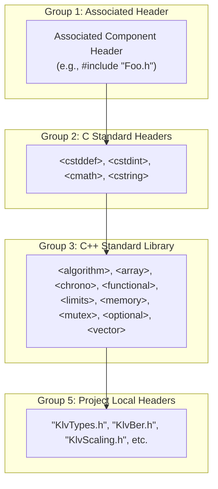

# Implementation Plan: `libs/Klv` Phase 3 — P2 Build Hygiene, IWYU, Doxygen & Checklist Polish

**Scope:** `libs/Klv/` (38 headers, 28 implementation files, `CMakeLists.txt`) & `libs/Klv/tests/` (23 GoogleTest suites, 130 test cases)  
**Standard Baseline:** MISRA C++:2023, SEI CERT C++ (`ERR55-CPP`, `INT31-C`), Include-What-You-Use (IWYU) & `<cstdint>` Policy, and 18-Point Verification Checklist  
**Reference Document:** [`docs/klv_review.md`](klv_review.md) (Section 3.3, Findings **P2-1** through **P2-3**, and Section 7.3)  

---

## 1. Executive Summary & Defect Mapping

Phase 1 successfully hardened `libs/Klv` against P0 memory DoS, floating-point undefined behavior, infinite loops, and concurrency deadlocks. Phase 2 completed P1 functional completeness, full `.sidx` index persistence, and MISB/STANAG standard conformance.

**Phase 3 resolves all remaining P2 technical debt, build hygiene, IWYU anomalies, and 18-point verification checklist warnings** in `libs/Klv`:

| Finding ID | Dimension | Target Files | Defect Description & Remediation Target |
| :--- | :--- | :--- | :--- |
| **P2-1** | **CMake Target Linkage Hygiene** | `libs/Klv/CMakeLists.txt` | `libs/Klv` links `glog::glog` as `PUBLIC`, yet zero files in `libs/Klv` include `<glog/...>` or use Google Logging. Pruning `glog::glog` eliminates an unnecessary transitive dependency for all `Klv` consumers. |
| **P2-2** | **IWYU & Canonical Include Organization** | `libs/Klv/MpegTsKlvExtractor.h`<br/>`libs/Klv/GeoRegistrationParser.cpp`<br/>`libs/Klv/St1607Types.cpp`<br/>All 28 `.cpp` and 38 `.h` files | (1) Remove unused `#include <map>` from `MpegTsKlvExtractor.h`.<br/>(2) Add direct standard headers (`<cmath>`, `<limits>`, `<algorithm>`, `<cstring>`) to files currently relying on transitive includes.<br/>(3) Enforce the canonical 5-group include order across all translation units and headers, eliminating cases where standard headers precede associated headers (`KlvBer.cpp`) or local headers precede standard headers. |
| **P2-3** | **Checklist #8: `[[nodiscard]]` Enforcement** | `libs/Klv/KlvStreamScanner.h`<br/>`libs/Klv/PtsSyncManager.h`<br/>`libs/Klv/MpegTsKlvExtractor.h`<br/>`libs/Klv/MpegTsKlvMuxer.h`<br/>`libs/Klv/StanagScrubController.h` | Add `[[nodiscard]]` to all count- and status-returning methods: `KlvStreamScanner::processBytes()`, `scanAndDispatch()`, `PtsSyncManager::flush()`, `handlePesPacket()`, `emitTsPacket()`, `emitPesStream()`, and `executeSeekLocked()`. |
| **P2-4** | **Checklist #7: Uniform `{}` Initialization** | `libs/Klv/KlvTypes.h`<br/>`libs/Klv/VmtiTypes.h`<br/>`libs/Klv/KlvStreamScanner.h`<br/>`libs/Klv/MpegTsKlvExtractor.h`<br/>`libs/Klv/MpegTsKlvMuxer.h`<br/>`libs/Klv/St1607Types.h` | Normalize in-class member initialization to uniform braces `{}` across all optional fields in `UasDatalinkMessage`, `VTargetPack`, `VmtiLocalSet`, and private class members in scanner, extractor, and muxer classes. |
| **P2-5** | **Checklist #9 & #13: Doxygen Polish & Basenames** | `libs/Klv/MiisCoreId.h`<br/>`libs/Klv/KlvScaling.h`<br/>`libs/Klv/Misb1201.h` | (1) Add missing `/// @file` banners to `MiisCoreId.h` and `KlvScaling.h`.<br/>(2) Fix inverted docstring on `Uuid::isNull()` (`true` when all 16 bytes are `0x00U`).<br/>(3) Replace path-prefixed `/// @file libs/Klv/Misb1201.h` with relative basename `/// @file Misb1201.h`. |

---

## 2. Structural & Architectural Target State

### 2.1 Canonical 5-Group Include Architecture

Per `.agents/rules/iwyu-cstdint.md`, every translation unit and header in `libs/Klv` must structure includes into strictly sorted, isolated groups.

#### ASCII Diagram: Translation Unit Include Ordering
```
+-------------------------------------------------------------------------------+
|                       CANONICAL 5-GROUP INCLUDE STRUCTURE                     |
+-------------------------------------------------------------------------------+
|   Group 1: Associated Header                                                  |
|     #include "MpegTsKlvExtractor.h"                                           |
|                                                                               |
|   Group 2: C System / Standard Headers (<c...>)                               |
|     #include <cstddef>                                                        |
|     #include <cstdint>                                                        |
|     #include <cstring>                                                        |
|                                                                               |
|   Group 3: C++ Standard Library Headers (<...>)                               |
|     #include <algorithm>                                                      |
|     #include <optional>                                                       |
|     #include <vector>                                                         |
|                                                                               |
|   Group 4: Third-Party Libraries (None for pure C++17 Klv Core)               |
|                                                                               |
|   Group 5: Project Local Headers ("...")                                      |
|     #include "KlvBer.h"                                                       |
|     #include "KlvStreamScanner.h"                                             |
|     #include "KlvTypes.h"                                                     |
+-------------------------------------------------------------------------------+
```

#### Mermaid Diagram: Header Dependency & Layered Inclusion Flow


---

## 3. Work Breakdown Structure (WBS) & Implementation Details

### Work Stream 1: CMake Target Linkage Polish (P2-1)
- **Target File:** `libs/Klv/CMakeLists.txt`
- **Actions:**
  - Remove `glog::glog` from `target_link_libraries(Klv PUBLIC ...)`.
  - Retain `Threads::Threads` as `PUBLIC`.
  - Validate that `libs/VideoFilters`, `libs/Video`, and `app-video-qt` configure and build without errors.

---

### Work Stream 2: Manual IWYU & Canonical 5-Group Include Organization (P2-2)

#### 2.1 Remove Dead Headers
- `libs/Klv/MpegTsKlvExtractor.h`: Remove `#include <map>` (line 11).

#### 2.2 Add Missing Direct Standard Inclusions
- `libs/Klv/GeoRegistrationParser.cpp`: Add `#include <cmath>` (for `std::isnan`) and `#include <limits>` (for `std::numeric_limits<double>::quiet_NaN`).
- `libs/Klv/St1607Types.cpp`: Add `#include <algorithm>` (for `std::find_if`) and `#include <cstdint>`.
- `libs/Klv/VmtiParser.cpp`: Ensure `#include <cmath>` and `#include <cstring>` are present.
- `libs/Klv/RvtParser.cpp`: Ensure `#include <cmath>` and `#include <cstring>` are present.

#### 2.3 Reorganize Include Blocks into Canonical 5 Groups
Standardize the following categories of files:
1. **Inverted Associated Headers:**
   - `libs/Klv/KlvBer.cpp`: Place `#include "KlvBer.h"` at line 1, followed by blank line, Group 2 (`<cstddef>`, `<cstdint>`), and Group 3 (`<vector>`).
2. **Local Headers Displacing Standard Headers:**
   - Move project-local headers from the top preamble down to Group 5 (after standard library headers) in:
     - Implementation files: `GeoRegistrationEncoder.cpp`, `GeoRegistrationParser.cpp`, `KlvParser.cpp`, `KlvStreamScanner.cpp`, `MiisCoreId.cpp`, `MpegTsKlvExtractor.cpp`, `MpegTsKlvMuxer.cpp`, `RvtParser.cpp`, `St1607Parser.cpp`, `StanagStreamIndexer.cpp`.
     - Header files: `GeoRegistrationEncoder.h`, `GeoRegistrationParser.h`, `KlvEncoder.h`, `KlvGeodesy.h`, `KlvParser.h`, `KlvStreamScanner.h`, `KlvTypes.h`, `MpegTsKlvExtractor.h`, `MpegTsMuxerTypes.h`, `PtsSyncManager.h`, `PtsSyncTypes.h`, `RvtEncoder.h`, `RvtParser.h`, `RvtTypes.h`, `St1607Encoder.h`, `St1607Parser.h`, `St1607Types.h`, `StanagScrubController.h`, `StanagScrubTypes.h`, `StanagStreamIndexer.h`, `TelemetryInterpolator.h`, `TelemetryTimeIndex.h`, `VideoNaluParser.h`, `VideoPesPacketizer.h`, `VmtiEncoder.h`, `VmtiParser.h`, `VmtiTypes.h`.

---

### Work Stream 3: Verification Checklist & Doxygen Documentation Polish (P2-3)

#### 3.1 Apply `[[nodiscard]]` (Checklist #8)
Update headers and translation units to mark status and count-returning methods with `[[nodiscard]]`:
1. `KlvStreamScanner::processBytes(const std::uint8_t* data, std::size_t size)` in `libs/Klv/KlvStreamScanner.h:44`.
2. `KlvStreamScanner::scanAndDispatch()` in `libs/Klv/KlvStreamScanner.h:58`.
3. `PtsSyncManager::flush()` in `libs/Klv/PtsSyncManager.h:84`.
4. `MpegTsKlvExtractor::handlePesPacket(const std::uint8_t* pesData, std::size_t pesSize)` in `libs/Klv/MpegTsKlvExtractor.h:83`.
5. `MpegTsKlvMuxer::emitTsPacket(...)` and `emitPesStream(...)` in `libs/Klv/MpegTsKlvMuxer.h:140, 143`.
6. `StanagScrubController::executeSeekLocked(std::uint64_t targetPts)` in `libs/Klv/StanagScrubController.h:98`.

#### 3.2 Uniform `{}` Member Initialization (Checklist #7)
Normalize in-class member initialization across structs and classes:
1. `libs/Klv/KlvTypes.h`: Add explicit `{}` to all optional fields in `UasDatalinkMessage` (`precisionTimeStampUs {}`, `missionId {}`, `platformHeadingDeg {}`, `sensorRelElevationDeg {}`, etc.).
2. `libs/Klv/VmtiTypes.h`: Add explicit `{}` to all member variables in `VTargetPack` (`centroid {}`, `boundingBox {}`, `priority {}`, `confidence {}`, etc.) and `VmtiLocalSet`.
3. `libs/Klv/KlvStreamScanner.h`: Add `{}` to `m_buffer {}`, `m_rawPacketCallback {}`, `m_messageCallback {}`.
4. `libs/Klv/MpegTsKlvExtractor.h`: Add `{}` to `m_metadataPid {}`, `m_pmtPid {}`, `m_streamBuffer {}`, `m_pesReassemblyBuffer {}`, `m_payloadCallback {}`, `m_scanner {}`.
5. `libs/Klv/MpegTsKlvMuxer.h`: Add `{}` to `m_config {}`, `m_callback {}`.
6. `libs/Klv/St1607Types.h`: Normalize array constants from `= { ... }` to `{ ... }`.

#### 3.3 Doxygen Documentation & File Banner Polish (Checklist #9 & #13)
1. `libs/Klv/MiisCoreId.h`:
   - Add missing `/// @file MiisCoreId.h` and module brief at line 3.
   - Correct inverted docstring on `Uuid::isNull()`:
     ```cpp
     /// @brief Checks if this UUID is all zeros (nil UUID).
     /// @return True if all 16 bytes are zero, false otherwise.
     [[nodiscard]] bool isNull() const noexcept;
     ```
2. `libs/Klv/KlvScaling.h`:
   - Add missing `/// @file KlvScaling.h` and `@brief Centralized numerical scaling and bounds validation helpers.`
3. `libs/Klv/Misb1201.h`:
   - Replace `/// @file libs/Klv/Misb1201.h` with relative basename `/// @file Misb1201.h`.

---

## 4. Verification & Validation Protocol

```
+-------------------------------------------------------------------------------+
|                       PHASE 3 VERIFICATION GATES                              |
+-------------------------------------------------------------------------------+
|   Gate 1: Automated Script Audit                                              |
|     - python3 scripts/verify_iwyu_cstdint.py libs/Klv --strict (100% PASS)    |
|     - python3 scripts/verify_function_lengths.py libs/Klv      (0 >= 30 char) |
|     - python3 scripts/verify_type_conversions.py libs/Klv      (0 violations) |
|                                                                               |
|   Gate 2: Zero-Warning Compiler Hardening Build                               |
|     - cmake --build build_clang --target Klv -j$(nproc)                       |
|       Flags: -Wall -Wextra -Wpedantic -Werror                                 |
|                                                                               |
|   Gate 3: Full Test Suite Execution                                           |
|     - ctest --test-dir build_clang/libs/Klv/tests --output-on-failure         |
|       Requirement: 23 test suites, 130 test cases, 100% PASS                  |
+-------------------------------------------------------------------------------+
```

---

## 5. Execution Order

1. **Step 1:** Modify `libs/Klv/CMakeLists.txt` to remove `glog::glog`.
2. **Step 2:** Update `MpegTsKlvExtractor.h`, `GeoRegistrationParser.cpp`, `St1607Types.cpp` for missing/dead headers.
3. **Step 3:** Reorganize include blocks across `libs/Klv` headers and translation units into the canonical 5-group layout.
4. **Step 4:** Apply `[[nodiscard]]` annotations to `KlvStreamScanner`, `PtsSyncManager`, and internal methods.
5. **Step 5:** Normalize uniform `{}` member initialization in `KlvTypes.h`, `VmtiTypes.h`, `KlvStreamScanner.h`, `MpegTsKlvExtractor.h`, `MpegTsKlvMuxer.h`, and `St1607Types.h`.
6. **Step 6:** Polish Doxygen file banners and docstrings in `MiisCoreId.h`, `KlvScaling.h`, and `Misb1201.h`.
7. **Step 7:** Run validation scripts, perform zero-warning compilation under Clang, and execute all 130 unit tests.

