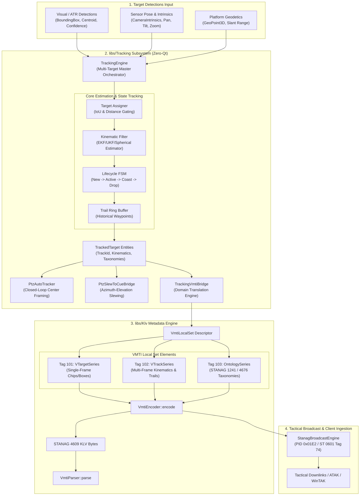

# Implementation Plan: Phase 11 – VMTI Multi-Frame Target Tracking & Ontology (MISB ST 0903 Tag 102/103)

**Scope:** `libs/Klv/` (`VmtiTypes.h`, `VmtiParser.h`, `VmtiParser.cpp`, `VmtiEncoder.h`, `VmtiEncoder.cpp`), `libs/Tracking/` (`TrackingEngine.h`, `TrackingEngine.cpp`, `TrackingVmtiBridge.h`, `TrackingVmtiBridge.cpp`, `Tracking.h`, `CMakeLists.txt`), `libs/Klv/tests/` (`TestVmtiEncoderParser.cpp`), `libs/Tracking/tests/` (`TestTrackingEngine.cpp`, `TestTrackingVmtiBridge.cpp`, `CMakeLists.txt`), `docs/KLV_Features.md`  
**Standards Baseline:** MISB ST 0903.6 (Video Moving Target Indicator and Track Metadata), MISB RP 0904, STANAG 1241 Ed. 5 (NATO Standard for Target Classification), STANAG 4676 Ed. 2 (NATO ISR Tracking Standard), MIL-STD-2525D / APP-6D (Joint Military Symbology), MISRA C++:2023, SEI CERT C++ (ERR55-CPP, INT31-C, STR37-C), Project Rules in `.agents/rules/`  
**Reference Document:** [`docs/KLV_Features.md`](KLV_Features.md) (§1, §2, §3.23, §4.2 Phase 11)

---

## 1. Executive Summary & Operational Context

### 1.1 Operational Problem Statement
Tactical airborne and mast-mounted electro-optical/infrared (EO/IR) sensor systems produce live Full Motion Video (FMV) feeds under NATO STANAG 4609. The existing implementation in `libs/Klv` supports MISB ST 0903 Tag 101 (`VTarget Pack`), reporting instantaneous, frame-by-frame 2D visual bounding boxes and centroid coordinates.

However, instantaneous single-frame detections alone fail to satisfy operational requirements for autonomous reconnaissance, target handoff, and combat identification:
1. **Lack of Identity Persistence Across Frames:** Single-frame detections lack temporal continuity. Downstream C2 systems (ATAK, WinTAK, DCGS-A) observe flickering target IDs that reset or swap identities upon temporary occlusion, foliage obscuration, or sensor slewing.
2. **Absence of Ground Kinematics:** Bounding boxes provide pixel centroids without velocity vectors ($\text{m/s}$), track headings ($[0^\circ, 360^\circ)$), ground acceleration ($\text{m/s}^2$), or trajectory trails. Tactical decision-makers cannot assess target intent, intercept trajectories, or speed over ground without external filtering.
3. **Missing Semantic Classification & NATO Interoperability:** Detections lack standardized taxonomy labels. Without semantic classification mapped to NATO STANAG 1241 and STANAG 4676 object taxonomies (Dismount, Wheeled Vehicle, Tracked Armor, Vessel, Aircraft) and MIL-STD-2525 SIDC symbols, automated target recognition (ATR) outputs cannot be ingested into common operational pictures (COP).
4. **Decoupled Tracking and Telemetry:** Although `libs/Tracking` provides estimation filters (`PtzSphericalEstimator`, `ExtendedKalmanFilter`, `UnscentedKalmanFilter`) and controllers (`PtzAutoTracker`, `PtzSlewToCueBridge`), the codebase lacks a high-level, multi-target orchestrator (`TrackingEngine`) that binds multi-target state estimation to standardized MISB ST 0903 Tag 102 (`VTrack Pack`) and Tag 103 (`Ontology Local Set`) telemetry outputs.

### 1.2 The Phase 11 Solution
Phase 11 extends `libs/Klv` and `libs/Tracking` into a cohesive, production-grade tracking and ontology telemetry architecture:
- **MISB ST 0903 Tag 102 VTrack Series:** Implements multi-frame persistent track representation, encoding unique track identifiers (`TrackId`), lifecycle states (`TrackStatus`), 3D local-tangent kinematics ($V_E, V_N, V_U$, ground course, acceleration), position/velocity covariances, and historical trajectory point trails.
- **MISB ST 0903 Tag 103 Ontology Series:** Implements semantic classification local sets referencing NATO STANAG 1241 and STANAG 4676 taxonomies, detector confidence metrics, ATR model provenance metadata, and MIL-STD-2525 symbol identifiers.
- **Unified Multi-Target `TrackingEngine`:** Implements an industrial, zero-Qt, thread-safe tracking manager in `libs/Tracking` that performs:
  1. Multi-target data association (IoU and Mahalanobis gating) between incoming visual detections and active tracks.
  2. Per-track kinematic filtering and state estimation with lifecycle state machine (Initiated $\to$ Active $\to$ Coasting $\to$ Dropped).
  3. Bounded-history trajectory logging (last $N$ points).
  4. Automatic generation of synchronized MISB ST 0903 `VmtiLocalSet` packets containing Tag 101 (detections), Tag 102 (tracks), and Tag 103 (taxonomies).
  5. Primary target selection and closed-loop command dispatch to `PtzAutoTracker` and `PtzSlewToCueBridge`.

---

## 2. Architecture & Data Flow

### 2.1 ASCII Architecture Diagram

```
+---------------------------------------------------------------------------------------------------------------------+
|                                 PHASE 11 VMTI MULTI-FRAME TRACKING & ONTOLOGY ARCHITECTURE                          |
+---------------------------------------------------------------------------------------------------------------------+
|                                                                                                                     |
|   Visual Ingest / Detector (AI / CV / Radar / Operator Cues)                                                        |
|                           │                                                                                         |
|                           ▼ [std::vector<RawDetection> / Klv::VTargetPack]                                          |
|   +───────────────────────┼─────────────────────────────────────────────────────────────────────────────────────+   |
|   │ LIBS/TRACKING (ZERO-QT)                                                                                     │   |
|   │                       ▼                                                                                     │   |
|   │         +───────────────────────────+                                                                       │   |
|   │         |       TrackingEngine      | <── [TrackingEngineConfig]                                            │   |
|   │         +───────────────────────────+     (Gating, Max Coast Frames, History Depth, Primary ID)             │   |
|   │                       │                                                                                     │   |
|   │         ┌─────────────┼─────────────────────────────┐                                                       │   |
|   │         ▼             ▼                             ▼                                                       │   |
|   │   +───────────+ +───────────+             +───────────────────+                                             │   |
|   │   | Target    | | Kinematic |             | Track Lifecycle   |                                             │   |
|   │   | Assigner  | | Estimator |             | State Machine     |                                             │   |
|   │   | (IoU/Dist)| | (EKF/UKF) |             | (Active/Coast/Drop│                                             │   |
|   │   +─────┬─────+ +─────┬─────+             +─────────┬─────────+                                             │   |
|   │         │             │                             │                                                       │   |
|   │         └─────────────┼─────────────────────────────┘                                                       │   |
|   │                       ▼                                                                                     │   |
|   │         +───────────────────────────+                                                                       │   |
|   │         |   TrackedTarget Entity    |                                                                       │   |
|   │         | - TrackId (BER-OID)       |                                                                       │   |
|   │         | - Kinematics (Vel, Acc)   |                                                                       │   |
|   │         | - History Trail (Buffer)  |                                                                       │   |
|   │         | - StanagTaxonomy (1241)   |                                                                       │   |
|   │         +─────────────┬─────────────+                                                                       │   |
|   │                       │                                                                                     │   |
|   │        ┌──────────────┴──────────────────────────────┐                                                      │   |
|   │        ▼                                             ▼                                                      │   |
|   │   +───────────────────────────+         +───────────────────────────+                                       │   |
|   │   | Closed-Loop PTZ Slew/Track|         |     TrackingVmtiBridge    |                                       │   |
|   │   | - PtzAutoTracker          |         +─────────────┬─────────────+                                       │   |
|   │   | - PtzSlewToCueBridge      |                       │                                                     │   |
|   │   +───────────────────────────+                       │                                                     │   |
|   +───────────────────────────────────────────────────────┼─────────────────────────────────────────────────────+   |
|                                                           │                                                         |
|                                                           ▼ [VmtiLocalSet with Tag 101, 102, 103]                   |
|   +───────────────────────────────────────────────────────┼─────────────────────────────────────────────────────+   |
|   │ LIBS/KLV CORE ENCODING & PARSING                      │                                                         |   |
|   │                                                       ▼                                                         │   |
|   │                                         +───────────────────────────+                                           │   |
|   │                                         |        VmtiEncoder        |                                           │   |
|   │                                         | - Tag 101: VTarget Series |                                           │   |
|   │                                         | - Tag 102: VTrack Series  |                                           │   |
|   │                                         | - Tag 103: Ontology Series|                                           │   |
|   │                                         +─────────────┬─────────────+                                           │   |
|   │                                                       │                                                         │   |
|   │                                                       ▼ (Serialized KLV Byte Stream)                            │   |
|   │                                         +───────────────────────────+                                           │   |
|   │                                         |        VmtiParser         |                                           │   |
|   │                                         | - Zero-copy TLV unwrap    |                                           │   |
|   │                                         | - IMAPB unscaling         |                                           │   |
|   │                                         | - Taxonomy extraction     |                                           │   |
|   │                                         +─────────────┬─────────────+                                           │   |
|   +───────────────────────────────────────────────────────┼─────────────────────────────────────────────────────+   |
|                                                           │                                                         |
|                                                           ▼                                                         |
|                                         +───────────────────────────────────+                                       |
|                                         |       StanagBroadcastEngine       |                                       |
|                                         | - Embedded in ST 0601 Tag 74      |                                       |
|                                         | - Dedicated VMTI PID 0x01E2       |                                       |
|                                         +───────────────────────────────────+                                       |
|                                                           │                                                         |
|                                                           ▼                                                         |
|                                    Tactical Clients (ATAK, WinTAK, Video Overlays)                                  |
+---------------------------------------------------------------------------------------------------------------------+
```

### 2.2 Mermaid Architecture Diagram



---

## 3. Standards Compliance & Taxonomy Mapping

### 3.1 MISB ST 0903 Tag 102 (VTrack Pack) Specification
Per MISB ST 0903.6 Section 10.3, `VTrack Pack` elements encapsulate multi-frame kinematic state:

| Tag | Item Name | Format | Units / Scale | Semantic Description |
| :---: | :--- | :--- | :--- | :--- |
| **1** | `TrackId` | BER-OID / uint32 | Dimensionless | Unique persistent track identifier |
| **2** | `TrackStatus` | uint8 | Enumeration | `1=Active`, `2=Coasting`, `3=Dropped`, `4=New` |
| **3** | `TrackConfidence` | uint8 | $[0, 100]\%$ | Estimator confidence / probability |
| **4** | `VelocityEast` | IMAPB (3 bytes) | $\text{m/s}$ $[-327.68, +327.67]$ | Target velocity vector East |
| **5** | `VelocityNorth` | IMAPB (3 bytes) | $\text{m/s}$ $[-327.68, +327.67]$ | Target velocity vector North |
| **6** | `VelocityUp` | IMAPB (2 bytes) | $\text{m/s}$ $[-100.0, +100.0]$ | Target velocity vector Up (vertical) |
| **7** | `GroundCourse` | uint16 | $[0^\circ, 360^\circ)$ | Target track heading over ground ($360^\circ / 65535$) |
| **8** | `GroundSpeed` | uint16 | $\text{m/s}$ $[0, 200.0]$ | Horizontal ground speed ($200 / 65535$) |
| **9** | `AccelerationEast` | IMAPB (2 bytes) | $\text{m/s}^2$ $[-50.0, +50.0]$ | Horizontal East acceleration |
| **10** | `AccelerationNorth` | IMAPB (2 bytes) | $\text{m/s}^2$ $[-50.0, +50.0]$ | Horizontal North acceleration |
| **11** | `TrackHistory` | Series Pack | Variable | Sequence of previous geodetic/pixel waypoints |
| **12** | `TrackStartTime` | uint64 | Epoch $\mu\text{s}$ | Precision timestamp when track was initiated |
| **13** | `TrackDuration` | uint32 | Microseconds | Active tracking elapsed time |

### 3.2 MISB ST 0903 Tag 103 (Ontology Local Set) & NATO Taxonomy
Per MISB ST 0903.6 Section 10.4 and STANAG 1241 / 4676:

| Tag | Item Name | Format | Standard / Value | Semantic Description |
| :---: | :--- | :--- | :--- | :--- |
| **1** | `OntologyId` | uint32 (BER-OID) | Integer ID | Identifier matching track target or registry |
| **2** | `OntologyUri` | UTF-8 String | URI / URN | E.g. `"urn:nato:stanag:1241"`, `"urn:nato:stanag:4676"` |
| **3** | `ClassCategory` | uint8 | Enum | Standard category: Dismount, Vehicle, Armor, Vessel, Aircraft |
| **4** | `ClassLabel` | UTF-8 String | String label | E.g. `"Tracked Armor"`, `"Wheeled Vehicle"`, `"Civilian Drone"` |
| **5** | `Confidence` | uint8 | $[0, 100]\%$ | Model classification confidence percentage |
| **6** | `SidcCode` | UTF-8 String (15-30 chars) | MIL-STD-2525D / APP-6D | Symbol Identification Code (e.g. `"SFGPUCV----"`)|
| **7** | `AlgorithmId` | uint32 (BER-OID) | Registry ID | Reference to Tag 102 Algorithm Local Set |

---

## 4. Detailed Type Design & Domain Modeling

All data types adhere to `.agents/rules/domain-modeling.md`, `.agents/rules/compliance.md`, and `.agents/rules/iwyu-cstdint.md`.

### 4.1 Value Objects & Enumerations (`libs/Klv/VmtiTypes.h`)

```cpp
namespace Klv {

/// @enum TrackStatus
/// @brief Operational lifecycle condition of a persistent target track.
enum class TrackStatus : std::uint8_t {
    New = 1U,        ///< Track initiated in current frame
    Active = 2U,     ///< Track actively updated with direct visual detection
    Coasting = 3U,   ///< Track predicted on dead reckoning / Kalman coasting
    Dropped = 4U,    ///< Track terminated or lost
    Handoff = 5U     ///< Track handed off to external sensor / cue
};

/// @enum StanagCategory
/// @brief Standard NATO STANAG 1241 / 4676 target classification category.
enum class StanagCategory : std::uint8_t {
    Unknown = 0U,
    Dismount = 1U,            ///< Personnel, infantry, pedestrian
    WheeledVehicle = 2U,      ///< Light vehicle, car, truck, bus
    TrackedArmor = 3U,        ///< Tank, APC, IFV, artillery
    Watercraft = 4U,          ///< Vessel, boat, submarine, surface combatant
    FixedWingAircraft = 5U,   ///< Airplane, jet, UAV fixed-wing
    RotaryWingAircraft = 6U   ///< Helicopter, quadcopter, multicopter UAS
};

/// @struct TrackHistoryPoint
/// @brief Historical waypoint record in a persistent target trajectory trail.
struct TrackHistoryPoint {
    std::uint64_t timestampUs { 0U };
    PixelCoord pixelLocation {};
    std::optional<GeoPoint3D> geodeticLocation {};
};

/// @struct VTrackPack
/// @brief Strongly-typed MISB ST 0903 Tag 102 persistent multi-frame target track.
struct VTrackPack {
    std::uint32_t trackId { 0U };
    TrackStatus status { TrackStatus::New };
    std::uint8_t confidence { 0U };
    
    // 3D Kinematics in local-tangent frame (m/s)
    std::optional<double> velocityEastMps {};
    std::optional<double> velocityNorthMps {};
    std::optional<double> velocityUpMps {};
    
    // Horizontal polar kinematics
    std::optional<double> groundSpeedMps {};
    std::optional<double> groundCourseDeg {}; // [0, 360)
    
    // Acceleration (m/s^2)
    std::optional<double> accelerationEastMps2 {};
    std::optional<double> accelerationNorthMps2 {};
    
    // Trajectory history trail
    std::vector<TrackHistoryPoint> historyTrail {};
    
    // Temporal metadata
    std::optional<std::uint64_t> trackStartTimeUs {};
    std::optional<std::uint32_t> trackDurationUs {};
};

/// @struct OntologyLocalSet
/// @brief Strongly-typed MISB ST 0903 Tag 103 semantic classification local set.
struct OntologyLocalSet {
    std::uint32_t ontologyId { 0U };
    std::string ontologyUri { "urn:nato:stanag:1241" };
    StanagCategory category { StanagCategory::Unknown };
    std::string classLabel {};
    std::uint8_t confidence { 0U };
    std::string sidcCode {}; // MIL-STD-2525 / APP-6
    std::optional<std::uint32_t> algorithmId {};
};

} // namespace Klv
```

### 4.2 Tracking Engine Interface (`libs/Tracking/TrackingEngine.h`)

All method names are strictly less than 30 characters:

```cpp
namespace Tracking {

/// @struct TrackingEngineConfig
/// @brief Operational configuration for multi-target tracking and data association.
struct TrackingEngineConfig {
    double iouThreshold { 0.3 };
    double maxGatingDistancePx { 120.0 };
    std::uint32_t minHitsToConfirm { 3U };
    std::uint32_t maxCoastingFrames { 15U };
    std::size_t maxHistoryPoints { 30U };
    std::optional<std::uint32_t> primaryTrackId {};
};

/// @class TrackingEngine
/// @brief Multi-target tracking master orchestrator and telemetry generator.
class TrackingEngine {
public:
    explicit TrackingEngine(const TrackingEngineConfig& config = {}) noexcept;

    /// @brief Reset all active tracks, associations, and filters.
    void reset() noexcept;

    /// @brief Reconfigure tracking engine parameters at runtime.
    void configure(const TrackingEngineConfig& config) noexcept;

    /// @brief Ingest a frame of visual detections and update all active tracks.
    void updateDetections(
        const std::vector<Klv::VTargetPack>& detections,
        std::uint64_t timestampUs,
        double dtSec,
        const CameraIntrinsics& intrinsics,
        double camPanRad = 0.0,
        double camTiltRad = 0.0,
        double zoom = 1.0,
        const std::optional<Klv::GeoPoint3D>& platformPos = std::nullopt);

    /// @brief Assign or override STANAG taxonomy for a specific track.
    [[nodiscard]] bool setTrackTaxonomy(
        std::uint32_t trackId,
        Klv::StanagCategory category,
        std::string_view label,
        std::uint8_t confidence,
        std::string_view sidc = "") noexcept;

    /// @brief Designate the primary target track of interest for auto-framing.
    void setPrimaryTrack(std::uint32_t trackId) noexcept;

    /// @brief Retrieve the current primary target track of interest, if active.
    [[nodiscard]] std::optional<std::uint32_t> getPrimaryTrack() const noexcept;

    /// @brief Build a comprehensive MISB ST 0903 VmtiLocalSet.
    [[nodiscard]] Klv::VmtiLocalSet buildVmtiSet(
        std::uint64_t timestampUs,
        std::uint32_t frameWidth,
        std::uint32_t frameHeight) const;

    /// @brief Retrieve snapshot of all tracked entities.
    [[nodiscard]] std::vector<Klv::VTrackPack> getActiveTracks() const;

    /// @brief Retrieve snapshot of all active ontologies.
    [[nodiscard]] std::vector<Klv::OntologyLocalSet> getOntologies() const;

    /// @brief Get actionable tracking command for the designated primary target.
    [[nodiscard]] std::optional<TrackingCommand> computePtzCommand(
        PtzAutoTracker& tracker,
        std::uint32_t frameWidth,
        std::uint32_t frameHeight,
        double dtSec,
        double currentZoom = 1.0) const;
};

} // namespace Tracking
```

---

## 5. Implementation Steps & Task Breakdown

### Task 1: Extend `libs/Klv/VmtiTypes.h`
- Define `TrackStatus`, `StanagCategory`, `TrackHistoryPoint`, `VTrackPack`, `OntologyLocalSet`.
- Add `tracks` (`std::vector<VTrackPack>`) and `ontologies` (`std::vector<OntologyLocalSet>`) to `VmtiLocalSet`.
- Verify explicit `<cstdint>`, `<cstddef>`, `<string>`, `<vector>`, and `<optional>` inclusions.

### Task 2: Implement VTrack Series (Tag 102) & Ontology (Tag 103) in `VmtiEncoder`
- File: `libs/Klv/VmtiEncoder.h` and `libs/Klv/VmtiEncoder.cpp`
- Methods (all strictly $< 30$ chars):
  - `encodeTrackPack`: Encodes single `VTrackPack` TLV pack.
  - `encodeTrackSeries`: Encodes Tag 102 series wrapper.
  - `encodeOntologySet`: Encodes single `OntologyLocalSet` TLV.
  - `encodeOntologySeries`: Encodes Tag 103 series wrapper.
  - IMAPB scaling helpers for velocity ($[-327.68, +327.67]\text{ m/s}$) and acceleration ($[-50.0, +50.0]\text{ m/s}^2$).
- Update `VmtiEncoder::encode` to serialize Tag 102 and Tag 103 when elements are present.

### Task 3: Implement VTrack Series (Tag 102) & Ontology (Tag 103) in `VmtiParser`
- File: `libs/Klv/VmtiParser.h` and `libs/Klv/VmtiParser.cpp`
- Methods:
  - `parseTrackPack`: Deserializes raw KLV bytes into `VTrackPack`.
  - `parseTrackSeries`: Unpacks Tag 102 series into `std::vector<VTrackPack>`.
  - `parseOntologySet`: Deserializes raw KLV bytes into `OntologyLocalSet`.
  - `parseOntologySeries`: Unpacks Tag 103 series into `std::vector<OntologyLocalSet>`.
- Update `VmtiParser::parse` top-level switch to dispatch `VmtiTag::VTrackSeries` (102) and `VmtiTag::OntologySeries` (103).

### Task 4: Extend `libs/Tracking/TrackingVmtiBridge`
- File: `libs/Tracking/TrackingVmtiBridge.h` and `libs/Tracking/TrackingVmtiBridge.cpp`
- Add methods:
  - `buildTrackPack`: Converts kinematic state + track ID + history trail into `Klv::VTrackPack`.
  - `buildOntology`: Constructs `Klv::OntologyLocalSet` from STANAG taxonomy attributes.

### Task 5: Implement `TrackingEngine` (`libs/Tracking/TrackingEngine.h` & `.cpp`)
- Implement multi-target association using bounding box IoU and centroid distance.
- Implement track lifecycle state machine:
  - First sighting $\to$ `New` (tentative).
  - Consecutive detections $\ge \text{minHits}$ $\to$ `Active`.
  - Missed frame $\to$ `Coasting` (Kalman state propagated on prior velocity/acceleration).
  - Missed frames $> \text{maxCoasting}$ $\to$ `Dropped`.
- Maintain historical trajectory ring buffer up to `maxHistoryPoints`.
- Thread-safe read/write protections using `std::mutex` where necessary.
- Zero dynamic allocations on query/read fast-paths per CERT ERR55-CPP.

### Task 6: Build & CMake Integration
- Update `libs/Tracking/CMakeLists.txt` to include `TrackingEngine.cpp`.
- Ensure `libs/Tracking` links cleanly against `Klv` (zero Qt dependencies).

### Task 7: Comprehensive Unit Testing
- File: `libs/Klv/tests/TestVmtiEncoderParser.cpp`
  - Test Tag 102 `VTrackPack` encoding, decoding, and round-trip fidelity.
  - Test Tag 103 `OntologyLocalSet` encoding, decoding, and round-trip fidelity.
  - Test invalid BER-OID, truncated buffers, out-of-range velocities, and IMAPB unscaling precision.
- File: `libs/Tracking/tests/TestTrackingEngine.cpp`
  - Multi-target association and unique ID preservation across frames.
  - Coasting state transitions under temporary target occlusion.
  - Kinematics calculation (velocity vector, ground course, speed).
  - History trail point logging and buffer wrapping.
  - Primary target auto-framing command computation.
  - STANAG 1241 / 4676 taxonomy assignment and VMTI Local Set generation.
- File: `libs/Tracking/tests/CMakeLists.txt`
  - Register `TestTrackingEngine.cpp` in test suite.

### Task 8: Documentation & Verification
- Update `docs/KLV_Features.md` marking Phase 11 as **IMPLEMENTED**.
- Run automated verification scripts (`verify_iwyu_cstdint.py`, `verify_relative_doc_paths.py`).
- Run full test suite to guarantee 100% pass rate.

---

## 6. Verification & Test Plan

| Test Case | Objective | Pass Criteria |
| :--- | :--- | :--- |
| **`TestVmtiTag102TrackPackRoundTrip`** | Validate serialization & deserialization of `VTrackPack`. | Bit-exact recovery of TrackId, status, velocity, course, acceleration, history points. |
| **`TestVmtiTag103OntologyRoundTrip`** | Validate serialization & deserialization of `OntologyLocalSet`. | Exact recovery of URI, category, label, confidence, and SIDC string. |
| **`TestVmtiMultiFrameComposite`** | Verify packet with simultaneous Tags 101, 102, and 103. | `VmtiParser` correctly populates `targets`, `tracks`, and `ontologies` without corruption. |
| **`TestTrackingEngineLifecycle`** | Verify New $\to$ Active $\to$ Coasting $\to$ Dropped state transitions. | Target correctly coasts for configured frames and drops after threshold. |
| **`TestTrackingEngineAssociation`** | Verify IoU/distance gating with multiple crossing targets. | Target tracks maintain distinct identities without identity swapping. |
| **`TestTrackingEngineKinematics`** | Verify velocity vector and ground course derivation. | Derived velocity and course match synthetic ground-truth within $\pm 0.1\text{ m/s}$ and $\pm 0.5^\circ$. |
| **`TestTrackingEngineHistoryTrail`** | Verify bounded history ring buffer behavior. | Buffer stores up to $N$ points without unbounded growth or heap allocation. |
| **`TestTrackingEnginePtzCommand`** | Verify PTZ auto-tracker command generation for primary target. | Generated `TrackingCommand` matches expected pan/tilt directions and speeds. |

---

## 7. Safety & Compliance Checklist

- [ ] **MISRA C++:2023 Rule 7.0.6 & SEI CERT INT31-C:** All integer conversions are explicit (`static_cast`), signed/unsigned safe.
- [ ] **SEI CERT ERR55-CPP:** Zero dynamic heap allocation in `noexcept` fast query paths (`getPrimaryTrack`, pixel projections).
- [ ] **SEI CERT STR37-C:** ASCII helper functions for token and URI comparisons (no locale-dependent `<cctype>`).
- [ ] **IWYU & `<cstdint>`:** Every source/header file explicitly includes `<cstdint>` and `<cstddef>` with `std::` qualification.
- [ ] **Zero Qt Dependencies:** `libs/Klv` and `libs/Tracking` maintain 0 `#include <Q...>` references.
- [ ] **Identifier Length Rule:** All function and method names are strictly less than 30 characters.
- [ ] **Relative Paths Rule:** All file links and prose references are strictly repository-relative.
- [ ] **Diagram Requirements:** Both ASCII and Mermaid architecture diagrams are included.

