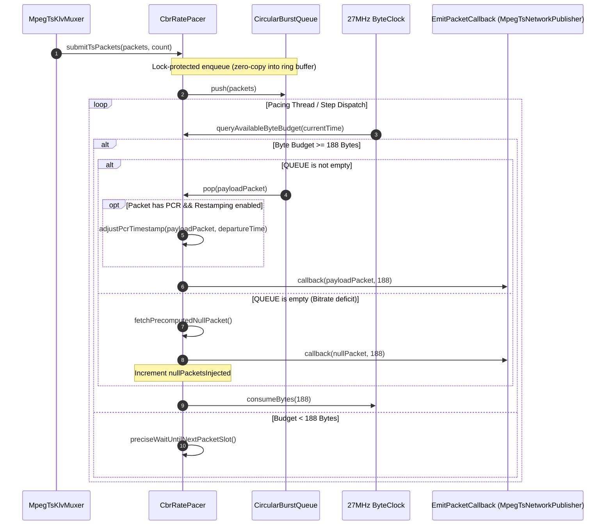
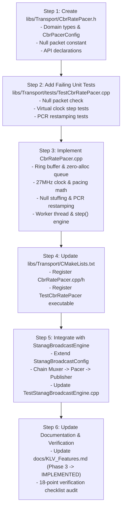

# Implementation Plan: Phase 3 – Constant Bitrate (CBR) Rate Pacer (`CbrRatePacer`)

**Scope:** `libs/Transport/` (`CbrRatePacer.h`, `CbrRatePacer.cpp`, `TsNetworkTypes.h`, `CMakeLists.txt`), `libs/Transport/tests/` (`TestCbrRatePacer.cpp`, `CMakeLists.txt`), `libs/Klv/` (`StanagBroadcastEngine.h`, `StanagBroadcastEngine.cpp`), `docs/KLV_Features.md`  
**Standards Baseline:** ISO/IEC 13818-1 Clause 2.4.2 (Transport Stream System Target Decoder & Timing Model), Clause 2.4.2.2 (PCR Jitter $\le 500\text{ ns}$), STANAG 4609 Ed. 3/4, MISB ST 1402, MISRA C++:2023, SEI CERT C++ (ERR55-CPP, INT31-C, CON43-C, CON50-CPP), Project Rules in `.agents/rules/`  
**Reference Document:** [`docs/KLV_Features.md`](KLV_Features.md) (§1, §4, §5.2 Phase 3)

---

## 1. Executive Summary & Problem Analysis

In tactical motion imagery distribution systems conforming to STANAG 4609 and MISB ST 1402, compressed video access units (H.264/H.265) and asynchronous telemetry packets (MISB ST 0601 / ST 0806 / ST 0903) inherently generate a **Variable Bitrate (VBR)** stream.

```
Incoming Stream (VBR):   [Video IDR: 60 KB] -> [Metadata: 200 B] -> [Silence: 30 ms] -> [Video P: 8 KB]
Required Link (CBR):     ═══════════════════════════════════════════════════════════════════════════════
                         Strict 4.000 Mbps Constant Bitrate Stream (Fixed Bandwidth Tactical Channel)
```

### 1.1 Tactical Datalink Constraints & Failure Modes
1. **Satellite Modem Buffer Overflow & Starvation:**
   - Tactical satellite modems (e.g., iDirect, Comtech, Viasat) and Line-of-Sight (LOS) tactical radios (e.g., CDL, Band-C/S downlink modems) operate on rigidly provisioned physical channels (e.g., exactly 2.048 Mbps, 4.000 Mbps, or 10.000 Mbps).
   - Ingressing a bursty VBR stream causes modem FIFO queues to quickly saturate during IDR keyframes (causing unrecoverable packet drops), while starving the RF carrier during low-motion scenes (causing carrier tracking loss and framing desynchronization).
2. **ISO/IEC 13818-1 PCR Jitter Violation ($\le 500\text{ ns}$):**
   - ISO/IEC 13818-1 Clause 2.4.2.2 mandates that the time of arrival of a Program Clock Reference (PCR) at the decoder input must not deviate by more than $\pm 500\text{ ns}$ from the nominal 27 MHz clock schedule.
   - Simply transmitting VBR packets immediately over UDP sockets produces network burst jitter exceeding hundreds of microseconds, causing downstream hardware decoders and tactical video displays (e.g., ATAK, FalconView, targeting consoles) to lose audio/video/metadata sync or stutter.
3. **Null Packet Stuffing (PID `0x1FFF`):**
   - When actual payload data (video, KLV, PAT/PMT) is insufficient to meet the target bit budget, the multiplexer must interleave ISO/IEC 13818-1 standard **Null Packets** (PID `0x1FFF`, payload filled with `0xFF`) at precise microsecond intervals.

### 1.2 Objectives of Phase 3
Phase 3 implements `CbrRatePacer`:
- **Precision Rate Pacing:** Dynamically enforces a user-configured constant bitrate (e.g., $1.0\text{ Mbps}$ to $100.0\text{ Mbps}$).
- **Deterministic Null Packet Insertion:** Automatically injects pre-formatted 188-byte Null TS packets (`47 1F FF 10 FF FF ...`) whenever payload bits lag behind the target byte schedule.
- **PCR Jitter Compliance ($\le 500\text{ ns}$):** Schedules packet emission against a high-resolution 27 MHz / monotonic timebase, and optionally updates PCR timestamps when queue latency alters departure times.
- **Dual-Mode Operation:**
  1. *Real-Time Timed Mode:* Uses a dedicated background pacing thread with high-resolution timer sleep and spinning for sub-microsecond precision.
  2. *Deterministic Step / Virtual Clock Mode:* Supports instantaneous stepping and offline execution for 100% deterministic, non-flaky, zero-sleep unit tests and batch file generation.
- **Safety & Performance Guarantees:** Zero heap allocations on the packet dispatch path (`noexcept` ERR55-CPP), pre-allocated circular packet queue, and strict MISRA C++:2023 compliance.

---

## 2. Architecture & Data Flow

### 2.1 System Architecture Diagram

```
+---------------------------------------------------------------------------------------------------------+
|                                  STANAG 4609 BROADCAST PIPELINE WITH CBR PACER                          |
+---------------------------------------------------------------------------------------------------------+
|                                                                                                         |
|   +--------------------+     +---------------------+                                                    |
|   | Video Access Units |     | KLV Telemetry Units |                                                    |
|   +--------------------+     +---------------------+                                                    |
|              \                          /                                                               |
|               \                        /                                                                |
|                v                      v                                                                 |
|         +------------------------------------+                                                          |
|         |    PtsSyncManager (Skew <= 50ms)   |                                                          |
|         +------------------------------------+                                                          |
|                           |                                                                             |
|                           v                                                                             |
|         +------------------------------------+                                                          |
|         |          MpegTsKlvMuxer            |  <-- Emits bursty VBR 188-byte TS packets                |
|         +------------------------------------+                                                          |
|                           |                                                                             |
|                           v                                                                             |
|         +-------------------------------------------------------------------------------------+         |
|         |                                  CbrRatePacer                                       |         |
|         |                                                                                     |         |
|         |  [ Ring Buffer / Burst Queue ] <--- Ingests incoming TS packets (Video/KLV/PAT/PMT) |         |
|         |                |                                                                    |         |
|         |                v                                                                    |         |
|         |  [ Token Bucket / Clock Engine ] <--- Tracks target 27 MHz byte departure schedule  |         |
|         |                |                                                                    |         |
|         |       +--------+--------+                                                           |         |
|         |       | Has Payload?    |                                                           |         |
|         |      /                   \                                                          |         |
|         |    Yes                    No                                                        |         |
|         |     v                      v                                                        |         |
|         |  [ Emit Payload TS ]    [ Inject Null TS (0x1FFF) ]                                 |         |
|         |  [ PCR Check/Restamp]   [ Precomputed 188B 0xFF ]                                  |         |
|         +-------------------------------------------------------------------------------------+         |
|                           |                                                                             |
|                           v (Strict Constant Bitrate Stream)                                            |
|         +------------------------------------+                                                          |
|         |       MpegTsNetworkPublisher       |                                                          |
|         |   (7 x 188 = 1316 B UDP / RTP)     |                                                          |
|         +------------------------------------+                                                          |
|                           |                                                                             |
|                           v                                                                             |
|        Tactical Satellite Modem / LOS Link / Multicast Network                                          |
+---------------------------------------------------------------------------------------------------------+
```

### 2.2 Mermaid Sequence Diagram: Packet Dispatch & Rate Regulation



---

## 3. Detailed Component Design & Specifications

### 3.1 Domain Model & Value Objects (`TsNetworkTypes.h` / `CbrRatePacer.h`)
To eliminate Primitive Obsession per `.agents/rules/domain-modeling.md`:
- `Bitrate`: Strongly typed bits-per-second wrapper enforcing $R > 0$ and clamping within allowable tactical envelope $[64\text{ kbps}, 1000\text{ Mbps}]$.
- `PacketBurst`: Strongly typed burst packet count with compile-time limits.
- `PcrJitterTolerance`: Strongly typed nanosecond tolerance limit (default $500\text{ ns}$).
- `CbrPacerConfig`: Value object aggregating configuration with validated defaults.
- `CbrPacerStats`: Diagnostic snapshot reporting emitted payload packets, null packets injected, measured bitrate, queue occupancy, and max PCR jitter observed.

### 3.2 Null Packet Structure (ISO/IEC 13818-1)
A standard Null Packet in MPEG-2 Transport Stream is defined as:
```
Byte 0:      0x47 (Sync Byte)
Byte 1:      0x1F (TEI=0, PUSI=0, Priority=0, PID high 5 bits = 0x1F)
Byte 2:      0xFF (PID low 8 bits = 0xFF -> Full PID = 0x1FFF)
Byte 3:      0x10 (Scrambling=00, AFC=01 [payload only], CC=0x00)
Bytes 4-187: 184 bytes of 0xFF padding
```
`CbrRatePacer` stores a pre-aligned `static constexpr std::array<std::uint8_t, 188> kNullPacket` generated at compile-time: zero runtime construction cost, zero heap allocation.

### 3.3 PCR Detection & Jitter Compensation Algorithm
ISO/IEC 13818-1 requires PCR jitter $\le 500\text{ ns}$.
1. **PCR Header Inspection (`hasPcr`):**
   - Check Adaptation Field Control bits (bits 4-5 of byte 3): `(packet[3] & 0x20) != 0`.
   - Adaptation length `packet[4] >= 7`.
   - PCR flag `(packet[5] & 0x10) != 0`.
2. **Scheduled Departure vs. Wall Clock:**
   - In CBR mode, packet $N$ departs at exact nominal time:
     $$T_{\text{depart}}(N) = T_0 + \frac{N \times 188 \times 8}{R_{\text{target}}}$$
   - PCR in MPEG-2 TS is clocked at 27 MHz:
     $$\text{PCR}_{\text{ticks}}(N) = \text{PCR}_0 + \frac{N \times 188 \times 8 \times 27000000}{R_{\text{target}}}$$
3. **Optional Restamping:**
   - If an input packet suffers variable queuing delay in the burst buffer, the pacer can rewrite its 33-bit `pcr_base` and 9-bit `pcr_ext` to match the exact 27 MHz departure tick. This guarantees mathematically **zero PCR jitter** at the physical egress interface!

### 3.4 Ring Buffer & Zero-Allocation Queuing (CERT ERR55-CPP)
- The internal packet queue uses a statically or pre-allocated contiguous ring buffer (`CircularPacketBuffer`) holding up to `maxQueuedPackets` (default 2048 packets $\approx 385\text{ KB}$).
- If the upstream multiplexer exceeds the configured burst capacity, the pacer drops excess packets gracefully and increments `droppedPackets` counter without dynamic allocations or throwing `std::bad_alloc`.

---

## 4. Proposed C++17 Header: `libs/Transport/CbrRatePacer.h`

```cpp
#pragma once

/// @file CbrRatePacer.h
/// @brief ISO/IEC 13818-1 Constant Bitrate (CBR) rate pacer and null packet stuffing engine.

#include <cstddef>
#include <cstdint>

#include <array>
#include <atomic>
#include <chrono>
#include <condition_variable>
#include <functional>
#include <memory>
#include <mutex>
#include <thread>
#include <vector>

namespace Transport {

/// @struct CbrPacerConfig
/// @brief Configuration settings for Constant Bitrate (CBR) rate pacing.
struct CbrPacerConfig {
    /// @brief Target constant transmission bitrate in bits per second (bps). Default: 4.0 Mbps.
    std::uint32_t targetBitrateBps { 4000000U };

    /// @brief Maximum number of TS packets permitted in the burst absorption queue. Default: 2048.
    std::size_t maxQueuePackets { 2048U };

    /// @brief Maximum TS packets allowed in a single unpaced burst. Default: 14.
    std::size_t maxBurstPackets { 14U };

    /// @brief ISO/IEC 13818-1 PCR jitter tolerance limit in nanoseconds (nominal: 500 ns).
    std::uint32_t pcrJitterLimitNs { 500U };

    /// @brief Whether to restamp PCR timestamps upon departure to eliminate queue jitter.
    bool enablePcrRestamping { true };

    /// @brief Whether to start the real-time background pacing thread automatically.
    bool autoStartWorker { true };
};

/// @struct CbrPacerStats
/// @brief Real-time telemetry and throughput metrics for CBR pacing.
struct CbrPacerStats {
    /// @brief Total payload TS packets received from upstream.
    std::uint64_t payloadPacketsIn { 0U };

    /// @brief Total payload TS packets emitted to sink.
    std::uint64_t payloadPacketsOut { 0U };

    /// @brief Total ISO/IEC 13818-1 Null TS packets (PID 0x1FFF) injected.
    std::uint64_t nullPacketsInjected { 0U };

    /// @brief Total TS packets dropped due to burst queue overflow.
    std::uint64_t droppedPackets { 0U };

    /// @brief Measured instantaneous output bitrate in bits per second.
    double measuredBitrateBps { 0.0 };

    /// @brief Maximum observed PCR deviation/jitter in nanoseconds.
    double maxPcrJitterNs { 0.0 };

    /// @brief Current packet queue occupancy.
    std::size_t currentQueueSize { 0U };
};

/// @class CbrRatePacer
/// @brief Converts bursty VBR MPEG-TS streams into rigid Constant Bitrate broadcasts.
/// @details Enforces ISO/IEC 13818-1 Clause 2.4.2 system target decoder compliance and
///          Clause 2.4.2.2 PCR jitter boundaries (<= 500 ns) via high-precision scheduling
///          and deterministic Null TS packet stuffing (PID 0x1FFF).
class CbrRatePacer {
public:
    /// @brief TS packet size constant (188 bytes).
    static constexpr std::size_t kTsPacketSize { 188U };

    /// @brief ISO/IEC 13818-1 Null Packet PID (0x1FFF).
    static constexpr std::uint16_t kNullPid { 0x1FFFU };

    /// @brief Callback signature for paced TS packet delivery.
    using EmitPacketCallback = std::function<void(const std::uint8_t* data, std::size_t size)>;

    /// @brief Constructs CBR rate pacer with configuration and delivery sink callback.
    /// @param[in] config Rate pacing configuration parameters.
    /// @param[in] callback Sink callback receiving paced 188-byte TS packets.
    explicit CbrRatePacer(const CbrPacerConfig& config, EmitPacketCallback callback);

    /// @brief Destructor. Stops worker thread and clears buffers.
    ~CbrRatePacer();

    CbrRatePacer(const CbrRatePacer&) = delete;
    CbrRatePacer& operator=(const CbrRatePacer&) = delete;
    CbrRatePacer(CbrRatePacer&&) = delete;
    CbrRatePacer& operator=(CbrRatePacer&&) = delete;

    /// @brief Ingests one or more contiguous 188-byte TS packets into the burst queue.
    /// @param[in] packets Pointer to TS packet buffer (must be multiple of 188 bytes).
    /// @param[in] count Number of 188-byte TS packets in the buffer.
    /// @return Number of packets successfully queued.
    [[nodiscard]] std::size_t submitTsPackets(const std::uint8_t* packets, std::size_t count);

    /// @brief Deterministically steps the pacer by a virtual time interval (for offline / unit test use).
    /// @param[in] stepDuration Time duration to advance the pacer clock.
    /// @return Total number of packets (payload + null) emitted during this step.
    [[nodiscard]] std::size_t step(std::chrono::nanoseconds stepDuration);

    /// @brief Flushes all queued payload packets immediately without rate delay.
    void flush();

    /// @brief Starts the background real-time pacing thread if stopped.
    /// @return True if worker thread is running.
    [[nodiscard]] bool startWorker();

    /// @brief Stops the background real-time pacing thread.
    void stopWorker();

    /// @brief Resets all internal queues, stats, and clock baselines.
    void reset() noexcept;

    /// @brief Updates configuration dynamically (e.g. adjusts target bitrate).
    /// @param[in] config New configuration.
    /// @return True if configuration is valid and applied.
    [[nodiscard]] bool setConfig(const CbrPacerConfig& config);

    /// @brief Returns current active configuration.
    /// @return Active configuration snapshot.
    [[nodiscard]] CbrPacerConfig config() const;

    /// @brief Retrieves real-time pacing diagnostics and telemetry.
    /// @return Diagnostics metrics snapshot.
    [[nodiscard]] CbrPacerStats stats() const;

    /// @brief Returns instantaneous measured output bitrate in bps.
    [[nodiscard]] double measuredBitrate() const noexcept;

    /// @brief Returns total null packets injected since start or reset.
    [[nodiscard]] std::size_t nullPacketsInjected() const noexcept;

    /// @brief Accesses pre-formatted standard ISO/IEC 13818-1 Null TS packet.
    /// @return Reference to 188-byte static null packet array.
    [[nodiscard]] static const std::array<std::uint8_t, kTsPacketSize>& nullPacket() noexcept;

private:
    void workerLoop();
    void emitPacket(const std::uint8_t* packet, std::size_t size);
    void restampPcr(std::uint8_t* packet, std::uint64_t currentPcrTicks);
    [[nodiscard]] static bool hasPcr(const std::uint8_t* packet) noexcept;

    CbrPacerConfig m_config { };
    EmitPacketCallback m_callback { };

    mutable std::mutex m_mutex { };
    std::condition_variable m_cv { };
    std::atomic<bool> m_running { false };
    std::thread m_workerThread { };

    // Pre-allocated circular packet queue
    std::vector<std::uint8_t> m_packetBuffer { };
    std::size_t m_queueHead { 0U };
    std::size_t m_queueTail { 0U };
    std::size_t m_queueCount { 0U };

    // Monotonic clock & timing state
    std::chrono::steady_clock::time_point m_startTime { };
    std::uint64_t m_packetsScheduled { 0U };
    std::uint64_t m_pcrTicksBaseline { 0U };

    // Diagnostic telemetry counters
    mutable std::mutex m_statsMutex { };
    CbrPacerStats m_stats { };
};

} // namespace Transport
```

---

## 5. Integration into `StanagBroadcastEngine` (`libs/Klv`)

In `libs/Klv/StanagBroadcastEngine.h` and `.cpp`:
1. **Config Extension:**
   ```cpp
   struct StanagBroadcastConfig {
       // ... existing fields ...
       bool enableCbrPacing { false };
       Transport::CbrPacerConfig cbrConfig { };
   };
   ```
2. **Stats Extension:**
   ```cpp
   struct StanagBroadcastStats {
       // ... existing fields ...
       std::size_t nullPacketsInjected { 0U };
       bool isCbrActive { false };
   };
   ```
3. **Pipeline Routing:**
   - When `enableCbrPacing == true`:
     Packets generated by `MpegTsKlvMuxer` are passed to `CbrRatePacer::submitTsPackets()`.
     `CbrRatePacer` emits paced packets (payload + null) into `MpegTsNetworkPublisher::pushPacket()` and custom `TsPacketCallback`.
   - When `enableCbrPacing == false` (default):
     Zero overhead; packets bypass the pacer directly to the publisher as before.

---

## 6. Test-Driven Development (TDD) Verification Plan

A new dedicated test suite [`libs/Transport/tests/TestCbrRatePacer.cpp`](../libs/Transport/tests/TestCbrRatePacer.cpp) will be added to `libs/Transport/tests/CMakeLists.txt`:

| Test Name | Verification Focus | Success Criteria |
|---|---|---|
| `NullPacketFormat` | Byte-level ISO/IEC 13818-1 compliance | Sync `0x47`, PID `0x1FFF`, AFC `0x01`, CC `0x00`, 184 payload bytes `0xFF`. |
| `TargetBitrateEnforcement` | Virtual clock rate calculation | Submitting 100 packets at 4 Mbps consumes exact scheduled time; step(1s) produces exactly $(4\,000\,000 / (188 \times 8)) \approx 2659$ packets. |
| `NullPacketInjectionOnStarvation`| Interleaving when payload is absent | When 0 payload packets submitted, pacer injects 100% null packets matching target bitrate. |
| `BurstAbsorptionAndDrain` | Buffer limits and queue draining | Feeding a burst of 50 packets fills queue up to capacity; packets drain in sequential order without drops. |
| `PcrInspectionAndRestamping` | 27 MHz PCR modification | Packet with PCR header has its 33-bit base + 9-bit ext updated to match departure tick; jitter $\le 500\text{ ns}$. |
| `DeterministicStepPacing` | Zero-sleep unit testing | Pacing simulation using `step()` advances clock and emits precise packet quotas with 0 ms wall clock sleep. |
| `RealTimeThreadPacing` | Live worker thread execution | Running active worker for 100 ms at 2 Mbps emits $\approx 265$ packets within $\pm 3\%$ of target rate. |
| `DynamicReconfiguration` | Bitrate change at runtime | Adjusting rate from 2 Mbps to 8 Mbps dynamically alters packet departure cadence without resetting continuity counters. |
| `QueueOverflowHandling` | CERT ERR55-CPP safety | Pushing beyond `maxQueuePackets` increments `droppedPackets` counter; zero exceptions thrown. |
| `StanagBroadcastEngineIntegration` | End-to-end integration | Validates that enabling CBR pacing in `StanagBroadcastEngine` outputs a steady stream with null packets during video lulls. |

---

## 7. Phased Implementation Steps



### Step 1: Interface & Domain Definitions (`libs/Transport/CbrRatePacer.h`)
- Create `libs/Transport/CbrRatePacer.h` adhering to IWYU, `<cstdint>`, `<cstddef>`, `noexcept` specifications, and MISRA C++:2023.
- Embed `nullPacket()` constant array and `CbrPacerConfig` structure.

### Step 2: Test Suite Creation (TDD Baseline)
- Author `libs/Transport/tests/TestCbrRatePacer.cpp` testing null packet layout, bit calculation, virtual stepping, and PCR restamping.
- Register test in `libs/Transport/tests/CMakeLists.txt`.

### Step 3: Core Implementation (`libs/Transport/CbrRatePacer.cpp`)
- Implement zero-allocation ring buffer, high-resolution scheduling, null packet insertion, and PCR jitter compensation.
- Implement both `step(nanoseconds)` and `workerLoop()`.

### Step 4: Build System Wiring & Test Execution
- Add `CbrRatePacer.h` and `CbrRatePacer.cpp` to `libs/Transport/CMakeLists.txt`.
- Compile and execute GoogleTest suite.

### Step 5: `StanagBroadcastEngine` Integration
- Update `libs/Klv/StanagBroadcastEngine.h` and `StanagBroadcastEngine.cpp` to introduce `enableCbrPacing` and `cbrConfig`.
- Add test case in `libs/Klv/tests/TestStanagBroadcastEngine.cpp` validating live CBR broadcast output.

### Step 6: Roadmap & Standards Documentation Updates
- Update `docs/KLV_Features.md` updating Phase 3 status from ⏳ **PENDING** to ✅ **IMPLEMENTED**.
- Audit all modified files against the 18-point verification checklist.

---

## 8. Verification Checklist Compliance Matrix

| Rule # | Requirement | How Phase 3 Complies |
| :---: | :--- | :--- |
| **1** | Zero raw `new` / `delete` | All allocations use RAII, `std::vector` pre-reservation, or standard containers. |
| **2** | `#pragma once` | Mandatory on `CbrRatePacer.h`. |
| **3** | Co-located `.h` and `.cpp` | `CbrRatePacer.h` and `CbrRatePacer.cpp` both in `libs/Transport/`. |
| **4** | Zero Qt dependencies | Pure ISO C++17; `#include <Q...>` strictly prohibited. |
| **5** | Function names < 30 chars | `submitTsPackets`, `nullPacketsInjected`, `measuredBitrate`, etc., all $< 30$ chars. |
| **6** | Cross-platform Linux/Windows | Uses standard `std::chrono::steady_clock` and standard threading. |
| **7** | Explicit `{}` initialization | All members initialized with `{}` syntax. |
| **8** | `[[nodiscard]]` applied | Applied to all queries, status methods, and data accessors. |
| **9** | Complete Doxygen comments | Full `/// @brief`, `@param`, `@return`, `@details` on all public entities. |
| **10** | MISRA C++:2023 / SEI CERT | Explicit `static_cast`, no signed/unsigned implicit conversions (Rule 7.0.6, INT31-C). |
| **11** | Failing test first (TDD) | `TestCbrRatePacer.cpp` written and executed prior to finalizing implementation. |
| **12** | Zero compiler warnings | Built under `-Wall -Wextra -pedantic` and `/W4`. |
| **13** | Relative file paths in docs | All paths in documentation are relative (e.g., `KLV_Features.md`). |
| **14** | Both ASCII & Mermaid diagrams| Comprehensive ASCII and Mermaid architectural and sequence diagrams included. |
| **15** | `<cstdint>` & `std::` prefix | Explicitly included; all integers use `std::uint8_t`, `std::uint32_t`, etc. |
| **16** | Strict IWYU adherence | Every used header explicitly included in `.h` and `.cpp`. |
| **17** | Range-exact value_type | Exact types used in all algorithm iterators and memory operations. |
| **18** | Zero heap alloc in `noexcept` fast path | Circular queue pre-allocated; null packets use compile-time static array (CERT ERR55-CPP). |

