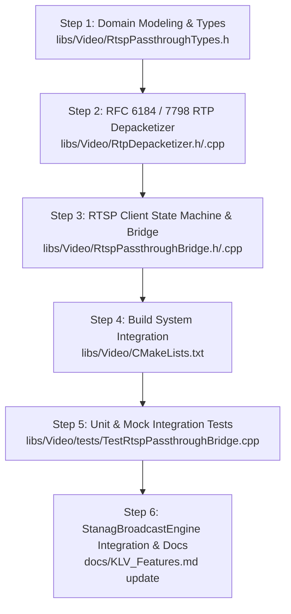

# Implementation Plan: Phase 4 — RTSP Direct Ingest Bridge (`RtspPassthroughBridge`)

This document provides a comprehensive, production-grade technical plan and specification for **Phase 4: RTSP Direct Ingest Bridge (`RtspPassthroughBridge`)** defined in [KLV_Features.md](KLV_Features.md).

---

## 1. Executive Summary & Architectural Scope

### 1.1 Context & Objective
In STANAG 4609 broadcast systems, live tactical EO/IR gimbals and IP cameras stream compressed **H.264 (AVC)** or **H.265 (HEVC)** video over RTSP/RTP. Traditional video ingestion decodes incoming video packets into raw YUV/RGB frame buffers and subsequently re-encodes them for MPEG-2 Transport Stream multiplexing. This approach introduces:
1. **Severe Latency Inefficiencies**: Decode-encode cycles add 100–300 ms of glass-to-glass latency.
2. **Computational Overhead**: Software or hardware video transcoders consume significant CPU/GPU compute and power, limiting SWaP-C constrained embedded edge platforms.
3. **Generation Loss**: Recompression degrades image fidelity and introduces compression artifacts that disrupt downstream CV tracking and target detection algorithms.

**Phase 4 (`RtspPassthroughBridge`)** bypasses decoding entirely. It establishes an RTSP 1.0/2.0 client session with the target camera, depacketizes incoming RFC 6184 (H.264) and RFC 7798 (H.265) RTP payloads directly into standard ISO/IEC Annex B elementary stream byte units (`00 00 00 01`), extracts or injects out-of-band parameter sets (SPS/PPS/VPS), calculates continuous 90 kHz / microsecond presentation timestamps (PTS), and pipes the stream directly into [VideoNaluParser](../libs/Klv/VideoNaluParser.h) and [StanagBroadcastEngine](../libs/Klv/StanagBroadcastEngine.h) with **sub-5 ms ingestion latency** and **near-zero CPU overhead**.

### 1.2 Standards Reference
| Standard / Specification | Scope within Phase 4 |
|---|---|
| **RFC 2326 / RFC 7826** | Real Time Streaming Protocol (RTSP 1.0 / RTSP 2.0 client handshake, session control, keepalive) |
| **RFC 4566 / RFC 2327** | Session Description Protocol (SDP parsing, video track discovery, clock rate, out-of-band parameter sets) |
| **RFC 3550** | Real-time Transport Protocol (RTP fixed header parsing, 90 kHz timestamp unwrapping, marker bit detection) |
| **RFC 6184** | RTP Payload Format for H.264 Video (Single NAL unit, STAP-A aggregation, FU-A fragmentation units) |
| **RFC 7798** | RTP Payload Format for H.265 / HEVC Video (Single NAL unit, AP aggregation, FU fragmentation units) |
| **ISO/IEC 14496-10 & 23008-2** | Annex B Start Code delimitation (`00 00 01` / `00 00 00 01`) and NAL Unit Type identification |
| **STANAG 4609 Ed. 3/4** | Temporal alignment with KLV metadata via 90 kHz PTS timebase ($\le 50\text{ ms}$ skew) |

---

## 2. Architecture & Data Flow

### 2.1 ASCII Architecture Diagram

```
+-----------------------------------------------------------------------------------------------------------------------------+
|                                      PHASE 4: RTSP DIRECT INGEST BRIDGE ARCHITECTURE                                        |
+-----------------------------------------------------------------------------------------------------------------------------+
|                                                                                                                             |
|   +---------------------------------------------------------------------------------------------------------------------+   |
|   | Target RTSP Camera / Gimbal Source (rtsp://192.168.1.100:554/stream1)                                               |   |
|   +---------------------------------------------------------------------------------------------------------------------+   |
|               |                                                                                     |                       |
|               | RTSP Control (TCP)                                                                  | Video Stream (RTP)    |
|               | [OPTIONS, DESCRIBE, SETUP, PLAY]                                                    | [TCP Interleaved /    |
|               v                                                                                     |  UDP Unicast]         |
|   +---------------------------------------------------------------------------------------------+   |                       |
|   | RtspPassthroughBridge (libs/Video)                                                          |   |                       |
|   |                                                                                             |   |                       |
|   |  +-----------------------+     +------------------------+     +--------------------------+  |   |                       |
|   |  |  RtspClientSession    |     |      SdpParser         |     |  RtspKeepAliveTimer      |  |   |                       |
|   |  |  - TCP Connect / Auth |<--->|  - Video Track Extract |     |  - Periodic GET_PARAM    |  |   |                       |
|   |  |  - CSeq & Session ID  |     |  - SPS/PPS Base64 sprop|     |  - 30s session refresh   |  |   |                       |
|   |  +-----------------------+     +------------------------+     +--------------------------+  |   |                       |
|   |              |                                                                              |   |                       |
|   |              v                                                                              |   |                       |
|   |  +---------------------------------------------------------------------------------------+  |   |                       |
|   |  | RtpDemuxer (TCP Interleaved `$` / UDP Datagram)                                       |  |<--+                       |
|   |  | - Strips 4-byte RFC 2326 header ($ + Channel + Length)                                |  |                           |
|   |  | - Parses 12-byte RFC 3550 RTP Header (Marker bit, Sequence, 90kHz Timestamp, SSRC)    |  |                           |
|   |  | - Unwraps 32-bit RTP timestamp into monotonic 64-bit microsecond PTS                  |  |                           |
|   |  | - Tracks packet sequence continuity & drops                                           |  |                           |
|   |  +---------------------------------------------------------------------------------------+  |                           |
|   |              |                                                                              |                           |
|   |              +--------------------------------------+                                       |                           |
|   |              | H.264 Payload                        | H.265 Payload                         |                           |
|   |              v                                      v                                       |                           |
|   |  +---------------------------------------+  +--------------------------------------------+  |                           |
|   |  | H264RtpDepacketizer (RFC 6184)        |  | H265RtpDepacketizer (RFC 7798)             |  |                           |
|   |  | - Single NALU (Types 1..23)           |  | - Single NALU (Types 0..47)                |  |                           |
|   |  | - STAP-A (Type 24 aggregation)        |  | - AP (Type 48 aggregation)                 |  |                           |
|   |  | - FU-A (Type 28 fragmentation reasm)  |  | - FU (Type 49 fragmentation reassembly)    |  |                           |
|   |  +---------------------------------------+  +--------------------------------------------+  |                           |
|   |              |                                      |                                       |                           |
|   |              +-------------------+------------------+                                       |                           |
|   |                                  |                                                          |                           |
|   |                                  v                                                          |                           |
|   |  +---------------------------------------------------------------------------------------+  |                           |
|   |  | AccessUnitAssembler                                                                   |  |                           |
|   |  | - Injects out-of-band SPS/PPS/VPS on IDR/IRAP keyframes if omitted in stream          |  |                           |
|   |  | - Delimits NALUs with 4-byte Annex B prefix (00 00 00 01)                             |  |                           |
|   |  | - Demarcates Access Units via RTP Marker bit (M=1) or timestamp change                |  |                           |
|   |  +---------------------------------------------------------------------------------------+  |                           |
|   +---------------------------------------------------------------------------------------------+                           |
|                                  |                                                                                          |
|                                  v VideoAccessUnit / Annex B Chunk                                                          |
|   +---------------------------------------------------------------------------------------------+                           |
|   | VideoNaluParser (libs/Klv)                                                                  |                           |
|   | - Keyframe detection (IDR / CRA / BLA) & Slice header validation                            |                           |
|   +---------------------------------------------------------------------------------------------+                           |
|                                  |                                                                                          |
|                                  v pushVideoAccessUnit()                                                                    |
|   +---------------------------------------------------------------------------------------------+                           |
|   | StanagBroadcastEngine (libs/Klv)                                                            |                           |
|   | - PtsSyncManager (Aligns video PTS with KLV metadata within +/- 50 ms)                      |                           |
|   | - MpegTsKlvMuxer (Multiplexes Video PID 0x0101 + KLV PID 0x01E0 into 188-byte TS packets)   |                           |
|   | - CbrRatePacer & MpegTsNetworkPublisher (Network egress broadcast)                          |                           |
|   +---------------------------------------------------------------------------------------------+                           |
+-----------------------------------------------------------------------------------------------------------------------------+
```

### 2.2 Mermaid Protocol Sequence Diagram

```mermaid
sequenceDiagram
    autonumber
    participant Cam as IP Camera / Gimbal
    participant Bridge as RtspPassthroughBridge
    participant Depack as RtpDepacketizer
    participant Engine as StanagBroadcastEngine

    Note over Bridge,Cam: RTSP Handshake & Session Setup
    Bridge->>Cam: OPTIONS rtsp://camera/live RTSP/1.0
    Cam-->>Bridge: 200 OK (Public: OPTIONS, DESCRIBE, SETUP, PLAY, TEARDOWN)
    Bridge->>Cam: DESCRIBE rtsp://camera/live RTSP/1.0 (Accept: application/sdp)
    Cam-->>Bridge: 200 OK (Content-Type: application/sdp, sprop-parameter-sets=...)
    Note over Bridge: Parse SDP: Codec (H264/H265), Clock=90000, SPS/PPS
    Bridge->>Cam: SETUP rtsp://camera/live/trackID=1 RTSP/1.0 (Transport: RTP/AVP/TCP;interleaved=0-1)
    Cam-->>Bridge: 200 OK (Session: 987654321; Transport: interleaved=0-1)
    Bridge->>Cam: PLAY rtsp://camera/live RTSP/1.0 (Session: 987654321)
    Cam-->>Bridge: 200 OK (RTP-Info: url=trackID=1;seq=1200;rtptime=360000)

    Note over Cam,Bridge: High-Speed Passthrough Ingestion Loop
    loop Active Video Streaming
        Cam->>Bridge: Interleaved TCP Frame ($ 00 <Len> <RTP Packet>)
        Bridge->>Depack: Parse RTP Header (Seq, 90kHz TS, Marker Bit)
        alt Single NALU (Type 1..23 / 0..47)
            Depack->>Depack: Prepend Annex B Prefix (00 00 00 01)
        else Fragmentation Unit (FU-A / FU)
            Depack->>Depack: Reconstruct NAL Header & Accumulate Fragments
        else Aggregation Packet (STAP-A / AP)
            Depack->>Depack: Unpack multiple NALUs with Annex B Prefixes
        end
        opt Marker Bit M=1 (Access Unit Complete)
            Depack-->>Bridge: Emit Assembled VideoAccessUnit (PTS µs, Keyframe, NALUs)
            Bridge->>Engine: pushVideoAccessUnit(au)
        end
    end

    Note over Bridge,Cam: Keepalive & Teardown
    loop Every 30 Seconds
        Bridge->>Cam: GET_PARAMETER / OPTIONS (Session: 987654321)
        Cam-->>Bridge: 200 OK
    end

    Bridge->>Cam: TEARDOWN rtsp://camera/live RTSP/1.0 (Session: 987654321)
    Cam-->>Bridge: 200 OK
```

---

## 3. Detailed Specifications & Implementation Plan

### 3.1 RTP Depacketization Engine (RFC 6184 & RFC 7798)

#### A. RFC 6184: H.264 / AVC Depacketizer
1. **Single NAL Unit Packet**:
   - NAL unit type: `nal_type = payload[0] & 0x1F`.
   - Types `1` through `23` represent unfragmented NAL units.
   - Action: Prepend `00 00 00 01` start code, copy payload directly into AU buffer.
2. **STAP-A (Single-Time Aggregation Packet type A)**:
   - NAL unit type: `24`.
   - Structure: 1-byte STAP-A header followed by one or more aggregated NAL units:
     - 2-byte unsigned big-endian size: `nalu_size`.
     - `nalu_size` bytes of NAL unit payload.
   - Action: Loop over the buffer, read 16-bit length, prepend `00 00 00 01`, extract NALU, repeat until end of packet.
3. **FU-A (Fragmentation Unit type A)**:
   - NAL unit type: `28`.
   - Byte 0: FU indicator (`F [1 bit] | NRI [2 bits] | Type=28 [5 bits]`).
   - Byte 1: FU header (`S [1 bit] | E [1 bit] | R [1 bit] | Type [5 bits]`).
   - Reassembly:
     - `S == 1` (Start fragment): Allocate/reset AU fragment buffer. Reconstruct the original 1-byte NAL header:
       $$\text{nal\_header} = (\text{indicator} \ \& \ 0\text{xE}0) \ | \ (\text{fu\_header} \ \& \ 0\text{x}1\text{F})$$
       Prepend `00 00 00 01` + `nal_header`, then append `payload + 2`.
     - `S == 0 && E == 0` (Middle fragment): Verify sequence continuity, append `payload + 2`.
     - `E == 1` (End fragment): Append `payload + 2`. Fragmented NAL unit is now complete.
4. **Out-of-band Parameter Sets**:
   - Extract `sprop-parameter-sets` from SDP attribute `a=fmtp:<pt> ...`.
   - Base64-decode SPS and PPS.
   - Inject before the first IDR keyframe if the camera does not send in-band parameter sets.

#### B. RFC 7798: H.265 / HEVC Depacketizer
1. **Payload Header**:
   - 2 bytes: `F [1 bit] | Type [6 bits] | LayerId [6 bits] | TID [3 bits]`.
   - `nal_type = (payload[0] >> 1) & 0x3F`.
2. **Single NAL Unit Packet**:
   - Types `0` through `47`. Prepend `00 00 00 01` start code and copy entire 2-byte header + payload.
3. **AP (Aggregation Packet)**:
   - Type `48`. Preceded by 2-byte HEVC payload header. Followed by 16-bit big-endian length-prefixed NALUs.
4. **FU (Fragmentation Unit)**:
   - Type `49`.
   - Bytes 0-1: Payload Header (`Type=49`).
   - Byte 2: FU Header (`S [1 bit] | E [1 bit] | FuType [6 bits]`).
   - Reconstruct 2-byte NAL header:
     - Byte 0: `(payload[0] & 0x81) | ((fu_header & 0x3F) << 1)`
     - Byte 1: `payload[1]`
   - Assemble start, middle, and end fragments identically to FU-A.

#### C. Timestamp Unwrapping & Clock Synchronization
- RTP timestamps are 32-bit unsigned integers ticking at 90,000 Hz.
- Rollover occurs every $\approx 13.25\text{ hours}$ ($2^{32} / 90000\text{ s} \approx 47721.8\text{ s}$).
- The unwrapper tracks rollover epochs:
  $$\Delta t = (\text{current\_rtp\_ts} - \text{last\_rtp\_ts}) \pmod{2^{32}}$$
  If $\Delta t > 2^{31}$, treat as backward step or out-of-order; if forward, accumulate into a monotonic 64-bit presentation timestamp:
  $$\text{pts\_us} = \text{base\_us} + \left( \frac{\text{unwrapped\_rtp\_ts} - \text{initial\_rtp\_ts}}{90000} \right) \times 1{,}000{,}000$$

---

## 4. Domain Modeling & Value Objects

In strict adherence to project domain modeling rules:
- Raw primitives (`int`, `uint8_t`, `std::string`) are wrapped across public APIs.
- Domain invariants are validated upon construction.
- Zero dynamic allocations on fast paths.

```cpp
namespace Video {

/// @class RtspUrl
/// @brief Strongly-typed, validated RTSP uniform resource locator.
class RtspUrl {
public:
    explicit RtspUrl(std::string_view url);
    [[nodiscard]] std::string_view host() const noexcept;
    [[nodiscard]] std::uint16_t port() const noexcept;
    [[nodiscard]] std::string_view path() const noexcept;
    [[nodiscard]] std::string_view raw() const noexcept;
    [[nodiscard]] bool isValid() const noexcept;
private:
    std::string m_raw;
    std::string_view m_host;
    std::uint16_t m_port { 554U };
    std::string_view m_path;
    bool m_valid { false };
};

/// @class RtpSequenceNumber
/// @brief 16-bit RTP sequence number with modulo-65536 delta and loss arithmetic.
class RtpSequenceNumber {
public:
    explicit constexpr RtpSequenceNumber(std::uint16_t seq = 0U) noexcept : m_val(seq) {}
    [[nodiscard]] constexpr std::uint16_t value() const noexcept { return m_val; }
    [[nodiscard]] constexpr std::int32_t delta(RtpSequenceNumber other) const noexcept {
        return static_cast<std::int16_t>(m_val - other.m_val);
    }
private:
    std::uint16_t m_val { 0U };
};

/// @enum class RtspTransportProtocol
enum class RtspTransportProtocol : std::uint8_t {
    TcpInterleaved = 0U,
    UdpUnicast     = 1U
};

/// @enum class RtspBridgeState
enum class RtspBridgeState : std::uint8_t {
    Disconnected = 0U,
    Connecting,
    Describing,
    SettingUp,
    Playing,
    Reconnecting,
    Error
};

} // namespace Video
```

---

## 5. File Structure & Proposed Interfaces

### 5.1 File Organization

```
libs/Video/
├── RtspPassthroughTypes.h          # Domain types, config, statistics, enums
├── RtpDepacketizer.h               # RFC 6184 / RFC 7798 RTP NALU depacketizer
├── RtpDepacketizer.cpp             # Implementation: Single, STAP-A, AP, FU-A, FU
├── RtspPassthroughBridge.h         # Master Bridge facade, client state machine
├── RtspPassthroughBridge.cpp       # RTSP I/O, keepalive, Annex B Access Unit emission
└── tests/
    └── TestRtspPassthroughBridge.cpp # Comprehensive GTest unit & mock integration suite
```

### 5.2 Header Interface: `libs/Video/RtspPassthroughTypes.h`

```cpp
#pragma once

/// @file RtspPassthroughTypes.h
/// @brief Domain value objects, configuration, and statistics for RTSP Passthrough Bridge.

#include <cstddef>
#include <cstdint>
#include <string>
#include <string_view>

#include "Klv/VideoTypes.h"

namespace Video {

/// @enum class RtspTransportProtocol
enum class RtspTransportProtocol : std::uint8_t {
    TcpInterleaved = 0U,
    UdpUnicast     = 1U
};

/// @enum class RtspBridgeState
enum class RtspBridgeState : std::uint8_t {
    Disconnected = 0U,
    Connecting,
    Describing,
    SettingUp,
    Playing,
    Reconnecting,
    Error
};

/// @struct RtspPassthroughConfig
struct RtspPassthroughConfig {
    std::string rtspUrl { };
    std::string username { };
    std::string password { };
    RtspTransportProtocol transport { RtspTransportProtocol::TcpInterleaved };
    std::uint32_t connectTimeoutMs { 5000U };
    std::uint32_t keepaliveIntervalMs { 30000U };
    std::uint32_t reconnectDelayMs { 2000U };
    std::size_t maxAuBufferSize { 10485760U }; // 10 MB limit for jumbo keyframes
    bool autoReconnect { true };
    Klv::VideoCodec preferredCodec { Klv::VideoCodec::H264 };
};

/// @struct RtspPassthroughStats
struct RtspPassthroughStats {
    std::size_t rtpPacketsReceived { 0U };
    std::size_t rtpBytesReceived { 0U };
    std::size_t accessUnitsEmitted { 0U };
    std::size_t packetLossCount { 0U };
    std::size_t corruptPackets { 0U };
    double currentBitrateKbps { 0.0 };
    RtspBridgeState state { RtspBridgeState::Disconnected };
};

} // namespace Video
```

### 5.3 Header Interface: `libs/Video/RtpDepacketizer.h`

```cpp
#pragma once

/// @file RtpDepacketizer.h
/// @brief Zero-transcode RFC 6184 (H.264) and RFC 7798 (H.265) RTP depacketizer.

#include <cstddef>
#include <cstdint>
#include <functional>
#include <vector>

#include "Klv/VideoTypes.h"
#include "RtspPassthroughTypes.h"

namespace Video {

/// @class RtpDepacketizer
/// @brief Assembles RTP payloads into standard Annex B Access Units.
class RtpDepacketizer {
public:
    /// @brief Callback invoked when a complete video Access Unit is assembled.
    using AccessUnitCallback = std::function<void(const Klv::VideoAccessUnit& au)>;

    /// @brief Constructs depacketizer for specified codec.
    explicit RtpDepacketizer(Klv::VideoCodec codec = Klv::VideoCodec::H264) noexcept;

    /// @brief Registers Access Unit output callback.
    void setUnitCallback(AccessUnitCallback callback);

    /// @brief Sets active video codec.
    void setCodec(Klv::VideoCodec codec) noexcept;

    /// @brief Injects out-of-band SPS / PPS / VPS parameter sets extracted from SDP.
    void setParameterSets(const std::vector<std::vector<std::uint8_t>>& paramSets);

    /// @brief Processes an incoming RTP packet.
    /// @param[in] rtpPacket Pointer to raw RFC 3550 RTP packet.
    /// @param[in] size Size of packet in bytes.
    /// @return True if packet was valid and processed successfully.
    bool processRtpPacket(const std::uint8_t* rtpPacket, std::size_t size);

    /// @brief Flushes currently accumulated Access Unit buffer.
    void flush();

    /// @brief Resets all sequence and reassembly buffers.
    void reset() noexcept;

    /// @brief Gets total packet loss count detected via sequence number gaps.
    [[nodiscard]] std::size_t packetLossCount() const noexcept;

private:
    Klv::VideoCodec m_codec { Klv::VideoCodec::H264 };
    AccessUnitCallback m_callback { };
    std::vector<std::vector<std::uint8_t>> m_paramSets { };

    std::vector<std::uint8_t> m_auBuffer { };
    std::uint32_t m_lastRtpTimestamp { 0U };
    std::uint64_t m_currentPtsUs { 0U };
    std::uint16_t m_lastSequence { 0U };
    bool m_hasLastSequence { false };
    std::size_t m_packetLossCount { 0U };

    // Fragmentation unit state
    std::vector<std::uint8_t> m_fuBuffer { };
    bool m_fuInProgress { false };

    bool parseH264(const std::uint8_t* payload, std::size_t payloadLen, bool marker);
    bool parseH265(const std::uint8_t* payload, std::size_t payloadLen, bool marker);
    void appendNalu(const std::uint8_t* naluData, std::size_t naluLen);
    void emitAccessUnit();
};

} // namespace Video
```

### 5.4 Header Interface: `libs/Video/RtspPassthroughBridge.h`

```cpp
#pragma once

/// @file RtspPassthroughBridge.h
/// @brief Direct Ingest RTSP/RTP bridge demuxing H.264/H.265 Access Units with zero transcoding.

#include <cstddef>
#include <cstdint>
#include <functional>
#include <memory>
#include <string_view>

#include "Klv/VideoTypes.h"
#include "RtspPassthroughTypes.h"

namespace Video {

/// @class RtspPassthroughBridge
/// @brief Thread-safe high-performance RTSP passthrough ingest client.
class RtspPassthroughBridge {
public:
    /// @brief Callback invoked when a complete video Access Unit is assembled.
    using AccessUnitCallback = std::function<void(const Klv::VideoAccessUnit& au)>;

    /// @brief Callback invoked when raw Annex B byte stream chunks are ready.
    using RawChunkCallback = std::function<void(const std::uint8_t* data, std::size_t size, std::uint64_t ptsUs)>;

    /// @brief Callback invoked on connection state transition.
    using StateCallback = std::function<void(RtspBridgeState state, std::string_view message)>;

    /// @brief Constructs bridge with designated configuration.
    explicit RtspPassthroughBridge(const RtspPassthroughConfig& config);
    ~RtspPassthroughBridge();

    RtspPassthroughBridge(const RtspPassthroughBridge&) = delete;
    RtspPassthroughBridge& operator=(const RtspPassthroughBridge&) = delete;
    RtspPassthroughBridge(RtspPassthroughBridge&&) = delete;
    RtspPassthroughBridge& operator=(RtspPassthroughBridge&&) = delete;

    /// @brief Registers callback for assembled VideoAccessUnit instances.
    void setUnitCallback(AccessUnitCallback callback);

    /// @brief Registers callback for raw Annex B chunks (e.g. for pushVideoChunk).
    void setChunkCallback(RawChunkCallback callback);

    /// @brief Registers state transition observer.
    void setStateCallback(StateCallback callback);

    /// @brief Starts background network ingestion thread and connects to camera.
    /// @return True if worker thread started successfully.
    [[nodiscard]] bool start();

    /// @brief Stops network ingestion and sends RTSP TEARDOWN.
    void stop();

    /// @brief Queries whether bridge is actively running.
    [[nodiscard]] bool isRunning() const noexcept;

    /// @brief Retrieves current runtime diagnostics.
    [[nodiscard]] RtspPassthroughStats stats() const;

private:
    class Impl;
    std::unique_ptr<Impl> m_impl;
};

} // namespace Video
```

---

## 6. Comprehensive Test Verification Matrix

| Test Case | Scenario / Vector | Expected Outcome |
|---|---|---|
| **TestH264SingleNalu** | RFC 6184 Single NALU (Type 1 non-IDR, Type 5 IDR, Type 7 SPS, Type 8 PPS) | Prepend `00 00 00 01` start code, correct NALU type preserved |
| **TestH264StapA** | RFC 6184 STAP-A aggregation packet with SPS (Type 7) + PPS (Type 8) | Both NALUs extracted individually with `00 00 00 01` delimiters |
| **TestH264FuAFragment** | RFC 6184 FU-A 3-packet sequence (Start `S=1`, Middle `S=0,E=0`, End `E=1`) | Reconstructed original NAL header, seamless byte payload assembly |
| **TestH265SingleNalu** | RFC 7798 Single NALU (Type 19 IDR, Type 1 TRAIL_R) | Prepend `00 00 00 01`, 2-byte header preserved |
| **TestH265ApAggregation**| RFC 7798 AP aggregation packet with VPS + SPS + PPS | Three NALUs extracted with `00 00 00 01` delimiters |
| **TestH265FuFragment** | RFC 7798 FU fragmentation unit sequence | 2-byte HEVC NAL header reconstructed, fragments merged |
| **TestSequenceLossDetection** | Missing RTP sequence number (e.g. seq 100 -> 102) | Dropped packet flagged, corrupt fragmented AU discarded safely |
| **TestTimestampRollover** | RTP timestamp wrapping across $2^{32}-1 \rightarrow 0$ | Monotonic microsecond PTS continuous with no backward jumps |
| **TestSdpSpropExtraction** | SDP with `sprop-parameter-sets=Z00AH...` | Base64 decoded to Annex B SPS/PPS and injected before first keyframe |
| **TestRtspHandshakeMock** | Mock TCP RTSP server responding to OPTIONS/DESCRIBE/SETUP/PLAY | State machine transitions cleanly to `Playing`, TEARDOWN on stop |
| **TestEngineIntegration** | Emitted AU fed into `StanagBroadcastEngine::pushVideoAccessUnit` | Successfully multiplexed into 188-byte MPEG-TS packets |

---

## 7. Step-by-Step Implementation Roadmap



1. **Step 1: Domain Value Objects & Types**
   - Author `libs/Video/RtspPassthroughTypes.h` defining `RtspTransportProtocol`, `RtspBridgeState`, `RtspPassthroughConfig`, and `RtspPassthroughStats`.
2. **Step 2: RFC 6184 & RFC 7798 RTP Depacketizer**
   - Author `libs/Video/RtpDepacketizer.h` and `libs/Video/RtpDepacketizer.cpp`.
   - Implement Single NALU, STAP-A, AP, FU-A, and FU reassembly, Base64 SDP sprop parsing, and timestamp unwrap.
3. **Step 3: RTSP Direct Ingest Bridge Facade**
   - Author `libs/Video/RtspPassthroughBridge.h` and `libs/Video/RtspPassthroughBridge.cpp`.
   - Implement RTSP 1.0 client state machine (`OPTIONS`, `DESCRIBE`, `SETUP`, `PLAY`, `TEARDOWN`), socket event polling loop via `SocketUtils`, keepalive timer, and automatic reconnect.
4. **Step 4: CMake Integration**
   - Update `libs/Video/CMakeLists.txt` to include the new sources and link `Transport` and `Klv`.
5. **Step 5: Test Suite Authoring & Execution**
   - Author `libs/Video/tests/TestRtspPassthroughBridge.cpp` implementing the 11 test vectors from the Test Matrix.
   - Register test executable in `libs/Video/tests/CMakeLists.txt`.
6. **Step 6: Update Documentation**
   - Mark Phase 4 as **IMPLEMENTED** in `docs/KLV_Features.md`.

