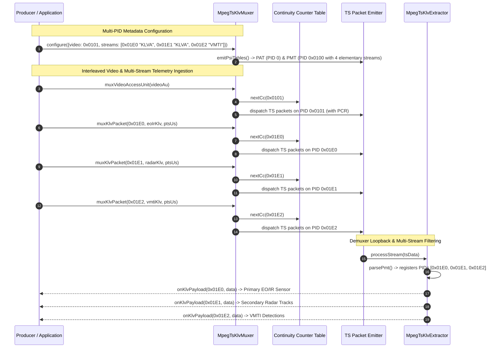

# Implementation Plan: Phase 5 — Multi-PID Metadata Substream Multiplexing

This document provides a comprehensive, production-grade technical plan and specification for **Phase 5: Multi-PID Metadata Substream Multiplexing** defined in [KLV_Features.md](KLV_Features.md).

---

## 1. Executive Summary & Architectural Scope

### 1.1 Context & Objective
In tactical STANAG 4609 / MISB motion imagery broadcasts, high-performance airborne ISR platforms (UAS, aerostats, fixed-wing reconnaissance, and naval payloads) deploy integrated sensor suites and edge processing nodes. Rather than producing a single monolithic telemetry stream, modern airborne platforms generate multiple concurrent telemetry substreams:
1. **Primary Electro-Optical / Infrared (EO/IR) Sensor**: MISB ST 0601 UAS Datalink Local Set capturing platform attitude, gimbal angles, slant range, and sensor field of view on PID `0x01E0` (Registration `"KLVA"`).
2. **Secondary Co-Mounted Sensor / Radar Tracks**: Secondary optical sensor, Synthetic Aperture Radar (SAR), Maritime AIS, or Co-Target track reports on PID `0x01E1` (Registration `"KLVA"`).
3. **Automated Video Moving Target Indicator (VMTI)**: MISB ST 0903 detections, track centroids, and bounding boxes generated by edge computer vision models on PID `0x01E2` (Registration `"VMTI"`).
4. **Geo-Registration & Structural Amendments**: MISB ST 1601 tie points and MISB ST 1607 Amend/Segment sets on PID `0x01E3` (Registration `"KLVA"`).

Prior to Phase 5, [`MpegTsKlvMuxer`](../libs/Klv/MpegTsKlvMuxer.h) only accommodated a single metadata Elementary Stream on a single PID. Mixing diverse sensor feeds into a single PID creates:
- **Bandwidth & PES Packet Bloat**: Bundling high-frequency VMTI detections (e.g. 30 Hz) inside ST 0601 Tag 74 bloats primary telemetry packets and causes frame loss over constrained tactical datalinks.
- **Hardware Demuxing Limitations**: Downstream hardware/FPGA decoders and tactical ground stations cannot selectively filter streams by elementary stream PID at the transport layer, forcing full software demuxing of all metadata.
- **Loss of Semantic Disambiguation**: Receivers lack explicit Program Map Table (PMT) descriptors and MISB ST 1607 Item 143 Metadata Substream Identifiers (MSID) to definitively associate telemetry with distinct optical or RF sensors.

**Phase 5** upgrades [`MpegTsKlvMuxer`](../libs/Klv/MpegTsKlvMuxer.h), [`MpegTsKlvExtractor`](../libs/Klv/MpegTsKlvExtractor.h), [`MpegTsMuxerTypes.h`](../libs/Klv/MpegTsMuxerTypes.h), and [`StanagBroadcastEngine`](../libs/Klv/StanagBroadcastEngine.h) to deliver **simultaneous Multi-PID metadata substream multiplexing and demuxing**, full PMT generation with MISB ST 1402 registration descriptors, per-stream continuity counters, and MISB ST 1607 Item 143 substream identification.

### 1.2 Standards Reference
| Standard / Specification | Scope within Phase 5 |
|---|---|
| **ISO/IEC 13818-1 Clause 2.4.4.8** | Program Map Table (PMT) multi-stream elementary syntax, table IDs, ES descriptors |
| **ISO/IEC 13818-1 Clause 2.6.8** | Registration Descriptor (Tag `0x05`, format identifier `"KLVA"`, `"VMTI"`) |
| **STANAG 4609 Edition 3/4** | Multi-stream PES encapsulation, 90 kHz PTS stamping, PCR timing on Video or Metadata |
| **MISB ST 1402.2** | Multi-Stream Video & Metadata Multiplexing in MPEG-2 Transport Streams |
| **MISB ST 1607.2** | Item 143: Metadata Substream Identifier Pack (MSID Local ID / UUID association) |
| **MISB ST 0903.6** | Video Moving Target Indicator (VMTI) PES stream packaging and PMT advertisement |
| **MISRA C++:2023 & SEI CERT** | Zero-heap fast-path execution (ERR55-CPP), explicit casting (7.0.6/INT31-C), IWYU |

---

## 2. Architecture & Data Flow

### 2.1 ASCII Architecture Diagram

```
+-----------------------------------------------------------------------------------------------------------------------------+
|                                    PHASE 5: MULTI-PID METADATA MULTIPLEXING ARCHITECTURE                                     |
+-----------------------------------------------------------------------------------------------------------------------------+
|                                                                                                                             |
|   +-------------------+    +--------------------+    +--------------------+    +----------------------------------------+   |
|   | Primary EO/IR LS  |    | Secondary Radar LS |    |  VMTI Detections   |    | Compressed Video Access Units          |   |
|   |  (MISB ST 0601)   |    |   (MISB ST 0601)   |    |  (MISB ST 0903)    |    | (H.264 AVC / H.265 HEVC)               |   |
|   +-------------------+    +--------------------+    +--------------------+    +----------------------------------------+   |
|             |                        |                         |                                   |                        |
|             v                        v                         v                                   v                        |
|   [MSID Pack Local ID 1]   [MSID Pack Local ID 2]    [MSID Pack Local ID 3]                        |                        |
|             |                        |                         |                                   |                        |
|             +------------------------+------------+------------+                                   |                        |
|                                                   |                                                |                        |
|                                                   v                                                v                        |
|   +---------------------------------------------------------------------------------------------------------------------+   |
|   | MpegTsKlvMuxer (libs/Klv)                                                                                           |   |
|   |                                                                                                                     |   |
|   |  +---------------------------------------------------------------------------------------------------------------+  |   |
|   |  | Program Map Table (PMT) Synthesizer                                                                           |  |   |
|   |  | - Elementary Stream 1: Video (PID 0x0101, StreamType 0x1B/0x24)                                               |  |   |
|   |  | - Elementary Stream 2: Primary KLV (PID 0x01E0, StreamType 0x15, Desc: Reg("KLVA"), MSID: 1)                  |  |   |
|   |  | - Elementary Stream 3: Radar KLV   (PID 0x01E1, StreamType 0x15, Desc: Reg("KLVA"), MSID: 2)                  |  |   |
|   |  | - Elementary Stream 4: VMTI KLV    (PID 0x01E2, StreamType 0x15, Desc: Reg("VMTI"), MSID: 3)                  |  |   |
|   |  +---------------------------------------------------------------------------------------------------------------+  |   |
|   |                                                                                                                     |   |
|   |  +---------------------------------------------------------------------------------------------------------------+  |   |
|   |  | Independent Continuity Counter Engine (std::array<PidCcEntry, 32> - Zero Heap Allocation, CERT ERR55-CPP)     |  |   |
|   |  | [PID 0x0000: CC] [PID 0x0100: CC] [PID 0x0101: CC] [PID 0x01E0: CC] [PID 0x01E1: CC] [PID 0x01E2: CC] ...      |  |   |
|   |  +---------------------------------------------------------------------------------------------------------------+  |   |
|   |                                                                                                                     |   |
|   |  +---------------------------------------------------------------------------------------------------------------+  |   |
|   |  | Multi-PID PES Packetizer & TS Packet Dispatcher (90 kHz PTS, 27 MHz PCR Injection)                            |  |   |
|   |  +---------------------------------------------------------------------------------------------------------------+  |   |
|   +---------------------------------------------------------------------------------------------------------------------+   |
|                                                           |                                                                 |
|                                                           v                                                                 |
|                                     Single Multiplexed STANAG 4609 MPEG-TS Stream                                           |
|                     [PAT: 0x00] -> [PMT: 0x100] -> [VID: 0x101] -> [KLV: 0x1E0] -> [KLV: 0x1E1] -> [VMTI: 0x1E2]          |
|                                                           |                                                                 |
|                               +---------------------------+---------------------------+                                     |
|                               |                                                       |                                     |
|                               v                                                       v                                     |
|               +-------------------------------+                       +-------------------------------+                     |
|               | MpegTsNetworkPublisher        |                       | MpegTsKlvExtractor            |                     |
|               | (UDP Multicast / RTP RFC 3550)|                       | - Multi-PID PMT Auto-Discover |                     |
|               +-------------------------------+                       | - Independent PID Reassembly  |                     |
|                                                                       | - Per-PID Dispatched Callbacks|                     |
|                                                                       +-------------------------------+                     |
|                                                                                                                             |
+-----------------------------------------------------------------------------------------------------------------------------+
```

---

### 2.2 Mermaid Sequence Diagram



---

## 3. Domain Modeling & Value Object Enhancements

Per project standard [`.agents/rules/domain-modeling.md`](../.agents/rules/domain-modeling.md), primitive obsession is forbidden. Metadata stream parameters must be strongly typed with invariant validation upon construction.

### 3.1 Metadata Stream Configuration (`MetadataStreamConfig`)
In [`libs/Klv/MpegTsMuxerTypes.h`](../libs/Klv/MpegTsMuxerTypes.h), define:

```cpp
/// @struct MetadataStreamConfig
/// @brief Configuration descriptor for an individual metadata elementary stream.
struct MetadataStreamConfig {
    /// @brief 13-bit Elementary Stream PID (valid range 0x0020 - 0x1FFE).
    std::uint16_t pid { 0x01E0U };

    /// @brief Stream type in PMT (0x15 for Metadata in PES, 0x06 for PES private data).
    KlvStreamType streamType { KlvStreamType::MetadataInPes };

    /// @brief PES packet stream identifier (0xBD for PrivateStream1, 0xFC for MetadataStream).
    KlvStreamId streamId { KlvStreamId::PrivateStream1 };

    /// @brief 4-byte ISO/IEC 13818-1 Registration Descriptor format identifier ("KLVA", "VMTI").
    std::string formatIdentifier { "KLVA" };

    /// @brief Human-readable name or subsystem descriptor (e.g., "Primary EO/IR", "Radar Tracks").
    std::string streamName { "Primary Telemetry" };

    /// @brief Optional MISB ST 1607 Item 143 Metadata Substream Identifier.
    std::optional<MetadataSubstreamId> msid { std::nullopt };

    /// @brief Whether to inject 33-bit PTS timestamps into PES headers for this stream.
    bool emitPts { true };

    /// @brief Validates conformance of stream settings.
    [[nodiscard]] constexpr bool isValid() const noexcept {
        return (pid >= 0x0020U && pid <= 0x1FFEU) && (formatIdentifier.size() >= 4U);
    }
};
```

### 3.2 Enhanced `MpegTsMuxerConfig`
Upgrade `MpegTsMuxerConfig` in [`libs/Klv/MpegTsMuxerTypes.h`](../libs/Klv/MpegTsMuxerTypes.h):
- Provide a `std::vector<MetadataStreamConfig> metadataStreams` collection.
- Retain `metadataPid`, `streamType`, `streamId`, and `formatIdentifier` for single-PID default operation. When `metadataStreams` is populated, it defines the full set of elementary metadata streams in the PMT. If `metadataStreams` is empty, a single stream configured with `metadataPid` is synthesized automatically.
- Provide helper methods:
  - `[[nodiscard]] const MetadataStreamConfig* findStream(std::uint16_t pid) const noexcept;`
  - `[[nodiscard]] const MetadataStreamConfig* findStreamByMsid(std::uint32_t localId) const noexcept;`
  - `[[nodiscard]] std::uint16_t primaryMetadataPid() const noexcept;`
  - `[[nodiscard]] bool validate() const noexcept;` (verifies PID uniqueness across video, PMT, and all metadata streams).

---

## 4. Component Modifications & Implementation Details

### 4.1 Multiplexer Engine (`MpegTsKlvMuxer.h` / `MpegTsKlvMuxer.cpp`)

#### A. Zero-Alloc Continuity Counter Table
- Currently, `m_continuityCounters` is a fixed array of 16 entries (`std::array<PidCcEntry, 16>`).
- Increase the capacity to 32 entries (`std::array<PidCcEntry, 32>`).
- This accommodates PAT (`0x0000`), PMT (`0x0100`), Video (`0x0101`), Null Packets (`0x1FFF`), and up to 28 concurrent metadata PIDs with zero dynamic memory allocation on the transmission path (CERT ERR55-CPP).

#### B. Dynamic Multi-Stream PMT Generation
Update `buildPmtPacket()` in [`libs/Klv/MpegTsKlvMuxer.cpp`](../libs/Klv/MpegTsKlvMuxer.cpp):
1. Compute the PMT section length across all active elementary streams:
   - Header after length: 9 bytes.
   - Program Info descriptors: 0 bytes.
   - Video ES entry: 5 bytes (if video active).
   - Metadata ES entries: For each stream in `metadataStreams`:
     - ES header: 5 bytes (`stream_type` [1], `elementary_PID` [2], `ES_info_length` [2]).
     - Registration descriptor: 6 bytes (`tag` 0x05 [1], `len` 0x04 [1], `format_identifier` [4]).
     - Optional ST 1607 MSID descriptor (if configured).
   - Section CRC-32: 4 bytes.
2. Emit each elementary stream entry consecutively.
3. Compute CRC-32 over the section using `KlvCrc::calculateCrc32Mpeg` and append the 4-byte CRC.

#### C. Multi-PID Multiplexing API
Extend [`libs/Klv/MpegTsKlvMuxer.h`](../libs/Klv/MpegTsKlvMuxer.h) with public methods:
```cpp
/// @brief Multiplexes a raw KLV packet onto a specific elementary PID.
[[nodiscard]] std::size_t muxKlvPacket(std::uint16_t pid, const std::uint8_t* klvData, 
    std::size_t size, std::optional<std::uint64_t> timestampUs = std::nullopt);

/// @brief Multiplexes a high-level telemetry message onto a specific elementary PID.
[[nodiscard]] std::size_t muxMessage(std::uint16_t pid, const UasDatalinkMessage& message);

/// @brief Multiplexes a KLV packet targeted by MISB ST 1607 MSID Local ID.
[[nodiscard]] std::size_t muxSubstream(std::uint32_t msidLocalId, const std::uint8_t* klvData, 
    std::size_t size, std::optional<std::uint64_t> timestampUs = std::nullopt);

/// @brief Multiplexes a high-level telemetry message targeted by MSID Local ID.
[[nodiscard]] std::size_t muxSubstreamMessage(std::uint32_t msidLocalId, const UasDatalinkMessage& message);

/// @brief Multiplexes a KLV packet onto a specific PID directly into an allocated buffer.
[[nodiscard]] std::vector<std::uint8_t> muxToBuffer(std::uint16_t pid, 
    const std::uint8_t* klvData, std::size_t size, std::optional<std::uint64_t> timestampUs = std::nullopt);
```
- Existing methods without a `pid` argument automatically dispatch to `primaryMetadataPid()`, ensuring zero regressions for single-stream callers.

---

### 4.2 Demuxer / Extractor Multi-PID Support (`MpegTsKlvExtractor.h` / `MpegTsKlvExtractor.cpp`)

To verify and consume multi-PID multiplexed streams, [`libs/Klv/MpegTsKlvExtractor.h`](../libs/Klv/MpegTsKlvExtractor.h) is upgraded:
1. **Multi-PID Discovery in PMT**:
   - `parsePmt()` scans all elementary streams in the PMT section.
   - Any elementary stream with `stream_type == 0x15` or `0x06` carrying `"KLVA"` or `"VMTI"` is tracked as an active metadata stream.
2. **Per-PID Reassembly Buffers**:
   - Track per-PID continuity counters and reassembly buffers using a lightweight lookup structure:
     ```cpp
     struct SubstreamState {
         std::uint16_t pid { 0U };
         int lastContinuityCounter { -1 };
         std::vector<std::uint8_t> pesBuffer {};
     };
     ```
3. **Multi-PID Callbacks**:
   - `using MultiPidPayloadCallback = std::function<void(std::uint16_t pid, const std::uint8_t* data, std::size_t size)>;`
   - `using MultiPidMessageCallback = std::function<void(std::uint16_t pid, const UasDatalinkMessage& msg)>;`
   - The legacy single-PID callbacks continue to dispatch payloads from the primary metadata PID or all streams.

---

### 4.3 High-Level Orchestration (`StanagBroadcastEngine.h` / `StanagBroadcastEngine.cpp`)

Add multi-stream queueing and routing in [`libs/Klv/StanagBroadcastEngine.h`](../libs/Klv/StanagBroadcastEngine.h):
```cpp
/// @brief Pushes telemetry targeted for a specific metadata PID.
void pushTelemetry(std::uint16_t pid, const UasDatalinkMessage& message);

/// @brief Pushes telemetry targeted for a specific ST 1607 MSID Local ID.
void pushSubstream(std::uint32_t msidLocalId, const UasDatalinkMessage& message);
```

---

## 5. Compliance with Project Standards & Safety Rules

| Standard / Policy | Requirement | Implementation in Phase 5 |
|---|---|---|
| **MISRA C++:2023 Rule 7.0.6** | No implicit signed/unsigned conversions. | Explicit `static_cast<std::uint8_t>` and `static_cast<std::uint16_t>` for all bitwise operations and PID masks. |
| **SEI CERT INT31-C** | Range-verified integer conversions. | PID values checked against valid MPEG-TS bounds (`0x0020 <= pid <= 0x1FFE`). |
| **SEI CERT STR37-C** | Locale-independent ASCII character handling. | Format identifiers (`"KLVA"`, `"VMTI"`) handled as fixed 4-byte ASCII without locale dependency. |
| **SEI CERT ERR55-CPP** | No heap allocations in `noexcept` critical paths. | Continuity counter tracking uses fixed `std::array<PidCcEntry, 32>` with zero dynamic allocations inside `nextCc()`. |
| **IWYU & `<cstdint>`** | Include-What-You-Use, explicit `std::` qualification. | Direct `#include <cstdint>` and `#include <cstddef>` in all headers. All integer types qualified with `std::`. |
| **Verification Checklist** | Co-located `.h`/`.cpp`, `#pragma once`, zero Qt dependencies. | All code restricted to `libs/Klv/` and `libs/Transport/`. Zero Qt headers. Function names strictly < 30 characters. |

---

## 6. Test-Driven Development (TDD) Verification Plan

We add comprehensive unit tests in [`libs/Klv/tests/TestMpegTsKlvMuxer.cpp`](../libs/Klv/tests/TestMpegTsKlvMuxer.cpp):

1. **`MultiPidPmtGeneration`**:
   - Configure 3 metadata streams (`0x01E0` KLVA, `0x01E1` KLVA, `0x01E2` VMTI).
   - Call `emitPsiTables()`.
   - Parse PMT packet: verify Table ID `0x02`, verify Section Length, verify 3 ES entries with matching PIDs and Registration Descriptors, and verify MPEG-2 CRC-32 remainder is `0x00000000`.
2. **`IndependentContinuityCountersAcrossPids`**:
   - Multiplex packets interleaved across Video (`0x0101`), Primary (`0x01E0`), Radar (`0x01E1`), and VMTI (`0x01E2`).
   - Verify that the continuity counter for each distinct PID advances independently from 0 to 15 without interference.
3. **`MultiPidDemuxRoundTrip`**:
   - Multiplex distinct telemetry messages on `0x01E0` (Platform heading 135 deg) and `0x01E1` (Platform heading 270 deg).
   - Feed TS stream into `MpegTsKlvExtractor`.
   - Verify that the extractor correctly identifies both PIDs and dispatches the exact corresponding telemetry values to the respective PID callbacks.
4. **`BackwardCompatibilityVerification`**:
   - Ensure all 13 existing unit tests pass without regression.

---

## 7. Implementation Roadmap & Milestones

```
+-----------------------------------------------------------------------------------------------+
|                                    PHASE 5 EXECUTION ROADMAP                                  |
+-----------------------------------------------------------------------------------------------+
|                                                                                               |
|  [Step 1: Domain Types]                                                                       |
|  Define MetadataStreamConfig, update MpegTsMuxerConfig in libs/Klv/MpegTsMuxerTypes.h         |
|                                        │                                                      |
|                                        ▼                                                      |
|  [Step 2: Failing Unit Tests (TDD)]                                                           |
|  Author MultiPidPmtGeneration & MultiPidDemuxRoundTrip tests in TestMpegTsKlvMuxer.cpp       |
|                                        │                                                      |
|                                        ▼                                                      |
|  [Step 3: Muxer PMT & Multi-PID Implementation]                                               |
|  Update MpegTsKlvMuxer.h/.cpp (CC array, PMT generator, muxKlvPacket(pid, ...))               |
|                                        │                                                      |
|                                        ▼                                                      |
|  [Step 4: Extractor Multi-PID Support]                                                        |
|  Update MpegTsKlvExtractor.h/.cpp for multi-PID PMT discovery and per-PID reassembly          |
|                                        │                                                      |
|                                        ▼                                                      |
|  [Step 5: Broadcast Engine Integration]                                                       |
|  Expose multi-PID / MSID push methods in StanagBroadcastEngine.h/.cpp                         |
|                                        │                                                      |
|                                        ▼                                                      |
|  [Step 6: Documentation & Roadmap Sync]                                                       |
|  Update docs/KLV_Features.md marking Phase 5 as IMPLEMENTED with test counts                 |
|                                                                                               |
+-----------------------------------------------------------------------------------------------+
```

---

## 8. Summary of Files to Modify

| File | Nature of Changes |
|---|---|
| [`libs/Klv/MpegTsMuxerTypes.h`](../libs/Klv/MpegTsMuxerTypes.h) | Add `MetadataStreamConfig`, expand `MpegTsMuxerConfig` with `metadataStreams` vector and query helpers. |
| [`libs/Klv/MpegTsKlvMuxer.h`](../libs/Klv/MpegTsKlvMuxer.h) | Add multi-PID multiplexing overloads (`muxKlvPacket`, `muxMessage`, `muxSubstream`). |
| [`libs/Klv/MpegTsKlvMuxer.cpp`](../libs/Klv/MpegTsKlvMuxer.cpp) | Expand CC array to 32, update `buildPmtPacket()` for multi-stream loop, implement multi-PID routing. |
| [`libs/Klv/MpegTsKlvExtractor.h`](../libs/Klv/MpegTsKlvExtractor.h) | Support multi-PID extraction, per-PID buffers, and multi-PID callback signatures. |
| [`libs/Klv/MpegTsKlvExtractor.cpp`](../libs/Klv/MpegTsKlvExtractor.cpp) | Parse multi-stream PMTs, route TS packets by discovered PID, manage independent CC states. |
| [`libs/Klv/StanagBroadcastEngine.h`](../libs/Klv/StanagBroadcastEngine.h) | Add `pushTelemetry(pid, ...)` and `pushSubstream(...)` facade methods. |
| [`libs/Klv/StanagBroadcastEngine.cpp`](../libs/Klv/StanagBroadcastEngine.cpp) | Route multi-PID messages through queue worker to muxer. |
| [`libs/Klv/tests/TestMpegTsKlvMuxer.cpp`](../libs/Klv/tests/TestMpegTsKlvMuxer.cpp) | Comprehensive GoogleTest suite verifying multi-PID PMT, independent CCs, and loopback roundtrip. |
| [`docs/KLV_Features.md`](KLV_Features.md) | Update Phase 5 status to Implemented, update test verification matrix. |

