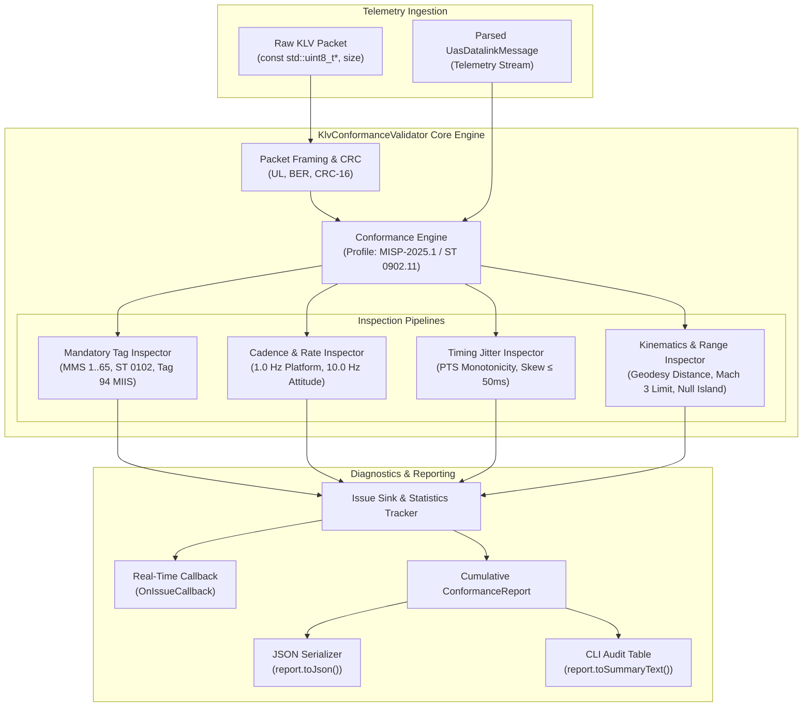

# Implementation Plan: Phase 9 – Automated Conformance Engine (`KlvConformanceValidator`)

**Scope:** `libs/Klv/` (`KlvValidationTypes.h`, `KlvConformanceValidator.h`, `KlvConformanceValidator.cpp`, `CMakeLists.txt`), `libs/Klv/tests/` (`TestKlvConformanceValidator.cpp`, `CMakeLists.txt`), `docs/KLV_Features.md`  
**Standards Baseline:** MISB ST 0902.11 (Minimum Metadata Set for Motion Imagery), DoD/NATO MISP-2025.1 (Motion Imagery Standards Profile), MISB ST 0601.19 (UAS Datalink Local Set), MISB ST 0102.13 (Security Classification Local Set), MISB ST 1204 (MIIS Core Identifier), STANAG 4609 Edition 3/4, MISRA C++:2023, SEI CERT C++ (ERR55-CPP, INT31-C, STR37-C), Project Rules in `.agents/rules/`  
**Reference Document:** [`docs/KLV_Features.md`](KLV_Features.md) (§1, §2, §3.21, §4.2 Phase 9, §5.9)

---

## 1. Executive Summary & Operational Context

### 1.1 Operational Context
In tactical defense, intelligence, surveillance, and reconnaissance (ISR) operations, STANAG 4609 / MISB KLV telemetry streams are consumed by automated exploitation tools, geospatial command systems (ATAK, WinTAK, DCGS-A), and analytics engines. Ensuring that broadcast telemetry strictly conforms to standards is critical:
- Missing mandatory elements (such as timestamps, security markings, or platform coordinates) causes tactical systems to reject or silently drop incoming streams.
- Severe timing jitter ($> 50\text{ ms}$) degrades synchronization between video frames and sensor reticles.
- Kinematic corruption (telemetry jumps exceeding physical aircraft envelopes or Null Island coordinates `(0, 0)`) can trigger false alerts and misdirect kinetic/sensor payloads.

To ensure compliance across all operational environments, **Phase 9** implements the **Automated Conformance Engine (`KlvConformanceValidator`)**, capable of both real-time inline stream verification and offline post-mission audit analysis against **MISB ST 0902.11 Minimum Metadata Set (MMS)** and **MISP-2025.1** profiles.

### 1.2 Core Pillars of Validation

```
                                  MISP & MMS Validation Pillars
                                                │
         ┌──────────────────────┬───────────────┴───────────────┬──────────────────────┐
         ▼                      ▼                               ▼                      ▼
  Mandatory Tags         Cadence Rates                   Timing Jitter          Physical Bounds
  - Tag 1 CRC-16         - Platform >= 1.0 Hz            - PTS Monotonicity     - WGS-84 Bounds
  - Tag 2 PTS            - Attitude >= 10.0 Hz           - Jitter <= 50 ms      - Mach 3 Velocity
  - ST 0102 Security     - Frame Center >= 10.0 Hz       - Skew Detection       - Climb / Turn Rates
  - ST 1204 MIIS (Tag 94)- Cadence Starvation Alert      - Drop Threshold (5s)  - Null Island Filter
```

1. **Mandatory Tag Enforcement:**
   - Universal Label and packet framing integrity.
   - Tag 1 (CRC-16-CCITT checksum) verified on every byte packet.
   - Tag 2 (Precision Time Stamp) present and strictly monotonic.
   - Minimum Metadata Set (MMS): Tags 3, 4, 5, 6/90, 7/91, 10, 11, 12, 13, 14, 15/75, 16, 17, 48, 65.
   - MISP-2025.1 additions: Tag 94 (MIIS Core Identifier), ST 0102 Security Sub-tags 1, 2, 3, 12, 22, and UAS LS version $\ge 16$.
2. **Rate Cadence Verification:**
   - Platform state, mission metadata, and security markings monitored for $\ge 1.0\text{ Hz}$ delivery (maximum inter-message arrival interval $\le 1200\text{ ms}$).
   - Sensor orientation, FOV, and frame center coordinates monitored for $\ge 10.0\text{ Hz}$ delivery (maximum inter-message interval $\le 150\text{ ms}$).
3. **Timing Jitter Bounds:**
   - Monotonicity checks detecting backwards time travel ($PTS_n \le PTS_{n-1}$) and excessive temporal gaps ($> 5.0\text{ s}$).
   - PTS-to-arrival skew jitter: $|(PTS_n - PTS_{n-1}) - (Arrival_n - Arrival_{n-1})| \le 50,000\,\mu\text{s}$ ($50\text{ ms}$ bound).
4. **Range & Kinematics Consistency:**
   - Coordinates bounded to valid WGS-84 ellipsoidal intervals (Lat $[-90, +90]^\circ$, Lon $[-180, +180]^\circ$, Alt $[-900, 19000]\text{ m}$).
   - Null Island `(0.0, 0.0)` detector flagging uninitialized sensor coordinates.
   - Kinematic sanity checks using [`KlvGeodesy::distanceMeters`](../libs/Klv/KlvGeodesy.h) to filter velocity anomalies exceeding Mach 3 ($1029\text{ m/s}$), vertical climb rate anomalies ($> 200\text{ m/s}$), and impossible angular slews ($> 360^\circ/\text{s}$).

---

## 2. Architecture & Data Flow

### 2.1 ASCII Architecture Diagram

```
+---------------------------------------------------------------------------------------------------------+
|                                    KLV CONFORMANCE VALIDATION ARCHITECTURE                              |
+---------------------------------------------------------------------------------------------------------+
|                                                                                                         |
|   +------------------------------------+             +---------------------------------------------+    |
|   | Raw KLV Byte Packets               |             | Parsed UasDatalinkMessage                   |    |
|   | (from UDP / RTP / MPEG-TS PES)     |             | (from KlvParser or Flight Telemetry Source) |    |
|   +-----------------+------------------+             +----------------------+----------------------+    |
|                     |                                                       |                           |
|                     v                                                       |                           |
|   +------------------------------------+                                    |                           |
|   | Raw Packet Framing & CRC Filter    |                                    |                           |
|   | - 16-byte Universal Label Check    |                                    |                           |
|   | - BER Length Integrity             |                                    |                           |
|   | - CRC-16-CCITT Checksum Verify     |                                    |                           |
|   +-----------------+------------------+                                    |                           |
|                     |                                                       |                           |
|                     +---------------------------+---------------------------+                           |
|                                                 |                                                       |
|                                                 v                                                       |
|                              +-------------------------------------+                                    |
|                              |      KlvConformanceValidator        |                                    |
|                              |                                     |                                    |
|                              |  [Configured Profile: MISP-2025.1]  |                                    |
|                              +------------------+------------------+                                    |
|                                                 |                                                       |
|             +-----------------------------------+-----------------------------------+                   |
|             |                                   |                                   |                   |
|             v                                   v                                   v                   |
|   +-------------------+               +-------------------+               +--------------------+        |
|   | Mandatory Tag &   |               | Cadence & Timing  |               | Kinematics & Range |        |
|   | Profile Inspector |               | Jitter Inspector  |               | Feasibility Check  |        |
|   | - MMS Tags 1..65  |               | - 1.0 Hz Platform |               | - WGS-84 Bounds    |        |
|   | - ST 0102 Subtags |               | - 10 Hz Attitude  |               | - Mach 3 Velocity  |        |
|   | - ST 1204 MIIS    |               | - Skew <= 50ms    |               | - Climb Rate       |        |
|   | - LS Version      |               | - Monotonic PTS   |               | - Null Island (0,0)|        |
|   +---------+---------+               +---------+---------+               +----------+---------+        |
|             |                                   |                                    |                  |
|             +-----------------------------------+------------------------------------+                  |
|                                                 |                                                       |
|                                                 v                                                       |
|                              +-------------------------------------+                                    |
|                              |        Validation Issue Sink        |                                    |
|                              | - Real-time OnIssueCallback         |                                    |
|                              | - Cumulative ConformanceReport      |                                    |
|                              +------------------+------------------+                                    |
|                                                 |                                                       |
|                   +-----------------------------+-----------------------------+                         |
|                   |                                                           |                         |
|                   v                                                           v                         |
|   +---------------------------------+                       +---------------------------------+         |
|   | JSON Report Output              |                       | Human-Readable CLI Audit        |         |
|   | ConformanceReport::toJson()     |                       | ConformanceReport::toSummary()  |         |
|   +---------------------------------+                       +---------------------------------+         |
+---------------------------------------------------------------------------------------------------------+
```

### 2.2 Mermaid Architecture Diagram



---

## 3. Strongly-Typed Domain Modeling & Interface Specifications

### 3.1 Domain Models & Types (`libs/Klv/KlvValidationTypes.h`)
- Zero primitive obsession (SEI CERT INT31-C, MISRA C++:2023 Rule 7.0.6).
- Strongly-typed enumerations for `ValidationSeverity`, `ValidationProfile`, and `ViolationCategory`.
- Value structures for `ValidationIssue`, `ValidationConfig`, and `ConformanceReport`.

### 3.2 Conformance Engine (`libs/Klv/KlvConformanceValidator.h` & `.cpp`)
- `validatePacket(data, size, arrivalTimeUs)`: Unpacks byte buffers, performs CRC validation, and evaluates parsed messages.
- `validateMessage(message, arrivalTimeUs)`: Evaluates all 4 inspection pillars against configured profile.
- Real-time `OnIssueCallback` dispatch and capped in-memory violation logging.

---

## 4. Test Strategy & Verification

A dedicated unit test suite [`libs/Klv/tests/TestKlvConformanceValidator.cpp`](../libs/Klv/tests/TestKlvConformanceValidator.cpp) validates:
1. `CompliantStreamPassesValidation`: Synthetic compliant 10 Hz flight stream produces 0 errors and 0 warnings.
2. `MissingMandatoryTagsTriggerErrors`: Omitting Tag 3, Tag 48, or Tag 13/14 results in `ValidationSeverity::Error`.
3. `TimingJitterAndReversedPtsDetected`: Monotonicity violation and $> 50\text{ ms}$ jitter triggers warnings/errors.
4. `CadenceStarvationDetected`: Delaying 1 Hz platform updates past 1200 ms triggers cadence drop alerts.
5. `KinematicAnomaliesDetected`: Geodetic jump exceeding Mach 3 triggers kinematic warnings.
6. `NullIslandDetected`: Coordinates `(0.0, 0.0)` trigger coordinate warnings.
7. `SecuritySubtagsEnforced`: Missing ST 0102 mandatory sub-tags triggers MISP compliance failures.
8. `RawPacketCrcMismatch`: Corrupted byte stream triggers `Fatal` framing errors.
9. `JsonReportGeneration`: Verify well-formed JSON output containing issue counts and details.

