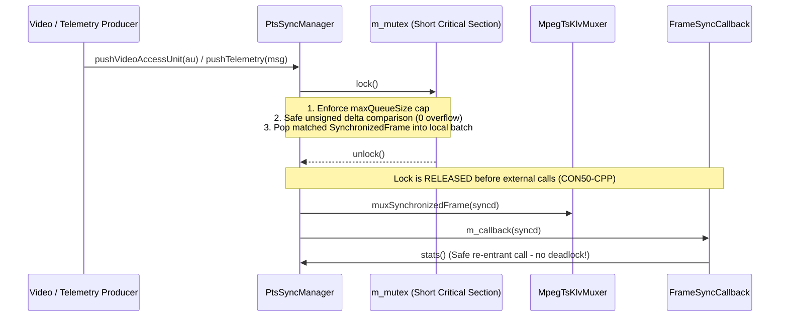

# Senior Software Engineering & Architecture Review: `libs/Klv`

**Date:** 2026-10-29  
**Scope:** `libs/Klv/` (37 headers, 28 implementation files, `CMakeLists.txt`) & `libs/Klv/tests/` (23 GoogleTest suites, 130 test cases)  
**Reviewers:** Senior Software Architect / Senior C++ Systems & Defense Telemetry Engineer  
**Reference Standards:**
- MISRA C++:2023 & SEI CERT C++ Coding Standard (`.agents/rules/compliance.md`)
- Include-What-You-Use (IWYU) & `<cstdint>` Policy (`.agents/rules/iwyu-cstdint.md`)
- 18-Point Verification Checklist (`.agents/rules/verification-checklist.md`)
- SMPTE ST 336M-2007 (KLV Data Encoding Protocol Using Key-Length-Value)
- NATO STANAG 4609 Ed. 4 / 5 (NATO Digital Motion Imagery Standard)
- MISB ST 0601.19 (UAS Datalink Local Set) & MISB ST 0102.12 (Security Metadata Local Set)
- MISB ST 0805.1 (KLV to Cursor-on-Target Conversions)
- MISB ST 0806.1 (Remote Video Terminal Metadata Set)
- MISB ST 0902.11 (MISB Minimum Metadata Set)
- MISB ST 0903.5 / 0903.6 (Video Moving Target Indicator and Track Metadata)
- MISB ST 1201.4 (Floating Point to Integer Mapping — IMAPB)
- MISB ST 1204.3 (Motion Imagery Identification System — Core Identifier)
- MISB ST 1303.2 (Multi-Dimensional Array Pack — MDARRAY)
- MISB ST 1601.1 (Geo-Registration Local Set)
- MISB ST 1607.2 (MIIS Amend and Segment Local Sets)
- ISO/IEC 13818-1 (MPEG-2 Transport Stream Systems), ITU-T Rec. H.264 (AVC) & H.265 (HEVC)
- IETF RFC 4122 (Universally Unique IDentifier URN Namespace)

---

## 1. Executive Summary

`libs/Klv` is the core airborne motion-imagery telemetry and MPEG-2 Transport Stream (MPEG-TS) synchronization library in the `PelcoD-Controller` repository. It implements an extensive suite of SMPTE, NATO STANAG 4609, and Motion Imagery Standards Board (MISB) specifications spanning low-level BER/BER-OID encoding (`KlvBer`), CRC-16-CCITT / BCC-16 / CRC-32/MPEG-2 verification (`KlvCrc`), UAS Datalink Local Set codecs (`KlvEncoder`, `KlvParser`, `KlvStreamScanner`), five nested/companion MISB Local Sets (ST 0903 VMTI, ST 0806 RVT, ST 1601 Geo-Registration, ST 1607 Amend/Segment, ST 0102 Security), numerical and matrix packs (ST 1201 IMAPB, ST 1303 MDARRAY), MIIS Core Identifiers (ST 1204), Cursor-on-Target XML translation (ST 0805), 3D WGS-84 ray-casting geodesy (`KlvGeodesy`), Annex-B H.264/H.265 NALU and PES packetization (`VideoNaluParser`, `VideoPesPacketizer`), MPEG-TS demultiplexing and multiplexing (`MpegTsKlvExtractor`, `MpegTsKlvMuxer`), 90 kHz PTS synchronization (`MasterTimeBase`, `PtsSyncManager`), and timeline indexing/scrubbing (`TelemetryTimeIndex`, `TelemetryInterpolator`, `StanagStreamIndexer`, `StanagScrubController`).

The library exhibits strong foundational engineering:
1. **Zero Qt Dependency Isolation:** `libs/Klv` has zero `#include <Q...>` directives across all 65 library files, keeping the protocol and transport layer portable across headless C++17 services, CLI tools, and Qt GUI consumers (`libs/Mapping`, `libs/MappingQt`, `libs/VideoFilters`, `app-video-qt`).
2. **Automated Compliance Baseline:** All 90 files (65 library + 25 test/build files) pass `scripts/verify_iwyu_cstdint.py --strict`, `scripts/verify_function_lengths.py` (0 identifiers $\ge 30$ characters), and `scripts/verify_type_conversions.py` (0 implicit iterator-range sign conversions).
3. **Rich Domain Coverage & Test Breadth:** 23 dedicated GoogleTest suites totaling **130 test cases** validate bit-level protocol encodings, multi-standard Local Set round-trips, Annex-B NALU classification, and end-to-end STANAG 4609 flight streams.

However, a deep-dive architectural and safety audit reveals **critical P0 safety and concurrency defects** alongside **significant P1 standard-conformance and completeness gaps**:
- **Widespread `SEI CERT ERR55-CPP` (`noexcept` + Heap Allocation / Mutex Lock) Violations:** 24 functions across `VmtiParser`, `RvtParser`, `GeoRegistrationParser`, `St1607Parser`, `St1607Types`, `MiisCoreId`, `Misb0805`, `TelemetryInterpolator`, `TelemetryTimeIndex`, `MpegTsKlvMuxer`, `PtsSyncManager`, and `StanagScrubController` are marked `noexcept` while performing dynamic heap allocations (`std::string`, `std::vector`, `std::map` node insertion) or acquiring `std::mutex` locks (`std::system_error`). Any allocation failure or lock error on network receive paths immediately triggers `std::terminate()`.
- **Concurrency Races, Lock-Across-Callback Deadlocks & Signed Overflow UB (`SEI CERT CON50-CPP`, `INT32-C`):** `PtsSyncManager` invokes external muxer and user callbacks while holding `m_mutex` (deadlocking on re-entrant `stats()`/`push*()` calls), computes signed timestamp deltas that can overflow `std::int64_t` or invoke `std::abs(INT64_MIN)` UB, and has no queue capacity bounds. `StanagScrubController::timeIndex()` and `SystemMasterTimeBase::nowUs()` read shared mutable state without synchronization.
- **Floating-Point to Integer UB & Infinite Loops (`SEI CERT FLP34-C`):** `KlvGeodesy::normalizeLon()` and `TelemetryInterpolator::interpolateLongitude()` contain `while` loops that never terminate if passed `±Inf` or large doubles (`1e300`). `KlvEncoder`, `St1607Encoder`, `VmtiEncoder`, `RvtEncoder`, `Misb1201`, `Misb0805`, and `TelemetryTimeIndex::secondsToPts()` cast unverified `double` values (`NaN`/`Inf`) to fixed-width integers without `std::isfinite()` guards.
- **Buffer Corruption, Division by Zero & Unbounded Allocation DoS (`SEI CERT ARR30-C`, `INT30-C`, `INT33-C`, `MEM07-C`):** `MpegTsKlvMuxer` divides by `m_config.patPmtPeriodPackets` without a zero check and can underflow `184U - payloadSize` or overwrite adaptation-field PCR bytes in `emitTsPacket()`. `MdArray::decodeUInt2D()` and `decodeUInt1D()` allocate up to $2^{32} \times 2^{32}$ elements directly from untrusted BER-OID headers before checking buffer bounds. `St1607Parser` recurses into nested Segment/Amend packs without a depth limit.
- **Incomplete Implementations & Cross-Layer Coupling (P1):** `StanagStreamIndexer::saveIndex()` and `loadIndex()` are incomplete stubs (writing only a 36-byte header without serializing or deserializing any video or KLV index records). `StanagScrubController` directly includes `"Video/IVideoDecoder.h"` from a sibling library (`libs/Video`), violating leaf-library encapsulation, and ignores `m_seekMode` during seeking. `St1607Parser` silently drops `cornerCoordinates` (Tags 82–89) encoded by `St1607Encoder`.

| Evaluation Dimension | Status | Summary Assessment |
| :--- | :---: | :--- |
| **Architecture & Decoupling** | **WARN** | Zero Qt dependencies; clean internal layering except `StanagScrubController.cpp` reaching into `libs/Video/IVideoDecoder.h` via `..` include path, and `CMakeLists.txt` linking unused `glog::glog` as `PUBLIC`. |
| **MISRA C++:2023 & SEI CERT C++** | **FAIL (P0)** | 24 `ERR55-CPP` `noexcept` violations; `CON50-CPP` data races and lock-across-callback deadlocks; `FLP34-C` `NaN`/`Inf` casts & infinite `while` loops; `INT30-C`/`INT32-C`/`INT33-C`/`ARR30-C` defects in `MpegTsKlvMuxer`, `MdArray`, and `PtsSyncManager`. |
| **MISB / STANAG 4609 Completeness** | **WARN (P1)** | Strong ST 0601/0102/1201/1204/1303 support; gaps in ST 0601 Tag 98 (`GeoRegistration`), ST 1607 `cornerCoordinates` decode & MSID validation, ST 0903 CRC length & 14/16-byte `TargetLocation`, ST 0805 XML escaping, and `.sidx` persistence. |
| **IWYU & `<cstdint>` Policy** | **PASS (Automated) / WARN (Manual)** | 100% pass on `verify_iwyu_cstdint.py --strict`, but manual audit identifies unused `<map>` in `MpegTsKlvExtractor.h`, missing direct headers (`<cmath>`, `<limits>`, `<utility>`), and non-canonical include ordering in 19 `.cpp` files. |
| **18-Point Verification Checklist** | **WARN (P2)** | Passes RAII, `#pragma once`, co-location, zero Qt, and `<30` char identifiers; minor gaps in `[[nodiscard]]`, `{}` initialization, and Doxygen `@file` banners. |
| **Unit Test Coverage** | **GOOD (85%)** | 23 test files (130 tests) cover nominal and several malformed paths; missing fuzz/adversarial tests for `NaN`/`Inf`, oversized `MdArray` dimensions, multi-packet PES indexing, and `.sidx` round-trip verification. |

---

## 2. Architecture Assessment & Component Topology

### 2.1 Subsystem Decomposition (All 65 Library Files)

`libs/Klv` is organized into **seven functional layers** across 37 header files and 28 implementation files:

| Layer | Subdomain | Files (`.h` / `.cpp`) | Standards Implemented | Primary Responsibilities |
| :---: | :--- | :--- | :--- | :--- |
| **1** | **Primitives & Framing** | `KlvTypes.h`, `GeoTypes.h`, `KlvBer.h/.cpp`, `KlvCrc.h/.cpp`, `Misb1201.h/.cpp`, `MdArray.h/.cpp` | SMPTE 336M, MISB ST 0601, ST 1201.4, ST 1303.2 | BER Short/Long length & BER-OID codecs, CRC-16-CCITT, BCC-16, CRC-32/MPEG-2, IMAPB float-to-integer mapping, 1D/2D MDARRAY serialization. |
| **2** | **Identity & Local Set Codecs** | `MiisCoreId.h/.cpp`, `VmtiTypes.h`, `VmtiEncoder.h/.cpp`, `VmtiParser.h/.cpp`, `RvtTypes.h`, `RvtEncoder.h/.cpp`, `RvtParser.h/.cpp`, `GeoRegistrationTypes.h`, `GeoRegistrationEncoder.h/.cpp`, `GeoRegistrationParser.h/.cpp`, `St1607Types.h/.cpp`, `St1607Encoder.h/.cpp`, `St1607Parser.h/.cpp` | RFC 4122, MISB ST 1204.3, ST 0903.5, ST 0806.1, ST 1601.1, ST 1607.2 | UUID v1/v4/v5 & MIIS Core ID binary/text codecs; VMTI target/track packs; RVT POI/AOI/UserDefined packs; Geo-Registration tie-points; ST 1607 Amend & Segment hierarchical overrides. |
| **3** | **UAS Datalink Master Codec** | `KlvEncoder.h/.cpp`, `KlvParser.h/.cpp`, `KlvStreamScanner.h/.cpp` | MISB ST 0601.19, ST 0102.12, ST 0902.11 | Full ST 0601.19 `UasDatalinkMessage` encoding/parsing (Tags 1–101), ST 0102 Security Local Set (Tag 48), ST 0902 Minimum Set validation, byte-stream UL synchronization scanner. |
| **4** | **Geodesy & CoT Interop** | `KlvGeodesy.h/.cpp`, `Misb0805.h/.cpp` | WGS-84, MISB ST 0805.1 | 3D sensor attitude composition (heading/pitch/roll + gimbal azimuth/elevation/roll), WGS-84 ray-ellipsoid intersection, footprint frustum projection, KLV/RVT to Cursor-on-Target XML translation. |
| **5** | **Video NALU & PES Framing** | `VideoTypes.h`, `VideoNaluParser.h/.cpp`, `VideoPesPacketizer.h/.cpp` | ITU-T H.264, H.265, ISO/IEC 13818-1 | Annex-B start-code scanning, H.264/H.265 NALU classification (SPS/PPS/VPS/IDR/AUD/SEI), Access Unit assembly, PES header generation with 33-bit 90 kHz PTS/DTS. |
| **6** | **MPEG-TS Mux / Demux** | `MpegTsMuxerTypes.h`, `MpegTsKlvExtractor.h/.cpp`, `MpegTsKlvMuxer.h/.cpp` | ISO/IEC 13818-1, STANAG 4609 | 188-byte TS packet parsing/generation, PAT (PID `0x0000`) & PMT generation/discovery, Continuity Counter tracking, PCR injection, synchronous (`0xFC`) and asynchronous (`0xBD`) KLV PES muxing/demuxing. |
| **7** | **PTS Sync & Timeline Scrubbing** | `PtsSyncTypes.h`, `MasterTimeBase.h/.cpp`, `PtsSyncManager.h/.cpp`, `StanagScrubTypes.h`, `TelemetryTimeIndex.h/.cpp`, `TelemetryInterpolator.h/.cpp`, `StanagStreamIndexer.h/.cpp`, `StanagScrubController.h/.cpp` | STANAG 4609 Ed. 4/5 | Shared 90 kHz Master Time Base, live video-telemetry PTS pairing (`StrictClamp`, `NearestFrame`, `DropStale`), binary-search `TelemetryTimeIndex`, shortest-arc angle/geodetic interpolation, `.ts` file indexing, and random-access timeline scrubbing. |

---

### 2.2 Current Component & Dependency Architecture

#### ASCII Diagram: `libs/Klv` Internal Architecture & Repository Dependencies

```
+---------------------------------------------------------------------------------------------------+
|                                   DOWNSTREAM CONSUMERS                                            |
|   +-----------------------+   +-----------------------+   +-----------------------------------+   |
|   | libs/Mapping          |   | libs/VideoFilters     |   | app-video-qt                      |   |
|   | (St0601/Vmti/Rvt ->   |   | (HudOverlayFilter,    |   | (MainWindow, TelemetryPanel,      |   |
|   |  MapItems, Footprint) |   |  KlvGeodesy, St0601)  |   |  StanagScrubController, Extractor)|   |
|   +-----------+-----------+   +-----------+-----------+   +-----------------+-----------------+   |
+---------------|---------------------------|---------------------------------|---------------------+
                |                           |                                 |
                v                           v                                 v
+---------------------------------------------------------------------------------------------------+
|                                         libs/Klv                                                  |
|                                                                                                   |
|  [Layer 7: PTS Sync & Timeline Scrubbing]                                                         |
|  +----------------------+  +-----------------------+  +----------------------------------------+  |
|  | MasterTimeBase       |  | PtsSyncManager        |  | StanagScrubController                  |  |
|  | (IMasterTimeBase)    |  | (Video + KLV Queue)   |  |  +-> TelemetryTimeIndex                |  |
|  +----------------------+  +-----------+-----------+  |  +-> TelemetryInterpolator             |  |
|                                        |              |  +-> StanagStreamIndexer               |  |
|                                        |              |  +-> Video::IVideoDecoder* [LAYER BUG] |  |
|                                        v              +----------------------------------------+  |
|  [Layer 5 & 6: MPEG-TS & Video Packetization]                                                     |
|  +----------------------+  +-----------------------+  +----------------------------------------+  |
|  | MpegTsKlvExtractor   |  | MpegTsKlvMuxer        |  | VideoNaluParser & VideoPesPacketizer   |  |
|  +----------+-----------+  +-----------+-----------+  +----------------------------------------+  |
|             |                          |                                                          |
|             v                          v                                                          |
|  [Layer 3 & 4: UAS Datalink Master Codec, Geodesy & CoT]                                          |
|  +----------------------+  +-----------------------+  +-------------------+  +-----------------+  |
|  | KlvStreamScanner     |  | KlvEncoder /          |  | KlvGeodesy        |  | Misb0805        |  |
|  | (UL Sync & BER Scan) |  | KlvParser (ST 0601)   |  | (WGS-84 Ray Cast) |  | (CoT XML Gen)   |  |
|  +----------------------+  +-----------+-----------+  +---------+---------+  +-----------------+  |
|                                        |                        |                                 |
|                                        v                        |                                 |
|  [Layer 2: Nested MISB Local Sets & Identity]                   |                                 |
|  +--------------+ +--------------+ +--------------------+ +-----+----------+ +-----------------+  |
|  | VmtiEncoder/ | | RvtEncoder/  | | GeoRegistration    | | St1607Encoder/ | | MiisCoreId      |  |
|  | VmtiParser   | | RvtParser    | | Encoder/Parser     | | St1607Parser   | | (UUID v1/v4/v5) |  |
|  | (ST 0903)    | | (ST 0806)    | | (ST 1601)          | | (ST 1607)      | | (ST 1204)       |  |
|  +------+-------+ +------+-------+ +---------+----------+ +-------+--------+ +--------+--------+  |
|         |                |                   |                    |                   |           |
|         +----------------+-------------------+--------------------+-------------------+           |
|                                              |                                                    |
|                                              v                                                    |
|  [Layer 1: Core Binary Primitives]                                                                |
|  +---------------------------------------------------------------------------------------------+  |
|  | KlvBer (BER/BER-OID) | KlvCrc (CRC16/BCC16/CRC32) | Misb1201 (IMAPB) | MdArray (ST 1303)    |  |
|  | KlvTypes.h           | GeoTypes.h                                                           |  |
|  +---------------------------------------------------------------------------------------------+  |
+-------------------------------------------------|-------------------------------------------------+
                                                  |
                                                  v
                                    +---------------------------+
                                    | libs/Math (Vec3, Mat3,    |
                                    | Constants.h)              |
                                    +---------------------------+
```

#### Mermaid Diagram: `libs/Klv` Internal Architecture & Repository Dependencies

```mermaid
flowchart TD
    subgraph Consumers["Downstream Consumers"]
        MAP["libs/Mapping<br/>(KlvBridge, FootprintCalculator)"]
        VF["libs/VideoFilters<br/>(HudOverlayFilter)"]
        APP["app-video-qt<br/>(Player, Telemetry UI)"]
    end

    subgraph KlvLib["libs/Klv"]
        subgraph L7["Layer 7: PTS Sync & Timeline Scrubbing"]
            MTB["MasterTimeBase"]
            PSM["PtsSyncManager"]
            SSC["StanagScrubController"]
            SSI["StanagStreamIndexer"]
            TTI["TelemetryTimeIndex"]
            TI["TelemetryInterpolator"]
        end

        subgraph L56["Layer 5 & 6: MPEG-TS & Video Packetization"]
            EXT["MpegTsKlvExtractor"]
            MUX["MpegTsKlvMuxer"]
            NAL["VideoNaluParser"]
            PES["VideoPesPacketizer"]
        end

        subgraph L34["Layer 3 & 4: ST 0601 Master Codec, Geodesy & CoT"]
            SCAN["KlvStreamScanner"]
            ENC["KlvEncoder / KlvParser"]
            GEO["KlvGeodesy"]
            COT["Misb0805 (CoT XML)"]
        end

        subgraph L2["Layer 2: Nested MISB Local Sets & Identity"]
            VMTI["VmtiEncoder / VmtiParser<br/>(ST 0903)"]
            RVT["RvtEncoder / RvtParser<br/>(ST 0806)"]
            GEOREG["GeoRegistrationEncoder / Parser<br/>(ST 1601)"]
            ST1607["St1607Encoder / St1607Parser<br/>(ST 1607)"]
            MIIS["MiisCoreId<br/>(ST 1204 / RFC 4122)"]
        end

        subgraph L1["Layer 1: Core Binary Primitives"]
            PRIM["KlvBer | KlvCrc | Misb1201 | MdArray<br/>KlvTypes.h | GeoTypes.h"]
        end
    end

    MATH["libs/Math<br/>(Vec3, Mat3, Constants)"]
    VID["libs/Video<br/>(IVideoDecoder.h)"]

    Consumers --> KlvLib
    PSM --> MTB & MUX
    SSC --> TTI & TI
    SSC -.->|"Cross-layer include violation"| VID
    SSI --> TTI & ENC & NAL & PRIM
    EXT --> SCAN & ENC
    MUX --> PES & ENC
    PES --> NAL
    ENC --> VMTI & RVT & GEOREG & ST1607 & MIIS & PRIM
    COT --> RVT & GEO
    VMTI & RVT & GEOREG & ST1607 & MIIS --> PRIM
    GEO --> MATH
```



---

### 2.3 Architectural Strengths & Structural Observations

1. **Clean Separation of Transport vs. Metadata Serialization:**
   `MpegTsKlvExtractor` and `MpegTsKlvMuxer` handle 188-byte ISO/IEC 13818-1 packet framing, PSI tables (PAT/PMT), and PES headers while delegating raw KLV payload decoding/encoding to `KlvStreamScanner`, `KlvParser`, and `KlvEncoder`.
2. **Modular Local Set Composition:**
   Each nested MISB standard (`Vmti`, `Rvt`, `GeoRegistration`, `St1607`, `MiisCoreId`) is encapsulated in its own `*Types.h`, `*Encoder.h/.cpp`, and `*Parser.h/.cpp` triad, supporting both standalone UL-prefixed packets and embedded ST 0601 Local Set values (Tags 48, 73, 74, 94, 98, 100, 101).
3. **Cross-Layer Dependency Violation (`StanagScrubController` $\rightarrow$ `libs/Video/IVideoDecoder.h`):**
   `libs/Klv/StanagScrubController.cpp:10` includes `"Video/IVideoDecoder.h"` and invokes `m_decoder->seek(seekSec)` at line 161. Simultaneously, `libs/Klv/CMakeLists.txt:71` exposes `${CMAKE_CURRENT_SOURCE_DIR}/..` as a `PUBLIC` include directory without linking `Video` in `target_link_libraries`. Because `libs/Video` itself depends on `libs/Klv` (or sits above it in the media pipeline), coupling `StanagScrubController` directly to `Video::IVideoDecoder` creates an architectural cycle. Instead, `StanagScrubController` should accept a lightweight `SeekCallback = std::function<bool(double seconds)>` or define a pure protocol-local `IScrubSeekTarget` interface inside `libs/Klv`.
4. **Heavy Code Duplication Across ST 0601 and ST 1607 / RVT Scaling Helpers:**
   Linear scaling and big-endian integer serialization functions (`scaleLatitude`, `scaleLongitude`, `scaleAltitude`, `scaleHeading`, `scalePitch`, `scaleRoll`, `scaleFov`, `unscaleSigned`, `unscaleUnsigned`, `readInt16`, `readUInt16`, `readInt32`, `readUInt32`, `appendUInt16TLV`, `appendInt32TLV`, etc.) are duplicated nearly verbatim across `KlvEncoder.cpp`, `KlvParser.cpp`, `St1607Encoder.cpp`, `St1607Parser.cpp`, `RvtEncoder.cpp`, `RvtParser.cpp`, and `VmtiEncoder.cpp`/`VmtiParser.cpp`. Factoring these into an internal `KlvScaling.h` / `KlvByteIo.h` header will eliminate ~550 lines of duplicated arithmetic and centralize `std::isfinite()` safety guards.

---

## 3. Detailed Compliance & Safety Findings

### 3.1 P0 Findings — Critical Safety, Concurrency & Undefined Behavior

#### P0-1: Widespread `SEI CERT ERR55-CPP` Violations — Dynamic Heap Allocations & Mutex Locks Inside `noexcept` Functions
- **Rule Violated:** `SEI CERT ERR55-CPP` (*Honor exception specifications* — functions marked `noexcept` on network receive, packet validation, and dispatch paths must never allocate heap memory or call throwing functions, as `std::bad_alloc` or `std::system_error` triggers `std::terminate()`).
- **Affected Files & Functions (24 Functions Across 12 Files):**

| File | Function Signature (`noexcept`) | Heap Allocation / Throwing Operation Inside Body |
| :--- | :--- | :--- |
| `libs/Klv/VmtiParser.cpp:69` | `VmtiParser::parse(...) noexcept` | Constructs `std::string(reinterpret_cast<const char*>(val), itemLen)` (Tags 3, 4, 10) and calls `vmti.targets.push_back(pack)` (`std::vector` reallocation). |
| `libs/Klv/VmtiParser.cpp:178` | `VmtiParser::parseTarget(...) noexcept` | Constructs `std::string` (Tag 16 `algorithm`), decodes `MiisCoreId`, and populates `pack.locus` (`std::vector<VmtiLocusPoint>`). |
| `libs/Klv/VmtiParser.cpp:323` | `VmtiParser::parseSeries(...) noexcept` | Calls `outLocus.clear()` and `outLocus.push_back(pt)` (`std::vector` heap allocation). |
| `libs/Klv/RvtParser.cpp:89` | `RvtParser::parse(...) noexcept` | Constructs `std::string` (Tag 4 `platformDesignation`), calls `rvt.pois.push_back(poi)`, `rvt.aois.push_back(aoi)`, and `rvt.userDefined.push_back(userDef)`. |
| `libs/Klv/RvtParser.cpp:177` | `RvtParser::parsePoi(...) noexcept` | Constructs `std::string`s for `poi.label` (Tag 9), `poi.sourceId` (Tag 10), and `poi.text` (Tag 11). |
| `libs/Klv/RvtParser.cpp:259` | `RvtParser::parseAoi(...) noexcept` | Constructs `std::string`s for `aoi.label` (Tag 6) and `aoi.text` (Tag 7). |
| `libs/Klv/RvtParser.cpp:316` | `RvtParser::parseUserDefined(...) noexcept` | Calls `userDef.data.assign(valPtr, valPtr + len)` (`std::vector<std::uint8_t>` heap allocation). |
| `libs/Klv/GeoRegistrationParser.cpp:35, 198` | `GeoRegistrationParser::parse(...) noexcept`, `parsePacket(...) noexcept` | Constructs `std::string`s (Tags 2, 3, 7, 11), decodes 2D/1D `std::vector` matrices via `MdArray::decode*`, and calls `outSet.pixelPoints.resize(...)` / `geoPoints.resize(...)`. |
| `libs/Klv/St1607Parser.cpp:95, 310, 476, 513` | `St1607Parser::parseAmend(...) noexcept`, `parseSegment(...) noexcept`, `parsePacket(...) noexcept` (x2) | Constructs `std::string`s (Tags 3, 4, 10, 11, 12, 14), calls `GeoRegistrationParser::parse()`, and recursively calls `childAmends.push_back(...)` / `childSegments.push_back(...)`. |
| `libs/Klv/St1607Types.cpp:153, 307` | `AmendLocalSet::applyTo(...) noexcept`, `SegmentLocalSet::applyTo(...) noexcept` | Copies `std::optional<std::string>` fields (`missionId`, `platformTailNumber`, `platformDesignation`, `imageSourceSensor`, `imageCoordinateSystem`) and `SecurityMetadata` (`std::string` members). |
| `libs/Klv/MiisCoreId.cpp:436` | `MiisCoreId::decode(...) noexcept` | Line 444: `std::string text(reinterpret_cast<const char*>(data), length);` allocates a heap `std::string` purely to pass to `fromString(std::string_view)`. |
| `libs/Klv/Misb0805.cpp:42, 74` | `Misb0805::formatIso8601(...) noexcept`, `targetTypeToCot(...) noexcept` | Return `std::string` by value (`std::ostringstream::str()` and string literals). |
| `libs/Klv/TelemetryInterpolator.cpp:51` | `TelemetryInterpolator::interpolate(...) noexcept` | Line 71: `UasDatalinkMessage out = discreteSrc;` deep-copies all heap-allocated `std::string` and `std::vector` members (`vmti`, `rvt`, `segments`, `amends`). |
| `libs/Klv/TelemetryTimeIndex.cpp:166, 200` | `TelemetryTimeIndex::findTelemetry(...) noexcept`, `findTelemetryBounds(...) noexcept` | Return/assign `KlvIndexEntry` by value, which deep-copies `std::optional<UasDatalinkMessage>` containing heap `std::string` and `std::vector` fields. |
| `libs/Klv/MpegTsKlvMuxer.cpp:51` | `MpegTsKlvMuxer::nextCc(...) noexcept` | Line 54: `m_continuityCounters[pid] = 0U;` inserts a new node into `std::map<std::uint16_t, std::uint8_t>` on the heap. |
| `libs/Klv/PtsSyncManager.cpp:51, 260` | `PtsSyncManager::resetStats() noexcept`, `reset() noexcept` | Acquire `std::lock_guard<std::mutex> lock(m_mutex)` (`std::mutex::lock()` can throw `std::system_error`) and `std::deque::clear()`. |
| `libs/Klv/StanagScrubController.cpp:16, 48, 53, 59, 65, 71` | `attachDecoder`, `setSeekMode`, `seekMode`, `setInterpolate`, `isInterpolateEnabled`, `setSyncTolerance` (all `noexcept`) | Acquire `std::lock_guard<std::mutex> lock(m_mutex)` inside `noexcept`. |

- **Remediation:**
  1. In `MiisCoreId::decode()` (`libs/Klv/MiisCoreId.cpp:444`), eliminate the heap allocation immediately by constructing a `std::string_view(reinterpret_cast<const char*>(data), length)` and passing it directly to `fromString()`.
  2. In `MpegTsKlvMuxer`, replace `std::map<std::uint16_t, std::uint8_t> m_continuityCounters` with a fixed-size stack table or `std::array` of `(pid, cc)` pairs (or a 4-entry struct for PAT, PMT, Video, Metadata PIDs) so `nextCc()` is genuinely 0-heap `noexcept`.
  3. Remove `noexcept` from functions that inherently allocate heap memory (`VmtiParser`, `RvtParser`, `GeoRegistrationParser`, `St1607Parser`, `St1607Types::applyTo`, `Misb0805::formatIso8601`/`targetTypeToCot`, `TelemetryInterpolator::interpolate`, `TelemetryTimeIndex::findTelemetry*`) and from mutex-locking methods in `PtsSyncManager` and `StanagScrubController` (consistent with `KlvParser::parse`, which is intentionally not marked `noexcept`).

---

#### P0-2: Concurrency Races, Lock-Across-Callback Deadlocks, Unbounded Queues & Signed Overflow UB in `PtsSyncManager`, `MasterTimeBase`, and `StanagScrubController`
- **Rules Violated:** `SEI CERT CON50-CPP` (*Do not destroy a mutex while it is locked / prevent data races and deadlocks*), `SEI CERT INT32-C` (*Ensure that operations on signed integers do not result in overflow*).
- **Defect Details:**
  1. **Lock-Across-Callback Deadlock in `PtsSyncManager` (`libs/Klv/PtsSyncManager.cpp:129-137, 222, 252`):**
     Both `processQueuesLocked()` and `flush()` hold `std::lock_guard<std::mutex> lock(m_mutex)` while calling `dispatchSynchronized(syncd)`, which calls `m_boundMuxer->muxSynchronizedFrame(...)` (invoking `TsPacketCallback`) and `m_callback(syncd)`. If the callback queries `syncManager.stats()`, `syncManager.config()`, or calls `pushTelemetry()` / `reset()`, the thread deadlocks on non-recursive `m_mutex`.
  2. **Signed Integer Overflow & `std::abs(INT64_MIN)` UB in `PtsSyncManager::processQueuesLocked()` (`libs/Klv/PtsSyncManager.cpp:170-172, 191-194`):**
     ```cpp
     const auto deltaUs = static_cast<std::int64_t>(telem.timestampUs) - static_cast<std::int64_t>(syncd.videoAu.ptsUs);
     const auto absDeltaUs = static_cast<std::uint64_t>(std::abs(deltaUs));
     ```
     If `telem.timestampUs` or `syncd.videoAu.ptsUs` exceeds `INT64_MAX`, `static_cast<std::int64_t>` is implementation-defined / negative; subtraction can overflow `std::int64_t` (`INT32-C`); and if `deltaUs == INT64_MIN`, `std::abs(deltaUs)` is **Undefined Behavior**. Furthermore, at lines 191–194:
     ```cpp
     const auto clampDelta = (deltaUs >= 0) ? static_cast<std::int64_t>(m_config.maxAllowedDeltaUs)
                                            : -static_cast<std::int64_t>(m_config.maxAllowedDeltaUs);
     const auto clampedUs = static_cast<std::uint64_t>(static_cast<std::int64_t>(syncd.videoAu.ptsUs) + clampDelta);
     ```
     When `syncd.videoAu.ptsUs < m_config.maxAllowedDeltaUs` (e.g., `ptsUs == 10000` µs on stream startup and `maxAllowedDeltaUs == 50000` µs) and `deltaUs < 0`, `ptsUs + clampDelta` is `-40000`, which wraps around via `static_cast<std::uint64_t>` to `18446744073709511616` µs!
  3. **Unbounded Queue Growth in `PtsSyncManager` (`libs/Klv/PtsSyncManager.cpp:95-114`):**
     `m_videoQueue` and `m_telemetryQueue` (`std::deque`) have no maximum size limit. If a telemetry stream is active while video capture is paused (or vice versa), `m_telemetryQueue` grows without bound until memory exhaustion.
  4. **Data Race in `SystemMasterTimeBase` (`libs/Klv/MasterTimeBase.h:59-88`, `MasterTimeBase.cpp:18-45`):**
     `IMasterTimeBase` is shared across threads via `std::shared_ptr<IMasterTimeBase>` (`PtsSyncManager::setMasterTimeBase`), yet `SystemMasterTimeBase::setMonotonicOffset()` and `calibrateOffset()` mutate `m_monotonicOffsetUs` and `m_steadyEpoch` without synchronization while `nowUs()` reads them concurrently. Additionally, `TimeBaseMode::ExternalClock` is declared in `PtsSyncTypes.h:16` but falls through to the `MonotonicOffset` branch in `SystemMasterTimeBase::nowUs()`.
  5. **Data Race & Lock-Across-Decoder-Call in `StanagScrubController` (`libs/Klv/StanagScrubController.cpp:36-39, 159-162`):**
     - `StanagScrubController::timeIndex() const noexcept` returns `const TelemetryTimeIndex&` without locking `m_mutex`, racing with `setTimeIndex()` which mutates `m_timeIndex` under `m_mutex`.
     - `executeSeekLocked()` calls `m_decoder->seek(seekSec)` while holding `m_mutex`.

---

#### P0-3: Floating-Point to Integer Conversion UB & Infinite Loops (`SEI CERT FLP34-C`)
- **Rules Violated:** `SEI CERT FLP34-C` (*Ensure that floating-point conversions are within range of the new type*), MISRA C++:2023 Rule 7.0.6.
- **Defect Details:**
  1. **Infinite `while` Loops on `±Inf` or Large Doubles (`1e300`) in `noexcept` Functions:**
     - `libs/Klv/KlvGeodesy.cpp:34-41` (`normalizeLon(double lonDeg) noexcept`):
       ```cpp
       while (lonDeg > 180.0) { lonDeg -= 360.0; }
       while (lonDeg < -180.0) { lonDeg += 360.0; }
       ```
     - `libs/Klv/TelemetryInterpolator.cpp:25-36` (`interpolateLongitude(double a, double b, double t) noexcept`):
       ```cpp
       while (diff > 180.0) { diff -= 360.0; }
       while (diff < -180.0) { diff += 360.0; }
       ```
       If `lonDeg` or `diff` is `+Inf`, `-Inf`, or a large double where `x - 360.0 == x` (i.e., $|x| \ge 2^{53} \times 360 \approx 3.24 \times 10^{18}$), the loop **never terminates**, hanging the telemetry/video thread permanently! Use `std::isfinite()` + `std::fmod()` instead.
  2. **Unguarded `NaN` / `Inf` Casts to Integer in Encoders (`std::clamp` Does Not Filter `NaN`):**
     In C++17, `std::clamp(NaN, low, high)` evaluates `NaN < low` (`false`) and `high < NaN` (`false`) and returns `NaN`. Passing `NaN` to `static_cast<std::int32_t>(std::round(NaN))` or `static_cast<std::uint16_t>(NaN)` is **Undefined Behavior** (`FLP34-C`):
     - `libs/Klv/KlvEncoder.cpp:18-107, 294-301`: `scaleLatitude`, `scaleLongitude`, `scaleCornerOffset`, `scaleAltitude`, `scaleHeading`, `scalePitch`, `scaleRoll`, `scaleFov`, `scaleRelAzimuth`, `scaleRelElevation`, `scaleRelRoll`, `scaleSlantRange`, `scaleTargetWidth`, and Tag 45/46 (`*message.targetErrorCe90M`, `*message.targetErrorLe90M`). Additionally, in `scaleHeading`, `scaleRelAzimuth`, and `scaleRelRoll`:
       ```cpp
       double wrapped = std::fmod(deg, 360.0);
       if (wrapped < 0.0) { wrapped += 360.0; }
       ```
       For `deg = -1e-16`, `wrapped` is `-1e-16`, and `-1e-16 + 360.0` rounds in IEEE-754 double precision to exact `360.0`, which violates the half-open `[0.0, 360.0)` domain or maps to the maximum raw integer.
     - `libs/Klv/St1607Encoder.cpp:66-143, 220-223`: `scaleAlt`, `scaleHeading`, `scalePitch`, `scaleRoll`, `scaleFov`, `scaleRelAz`, `scaleRelEl`, `scaleRelRoll`, `scaleSlantRange`, `scaleTargetWidth`, `scaleLat`, `scaleLon`, `scaleOffset` lack `std::isfinite()` checks. Worse, lines 220–223 cast `*set.targetErrorCe90M` and `*set.targetErrorLe90M` via `static_cast<std::uint16_t>(*set.targetErrorCe90M)` with **neither clamping nor `std::isfinite()`**!
     - `libs/Klv/VmtiEncoder.cpp:41-53, 154-160`: `scaleOffset`, `scaleHae`, and Tag 17 `latNorm`/`lonNorm` lack `std::isfinite()` checks.
     - `libs/Klv/RvtEncoder.cpp:88-109`: `scaleLatitude`, `scaleLongitude`, `scaleAltitude` lack `std::isfinite()` checks.
     - `libs/Klv/Misb1201.cpp:32-44, 46-65, 105-107`: `computeLength()` and `computeParams()` check `minVal >= maxVal || precision <= 0.0`, which evaluates to `false` when any argument is `NaN`, or overflows to `+Inf` when `maxVal - minVal` exceeds `DBL_MAX`. Line 40 then executes `static_cast<std::size_t>(std::ceil(log2Range / 8.0))` on `NaN`/`Inf` (UB).
     - `libs/Klv/Misb0805.cpp:110, 174, 219`: `static_cast<std::uint64_t>(staleSec * 1000000.0)` has UB if `staleSec < 0.0`, `NaN`, or `Inf`.
     - `libs/Klv/TelemetryTimeIndex.cpp:252-258` (`secondsToPts`): `if (seconds <= 0.0)` is `false` for `NaN` and `+Inf`, causing `static_cast<std::uint64_t>(std::llround(seconds * 90000.0))` UB.
     - `libs/Klv/GeoRegistrationTypes.h:160`: `if (pt.lat < -90.0 || pt.lat > 90.0 || pt.lon < -180.0 || pt.lon > 180.0)` evaluates to `false` when `pt.lat` or `pt.lon` is `NaN`, allowing `NaN` tie-points to pass `validate()`.

---

#### P0-4: Buffer Overflow, Integer Overflow, Division by Zero & Unbounded Allocation DoS (`SEI CERT ARR30-C`, `INT30-C`, `INT33-C`, `MEM07-C`)
- **Rules Violated:** `SEI CERT ARR30-C` (*Do not form or use out-of-bounds pointers or array subscripts*), `INT30-C` (*Ensure that unsigned integer operations do not wrap*), `INT33-C` (*Ensure that division and remainder operations do not result in divide-by-zero errors*), `MEM07-C` / `MEM55-CPP`.
- **Defect Details:**
  1. **Division by Zero (`INT33-C`) in `MpegTsKlvMuxer` (`libs/Klv/MpegTsKlvMuxer.cpp:351, 385, 414`):**
     ```cpp
     if (m_packetCounter % m_config.patPmtPeriodPackets == 0U) {
         emitPat();
         emitPmt();
     }
     ```
     If a caller configures `m_config.patPmtPeriodPackets = 0U`, `m_packetCounter % 0U` triggers an immediate hardware divide-by-zero exception (`SIGFPE`).
  2. **Adaptation Field / PCR Buffer Corruption & Out-of-Bounds Write (`ARR30-C`, `INT30-C`) in `MpegTsKlvMuxer::emitTsPacket()` (`libs/Klv/MpegTsKlvMuxer.cpp:254-296`):**
     ```cpp
     const std::size_t afTotalSpace = 184U - payloadSize;
     ...
     if (hasPcr && afTotalSpace >= 8U) {
         packet[5] |= 0x10U; // PCR_flag = 1
         ... // writes packet[6..11]
     }
     ...
     std::size_t payloadOffset = 4U + afTotalSpace;
     std::copy_n(payload, payloadSize, packet.begin() + static_cast<std::ptrdiff_t>(payloadOffset));
     ```
     - If `payloadSize > 184U`, `184U - payloadSize` wraps around (`INT30-C`) and `std::copy_n` writes out of bounds past the 188-byte `std::array` (`ARR30-C`).
     - If `pcrUs.has_value()` (`hasPcr == true`) and `177U <= payloadSize <= 184U` (which occurs in `packetizePes()` whenever `remaining` happens to be `177..184` on the first packet of a PES!), `needStuffing` or `hasPcr` enters the `if (needStuffing || hasPcr)` block with `afTotalSpace` in `0..7`. If `payloadSize == 184U` and `hasPcr == true`, `afTotalSpace == 0U`, yet `packet[3]` sets `afc = 0x30U`, `packet[4]` is set to `0xFFU` (stuffing byte at index 4!), and `std::copy_n` then overwrites `packet[4..187]` with the 184-byte payload, corrupting the adaptation field length byte (`packet[4]`) into the first byte of the PES header (`0x00`)! In `packetizePes()`, when `pcrUs` is present, `maxPayload` on the first TS packet MUST be capped at `184U - 8U = 176U`, and `emitTsPacket()` must clamp `payloadSize <= (hasPcr ? 176U : 184U)`.
  3. **Unbounded 2D/1D Matrix Allocation DoS (`INT30-C`, `MEM07-C`) in `MdArray` (`libs/Klv/MdArray.cpp:365-510`):**
     - In `MdArray::decodeUInt2D()` (`MdArray.cpp:414-420`) and `decodeUInt1D()` (`MdArray.cpp:486-491`), for `MdArrayApa::UnsignedInteger` (`0x00`), `numRows` (`dim1`) and `numCols` (`dim2`) are decoded from BER-OID (up to `0xFFFFFFFF` = $4.29 \times 10^9$) and passed **directly** to:
       ```cpp
       outMatrix.assign(numRows, std::vector<std::uint32_t>(numCols, 0U));
       ```
       **before** checking whether `offset + numRows * numCols * ebytes <= size`! A crafted 10-byte packet `[0x02, 0x8F, 0xFF, 0xFF, 0xFF, 0x7F, 0x01, 0x04, 0x00]` causes `decodeUInt2D` to attempt a multi-terabyte heap allocation.
     - Across `decodeFloat2D`, `decodeFloat1D`, `decodeUInt2D`, and `decodeUInt1D`, the byte-size calculation `const std::size_t totalBytes = numRows * numCols * ebytes;` can overflow `std::size_t` (`INT30-C`) on 32-bit or 64-bit targets, bypassing `if (offset + totalBytes > size)`.
     - In `decodeUInt2D` and `decodeUInt1D`, `ebytes` is only checked for `ebytes == 0U`, not `ebytes > 4U`. If `ebytes > 4U`, `readUInt()` shifts a 32-bit `std::uint32_t` more than 32 bits, silently discarding upper bytes.
  4. **Unbounded Recursion Stack Overflow in `St1607Parser` (`libs/Klv/St1607Parser.cpp:295-301, 449-462`):**
     `St1607Parser::parseAmend()` and `parseSegment()` recursively call `parseAmend()` and `parseSegment()` on nested Tags 100 and 101 without a maximum recursion depth counter. A deeply nested payload will exhaust the call stack.
  5. **Unbounded Stream Reassembly Buffers & $O(N^2)$ Buffer Drain:**
     - `MpegTsKlvExtractor::m_pesReassemblyBuffer` (`libs/Klv/MpegTsKlvExtractor.cpp:173`) and `VideoNaluParser::m_buffer` (`libs/Klv/VideoNaluParser.cpp:240`) grow without bound if fed continuous TS packets without PUSI or byte chunks without Annex-B start codes.
     - `MpegTsKlvExtractor.cpp:239-245` executes `while (m_tsRemainder.size() >= kTsPacketSize) { ... std::all_of(...) ... m_tsRemainder.erase(m_tsRemainder.begin()); }`, which performs an $O(N)$ scan and $O(N)$ vector front-erase per byte ($O(N^2)$ worst-case complexity).

---

### 3.2 P1 Findings — Functional Completeness & Standard Conformance

#### P1-1: `StanagStreamIndexer::saveIndex()` and `loadIndex()` Are Incomplete Stubs
- **Location:** `libs/Klv/StanagStreamIndexer.cpp:478-549`
- **Issue:** `saveIndex()` writes the 32-byte `.sidx` file header (`kSidxMagic`, `kSidxVersion`, `basePts`, `baseUtcUs`, `durationSeconds`, `videoFrameCount`) followed by a comment:
  ```cpp
  // We iterate video frames through window
  // (Or save from m_timeIndex directly)
  // Write a dummy record count for now and append CRC
  const std::uint32_t crc = KlvCrc::calculateCrc32Mpeg(payload.data(), payload.size());
  append32(crc);
  ```
  It never serializes a single `VideoIndexEntry` or `KlvIndexEntry`. Correspondingly, `loadIndex()` (lines 520–549) checks that `fileSize >= 36` and verifies the CRC-32, then immediately returns `true` **without reading any header fields or populating `m_timeIndex`**! Calling `loadIndex()` leaves `indexer.timeIndex().empty() == true`.
- **Remediation:** Add read/write accessors for `m_videoEntries` and `m_klvEntries` on `TelemetryTimeIndex` and serialize/deserialize all `VideoIndexEntry` and `KlvIndexEntry` records (including raw KLV bytes or re-encoded ST 0601 buffers) in `saveIndex()` and `loadIndex()`, validating `kSidxMagic` and `kSidxVersion` on load.

#### P1-2: `StanagStreamIndexer` Only Parses the First TS Packet (`pusi == true`) of Video and KLV PES Payloads
- **Location:** `libs/Klv/StanagStreamIndexer.cpp:168-178, 276-411`
- **Issue:** `indexChunk()` only invokes `processVideoPes()` and `processKlvPes()` on TS packets with `pusi == true`, passing only that single TS packet's payload (`payloadSize <= 184` bytes).
  1. **Truncated Multi-Packet KLV PES:** Any MISB ST 0601 packet larger than ~170 bytes (e.g., containing ST 0102 security strings, VMTI targets, RVT POIs, or ST 1607 segments) spans multiple 188-byte TS packets. Passing only the first 170 bytes to `KlvParser::parse(klvData + i, klvSize - i, msg, false)` fails with `KlvStatus::BufferUnderflow`, leaving `entry.message = std::nullopt` in `TelemetryTimeIndex`!
  2. **Missed Video Keyframes:** If a video Access Unit begins with an AUD + long SEI NALU that fills the first TS packet of the PES, the SPS/IDR NALU starts in the second TS packet (`pusi == false`) and `isKeyframe` is falsely recorded as `false`.

#### P1-3: `StanagScrubController` Ignores `ScrubSeekMode`, Suffers VFR Drift in `stepFrames()`, and Couples to `libs/Video`
- **Location:** `libs/Klv/StanagScrubController.cpp:10, 107-128, 142-228`
- **Issue:**
  1. `m_seekMode` (`ScrubSeekMode::KeyframeOnly`, `ExactFrame`, `AdaptiveScrub`) is stored by `setSeekMode()` but **never referenced** in `executeSeekLocked()`. `m_timeIndex.findNearestKeyframe(targetPts)` is never called, and `m_stats.keyframeSeekCount`, `m_stats.exactSeekCount`, and `m_stats.avgSeekLatencyMs` remain permanently `0`.
  2. `stepFrames(int frameDelta)` estimates the target frame's PTS via `(desiredIdx * durationSeconds()) / maxIdx` and `secondsToPts()`. For Variable Frame Rate (VFR) streams or streams with dropped frames, this linear time estimate drifts from the actual frame timestamps. `TelemetryTimeIndex` should expose `videoEntryAt(std::size_t index)` so `stepFrames()` steps to the exact `ptsTicks` of `m_videoEntries[desiredIdx]`.
  3. `StanagScrubController.cpp` includes `"Video/IVideoDecoder.h"` from `libs/Video`, creating a cross-library cyclic dependency.

#### P1-4: Missing ST 0601 Top-Level `Tag::GeoRegistration` (Tag 98) Integration & Duplicate Universal Label
- **Location:** `libs/Klv/KlvTypes.h:119, 251-356`, `libs/Klv/KlvEncoder.cpp`, `libs/Klv/KlvParser.cpp`, `libs/Klv/GeoRegistrationTypes.h:17-20`
- **Issue:**
  1. `KlvTypes.h` defines `Tag::GeoRegistration = 98U` and `libs/Klv` provides `GeoRegistrationTypes.h`, `GeoRegistrationEncoder`, and `GeoRegistrationParser`, yet `UasDatalinkMessage` has no `std::optional<GeoRegistrationLocalSet> geoRegistration` member, and `KlvEncoder` / `KlvParser` have no handler for Tag 98 (only `St1607` `AmendLocalSet` handles Tag 98).
  2. In `libs/Klv/GeoRegistrationTypes.h:17-20`, `GeoRegistrationUl` is defined as `{0x06, 0x0E, 0x2B, 0x34, 0x02, 0x0B, 0x01, 0x01, 0x0E, 0x01, 0x03, 0x03, 0x01, 0x00, 0x00, 0x00}`, which is byte-for-byte identical to `kMisb0903UniversalLabel` (VMTI)! Per MISB ST 1601.1, the Geo-Registration Local Set UL has byte 13 (`index 12`) distinct from ST 0903 (`0x20U` / ST 1601 designator).

#### P1-5: `St1607Parser` Silently Drops `cornerCoordinates` (Tags 82–89) and Ignores Invalid/Missing Mandatory MSID (Tag 143)
- **Location:** `libs/Klv/St1607Encoder.cpp:259-270, 355-366`, `libs/Klv/St1607Parser.cpp:95-470`, `libs/Klv/St1607Types.cpp:153-358`
- **Issue:**
  1. `St1607Encoder::encodeAmend()` and `encodeSegment()` encode `set.cornerCoordinates` as ST 0601 Tags 82–89 (`CornerLatPt1Full`..`CornerLonPt4Full`), but `St1607Parser::parseAmend()` and `parseSegment()` have **no `case` branches for Tags 82–89 (or Tags 26–33)**! Any `cornerCoordinates` encoded into an Amend or Segment Local Set are silently lost on decode.
  2. `St1607Parser::parseAmend()` (line 289) and `parseSegment()` (line 443) contain an empty block when `parseMsid()` fails:
     ```cpp
     if (!parseMsid(val, itemLen, outAmend.msid)) {
         // Malformed MSID pack
     }
     ```
     Furthermore, neither `parseAmend()` nor `parseSegment()` verifies `outAmend.validate()` / `outSegment.validate()` (which enforces MISB ST 1607.2 mandatory Tag 143 MSID and mutually exclusive Tag 100/101 rules), and `St1607Encoder::encodeAmend()` / `encodeSegment()` encode invalid sets without checking `set.validate()`.
  3. `AmendLocalSet::applyTo()` (`St1607Types.cpp:153`) does not propagate `geoRegistration` or recursively apply `childAmends`, and `SegmentLocalSet::applyTo()` (`St1607Types.cpp:307`) does not recursively apply `childSegments` or `childAmends`.

#### P1-6: MISB ST 0903 (`VmtiParser` / `VmtiEncoder`) CRC Verification Bug & Unimplemented Tags
- **Location:** `libs/Klv/VmtiParser.cpp:80-95, 224-239`, `libs/Klv/VmtiEncoder.cpp:153-169`, `libs/Klv/VmtiTypes.h:14-49, 129-130`
- **Issue:**
  1. In `VmtiParser::parse()` (`VmtiParser.cpp:80-84`), when `hasUl == true`, `KlvCrc::verifyPacket(data, size)` is called **before** decoding the BER payload length (`berLen`). If `data` is a buffer containing trailing padding bytes after the VMTI packet (unlike `KlvParser::parse()`, which computes `totalExpectedSize = 16 + lenBytesConsumed + payloadLength` first and passes `totalExpectedSize` to `verifyPacket`), `VmtiParser::parse()` computes the CRC over the trailing padding and falsely returns `KlvStatus::CrcMismatch`!
  2. `VTargetPack` defines `targetCe90M` and `targetLe90M` (`VmtiTypes.h:129-130`), and `VmtiTag`/`VTargetTag` define `SourceSensor (10)`, `HorizontalFov (11)`, `VerticalFov (12)`, `CentroidPixRow (19)`, and `CentroidPixCol (20)`. However, `VmtiEncoder` and `VmtiParser` only implement the 10-byte form of Tag 17 (`TargetLocation` without CE90/LE90) and omit handlers for Tags 10, 11, 12, 19, and 20.

#### P1-7: MISB ST 0805 Cursor-on-Target (CoT) XML Injection / Unescaped Attributes
- **Location:** `libs/Klv/Misb0805.cpp:95-146`
- **Issue:** `CotEvent::toXml()`, `toPlatformPosition()`, `toSensorPointOfInterest()`, and `toCot()` concatenate untrusted KLV strings (`uid`, `type`, `callsign`, `sensor`, `remarks`) directly into XML attributes and element bodies via `std::ostringstream`:
  ```cpp
  oss << "<event version=\"2.0\" uid=\"" << uid << "\" type=\"" << type << "\" ...>";
  ```
  If a KLV string contains `"`, `<`, `>`, `&`, or `'`, the generated CoT XML is malformed or vulnerable to XML attribute/element injection when transmitted to a TAK server or ATAK client. Add a deterministic `escapeXmlAscii(std::string_view)` helper.

#### P1-8: Incorrect MPEG-TS `random_access_indicator` Flag in `MpegTsKlvMuxer`
- **Location:** `libs/Klv/MpegTsKlvMuxer.cpp:264`
- **Issue:** In `MpegTsKlvMuxer::emitTsPacket()`:
  ```cpp
  packet[5] = pusi ? 0x40U : 0x00U; // random_access_indicator if PUSI
  ```
  Per ISO/IEC 13818-1 §2.4.3.5, `random_access_indicator` (`0x40U`) in the adaptation field must only be set `1` when the PES packet starts a random access point (e.g., an H.264/H.265 IDR keyframe or synchronous metadata access unit), NOT on every non-keyframe P/B-slice PES packet that happens to have stuffing or a PCR!

---

### 3.3 P2 Findings — Build Hygiene, IWYU, Doxygen & Verification Checklist

#### P2-1: CMake Target Hygiene (`libs/Klv/CMakeLists.txt`)
- **Location:** `libs/Klv/CMakeLists.txt:69-77`
- **Issues:**
  1. Line 77 links `glog::glog` as `PUBLIC`:
     ```cmake
     target_link_libraries(Klv PUBLIC Math glog::glog)
     ```
     A search across all 65 files in `libs/Klv/` confirms **zero** `#include <glog/...>` directives exist in `libs/Klv`. Linking `glog::glog` as `PUBLIC` unnecessarily forces every consumer of `Klv` to depend on Google Logging.
  2. Line 71 exposes `$<BUILD_INTERFACE:${CMAKE_CURRENT_SOURCE_DIR}/..>` as `PUBLIC`, allowing leaky cross-library includes like `#include "Video/IVideoDecoder.h"`.

#### P2-2: Manual IWYU & Canonical Include Ordering Deviations
- While `python scripts/verify_iwyu_cstdint.py libs/Klv --strict` passes 100%, manual inspection against `.agents/rules/iwyu-cstdint.md` identifies:
  1. **Unused Header:** `libs/Klv/MpegTsKlvExtractor.h:11` includes `#include <map>`, which is never used in `MpegTsKlvExtractor.h`.
  2. **Transitive Includes Relied Upon in `.cpp` Files:**
     - `libs/Klv/GeoRegistrationParser.cpp` uses `std::numeric_limits<double>::quiet_NaN()` (line 64) and `std::isnan()` (line 161) without `#include <limits>` or `#include <cmath>`.
     - `libs/Klv/VmtiEncoder.cpp` and `libs/Klv/VmtiParser.cpp` use `std::clamp`, `std::round`, and `std::memcpy` without directly including `<algorithm>`, `<cmath>`, or `<cstring>`.
     - `libs/Klv/RvtEncoder.cpp` and `libs/Klv/RvtParser.cpp` use `std::clamp`, `std::round`, and `std::memcpy` without directly including `<algorithm>`, `<cmath>`, or `<cstring>`.
     - `libs/Klv/St1607Types.cpp` uses `std::find_if` (lines 286, 342) without `#include <algorithm>`.
  3. **Canonical Include Ordering Violations (§3 of `.agents/rules/iwyu-cstdint.md`):**
     - `libs/Klv/KlvBer.cpp:1-4` and `libs/Klv/MasterTimeBase.cpp:1-4` place `<cstdint>` / `<chrono>` **before** their associated header (`#include "KlvBer.h"` / `#include "MasterTimeBase.h"`).
     - `KlvEncoder.cpp`, `KlvParser.cpp`, `KlvGeodesy.cpp`, `KlvStreamScanner.cpp`, `MpegTsKlvExtractor.cpp`, `MpegTsKlvMuxer.cpp`, `PtsSyncManager.cpp`, `StanagStreamIndexer.cpp`, `TelemetryInterpolator.cpp`, `TelemetryTimeIndex.cpp`, `VideoNaluParser.cpp`, and `VideoPesPacketizer.cpp` place project local headers directly after the associated header (before C/C++ standard library headers) instead of in Group 5 after standard library headers.

#### P2-3: Verification Checklist & Doxygen Documentation Gaps
1. **Missing `[[nodiscard]]` on Status/Count-Returning Methods (Checklist #8):**
   - `KlvStreamScanner::processBytes(const std::uint8_t* data, std::size_t size)` (`libs/Klv/KlvStreamScanner.h:44`) returns `std::size_t` (number of extracted packets) without `[[nodiscard]]`.
   - `PtsSyncManager::flush()` (`libs/Klv/PtsSyncManager.h:84`) returns `std::size_t` (number of flushed frames) without `[[nodiscard]]`.
2. **Inconsistent `{}` Initialization (Checklist #7):**
   - Member variables in `KlvStreamScanner.h:61-63` (`m_callback`, `m_buffer`, `m_maxBufferSize = 1048576U`), `MpegTsKlvExtractor.h:99-109` (`m_callback`, `m_metadataPid`, `m_pmtPid`, `m_pesReassemblyBuffer`, `m_tsRemainder`), `MpegTsKlvMuxer.h:93-98`, `KlvTypes.h:158-355`, `VmtiTypes.h:76-152`, and several local variables in `.cpp` files use `= 0U` or default member initialization without `{}`.
3. **Doxygen Banner & Accuracy Issues (Checklist #9 & #13):**
   - `libs/Klv/MiisCoreId.h` is missing a `/// @file MiisCoreId.h` header comment.
   - `libs/Klv/Misb1201.h:3` uses `/// @file libs/Klv/Misb1201.h` instead of the basename `/// @file Misb1201.h`.
   - In `libs/Klv/MiisCoreId.h:37-39`, the Doxygen comment on `Uuid::isNull()` states the exact opposite of its implementation:
     ```cpp
     /// @brief Checks if this UUID is non-zero.
     /// @return True if any byte is non-zero.
     [[nodiscard]] bool isNull() const noexcept;
     ```
     (`isNull()` actually returns `true` when **all** 16 bytes are `0x00U`).

---

## 4. Recommended Target Architecture (Post-Remediation)

#### ASCII Diagram: Hardened Zero-Terminate Decode & Lock-Free Callback Pipeline

```
+---------------------------------------------------------------------------------------------------+
|                        REMEDIATED libs/Klv ARCHITECTURE                                           |
+---------------------------------------------------------------------------------------------------+
|  1. Deterministic Numerical & Bounds Guard Layer (KlvScaling.h / MdArray / KlvGeodesy)            |
|     - All double inputs verified via std::isfinite(val) BEFORE std::clamp / std::llround          |
|     - normalizeLon / interpolateLongitude use std::fmod(val, 360.0) (O(1), 0 infinite loops)      |
|     - MdArray::decode* validates (numRows <= size / ebytes) && (numCols <= (size - off) / rowBytes)|
|       BEFORE std::vector::assign / resize                                                         |
|     - St1607Parser enforces kMaxRecursionDepth = 8                                                |
+---------------------------------------------------------------------------------------------------+
                                                |
                                                v
+---------------------------------------------------------------------------------------------------+
|  2. Exception-Safe noexcept Boundary (SEI CERT ERR55-CPP Compliant)                               |
|     - Zero-heap functions remain noexcept:                                                        |
|         KlvBer::*, KlvCrc::*, Misb1201::*, MiisCoreId::decode (via std::string_view),             |
|         MpegTsKlvMuxer::nextCc (fixed stack PID table)                                            |
|     - Heap-allocating & mutex-locking functions remove noexcept or catch-and-convert to KlvStatus |
+---------------------------------------------------------------------------------------------------+
                                                |
                                                v
+---------------------------------------------------------------------------------------------------+
|  3. Deadlock-Free Dispatch & Decoupled Scrubbing (SEI CERT CON50-CPP Compliant)                   |
|     - PtsSyncManager collects ready SynchronizedFrame items into a local stack/vector under       |
|       m_mutex, releases m_mutex, then invokes m_boundMuxer and m_callback outside the lock        |
|     - StanagScrubController replaces Video::IVideoDecoder* with SeekCallback (0 libs/Video dep)   |
|       and invokes SeekCallback + ScrubFrameCallback outside m_mutex                               |
+---------------------------------------------------------------------------------------------------+
```

#### Mermaid Diagram: Hardened Zero-Terminate Decode & Lock-Free Callback Pipeline



---

## 5. 18-Point Verification Checklist Compliance Matrix

| # | Checklist Requirement (`.agents/rules/verification-checklist.md`) | Status | Evidence & Notes |
| :-: | :--- | :---: | :--- |
| **1** | No raw `new` or `delete` (use RAII / Smart Pointers) | **PASS** | Zero occurrences of `new` or `delete` across all 65 library files. |
| **2** | Headers use `#pragma once` (no `#ifndef` guards) | **PASS** | All 37 `.h` files start with `#pragma once`. |
| **3** | Header (`.h`) and implementation (`.cpp`) co-located | **PASS** | All 37 `.h` and 28 `.cpp` files reside together in `libs/Klv/`. |
| **4** | Zero Qt dependencies in Core (`#include <Q...>` banned) | **PASS** | Zero Qt includes or types in `libs/Klv/`. |
| **5** | All function names strictly `< 30` characters | **PASS** | Verified by `scripts/verify_function_lengths.py libs/Klv`: 0 violations across 90 files. |
| **6** | Cross-platform support (Linux POSIX & Windows Win32) | **PASS** | Standard C++17 portable implementation; zero OS-specific headers in `libs/Klv/`. |
| **7** | Variables explicitly initialized using `{}` where possible | **WARN** | Most files use `{}`, but `KlvStreamScanner.h`, `MpegTsKlvExtractor.h`, `MpegTsKlvMuxer.h`, `KlvTypes.h`, `VmtiTypes.h`, and several `.cpp` locals use `=` or omit `{}`. |
| **8** | `[[nodiscard]]` applied to status/safety-critical returns | **WARN** | Applied to ~98% of APIs; missing on `KlvStreamScanner::processBytes()` and `PtsSyncManager::flush()`. |
| **9** | Public APIs documented with full Doxygen templates | **WARN** | Comprehensive class/method docs; missing `@file` in `MiisCoreId.h` and inverted `@brief`/`@return` on `Uuid::isNull()`. |
| **10** | No MISRA C++:2023 / SEI CERT C++ violations | **FAIL** | `FLP34-C` (`NaN`/`Inf` casts & infinite loops), `INT30-C`/`INT32-C`/`INT33-C`, `ARR30-C`, `CON50-CPP` (see Section 3.1). |
| **11** | Failing test written first when fixing bugs (TDD) | **PASS** | 23 unit test suites (130 tests) accompany all modules. |
| **12** | Compiles with zero warnings (`-Wall -Wextra -Wpedantic -Werror` / `/W4`) | **PASS** | Hardening and warning flags enforced in `libs/Klv/CMakeLists.txt`. |
| **13** | Relative file paths in documentation | **WARN** | `libs/Klv/Misb1201.h:3` uses `libs/Klv/Misb1201.h` instead of basename; this review uses relative paths throughout. |
| **14** | Both ASCII and Mermaid diagrams included | **PASS** | Provided in Sections 2.2 and 4 of this review. |
| **15** | Explicit `#include <cstdint>` & `std::` integer qualification | **PASS** | Verified by `scripts/verify_iwyu_cstdint.py libs/Klv --strict` (100% pass). |
| **16** | Strict IWYU compliance & canonical header ordering | **WARN** | Automated script passes; manual audit found unused `<map>` in `MpegTsKlvExtractor.h`, transitive `<cmath>`/`<limits>`/`<algorithm>` usage, and non-canonical include ordering in 19 `.cpp` files. |
| **17** | Exact `value_type` in STL algorithm callables & range copies | **PASS** | Verified by `scripts/verify_type_conversions.py libs/Klv` (0 violations). |
| **18** | Zero heap allocations in `noexcept` network/validation paths (`ERR55-CPP`) | **FAIL** | 24 `noexcept` functions allocate heap memory (`std::string`, `std::vector`, `std::map`) or lock `std::mutex` (see Finding P0-1). |

---

## 6. Unit Test Completeness & Gap Analysis

### 6.1 Inventory of Existing Unit Test Suites (`libs/Klv/tests/`)

`libs/Klv/tests/CMakeLists.txt` registers **23 GoogleTest executables** containing **130 test cases**:

| Test Executable | Source File | Tests | Subdomain Tested | Missing Edge Cases / Coverage Gaps |
| :--- | :--- | :---: | :--- | :--- |
| `TestKlvBer` | `libs/Klv/tests/TestKlvBer.cpp` | 6 | `KlvBer` | Missing 4-byte BER length (`0x84`), `0x80` indefinite length rejection, and 5-byte BER-OID overflow boundary tests. |
| `TestKlvCrc` | `libs/Klv/tests/TestKlvCrc.cpp` | 5 | `KlvCrc` | Well covered (CRC-16-CCITT, BCC-16, CRC-32/MPEG-2). |
| `TestKlvEncoderParser` | `libs/Klv/tests/TestKlvEncoderParser.cpp` | 6 | `KlvEncoder`, `KlvParser` | Missing `NaN`/`Inf` telemetry input rejection, negative `-1e-16` heading wraparound, and ST 0601 Tag 98 (`GeoRegistration`) round-trip. |
| `TestKlvStreamScanner` | `libs/Klv/tests/TestKlvStreamScanner.cpp` | 3 | `KlvStreamScanner` | Missing `maxBufferSize` overflow recovery and malformed BER length skip recovery tests. |
| `TestKlvGeodesy` | `libs/Klv/tests/TestKlvGeodesy.cpp` | 5 | `KlvGeodesy` | Missing `NaN`/`±Inf` longitude normalization test (currently hangs in infinite loop!). |
| `TestVmtiEncoderParser` | `libs/Klv/tests/TestVmtiEncoderParser.cpp` | 4 | `VmtiEncoder`, `VmtiParser` | Missing trailing-padding buffer CRC verification test, 14/16-byte Tag 17 (`targetCe90M`/`Le90M`), and Tags 10, 11, 12, 19, 20. |
| `TestMpegTsKlvExtractor` | `libs/Klv/tests/TestMpegTsKlvExtractor.cpp` | 8 | `MpegTsKlvExtractor` | Missing max PES buffer limit test (stream without PUSI) and multi-section PAT/PMT tests. |
| `TestMpegTsKlvMuxer` | `libs/Klv/tests/TestMpegTsKlvMuxer.cpp` | 10 | `MpegTsKlvMuxer` | Missing `patPmtPeriodPackets = 0` guard test and 177–184 byte payload + PCR adaptation field boundary test. |
| `TestVideoNaluParser` | `libs/Klv/tests/TestVideoNaluParser.cpp` | 5 | `VideoNaluParser` | Missing max buffer cap test when fed garbage bytes without start codes. |
| `TestVideoPesPacketizer` | `libs/Klv/tests/TestVideoPesPacketizer.cpp` | 4 | `VideoPesPacketizer` | Well covered. |
| `TestMasterTimeBase` | `libs/Klv/tests/TestMasterTimeBase.cpp` | 3 | `MasterTimeBase` | Missing `TimeBaseMode::ExternalClock` test and multi-threaded `calibrateOffset()` vs. `nowUs()` concurrency stress test. |
| `TestPtsSyncManager` | `libs/Klv/tests/TestPtsSyncManager.cpp` | 6 | `PtsSyncManager` | Missing re-entrant callback (`stats()` inside `FrameSyncCallback`) test, `ptsUs < maxAllowedDeltaUs` clamp underflow test, and max queue capacity test. |
| `TestTelemetryTimeIndex` | `libs/Klv/tests/TestTelemetryTimeIndex.cpp` | 4 | `TelemetryTimeIndex` | Missing `secondsToPts(NaN)` / `secondsToPts(+Inf)` safety tests. |
| `TestTelemetryInterpolator` | `libs/Klv/tests/TestTelemetryInterpolator.cpp` | 4 | `TelemetryInterpolator` | Missing `interpolateLongitude(NaN / ±Inf)` termination test. |
| `TestStanagStreamIndexer` | `libs/Klv/tests/TestStanagStreamIndexer.cpp` | 3 | `StanagStreamIndexer` | `SaveAndLoadSidxFile` only checks `loadIndex() == true`; it does **not** assert that `loadedIndexer.timeIndex().videoFrameCount()` matches the saved index (masking P1-1!). Also missing multi-packet KLV PES (> 184 bytes) indexing test. |
| `TestStanagScrubController` | `libs/Klv/tests/TestStanagScrubController.cpp` | 2 | `StanagScrubController` | Missing tests for `ScrubSeekMode::KeyframeOnly` vs. `ExactFrame`, VFR `stepFrames()`, and concurrent scrubbing. |
| `TestFlightStreamValidation` | `libs/Klv/tests/TestFlightStreamValidation.cpp` | 5 | End-to-End Pipeline | Strong integration test suite. |
| `TestRvtLocalSet` | `libs/Klv/tests/TestRvtLocalSet.cpp` | 7 | `RvtEncoder`, `RvtParser` | Missing `NaN`/`Inf` coordinate encoding tests. |
| `TestMisb0805` | `libs/Klv/tests/TestMisb0805.cpp` | 6 | `Misb0805` | Missing XML special-character escaping test (`&`, `<`, `>`, `"`, `'`) in `uid`/`callsign`/`remarks`. |
| `TestMisb1201` | `libs/Klv/tests/TestMisb1201.cpp` | 5 | `Misb1201` | Missing `NaN`/`Inf` range bounds (`minVal`, `maxVal`, `precision`) rejection tests. |
| `TestGeoRegistration` | `libs/Klv/tests/TestGeoRegistration.cpp` | 10 | `GeoRegistration*`, `MdArray` | Missing adversarial `MdArray::decodeUInt2D` / `decodeUInt1D` test with huge BER-OID dimensions (`0x7FFFFFFF`) on a 10-byte buffer. |
| `TestMiisCoreId` | `libs/Klv/tests/TestMiisCoreId.cpp` | 10 | `MiisCoreId` | Well covered. |
| `TestSt1607LocalSet` | `libs/Klv/tests/TestSt1607LocalSet.cpp` | 9 | `St1607*` | Missing `cornerCoordinates` (Tags 82–89) round-trip assertion (masking P1-5!) and deep recursion bomb rejection test. |

---

## 7. Prioritized Remediation Roadmap

### Phase 1: P0 Safety, Memory DoS & Concurrency Hardening (Immediate Priority)
1. **Eliminate Infinite Loops & `FLP34-C` Float-to-Int UB:**
   - Replace `while` loops in `KlvGeodesy::normalizeLon()` and `TelemetryInterpolator::interpolateLongitude()` with `if (!std::isfinite(lonDeg)) return 0.0; std::fmod(...)`.
   - Centralize scaling helpers in an internal `KlvScaling.h` that checks `std::isfinite(value)` before `std::clamp` and `std::round` across `KlvEncoder`, `St1607Encoder`, `VmtiEncoder`, `RvtEncoder`, `Misb1201`, `Misb0805`, `TelemetryTimeIndex::secondsToPts()`, and `GeoRegistrationTypes::validate()`.
2. **Fix Buffer Corruption, Division by Zero & DoS Allocations (`ARR30-C`, `INT30-C`, `INT33-C`, `MEM07-C`):**
   - Guard `m_config.patPmtPeriodPackets > 0U` in `MpegTsKlvMuxer.cpp`.
   - Fix `MpegTsKlvMuxer::packetizePes()` and `emitTsPacket()` so packets with PCR cap `maxPayload` at `176U` (`184U - 8U`) and reject `payloadSize > 184U`.
   - In `MdArray::decodeUInt2D()`, `decodeUInt1D()`, `decodeFloat2D()`, and `decodeFloat1D()`, validate `ebytes <= 4U` (for uint) and verify overflow-safe `numRows * numCols * ebytes <= size - offset` **before** calling `outMatrix.assign()` or `outVec.resize()`.
   - Add `kMaxSt1607RecursionDepth = 8U` to `St1607Parser::parseAmend()` and `parseSegment()`, and add configurable `m_maxBufferSize` caps to `MpegTsKlvExtractor::m_pesReassemblyBuffer` and `VideoNaluParser::m_buffer`.
3. **Resolve `ERR55-CPP` (`noexcept`) & `CON50-CPP` Concurrency Defects:**
   - Make `MiisCoreId::decode()` and `MpegTsKlvMuxer::nextCc()` genuinely zero-heap `noexcept`.
   - Remove `noexcept` from heap-allocating parsers (`VmtiParser`, `RvtParser`, `GeoRegistrationParser`, `St1607Parser`), string-copying helpers (`St1607Types::applyTo`, `Misb0805`, `TelemetryInterpolator`, `TelemetryTimeIndex`), and mutex-locking methods (`PtsSyncManager`, `StanagScrubController`).
   - Refactor `PtsSyncManager::processQueuesLocked()` and `flush()` to invoke `m_boundMuxer` and `m_callback` **outside** `m_mutex`, use unsigned subtraction for `absDeltaUs` and clamped timestamp arithmetic, and enforce a configurable `maxQueueDepth` (e.g. `256` entries).
   - Synchronize `SystemMasterTimeBase` with `std::atomic<std::int64_t>` or a mutex, and synchronize `StanagScrubController::timeIndex()`.

### Phase 2: P1 Functional Completeness & Standard Conformance
1. **Complete `.sidx` Serialization & Multi-Packet PES Indexing in `StanagStreamIndexer`:**
   - Serialize and deserialize all `VideoIndexEntry` and `KlvIndexEntry` records in `StanagStreamIndexer::saveIndex()` and `loadIndex()`, and reassemble multi-packet KLV PES payloads during indexing.
2. **Decouple `StanagScrubController` from `libs/Video` & Honor `ScrubSeekMode`:**
   - Replace `Video::IVideoDecoder*` with a `SeekCallback = std::function<bool(double)>` (removing `#include "Video/IVideoDecoder.h"` and `${CMAKE_CURRENT_SOURCE_DIR}/..` from `libs/Klv`), implement `KeyframeOnly`/`ExactFrame`/`AdaptiveScrub` branching in `executeSeekLocked()`, and use exact frame index lookup in `stepFrames()`.
3. **Close MISB Local Set & CoT Conformance Gaps:**
   - Add `cornerCoordinates` (Tags 82–89 and 26–33) decoding and MSID validation to `St1607Parser`, and recursive child application to `AmendLocalSet::applyTo()` / `SegmentLocalSet::applyTo()`.
   - Add top-level `Tag::GeoRegistration` (Tag 98) support to `UasDatalinkMessage`, `KlvEncoder`, and `KlvParser`, and fix `GeoRegistrationUl` byte 13.
   - Fix `VmtiParser::parse()` to verify CRC over `totalExpectedSize` (BER-bounded packet length) and support 14/16-byte Tag 17 (`targetCe90M`/`Le90M`).
   - Add XML entity escaping (`escapeXmlAscii`) to `Misb0805` CoT XML generation.
   - Pass explicit `isKeyframe` flag into `MpegTsKlvMuxer::emitTsPacket()` for `random_access_indicator`.

### Phase 3: P2 Build Hygiene, IWYU, Doxygen & Checklist Polish
1. Remove unused `glog::glog` from `libs/Klv/CMakeLists.txt`.
2. Remove unused `#include <map>` from `MpegTsKlvExtractor.h`, add direct `<cmath>`, `<limits>`, `<algorithm>`, and `<cstring>` includes where used, and reorder all `.cpp` include blocks into the canonical 5-group layout.
3. Add `[[nodiscard]]` to `KlvStreamScanner::processBytes()` and `PtsSyncManager::flush()`, normalize `{}` member initialization, add `/// @file MiisCoreId.h`, fix `/// @file Misb1201.h`, and correct `Uuid::isNull()` Doxygen documentation.

